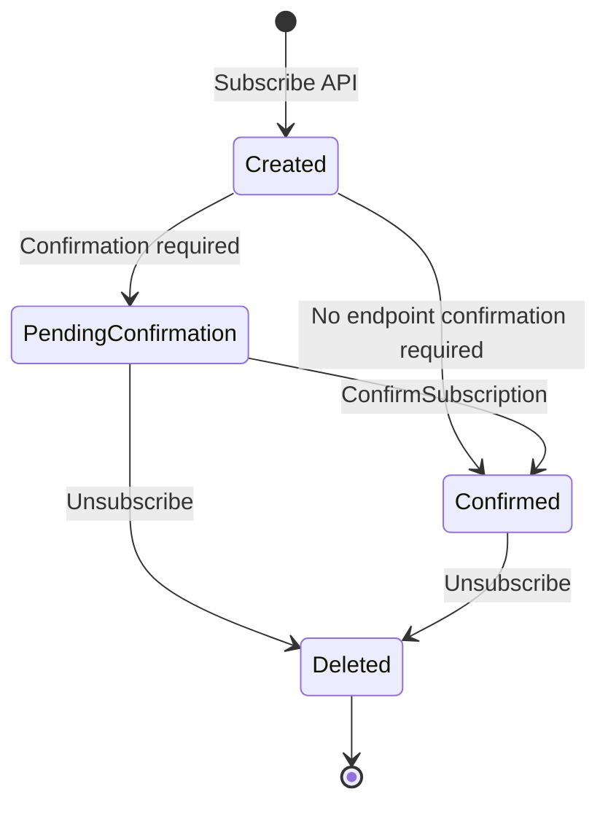
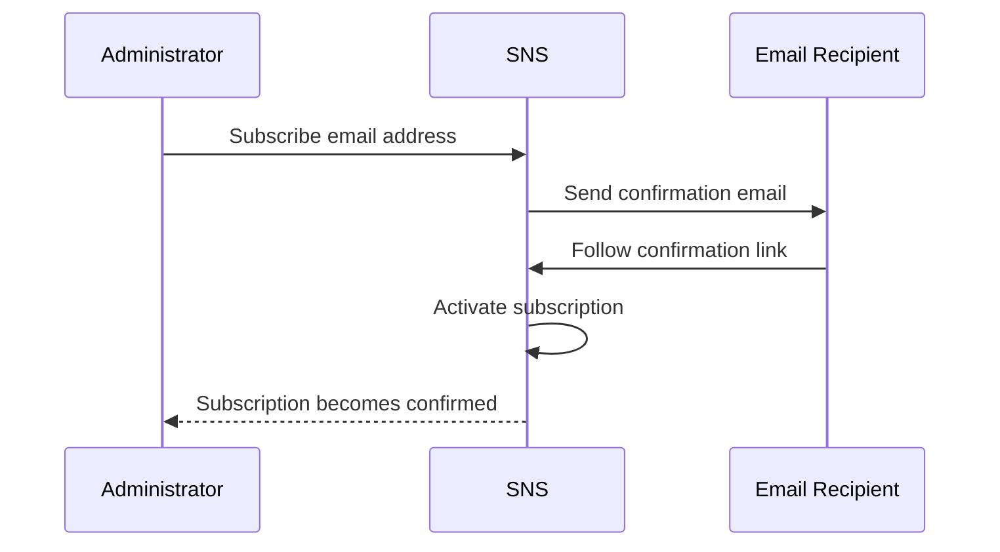
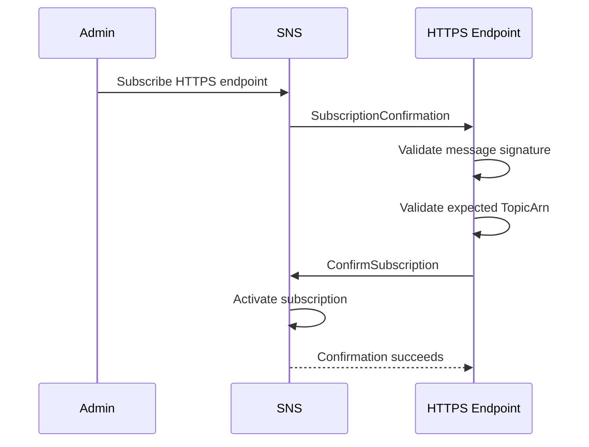
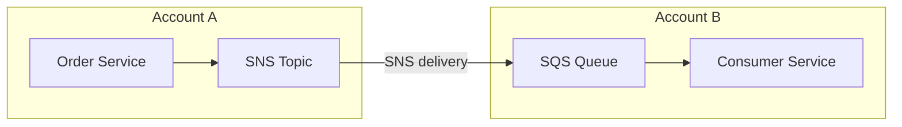
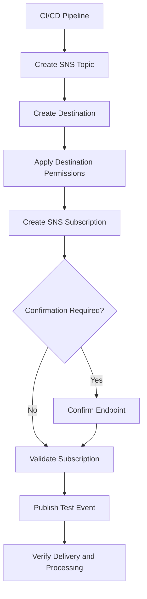

# 08- Subscription Lifecycle and Confirmation

## Overview

An Amazon SNS subscription connects a topic to a destination endpoint. The subscription lifecycle determines whether the endpoint is authorized to receive notifications, how its configuration changes over time, and how it is removed.

Understanding this lifecycle is important when building production event-driven systems because creating a subscription does not always mean that message delivery is immediately active.

Some protocols require endpoint confirmation, while AWS service integrations rely on service-specific permissions and configuration. An unconfirmed subscription can remain pending and silently prevent the expected event flow.

This document covers subscription creation, confirmation, activation, configuration changes, monitoring, and deletion.

## Subscription Lifecycle

An SNS subscription typically moves through the following logical states:

- **Pending confirmation:** The subscription has been created but requires endpoint confirmation.
- **Confirmed:** The endpoint has accepted the subscription and can receive notifications.
- **Deleted:** The subscription has been removed and no longer receives notifications.

Not every protocol uses the same confirmation mechanism. AWS service integrations such as SQS and Lambda generally rely on resource permissions rather than an email-style confirmation workflow.

### Lifecycle Diagram



This diagram represents the logical lifecycle. Actual subscription status and available operations depend on the endpoint protocol.

## Creating an SNS Subscription

A subscription is created using the SNS `Subscribe` API.

The request identifies:

- The SNS topic ARN.
- The subscription protocol.
- The destination endpoint.
- Optional subscription attributes.

### Subscribe API

The following example creates an HTTPS subscription:

```bash
aws sns subscribe \
  --topic-arn arn:aws:sns:ap-south-1:123456789012:order-events \
  --protocol https \
  --notification-endpoint https://api.example.com/webhooks/sns
```

The API returns a subscription ARN when available. For protocols requiring confirmation, the subscription may initially be pending.

### Subscription Creation by Protocol

| Protocol | Endpoint | Confirmation or authorization requirement |
|---|---|---|
| `email` | Email address | Recipient must confirm |
| `email-json` | Email address | Recipient must confirm |
| `http` | HTTP URL | Endpoint must process confirmation |
| `https` | HTTPS URL | Endpoint must process confirmation |
| `sqs` | SQS queue ARN | Queue policy must allow SNS delivery |
| `lambda` | Lambda function ARN | Lambda resource policy must allow SNS invocation |
| `sms` | Phone number | Delivery depends on SMS configuration and service requirements |
| `application` | Platform application endpoint ARN | Endpoint and platform application must be configured |
| `firehose` | Firehose delivery stream ARN | Required IAM permissions and destination configuration must be valid |

The confirmation requirement is protocol-specific. Do not assume every subscription follows the same activation process.

## Pending Confirmation

A subscription enters the pending-confirmation state when SNS requires the destination to explicitly accept the subscription.

This is primarily relevant to email and HTTP/S subscriptions.

Until confirmation is completed, SNS does not deliver normal notifications through that subscription.

### Why Confirmation Exists

Confirmation prevents unauthorized parties from subscribing arbitrary endpoints to topics.

Without confirmation, an attacker could potentially:

- Subscribe another person's email address to unwanted notifications.
- Register an endpoint controlled by someone else.
- Cause an endpoint to receive unsolicited traffic.
- Abuse a topic to send messages to unintended destinations.

Confirmation establishes that the endpoint has accepted the subscription request.

### Email Confirmation

When an email subscription is created, SNS sends a confirmation email to the specified recipient.

The recipient must follow the confirmation link to activate the subscription.

Lifecycle:



If the recipient does not confirm, the subscription remains pending and does not receive normal notifications.

### HTTP/S Confirmation

For HTTP/S subscriptions, SNS sends a confirmation request to the endpoint.

The request contains information required to validate and confirm the subscription, including a confirmation token and subscription URL.

A typical request contains fields such as:

```json
{
  "Type": "SubscriptionConfirmation",
  "MessageId": "example-message-id",
  "Token": "example-confirmation-token",
  "TopicArn": "arn:aws:sns:ap-south-1:123456789012:order-events",
  "Message": "You have chosen to subscribe...",
  "SubscribeURL": "https://sns.ap-south-1.amazonaws.com/?Action=ConfirmSubscription",
  "Timestamp": "2026-11-19T10:00:00.000Z",
  "SignatureVersion": "2",
  "Signature": "example-signature",
  "SigningCertURL": "https://sns.ap-south-1.amazonaws.com/SimpleNotificationService-example.pem"
}
```

The endpoint must validate the confirmation request before accepting it.

### Confirmation Flow



### Confirming a Subscription with AWS CLI

An administrator can confirm a subscription using the topic ARN and confirmation token.

```bash
aws sns confirm-subscription \
  --topic-arn arn:aws:sns:ap-south-1:123456789012:order-events \
  --token "<confirmation-token>"
```

The confirmation token must come from the actual SNS confirmation request.

Avoid copying tokens into source code, configuration files, or permanent logs.

## Implementing HTTP/S Confirmation with FastAPI

A webhook endpoint should distinguish between subscription confirmation and normal notifications.

The application must validate the SNS signature and expected topic before performing either action.

The following example demonstrates the endpoint structure. The signature verification function is intentionally an integration boundary and must be implemented using the documented SNS signature verification procedure before deployment.

```python
import logging

import boto3
from fastapi import FastAPI, HTTPException, Request
from botocore.exceptions import BotoCoreError, ClientError

logger = logging.getLogger(__name__)

app = FastAPI()

sns = boto3.client("sns", region_name="ap-south-1")

EXPECTED_TOPIC_ARN = (
    "arn:aws:sns:ap-south-1:123456789012:order-events"
)


def verify_sns_signature(payload: dict) -> bool:
    """
    Verify the SNS message signature using the official
    SNS signing certificate and canonical message format.

    Implement and test this function before production use.
    """
    raise NotImplementedError("SNS signature verification is required")


@app.post("/webhooks/sns")
async def sns_webhook(request: Request) -> dict:
    try:
        payload = await request.json()
    except ValueError as exc:
        raise HTTPException(
            status_code=400,
            detail="Invalid JSON payload",
        ) from exc

    if not verify_sns_signature(payload):
        raise HTTPException(
            status_code=403,
            detail="Invalid SNS signature",
        )

    if payload.get("TopicArn") != EXPECTED_TOPIC_ARN:
        raise HTTPException(
            status_code=403,
            detail="Unexpected SNS topic",
        )

    message_type = payload.get("Type")

    if message_type == "SubscriptionConfirmation":
        token = payload.get("Token")

        if not token:
            raise HTTPException(
                status_code=400,
                detail="Missing confirmation token",
            )

        try:
            sns.confirm_subscription(
                TopicArn=EXPECTED_TOPIC_ARN,
                Token=token,
            )
        except (BotoCoreError, ClientError):
            logger.exception("SNS subscription confirmation failed")
            raise HTTPException(
                status_code=502,
                detail="Unable to confirm SNS subscription",
            )

        return {"status": "confirmed"}

    if message_type == "Notification":
        message_id = payload.get("MessageId")
        message = payload.get("Message")

        if not message_id or not isinstance(message, str):
            raise HTTPException(
                status_code=400,
                detail="Invalid SNS notification",
            )

        # Persist the notification or enqueue it before returning 2xx.
        logger.info("Received SNS notification: %s", message_id)

        return {"status": "accepted"}

    if message_type == "UnsubscribeConfirmation":
        logger.info("SNS unsubscribe confirmation received")
        return {"status": "accepted"}

    raise HTTPException(
        status_code=400,
        detail="Unsupported SNS message type",
    )
```

### Production Requirements

Before deploying an HTTP/S confirmation endpoint:

- Implement SNS signature verification.
- Validate the expected topic ARN.
- Validate the signing certificate URL against the documented SNS certificate host and HTTPS requirements.
- Avoid blindly following arbitrary `SubscribeURL` values.
- Use an IAM role with permission to confirm only the required subscription workflow.
- Keep confirmation tokens out of logs.
- Return a successful response only after the confirmation operation succeeds.
- Make notification processing idempotent.

For systems that do not need automated endpoint confirmation, an explicitly controlled administrative confirmation workflow can be used.

## Confirming a Subscription Programmatically

Boto3 exposes the `confirm_subscription` operation.

```python
import boto3
from botocore.exceptions import BotoCoreError, ClientError

sns = boto3.client("sns", region_name="ap-south-1")


def confirm_sns_subscription(
    topic_arn: str,
    token: str,
) -> str:
    try:
        response = sns.confirm_subscription(
            TopicArn=topic_arn,
            Token=token,
        )

        return response["SubscriptionArn"]

    except (BotoCoreError, ClientError):
        raise
```

The IAM identity performing this operation must have the required SNS permissions.

The confirmation token should be treated as sensitive, short-lived operational data. Obtain it from a validated SNS confirmation request rather than accepting arbitrary user-supplied tokens.

### AuthenticateConfirmation and AuthenticateOnUnsubscribe

SNS supports subscription attributes that influence confirmation and unsubscribe behavior.

| Attribute | Purpose |
|---|---|
| `AuthenticateOnUnsubscribe` | Controls whether authentication is required when unsubscribing, where applicable |

For subscriptions that support this attribute, setting it to `true` helps prevent unauthorized unsubscribe operations.

Example:

```bash
aws sns set-subscription-attributes \
  --subscription-arn arn:aws:sns:ap-south-1:123456789012:order-events:example-subscription-id \
  --attribute-name AuthenticateOnUnsubscribe \
  --attribute-value true
```

This setting does not replace IAM permissions, topic policies, or endpoint authentication.

## Confirmed Subscriptions

A confirmed subscription is active and eligible to receive notifications published to its topic, subject to filtering, permissions, endpoint availability, and delivery configuration.

Confirmation does not guarantee successful delivery or successful business processing.

For example, an HTTPS subscription can be confirmed but later fail because:

- The endpoint is unavailable.
- DNS resolution fails.
- TLS negotiation fails.
- The endpoint returns an unsuccessful HTTP response.
- The application rejects the request.
- The endpoint is throttled.

Similarly, an SQS subscription can be configured but fail to deliver if the queue policy does not authorize SNS.

### Checking Subscription State

Use `list-subscriptions-by-topic` to inspect subscriptions associated with a topic.

```bash
aws sns list-subscriptions-by-topic \
  --topic-arn arn:aws:sns:ap-south-1:123456789012:order-events
```

Example output:

```json
{
  "Subscriptions": [
    {
      "SubscriptionArn": "PendingConfirmation",
      "Owner": "123456789012",
      "Protocol": "https",
      "Endpoint": "https://api.example.com/webhooks/sns",
      "TopicArn": "arn:aws:sns:ap-south-1:123456789012:order-events"
    },
    {
      "SubscriptionArn": "arn:aws:sns:ap-south-1:123456789012:order-events:example-subscription-id",
      "Owner": "123456789012",
      "Protocol": "sqs",
      "Endpoint": "arn:aws:sqs:ap-south-1:123456789012:inventory-queue",
      "TopicArn": "arn:aws:sns:ap-south-1:123456789012:order-events"
    }
  ]
}
```

A subscription ARN of `PendingConfirmation` indicates that confirmation has not been completed.

### Retrieving Subscription Attributes

Use `get-subscription-attributes` to inspect the configuration of an existing subscription.

```bash
aws sns get-subscription-attributes \
  --subscription-arn arn:aws:sns:ap-south-1:123456789012:order-events:example-subscription-id
```

The response can include:

- Protocol.
- Endpoint.
- Topic ARN.
- Raw message delivery setting.
- Filter policy.
- Filter policy scope.
- Delivery policy.
- Redrive policy.
- Owner.
- Confirmation-related attributes where applicable.

Use the subscription ARN to inspect an individual confirmed subscription.

## Subscription Configuration Changes

After confirmation, subscription attributes can be modified without deleting and recreating the subscription, provided the attribute is supported by the protocol.

Common configuration changes include:

- Enabling raw message delivery.
- Updating message filter policies.
- Changing filter policy scope.
- Configuring delivery policies.
- Configuring a subscription dead-letter queue.

### Updating Filter Policy

A filter policy determines which messages SNS delivers to a subscription.

Example:

```bash
aws sns set-subscription-attributes \
  --subscription-arn arn:aws:sns:ap-south-1:123456789012:order-events:example-subscription-id \
  --attribute-name FilterPolicy \
  --attribute-value '{"event_type":["OrderCreated","OrderUpdated"]}'
```

The policy can be updated as application routing requirements change.

Filter policy changes can take time to propagate. Do not assume a newly applied policy immediately affects every notification.

### Updating Raw Message Delivery

```bash
aws sns set-subscription-attributes \
  --subscription-arn arn:aws:sns:ap-south-1:123456789012:order-events:example-subscription-id \
  --attribute-name RawMessageDelivery \
  --attribute-value true
```

Changing raw message delivery changes the payload structure received by supported endpoints.

Treat this as a consumer-facing contract change. Update and test consumers before enabling it in production.

### Configuration Management

Use infrastructure-as-code to manage subscription configuration.

For example, Terraform can manage an SNS subscription:

```hcl
resource "aws_sns_topic_subscription" "inventory" {
  topic_arn = aws_sns_topic.order_events.arn
  protocol  = "sqs"
  endpoint  = aws_sqs_queue.inventory.arn

  raw_message_delivery = true

  filter_policy = jsonencode({
    event_type = [
      "OrderCreated",
      "OrderUpdated"
    ]
  })
}
```

The corresponding SQS queue policy must also authorize SNS to send messages.

Avoid making manual changes to infrastructure-managed subscriptions unless the changes are reconciled with the Terraform configuration. Otherwise, subsequent deployments may overwrite the manual configuration.

## Unsubscribing and Deleting Subscriptions

A subscription can be removed using the `Unsubscribe` API.

After removal, SNS stops delivering new notifications through that subscription.

### Unsubscribe with AWS CLI

```bash
aws sns unsubscribe \
  --subscription-arn arn:aws:sns:ap-south-1:123456789012:order-events:example-subscription-id
```

### Unsubscribe with Boto3

```python
import boto3
from botocore.exceptions import BotoCoreError, ClientError

sns = boto3.client("sns", region_name="ap-south-1")


def unsubscribe(subscription_arn: str) -> None:
    try:
        sns.unsubscribe(
            SubscriptionArn=subscription_arn,
        )

    except (BotoCoreError, ClientError):
        raise
```

The caller must have the required permissions. Some subscriptions also have authentication requirements for unsubscribe operations.

### Deletion Considerations

Before deleting a production subscription:

- Confirm that no active service depends on it.
- Check whether another subscription should replace it.
- Review queued messages in downstream SQS queues.
- Confirm whether the destination has independent processing obligations.
- Update infrastructure-as-code.
- Record the change for operational traceability.

Deleting an SNS subscription does not automatically delete the destination SQS queue, Lambda function, email address, or HTTP endpoint.

It also does not remove messages that were already delivered to an SQS queue.

## Cross-Account Subscription Lifecycle

SNS topics can support subscriptions from other AWS accounts when the required permissions and resource policies are configured.

Cross-account integrations require coordination between the topic-owning account and the destination-owning account.

### Example Architecture



The topic owner must authorize the relevant subscription operation through the topic policy.

The destination queue must authorize SNS delivery from the expected topic.

### Security Requirements

- Restrict topic policies to known AWS accounts and principals.
- Restrict queue policies to the exact topic ARN.
- Use explicit resource ARNs.
- Avoid broad cross-account permissions.
- Ensure KMS key policies permit the required service interactions.
- Coordinate subscription creation and confirmation where applicable.

Cross-account subscription setup should be tested using the actual IAM identities and resource policies used in deployment.

## Subscription Lifecycle in CI/CD

Subscription management is part of infrastructure deployment and should be automated consistently.

A typical deployment sequence is:



### Deployment Recommendations

- Create destination resources before subscriptions.
- Apply SQS queue policies before testing SNS delivery.
- Add Lambda invocation permissions before relying on SNS-to-Lambda delivery.
- Automate confirmation only through a validated endpoint workflow.
- Treat pending confirmation as a deployment condition requiring attention.
- Verify the subscription configuration after deployment.
- Publish a controlled test event.
- Verify destination receipt and application processing.
- Keep infrastructure changes version-controlled.

For email subscriptions, confirmation may require a human action. Account for this in deployment procedures rather than treating it as an automatic infrastructure operation.

## Monitoring and Troubleshooting

Subscription lifecycle failures can prevent event delivery even when publishers successfully publish messages.

Monitor both subscription state and delivery outcomes.

### Common Problems

| Symptom | Possible cause | Recommended action |
|---|---|---|
| Subscription remains pending | Endpoint has not confirmed | Complete confirmation |
| Email notifications are not received | Recipient has not confirmed or email filtering is involved | Verify subscription state and recipient mailbox |
| HTTPS endpoint receives no notifications | Subscription is pending or endpoint is unreachable | Inspect subscription state and delivery failures |
| SNS cannot send to SQS | Queue policy is missing or incorrect | Allow `sns.amazonaws.com` with the exact topic ARN condition |
| SNS cannot invoke Lambda | Lambda resource permission is missing | Add the SNS invocation permission |
| Subscription exists but messages are filtered | Filter policy excludes the message | Inspect filter policy and message attributes |
| Consumer receives an unexpected payload | Raw message delivery configuration changed | Inspect subscription attributes |
| Unsubscribe operation fails | Missing permissions or authentication requirements | Verify IAM permissions and subscription attributes |
| Subscription disappears after deployment | Infrastructure configuration changed | Review Terraform plans and deployment history |

### CloudWatch Monitoring

Monitor SNS delivery metrics, including:

| Metric | Operational purpose |
|---|---|
| `NumberOfMessagesPublished` | Confirms SNS accepted published messages |
| `NumberOfNotificationsDelivered` | Tracks successful notification deliveries |
| `NumberOfNotificationsFailed` | Identifies delivery failures |
| `NumberOfNotificationsFilteredOut` | Helps explain messages excluded by filtering |

Metrics and dimensions vary by protocol and configuration.

For HTTP/S endpoints, also monitor:

- Endpoint availability.
- Request latency.
- HTTP response codes.
- TLS failures.
- Application error rates.

For SQS destinations, monitor queue depth and oldest-message age. For Lambda destinations, monitor invocation errors and throttling.

### Operational Alerts

Create alerts for conditions such as:

- Unexpected pending subscriptions.
- Sustained SNS delivery failures.
- Sudden drops in delivered notifications.
- Unexpected subscription deletion.
- Growing SQS backlog.
- Lambda invocation failures.

A pending subscription alert is especially useful for automated deployments that create HTTP/S subscriptions.

## Security Best Practices

Subscription lifecycle operations can affect who receives application events and where data is delivered.

Apply the following controls:

- Restrict `sns:Subscribe`, `sns:ConfirmSubscription`, and `sns:Unsubscribe` permissions.
- Use topic policies to control which principals can subscribe.
- Validate HTTP/S signatures before processing confirmation or notification messages.
- Verify the expected topic ARN.
- Protect confirmation tokens and subscription URLs.
- Use HTTPS for webhook endpoints.
- Restrict SQS queue policies to expected topic ARNs.
- Restrict Lambda invocation permissions to expected topic ARNs.
- Encrypt SNS topics and destination resources where required.
- Audit subscription creation, modification, and deletion.

Do not expose unrestricted subscription management APIs to application users.

## Common Mistakes and Production Pitfalls

| Mistake | Impact | Prevention |
|---|---|---|
| Assuming subscription creation means activation | Messages are not delivered while confirmation is pending | Inspect subscription state |
| Ignoring confirmation emails | Email subscriptions remain inactive | Include confirmation in operational procedures |
| Automatically trusting `SubscribeURL` | Can create an unsafe URL-following workflow | Validate signature, host, and topic before confirmation |
| Confirming arbitrary tokens | Unauthorized subscription activation may occur | Accept confirmation only from validated SNS requests |
| Treating all protocols identically | Permission and confirmation requirements differ | Follow protocol-specific lifecycle behavior |
| Deleting a subscription without checking consumers | A downstream service stops receiving new events | Review dependencies before deletion |
| Changing raw delivery without testing | Consumers may fail to parse messages | Treat payload changes as contract changes |
| Manually changing Terraform-managed subscriptions | Infrastructure drift occurs | Update the source configuration |
| Ignoring pending subscriptions in CI/CD | Deployments appear successful while integrations remain inactive | Add lifecycle validation |
| Assuming successful publication proves processing | Delivery and business processing are separate | Monitor destination-side outcomes |

## Key Takeaways

- SNS subscriptions can require endpoint confirmation before becoming active; the lifecycle depends on the subscription protocol.
- Email and HTTP/S subscriptions use explicit confirmation, while AWS service integrations generally rely on resource permissions and destination configuration.
- Validate SNS signatures, topic ARNs, and confirmation requests before activating HTTP/S subscriptions.
- Manage subscription attributes and lifecycle through infrastructure-as-code, and verify configuration after deployment.
- Monitor subscription state and delivery outcomes separately from publisher success and downstream business processing.