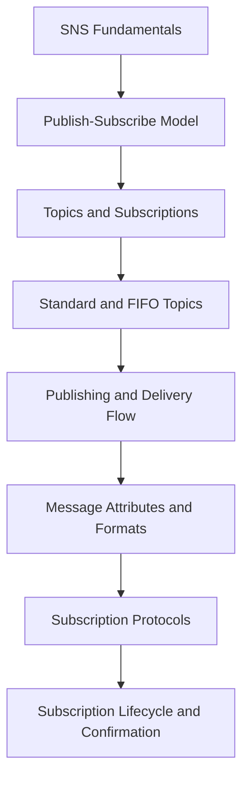
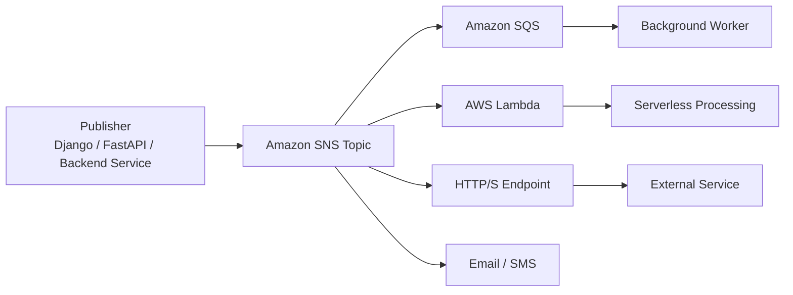
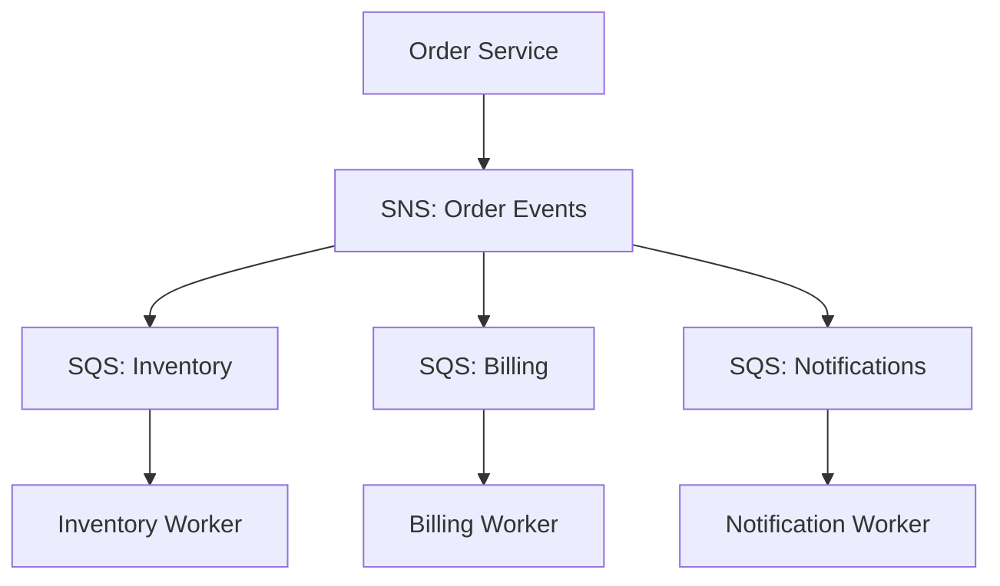

# README

## Overview

Amazon Simple Notification Service (Amazon SNS) is a fully managed publish-subscribe messaging service used to distribute messages from publishers to multiple subscribers. It enables event-driven architectures by decoupling message producers from downstream consumers.

This directory covers Amazon SNS from its core messaging model through subscription configuration, delivery behavior, message formats, and operational considerations.

SNS is commonly used to:
- Broadcast domain events to multiple microservices.
- Trigger asynchronous processing through SQS queues and Lambda functions.
- Distribute notifications through HTTP/S endpoints, email, SMS, and mobile push.
- Integrate AWS services through event-driven workflows.
- Implement fan-out architectures without requiring publishers to manage individual consumers.

## Documentation Structure

| File | Topic | Description |
|---|---|---|
| [01- Introduction to Amazon SNS.md](./01-%20Introduction%20to%20Amazon%20SNS.md) | SNS Fundamentals | Introduces Amazon SNS, its purpose, architecture, capabilities, and common backend use cases. |
| [02- Publish-Subscribe Messaging Model.md](./02-%20Publish-Subscribe%20Messaging%20Model.md) | Messaging Model | Explains publishers, topics, subscribers, message distribution, and publisher-consumer decoupling. |
| [03- Topics and Subscriptions.md](./03-%20Topics%20and%20Subscriptions.md) | Topics and Subscriptions | Covers topic creation, subscription management, endpoint configuration, and subscription relationships. |
| [04- Standard Topics and FIFO Topics.md](./04-%20Standard%20Topics%20and%20FIFO%20Topics.md) | Topic Types | Compares Standard and FIFO topics, including ordering, deduplication, throughput, and delivery semantics. |
| [05- Message Publishing and Delivery Flow.md](./05-%20Message%20Publishing%20and%20Delivery%20Flow.md) | Publishing and Delivery | Explains message publication, SNS delivery workflows, acknowledgments, retries, and subscriber behavior. |
| [06- Message Attributes and Message Formats.md](./06-%20Message%20Attributes%20and%20Message%20Formats.md) | Message Structure | Covers message attributes, structured messages, protocol-specific payloads, raw delivery, and filtering metadata. |
| [07- Subscription Protocols.md](./07-%20Subscription%20Protocols.md) | Subscription Protocols | Explains supported endpoint protocols, including SQS, Lambda, HTTP/S, email, SMS, mobile push, and Firehose. |
| [08- Subscription Lifecycle and Confirmation.md](./08-%20Subscription%20Lifecycle%20and%20Confirmation.md) | Subscription Lifecycle | Covers subscription creation, endpoint confirmation, pending subscriptions, lifecycle management, and cleanup. |

## Learning Path

Follow the documentation in sequence to understand SNS architecture and its implementation.

The sequence moves from the core publish-subscribe model to practical subscription management and message delivery behavior.

## Core Architecture

SNS uses topics as logical distribution points. Publishers send messages to topics, and SNS delivers those messages to subscribed endpoints.

A publisher does not need to know how many subscribers exist or how each subscriber processes messages. SNS manages topic-based distribution, while each subscriber handles its own downstream processing.

## Key Concepts

| Concept | Description |
|---|---|
| Publisher | Application or AWS service that publishes messages to an SNS topic. |
| Topic | Logical communication channel used to distribute messages to subscribers. |
| Subscription | Association between a topic and a subscriber endpoint. |
| Subscriber | Endpoint that receives messages published to a topic. |
| Message Attribute | Metadata attached to a message, commonly used for filtering and routing. |
| Message Filter Policy | Rules that determine which messages a subscription receives. |
| Standard Topic | Topic type optimized for high-throughput message delivery with best-effort ordering. |
| FIFO Topic | Topic type that supports message ordering and deduplication within defined boundaries. |
| Dead-Letter Queue | SQS queue used to isolate messages that cannot be successfully delivered to supported subscribers. |
| Raw Message Delivery | Subscription configuration that removes the SNS notification envelope for supported endpoints. |

## Common Backend Integration Patterns

### SNS to SQS Fan-Out

Use SNS to distribute an event to multiple SQS queues. Each downstream service processes its own copy independently.

Typical use cases:
- Order creation and fulfillment.
- Payment processing notifications.
- Customer notification workflows.
- Audit and analytics event distribution.

### SNS to Lambda

SNS can invoke Lambda functions asynchronously for supported topic types. This is useful for lightweight event processing where a separate queue-based consumer is unnecessary.

For FIFO topics, use an SQS FIFO subscription and consume from the queue through a Lambda event source mapping.

### SNS to HTTP/S

SNS can deliver notifications to HTTP/S endpoints. The receiving service must implement subscription confirmation and message handling correctly.

For production webhook integrations:
- Validate SNS message signatures.
- Handle subscription confirmation securely.
- Make handlers idempotent.
- Return successful responses only after the required durable acceptance step.
- Account for retries and duplicate deliveries.

## Production Considerations

### Reliability and Delivery Semantics

SNS delivery behavior depends on the topic type and subscriber protocol.

- Standard topics provide high-throughput delivery with at-least-once behavior for supported delivery paths; duplicates are possible.
- FIFO topics provide ordering within message groups and deduplication within a five-minute interval.
- A successful `Publish` response confirms SNS accepted the publication, not that every subscriber completed its business operation.
- Subscriber processing should be idempotent.
- Configure delivery retries and dead-letter queues where supported.
- Monitor failed deliveries and subscription health.

### Security

Apply least-privilege access controls across publishers, topics, and subscribers.

- Use IAM policies to restrict who can publish and manage subscriptions.
- Use topic resource policies for controlled cross-account access.
- Restrict subscriptions and delivery permissions to trusted endpoints.
- Require HTTPS for HTTP-based integrations.
- Validate SNS signatures before trusting HTTP/S notifications.
- Encrypt messages at rest using SNS server-side encryption where applicable.
- Review KMS key policies and permissions when using customer-managed keys.
- Avoid placing credentials, access tokens, or unnecessary personal data in message bodies and attributes.

### Scalability

SNS is designed for managed message distribution, but downstream capacity still determines the effective throughput of the complete system.

- Scale SQS consumers independently for each subscriber.
- Use multiple message groups when designing high-throughput FIFO workloads.
- Avoid concentrating all FIFO traffic into one message group unless strict global ordering is required.
- Use subscription filtering to reduce unnecessary downstream traffic.
- Keep message payloads compact.
- Offload large payloads to S3 and publish references when appropriate.

### Monitoring and Operations

Monitor both SNS delivery behavior and downstream processing.

| Area | Operational Focus |
|---|---|
| Publishing | Publication success, failures, and application-level publish latency. |
| Delivery | Delivery attempts, failed deliveries, and endpoint availability. |
| Subscriptions | Pending confirmations, deleted endpoints, and subscription configuration. |
| SQS Subscribers | Queue depth, oldest message age, visibility timeout, and DLQ depth. |
| Lambda Subscribers | Invocation errors, throttling, duration, and asynchronous failure handling. |
| Cost | Published messages, delivery volume, SMS usage, and downstream service consumption. |

Use CloudWatch metrics, CloudWatch alarms, structured application logs, and distributed tracing where supported. Include stable event identifiers in logs to correlate publication and downstream processing.

## Repository Conventions

Keep documentation organized by topic and preserve the numbered filename sequence.

When adding a new SNS document:

1. Place it in this directory.
2. Use the next available numeric filename prefix.
3. Update this README with the filename, topic, and description.
4. Keep links relative to this directory.
5. Maintain the same technical documentation style used by the existing files.

## Key Takeaways

- SNS provides topic-based message distribution and decouples publishers from subscribers.
- SNS-to-SQS fan-out is a common pattern for independently scaling multiple backend consumers.
- Standard and FIFO topics have different ordering, throughput, and deduplication characteristics.
- Production subscribers must account for retries, duplicate deliveries, idempotency, security, and observability.
- SNS acceptance of a published message does not guarantee successful completion of downstream business processing.