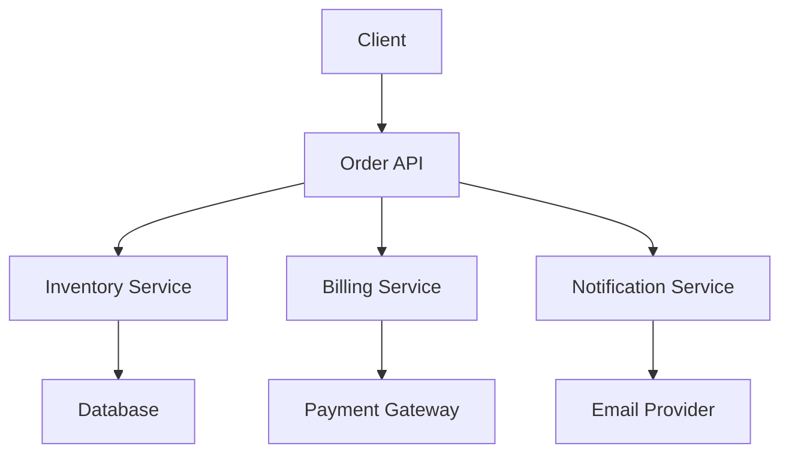
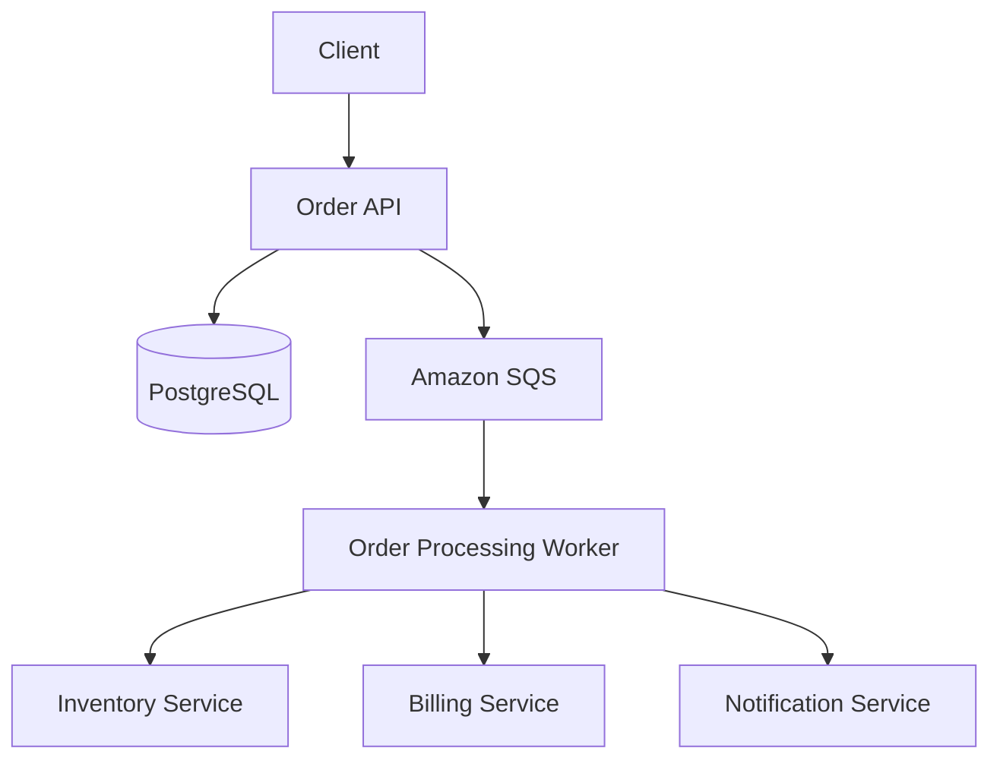
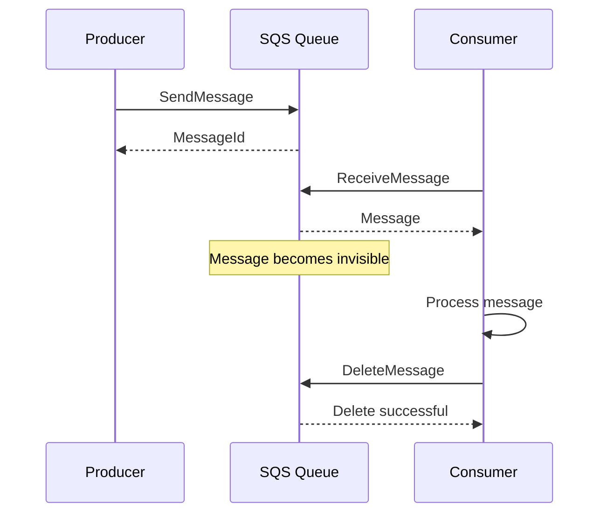
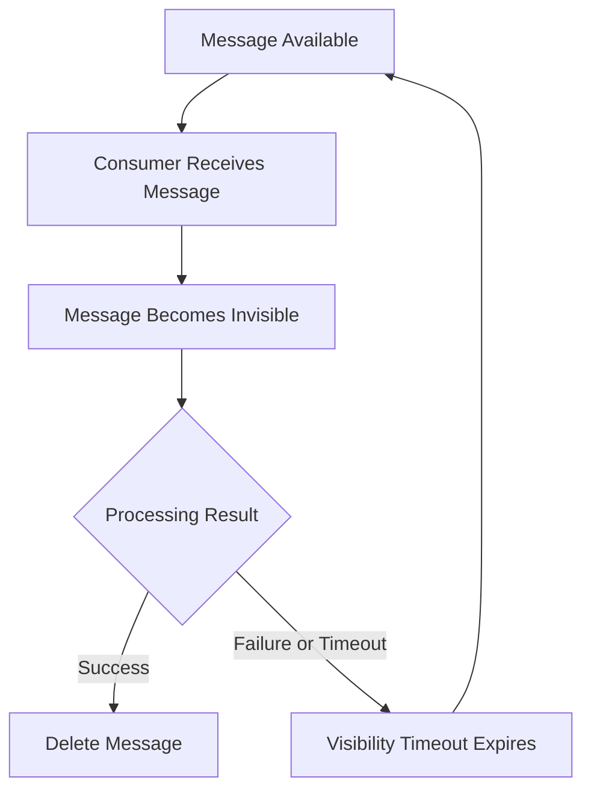
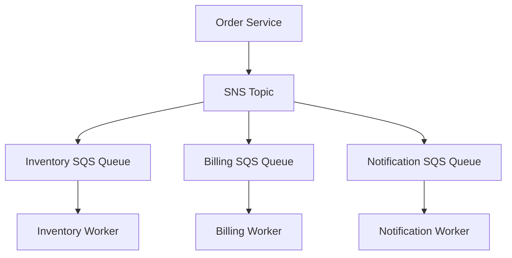
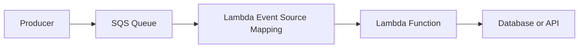
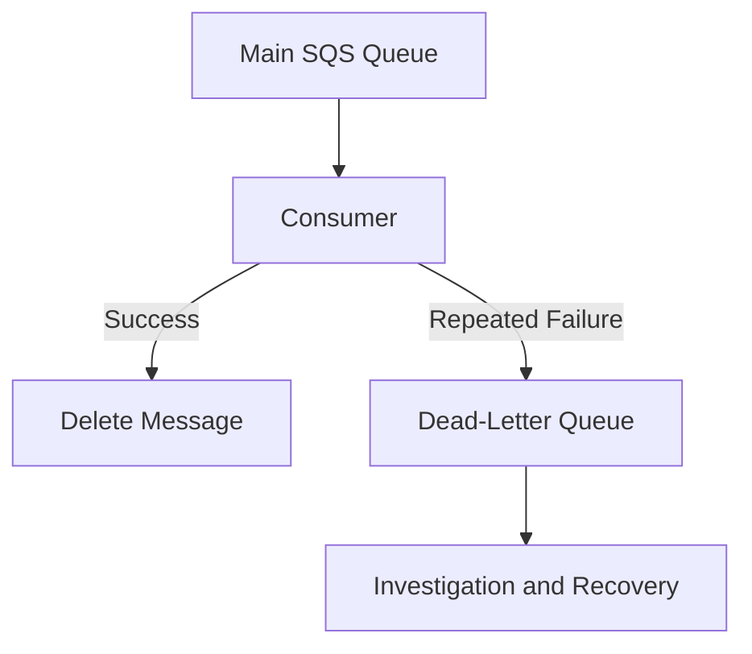
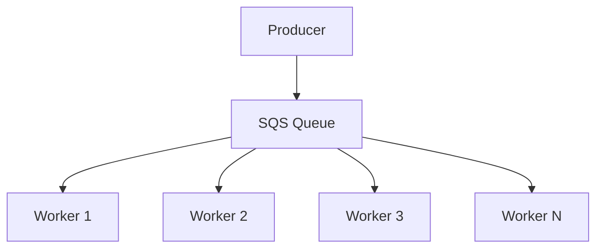

# 01- Introduction to Amazon SQS

## Overview

Amazon Simple Queue Service (SQS) is a fully managed message queuing service that enables asynchronous communication between distributed application components.

It allows producers to send messages to a queue and consumers to retrieve and process those messages independently. Producers do not need to know when consumers are available, how many consumers exist, or how long processing takes.

SQS acts as a durable communication boundary between services, helping backend systems handle traffic spikes, isolate failures, and scale individual components independently.

In modern backend architectures, SQS is commonly used for:

- Asynchronous background processing.
- Decoupling microservices.
- Distributed task execution.
- Event-driven application workflows.
- Workload buffering and backpressure management.
- Reliable integration between AWS services.
- Processing jobs using Python workers, Celery-compatible architectures, and Lambda.

## Why Amazon SQS Exists

In a synchronous architecture, one service directly invokes another service and waits for its response.

For example, an e-commerce API might synchronously call inventory, billing, and notification services when an order is created.



This architecture introduces several problems:

- The API response depends on every downstream service.
- A slow dependency increases overall request latency.
- A downstream outage can cause the entire workflow to fail.
- Traffic spikes propagate across services.
- Scaling one component independently becomes difficult.
- Long-running operations consume application server resources.

SQS introduces asynchronous communication between producers and consumers.

Instead of executing background work immediately, the producer publishes a message to a queue. Consumers retrieve messages when they have available processing capacity.



The API can acknowledge the request after the order and its processing request have been safely recorded.

Downstream processing happens independently.

## Core Components

An SQS-based architecture contains several important components.

### Producer

A producer is an application or AWS service that sends messages to an SQS queue.

Examples include:

- Django REST Framework APIs.
- FastAPI applications.
- Python background-job publishers.
- AWS Lambda functions.
- Amazon EventBridge rules.
- Other AWS services and applications using the SQS API.

A producer does not need to know which consumer processes the message.

### Queue

A queue stores messages until consumers retrieve and process them or until their retention period expires.

Each queue has configuration that controls behavior such as:

- Message retention.
- Visibility timeout.
- Delivery delay.
- Long polling.
- Maximum message size.
- Dead-letter queue handling.

### Consumer

A consumer retrieves messages from a queue and performs the associated business operation.

Examples include:

- Python worker processes.
- Django management commands.
- FastAPI background worker services.
- AWS Lambda functions.
- Containerized workers running on Amazon ECS or Kubernetes.

Consumers control their polling and processing behavior.

### Message

A message contains the data that the producer wants the consumer to process.

Example:

```json
{
  "event_id": "evt-10001",
  "event_type": "OrderCreated",
  "occurred_at": "2026-11-19T10:30:00Z",
  "data": {
    "order_id": "ORD-1001",
    "customer_id": "CUS-501",
    "total_amount": 2499.00,
    "currency": "INR"
  }
}
```

A message should contain enough information for the consumer to identify and process the event.

Avoid placing large database records, secrets, or unnecessary personal information inside messages.

## How Amazon SQS Works

SQS follows a producer-consumer model.

The producer sends a message to a queue. SQS stores it until a consumer receives it. The consumer processes the message and deletes it after successful processing.



The message lifecycle consists of several stages.

### Message Publishing

The producer sends a message using the `SendMessage` API.

```python
import json
import boto3

sqs = boto3.client("sqs", region_name="ap-south-1")

QUEUE_URL = "https://sqs.ap-south-1.amazonaws.com/123456789012/order-queue"

message = {
    "event_id": "evt-10001",
    "event_type": "OrderCreated",
    "order_id": "ORD-1001",
}

response = sqs.send_message(
    QueueUrl=QUEUE_URL,
    MessageBody=json.dumps(message),
)

print(response["MessageId"])
```

After successful acceptance, SQS returns a message ID.

This confirms that SQS accepted the message. It does not mean that a consumer has processed the business operation.

### Message Storage

SQS stores messages until they are received and deleted, expire, or are otherwise removed according to queue behavior.

Messages are retained for a configurable period.

The default retention period is four days, and the maximum is fourteen days.

A message can remain in the queue even when no consumers are running.

### Message Retrieval

Consumers retrieve messages using the `ReceiveMessage` API.

```python
response = sqs.receive_message(
    QueueUrl=QUEUE_URL,
    MaxNumberOfMessages=10,
    WaitTimeSeconds=20,
)
```

The consumer receives up to the requested number of messages, subject to queue availability and service limits.

SQS does not push messages directly into an ordinary polling worker. The consumer requests messages from the queue.

Lambda event source mappings provide a managed polling integration for SQS-triggered Lambda functions.

### Visibility Timeout

When a consumer receives a message, SQS makes that message temporarily invisible to other consumers.

This period is called the visibility timeout.

It prevents multiple consumers from processing the same message simultaneously under normal conditions.



If the consumer does not delete the message before the visibility timeout expires, the message becomes available again.

This enables redelivery when a consumer crashes or fails to complete processing.

The visibility timeout does not guarantee that a message can never be delivered to multiple consumers. SQS Standard queues provide at-least-once delivery, so consumers must handle duplicates.

### Message Deletion

After successful processing, the consumer must delete the message using its receipt handle.

```python
sqs.delete_message(
    QueueUrl=QUEUE_URL,
    ReceiptHandle=message["ReceiptHandle"],
)
```

A receipt handle is returned when a message is received. It identifies that particular receive operation.

Use the latest receipt handle for deletion. A receipt handle from an earlier receive operation may no longer be valid for the current delivery.

Deleting a message is an explicit acknowledgement that the consumer has completed its processing responsibility.

## Queue Types

Amazon SQS provides two primary queue types:

- Standard queues.
- FIFO queues.

They have different ordering, throughput, and deduplication characteristics.

### Standard Queue

A Standard queue is designed for high-throughput message processing and distributed workloads.

Characteristics:

- Nearly unlimited API-level throughput, subject to service quotas and account or regional constraints.
- At-least-once message delivery.
- Best-effort message ordering.
- Possible duplicate deliveries.
- High scalability.

Use Standard queues when throughput and horizontal scalability are more important than strict ordering.

Typical use cases:

- Image processing.
- Email delivery.
- Background report generation.
- Independent order-related tasks.
- Large-scale data processing.

### FIFO Queue

FIFO stands for First-In, First-Out.

FIFO queues provide ordering within a message group and support deduplication within a five-minute deduplication interval.

Characteristics:

- Ordered processing within a message group.
- Exactly-once processing of accepted sends within the deduplication interval, subject to the service's deduplication behavior.
- Message group-based concurrency.
- Lower throughput constraints than Standard queues unless supported high-throughput FIFO configuration is enabled.

FIFO does not provide exactly-once business processing. Consumers can still receive a message again after visibility timeout expiration or processing failures.

Use FIFO queues when ordering is a business requirement.

Typical use cases:

- Account balance updates.
- Inventory state transitions.
- Sequential order processing.
- Workflows where operations for one entity must remain ordered.

### Standard vs FIFO

| Feature | Standard Queue | FIFO Queue |
|---|---|---|
| Ordering | Best effort | Strict within a message group |
| Delivery | At least once | At least once to consumers |
| Send deduplication | No built-in FIFO deduplication | Five-minute deduplication interval |
| Throughput | Very high | Depends on FIFO throughput configuration |
| Message groups | Not supported | Supported |
| Duplicate delivery | Possible | Possible during consumer processing |
| Typical use | High-volume independent tasks | Ordered business operations |
| Queue name | No `.fifo` suffix | Must end with `.fifo` |

Choose FIFO only when ordering or send deduplication is required. Do not use it as a general replacement for Standard queues.

## Message Attributes

SQS messages can contain custom message attributes in addition to the message body.

Attributes provide metadata that consumers can inspect without parsing the complete message body.

Example:

```python
import json
import boto3

sqs = boto3.client("sqs", region_name="ap-south-1")

response = sqs.send_message(
    QueueUrl=QUEUE_URL,
    MessageBody=json.dumps({
        "event_id": "evt-10001",
        "order_id": "ORD-1001",
    }),
    MessageAttributes={
        "event_type": {
            "DataType": "String",
            "StringValue": "OrderCreated",
        },
        "priority": {
            "DataType": "Number",
            "StringValue": "1",
        },
    },
)
```

Common message attribute data types include:

- `String`
- `Number`
- `Binary`
- Custom data type labels using supported prefixes and formats.

Use attributes for routing and metadata, not as a replacement for a well-defined message schema.

## SQS and SNS Integration

SNS and SQS are frequently combined to distribute events to multiple independent consumers.

SNS provides publish-subscribe fanout, while SQS provides durable buffering and asynchronous consumption.

### Architecture



Each queue receives its own copy of the published notification.

This allows services to:

- Process independently.
- Scale at different rates.
- Retry failures separately.
- Maintain separate dead-letter queues.
- Avoid direct dependencies between consumers.

A shared SQS queue does not provide fanout to every consumer. Multiple workers polling the same queue compete for messages.

For independent subscribers, create a separate queue for each consumer.

## SQS and Lambda Integration

SQS can trigger AWS Lambda through an event source mapping.

Lambda polls the queue and invokes the function with batches of messages.



This integration is useful for event-driven processing without maintaining worker infrastructure.

Important considerations:

- Configure batch size appropriately.
- Set visibility timeout in relation to Lambda execution time.
- Configure a queue redrive policy.
- Use partial batch responses when appropriate.
- Make processing idempotent.
- Monitor queue age and Lambda errors.

A failed batch can cause messages to be retried. Partial batch response support helps avoid retrying successfully processed records when only some messages fail.

## Practical Python Consumer

A production-oriented worker should use long polling, process messages safely, and delete them only after successful business processing.

```python
import json
import logging
import os

import boto3
from botocore.exceptions import BotoCoreError, ClientError

logger = logging.getLogger(__name__)
logging.basicConfig(level=logging.INFO)

sqs = boto3.client("sqs", region_name=os.getenv("AWS_REGION", "ap-south-1"))

QUEUE_URL = os.environ["SQS_QUEUE_URL"]


def process_order_event(event: dict) -> None:
    event_id = event.get("event_id")
    order_id = event.get("order_id")

    if not event_id or not order_id:
        raise ValueError("Invalid order event")

    logger.info(
        "Processing order event",
        extra={
            "event_id": event_id,
            "order_id": order_id,
        },
    )

    # Execute idempotent business processing here.


def poll_queue() -> None:
    while True:
        try:
            response = sqs.receive_message(
                QueueUrl=QUEUE_URL,
                MaxNumberOfMessages=10,
                WaitTimeSeconds=20,
                VisibilityTimeout=60,
                AttributeNames=["ApproximateReceiveCount"],
            )

            for message in response.get("Messages", []):
                try:
                    event = json.loads(message["Body"])
                    process_order_event(event)

                    sqs.delete_message(
                        QueueUrl=QUEUE_URL,
                        ReceiptHandle=message["ReceiptHandle"],
                    )

                except (json.JSONDecodeError, ValueError):
                    logger.exception("Invalid SQS message")

                except Exception:
                    logger.exception("Message processing failed")

        except (BotoCoreError, ClientError):
            logger.exception("SQS polling failed")
            raise


if __name__ == "__main__":
    poll_queue()
```

This is a basic polling structure. Production workers should also implement:

- Controlled retry and process shutdown behavior.
- Visibility timeout extension for long-running tasks.
- Idempotent business operations.
- Dead-letter queue configuration.
- Structured logging and metrics.
- Graceful handling of termination signals.
- Bounded concurrency and downstream rate limits.

A message that repeatedly fails should eventually be handled through a configured redrive policy rather than being retried indefinitely.

## Reliability and Delivery Semantics

SQS provides reliable message storage and delivery, but consumers must still account for failures.

### At-Least-Once Delivery

Standard queues provide at-least-once delivery.

A message can be delivered more than once because of distributed processing behavior or a failure during acknowledgement.

For example:

1. A worker receives a message.
2. The worker successfully updates PostgreSQL.
3. The worker crashes before deleting the SQS message.
4. The visibility timeout expires.
5. Another worker receives the same message.
6. The business operation may execute again.

This is why idempotency is essential.

### Idempotent Processing

An idempotent operation produces the same business outcome when executed multiple times with the same event.

A common approach is to store processed event IDs in PostgreSQL.

```sql
CREATE TABLE processed_events (
    event_id UUID PRIMARY KEY,
    processed_at TIMESTAMPTZ NOT NULL DEFAULT NOW()
);
```

The consumer should claim an event and apply its business changes within an appropriate transaction boundary.

For external side effects, such as payment processing, use the downstream provider's idempotency mechanism when available.

### Dead-Letter Queues

A dead-letter queue (DLQ) stores messages that repeatedly fail processing after reaching the configured maximum receive count.

It prevents problematic messages from continuously blocking normal processing.



A DLQ is useful for:

- Invalid message formats.
- Persistent downstream failures.
- Business validation errors.
- Unexpected application defects.
- Messages that require manual investigation.

DLQ messages should be monitored and replayed only after the underlying failure is understood.

## Visibility Timeout and Message Retention

These settings control how long messages remain available and how redelivery behaves.

| Setting | Purpose | Important consideration |
|---|---|---|
| Visibility timeout | Hides a received message temporarily | Must accommodate processing duration |
| Message retention | Maximum time a message remains in the queue | Default four days, maximum fourteen days |
| Delivery delay | Delays initial availability of a message | Maximum fifteen minutes |
| Receive message wait time | Controls long polling | Maximum twenty seconds |

For long-running tasks, consumers can extend visibility timeout using `ChangeMessageVisibility`.

Do not set the visibility timeout too low, because the message may become visible while the original consumer is still processing it.

Do not set it excessively high without considering recovery time after worker failure.

## Long Polling

SQS supports short polling and long polling.

Short polling can return immediately even when messages are not available on every internal queue server.

Long polling waits for messages to become available, reducing unnecessary empty responses.

Configure long polling using `WaitTimeSeconds`.

```python
response = sqs.receive_message(
    QueueUrl=QUEUE_URL,
    MaxNumberOfMessages=10,
    WaitTimeSeconds=20,
)
```

Advantages include:

- Fewer empty receive requests.
- Reduced API request costs.
- More efficient consumer polling.
- Lower unnecessary network traffic.

Long polling is generally recommended for production consumers.

## Scalability and Performance

SQS supports distributed workloads where producers and consumers scale independently.

### Horizontal Consumer Scaling

Multiple consumers can poll the same queue and process different messages concurrently.



The number of workers should be based on:

- Incoming message rate.
- Average processing duration.
- Queue backlog.
- Downstream database capacity.
- External API rate limits.
- Available compute resources.

Scaling consumers without considering downstream capacity can overload databases and external services.

### Backpressure

SQS provides a buffer between producers and consumers.

When producers send messages faster than consumers process them, the queue backlog increases.

This allows temporary traffic spikes to be absorbed without immediately overwhelming downstream systems.

However, a continuously growing backlog indicates that consumer capacity is insufficient or processing is failing.

Use queue depth and oldest-message age to detect this condition.

### Batch Processing

SQS supports receiving multiple messages in a single request.

The maximum number of messages returned by a `ReceiveMessage` request is ten.

Batching can reduce API request overhead and improve worker efficiency.

However, batch size should be balanced against:

- Processing time.
- Visibility timeout.
- Memory usage.
- Failure isolation.
- Downstream concurrency.

## Security Considerations

SQS security should be implemented using IAM, queue policies, encryption, and network controls.

### IAM Permissions

Use least-privilege permissions for producers and consumers.

A producer generally needs `sqs:SendMessage`.

A consumer commonly needs:

- `sqs:ReceiveMessage`
- `sqs:DeleteMessage`
- `sqs:ChangeMessageVisibility`
- `sqs:GetQueueAttributes`

Example producer policy:

```json
{
  "Version": "2012-10-17",
  "Statement": [
    {
      "Effect": "Allow",
      "Action": [
        "sqs:SendMessage"
      ],
      "Resource": "arn:aws:sqs:ap-south-1:123456789012:order-queue"
    }
  ]
}
```

Avoid granting `sqs:*` permissions to application roles.

### Encryption

SQS supports encryption at rest through server-side encryption.

Depending on requirements, use:

- SQS-managed encryption keys.
- AWS KMS customer-managed keys.

For customer-managed keys, configure IAM permissions and KMS key policies correctly.

Use HTTPS for API communication to protect messages in transit.

### Queue Access Policies

Queue policies are resource-based policies that control access to a queue.

They are especially important for cross-account integrations and AWS service integrations such as SNS.

Restrict service access using conditions such as `aws:SourceArn` and `aws:SourceAccount` where appropriate.

### Sensitive Data

Avoid placing secrets, access tokens, or unnecessary personal information in messages.

Messages may be copied, retried, retained, and processed by multiple services.

Prefer identifiers and retrieve sensitive data through authorized service APIs.

## Monitoring and Observability

SQS exposes CloudWatch metrics that help operators understand queue behavior.

Important metrics include:

| Metric | Purpose |
|---|---|
| `ApproximateNumberOfMessagesVisible` | Messages available for retrieval |
| `ApproximateNumberOfMessagesNotVisible` | Messages currently being processed or invisible |
| `ApproximateNumberOfMessagesDelayed` | Messages not yet available due to delivery delay |
| `ApproximateAgeOfOldestMessage` | Age of the oldest message waiting in the queue |
| `NumberOfMessagesSent` | Number of messages sent |
| `NumberOfMessagesReceived` | Number of messages received |
| `NumberOfMessagesDeleted` | Number of messages deleted |

Many SQS metrics are approximate and should be interpreted as operational signals rather than exact transactional counts.

### Operational Alerts

Consider alerts for:

- Growing visible message count.
- Increasing age of the oldest message.
- Unexpectedly high message receive counts.
- DLQ message count greater than zero.
- Sudden drops in successful message deletion.
- Consumer error rates and processing latency.

Track application-level metrics as well:

- Messages processed successfully.
- Messages failed.
- Processing duration.
- Retry count.
- Idempotency conflicts.
- Business operation failures.

Use correlation IDs and event IDs to trace a message across producers, queues, and consumers.

## Cost Considerations

SQS pricing is primarily influenced by API request volume, message size, and optional features.

Important cost drivers include:

- SendMessage requests.
- ReceiveMessage requests.
- DeleteMessage requests.
- Batch API usage.
- Data transfer.
- FIFO queue usage.
- Optional encryption and related KMS usage.

Long polling and batching can reduce unnecessary API calls.

Avoid excessive polling and unnecessary message traffic.

For cost estimation, account for the complete lifecycle of each message, including sends, receives, deletes, retries, and DLQ operations.

## High Availability and Disaster Recovery

SQS is a regional managed service designed for highly available queue operations.

For production systems:

- Use durable queues rather than relying on in-memory task buffers.
- Configure appropriate message retention.
- Use DLQs for repeated failures.
- Keep producers and consumers independently deployable.
- Monitor queue age and processing capacity.
- Use infrastructure-as-code for reproducible queue configuration.
- Document cross-Region recovery procedures where required.

Do not assume that an SQS queue automatically replicates messages to another Region.

Cross-Region disaster recovery requires an explicit architecture, such as application-level republishing, event replication, or a separate regional queue and recovery workflow.

## Common Mistakes and Production Pitfalls

| Mistake | Why it causes problems | Recommended approach |
|---|---|---|
| Forgetting to delete messages | Successfully processed messages are delivered again | Delete after successful processing |
| Assuming exactly-once business processing | Duplicate deliveries can repeat business operations | Implement idempotency |
| Setting visibility timeout too low | Messages become available while processing continues | Size timeout for processing duration |
| Using short polling unnecessarily | Generates empty receive requests | Enable long polling |
| Ignoring DLQs | Poison messages repeatedly consume worker capacity | Configure redrive policies and monitor DLQs |
| Scaling consumers without limits | Downstream databases and APIs can be overloaded | Apply bounded concurrency |
| Using one queue for independent fanout consumers | Consumers compete for messages | Use SNS with one queue per subscriber |
| Assuming queue order is guaranteed | Standard queues provide best-effort ordering | Use FIFO when ordering is required |
| Treating message ID as a business event ID | Message identifiers do not provide business idempotency | Include a stable application event ID |
| Ignoring queue age | Backlog can grow without obvious processing failures | Monitor oldest-message age |
| Deleting before committing business changes | A crash can cause message loss from the application's perspective | Commit processing before deletion |
| Assuming SQS is a permanent event archive | Messages expire after the retention period | Store long-term records in durable storage |

## Key Takeaways

- Amazon SQS provides asynchronous, decoupled communication between producers and consumers through durable managed queues.
- Standard queues prioritize scalability and throughput, while FIFO queues provide ordered processing within message groups and send deduplication.
- Visibility timeout controls message availability after receipt; consumers must delete messages only after successful processing.
- At-least-once delivery requires idempotent consumers, and dead-letter queues provide isolation for repeatedly failing messages.
- Production SQS systems require long polling, bounded consumer concurrency, least-privilege access, monitoring, and deliberate disaster recovery planning.