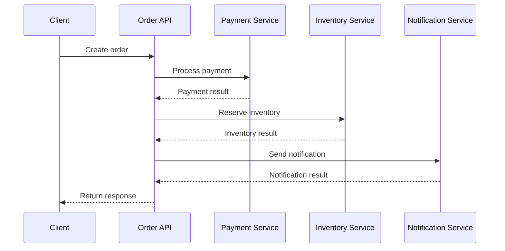
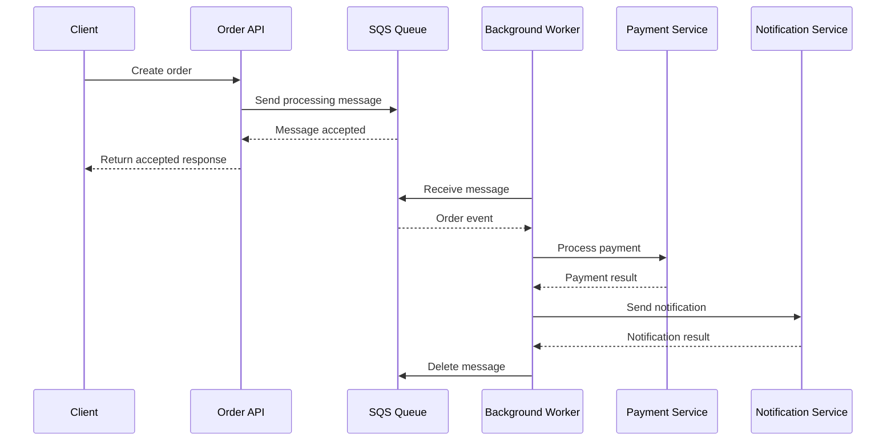
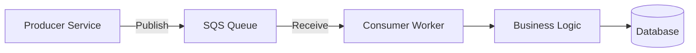
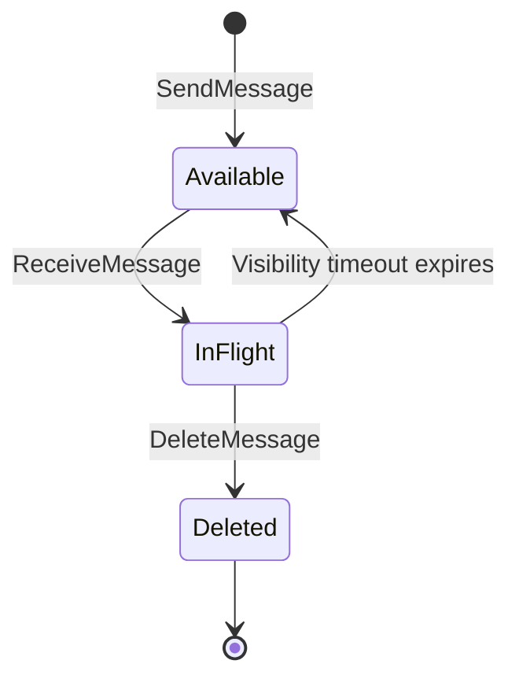
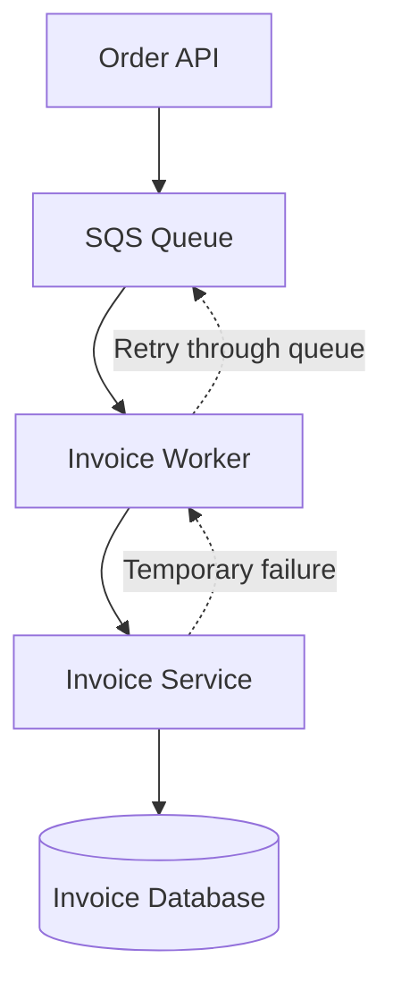
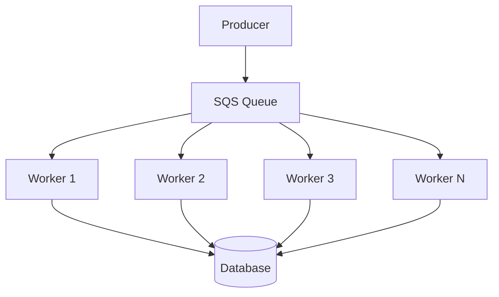
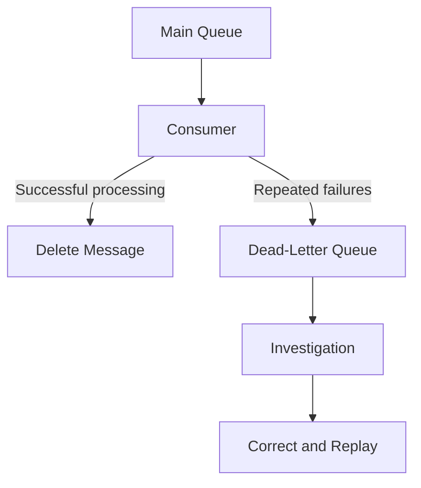
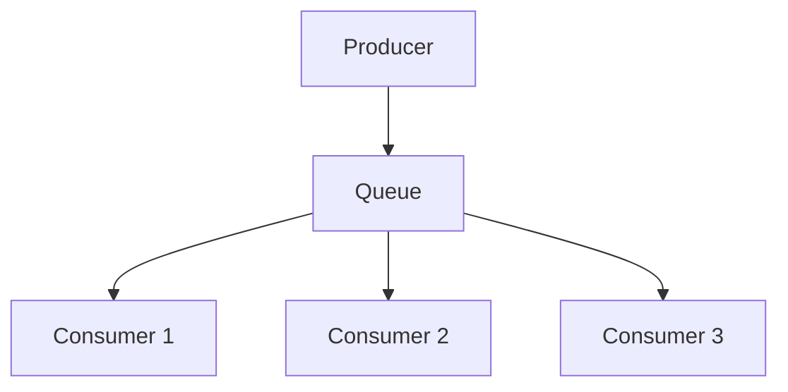
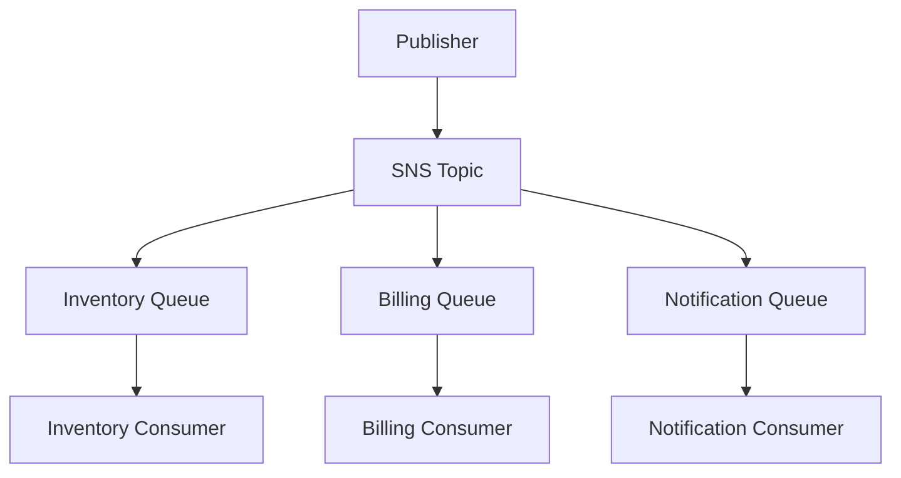
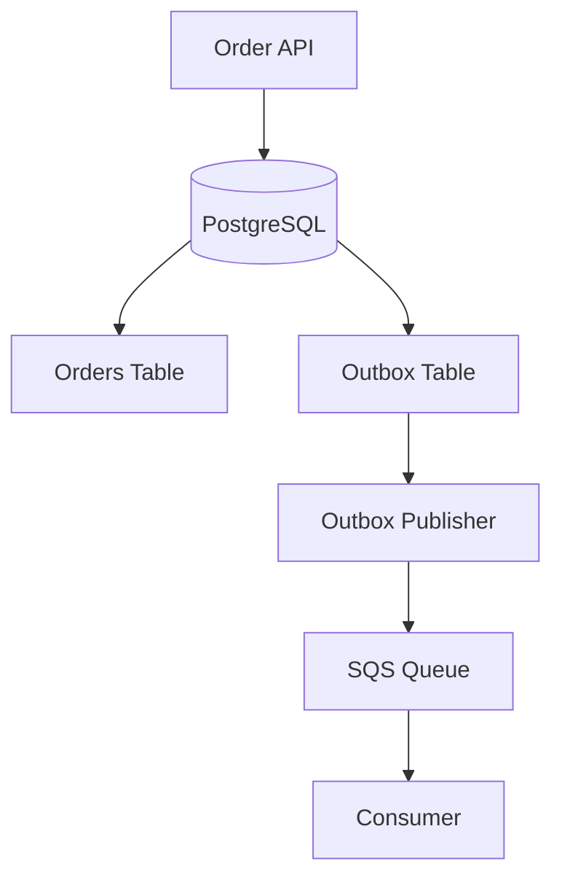

# 02- Asynchronous Messaging and Queue Fundamentals

## Overview

Asynchronous messaging is a communication pattern in which one application component sends a message without waiting for another component to complete the requested operation.

The producer publishes a message to a messaging system, which stores or routes it until a consumer processes it. The producer and consumer operate independently in time and can scale, deploy, and recover separately.

Amazon SQS provides a managed queue-based implementation of this pattern. It acts as an intermediary between application components, providing message buffering, independent processing, and failure isolation.

Asynchronous messaging is particularly important in distributed backend systems where synchronous dependencies introduce latency, availability risks, and scaling constraints.

## Synchronous vs Asynchronous Communication

### Synchronous Communication

In synchronous communication, the caller waits for the downstream operation to complete before continuing.

Common examples include:

- REST API requests.
- gRPC calls.
- Direct database queries.
- Synchronous service-to-service HTTP requests.

Consider an order API that directly invokes payment, inventory, and notification services.



The response time depends on the execution time of downstream operations.

If a downstream service becomes slow or unavailable, the entire request can be delayed or fail.

### Asynchronous Communication

In asynchronous communication, the producer submits work to a messaging system and continues without waiting for the consumer to finish processing.



The producer does not wait for the entire downstream workflow.

This reduces request latency and allows background processing to continue independently.

### Comparison

| Characteristic | Synchronous | Asynchronous |
|---|---|---|
| Communication | Direct request-response | Message-based |
| Caller behavior | Waits for response | Continues after acceptance |
| Coupling | Higher temporal coupling | Lower temporal coupling |
| Latency | Includes downstream execution | Usually limited to message acceptance |
| Failure propagation | Can affect the caller immediately | Can be isolated and retried |
| Scaling | Often coordinated across dependencies | Producers and consumers scale independently |
| Processing | Usually immediate | Deferred or independently scheduled |
| Complexity | Simpler for direct interactions | Requires message lifecycle management |
| Typical technologies | REST, gRPC | SQS, SNS, Kafka, RabbitMQ |

Asynchronous messaging does not eliminate failures. It changes where failures occur and how they are handled.

## Core Messaging Concepts

### Producer

A producer is an application component that creates and publishes messages.

Examples include:

- Django REST Framework APIs.
- FastAPI services.
- Order management systems.
- Payment services.
- Scheduled jobs.
- AWS Lambda functions.

The producer should not depend on the internal implementation of the consumer.

Its responsibility is to publish a valid message to the messaging system.

### Consumer

A consumer retrieves and processes messages.

Examples include:

- Python worker processes.
- Celery workers.
- Django management commands.
- Kubernetes worker deployments.
- AWS Lambda functions.
- Containerized services running on Amazon ECS.

Consumers should be independently deployable and scalable.

### Message

A message is the data exchanged between a producer and a consumer.

A well-designed message generally contains:

- Unique event identifier.
- Event type.
- Event creation timestamp.
- Schema version.
- Relevant business identifiers.
- Event payload.

Example:

```json
{
  "event_id": "evt-10001",
  "event_type": "OrderCreated",
  "event_version": 1,
  "occurred_at": "2026-11-19T10:30:00Z",
  "correlation_id": "corr-20001",
  "data": {
    "order_id": "ORD-1001",
    "customer_id": "CUS-501",
    "total_amount": 2499.00,
    "currency": "INR"
  }
}
```

Messages should represent stable application contracts rather than internal database implementation details.

### Queue

A queue is an intermediary that stores messages until consumers retrieve and process them.

A queue provides:

- Temporary storage.
- Message buffering.
- Independent producer and consumer execution.
- Controlled consumption.
- Redelivery after unsuccessful processing.
- Integration with dead-letter handling.

In SQS, a queue is a managed AWS resource with configurable retention, visibility timeout, delivery delay, and access policies.

### Acknowledgement

An acknowledgement indicates that a consumer has completed its responsibility for a message.

In SQS, successful processing is typically followed by `DeleteMessage`.

Unlike systems that use explicit acknowledgement APIs, SQS uses message deletion as the acknowledgement mechanism.

A message should not be deleted before its business operation has safely completed.

## Queue-Based Messaging Architecture

A queue introduces an intermediary between producers and consumers.



The producer and consumer do not need to be available simultaneously.

For example:

- The API can publish messages while workers are temporarily offline.
- Workers can process messages after recovering from deployment failures.
- Additional workers can be started when backlog increases.
- Consumers can be deployed independently of producers.

### Temporal Decoupling

Temporal decoupling means that producers and consumers do not need to operate at the same time.

A producer can publish a message at 10:00 AM, and a consumer can process it later when capacity becomes available.

This is useful for:

- Scheduled background work.
- Long-running operations.
- Temporary consumer outages.
- Traffic spikes.
- Workflows with variable processing durations.

### Deployment Decoupling

Producers and consumers can be deployed independently as long as they remain compatible with the message contract.

For example, a Django API can publish an `OrderCreated` message while a separately deployed Python worker processes it.

A change to the worker's internal implementation does not necessarily require a change to the producer.

However, message schema changes must be managed carefully to preserve compatibility.

## Queueing and Message Lifecycle

A queue-based messaging system manages the transition of messages through different states.

For SQS, the important states are:

- Available: The message can be received by a consumer.
- In flight: The message has been received and is temporarily invisible.
- Deleted: The message has been successfully acknowledged through deletion.
- Redelivered: The message becomes available again after visibility timeout expiration if it was not deleted.



### Message Publishing

The producer sends a message to the queue.

```python
import json
import boto3

sqs = boto3.client("sqs", region_name="ap-south-1")

QUEUE_URL = "https://sqs.ap-south-1.amazonaws.com/123456789012/order-queue"


def publish_order_event(event: dict) -> str:
    response = sqs.send_message(
        QueueUrl=QUEUE_URL,
        MessageBody=json.dumps(event),
    )

    return response["MessageId"]
```

The returned message ID identifies the SQS message. It should not replace the application's stable business event ID.

### Message Retrieval

Consumers poll the queue to retrieve available messages.

```python
response = sqs.receive_message(
    QueueUrl=QUEUE_URL,
    MaxNumberOfMessages=10,
    WaitTimeSeconds=20,
    VisibilityTimeout=60,
)
```

SQS supports long polling to reduce unnecessary empty receive requests.

### Message Processing

The consumer executes the required business operation.

Processing should be designed to handle:

- Duplicate deliveries.
- Temporary downstream failures.
- Invalid messages.
- Long-running operations.
- Worker crashes.
- Database transaction failures.

### Message Acknowledgement

After successful processing, the consumer deletes the message.

```python
sqs.delete_message(
    QueueUrl=QUEUE_URL,
    ReceiptHandle=message["ReceiptHandle"],
)
```

If the consumer fails before deletion, the message can become available again after the visibility timeout.

This provides a recovery mechanism but also means that duplicate processing is possible.

## Decoupling and Failure Isolation

One of the most important benefits of asynchronous messaging is the ability to isolate failures between services.

Consider an order service that publishes work for invoice generation.

Without a queue:

- The order API depends on the invoice service being available.
- Invoice processing latency affects the API response.
- Invoice service failures can affect order creation.

With SQS:

- The order API publishes a message.
- The queue stores the message.
- The invoice worker processes it independently.
- Temporary invoice service failures do not necessarily prevent order creation.

### Failure Isolation Architecture



Failure isolation is not automatic for every failure scenario.

For example, if the queue itself is inaccessible, the producer may still fail to publish. If the consumer repeatedly fails, messages can accumulate.

A production system needs explicit retry, dead-letter, and monitoring strategies.

## Buffering and Backpressure

### Message Buffering

A queue temporarily stores messages when producers generate work faster than consumers can process it.

For example:

- Producers publish 1,000 messages per minute.
- Consumers process 700 messages per minute.
- The backlog grows by approximately 300 messages per minute.

The queue absorbs the difference temporarily.

This protects downstream services from immediate traffic spikes.

### Backpressure

Backpressure is a mechanism or system behavior that prevents producers or downstream dependencies from being overwhelmed by excessive workload.

SQS provides a buffer, but it does not automatically guarantee that the backlog will remain bounded or that downstream systems will remain healthy.

Consumers should be scaled and throttled according to processing capacity.

### Queue Backlog

The backlog can be approximated as:

\[
B_{t+1} = B_t + M_p - M_c
\]

Where:

- \(B_t\) is the current backlog.
- \(M_p\) is the number of messages published during the interval.
- \(M_c\) is the number of messages successfully processed and removed.

If publishing consistently exceeds processing capacity, the backlog grows.

Monitor:

- Visible message count.
- In-flight message count.
- Age of the oldest message.
- Successful processing rate.
- Failure and retry rate.

The age of the oldest message is particularly useful because a large backlog does not always indicate unacceptable processing delay if consumers are processing quickly.

### Scaling Consumers

Consumers can be scaled horizontally to increase processing capacity.



Scale based on queue backlog, processing latency, and downstream capacity.

Increasing worker count without controlling database connections or external API requests can move the bottleneck downstream.

## Delivery Semantics

Message delivery semantics describe how a messaging system handles message delivery and processing.

The major models are:

- At-most-once delivery.
- At-least-once delivery.
- Exactly-once processing.

### At-Most-Once

A message is delivered zero or one time.

A message can be lost if delivery or processing fails without a retry mechanism.

This approach can be suitable for non-critical telemetry or disposable signals where occasional loss is acceptable.

It is generally unsuitable for critical business operations.

### At-Least-Once

A message is delivered one or more times until it is successfully acknowledged or expires according to the system's behavior.

Duplicates are possible.

SQS Standard queues provide at-least-once delivery.

Consumers must therefore be idempotent.

### Exactly-Once Processing

Exactly-once processing means that a business operation has one effective outcome even if messages are retried or delivered more than once.

This is difficult to guarantee across distributed services because message delivery, database transactions, and external side effects are separate operations.

FIFO queue deduplication helps prevent duplicate sends within its deduplication interval, but it does not guarantee exactly-once business processing by consumers.

### Delivery Semantics Comparison

| Model | Message loss | Duplicate delivery | Typical use |
|---|---|---|---|
| At-most-once | Possible | No redelivery by design | Best-effort telemetry |
| At-least-once | Retries reduce loss | Possible | SQS Standard processing |
| Exactly-once effect | Requires coordinated processing design | May occur internally but must not duplicate business effects | Financial and critical workflows |

## Idempotency in Asynchronous Processing

Idempotency ensures that processing the same business event multiple times does not produce repeated business effects.

Consider a payment event:

1. A worker receives `PaymentRequested`.
2. The payment provider successfully charges the customer.
3. The worker crashes before deleting the SQS message.
4. SQS makes the message available again.
5. Another worker receives the same event.

Without idempotency, the customer could be charged twice.

### Event ID-Based Idempotency

Include a stable event ID in every business message.

```json
{
  "event_id": "evt-payment-10001",
  "event_type": "PaymentRequested",
  "data": {
    "order_id": "ORD-1001",
    "amount": 2499.00,
    "currency": "INR"
  }
}
```

A PostgreSQL table can enforce uniqueness:

```sql
CREATE TABLE processed_events (
    event_id UUID PRIMARY KEY,
    processed_at TIMESTAMPTZ NOT NULL DEFAULT NOW()
);
```

The consumer should claim the event and apply database changes within a transaction.

For external operations, use provider-supported idempotency keys and persist operation state.

A database uniqueness constraint alone cannot make a remote API call and a database transaction atomic.

## Retry and Dead-Letter Handling

A message can fail because of:

- Temporary network errors.
- Database unavailability.
- External API throttling.
- Invalid business data.
- Application defects.
- Worker termination.

A retry allows transient failures to recover without losing the message.

### Retry Behavior in SQS

When a consumer receives a message, SQS starts the visibility timeout.

If the consumer does not delete the message, it becomes available again after the timeout expires.

This supports redelivery.

However, repeated retries of a permanently invalid message waste processing capacity.

### Dead-Letter Queue

A dead-letter queue stores messages that repeatedly fail processing after reaching the configured maximum receive count.



Use a DLQ to isolate poison messages and support controlled recovery.

A production recovery process should:

- Inspect the message.
- Identify the root cause.
- Correct the underlying issue.
- Validate the message contract.
- Replay safely.
- Preserve idempotency.

Do not automatically replay every DLQ message without understanding why it failed.

## Queue-Based Messaging vs Publish-Subscribe

Queue-based messaging and publish-subscribe messaging solve different communication problems.

### Queue-Based Messaging

In a traditional competing-consumer queue, multiple consumers retrieve messages from the same queue.

A message is normally processed by one consumer, although redelivery can result in another consumer receiving it.



Use this pattern when multiple workers should share a workload.

### Publish-Subscribe Messaging

In publish-subscribe messaging, one published event is distributed to multiple independent subscribers.

For example, SNS can distribute an order event to separate SQS queues.



Each subscriber receives its own copy.

### Comparison

| Characteristic | Queue-Based Work Distribution | Publish-Subscribe |
|---|---|---|
| Primary purpose | Distribute tasks among workers | Distribute events to independent subscribers |
| Message copies | One logical queue message | One copy per matching subscriber |
| Consumer behavior | Competing consumers | Independent subscribers |
| Typical AWS service | SQS | SNS |
| Combined architecture | SQS | SNS with SQS subscriptions |

SNS and SQS are frequently combined to provide both fanout and durable asynchronous processing.

## Message Contract Design

A message is an interface between independently deployed services.

Poorly designed message contracts create tight coupling and make deployments difficult.

### Recommended Message Structure

```json
{
  "event_id": "evt-10001",
  "event_type": "OrderCreated",
  "event_version": 1,
  "occurred_at": "2026-11-19T10:30:00Z",
  "producer": "order-service",
  "correlation_id": "corr-20001",
  "data": {
    "order_id": "ORD-1001",
    "customer_id": "CUS-501"
  }
}
```

Recommended fields:

| Field | Purpose |
|---|---|
| `event_id` | Stable identifier for idempotency |
| `event_type` | Identifies the business event |
| `event_version` | Supports schema evolution |
| `occurred_at` | Records event creation time |
| `producer` | Identifies the originating service |
| `correlation_id` | Connects related operations |
| `data` | Contains event-specific information |

### Schema Evolution

Message schemas should evolve without unexpectedly breaking existing consumers.

Recommended practices:

- Add optional fields where possible.
- Avoid removing fields immediately.
- Preserve field meaning.
- Version incompatible contracts.
- Validate incoming payloads.
- Test old and new consumer compatibility.
- Avoid exposing internal database models directly.

For systems with many independent consumers, consider a schema registry or centrally governed event contract repository.

## Database Transactions and the Dual-Write Problem

A common problem occurs when an application must update a database and publish a message as part of the same business operation.

Consider this sequence:

1. Insert an order into PostgreSQL.
2. Publish `OrderCreated` to SQS.

If the database commit succeeds but the message publish fails, the order exists without the corresponding event.

If the message is published before the database transaction commits and the transaction later rolls back, consumers may process an event for a nonexistent order.

These are dual-write consistency problems.

### Transactional Outbox Pattern

The transactional outbox pattern stores the business update and event record in the same database transaction.

A separate publisher reads unsent outbox records and publishes them to SQS.



Example transaction:

```sql
BEGIN;

INSERT INTO orders (
    order_id,
    customer_id,
    status
)
VALUES (
    'ORD-1001',
    'CUS-501',
    'PENDING'
);

INSERT INTO outbox_events (
    event_id,
    event_type,
    payload,
    published_at
)
VALUES (
    'evt-10001',
    'OrderCreated',
    '{"order_id":"ORD-1001","customer_id":"CUS-501"}',
    NULL
);

COMMIT;
```

The publisher retrieves unpublished events, sends them to SQS, and marks them as published after successful acceptance.

The publisher can still publish a duplicate if it crashes after SQS accepts the message but before the database records the publication result.

Therefore, consumers must remain idempotent.

The outbox pattern provides reliable event publication intent, not exactly-once delivery.

## Asynchronous Messaging with Python Backend Services

SQS can be integrated into Django, FastAPI, or other Python applications.

### Producer in FastAPI

A REST endpoint can persist a business operation and publish a processing request.

The following simplified example demonstrates the messaging boundary. For reliable database-to-queue publication, use a transactional outbox rather than assuming that the database write and SQS send are atomic.

```python
import json
import os
from uuid import uuid4

import boto3
from fastapi import FastAPI, HTTPException
from botocore.exceptions import BotoCoreError, ClientError
from pydantic import BaseModel

app = FastAPI()

sqs = boto3.client(
    "sqs",
    region_name=os.getenv("AWS_REGION", "ap-south-1"),
)

QUEUE_URL = os.environ["SQS_QUEUE_URL"]


class OrderRequest(BaseModel):
    customer_id: str
    total_amount: float


@app.post("/orders", status_code=202)
def create_order(request: OrderRequest) -> dict:
    event = {
        "event_id": str(uuid4()),
        "event_type": "OrderCreated",
        "data": {
            "customer_id": request.customer_id,
            "total_amount": request.total_amount,
        },
    }

    try:
        response = sqs.send_message(
            QueueUrl=QUEUE_URL,
            MessageBody=json.dumps(event),
        )

    except (BotoCoreError, ClientError) as exc:
        raise HTTPException(
            status_code=503,
            detail="Unable to submit order processing request",
        ) from exc

    return {
        "status": "accepted",
        "event_id": event["event_id"],
        "message_id": response["MessageId"],
    }
```

A real order API should persist the order and use an outbox or another reliable publication mechanism.

An HTTP `202 Accepted` response indicates that processing has been accepted for asynchronous execution. It does not indicate that the order workflow has completed.

### Consumer Worker

A worker can run as a separate Docker container or Kubernetes deployment.

```python
import json
import logging
import os

import boto3
from botocore.exceptions import BotoCoreError, ClientError

logger = logging.getLogger(__name__)
logging.basicConfig(level=logging.INFO)

sqs = boto3.client(
    "sqs",
    region_name=os.getenv("AWS_REGION", "ap-south-1"),
)

QUEUE_URL = os.environ["SQS_QUEUE_URL"]


def process_event(event: dict) -> None:
    if event.get("event_type") != "OrderCreated":
        raise ValueError("Unsupported event type")

    event_data = event.get("data", {})

    if not event_data.get("customer_id"):
        raise ValueError("Missing customer identifier")

    logger.info("Processing order event: %s", event["event_id"])


def run_worker() -> None:
    while True:
        response = sqs.receive_message(
            QueueUrl=QUEUE_URL,
            MaxNumberOfMessages=10,
            WaitTimeSeconds=20,
            VisibilityTimeout=60,
        )

        for message in response.get("Messages", []):
            try:
                event = json.loads(message["Body"])
                process_event(event)

                sqs.delete_message(
                    QueueUrl=QUEUE_URL,
                    ReceiptHandle=message["ReceiptHandle"],
                )

            except (ValueError, KeyError, json.JSONDecodeError):
                logger.exception("Invalid message")

            except Exception:
                logger.exception("Message processing failed")


if __name__ == "__main__":
    try:
        run_worker()
    except (BotoCoreError, ClientError):
        logger.exception("SQS worker terminated")
        raise
```

This example illustrates the processing lifecycle. Production workers should add idempotency, controlled shutdown, visibility timeout management, DLQ handling, and application-specific error classification.

## SQS vs Other Messaging Technologies

SQS is one option among several messaging technologies.

| Technology | Messaging model | Main strengths | Common use cases |
|---|---|---|---|
| Amazon SQS | Managed queue | Durable buffering and simple managed operations | AWS background processing |
| Amazon SNS | Publish-subscribe | Fanout to multiple subscribers | Event distribution |
| Apache Kafka | Distributed event streaming | Retained event logs, partitioning, replay | Event streaming and data pipelines |
| RabbitMQ | Message broker | Flexible routing and acknowledgement models | Complex broker-based messaging |
| Redis Streams | Stream-based messaging | Low-latency stream processing | Lightweight event processing |
| Celery | Distributed task processing framework | Python task execution and scheduling integrations | Python background jobs |

### SQS vs Kafka

SQS and Kafka should not be treated as interchangeable.

SQS is primarily a managed queueing service for distributing work to consumers.

Kafka is a distributed event streaming platform that retains ordered records within partitions and allows consumer groups to track offsets and replay retained data.

| Characteristic | SQS | Kafka |
|---|---|---|
| Primary abstraction | Queue | Distributed log |
| Message consumption | Receive and delete | Read using offsets |
| Retention | Configurable queue retention, up to fourteen days | Configurable topic retention |
| Replay | Requires messages to remain available or be republished | Supported through offset management and retention |
| Ordering | FIFO within message groups | Within a partition |
| Consumer model | Competing consumers | Consumer groups |
| Operational model | Fully managed AWS service | Managed or self-managed deployments |

Choose SQS for straightforward asynchronous work distribution. Choose Kafka when retained event streams, replay, partition-based processing, or multiple independent consumer groups are core requirements.

## Monitoring and Operational Considerations

Asynchronous systems require monitoring beyond API response time.

A producer may publish messages successfully while consumers fall behind or repeatedly fail.

Important operational metrics include:

| Metric | Purpose |
|---|---|
| Visible messages | Measures available backlog |
| Not-visible messages | Indicates messages currently in flight |
| Oldest message age | Measures processing delay |
| Messages sent | Tracks producer activity |
| Messages received | Tracks consumer retrieval |
| Messages deleted | Tracks successful acknowledgements |
| DLQ message count | Identifies repeated processing failures |
| Processing duration | Measures consumer performance |
| Processing error rate | Identifies application failures |

### Correlation and Tracing

Propagate identifiers across service boundaries:

- Event ID.
- Correlation ID.
- Trace ID.
- Producer service.
- Consumer service.

These identifiers make it possible to trace a business operation across API requests, queue messages, workers, and downstream services.

Avoid relying exclusively on SQS message IDs for business-level correlation.

### Alerting

Create alerts for:

- Continuously increasing queue backlog.
- Oldest message age exceeding business thresholds.
- DLQ messages appearing unexpectedly.
- Consumer processing failures.
- Unusual retry rates.
- Consumer capacity becoming insufficient.

A healthy asynchronous system should have an observable and bounded processing delay.

## Security Considerations

Messages cross service boundaries and should be treated as untrusted input.

Apply the following controls:

- Use IAM roles instead of embedded AWS credentials.
- Grant producers only `sqs:SendMessage` where possible.
- Grant consumers only the required receive, delete, and visibility permissions.
- Restrict queue policies.
- Use server-side encryption where required.
- Use HTTPS for API communication.
- Validate message schemas.
- Avoid logging sensitive payloads.
- Rotate and protect encryption keys according to organizational policy.
- Use VPC endpoints where private connectivity to SQS is required.

Never assume that a message is trustworthy simply because it originated from an internal service.

## Common Mistakes and Production Pitfalls

| Mistake | Why it causes problems | Recommended approach |
|---|---|---|
| Treating asynchronous acceptance as completion | The business operation may still be pending or fail | Expose processing status separately |
| Deleting messages before processing completes | Failed work can be lost | Delete only after successful processing |
| Ignoring duplicate delivery | Business operations may execute multiple times | Implement idempotency |
| Setting visibility timeout too low | Messages can be processed concurrently after becoming visible again | Align timeout with processing duration |
| Scaling workers without downstream limits | Databases and APIs can be overloaded | Apply bounded concurrency |
| Ignoring queue backlog | Processing latency increases unnoticed | Monitor queue depth and oldest-message age |
| Publishing incompatible event schemas | Independent consumers can fail after deployment | Use versioned, backward-compatible contracts |
| Assuming SQS provides fanout | Consumers compete for messages from one queue | Use SNS with separate SQS queues |
| Assuming a queue replaces a database | Queue retention is not permanent business storage | Persist authoritative business state separately |
| Ignoring the dual-write problem | Database and message publication can become inconsistent | Use a transactional outbox |
| Treating FIFO deduplication as exactly-once business processing | Consumer retries can still repeat business effects | Use application-level idempotency |
| Replaying DLQ messages without investigation | The same failure can recur | Fix the root cause and replay safely |

## Key Takeaways

- Asynchronous messaging separates producers from consumers in time, reducing synchronous dependencies and allowing independent scaling.
- SQS provides durable queue-based buffering, while visibility timeout, message deletion, retries, and DLQs govern message processing and recovery.
- At-least-once delivery requires idempotent consumers; FIFO deduplication does not guarantee exactly-once business outcomes.
- Stable message contracts, correlation identifiers, and the transactional outbox pattern improve reliability across independently deployed services.
- Production messaging systems require bounded consumer concurrency, backlog monitoring, controlled retries, least-privilege security, and explicit failure recovery.