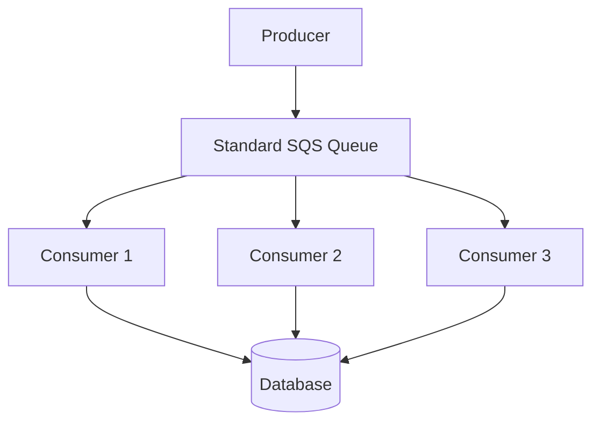
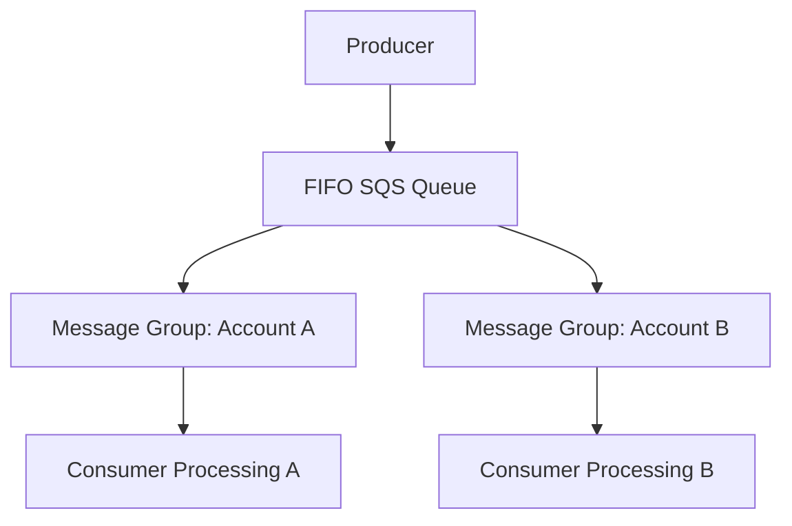
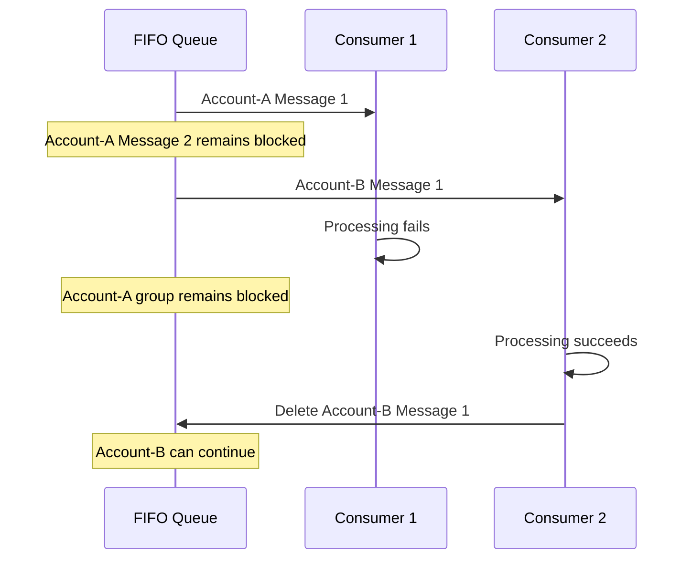
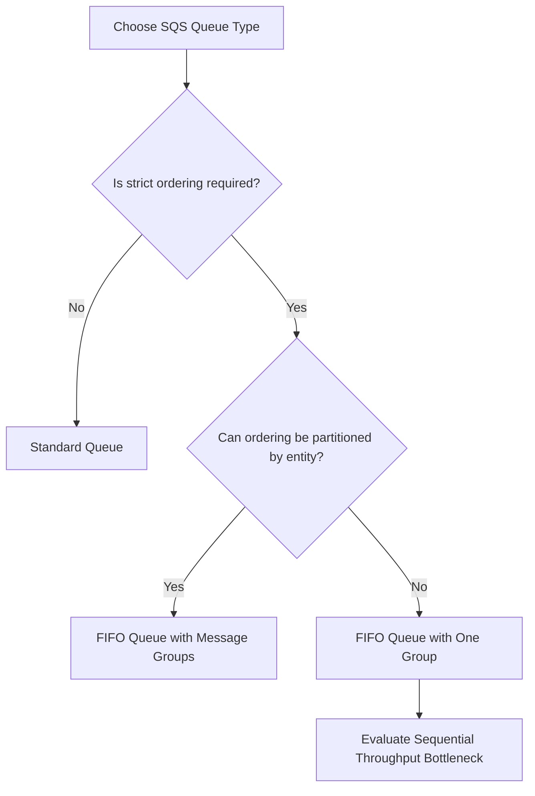

# 03- Standard and FIFO Queues

## Overview

Amazon Simple Queue Service (SQS) provides two primary queue types: Standard and FIFO (First-In, First-Out).

Both queue types provide managed message storage and asynchronous communication between producers and consumers. However, they differ in message ordering, deduplication, throughput characteristics, and processing behavior.

Choosing the correct queue type is an architectural decision. It affects how distributed workers process events, how business operations maintain ordering, and how the system handles duplicate messages.

- **Standard queues** prioritize scalability, availability, and high throughput.
- **FIFO queues** provide strict ordering within message groups and deduplication of accepted sends within a five-minute interval.

Neither queue type guarantees exactly-once business processing. Consumers must handle retries and duplicate deliveries safely.

## Standard Queues

A Standard queue is the default SQS queue type. It is designed for high-throughput distributed workloads where strict message ordering is not required.

### How Standard Queues Work

Producers send messages to the queue, and multiple consumers retrieve and process them independently.

SQS distributes messages across its managed infrastructure to support high availability and scalability.



Messages are generally processed independently. SQS does not guarantee that consumers receive messages in the same order in which they were sent.

### Characteristics

| Characteristic | Standard Queue |
|---|---|
| Throughput | Very high, subject to service quotas |
| Message ordering | Best effort |
| Delivery semantics | At least once |
| Duplicate delivery | Possible |
| Message groups | Not supported |
| Deduplication | No FIFO-style deduplication |
| Scalability | Designed for automatic scaling |
| Naming convention | No `.fifo` suffix |

### Message Ordering

Standard queues provide best-effort ordering.

Suppose a producer sends these messages:

```text
Message 1: OrderCreated
Message 2: PaymentCompleted
Message 3: OrderShipped
```

A consumer might receive them in a different order:

```text
PaymentCompleted
OrderCreated
OrderShipped
```

This behavior is acceptable when messages represent independent tasks or when the application does not depend on strict ordering.

Do not use a Standard queue when processing order is a mandatory business requirement.

### Duplicate Delivery

Standard queues provide at-least-once delivery.

A message can be delivered more than once because of distributed processing and acknowledgement behavior.

For example:

1. A worker receives a message.
2. The worker updates a database successfully.
3. The worker crashes before deleting the message.
4. The visibility timeout expires.
5. Another worker receives the same message.
6. The business operation may execute again.

Consumers must implement idempotency to prevent duplicate business effects.

### When to Use Standard Queues

Standard queues are appropriate for:

- Image and document processing.
- Email and notification delivery.
- Report generation.
- Independent background jobs.
- Data transformation workloads.
- Log processing.
- High-volume asynchronous integrations.

For example, an image-processing service can distribute thousands of independent image-processing tasks across multiple workers without requiring a particular execution order.

### Advantages

- High throughput and horizontal scalability.
- Simple producer-consumer architecture.
- Suitable for independent workloads.
- Automatic managed infrastructure.
- Flexible integration with AWS services.

### Limitations

- No strict message ordering.
- Duplicate delivery is possible.
- Consumers must implement idempotency.
- No FIFO-style send deduplication.
- Application-level sequencing must be implemented when required.

## FIFO Queues

FIFO queues provide ordered message processing and deduplication support.

FIFO stands for First-In, First-Out.

They are designed for workloads where the order of operations matters, such as financial transactions, inventory updates, and sequential state transitions.

### How FIFO Queues Work

FIFO queues use message group identifiers to define ordering boundaries.

Messages belonging to the same message group are processed in strict order.

Messages belonging to different message groups can be processed concurrently.



For example, an account may receive these operations:

```text
Account A:
1. Deposit 1000
2. Withdraw 200
3. Deposit 500

Account B:
1. Deposit 700
2. Withdraw 100
```

FIFO preserves the order within each account's message group while allowing Account A and Account B to be processed independently.

### Characteristics

| Characteristic | FIFO Queue |
|---|---|
| Throughput | Limited by FIFO throughput configuration and quotas |
| Message ordering | Strict within a message group |
| Delivery semantics | At least once to consumers |
| Send deduplication | Five-minute deduplication interval |
| Message groups | Supported |
| Content-based deduplication | Supported when enabled |
| Naming convention | Must end with `.fifo` |
| Consumer concurrency | Across independent message groups |

### Creating a FIFO Queue

A FIFO queue name must end with `.fifo`.

```bash
aws sqs create-queue \
  --queue-name order-processing.fifo \
  --attributes \
    FifoQueue=true,\
    ContentBasedDeduplication=false
```

For production infrastructure, configure additional attributes such as visibility timeout, message retention, encryption, and dead-letter handling as required.

### Message Group ID

`MessageGroupId` identifies the ordering group to which a message belongs.

Messages with the same group ID are processed in strict order.

Example:

```python
import json
import boto3

sqs = boto3.client("sqs", region_name="ap-south-1")

QUEUE_URL = (
    "https://sqs.ap-south-1.amazonaws.com/123456789012/"
    "order-processing.fifo"
)


def publish_order_event(order_id: str, event: dict) -> str:
    response = sqs.send_message(
        QueueUrl=QUEUE_URL,
        MessageBody=json.dumps(event),
        MessageGroupId=order_id,
        MessageDeduplicationId=event["event_id"],
    )

    return response["MessageId"]
```

Using the order ID as the group ID ensures that events for the same order are processed sequentially.

Different orders can be processed concurrently.

### Choosing Message Group IDs

Message group design directly affects concurrency and throughput.

| Group ID strategy | Behavior | Suitable use |
|---|---|---|
| One global group | All messages processed sequentially | Workloads requiring global ordering |
| Customer ID | Messages ordered per customer | Customer-specific operations |
| Account ID | Messages ordered per account | Financial account operations |
| Order ID | Messages ordered per order | Order lifecycle processing |
| Tenant ID | Messages ordered per tenant | Tenant-specific workflows |

Avoid using one global message group unless global ordering is genuinely required.

A single message group can become a throughput bottleneck because messages within that group must be processed sequentially.

### Message Deduplication

FIFO queues support deduplication to prevent duplicate messages from being accepted within a five-minute deduplication interval.

There are two approaches:

- Explicit deduplication IDs.
- Content-based deduplication.

#### Explicit Deduplication ID

The producer supplies a stable `MessageDeduplicationId`.

```python
response = sqs.send_message(
    QueueUrl=QUEUE_URL,
    MessageBody=json.dumps(event),
    MessageGroupId="ORD-1001",
    MessageDeduplicationId="evt-10001",
)
```

If the same deduplication ID is submitted again within the deduplication interval, SQS recognizes it as a duplicate send and does not introduce another copy through that duplicate send request.

Use a stable business event identifier rather than generating a new random identifier for every retry.

#### Content-Based Deduplication

Content-based deduplication can be enabled when creating the queue.

```bash
aws sqs create-queue \
  --queue-name order-processing.fifo \
  --attributes \
    FifoQueue=true,\
    ContentBasedDeduplication=true
```

When enabled, SQS generates a deduplication ID using a SHA-256 hash of the message body.

Important considerations:

- Message attributes are not included in the content-based hash.
- Identical message bodies within the deduplication interval are treated as duplicate sends.
- Different message bodies produce different hashes.
- Explicit deduplication IDs can be supplied when content-based deduplication is enabled.

For business-critical events, explicit deduplication IDs are generally easier to reason about because they represent application-level event identity.

### Deduplication Is Not Exactly-Once Processing

FIFO deduplication prevents duplicate sends within its deduplication interval. It does not guarantee that a consumer executes a business operation exactly once.

Consider this scenario:

1. A consumer receives a FIFO message.
2. The consumer updates PostgreSQL.
3. The consumer crashes before deleting the message.
4. The visibility timeout expires.
5. SQS delivers the message again.

The consumer may execute the business operation again.

Use application-level idempotency even with FIFO queues.

## Message Ordering and Message Groups

Message groups are the primary mechanism for controlling FIFO ordering and concurrency.

### Ordering Within a Message Group

Consider these messages:

| Message | Message Group ID | Sequence |
|---|---|---|
| M1 | Account-A | 1 |
| M2 | Account-A | 2 |
| M3 | Account-B | 1 |
| M4 | Account-A | 3 |
| M5 | Account-B | 2 |

SQS preserves the order of messages within each group:

```text
Account-A: M1 -> M2 -> M4
Account-B: M3 -> M5
```

The two groups can make progress independently.

### Concurrent Processing

FIFO supports concurrent processing across different message groups.

A consumer can process messages from Account A while another consumer processes messages from Account B.

However, messages from the same group remain subject to ordering constraints.

This provides a balance between ordering guarantees and parallel processing.

### Ordering Does Not Mean Global Business Sequencing

FIFO preserves the order in which messages are accepted for a message group.

It cannot automatically determine the intended business order when multiple producers publish concurrently.

For example, if two services independently publish events for the same account, the application must coordinate event sequencing when business correctness depends on a particular order.

Use mechanisms such as:

- A single authoritative producer for a business entity.
- Database sequence numbers.
- Optimistic concurrency control.
- Version checks in consumers.
- Transactional outbox publishing.

Do not assume FIFO can reconstruct business order from independently generated timestamps.

## Standard vs FIFO: Detailed Comparison

| Feature | Standard Queue | FIFO Queue |
|---|---|---|
| Primary goal | High scalability and throughput | Ordered processing and send deduplication |
| Ordering | Best effort | Strict within message groups |
| Delivery | At least once | At least once to consumers |
| Duplicate delivery | Possible | Possible during consumer processing |
| Send deduplication | Not provided | Five-minute deduplication interval |
| Content-based deduplication | Not available | Supported |
| Message groups | Not supported | Supported |
| Parallel processing | Across available messages | Across independent message groups |
| Global ordering | Not guaranteed | Not guaranteed across multiple groups |
| Queue naming | Ordinary queue name | Name must end with `.fifo` |
| Typical workload | Independent background tasks | Sequential entity-specific operations |

## Throughput and Performance Considerations

Queue type selection influences how workloads scale.

### Standard Queue Throughput

Standard queues are designed for very high throughput and automatic scaling.

They are suitable when messages can be processed independently and strict ordering is unnecessary.

Actual throughput is subject to AWS quotas, message size, batching, and regional service limits.

### FIFO Queue Throughput

FIFO throughput depends on the queue's throughput configuration and message group distribution.

High-throughput FIFO queues support higher request rates through message-group-level distribution, subject to regional quotas and API limits.

The relevant configuration includes:

- `DeduplicationScope`
- `FifoThroughputLimit`

Common configuration values include:

| Attribute | Value | Meaning |
|---|---|---|
| `DeduplicationScope` | `queue` | Deduplication applies across the queue |
| `DeduplicationScope` | `messageGroup` | Deduplication applies within a message group |
| `FifoThroughputLimit` | `perQueue` | Throughput limit applies at queue level |
| `FifoThroughputLimit` | `perMessageGroupId` | Throughput is managed per message group |

For high-throughput FIFO configuration, use:

```text
DeduplicationScope=messageGroup
FifoThroughputLimit=perMessageGroupId
```

These settings must be used with FIFO queues and supported service configurations.

Example:

```bash
aws sqs create-queue \
  --queue-name high-throughput-orders.fifo \
  --attributes \
    FifoQueue=true,\
    DeduplicationScope=messageGroup,\
    FifoThroughputLimit=perMessageGroupId
```

Verify current regional quotas and service configuration requirements before selecting capacity targets.

### Message Group Distribution

High-throughput FIFO processing depends on having enough active message groups.

For example:

```text
Poor distribution:
MessageGroupId = GLOBAL
MessageGroupId = GLOBAL
MessageGroupId = GLOBAL

Better distribution:
MessageGroupId = ORDER-1001
MessageGroupId = ORDER-1002
MessageGroupId = ORDER-1003
```

The first design serializes all work through one group.

The second design allows independent orders to progress concurrently while preserving per-order ordering.

## Visibility Timeout and FIFO Processing

Visibility timeout controls how long a received message remains unavailable to other consumers.

In FIFO queues, an in-flight message also affects the availability of subsequent messages in the same message group.

If a message fails and is not deleted, subsequent messages in that group cannot proceed normally until the failed message is resolved or becomes available again and is processed.

This preserves ordering but can create head-of-line blocking.

### Example



A failure in one group does not necessarily block unrelated groups.

Production consumers should:

- Set visibility timeout according to processing duration.
- Extend visibility timeout for long-running operations.
- Handle failed messages deliberately.
- Monitor age of the oldest message.
- Avoid allowing poison messages to block a group indefinitely.

## Dead-Letter Queues for Standard and FIFO

Both Standard and FIFO queues support dead-letter queue configurations.

A DLQ isolates messages that repeatedly fail processing after reaching the configured maximum receive count.

The source and DLQ queue types must match:

| Source queue | DLQ type |
|---|---|
| Standard | Standard |
| FIFO | FIFO |

Example FIFO redrive configuration:

```bash
aws sqs create-queue \
  --queue-name order-processing-dlq.fifo \
  --attributes FifoQueue=true
```

Configure the source queue's redrive policy:

```bash
aws sqs set-queue-attributes \
  --queue-url https://sqs.ap-south-1.amazonaws.com/123456789012/order-processing.fifo \
  --attributes '{
    "RedrivePolicy": "{\"deadLetterTargetArn\":\"arn:aws:sqs:ap-south-1:123456789012:order-processing-dlq.fifo\",\"maxReceiveCount\":\"5\"}"
  }'
```

A DLQ is particularly important for FIFO queues because a repeatedly failing message can prevent later messages in the same group from progressing.

For FIFO queues, moving a message to a DLQ can also affect the original ordering sequence. If strict end-to-end ordering is a business requirement, evaluate whether moving failed messages out of the source queue is acceptable.

## Practical Python Implementation

### Sending Messages to a Standard Queue

```python
import json
import boto3

sqs = boto3.client("sqs", region_name="ap-south-1")

STANDARD_QUEUE_URL = (
    "https://sqs.ap-south-1.amazonaws.com/123456789012/order-tasks"
)


def send_standard_message(event: dict) -> str:
    response = sqs.send_message(
        QueueUrl=STANDARD_QUEUE_URL,
        MessageBody=json.dumps(event),
    )

    return response["MessageId"]
```

### Sending Messages to a FIFO Queue

```python
import json
import boto3

sqs = boto3.client("sqs", region_name="ap-south-1")

FIFO_QUEUE_URL = (
    "https://sqs.ap-south-1.amazonaws.com/123456789012/"
    "order-processing.fifo"
)


def send_fifo_message(event: dict) -> str:
    response = sqs.send_message(
        QueueUrl=FIFO_QUEUE_URL,
        MessageBody=json.dumps(event),
        MessageGroupId=event["order_id"],
        MessageDeduplicationId=event["event_id"],
    )

    return response["MessageId"]
```

The FIFO implementation preserves ordering for messages sharing the same `order_id` and deduplicates repeated sends using the stable event ID within the deduplication interval.

### Receiving FIFO Messages

```python
response = sqs.receive_message(
    QueueUrl=FIFO_QUEUE_URL,
    MaxNumberOfMessages=10,
    WaitTimeSeconds=20,
    VisibilityTimeout=60,
    AttributeNames=["ApproximateReceiveCount"],
    MessageSystemAttributeNames=[
        "MessageGroupId",
        "MessageDeduplicationId",
        "SequenceNumber",
    ],
)
```

FIFO messages expose system attributes that help consumers understand their ordering and deduplication context.

Do not use sequence numbers as application-level event identifiers. They are SQS-managed sequencing metadata.

## Infrastructure as Code with Terraform

Terraform can manage both queue types.

### Standard Queue

```hcl
resource "aws_sqs_queue" "order_tasks" {
  name                       = "order-tasks"
  visibility_timeout_seconds = 60
  message_retention_seconds  = 345600
  receive_wait_time_seconds  = 20

  sqs_managed_sse_enabled = true
}
```

### FIFO Queue

```hcl
resource "aws_sqs_queue" "order_processing" {
  name                        = "order-processing.fifo"
  fifo_queue                  = true
  content_based_deduplication = false

  visibility_timeout_seconds = 60
  message_retention_seconds  = 345600
  receive_wait_time_seconds  = 20

  sqs_managed_sse_enabled = true
}
```

### FIFO Queue with High-Throughput Configuration

```hcl
resource "aws_sqs_queue" "high_throughput_orders" {
  name                        = "high-throughput-orders.fifo"
  fifo_queue                  = true
  content_based_deduplication = false

  deduplication_scope = "messageGroup"
  fifo_throughput_limit = "perMessageGroupId"

  visibility_timeout_seconds = 60
  receive_wait_time_seconds  = 20

  sqs_managed_sse_enabled = true
}
```

Pin and test the AWS Terraform provider version used by the project. Verify that the provider supports the configured FIFO attributes.

## Choosing the Right Queue Type

Queue selection should be based on business semantics rather than assumed performance differences.

### Use Standard When

- Messages represent independent tasks.
- Strict ordering is unnecessary.
- High throughput is important.
- Consumers can process messages concurrently.
- Duplicate delivery can be handled through idempotency.

Examples:

- Generating reports.
- Processing uploaded files.
- Sending emails.
- Resizing images.
- Running independent data transformations.

### Use FIFO When

- Operations for the same business entity must remain ordered.
- Duplicate sends within the deduplication interval should be suppressed.
- Message groups can be designed to support the required concurrency.
- The application can tolerate the throughput and ordering constraints.

Examples:

- Account balance updates.
- Inventory state transitions.
- Sequential order lifecycle operations.
- Customer-specific workflow processing.

### Decision Guide



If all messages must be globally ordered, a single FIFO message group may be necessary. This introduces serialization and limits concurrency.

If ordering is only required per customer, account, or order, use that entity as the message group identifier.

## Security Considerations

Standard and FIFO queues use the same core SQS security model.

Apply the following controls:

- Use IAM roles for application access.
- Restrict producers to `sqs:SendMessage`.
- Restrict consumers to the required receive and delete operations.
- Use resource-based queue policies for cross-account access.
- Enable server-side encryption where required.
- Use TLS for API communication.
- Avoid embedding credentials or sensitive data in message bodies.
- Restrict DLQ access to authorized operators and recovery services.

For customer-managed KMS keys, ensure that the relevant producer and consumer identities have the required key permissions.

## Monitoring and Operational Considerations

Monitor both queue-level behavior and application processing.

Important CloudWatch metrics include:

| Metric | Purpose |
|---|---|
| `ApproximateNumberOfMessagesVisible` | Available messages |
| `ApproximateNumberOfMessagesNotVisible` | Messages currently in flight |
| `ApproximateAgeOfOldestMessage` | Processing delay indicator |
| `NumberOfMessagesSent` | Producer activity |
| `NumberOfMessagesReceived` | Consumer retrieval activity |
| `NumberOfMessagesDeleted` | Successful message acknowledgements |

For FIFO queues, also monitor:

- Message group distribution.
- Long-running in-flight messages.
- Repeated failures within individual groups.
- Queue throughput and throttling.
- Oldest-message age.

For Standard queues, monitor backlog growth and consumer processing rates to identify capacity issues.

Use application-level metrics to measure actual business processing success rather than relying only on SQS receive and delete counts.

## Common Mistakes and Production Pitfalls

| Mistake | Why it causes problems | Recommended approach |
|---|---|---|
| Choosing FIFO for every workload | Introduces ordering constraints without business value | Use Standard for independent tasks |
| Choosing Standard when strict ordering is required | Messages can be processed out of order | Use FIFO with appropriate message groups |
| Using one global FIFO message group | Serializes all processing | Partition groups by business entity |
| Generating a new deduplication ID on every retry | Duplicate sends are not recognized | Reuse a stable event ID |
| Treating FIFO deduplication as exactly-once processing | Consumer redelivery can still repeat business operations | Implement idempotent consumers |
| Assuming FIFO provides global ordering across groups | Ordering is scoped to each group | Use one group only when global sequencing is essential |
| Using incompatible DLQ types | Redrive configuration fails | Match Standard with Standard and FIFO with FIFO |
| Ignoring failed FIFO messages | One message can block later messages in its group | Configure DLQ handling and recovery procedures |
| Assuming SQS determines business event order | Concurrent publishers can submit events in an unintended order | Coordinate publishing and use business sequence numbers |
| Ignoring message group distribution | A small number of groups limits concurrency | Choose group IDs based on workload partitioning |

## Key Takeaways

- Standard queues prioritize high throughput and scalability with best-effort ordering and at-least-once delivery.
- FIFO queues preserve message order within each message group and support send deduplication within a five-minute interval.
- Message group design determines FIFO concurrency; one global group can become a significant processing bottleneck.
- FIFO deduplication does not guarantee exactly-once business processing, so consumers still need application-level idempotency.
- Select queue types according to business ordering requirements, throughput needs, failure recovery strategy, and operational constraints.