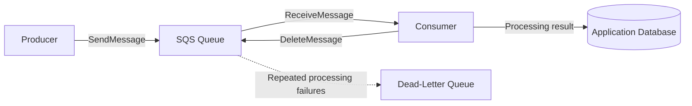
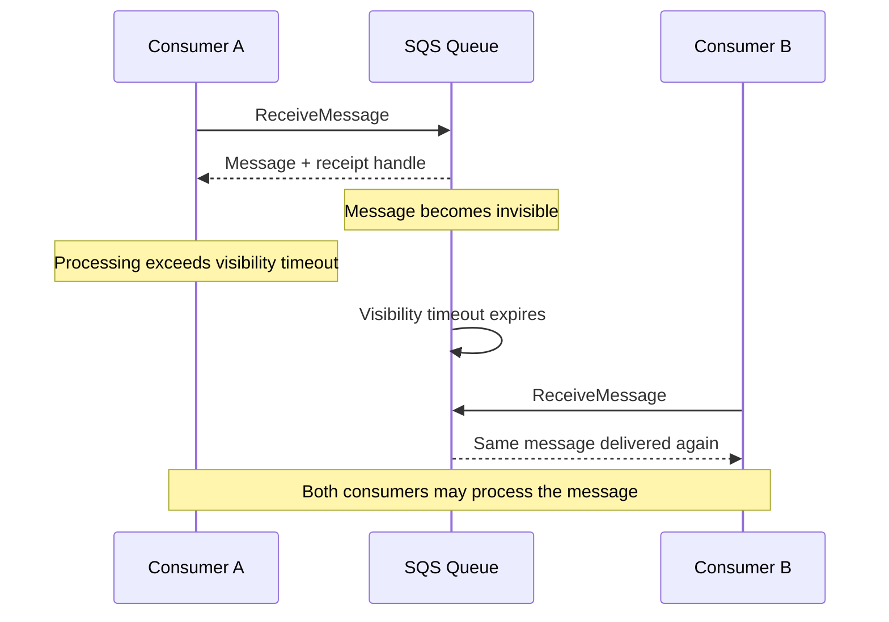

# 04- Queue Components and Attributes

## Overview

Amazon Simple Queue Service (SQS) queues are configured through a set of components and attributes that control message storage, delivery, processing, access, and failure handling.

Understanding these attributes is essential when designing reliable asynchronous workflows. Queue configuration directly affects:

- Message delivery and processing behavior.
- Consumer concurrency and throughput.
- Message retention and recovery.
- Security and access control.
- Operational cost and observability.
- Failure isolation and retry behavior.

An SQS queue is more than a container for messages. It is a managed messaging resource whose configuration defines how producers and consumers interact with each other.

## Core Queue Components

An SQS-based messaging architecture typically consists of producers, queues, messages, consumers, and optional failure-handling components.

| Component | Responsibility |
|---|---|
| Producer | Sends messages to an SQS queue. |
| Queue | Stores messages until they are successfully processed or expire. |
| Message | Contains the payload and associated metadata. |
| Consumer | Retrieves and processes messages. |
| Receipt handle | Identifies a specific received message delivery for deletion or visibility changes. |
| Visibility timeout | Temporarily prevents other consumers from receiving a message being processed. |
| Dead-letter queue (DLQ) | Stores messages that repeatedly fail processing. |
| Queue policy | Controls which AWS principals and services can access the queue. |
| Encryption configuration | Protects messages at rest using SQS-managed or AWS KMS encryption. |

### Queue Architecture



The producer and consumer operate independently. The queue buffers messages between them, allowing each service to scale and recover separately.

For example, an order service can publish an order-confirmation task without waiting for an email service to complete delivery.

## Queue URL and ARN

Every SQS queue has two important identifiers.

### Queue URL

The Queue URL is the endpoint identifier used by SQS API operations.

Example:

```text
https://sqs.ap-south-1.amazonaws.com/123456789012/order-processing
```

It is commonly used by SDK operations such as:

- `SendMessage`
- `ReceiveMessage`
- `DeleteMessage`
- `GetQueueAttributes`
- `SetQueueAttributes`

Python example:

```python
import boto3

sqs = boto3.client("sqs", region_name="ap-south-1")

queue_url = "https://sqs.ap-south-1.amazonaws.com/123456789012/order-processing"

response = sqs.send_message(
    QueueUrl=queue_url,
    MessageBody='{"order_id": "ORD-1001"}',
)

print(response["MessageId"])
```

### Queue ARN

The Amazon Resource Name (ARN) uniquely identifies the queue as an AWS resource.

Example:

```text
arn:aws:sqs:ap-south-1:123456789012:order-processing
```

Queue ARNs are commonly used in:

- IAM policies.
- SQS resource policies.
- SNS-to-SQS subscriptions.
- Event source configurations.
- CloudWatch and infrastructure configuration.

| Identifier | Primary purpose |
|---|---|
| Queue URL | Identifies the queue for SQS API operations. |
| Queue ARN | Identifies the queue in AWS resource and permission configurations. |

Do not interchange the two. SDK operations generally require the Queue URL, while resource policies commonly reference the queue ARN.

## Message Structure

An SQS message consists of a message body and optional attributes.

### Message Body

The message body contains the application payload.

SQS treats the body as message content. It does not understand application-specific business semantics.

Example:

```json
{
  "event_id": "evt-8f2a91",
  "event_type": "order.created",
  "order_id": "ORD-1001",
  "customer_id": "CUS-501",
  "created_at": "2026-11-19T10:30:00Z"
}
```

A well-designed message should contain:

- A stable business event identifier.
- An event type or task type.
- The identifiers needed by the consumer.
- A schema version when payload evolution requires it.
- Relevant timestamps or correlation identifiers.

For large payloads, store the data in Amazon S3 and send an object reference through SQS rather than placing the entire payload in the message.

### Message Size

SQS supports message bodies up to 1 MiB.

The size limit applies to the message body and message attributes. Design payloads with sufficient room for metadata and future schema evolution.

Large messages increase network transfer, serialization, and processing overhead.

### Message Attributes

Message attributes provide structured metadata separate from the message body.

They are useful for carrying information that consumers or integrations need without parsing the complete payload.

Example:

```python
import boto3

sqs = boto3.client("sqs", region_name="ap-south-1")

response = sqs.send_message(
    QueueUrl="https://sqs.ap-south-1.amazonaws.com/123456789012/order-processing",
    MessageBody='{"order_id": "ORD-1001"}',
    MessageAttributes={
        "event_type": {
            "DataType": "String",
            "StringValue": "order.created",
        },
        "priority": {
            "DataType": "Number",
            "StringValue": "1",
        },
        "source": {
            "DataType": "String",
            "StringValue": "order-service",
        },
    },
)
```

Supported message attribute data types include:

| Data type | Purpose |
|---|---|
| `String` | Text metadata. |
| `Number` | Numeric metadata represented through a string value. |
| `Binary` | Binary metadata. |

SQS message attributes are not the same as message system attributes.

### Message Attributes vs System Attributes

| Property | Message attributes | System attributes |
|---|---|---|
| Defined by | Application producer | SQS |
| Purpose | Application metadata | Messaging and delivery metadata |
| Example | `event_type`, `priority` | `ApproximateReceiveCount`, `SentTimestamp` |
| Included in | Message attribute collection | System attribute collection |
| Common use | Application routing and processing | Diagnostics and delivery management |

System attributes are exposed through SQS API operations and are not arbitrary application-defined metadata.

For example, `ApproximateReceiveCount` helps identify how many times a message has been received.

## Message Identifiers and Receipt Handles

SQS uses different identifiers for different stages of message processing.

### Message ID

The Message ID is assigned by SQS when a message is successfully accepted.

It identifies the message within SQS and is returned by `SendMessage`.

Example:

```python
response = sqs.send_message(
    QueueUrl=queue_url,
    MessageBody='{"order_id": "ORD-1001"}',
)

message_id = response["MessageId"]
```

A Message ID is not a business event identifier. Producers should include their own stable event ID when consumers need to detect duplicate business events.

### Receipt Handle

A receipt handle is returned when a consumer receives a message.

It identifies a particular delivery of that message and is required for operations such as:

- `DeleteMessage`
- `ChangeMessageVisibility`

Example:

```python
response = sqs.receive_message(
    QueueUrl=queue_url,
    MaxNumberOfMessages=1,
)

for message in response.get("Messages", []):
    receipt_handle = message["ReceiptHandle"]

    print(message["Body"])
```

The receipt handle changes when the message is received again.

Always use the receipt handle from the latest receive operation. A previous receipt handle should not be reused for a later delivery.

### Message ID vs Receipt Handle

| Property | Message ID | Receipt handle |
|---|---|---|
| Generated by | SQS | SQS |
| Returned by | `SendMessage` | `ReceiveMessage` |
| Purpose | Message identification | Identifies a particular delivery |
| Changes on redelivery | No | Yes |
| Used for deletion | No | Yes |
| Used for visibility changes | No | Yes |

## Queue Configuration Attributes

SQS exposes queue attributes that determine message lifecycle and delivery behavior.

The most important attributes are described below.

### VisibilityTimeout

The visibility timeout determines how long a received message remains invisible to other consumers.

When a consumer receives a message, SQS hides it from other consumers for the configured duration.

If the consumer successfully processes the message, it should delete it before the visibility timeout expires.

If the consumer fails or does not delete the message before the timeout expires, the message becomes visible again.

**Default:** 30 seconds.

**Maximum:** 12 hours.

Example:

```python
sqs.set_queue_attributes(
    QueueUrl=queue_url,
    Attributes={
        "VisibilityTimeout": "120",
    },
)
```

This configures a two-minute visibility timeout.

**Production considerations:**

- Set the timeout according to realistic processing duration, not just average execution time.
- Include time for database operations, external API calls, and transient delays.
- Extend visibility for long-running tasks using `ChangeMessageVisibility`.
- Make consumers idempotent because message redelivery remains possible.
- For Lambda SQS event source mappings, configure the queue visibility timeout in relation to the Lambda function timeout and batch-processing behavior.

A visibility timeout is not a processing lock that guarantees exactly-once execution. It is a temporary delivery restriction.

### MessageRetentionPeriod

This attribute determines how long SQS retains a message before deleting it automatically.

| Configuration | Value |
|---|---|
| Default | 4 days |
| Minimum | 60 seconds |
| Maximum | 14 days |

Example:

```python
sqs.set_queue_attributes(
    QueueUrl=queue_url,
    Attributes={
        "MessageRetentionPeriod": "1209600",
    },
)
```

This configures the maximum retention period of 14 days.

**When to use longer retention:**

- Consumers may be unavailable for extended periods.
- Downstream systems have temporary outages.
- Recovery and replay windows are important.
- Processing capacity may temporarily fall behind incoming traffic.

Retention is not a substitute for archival storage. Messages are permanently removed when their retention period expires.

For long-term audit or event-history requirements, persist business events in a durable data store or event archive.

### DelaySeconds

`DelaySeconds` determines how long newly sent messages remain unavailable for retrieval after entering the queue.

The delay can be configured at queue level or, for supported queue types and operations, per message.

| Configuration | Value |
|---|---|
| Default | 0 seconds |
| Maximum | 15 minutes |

Queue-level example:

```python
sqs.set_queue_attributes(
    QueueUrl=queue_url,
    Attributes={
        "DelaySeconds": "30",
    },
)
```

Message-level example:

```python
sqs.send_message(
    QueueUrl=queue_url,
    MessageBody='{"task_id": "TASK-1001"}',
    DelaySeconds=30,
)
```

**Use cases:**

- Delayed background jobs.
- Short scheduling delays.
- Deferring work until a dependent operation is expected to complete.

SQS delay queues are not a full scheduling service. For complex recurring schedules, calendar-based execution, or long-term scheduling, use a service such as Amazon EventBridge Scheduler.

### ReceiveMessageWaitTimeSeconds

This attribute configures the default long-polling duration for `ReceiveMessage`.

| Configuration | Value |
|---|---|
| Default | 0 seconds |
| Maximum | 20 seconds |

When long polling is enabled, SQS waits for messages to become available instead of immediately returning an empty response.

Example:

```python
sqs.set_queue_attributes(
    QueueUrl=queue_url,
    Attributes={
        "ReceiveMessageWaitTimeSeconds": "20",
    },
)
```

Long polling reduces unnecessary empty receive requests and can lower API request costs.

A consumer can also specify `WaitTimeSeconds` directly in each `ReceiveMessage` request.

```python
response = sqs.receive_message(
    QueueUrl=queue_url,
    MaxNumberOfMessages=10,
    WaitTimeSeconds=20,
)
```

**Production considerations:**

- Prefer long polling for continuously running consumers.
- Configure HTTP client read timeouts to exceed the long-polling duration.
- Avoid creating a large number of empty receive requests.
- Monitor queue depth and message age to detect insufficient consumer capacity.

### MaximumMessageSize

This attribute controls the maximum permitted message size.

SQS supports message sizes up to 1 MiB.

Example:

```python
sqs.set_queue_attributes(
    QueueUrl=queue_url,
    Attributes={
        "MaximumMessageSize": "262144",
    },
)
```

This configures a 256 KiB maximum message size.

Use a lower limit when the application has an explicit payload contract or needs to prevent unexpectedly large messages.

The configured maximum cannot exceed the service limit.

### RedrivePolicy

The redrive policy configures how messages are moved from a source queue to a dead-letter queue.

It defines:

- The destination DLQ ARN.
- The maximum number of receives before a message is moved to the DLQ.

Example:

```python
import json

redrive_policy = {
    "deadLetterTargetArn": (
        "arn:aws:sqs:ap-south-1:123456789012:order-processing-dlq"
    ),
    "maxReceiveCount": "5",
}

sqs.set_queue_attributes(
    QueueUrl=queue_url,
    Attributes={
        "RedrivePolicy": json.dumps(redrive_policy),
    },
)
```

After the configured receive threshold is exceeded, SQS moves the message to the DLQ.

**Important considerations:**

- Configure the DLQ before enabling the redrive policy.
- Standard queues should use Standard DLQs.
- FIFO queues should use FIFO DLQs.
- Choose `maxReceiveCount` based on realistic transient failure behavior.
- Investigate DLQ messages before redriving them.
- Do not use a DLQ as a permanent storage mechanism.

The receive count is not necessarily equivalent to the number of completed application processing attempts. A message can be received and become visible again without the consumer completing its work.

### RedriveAllowPolicy

The redrive allow policy controls which source queues can use a queue as their DLQ.

This is configured on the destination DLQ.

It supports policies such as:

- `allowAll`: Any eligible source queue can designate this queue as its DLQ.
- `denyAll`: No source queue can designate this queue as its DLQ.
- `byQueue`: Only specified source queue ARNs are allowed.

Example:

```python
import json

redrive_allow_policy = {
    "redrivePermission": "byQueue",
    "sourceQueueArns": [
        "arn:aws:sqs:ap-south-1:123456789012:order-processing"
    ],
}

sqs.set_queue_attributes(
    QueueUrl="https://sqs.ap-south-1.amazonaws.com/123456789012/order-processing-dlq",
    Attributes={
        "RedriveAllowPolicy": json.dumps(redrive_allow_policy),
    },
)
```

This is useful when multiple teams or applications share an AWS account and DLQ usage must be explicitly controlled.

### Policy

The queue policy is a resource-based policy attached to an SQS queue.

It defines which AWS principals or services can perform actions on the queue.

Typical actions include:

- `sqs:SendMessage`
- `sqs:ReceiveMessage`
- `sqs:DeleteMessage`
- `sqs:GetQueueAttributes`
- `sqs:GetQueueUrl`

Example: allow an SNS topic to publish messages to an SQS queue.

```json
{
  "Version": "2012-10-17",
  "Statement": [
    {
      "Sid": "AllowExpectedSNSTopic",
      "Effect": "Allow",
      "Principal": {
        "Service": "sns.amazonaws.com"
      },
      "Action": "sqs:SendMessage",
      "Resource": "arn:aws:sqs:ap-south-1:123456789012:order-processing",
      "Condition": {
        "ArnEquals": {
          "aws:SourceArn": "arn:aws:sns:ap-south-1:123456789012:order-events"
        }
      }
    }
  ]
}
```

The `aws:SourceArn` condition prevents unrelated SNS topics from publishing to the queue.

**Security recommendations:**

- Grant only the required SQS actions.
- Restrict service principals using source ARN conditions.
- Avoid wildcard principals unless there is a deliberate cross-account access design.
- Use IAM identity policies together with resource policies.
- Review cross-account access and organization-level restrictions.

### KmsMasterKeyId

This attribute configures server-side encryption using AWS Key Management Service (KMS).

SQS supports:

- SSE-SQS: Encryption using SQS-managed encryption keys.
- SSE-KMS: Encryption using AWS KMS keys.

For SSE-KMS, configure the KMS key identifier.

Example:

```python
sqs.set_queue_attributes(
    QueueUrl=queue_url,
    Attributes={
        "KmsMasterKeyId": "alias/application-messaging-key",
        "KmsDataKeyReusePeriodSeconds": "300",
    },
)
```

`KmsDataKeyReusePeriodSeconds` controls how long SQS can reuse a data key before requesting another one from KMS.

Its supported configuration range is 60–86,400 seconds.

**Production considerations:**

- Use a customer-managed KMS key when key ownership and access control requirements justify it.
- Ensure producers and consumers have the required KMS permissions.
- Review the KMS key policy and IAM policies.
- Consider KMS request costs and throttling implications.
- Use the shortest practical key reuse period that satisfies security and operational requirements.

Encryption at rest does not replace TLS for data in transit or application-level authorization.

### SqsManagedSseEnabled

This attribute indicates whether SQS-managed server-side encryption is enabled.

Example:

```python
response = sqs.get_queue_attributes(
    QueueUrl=queue_url,
    AttributeNames=["SqsManagedSseEnabled"],
)

print(response["Attributes"].get("SqsManagedSseEnabled"))
```

When enabled, SQS manages the encryption keys rather than requiring the application to configure a customer-managed KMS key.

Use SSE-SQS when managed encryption is sufficient and customer-managed key policies are not required.

## FIFO-Specific Queue Attributes

FIFO queues expose additional attributes that control deduplication and throughput.

### FifoQueue

This attribute identifies whether a queue is FIFO.

FIFO queues require names ending in `.fifo`.

Example:

```python
sqs.create_queue(
    QueueName="order-events.fifo",
    Attributes={
        "FifoQueue": "true",
    },
)
```

The queue type cannot be changed after creation. A Standard queue cannot be converted into a FIFO queue, or vice versa.

### ContentBasedDeduplication

When enabled, SQS generates a deduplication ID by hashing the message body.

Messages with identical bodies sent within the five-minute deduplication interval are treated as duplicates for FIFO send deduplication.

Example:

```python
sqs.create_queue(
    QueueName="order-events.fifo",
    Attributes={
        "FifoQueue": "true",
        "ContentBasedDeduplication": "true",
    },
)
```

Message attributes are not included in the content-based deduplication hash.

For business-critical workflows, an explicit stable `MessageDeduplicationId` is often preferable because it represents business event identity rather than payload equality.

### DeduplicationScope

This attribute controls the scope in which FIFO message deduplication is applied.

| Value | Behavior |
|---|---|
| `queue` | Deduplication applies across the entire queue. |
| `messageGroup` | Deduplication applies within each message group. |

### FifoThroughputLimit

This attribute controls the throughput limit scope for FIFO queues.

| Value | Behavior |
|---|---|
| `perQueue` | Throughput is limited at queue level. |
| `perMessageGroupId` | Throughput is managed per message group. |

High-throughput FIFO configuration uses:

```python
sqs.set_queue_attributes(
    QueueUrl=queue_url,
    Attributes={
        "DeduplicationScope": "messageGroup",
        "FifoThroughputLimit": "perMessageGroupId",
    },
)
```

This allows higher aggregate throughput across independent message groups, subject to SQS quotas and regional capabilities.

These settings should be evaluated together with the application's ordering requirements and message-group distribution.

## Queue Attributes Reference

The following table summarizes commonly used queue attributes.

| Attribute | Purpose | Important consideration |
|---|---|---|
| `VisibilityTimeout` | Controls temporary message invisibility after receipt. | Must accommodate processing duration. |
| `MessageRetentionPeriod` | Controls how long messages remain in the queue. | Maximum is 14 days. |
| `DelaySeconds` | Delays availability of new messages. | Maximum is 15 minutes. |
| `ReceiveMessageWaitTimeSeconds` | Configures default long polling. | Maximum is 20 seconds. |
| `MaximumMessageSize` | Controls maximum message size. | Maximum is 1 MiB. |
| `RedrivePolicy` | Defines DLQ destination and receive threshold. | Configure a compatible DLQ. |
| `RedriveAllowPolicy` | Restricts which queues can use a DLQ. | Configure on the destination DLQ. |
| `Policy` | Controls resource-level access. | Restrict principals and actions. |
| `KmsMasterKeyId` | Configures KMS encryption. | Requires appropriate KMS permissions. |
| `KmsDataKeyReusePeriodSeconds` | Controls data-key reuse duration. | Affects KMS usage and cost. |
| `SqsManagedSseEnabled` | Indicates SQS-managed encryption. | Useful when SSE-SQS meets requirements. |
| `FifoQueue` | Identifies a FIFO queue. | Queue type is immutable after creation. |
| `ContentBasedDeduplication` | Enables body-hash-based FIFO deduplication. | Message attributes are excluded. |
| `DeduplicationScope` | Defines FIFO deduplication scope. | Relevant to high-throughput FIFO configuration. |
| `FifoThroughputLimit` | Defines FIFO throughput scope. | Coordinate with message-group design. |

## Reading Queue Attributes with Boto3

Use `GetQueueAttributes` to inspect the configuration of an existing queue.

```python
import boto3

sqs = boto3.client("sqs", region_name="ap-south-1")

queue_url = "https://sqs.ap-south-1.amazonaws.com/123456789012/order-processing"

response = sqs.get_queue_attributes(
    QueueUrl=queue_url,
    AttributeNames=["All"],
)

attributes = response["Attributes"]

for name, value in sorted(attributes.items()):
    print(f"{name}: {value}")
```

`AttributeNames=["All"]` requests the available queue attributes.

Some attributes are returned as strings, including numeric values and JSON-encoded policies. Parse them according to their documented format rather than assuming every value is already a Python number or dictionary.

## Configuring Queue Attributes with AWS CLI

The AWS CLI can inspect and modify queue configuration.

### Retrieve Queue Attributes

```bash
aws sqs get-queue-attributes \
  --queue-url https://sqs.ap-south-1.amazonaws.com/123456789012/order-processing \
  --attribute-names All \
  --region ap-south-1
```

### Update Visibility Timeout

```bash
aws sqs set-queue-attributes \
  --queue-url https://sqs.ap-south-1.amazonaws.com/123456789012/order-processing \
  --attributes VisibilityTimeout=120 \
  --region ap-south-1
```

### Enable Long Polling

```bash
aws sqs set-queue-attributes \
  --queue-url https://sqs.ap-south-1.amazonaws.com/123456789012/order-processing \
  --attributes ReceiveMessageWaitTimeSeconds=20 \
  --region ap-south-1
```

### Configure Message Retention

```bash
aws sqs set-queue-attributes \
  --queue-url https://sqs.ap-south-1.amazonaws.com/123456789012/order-processing \
  --attributes MessageRetentionPeriod=1209600 \
  --region ap-south-1
```

Queue attribute changes may take time to propagate. Do not assume that every consumer observes a configuration change immediately.

## Managing Queue Configuration with Terraform

Infrastructure as Code makes queue configuration repeatable, reviewable, and version-controlled.

The following example creates a Standard queue with a DLQ, encryption, long polling, and explicit message lifecycle settings.

```hcl
resource "aws_sqs_queue" "order_processing_dlq" {
  name                      = "order-processing-dlq"
  message_retention_seconds = 1209600

  sqs_managed_sse_enabled = true

  tags = {
    Environment = "production"
    Service     = "order-processing"
    Purpose     = "dead-letter-queue"
  }
}

resource "aws_sqs_queue" "order_processing" {
  name                       = "order-processing"
  visibility_timeout_seconds = 120
  message_retention_seconds  = 345600
  delay_seconds              = 0
  receive_wait_time_seconds  = 20
  max_message_size           = 262144

  sqs_managed_sse_enabled = true

  redrive_policy = jsonencode({
    deadLetterTargetArn = aws_sqs_queue.order_processing_dlq.arn
    maxReceiveCount     = 5
  })

  tags = {
    Environment = "production"
    Service     = "order-processing"
    Purpose     = "background-processing"
  }
}
```

The example uses the Terraform AWS provider's `aws_sqs_queue` resource.

For production deployments:

- Pin and maintain a tested AWS provider version.
- Keep queue names and environment-specific values configurable.
- Restrict queue access through IAM and resource policies.
- Configure alarms for DLQ depth and message age.
- Review retention and visibility settings against actual processing behavior.
- Keep DLQ retention long enough to investigate failures.
- Avoid placing secrets or sensitive customer data in message payloads unless the data-handling design explicitly permits it.

## Queue Attributes and Consumer Reliability

Queue attributes work together. Changing one attribute can affect message processing behavior elsewhere in the system.

Consider a consumer that normally processes a task in 45 seconds but occasionally needs 100 seconds because of a downstream API.

If the visibility timeout is 60 seconds, a slow task can become visible while the original consumer is still processing it. Another consumer may receive the same message.



A reliable consumer should combine appropriate visibility configuration with application-level idempotency.

For example, a database-backed consumer can use a unique event identifier to prevent duplicate business effects.

```python
from sqlalchemy import text
from sqlalchemy.exc import IntegrityError

def process_order_event(session, event: dict) -> None:
    event_id = event["event_id"]

    try:
        with session.begin():
            session.execute(
                text(
                    """
                    INSERT INTO processed_events (event_id)
                    VALUES (:event_id)
                    """
                ),
                {"event_id": event_id},
            )

            session.execute(
                text(
                    """
                    UPDATE orders
                    SET status = :status
                    WHERE order_id = :order_id
                    """
                ),
                {
                    "status": "CONFIRMED",
                    "order_id": event["order_id"],
                },
            )
    except IntegrityError:
        # The event was already committed by an earlier delivery.
        return
```

The `processed_events.event_id` column should have a unique constraint. The idempotency record and business update must commit in the same database transaction.

The SQS message should be deleted only after the transaction commits successfully.

## Operational Monitoring

Queue attributes determine expected behavior, but production systems also need monitoring to detect when actual behavior deviates from expectations.

Important CloudWatch metrics include:

| Metric | What it indicates | Operational use |
|---|---|---|
| `ApproximateNumberOfMessagesVisible` | Approximate number of messages available for retrieval. | Detect queue backlog. |
| `ApproximateNumberOfMessagesNotVisible` | Approximate number of messages currently in flight. | Understand active processing and visibility behavior. |
| `ApproximateAgeOfOldestMessage` | Approximate age of the oldest available message. | Detect processing delays. |
| `NumberOfMessagesSent` | Number of messages sent. | Understand producer traffic. |
| `NumberOfMessagesReceived` | Number of messages received. | Observe consumer retrieval activity. |
| `NumberOfMessagesDeleted` | Number of messages deleted. | Track successful acknowledgement activity. |

Metrics are approximate and should be interpreted together. For example, a growing visible-message count combined with increasing oldest-message age can indicate that consumer capacity is insufficient.

Recommended alarms include:

- DLQ message count greater than zero.
- Oldest-message age exceeding the processing SLA.
- Queue backlog growing continuously.
- Significant divergence between messages received and deleted.
- Unexpected changes in producer traffic.

For Standard queues, some metrics have approximate or distributed accounting behavior. Avoid treating a single metric as a precise business-processing count.

## Production Best Practices

### Design Queue Attributes Around Workload Behavior

Do not use identical settings for every queue.

A short-lived notification task and a long-running document-processing task have different requirements.

Evaluate:

- Expected and worst-case processing time.
- Producer traffic patterns.
- Consumer concurrency.
- Retry behavior.
- Acceptable message recovery window.
- Downstream service capacity.

### Use Long Polling

Configure `ReceiveMessageWaitTimeSeconds` to reduce empty polling requests for continuously running consumers.

Ensure the HTTP read timeout is longer than the configured long-polling duration.

### Make Consumers Idempotent

SQS can deliver a message more than once. FIFO deduplication does not guarantee exactly-once business processing.

Use stable business event identifiers and enforce idempotency at the application or database layer.

### Tune Visibility Timeout Carefully

Set visibility timeout based on realistic processing duration. Extend visibility for long-running work when necessary.

Avoid making the timeout excessively long without a recovery strategy, because failed tasks may remain unavailable for an extended period.

### Configure DLQs and Redrive Policies

Separate transient failures from persistent processing failures.

Monitor DLQ depth and establish a controlled investigation and redrive process.

### Apply Least-Privilege Access

Use IAM policies and queue resource policies to restrict access. When integrating SNS, restrict `sqs:SendMessage` to the expected topic ARN.

### Use Infrastructure as Code

Manage queue configuration through Terraform or another deployment system. This improves consistency across environments and makes configuration changes reviewable.

### Avoid Sensitive Payloads

Messages may remain in queues for days. Minimize sensitive data and use references to protected storage when payloads are large or contain confidential information.

### Plan for Recovery

Queue retention, DLQ retention, consumer recovery, and downstream data consistency should be considered together.

A DLQ is not a complete disaster recovery strategy. Define how messages are inspected, corrected, replayed, or permanently rejected.

## Common Mistakes and Pitfalls

| Mistake | Why it is problematic | Recommended approach |
|---|---|---|
| Using Message ID as an idempotency key | It does not represent stable business event identity. | Include a producer-generated event ID. |
| Reusing an old receipt handle | Receipt handles change across deliveries. | Use the latest handle returned by `ReceiveMessage`. |
| Setting visibility timeout too low | Messages may be processed concurrently after redelivery. | Account for realistic processing duration. |
| Setting visibility timeout too high | Failed messages take longer to become available again. | Balance processing time and recovery requirements. |
| Treating DLQ as permanent storage | DLQ messages are still subject to retention. | Export or persist records when long-term retention is required. |
| Disabling long polling | Can increase empty receive requests and costs. | Use long polling for continuous consumers. |
| Assuming FIFO means exactly-once processing | Consumer failures and redelivery can still occur. | Implement application-level idempotency. |
| Allowing unrestricted queue access | Increases the risk of unauthorized publishing or consumption. | Apply least-privilege IAM and queue policies. |
| Ignoring message size | Large payloads increase transfer overhead and can exceed limits. | Store large objects in S3 and send references. |
| Treating queue depth as the only health indicator | A queue can have low depth while messages are delayed or failing. | Monitor oldest-message age, in-flight messages, and DLQ depth. |

## Key Takeaways

- SQS queue attributes control message visibility, retention, delivery delay, polling, encryption, access, and failure handling.
- Message IDs identify SQS messages, while receipt handles identify individual deliveries and are required for deletion and visibility changes.
- Visibility timeout, idempotent processing, and DLQ configuration must be designed together to handle failures and redelivery safely.
- Queue policies and KMS permissions are critical parts of a secure production messaging architecture.
- Use Infrastructure as Code and CloudWatch monitoring to maintain consistent queue configuration and detect operational problems.