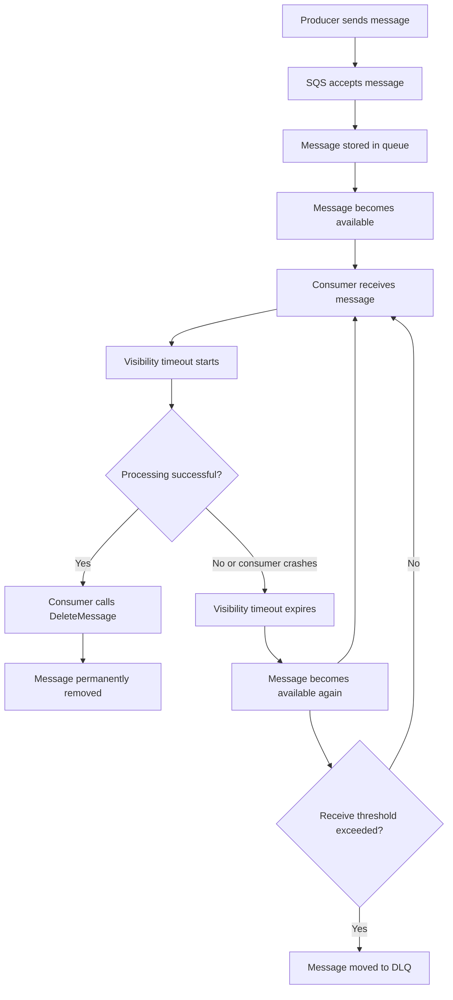
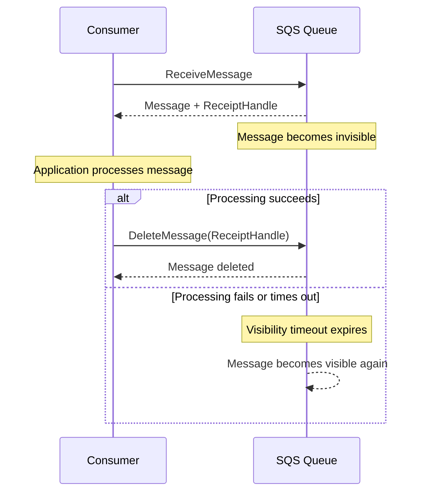
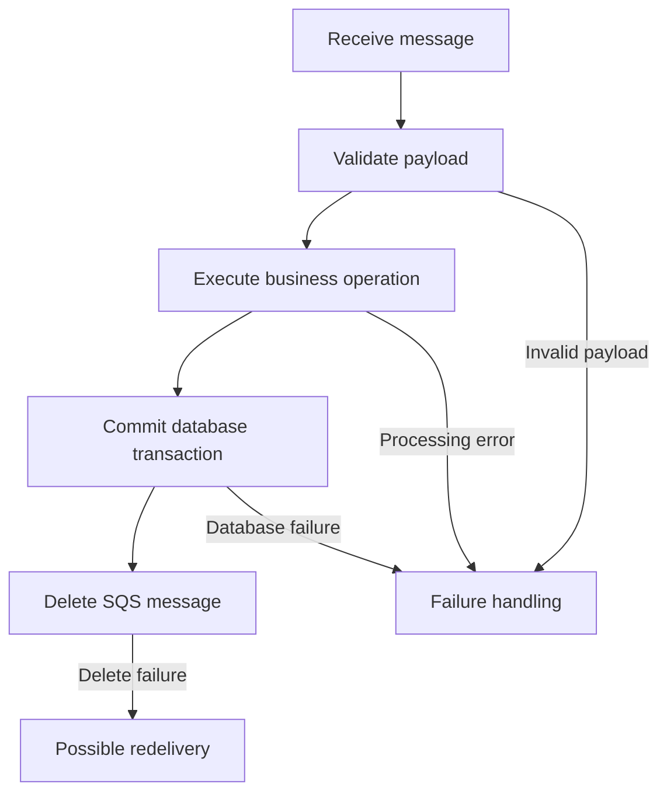
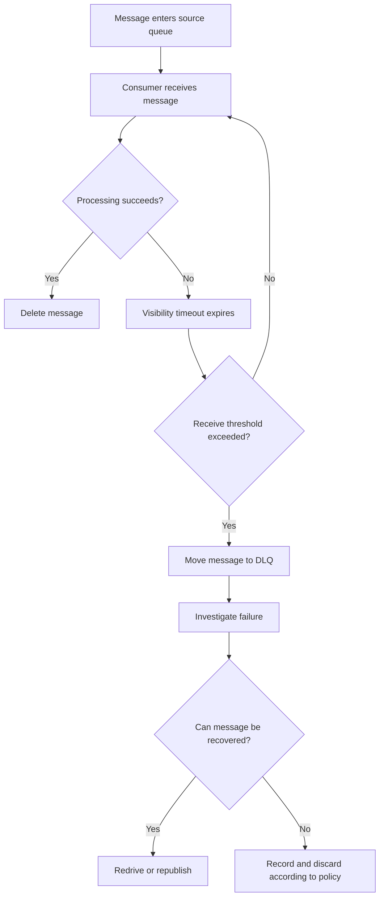
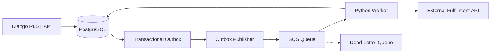

# 05- Message Lifecycle

## Overview

Amazon Simple Queue Service (SQS) manages messages through a lifecycle that begins when a producer sends a message and ends when the message is deleted, expires, or is moved to a dead-letter queue (DLQ).

Understanding this lifecycle is essential for designing reliable asynchronous processing systems. SQS provides durable message storage and delivery coordination, but application-level processing guarantees depend on consumer behavior, visibility timeout configuration, idempotency, and failure handling.

A typical message lifecycle includes:

- Message production and acceptance.
- Message storage and availability.
- Message retrieval by consumers.
- Temporary invisibility during processing.
- Successful acknowledgement through deletion.
- Redelivery after processing failures.
- Movement to a DLQ after repeated receives.
- Expiration when the retention period is exceeded.

## Message Lifecycle Architecture

The following diagram illustrates the primary lifecycle of a message in an SQS Standard queue.



The diagram represents the general processing flow. Actual redrive behavior depends on the queue type, redrive policy, and SQS delivery semantics.

## Message Production

The lifecycle begins when a producer sends a message using the `SendMessage` API.

A producer can be:

- A Django or FastAPI application.
- A microservice.
- An AWS Lambda function.
- A scheduled background process.
- Another AWS service integrated with SQS.

Example:

```python
import json
import boto3

sqs = boto3.client("sqs", region_name="ap-south-1")

QUEUE_URL = "https://sqs.ap-south-1.amazonaws.com/123456789012/order-processing"


def publish_order_event(event: dict) -> str:
    response = sqs.send_message(
        QueueUrl=QUEUE_URL,
        MessageBody=json.dumps(event),
    )

    return response["MessageId"]
```

A production message should contain enough information for reliable processing.

Example payload:

```json
{
  "event_id": "evt-8f2a91",
  "event_type": "order.created",
  "schema_version": 1,
  "order_id": "ORD-1001",
  "created_at": "2026-11-19T10:30:00Z"
}
```

### Producer Responsibilities

The producer should:

- Validate the message before publishing.
- Include a stable business event identifier.
- Use a versioned message schema where necessary.
- Avoid including unnecessary or sensitive data.
- Handle transient publishing failures.
- Avoid generating a new business event ID for every retry of the same logical event.

### Message Acceptance

When SQS successfully accepts a message, the API returns a `MessageId`.

A successful `SendMessage` response confirms that SQS accepted the message. It does not confirm that a consumer has received or processed it.

For reliable database-to-queue publishing, consider the transactional outbox pattern.

The outbox pattern stores the business update and an event record in the same database transaction. A separate publisher reads pending events and sends them to SQS.

This avoids the common dual-write failure where a database transaction commits but message publication fails, or vice versa.

The publisher must still tolerate duplicate sends if it crashes after SQS accepts a message but before marking the outbox record as published.

## Message Storage

After accepting a message, SQS stores it in the queue until it is successfully deleted, expires, or is moved through a redrive policy.

SQS is a managed distributed messaging service. Applications do not manage the underlying message-storage infrastructure.

### Message Durability

SQS stores messages redundantly across multiple Availability Zones within an AWS Region.

This reduces the risk of message loss caused by an individual infrastructure failure.

However, durability does not eliminate application-level failure scenarios such as:

- Incorrect queue configuration.
- Message retention expiration.
- Accidental message deletion.
- Invalid consumer processing.
- Misconfigured redrive policies.
- Regional outages.

### Message Retention

The `MessageRetentionPeriod` attribute controls how long a message can remain in a queue.

| Configuration | Value |
|---|---|
| Default retention | 4 days |
| Minimum retention | 60 seconds |
| Maximum retention | 14 days |

Example:

```python
sqs.set_queue_attributes(
    QueueUrl=QUEUE_URL,
    Attributes={
        "MessageRetentionPeriod": "1209600",
    },
)
```

This configures a retention period of 14 days.

A message that is not successfully processed within its retention period is automatically removed.

**Production considerations:**

- Set retention according to the maximum expected consumer outage.
- Consider recovery and operational investigation windows.
- Configure DLQ retention independently.
- Use S3 or another durable data store for long-term event archival.
- Do not assume messages remain available indefinitely.

For Standard queues, a message moved to a DLQ retains its original enqueue timestamp for the purpose of expiration. The DLQ's retention period therefore does not simply restart the message's original retention clock.

For FIFO queues, the enqueue timestamp resets when the message moves to the DLQ.

## Message Availability

A message becomes available for retrieval after SQS accepts and stores it, subject to any configured delay.

Two queue attributes influence when a newly sent message becomes available:

- `DelaySeconds`
- `ReceiveMessageWaitTimeSeconds`

These attributes serve different purposes.

### DelaySeconds

`DelaySeconds` delays the availability of a newly sent message.

For example:

```python
sqs.send_message(
    QueueUrl=QUEUE_URL,
    MessageBody=json.dumps({
        "task_id": "TASK-1001",
        "task_type": "generate-report",
    }),
    DelaySeconds=60,
)
```

The message becomes available for retrieval after the configured delay.

The maximum delay is 15 minutes.

Use delay queues for short scheduling delays. For longer scheduling requirements, recurring schedules, or calendar-based execution, consider Amazon EventBridge Scheduler.

### Long Polling

Long polling controls how long SQS waits for messages when a consumer calls `ReceiveMessage`.

It does not delay message availability.

Example:

```python
response = sqs.receive_message(
    QueueUrl=QUEUE_URL,
    MaxNumberOfMessages=10,
    WaitTimeSeconds=20,
)
```

With long polling enabled, SQS waits for messages to become available instead of immediately returning an empty response.

The maximum long-polling duration is 20 seconds.

Long polling reduces empty responses and unnecessary API requests.

## Message Retrieval

Consumers retrieve messages using the `ReceiveMessage` API.

A consumer can request up to 10 messages per API call.

Example:

```python
response = sqs.receive_message(
    QueueUrl=QUEUE_URL,
    MaxNumberOfMessages=10,
    WaitTimeSeconds=20,
    AttributeNames=["ApproximateReceiveCount"],
    MessageAttributeNames=["All"],
)

messages = response.get("Messages", [])

for message in messages:
    print(message["MessageId"])
    print(message["Body"])
    print(message["ReceiptHandle"])
```

A successful receive operation returns message information, including:

| Field | Purpose |
|---|---|
| `MessageId` | Identifies the SQS message. |
| `ReceiptHandle` | Identifies the current delivery of the message. |
| `Body` | Contains the message payload. |
| `Attributes` | Contains SQS system attributes when requested. |
| `MessageAttributes` | Contains producer-defined message metadata when requested. |

### Receipt Handle

The receipt handle is essential for acknowledging a message.

Every successful receive operation produces a receipt handle for that delivery.

If a message becomes visible again and is received by another consumer, SQS returns a new receipt handle.

Use the latest receipt handle for deletion or visibility changes.

A Message ID cannot be used in place of a receipt handle.

### At-Least-Once Delivery

SQS Standard queues provide at-least-once message delivery.

This means a message can be delivered more than once, even when a consumer successfully processes it.

Duplicate delivery can occur because SQS uses a distributed architecture and a message copy may not be successfully removed from every storage location during a receive/delete sequence.

Applications must therefore tolerate duplicate processing.

FIFO queues provide deduplication for sends within a five-minute interval and ordering within message groups, but consumers must still be designed to handle duplicate deliveries.

Neither queue type guarantees exactly-once business processing.

## Visibility Timeout

Visibility timeout is one of the most important parts of the SQS message lifecycle.

When a consumer receives a message, SQS temporarily hides that message from other consumers.

This prevents multiple consumers from normally processing the same message simultaneously.

The visibility timeout starts when the message is delivered to the consumer.



### Visibility Timeout Configuration

The default visibility timeout is 30 seconds.

The maximum is 12 hours.

Example:

```python
sqs.set_queue_attributes(
    QueueUrl=QUEUE_URL,
    Attributes={
        "VisibilityTimeout": "120",
    },
)
```

This configures a two-minute visibility timeout.

### Why Visibility Timeout Matters

Consider a consumer that receives a report-generation task and needs 90 seconds to complete it.

If the visibility timeout is only 30 seconds, the message becomes visible again before processing finishes.

Another consumer may receive the same message, causing concurrent execution.

This can result in:

- Duplicate database updates.
- Repeated external API calls.
- Duplicate notifications.
- Conflicting file generation.
- Unnecessary resource consumption.

### Extending Visibility Timeout

For long-running tasks, consumers can extend the visibility timeout using `ChangeMessageVisibility`.

Example:

```python
sqs.change_message_visibility(
    QueueUrl=QUEUE_URL,
    ReceiptHandle=receipt_handle,
    VisibilityTimeout=300,
)
```

This extends the invisibility period to five minutes from the time the operation is applied.

A consumer can periodically extend visibility while processing a long-running task.

However, the maximum visibility period for a message is 12 hours from when it is received. Repeated extensions do not provide an unlimited processing window.

For tasks that routinely exceed this limit, use a workflow or job-orchestration design rather than relying on one indefinitely running SQS message.

### Choosing a Visibility Timeout

Consider:

- Typical processing duration.
- Worst-case processing duration.
- Downstream API latency.
- Database transaction duration.
- Retry and recovery requirements.
- Consumer execution environment limits.

For Lambda functions using SQS event source mappings, configure the queue visibility timeout in relation to the Lambda function timeout and batch-processing behavior. AWS recommends setting it to at least six times the function timeout, with additional allowance when a batching window is configured.

For continuously running containerized consumers, the application can use periodic visibility extensions for long-running work.

## Message Processing

After receiving a message, the consumer performs the application-specific operation.

For example, an order-processing consumer may:

1. Deserialize the message.
2. Validate the event schema.
3. Check whether the event was already processed.
4. Update the order state.
5. Commit the database transaction.
6. Delete the SQS message.

The message should be deleted only after the business operation has completed successfully.

### Example Consumer

The following example demonstrates the processing sequence using Boto3 and a database-backed idempotency function.

```python
import json
import logging

import boto3
from botocore.exceptions import BotoCoreError, ClientError

logger = logging.getLogger(__name__)

sqs = boto3.client("sqs", region_name="ap-south-1")

QUEUE_URL = "https://sqs.ap-south-1.amazonaws.com/123456789012/order-processing"


def process_order_event(event: dict) -> None:
    """
    Apply the business operation transactionally.

    The implementation should enforce a unique event_id in the database
    and commit the idempotency record and business changes together.
    """
    event_id = event["event_id"]
    order_id = event["order_id"]

    # Replace with transactional database processing.
    logger.info(
        "Processing order event",
        extra={
            "event_id": event_id,
            "order_id": order_id,
        },
    )


def consume_messages() -> None:
    while True:
        try:
            response = sqs.receive_message(
                QueueUrl=QUEUE_URL,
                MaxNumberOfMessages=10,
                WaitTimeSeconds=20,
            )

            for message in response.get("Messages", []):
                receipt_handle = message["ReceiptHandle"]

                try:
                    event = json.loads(message["Body"])
                    process_order_event(event)

                    sqs.delete_message(
                        QueueUrl=QUEUE_URL,
                        ReceiptHandle=receipt_handle,
                    )

                except (ValueError, KeyError):
                    logger.exception(
                        "Invalid message payload",
                        extra={"message_id": message["MessageId"]},
                    )

                except Exception:
                    logger.exception(
                        "Message processing failed",
                        extra={"message_id": message["MessageId"]},
                    )

        except (BotoCoreError, ClientError):
            logger.exception("SQS polling operation failed")
```

This example intentionally does not delete messages after processing failures. They remain available for redelivery after the visibility timeout expires.

In a production implementation:

- Replace the placeholder processing function with a real database transaction.
- Distinguish permanent validation failures from transient infrastructure failures.
- Configure a DLQ for messages that repeatedly fail.
- Add bounded retry and backoff behavior for API-level failures.
- Use structured logging and distributed tracing.
- Ensure consumer shutdown does not acknowledge unfinished work.

For a production worker, process messages independently so that one failed message does not prevent unrelated messages from being processed.

## Message Deletion and Acknowledgement

SQS does not automatically delete a message after a consumer receives it.

The consumer must explicitly call `DeleteMessage` after successful processing.

Example:

```python
sqs.delete_message(
    QueueUrl=QUEUE_URL,
    ReceiptHandle=receipt_handle,
)
```

A successful deletion removes the message from the queue.

This operation is the SQS equivalent of acknowledging successful processing.

### Why Explicit Deletion Exists

SQS separates message retrieval from acknowledgement.

This allows messages to be redelivered when:

- A consumer crashes.
- Processing fails.
- The application cannot reach its database.
- An external dependency becomes unavailable.
- The consumer does not complete before visibility timeout expiration.

If SQS deleted messages immediately after delivery, a consumer crash could result in permanent message loss.

### Correct Processing Order



The recommended order is:

1. Receive the message.
2. Execute the business operation.
3. Commit the business transaction.
4. Delete the message.

Deleting the message before committing the business transaction creates a message-loss risk.

If the database transaction later fails, the message has already been removed from SQS.

### Database Commit and Message Deletion Are Not Atomic

SQS and PostgreSQL do not share a distributed transaction.

A consumer can successfully commit its database transaction and then crash before deleting the SQS message.

SQS will eventually redeliver the message.

This is why idempotency is mandatory for reliable processing.

A common approach is to store processed event IDs in a database table with a unique constraint.

```sql
CREATE TABLE processed_events (
    event_id VARCHAR(100) PRIMARY KEY,
    processed_at TIMESTAMPTZ NOT NULL DEFAULT NOW()
);
```

The consumer inserts the event ID and applies the business update in the same database transaction.

If the event ID already exists, the consumer recognizes the duplicate and avoids repeating the business operation.

## Message Redelivery

A message becomes available for retrieval again when its visibility timeout expires without successful deletion.

Redelivery is a normal part of SQS failure recovery.

Typical causes include:

- Consumer process crashes.
- Container termination.
- Application exceptions.
- Database transaction failures.
- External service timeouts.
- Visibility timeout configured too low.
- Consumer network connectivity problems.

### ApproximateReceiveCount

SQS exposes `ApproximateReceiveCount` as a system attribute.

It indicates how many times a message has been received.

Example:

```python
response = sqs.receive_message(
    QueueUrl=QUEUE_URL,
    MaxNumberOfMessages=10,
    WaitTimeSeconds=20,
    AttributeNames=["ApproximateReceiveCount"],
)

for message in response.get("Messages", []):
    receive_count = int(
        message["Attributes"]["ApproximateReceiveCount"]
    )

    logger.info(
        "Message received",
        extra={
            "message_id": message["MessageId"],
            "receive_count": receive_count,
        },
    )
```

The value is approximate and should not be treated as an exact count of completed business-processing attempts.

A message may be received without the application actually beginning or completing processing.

### Retry Behavior

SQS does not provide an application-level retry schedule for arbitrary processing failures.

Instead, a failed message becomes available again after its visibility timeout expires.

The consumer can also change visibility to control when a message becomes available again.

For example:

```python
sqs.change_message_visibility(
    QueueUrl=QUEUE_URL,
    ReceiptHandle=receipt_handle,
    VisibilityTimeout=60,
)
```

This can be used to defer another processing attempt.

For more complex retry policies involving exponential backoff, delayed retries, or different failure categories, consider implementing an explicit retry architecture.

Avoid retrying permanently invalid messages indefinitely.

## Dead-Letter Queue Lifecycle

A dead-letter queue is a separate SQS queue that receives messages after they exceed the configured receive threshold on a source queue.

The source queue's `RedrivePolicy` determines:

- The destination DLQ ARN.
- The `maxReceiveCount` threshold.

Example:

```python
import json

redrive_policy = {
    "deadLetterTargetArn": (
        "arn:aws:sqs:ap-south-1:123456789012:order-processing-dlq"
    ),
    "maxReceiveCount": "5",
}

sqs.set_queue_attributes(
    QueueUrl=QUEUE_URL,
    Attributes={
        "RedrivePolicy": json.dumps(redrive_policy),
    },
)
```

When the receive threshold is exceeded, SQS moves the message to the configured DLQ.

### DLQ Lifecycle



### Common DLQ Use Cases

- Invalid message schemas.
- Missing business records.
- Persistent downstream dependency failures.
- Unsupported event versions.
- Application bugs.
- Repeated authorization or configuration failures.

### DLQ Retention

The DLQ has its own retention configuration.

For Standard queues, the original enqueue timestamp is retained when a message moves to the DLQ. The DLQ retention period therefore needs to account for time already spent in the source queue.

For FIFO queues, the enqueue timestamp resets when the message moves to the DLQ.

Configure DLQ retention to provide enough time for investigation and recovery.

### Redriving Messages

SQS provides a message movement task API for moving messages from a DLQ back to a source queue or another supported destination queue.

The AWS CLI supports this through `start-message-move-task`.

Example:

```bash
aws sqs start-message-move-task \
  --source-arn arn:aws:sqs:ap-south-1:123456789012:order-processing-dlq \
  --destination-arn arn:aws:sqs:ap-south-1:123456789012:order-processing \
  --max-number-of-messages-per-second 50 \
  --region ap-south-1
```

Before redriving:

- Identify and fix the original failure.
- Validate the message schema and required data.
- Confirm downstream systems can handle the replay volume.
- Ensure consumer idempotency is implemented.
- Monitor the destination queue during redrive.

Do not blindly redrive all DLQ messages. Reintroducing invalid messages can create another failure cycle.

## Standard and FIFO Message Lifecycle Differences

Both Standard and FIFO queues use message retrieval, visibility timeout, and explicit deletion.

However, their ordering and deduplication behavior differ.

| Lifecycle behavior | Standard queue | FIFO queue |
|---|---|---|
| Delivery guarantee | At-least-once | Exactly-once processing is not guaranteed |
| Ordering | Best effort | Strict within a message group |
| Duplicate delivery | Possible | Still possible during consumer processing |
| Send deduplication | Not supported as a FIFO feature | Five-minute deduplication interval |
| Message groups | Not supported | Supported |
| Visibility timeout | Supported | Supported |
| Explicit deletion | Required | Required |
| DLQ support | Supported | Supported with FIFO DLQs |

### FIFO Message Groups

FIFO queues use `MessageGroupId` to define ordering boundaries.

Messages in the same group are processed in order. Different message groups can be processed concurrently.

For example:

```python
sqs.send_message(
    QueueUrl="https://sqs.ap-south-1.amazonaws.com/123456789012/order-events.fifo",
    MessageBody=json.dumps({
        "event_id": "evt-1001",
        "order_id": "ORD-1001",
        "event_type": "order.created",
    }),
    MessageGroupId="ORD-1001",
    MessageDeduplicationId="evt-1001",
)
```

Using an order identifier as the message group allows events for the same order to remain ordered while independent orders can be processed concurrently.

A message that is not deleted can block later messages in the same message group until it is successfully processed or moved to a DLQ.

## Batch Message Processing

SQS supports receiving and deleting multiple messages in a single API request.

Batch operations reduce API overhead and can improve consumer throughput.

The maximum batch size is 10 messages.

Example:

```python
response = sqs.receive_message(
    QueueUrl=QUEUE_URL,
    MaxNumberOfMessages=10,
    WaitTimeSeconds=20,
)

messages = response.get("Messages", [])

successful_entries = []

for index, message in enumerate(messages):
    try:
        event = json.loads(message["Body"])
        process_order_event(event)

        successful_entries.append({
            "Id": str(index),
            "ReceiptHandle": message["ReceiptHandle"],
        })

    except Exception:
        logger.exception(
            "Batch message processing failed",
            extra={"message_id": message["MessageId"]},
        )

if successful_entries:
    result = sqs.delete_message_batch(
        QueueUrl=QUEUE_URL,
        Entries=successful_entries,
    )

    if result.get("Failed"):
        logger.error(
            "Some SQS messages could not be deleted",
            extra={"failed_entries": result["Failed"]},
        )
```

Each message should be processed independently so that one failure does not prevent successful messages from being acknowledged.

Batch deletion responses can contain both successful and failed entries. Always inspect the response rather than assuming the entire batch succeeded.

For Lambda SQS event source mappings, configure partial batch responses when appropriate. This allows the function to report individual failed records instead of causing the entire batch to be retried.

## Message Lifecycle in a Production Backend

Consider an order-processing architecture with Django, PostgreSQL, SQS, and a containerized Python worker.



A typical workflow:

1. The REST API receives an order request.
2. Django writes the order and an outbox event in one database transaction.
3. An outbox publisher sends the event to SQS.
4. A worker retrieves the event.
5. The worker validates the event and checks its idempotency record.
6. The worker updates the order and performs the required business operation.
7. The worker commits its database transaction.
8. The worker deletes the SQS message.
9. If processing repeatedly fails, SQS moves the message to the DLQ.

### External Side Effects

Database idempotency alone is not sufficient when the consumer calls an external service.

For example, a worker may successfully charge a payment provider but crash before recording the successful result locally.

When SQS redelivers the message, the worker could charge the customer again.

Use the external provider's idempotency mechanism when available. Generate a stable idempotency key from the business event or operation identifier.

For operations without provider-side idempotency, use a durable operation state machine and reconciliation process.

## Operational Monitoring

Message lifecycle monitoring should identify delays, repeated failures, and processing bottlenecks.

Important CloudWatch metrics include:

| Metric | Operational meaning |
|---|---|
| `ApproximateNumberOfMessagesVisible` | Messages currently available for retrieval. |
| `ApproximateNumberOfMessagesNotVisible` | Messages currently in flight. |
| `ApproximateAgeOfOldestMessage` | Approximate age of the oldest available message. |
| `NumberOfMessagesSent` | Messages accepted by the queue. |
| `NumberOfMessagesReceived` | Messages retrieved by consumers. |
| `NumberOfMessagesDeleted` | Messages successfully deleted. |
| `ApproximateNumberOfMessagesDelayed` | Messages waiting for configured delivery delay. |

Recommended operational practices:

- Alarm on DLQ message count greater than zero.
- Monitor oldest-message age against the processing SLA.
- Track visible and in-flight messages together.
- Monitor consumer processing duration and failure rates.
- Log message IDs and business event IDs.
- Record `ApproximateReceiveCount` for repeated-failure investigation.
- Monitor queue growth during deployments and downstream outages.

Queue metrics are approximate and should not be treated as exact business-level accounting.

For accurate business processing metrics, instrument the consumer and application database.

## Common Message Lifecycle Mistakes

| Mistake | Consequence | Prevention |
|---|---|---|
| Deleting before database commit | Permanent loss of work if the transaction fails. | Delete only after durable business processing. |
| Assuming receive means acknowledgement | Messages can be delivered again. | Explicitly call `DeleteMessage`. |
| Using Message ID as an idempotency key | Does not reliably represent business event identity. | Include a stable producer-generated event ID. |
| Ignoring visibility timeout | Concurrent duplicate processing can occur. | Tune timeout and extend it for long-running tasks. |
| Assuming FIFO guarantees exactly-once business effects | Consumer retries can repeat side effects. | Implement application-level idempotency. |
| Retrying permanent failures indefinitely | Wastes capacity and delays healthy messages. | Use DLQs and classify failures. |
| Redriving without fixing the cause | Messages may fail repeatedly. | Investigate and correct the failure first. |
| Ignoring batch deletion failures | Some messages may be delivered again. | Inspect successful and failed batch entries. |
| Using short retention without recovery planning | Messages may expire during outages. | Align retention with recovery objectives. |
| Ignoring external API idempotency | Duplicate external side effects can occur. | Use provider idempotency keys and reconciliation. |

## Key Takeaways

- An SQS message moves through production, storage, retrieval, temporary invisibility, processing, and explicit deletion or failure handling.
- Visibility timeout controls redelivery behavior; it does not guarantee exclusive or exactly-once processing.
- Delete messages only after durable business processing, and use stable business event IDs to make consumers idempotent.
- DLQs isolate repeatedly failing messages, but investigation and controlled redrive are necessary for safe recovery.
- Reliable SQS consumers must account for duplicate delivery, database transaction boundaries, external side effects, and operational monitoring.