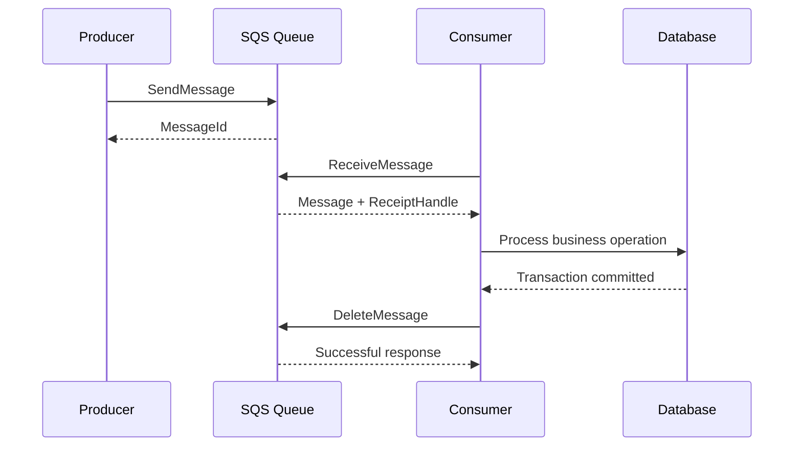
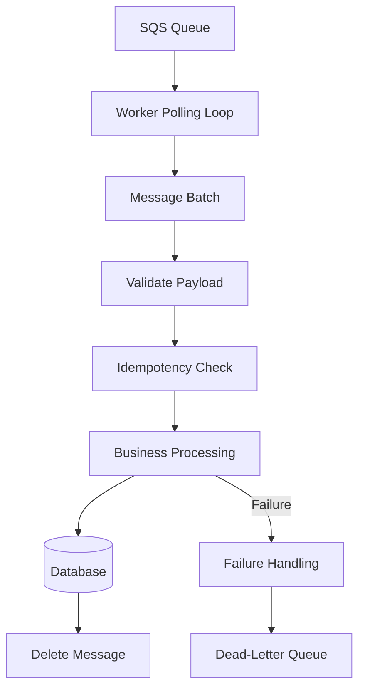

# 06- Message Operations and APIs

## Overview

Amazon Simple Queue Service (SQS) exposes APIs for sending, receiving, inspecting, modifying, and deleting messages. These operations form the application-facing interface between producers, queues, and consumers.

Understanding the APIs is important for building reliable backend workers and controlling message delivery behavior. Incorrect API usage can cause duplicate processing, message loss, unnecessary costs, or reduced throughput.

The core SQS message operations are:

- `SendMessage` — publish one message.
- `SendMessageBatch` — publish multiple messages in one request.
- `ReceiveMessage` — retrieve messages for processing.
- `DeleteMessage` — acknowledge successful processing.
- `DeleteMessageBatch` — acknowledge multiple messages.
- `ChangeMessageVisibility` — modify the visibility timeout of a received message.
- `ChangeMessageVisibilityBatch` — modify visibility for multiple messages.
- `GetQueueAttributes` — inspect queue configuration and operational attributes.
- `GetQueueUrl` — resolve a queue name to its URL.
- `PurgeQueue` — remove messages from a queue.

SQS APIs are available through AWS SDKs, the AWS CLI, and direct HTTPS requests using AWS Signature Version 4.

## SQS Message API Lifecycle

A typical producer-consumer workflow uses several SQS API operations.



The producer does not wait for the consumer to process the message. SQS stores the message and makes it available for asynchronous retrieval.

The consumer explicitly deletes the message after successfully completing its business operation.

## SendMessage

`SendMessage` publishes a single message to an SQS queue.

It is commonly used by backend applications when an operation must be processed asynchronously.

### API Parameters

| Parameter | Purpose |
|---|---|
| `QueueUrl` | URL of the destination queue. |
| `MessageBody` | Message payload. |
| `DelaySeconds` | Delays message availability. |
| `MessageAttributes` | Application-defined metadata. |
| `MessageSystemAttributes` | Supported SQS system attributes. |
| `MessageGroupId` | Required for FIFO queues; identifies the ordering group. |
| `MessageDeduplicationId` | Optional or required depending on FIFO deduplication configuration. |

`MessageGroupId` and `MessageDeduplicationId` are FIFO-specific parameters.

### Python Example

```python
import json

import boto3

sqs = boto3.client("sqs", region_name="ap-south-1")

QUEUE_URL = "https://sqs.ap-south-1.amazonaws.com/123456789012/order-processing"


def publish_order_event(event: dict) -> str:
    response = sqs.send_message(
        QueueUrl=QUEUE_URL,
        MessageBody=json.dumps(event),
        MessageAttributes={
            "event_type": {
                "DataType": "String",
                "StringValue": "order.created",
            },
            "source": {
                "DataType": "String",
                "StringValue": "order-service",
            },
        },
    )

    return response["MessageId"]
```

### AWS CLI Example

```bash
aws sqs send-message \
  --queue-url https://sqs.ap-south-1.amazonaws.com/123456789012/order-processing \
  --message-body '{"event_id":"evt-1001","order_id":"ORD-1001"}' \
  --region ap-south-1
```

### Response

A successful request returns information including:

```json
{
  "MD5OfMessageBody": "example-md5-value",
  "MessageId": "a1b2c3d4-e5f6-7890-abcd-123456789012"
}
```

For messages with attributes, the response can also contain an MD5 digest of the message attributes.

The Message ID identifies the SQS message. It should not be used as the application's business event identifier.

### Production Considerations

- Include a stable business event ID in the payload.
- Validate and serialize messages before publishing.
- Handle transient AWS API failures.
- Use bounded retries with backoff and jitter.
- Ensure retrying a publish does not create duplicate business effects.
- Avoid placing large payloads or sensitive data directly in messages.

For database-backed applications, use the transactional outbox pattern when publishing must be coordinated with a database transaction.

## SendMessageBatch

`SendMessageBatch` sends multiple messages in a single API request.

It reduces API request overhead and can improve producer throughput.

SQS supports up to 10 entries per batch request.

### Python Example

```python
import json

import boto3

sqs = boto3.client("sqs", region_name="ap-south-1")

QUEUE_URL = "https://sqs.ap-south-1.amazonaws.com/123456789012/order-processing"


def publish_order_events(events: list[dict]) -> dict:
    if not 1 <= len(events) <= 10:
        raise ValueError("A batch must contain between 1 and 10 messages")

    entries = [
        {
            "Id": str(index),
            "MessageBody": json.dumps(event),
        }
        for index, event in enumerate(events)
    ]

    return sqs.send_message_batch(
        QueueUrl=QUEUE_URL,
        Entries=entries,
    )
```

### AWS CLI Example

```bash
aws sqs send-message-batch \
  --queue-url https://sqs.ap-south-1.amazonaws.com/123456789012/order-processing \
  --entries '[
    {
      "Id": "order-1",
      "MessageBody": "{\"event_id\":\"evt-1001\",\"order_id\":\"ORD-1001\"}"
    },
    {
      "Id": "order-2",
      "MessageBody": "{\"event_id\":\"evt-1002\",\"order_id\":\"ORD-1002\"}"
    }
  ]' \
  --region ap-south-1
```

### Partial Batch Failures

A successful HTTP response does not necessarily mean every message in the batch was accepted.

The response contains separate `Successful` and `Failed` collections.

Example:

```json
{
  "Successful": [
    {
      "Id": "0",
      "MessageId": "message-id-1"
    }
  ],
  "Failed": [
    {
      "Id": "1",
      "Code": "InvalidParameterValue",
      "Message": "Invalid message parameter",
      "SenderFault": true
    }
  ]
}
```

Always inspect the response and retry only failed entries when appropriate.

Do not retry the entire batch automatically, because messages that were already accepted could be published again.

### Batch Constraints

| Constraint | Limit |
|---|---|
| Entries per request | 10 |
| Maximum message size | 1 MiB per message |
| Aggregate batch payload | 1 MiB |
| Entry identifier | Unique within the batch |
| Batch result | Individual success and failure results |

For FIFO queues, include the required message group and deduplication information according to the queue's configuration.

## ReceiveMessage

`ReceiveMessage` retrieves one or more messages from a queue.

It is typically called by a continuously running worker or an event-driven consumer.

### API Parameters

| Parameter | Purpose |
|---|---|
| `QueueUrl` | Source queue URL. |
| `MaxNumberOfMessages` | Maximum number of messages to retrieve, up to 10. |
| `WaitTimeSeconds` | Long-polling duration, up to 20 seconds. |
| `VisibilityTimeout` | Overrides the queue's visibility timeout for received messages. |
| `AttributeNames` | Selects SQS system attributes to return. |
| `MessageAttributeNames` | Selects application message attributes to return. |

### Python Example

```python
import boto3

sqs = boto3.client("sqs", region_name="ap-south-1")

QUEUE_URL = "https://sqs.ap-south-1.amazonaws.com/123456789012/order-processing"


def receive_order_messages() -> list[dict]:
    response = sqs.receive_message(
        QueueUrl=QUEUE_URL,
        MaxNumberOfMessages=10,
        WaitTimeSeconds=20,
        AttributeNames=["ApproximateReceiveCount"],
        MessageAttributeNames=["All"],
    )

    return response.get("Messages", [])
```

### AWS CLI Example

```bash
aws sqs receive-message \
  --queue-url https://sqs.ap-south-1.amazonaws.com/123456789012/order-processing \
  --max-number-of-messages 10 \
  --wait-time-seconds 20 \
  --attribute-names ApproximateReceiveCount \
  --message-attribute-names All \
  --region ap-south-1
```

### Response Structure

A received message can contain:

```json
{
  "Messages": [
    {
      "MessageId": "message-id-1",
      "ReceiptHandle": "receipt-handle-value",
      "MD5OfBody": "example-md5-value",
      "Body": "{\"event_id\":\"evt-1001\",\"order_id\":\"ORD-1001\"}",
      "Attributes": {
        "ApproximateReceiveCount": "1",
        "SentTimestamp": "1795084200000"
      }
    }
  ]
}
```

Important fields:

- `MessageId` identifies the message.
- `ReceiptHandle` identifies this particular delivery.
- `Body` contains the message payload.
- `Attributes` contains requested SQS system metadata.
- `MessageAttributes` contains requested application metadata.

A receipt handle is required for deleting the message or changing its visibility.

### Long Polling

Long polling reduces empty receive responses.

Configure it using `WaitTimeSeconds` or the queue-level `ReceiveMessageWaitTimeSeconds` attribute.

```python
response = sqs.receive_message(
    QueueUrl=QUEUE_URL,
    MaxNumberOfMessages=10,
    WaitTimeSeconds=20,
)
```

The HTTP client's read timeout must be longer than the configured long-polling duration.

For continuously running workers, long polling is generally preferable to short polling.

### Visibility Timeout Override

A consumer can override the queue's visibility timeout for a specific receive request.

```python
response = sqs.receive_message(
    QueueUrl=QUEUE_URL,
    MaxNumberOfMessages=5,
    WaitTimeSeconds=20,
    VisibilityTimeout=120,
)
```

This is useful when a particular consumer has different processing requirements from other consumers.

The override applies to the messages received by that request. It does not permanently change the queue's default visibility timeout.

## DeleteMessage

`DeleteMessage` removes a message after successful processing.

The operation requires the receipt handle returned by `ReceiveMessage`.

### Python Example

```python
def acknowledge_message(
    queue_url: str,
    receipt_handle: str,
) -> None:
    sqs.delete_message(
        QueueUrl=queue_url,
        ReceiptHandle=receipt_handle,
    )
```

### AWS CLI Example

```bash
aws sqs delete-message \
  --queue-url https://sqs.ap-south-1.amazonaws.com/123456789012/order-processing \
  --receipt-handle "RECEIPT_HANDLE_FROM_RECEIVE_MESSAGE" \
  --region ap-south-1
```

### Correct Acknowledgement Order

The recommended processing sequence is:

1. Receive the message.
2. Validate the payload.
3. Execute the business operation.
4. Commit the database transaction.
5. Delete the message.

Deleting before committing the business transaction can permanently remove a message even when the business operation later fails.

### Important Considerations

- Use the latest receipt handle.
- Do not delete messages before durable processing.
- Handle delete API failures.
- Make processing idempotent because a crash can occur after database commit but before deletion.
- Do not assume a successful delete response provides an atomic transaction with your database.

## DeleteMessageBatch

`DeleteMessageBatch` deletes multiple messages in one request.

It is useful when consumers process messages in batches.

### Python Example

```python
def delete_processed_messages(
    queue_url: str,
    messages: list[dict],
) -> dict:
    entries = [
        {
            "Id": str(index),
            "ReceiptHandle": message["ReceiptHandle"],
        }
        for index, message in enumerate(messages)
    ]

    if not entries:
        return {"Successful": [], "Failed": []}

    return sqs.delete_message_batch(
        QueueUrl=queue_url,
        Entries=entries,
    )
```

### Partial Failures

The API can return a mixture of successful and failed deletions.

Inspect both response collections:

```python
result = delete_processed_messages(QUEUE_URL, messages)

for entry in result.get("Failed", []):
    print(
        "Deletion failed:",
        entry["Id"],
        entry["Code"],
        entry["Message"],
    )
```

Do not assume that all messages were deleted simply because the batch API call returned successfully.

A failed deletion can result in redelivery after visibility timeout expiration.

## ChangeMessageVisibility

`ChangeMessageVisibility` modifies the visibility timeout of a received message.

It is primarily used when processing takes longer than the original visibility timeout.

### Python Example

```python
def extend_message_visibility(
    queue_url: str,
    receipt_handle: str,
    timeout_seconds: int,
) -> None:
    sqs.change_message_visibility(
        QueueUrl=queue_url,
        ReceiptHandle=receipt_handle,
        VisibilityTimeout=timeout_seconds,
    )
```

### AWS CLI Example

```bash
aws sqs change-message-visibility \
  --queue-url https://sqs.ap-south-1.amazonaws.com/123456789012/order-processing \
  --receipt-handle "RECEIPT_HANDLE_FROM_RECEIVE_MESSAGE" \
  --visibility-timeout 300 \
  --region ap-south-1
```

This changes the message's visibility timeout to five minutes from the time the request is applied.

### Use Cases

- Long-running report generation.
- Large file processing.
- Data transformation tasks.
- External API workflows with variable latency.
- Background jobs that require periodic progress checks.

### Visibility Timeout Limitations

The maximum visibility timeout is 12 hours from the time the message is received.

Repeatedly extending visibility does not reset this overall limit.

For workloads that can exceed the limit, use a workflow orchestration service or split the work into smaller independently recoverable tasks.

## ChangeMessageVisibilityBatch

This operation changes visibility for multiple received messages in one request.

It supports up to 10 entries per batch.

Example:

```python
def extend_batch_visibility(
    queue_url: str,
    messages: list[dict],
    timeout_seconds: int,
) -> dict:
    entries = [
        {
            "Id": str(index),
            "ReceiptHandle": message["ReceiptHandle"],
            "VisibilityTimeout": timeout_seconds,
        }
        for index, message in enumerate(messages)
    ]

    if not entries:
        return {"Successful": [], "Failed": []}

    return sqs.change_message_visibility_batch(
        QueueUrl=queue_url,
        Entries=entries,
    )
```

Inspect the `Successful` and `Failed` response collections.

Batch visibility changes are useful for workers that manage multiple long-running messages concurrently.

However, visibility extensions should be coordinated with actual task progress. Extending every message indefinitely can delay recovery from failed workers.

## GetQueueAttributes

`GetQueueAttributes` retrieves queue configuration and operational attributes.

It is useful for diagnostics, deployment validation, and monitoring integrations.

### Python Example

```python
def get_queue_attributes(queue_url: str) -> dict:
    response = sqs.get_queue_attributes(
        QueueUrl=queue_url,
        AttributeNames=["All"],
    )

    return response["Attributes"]
```

### AWS CLI Example

```bash
aws sqs get-queue-attributes \
  --queue-url https://sqs.ap-south-1.amazonaws.com/123456789012/order-processing \
  --attribute-names All \
  --region ap-south-1
```

Common attributes include:

| Attribute | Description |
|---|---|
| `ApproximateNumberOfMessages` | Approximate number of available messages. |
| `ApproximateNumberOfMessagesNotVisible` | Approximate number of messages in flight. |
| `ApproximateNumberOfMessagesDelayed` | Approximate number of delayed messages. |
| `VisibilityTimeout` | Default visibility timeout. |
| `MessageRetentionPeriod` | Message retention period. |
| `ReceiveMessageWaitTimeSeconds` | Default long-polling duration. |
| `RedrivePolicy` | DLQ configuration. |
| `QueueArn` | Queue ARN. |
| `CreatedTimestamp` | Queue creation timestamp. |
| `LastModifiedTimestamp` | Last queue modification timestamp. |

Queue depth attributes are approximate and may not immediately reflect recent changes.

Use CloudWatch metrics for operational monitoring rather than continuously polling queue attributes as a substitute for metrics.

## GetQueueUrl

`GetQueueUrl` retrieves a queue URL using its queue name.

It is useful when applications know the queue name but do not have its URL configured directly.

### Python Example

```python
def resolve_queue_url(queue_name: str) -> str:
    response = sqs.get_queue_url(
        QueueName=queue_name,
    )

    return response["QueueUrl"]


queue_url = resolve_queue_url("order-processing")
```

For cross-account access, `GetQueueUrl` can also accept `QueueOwnerAWSAccountId`.

### AWS CLI Example

```bash
aws sqs get-queue-url \
  --queue-name order-processing \
  --region ap-south-1
```

In production, resolve queue URLs during application initialization and cache them rather than calling `GetQueueUrl` for every message operation.

## PurgeQueue

`PurgeQueue` deletes all messages currently in a queue, including messages that are not visible to consumers.

It is an administrative operation, not a normal message-processing operation.

### Python Example

```python
sqs.purge_queue(
    QueueUrl=QUEUE_URL,
)
```

### AWS CLI Example

```bash
aws sqs purge-queue \
  --queue-url https://sqs.ap-south-1.amazonaws.com/123456789012/order-processing \
  --region ap-south-1
```

### Important Constraints

- Purging removes messages rather than moving them to a DLQ.
- The operation cannot be reversed.
- SQS limits how frequently a queue can be purged; another purge request cannot be made for 60 seconds.
- Messages sent during the purge operation can also be affected.
- Purging does not delete the queue itself.

Use it only for deliberate administrative cleanup, typically in development or controlled operational scenarios.

Never use `PurgeQueue` as a routine way to recover from consumer failures.

## FIFO-Specific Message Operations

FIFO queues use the same core send, receive, delete, and visibility APIs, with additional parameters for ordering and deduplication.

### MessageGroupId

`MessageGroupId` identifies the ordering group.

Messages with the same group ID are processed in order.

```python
sqs.send_message(
    QueueUrl="https://sqs.ap-south-1.amazonaws.com/123456789012/order-events.fifo",
    MessageBody=json.dumps({
        "event_id": "evt-1001",
        "order_id": "ORD-1001",
        "event_type": "order.created",
    }),
    MessageGroupId="ORD-1001",
    MessageDeduplicationId="evt-1001",
)
```

Use a business entity identifier as the group ID when events for that entity must be processed sequentially.

Different message groups can be processed concurrently.

### MessageDeduplicationId

`MessageDeduplicationId` identifies a message for FIFO send deduplication.

SQS suppresses duplicate sends using the same deduplication ID within the five-minute deduplication interval.

When content-based deduplication is enabled, SQS can generate the deduplication ID from the message body.

Explicit deduplication IDs are useful when the application has a stable business event identifier.

### FIFO Receive Considerations

FIFO queues preserve ordering within a message group.

If a consumer receives messages from a group and does not delete the first message, later messages in that group remain blocked from normal delivery until the earlier message is successfully processed or moved to a DLQ.

Consumers should therefore:

- Keep processing duration predictable.
- Avoid unnecessary visibility extensions.
- Use idempotent business operations.
- Monitor message groups that experience repeated failures.
- Avoid a single global message group unless global serialization is genuinely required.

## AWS SDK Error Handling

SQS operations can fail because of network problems, permissions, invalid parameters, throttling, or service-side issues.

Use Boto3's exception model to distinguish AWS service errors from client-side failures.

Example:

```python
import logging

import boto3
from botocore.exceptions import BotoCoreError, ClientError

logger = logging.getLogger(__name__)

sqs = boto3.client("sqs", region_name="ap-south-1")


def publish_message(queue_url: str, body: str) -> str:
    try:
        response = sqs.send_message(
            QueueUrl=queue_url,
            MessageBody=body,
        )

        return response["MessageId"]

    except ClientError as exc:
        error = exc.response.get("Error", {})

        logger.exception(
            "SQS service request failed",
            extra={
                "error_code": error.get("Code"),
                "queue_url": queue_url,
            },
        )
        raise

    except BotoCoreError:
        logger.exception("SQS client or transport failure")
        raise
```

### Error Categories

| Error category | Examples | Recommended handling |
|---|---|---|
| Authentication and authorization | Invalid credentials, access denied | Correct IAM role or resource policy. |
| Invalid request | Invalid queue URL, malformed parameters | Fix request construction. |
| Throttling | Request rate exceeds service limits | Use backoff with jitter and review throughput. |
| Network failure | Connection timeout, DNS issue | Retry transient failures within a bounded policy. |
| Service failure | Temporary AWS service error | Retry where appropriate. |
| Partial batch failure | Some batch entries rejected | Inspect and handle failed entries individually. |

### Retry Strategy

Boto3 supports configurable retry behavior through botocore.

Example:

```python
import boto3
from botocore.config import Config

retry_config = Config(
    retries={
        "mode": "standard",
        "total_max_attempts": 5,
    },
    connect_timeout=5,
    read_timeout=30,
)

sqs = boto3.client(
    "sqs",
    region_name="ap-south-1",
    config=retry_config,
)
```

Retries should be bounded and designed around the operation's semantics.

For example, retrying `SendMessage` after an ambiguous network failure can result in duplicate messages because the original request may have reached SQS even if the producer did not receive the response.

For FIFO queues, a stable `MessageDeduplicationId` can reduce duplicate sends within the deduplication interval. It does not replace consumer idempotency.

## Asynchronous Consumer Architecture

A production SQS consumer is usually a long-running worker that continuously polls the queue.

The worker can run as:

- A Docker container.
- A Kubernetes deployment.
- An ECS service.
- An EC2-hosted process.
- A Lambda function using an SQS event source mapping.

A containerized worker should separate polling, processing, and acknowledgement responsibilities.



### Operational Recommendations

- Use long polling.
- Retrieve batches when the workload benefits from batching.
- Limit concurrent processing based on downstream capacity.
- Use database connection pooling.
- Set HTTP timeouts longer than the long-polling interval.
- Handle graceful shutdown and stop receiving new work before termination.
- Do not acknowledge unfinished messages during shutdown.
- Monitor queue age, backlog, processing duration, and DLQ depth.
- Use idempotency for database and external side effects.

For Kubernetes workers, scale based on queue backlog and message age rather than CPU utilization alone.

## API Performance and Cost Considerations

SQS charges are influenced by API request volume and payload size. Batching can reduce the number of API requests required for a given workload.

| Optimization | Benefit | Trade-off |
|---|---|---|
| Long polling | Reduces empty receive requests. | Consumers may wait longer for a response. |
| Batch sending | Reduces producer API request overhead. | Requires partial failure handling. |
| Batch deletion | Reduces acknowledgement request overhead. | Requires tracking individual receipt handles. |
| Batch receiving | Improves retrieval efficiency. | Requires per-message processing and acknowledgement. |
| Payload references in S3 | Keeps messages smaller. | Adds storage and retrieval operations. |
| Appropriate concurrency | Improves throughput. | Can overload downstream dependencies if excessive. |

A high-throughput consumer should not simply maximize concurrency. It must respect database capacity, downstream API rate limits, and message-group ordering requirements.

## Security Considerations

SQS APIs should be called using IAM roles and temporary credentials wherever possible.

Recommended practices:

- Use IAM roles for EC2, ECS, EKS, and Lambda workloads.
- Grant only required actions.
- Restrict queue resource policies.
- Require TLS for API communication.
- Enable server-side encryption.
- Avoid logging message bodies containing sensitive data.
- Rotate and manage credentials through AWS identity mechanisms rather than hardcoding them.
- Review KMS permissions when using SSE-KMS.

Typical producer permissions:

```json
{
  "Version": "2012-10-17",
  "Statement": [
    {
      "Effect": "Allow",
      "Action": [
        "sqs:SendMessage",
        "sqs:SendMessageBatch"
      ],
      "Resource": "arn:aws:sqs:ap-south-1:123456789012:order-processing"
    }
  ]
}
```

Typical consumer permissions:

```json
{
  "Version": "2012-10-17",
  "Statement": [
    {
      "Effect": "Allow",
      "Action": [
        "sqs:ReceiveMessage",
        "sqs:DeleteMessage",
        "sqs:DeleteMessageBatch",
        "sqs:ChangeMessageVisibility",
        "sqs:ChangeMessageVisibilityBatch",
        "sqs:GetQueueAttributes"
      ],
      "Resource": "arn:aws:sqs:ap-south-1:123456789012:order-processing"
    }
  ]
}
```

Grant `sqs:GetQueueUrl` when the application resolves queues by name. Add other permissions only when the application requires them.

## Common API Mistakes

| Mistake | Impact | Recommended approach |
|---|---|---|
| Using a queue ARN in an API operation that expects a URL | Request validation failure. | Use the Queue URL for SQS API calls. |
| Using Message ID for deletion | Deletion fails because SQS expects a receipt handle. | Use the latest receipt handle. |
| Assuming batch APIs are all-or-nothing | Some entries may fail independently. | Inspect `Successful` and `Failed`. |
| Using short polling continuously | Increases empty receive requests. | Prefer long polling. |
| Deleting before business commit | Can cause permanent message loss. | Delete after durable processing. |
| Retrying every publish failure without deduplication | Can create duplicate messages. | Use stable event IDs and FIFO deduplication where applicable. |
| Extending visibility indefinitely | Delays recovery from failed workers. | Use bounded processing and a recovery strategy. |
| Purging a production queue casually | Permanently removes queued work. | Restrict and audit administrative purge operations. |
| Logging full message bodies | Can expose sensitive application data. | Log identifiers and safe metadata. |
| Ignoring SDK retry configuration | Can cause inconsistent failure behavior. | Configure bounded retries and timeouts. |

## Key Takeaways

- SQS APIs cover publishing, retrieval, acknowledgement, visibility management, queue inspection, and administrative operations.
- Batch APIs improve efficiency but require explicit handling of partial failures.
- Consumers must delete messages using the latest receipt handle only after durable business processing.
- Long polling, bounded retries, visibility management, and idempotency are essential for reliable production consumers.
- Use IAM least privilege, structured monitoring, and Infrastructure as Code to operate SQS integrations securely and consistently.