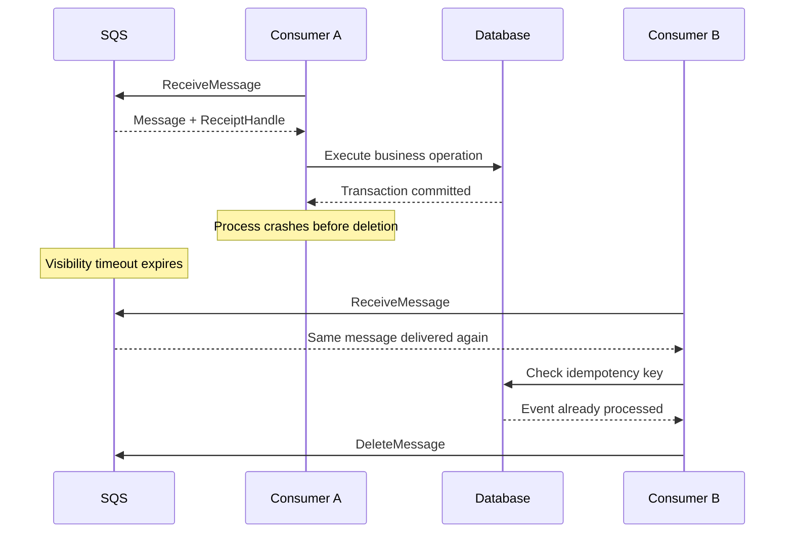
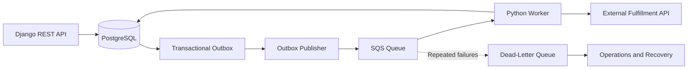

# 07- Message Retention and Delivery Guarantees

## Overview

Amazon Simple Queue Service (SQS) provides managed message storage and delivery between distributed application components. Two important aspects of its behavior are **message retention** and **delivery guarantees**.

Message retention determines how long SQS keeps a message available for processing. Delivery guarantees describe how messages are delivered to consumers, including the possibility of duplicate delivery, ordering behavior, and recovery after failures.

These characteristics directly influence application reliability, consumer design, and recovery strategies.

A production SQS architecture must account for:

- Message expiration and retention windows.
- At-least-once delivery.
- Duplicate message processing.
- Standard and FIFO queue semantics.
- Visibility timeout and redelivery.
- Dead-letter queues and message recovery.
- Consumer idempotency.
- Operational monitoring and disaster recovery.

## Message Retention

Message retention defines the maximum period SQS stores a message before automatically deleting it.

A message remains in the queue until one of the following occurs:

- A consumer successfully deletes it.
- Its retention period expires.
- It is moved to a dead-letter queue through a redrive policy.

Retention allows producers and consumers to operate independently. If consumers become temporarily unavailable, SQS can continue storing messages until they recover or the retention period expires.

### Retention Period Configuration

The `MessageRetentionPeriod` queue attribute controls message retention.

| Configuration | Value |
|---|---|
| Default retention | 4 days |
| Minimum retention | 60 seconds |
| Maximum retention | 14 days |
| Configuration unit | Seconds |

Example:

```python
import boto3

sqs = boto3.client("sqs", region_name="ap-south-1")

queue_url = "https://sqs.ap-south-1.amazonaws.com/123456789012/order-processing"

sqs.set_queue_attributes(
    QueueUrl=queue_url,
    Attributes={
        "MessageRetentionPeriod": "1209600",
    },
)
```

The value `1209600` represents 14 days.

### Choosing a Retention Period

Retention should reflect the application's recovery requirements rather than being configured arbitrarily.

Consider:

- Maximum expected consumer downtime.
- Deployment and maintenance windows.
- Downstream dependency outages.
- Expected backlog recovery time.
- Business processing deadlines.
- DLQ investigation requirements.

For example, an order-processing queue may use a longer retention period than a low-priority notification queue because losing an order event has a greater business impact.

### Retention and Message Expiration

When a message reaches its retention limit, SQS removes it automatically.

A consumer cannot retrieve an expired message.

This means retention is an important reliability boundary. A queue that retains messages for four days cannot protect against a consumer outage lasting five days.

For critical workloads, define a recovery strategy before the retention period expires.

Possible approaches include:

- Persisting business events in PostgreSQL.
- Archiving event payloads in Amazon S3.
- Using an outbox table to preserve unpublished events.
- Replaying events from a durable event store.
- Alerting before the oldest-message age approaches the retention limit.

SQS should not be treated as a permanent event archive.

## Retention Behavior with Dead-Letter Queues

A dead-letter queue has its own retention period, separate from the source queue.

The timestamp behavior differs between Standard and FIFO queues.

| Queue type | Enqueue timestamp after DLQ movement | Retention implication |
|---|---|---|
| Standard | Original enqueue timestamp is retained. | Time already spent in the source queue counts toward expiration. |
| FIFO | Enqueue timestamp resets when moved to the DLQ. | DLQ retention starts from the movement to the DLQ. |

For Standard queues, the original enqueue timestamp remains relevant after movement. The `ApproximateAgeOfOldestMessage` metric for the DLQ reflects the time since movement to the DLQ, not necessarily the original message age.

For FIFO queues, the enqueue timestamp resets when the message moves to the DLQ.

### Example

Assume a Standard queue has:

- Source queue retention: 4 days.
- DLQ retention: 14 days.
- Message age before movement: 3 days.

The message has already consumed 3 days of its original retention period. Moving it to the DLQ does not provide a fresh 14-day retention window.

This is why DLQ retention should generally be configured longer than source queue retention for Standard queues.

## Delivery Guarantees

SQS delivery guarantees describe how messages are made available to consumers.

The two queue types provide different ordering and deduplication behavior.

### Standard Queue Delivery

Standard queues provide at-least-once message delivery and best-effort ordering.

At-least-once delivery means SQS attempts to deliver a message successfully, but a consumer may receive the same message more than once.

Duplicate delivery can occur because SQS uses a distributed architecture. A message copy may not be successfully removed from every storage location during a receive and delete sequence.

Characteristics:

- High throughput.
- At-least-once delivery.
- Best-effort ordering.
- Duplicate deliveries are possible.
- No FIFO-style send deduplication.

Standard queues are suitable when consumers can process messages independently and tolerate duplicates.

Examples include:

- Background report generation.
- Image processing.
- Email notifications.
- Independent analytics tasks.
- Non-sequential data processing.

### FIFO Queue Delivery

FIFO queues provide ordering within a message group and send deduplication within a five-minute interval.

Characteristics:

- Strict ordering within each message group.
- Deduplication of repeated sends within the deduplication interval.
- Multiple message groups can be processed concurrently.
- Consumer redelivery is still possible.
- Exactly-once business processing is not guaranteed.

FIFO queues are useful when event ordering is important, such as processing order-state transitions or financial workflow events.

### Standard vs FIFO Delivery Guarantees

| Property | Standard | FIFO |
|---|---|---|
| Delivery behavior | At least once | Duplicate delivery can still occur |
| Ordering | Best effort | Strict within a message group |
| Send deduplication | Not supported as a FIFO feature | Five-minute deduplication interval |
| Message groups | Not supported | Supported |
| Throughput | High and scalable | Depends on message groups and throughput configuration |
| Consumer idempotency | Required | Required |

A common misconception is that FIFO queues guarantee exactly-once processing. FIFO deduplication applies to message sends within a limited interval; it does not make database transactions or external side effects exactly once.

## At-Least-Once Delivery

At-least-once delivery is a fundamental SQS reliability characteristic.

It prioritizes avoiding message loss over guaranteeing that every message is delivered only once.

Consider this sequence:

1. A consumer receives a message.
2. The consumer processes the business operation.
3. The database transaction commits.
4. The consumer crashes before calling `DeleteMessage`.
5. The visibility timeout expires.
6. Another consumer receives the same message.

The business operation may execute again unless the consumer is idempotent.



The second consumer detects that the business event has already been processed and safely acknowledges the duplicate delivery.

### Why At-Least-Once Delivery Matters

Distributed systems cannot assume that a successful operation at one component means every other component has observed that success.

For example, a consumer may successfully update PostgreSQL but fail to acknowledge the SQS message.

SQS cannot determine whether the business transaction committed. It therefore makes the message available again after the visibility timeout.

This behavior protects against message loss but requires application-level duplicate handling.

## Application-Level Idempotency

Idempotency means executing the same logical operation multiple times produces the same business result as executing it once.

It is one of the most important design requirements for SQS consumers.

### Stable Business Event IDs

Every logical event should contain a stable identifier generated by the producer.

Example:

```json
{
  "event_id": "evt-8f2a91",
  "event_type": "order.created",
  "order_id": "ORD-1001",
  "schema_version": 1
}
```

The `event_id` remains unchanged when the same logical event is published again.

Do not use the SQS `MessageId` as the business idempotency key. A duplicate send can create a different SQS message ID.

### Database Idempotency

A database table can track processed events.

```sql
CREATE TABLE processed_events (
    event_id VARCHAR(100) PRIMARY KEY,
    processed_at TIMESTAMPTZ NOT NULL DEFAULT NOW()
);
```

The consumer should insert the event ID and perform the business operation in the same transaction.

Example using SQLAlchemy:

```python
from sqlalchemy import text
from sqlalchemy.exc import IntegrityError


def process_order_event(session, event: dict) -> None:
    event_id = event["event_id"]
    order_id = event["order_id"]

    try:
        with session.begin():
            session.execute(
                text(
                    """
                    INSERT INTO processed_events (event_id)
                    VALUES (:event_id)
                    """
                ),
                {"event_id": event_id},
            )

            session.execute(
                text(
                    """
                    UPDATE orders
                    SET status = 'CONFIRMED'
                    WHERE order_id = :order_id
                    """
                ),
                {"order_id": order_id},
            )

    except IntegrityError:
        # The event was already committed by an earlier delivery.
        return
```

The unique constraint on `event_id` prevents the same event from being applied twice.

The idempotency record and business update must be committed atomically.

In a production implementation, distinguish a duplicate-key violation from other integrity errors rather than treating every `IntegrityError` as a duplicate.

### Idempotency for External APIs

Database transactions cannot make external API calls atomic.

For example, a consumer might successfully charge a payment provider and crash before recording the result in PostgreSQL.

A redelivery could trigger another charge.

Use the external provider's idempotency mechanism when available.

A stable operation identifier should be passed as the provider's idempotency key.

For operations without provider-side idempotency, maintain a durable operation state machine and implement reconciliation.

## FIFO Deduplication and Delivery Semantics

FIFO queues provide producer-side deduplication through `MessageDeduplicationId` or content-based deduplication.

### MessageDeduplicationId

The producer can supply an explicit deduplication ID.

```python
sqs.send_message(
    QueueUrl="https://sqs.ap-south-1.amazonaws.com/123456789012/order-events.fifo",
    MessageBody='{"event_id":"evt-1001","order_id":"ORD-1001"}',
    MessageGroupId="ORD-1001",
    MessageDeduplicationId="evt-1001",
)
```

When SQS receives another message with the same deduplication ID within the five-minute interval, it suppresses the duplicate send.

This is useful when a producer retries after an ambiguous network failure.

### Content-Based Deduplication

When enabled, SQS generates a deduplication ID using a SHA-256 hash of the message body.

Important behavior:

- The message body is used for the hash.
- Message attributes are excluded.
- Messages with different bodies have different generated deduplication IDs.
- An explicit `MessageDeduplicationId` takes precedence when supplied.

Content-based deduplication is useful when identical payloads should be treated as duplicate sends.

However, two separate business events can have identical payloads. In such cases, explicit business event IDs provide more reliable deduplication semantics.

### Deduplication Is Not Consumer Idempotency

FIFO deduplication does not prevent every possible duplicate business operation.

It does not protect against:

- Consumer crashes after processing.
- Database commit followed by failed message deletion.
- External API side effects repeated after redelivery.
- Duplicate events published outside the deduplication interval.
- Application retries that generate new business event IDs.

Consumer idempotency remains necessary.

## Message Ordering Guarantees

Ordering behavior differs between Standard and FIFO queues.

### Standard Queue Ordering

Standard queues provide best-effort ordering.

Messages can be delivered in a different order from the order in which they were sent.

Do not use Standard queues when strict sequential processing is a business requirement.

If ordering matters, use FIFO queues or implement an application-level ordering mechanism.

### FIFO Queue Ordering

FIFO queues preserve ordering within a message group.

A message group is identified by `MessageGroupId`.

Example:

```python
events = [
    {"event_id": "evt-1", "order_id": "ORD-1001", "status": "CREATED"},
    {"event_id": "evt-2", "order_id": "ORD-1001", "status": "PAID"},
    {"event_id": "evt-3", "order_id": "ORD-1001", "status": "SHIPPED"},
]

for event in events:
    sqs.send_message(
        QueueUrl="https://sqs.ap-south-1.amazonaws.com/123456789012/order-events.fifo",
        MessageBody=str(event),
        MessageGroupId=event["order_id"],
        MessageDeduplicationId=event["event_id"],
    )
```

Messages for `ORD-1001` belong to the same message group and are processed in order.

Messages belonging to different groups can be processed concurrently.

### Ordering Limitations

FIFO ordering is based on the order in which SQS accepts messages within a group.

SQS cannot infer the intended business order when multiple producers publish concurrently.

If events for the same entity are produced by multiple services, the application may need:

- A single logical publisher.
- A sequence number.
- A version or aggregate revision.
- Optimistic concurrency checks.
- Explicit handling of out-of-order business events.

### Message Group Design

| Grouping strategy | Benefit | Limitation |
|---|---|---|
| One global group | Global sequential processing | Limits concurrency and throughput |
| Customer ID | Preserves customer-level ordering | A high-volume customer can become a bottleneck |
| Order ID | Preserves order lifecycle ordering | Independent orders must be distributed across groups |
| Account ID | Preserves account-level sequencing | Busy accounts can create hot groups |

Choose a group ID based on the smallest business entity that requires strict ordering.

## Visibility Timeout and Delivery Guarantees

Visibility timeout determines how long a received message remains unavailable to other consumers.

It is a delivery coordination mechanism, not a guarantee of exclusive processing.

If the consumer does not delete the message before the timeout expires, SQS can deliver it again.

### Example

Assume:

- Visibility timeout: 60 seconds.
- Processing duration: 90 seconds.

The message becomes visible after 60 seconds even though the original consumer may still be processing it.

Another consumer can receive the same message.

This can cause concurrent duplicate processing.

### Production Recommendations

- Configure visibility timeout based on realistic processing duration.
- Extend visibility for long-running tasks.
- Use bounded processing deadlines.
- Make consumers idempotent.
- Monitor in-flight messages and processing duration.
- Avoid using excessively long visibility timeouts as a substitute for failure recovery.

For Lambda functions using SQS event source mappings, configure the queue visibility timeout in relation to the function timeout and batching behavior. AWS recommends a visibility timeout of at least six times the function timeout, with additional allowance for a configured batching window.

## Dead-Letter Queues and Delivery Recovery

A dead-letter queue isolates messages that repeatedly fail processing.

The source queue's redrive policy defines the DLQ destination and the maximum receive count.

Example:

```python
import json

redrive_policy = {
    "deadLetterTargetArn": (
        "arn:aws:sqs:ap-south-1:123456789012:order-processing-dlq"
    ),
    "maxReceiveCount": "5",
}

sqs.set_queue_attributes(
    QueueUrl="https://sqs.ap-south-1.amazonaws.com/123456789012/order-processing",
    Attributes={
        "RedrivePolicy": json.dumps(redrive_policy),
    },
)
```

When the receive threshold is exceeded, SQS moves the message to the DLQ.

### Delivery Failure Categories

| Failure type | Example | Recommended handling |
|---|---|---|
| Transient | Temporary database outage | Retry with controlled backoff. |
| Dependency failure | External API unavailable | Retry and monitor dependency health. |
| Invalid payload | Malformed JSON | Isolate in DLQ and investigate. |
| Business validation | Referenced entity does not exist | Apply business-specific recovery or rejection. |
| Application defect | Unhandled exception | Fix the defect before redriving. |

A DLQ should not be treated as a permanent archive.

Define:

- DLQ retention.
- Alerting thresholds.
- Investigation ownership.
- Message inspection procedures.
- Redrive approval requirements.
- Replay rate limits.
- Duplicate-processing safeguards.

### FIFO DLQ Ordering Implications

Moving a failed FIFO message to a DLQ can break the original sequence of business events.

For example, if an `order.created` event fails and moves to the DLQ, a later `order.paid` event may eventually be processed after the failed event is removed from the source queue.

If the application requires strict business sequencing across failures, design explicit sequence validation and recovery.

## Retention and Delivery Guarantees in Backend Architecture

Consider an order-processing architecture using Django, PostgreSQL, SQS, and a containerized Python worker.



The design should account for several failure boundaries:

| Failure boundary | Risk | Reliability mechanism |
|---|---|---|
| API to database | Business update fails | Database transaction |
| Database to SQS | Event publication fails | Transactional outbox |
| SQS to consumer | Duplicate delivery | Idempotent consumer |
| Consumer to database | Transaction failure | Database transaction and redelivery |
| Consumer to external API | Duplicate side effect | Provider idempotency key |
| Source queue to DLQ | Repeated processing failure | Redrive policy and DLQ monitoring |
| Consumer outage | Message backlog | Retention and recovery capacity |

The transactional outbox protects the database-to-message publication boundary. Idempotency protects the consumer-to-business-state boundary.

Together, they provide a practical foundation for reliable asynchronous processing without requiring a distributed transaction between PostgreSQL and SQS.

## Monitoring Retention and Delivery Behavior

CloudWatch metrics help identify message backlogs, delayed processing, and repeated failures.

| Metric | What it indicates | Operational use |
|---|---|---|
| `ApproximateAgeOfOldestMessage` | Age of the oldest available message | Detect processing delays and retention risk |
| `ApproximateNumberOfMessagesVisible` | Approximate available backlog | Identify insufficient consumer capacity |
| `ApproximateNumberOfMessagesNotVisible` | Approximate in-flight messages | Understand active processing |
| `ApproximateNumberOfMessagesDelayed` | Approximate delayed messages | Monitor scheduled availability |
| `NumberOfMessagesSent` | Messages accepted by the queue | Track producer activity |
| `NumberOfMessagesReceived` | Messages retrieved by consumers | Observe delivery activity |
| `NumberOfMessagesDeleted` | Messages deleted by consumers | Track acknowledgement activity |

### Recommended Alarms

Configure alarms for:

- Oldest-message age approaching the business processing SLA.
- DLQ message count greater than zero.
- Backlog increasing continuously.
- Unexpected growth in in-flight messages.
- Significant changes in send and delete rates.
- Consumer failure rate exceeding acceptable thresholds.

SQS metrics are approximate. For business-level accuracy, instrument application processing outcomes using structured logs, traces, and database records.

### Retention Risk Monitoring

A queue can continue accepting messages while consumers are unavailable.

However, once messages approach their retention limit, the system is at risk of losing unprocessed work.

Monitor oldest-message age relative to the configured retention period.

For Standard queues, remember that moving a message to a DLQ does not reset its original enqueue timestamp.

Use separate operational thresholds for:

- Normal processing latency.
- Consumer degradation.
- Recovery required.
- Approaching message expiration.

## Common Mistakes and Pitfalls

| Mistake | Why it is problematic | Recommended approach |
|---|---|---|
| Assuming SQS guarantees exactly-once processing | Consumer crashes can cause redelivery. | Implement application-level idempotency. |
| Treating FIFO deduplication as permanent | Deduplication is limited to a five-minute interval. | Use stable business event IDs. |
| Assuming Standard queues preserve ordering | Standard delivery is best effort. | Use FIFO when ordering is required. |
| Setting retention too short | Messages can expire during outages. | Align retention with recovery objectives. |
| Treating a DLQ as permanent storage | DLQ messages also expire. | Archive important events separately. |
| Ignoring Standard DLQ timestamp behavior | Original message age continues to count toward expiration. | Configure DLQ retention appropriately. |
| Using a global FIFO message group unnecessarily | Serializes processing and limits concurrency. | Partition groups by business entity. |
| Ignoring visibility timeout | Duplicate concurrent processing can occur. | Tune timeout and extend it when necessary. |
| Assuming database idempotency protects external APIs | External side effects are outside the database transaction. | Use provider idempotency keys and reconciliation. |
| Redriving messages without investigation | The original failure may repeat. | Correct the cause and validate replay safety. |

## Key Takeaways

- SQS retention controls how long messages remain available; expired messages cannot be recovered from the queue.
- Standard queues provide at-least-once delivery and best-effort ordering, while FIFO queues preserve ordering within message groups and deduplicate sends within a five-minute interval.
- Neither Standard nor FIFO queues guarantee exactly-once business processing; consumers must implement idempotency.
- DLQ retention and timestamp behavior differ between Standard and FIFO queues, so recovery windows must be designed deliberately.
- Reliable messaging requires coordinated retention, visibility timeout, idempotency, redrive, and monitoring strategies.