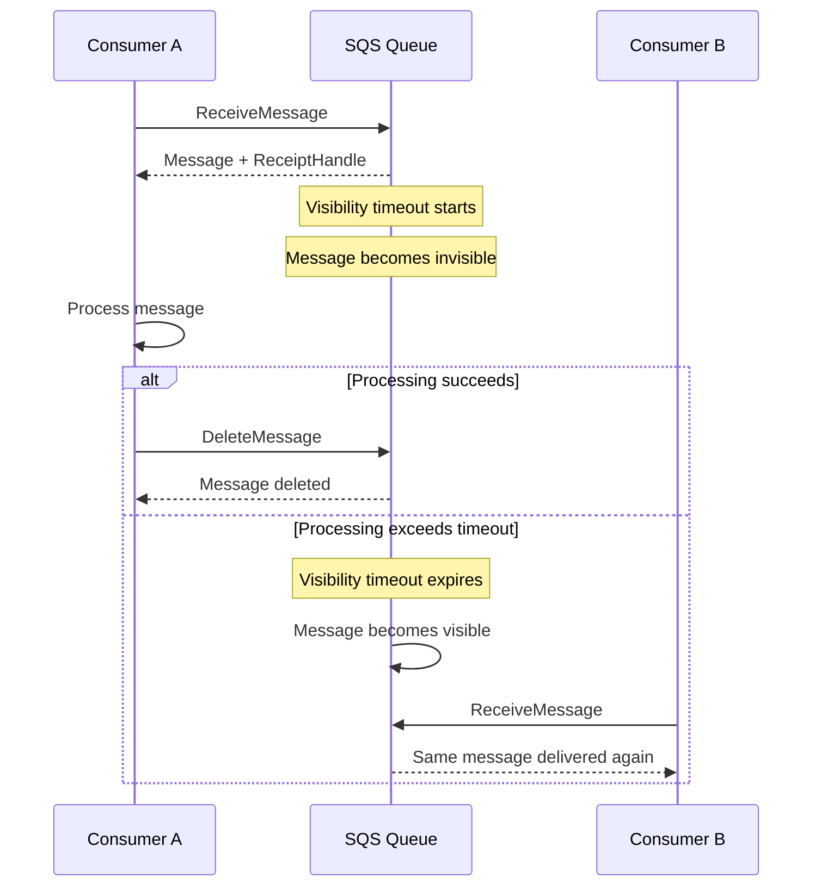
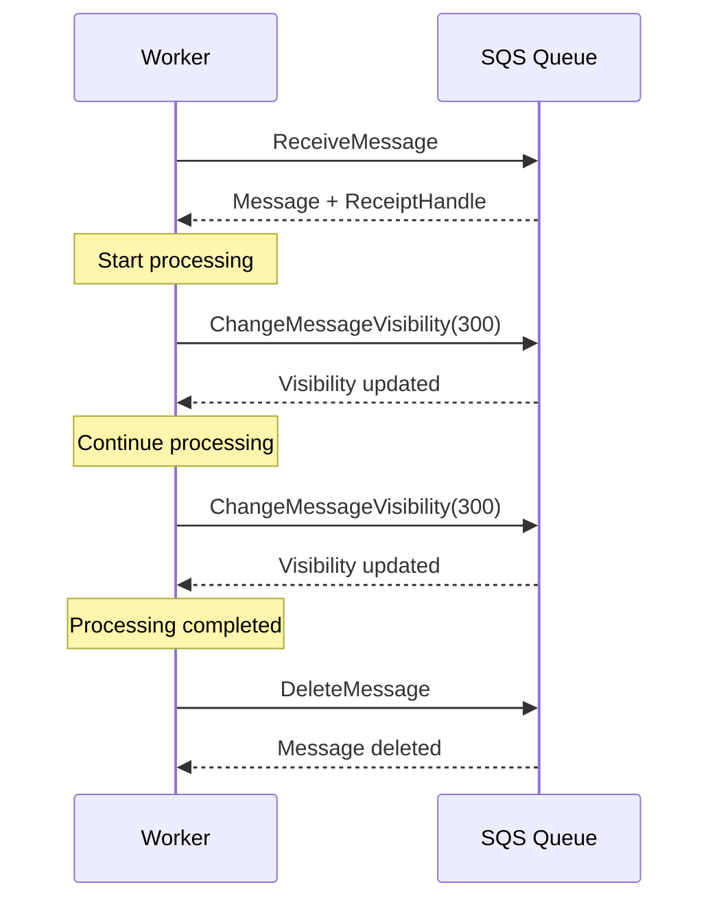
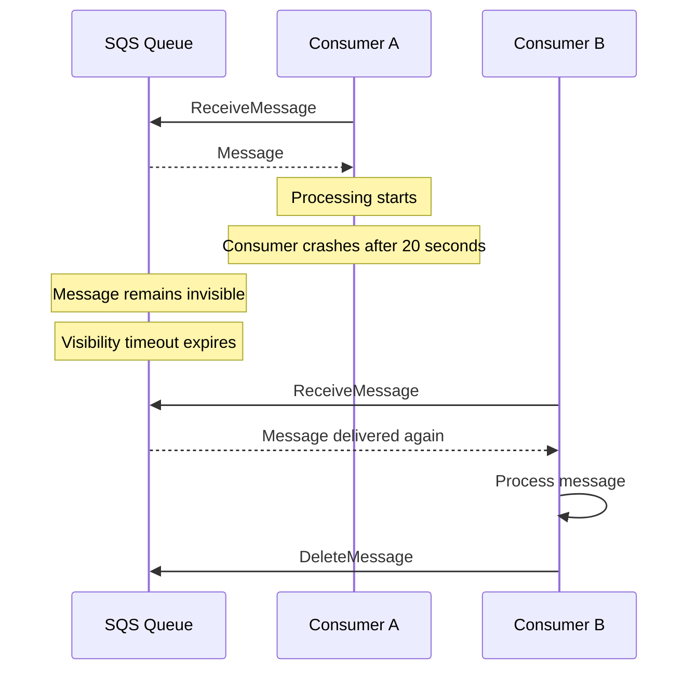
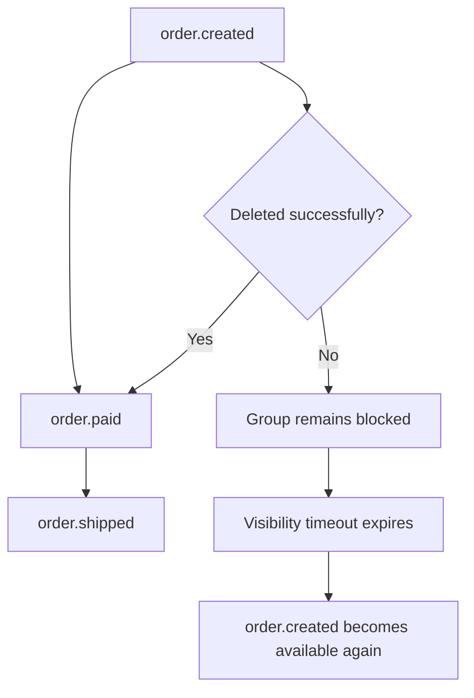

# 08- Visibility Timeout

## Overview

Amazon Simple Queue Service (SQS) visibility timeout controls how long a message remains unavailable to other consumers after it has been received.

When a consumer retrieves a message, SQS does not immediately remove it from the queue. Instead, the message becomes temporarily invisible while the consumer processes it.

If processing succeeds, the consumer explicitly deletes the message using `DeleteMessage`. If the consumer fails to delete it before the visibility timeout expires, the message becomes available for retrieval again.

Visibility timeout is a fundamental mechanism for coordinating distributed consumers and recovering from processing failures.

It directly affects:

- Duplicate message delivery.
- Concurrent message processing.
- Consumer throughput.
- Failure recovery time.
- FIFO message-group blocking.
- DLQ movement and retry behavior.

## How Visibility Timeout Works

The visibility timeout begins when SQS delivers a message to a consumer.

During this period, other consumers cannot normally retrieve that message.



The important distinction is that receiving a message does not acknowledge successful processing.

SQS requires an explicit deletion operation.

### Message State Transitions

A message generally moves through the following states:

| State | Description |
|---|---|
| Available | Message can be received by a consumer. |
| In flight | Message has been received and is temporarily invisible. |
| Deleted | Consumer successfully deleted the message. |
| Available again | Visibility timeout expired without successful deletion. |
| Moved to DLQ | Message exceeded the configured redrive threshold. |
| Expired | Message exceeded its retention period. |

Visibility timeout is not a distributed lock or an exclusive processing guarantee. A message can be delivered again after timeout expiration even if the original consumer is still executing.

## Visibility Timeout Configuration

Visibility timeout is controlled by the `VisibilityTimeout` queue attribute.

| Configuration | Value |
|---|---|
| Default | 30 seconds |
| Minimum | 0 seconds |
| Maximum | 12 hours |
| Unit | Seconds |

A queue can be configured with a visibility timeout appropriate for its workload.

### Configure Using Boto3

```python
import boto3

sqs = boto3.client("sqs", region_name="ap-south-1")

queue_url = "https://sqs.ap-south-1.amazonaws.com/123456789012/order-processing"

sqs.set_queue_attributes(
    QueueUrl=queue_url,
    Attributes={
        "VisibilityTimeout": "120",
    },
)
```

This configures a two-minute visibility timeout.

### Configure Using AWS CLI

```bash
aws sqs set-queue-attributes \
  --queue-url https://sqs.ap-south-1.amazonaws.com/123456789012/order-processing \
  --attributes VisibilityTimeout=120 \
  --region ap-south-1
```

### Configure Using Terraform

```hcl
resource "aws_sqs_queue" "order_processing" {
  name                       = "order-processing"
  visibility_timeout_seconds = 120

  message_retention_seconds = 345600
  receive_wait_time_seconds = 20

  tags = {
    Environment = "production"
    Service     = "order-processing"
  }
}
```

Use Infrastructure as Code to maintain consistent queue configuration across environments.

## Queue-Level and Message-Level Visibility Timeout

SQS supports visibility timeout configuration at different levels.

### Queue-Level Configuration

The queue-level `VisibilityTimeout` attribute defines the default visibility timeout for messages received from that queue.

```python
sqs.set_queue_attributes(
    QueueUrl=queue_url,
    Attributes={
        "VisibilityTimeout": "60",
    },
)
```

This affects the default behavior for subsequent receives unless a receive request specifies an override.

### Message-Level Override

A consumer can specify `VisibilityTimeout` directly in a `ReceiveMessage` request.

```python
response = sqs.receive_message(
    QueueUrl=queue_url,
    MaxNumberOfMessages=5,
    WaitTimeSeconds=20,
    VisibilityTimeout=180,
)
```

This sets the visibility timeout for messages returned by that receive request to three minutes.

The override does not permanently modify the queue's default configuration.

### Comparison

| Property | Queue-level timeout | Receive-level override |
|---|---|---|
| Configured through | `SetQueueAttributes` | `ReceiveMessage` |
| Scope | Queue default | Messages returned by that request |
| Persistence | Remains configured until changed | Applies to the received messages |
| Use case | Consistent workload behavior | Consumers with different processing requirements |

Use a queue-level timeout when most messages have similar processing requirements.

Use a receive-level override when different consumer workflows need different initial visibility periods.

## Choosing the Correct Visibility Timeout

Visibility timeout should account for realistic processing duration, including temporary delays.

Consider a report-generation worker:

- Payload validation: 2 seconds.
- Database queries: 10 seconds.
- File generation: 40 seconds.
- Upload to S3: 20 seconds.
- Final database update: 5 seconds.

Expected processing time is approximately 77 seconds.

A 30-second visibility timeout is insufficient because the message may become visible before processing finishes.

A practical configuration should provide enough allowance for normal execution variability while preserving reasonable recovery time.

### Factors to Consider

| Factor | Impact on visibility timeout |
|---|---|
| Processing duration | Longer tasks need longer visibility. |
| External API latency | Variable latency can extend processing time. |
| Database operations | Slow queries and locks increase execution duration. |
| Network instability | Temporary failures can delay completion. |
| Consumer concurrency | Resource contention can increase processing time. |
| Recovery requirements | Shorter timeouts can make failed messages available sooner. |
| Retry strategy | Visibility must accommodate the intended retry workflow. |

### Avoid Using Only Average Processing Time

Average processing time does not represent worst-case execution behavior.

For example:

| Measurement | Processing time |
|---|---:|
| Average | 20 seconds |
| 95th percentile | 45 seconds |
| 99th percentile | 90 seconds |
| Occasional slow execution | 150 seconds |

A timeout of 30 seconds would cause unnecessary redelivery for a significant portion of legitimate processing attempts.

Use observed latency percentiles and failure-recovery requirements when selecting the timeout.

## Extending Visibility Timeout

For long-running tasks, a consumer can extend the visibility timeout using `ChangeMessageVisibility`.

This prevents a message from becoming visible while the original consumer is still legitimately processing it.

### Boto3 Example

```python
def extend_visibility(
    queue_url: str,
    receipt_handle: str,
    timeout_seconds: int,
) -> None:
    sqs.change_message_visibility(
        QueueUrl=queue_url,
        ReceiptHandle=receipt_handle,
        VisibilityTimeout=timeout_seconds,
    )
```

Example usage:

```python
extend_visibility(
    queue_url=queue_url,
    receipt_handle=receipt_handle,
    timeout_seconds=300,
)
```

The message becomes invisible for another five minutes from the time the visibility change is applied.

### AWS CLI Example

```bash
aws sqs change-message-visibility \
  --queue-url https://sqs.ap-south-1.amazonaws.com/123456789012/order-processing \
  --receipt-handle "RECEIPT_HANDLE_FROM_RECEIVE_MESSAGE" \
  --visibility-timeout 300 \
  --region ap-south-1
```

### Periodic Visibility Extension

A worker processing a large document or running a lengthy data transformation can periodically extend visibility.



A visibility extension strategy should be based on actual task progress rather than extending messages indefinitely.

### Maximum Visibility Period

The maximum visibility timeout is 12 hours from the time a message is received.

Repeated visibility extensions do not reset this overall limit.

For tasks that can exceed this duration, consider:

- Splitting the task into smaller messages.
- Persisting job progress in a database.
- Using a workflow orchestration service.
- Designing resumable processing.
- Moving long-running orchestration to AWS Step Functions.

A single SQS message should not be used as an unlimited-duration execution lease.

## Visibility Timeout and Message Redelivery

If a consumer does not delete a message before its visibility timeout expires, SQS makes it available again.

This is a normal recovery mechanism.

### Example: Consumer Crash

Assume:

- Visibility timeout: 60 seconds.
- Consumer A receives the message.
- Consumer A crashes after 20 seconds.
- No deletion request is made.

After the remaining visibility period expires, another consumer can receive the message.



This behavior prevents a message from remaining permanently unavailable after a consumer failure.

### Duplicate Processing

Visibility timeout expiration can result in duplicate processing.

For example:

1. Consumer A receives a message.
2. Consumer A processes the database update.
3. The database transaction commits.
4. Consumer A becomes unresponsive before deleting the message.
5. Visibility timeout expires.
6. Consumer B receives the same message.
7. Consumer B attempts the same business operation.

The application must detect that the logical event has already been processed.

Visibility timeout does not replace application-level idempotency.

## Visibility Timeout and Idempotency

Idempotency ensures repeated processing of the same logical event does not produce duplicate business effects.

Use a stable event identifier generated by the producer.

Example message:

```json
{
  "event_id": "evt-8f2a91",
  "event_type": "order.created",
  "order_id": "ORD-1001"
}
```

A PostgreSQL table can enforce uniqueness:

```sql
CREATE TABLE processed_events (
    event_id VARCHAR(100) PRIMARY KEY,
    processed_at TIMESTAMPTZ NOT NULL DEFAULT NOW()
);
```

The consumer should insert the event identifier and perform the business update in the same transaction.

```python
from sqlalchemy import text
from sqlalchemy.exc import IntegrityError


def process_event(session, event: dict) -> None:
    try:
        with session.begin():
            session.execute(
                text(
                    """
                    INSERT INTO processed_events (event_id)
                    VALUES (:event_id)
                    """
                ),
                {"event_id": event["event_id"]},
            )

            session.execute(
                text(
                    """
                    UPDATE orders
                    SET status = 'CONFIRMED'
                    WHERE order_id = :order_id
                    """
                ),
                {"order_id": event["order_id"]},
            )

    except IntegrityError:
        # Production code should distinguish duplicate-key violations
        # from other database integrity errors.
        raise
```

The unique constraint prevents the same event from being applied twice.

After a duplicate is safely recognized, the consumer can acknowledge the message without repeating the business operation.

For external API calls, use provider-supported idempotency keys or a durable operation state machine. A database transaction cannot make an external side effect atomic with SQS acknowledgement.

## Visibility Timeout and FIFO Queues

Visibility timeout also affects FIFO queue processing.

FIFO queues preserve message ordering within each `MessageGroupId`.

When a consumer receives messages from a group, later messages in that group are not normally made available for processing until earlier messages have been successfully processed and deleted.

If the consumer fails to delete a message, it can block subsequent messages in the same group.

### Example

Consider the following events for one order:

```text
MessageGroupId = ORD-1001

1. order.created
2. order.paid
3. order.shipped
```

If `order.created` is received but not deleted, later messages in the same group remain blocked.



### Production Implications

- Avoid unnecessarily long visibility timeouts for FIFO workloads.
- Monitor groups affected by repeatedly failing messages.
- Use message groups based on business entities.
- Avoid a single global message group unless global serialization is required.
- Consider DLQ behavior carefully because moving a failed FIFO message can affect business ordering.

Visibility timeout and message-group design should be evaluated together.

## Visibility Timeout and Dead-Letter Queues

Visibility timeout and DLQ redrive policies work together to recover from repeated processing failures.

The redrive policy defines `maxReceiveCount`.

When a message exceeds the configured receive threshold, SQS moves it to the DLQ.

Example:

```python
import json

redrive_policy = {
    "deadLetterTargetArn": (
        "arn:aws:sqs:ap-south-1:123456789012:order-processing-dlq"
    ),
    "maxReceiveCount": "5",
}

sqs.set_queue_attributes(
    QueueUrl=queue_url,
    Attributes={
        "RedrivePolicy": json.dumps(redrive_policy),
    },
)
```

A typical failure sequence is:

1. Consumer receives a message.
2. Processing fails.
3. Message is not deleted.
4. Visibility timeout expires.
5. Message becomes available again.
6. Another receive attempt occurs.
7. The receive threshold is eventually exceeded.
8. SQS moves the message to the DLQ.

The receive count represents receives, not necessarily completed application processing attempts.

For example, a consumer can receive a message and crash before beginning business processing. That receive can still contribute to the message's receive count.

Choose `maxReceiveCount` based on actual failure behavior and the application's retry strategy.

## Visibility Timeout with AWS Lambda

When Lambda consumes messages through an SQS event source mapping, AWS manages polling and message retrieval.

The Lambda function receives records in an event batch.

If the function successfully processes the batch, the event source mapping deletes the corresponding messages.

If processing fails, messages can become visible again after the visibility timeout.

### Lambda Visibility Configuration

For Lambda SQS event source mappings, AWS recommends configuring the queue visibility timeout to at least six times the Lambda function timeout, with additional allowance when a batching window is configured.

Example:

- Lambda timeout: 30 seconds.
- Recommended minimum visibility timeout: 180 seconds.
- Additional batching-window allowance may be required.

The exact configuration should account for the function timeout, batching window, and retry behavior.

### Partial Batch Responses

Without partial batch responses, a failure in one record can cause the entire batch to be retried.

Enable `ReportBatchItemFailures` when the function processes records independently.

Example event source mapping configuration using Terraform:

```hcl
resource "aws_lambda_event_source_mapping" "order_worker" {
  event_source_arn = aws_sqs_queue.order_processing.arn
  function_name    = aws_lambda_function.order_worker.arn

  batch_size                         = 10
  function_response_types             = ["ReportBatchItemFailures"]
  maximum_batching_window_in_seconds = 5
}
```

The Lambda handler must return failed message identifiers in the expected response format.

```python
def lambda_handler(event, context):
    failures = []

    for record in event["Records"]:
        try:
            process_order_record(record)

        except Exception:
            failures.append({
                "itemIdentifier": record["messageId"],
            })

    return {
        "batchItemFailures": failures,
    }
```

This allows successfully processed records to be acknowledged while failed records are retried.

The handler must still implement idempotency because duplicate delivery remains possible.

## Visibility Timeout with Containerized Workers

Long-running workers deployed on ECS, EKS, or EC2 can manage visibility directly through Boto3.

A common pattern is:

1. Receive a message.
2. Start processing.
3. Periodically extend visibility.
4. Commit the business operation.
5. Delete the message.

A simplified processing structure:

```python
import logging
import time

import boto3
from botocore.exceptions import BotoCoreError, ClientError

logger = logging.getLogger(__name__)

sqs = boto3.client("sqs", region_name="ap-south-1")


def process_message(queue_url: str, message: dict) -> None:
    receipt_handle = message["ReceiptHandle"]

    try:
        perform_business_operation(message["Body"])

        sqs.delete_message(
            QueueUrl=queue_url,
            ReceiptHandle=receipt_handle,
        )

    except (BotoCoreError, ClientError):
        logger.exception(
            "SQS operation failed",
            extra={"message_id": message["MessageId"]},
        )
        raise
```

For genuinely long-running operations, add a separate visibility heartbeat mechanism.

The heartbeat should:

- Extend visibility before the current timeout expires.
- Stop when processing completes.
- Stop when the worker is shutting down.
- Detect failed visibility-change requests.
- Avoid extending messages after ownership is no longer valid.
- Respect the 12-hour maximum visibility period.

Do not block all worker processing while waiting for a single message to finish if the architecture supports concurrent message processing.

## In-Flight Messages and Visibility Timeout

A message becomes in flight when it is received and remains invisible while awaiting deletion or visibility expiration.

The number of in-flight messages is an important operational metric.

CloudWatch exposes:

`ApproximateNumberOfMessagesNotVisible`

This metric helps identify messages currently being processed or otherwise invisible.

### In-Flight Message Limits

SQS has in-flight message quotas.

For Standard queues, the approximate in-flight limit is generally 120,000 messages, subject to service behavior and quotas.

For FIFO queues, in-flight limits and throughput behavior depend on the queue configuration and message-group design.

When a Standard queue approaches its in-flight limit:

- Short polling can return an `OverLimit` error.
- Long polling may not return new messages until in-flight capacity becomes available.

Avoid treating in-flight messages as a direct count of active application threads. A message can remain invisible because of a slow consumer, a failed worker, or an excessively long visibility timeout.

### Reducing In-Flight Pressure

- Delete messages promptly after successful processing.
- Avoid unnecessarily long visibility timeouts.
- Use bounded consumer concurrency.
- Monitor in-flight messages alongside visible backlog.
- Scale consumers according to downstream capacity.
- Investigate workers that repeatedly receive messages without deleting them.

## Monitoring Visibility Timeout Behavior

Visibility timeout problems often appear as duplicate processing, growing backlog, or unexpectedly high in-flight message counts.

Important CloudWatch metrics include:

| Metric | Operational significance |
|---|---|
| `ApproximateNumberOfMessagesVisible` | Available messages waiting for consumers. |
| `ApproximateNumberOfMessagesNotVisible` | Messages currently in flight. |
| `ApproximateAgeOfOldestMessage` | Age of the oldest available message. |
| `NumberOfMessagesReceived` | Number of message retrievals. |
| `NumberOfMessagesDeleted` | Number of successful message deletions. |

### Useful Monitoring Signals

| Signal | Possible cause |
|---|---|
| High in-flight count | Slow processing or excessive visibility timeout. |
| Repeated receive activity | Consumer failures or visibility expiration. |
| Growing visible backlog | Insufficient consumer capacity. |
| Oldest-message age increasing | Processing delays or unavailable consumers. |
| High DLQ depth | Persistent processing failures. |
| High receive-to-delete ratio | Duplicate receives, failures, or delayed acknowledgement. |

SQS metrics are approximate. Correlate them with application-level processing duration, failure counts, and structured logs.

Include the business event ID and SQS Message ID in logs, but avoid logging sensitive payload contents.

## Production Best Practices

### Set Timeouts Based on Measured Processing Duration

Use production latency measurements and percentile distributions.

Do not choose visibility timeout solely from average processing duration.

### Implement Visibility Heartbeats for Long Tasks

For tasks with variable execution duration, extend visibility periodically.

Use a bounded heartbeat strategy and respect the 12-hour maximum.

### Make Consumers Idempotent

Duplicate delivery is expected behavior in distributed messaging systems.

Use stable event IDs and transactional idempotency records.

### Delete Only After Durable Processing

Commit database changes before acknowledging the message.

For external APIs, use provider idempotency keys and reconciliation.

### Configure DLQs

Use DLQs to isolate persistent failures and prevent repeatedly failing messages from consuming normal processing capacity.

### Scale Consumers Carefully

More consumers do not always improve throughput.

Account for:

- Database connection limits.
- External API quotas.
- FIFO message-group serialization.
- In-flight message limits.
- CPU and memory constraints.

### Handle Graceful Shutdown

During deployment or container termination:

- Stop receiving new messages.
- Allow active processing to finish within the shutdown grace period.
- Extend visibility when appropriate.
- Delete only successfully completed messages.
- Leave unfinished messages available for recovery.

## Common Mistakes and Pitfalls

| Mistake | Consequence | Prevention |
|---|---|---|
| Visibility timeout shorter than processing duration | Concurrent duplicate processing. | Use measured processing duration and sufficient allowance. |
| Visibility timeout excessively long | Slow recovery after worker failure. | Balance processing time against recovery requirements. |
| Assuming visibility timeout is a lock | Does not guarantee exclusive execution. | Implement idempotency and tolerate duplicate delivery. |
| Forgetting to delete messages | Messages become visible again. | Explicitly acknowledge successful processing. |
| Extending visibility indefinitely | Failed tasks remain unavailable too long. | Use bounded heartbeats and a recovery design. |
| Ignoring FIFO message-group blocking | Later messages in the same group stop progressing. | Monitor failed groups and design suitable group IDs. |
| Ignoring Lambda timeout relationships | Messages may be retried while a function is still running. | Configure visibility relative to function timeout and batching. |
| Treating receive count as completed attempts | Can misrepresent actual application processing. | Track application-level attempt and outcome metrics. |
| Processing external side effects without idempotency | Duplicate payments or external operations. | Use provider idempotency keys and durable operation state. |
| Ignoring in-flight quotas | Consumers may stop receiving new messages. | Monitor in-flight count and tune concurrency and visibility. |

## Key Takeaways

- Visibility timeout temporarily hides a received message from other consumers; it does not acknowledge successful processing or guarantee exclusive execution.
- Configure visibility based on realistic processing duration, and use `ChangeMessageVisibility` for long-running tasks within the 12-hour maximum.
- Messages can be redelivered when visibility expires, so consumers must implement application-level idempotency.
- FIFO message groups can be blocked by an earlier unacknowledged message, making visibility timeout especially important for ordered workflows.
- Monitor in-flight messages, receive activity, oldest-message age, and DLQ depth to detect visibility-related processing problems.