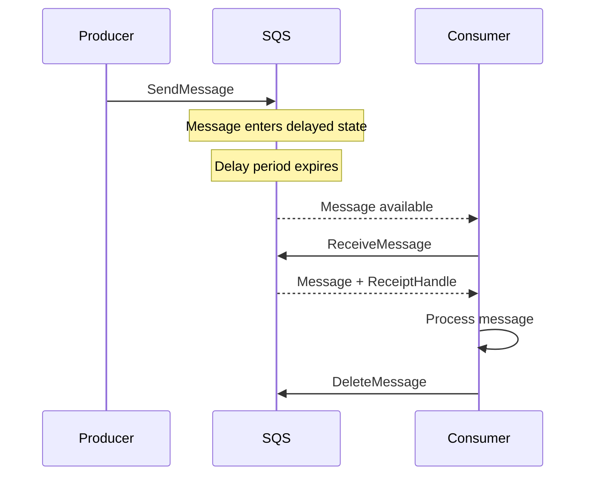
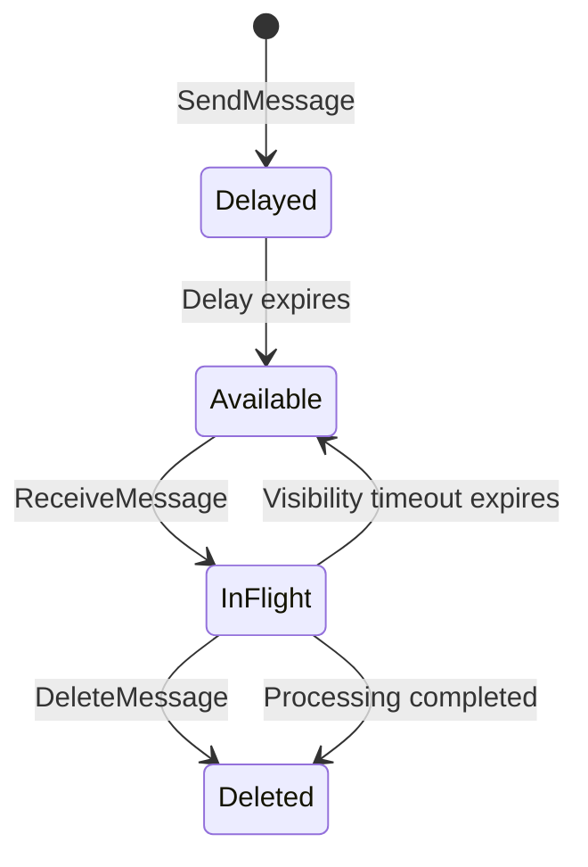
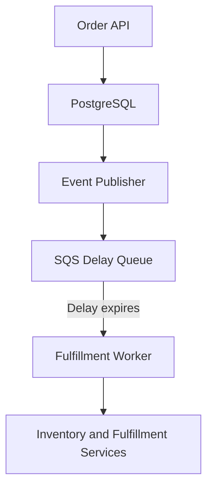
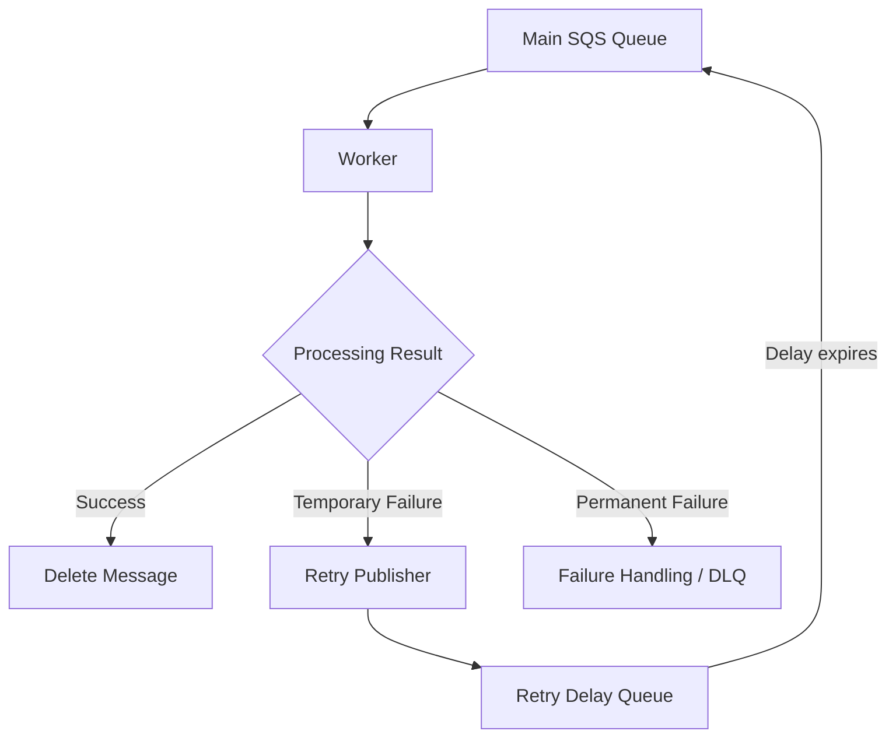

# 09- Delay Queues

## Overview

Amazon Simple Queue Service (SQS) delay queues postpone the visibility of newly added messages for a configured period. During this delay, consumers cannot normally retrieve the messages. Once the delay expires, messages become available for processing.

Delay queues are useful when a message should not be processed immediately after publication. Common use cases include:

- Scheduling a task to execute after a short waiting period.
- Delaying retries after a temporary failure.
- Implementing grace periods before processing an event.
- Deferring downstream work to control request rates.
- Separating immediate processing from delayed workflows.

SQS supports two related mechanisms:

| Mechanism | Scope | Purpose |
|---|---|---|
| Delay queue | Queue-level | Apply a default delay to newly sent messages |
| Message timer | Individual message | Override the queue delay for a specific message |

Both mechanisms support delays from 0 to 900 seconds (15 minutes).

**Important:** SQS delay queues are not general-purpose scheduling systems. They are suitable for short delays, not long-term scheduling, precise execution times, or recurring jobs.

## How Delay Queues Work

When a producer sends a message to a queue with a configured delay, SQS accepts the message but keeps it unavailable to consumers until the delay expires.

The message then becomes eligible for retrieval through `ReceiveMessage`.



The delay affects message availability, not message acceptance. A successful `SendMessage` response means SQS accepted the message; it does not mean a consumer can retrieve it immediately.

### Message State

A simplified message lifecycle is:



A delayed message does not consume a consumer's processing capacity because it is not yet available for retrieval.

Once available, it follows the normal SQS message lifecycle, including visibility timeout, redelivery, and deletion.

## Queue-Level Delay

Queue-level delay configures the default delay applied to newly sent messages.

The `DelaySeconds` queue attribute accepts values from 0 to 900 seconds.

| Value | Behavior |
|---|---|
| `0` | Messages become available without an intentional delay |
| `30` | Newly sent messages are delayed for 30 seconds |
| `300` | Newly sent messages are delayed for 5 minutes |
| `900` | Newly sent messages are delayed for 15 minutes |

### Configure Using AWS CLI

```bash
aws sqs set-queue-attributes \
    --queue-url https://sqs.us-east-1.amazonaws.com/123456789012/order-processing \
    --attributes DelaySeconds=60
```

Verify the configuration:

```bash
aws sqs get-queue-attributes \
    --queue-url https://sqs.us-east-1.amazonaws.com/123456789012/order-processing \
    --attribute-names DelaySeconds
```

Example response:

```json
{
    "Attributes": {
        "DelaySeconds": "60"
    }
}
```

The configured delay applies to newly sent messages. Changing the queue attribute does not retroactively modify the delay of messages already in the queue.

### Configure Using Boto3

```python
import boto3
from botocore.exceptions import BotoCoreError, ClientError

sqs = boto3.client("sqs", region_name="us-east-1")

queue_url = (
    "https://sqs.us-east-1.amazonaws.com/"
    "123456789012/order-processing"
)

try:
    sqs.set_queue_attributes(
        QueueUrl=queue_url,
        Attributes={
            "DelaySeconds": "60"
        },
    )

    response = sqs.get_queue_attributes(
        QueueUrl=queue_url,
        AttributeNames=["All"],
    )

    print(
        "Configured delay:",
        response["Attributes"]["DelaySeconds"],
    )

except (ClientError, BotoCoreError) as exc:
    raise RuntimeError(
        "Unable to configure SQS queue delay"
    ) from exc
```

Queue configuration should normally be managed through infrastructure-as-code rather than modified manually in production.

## Per-Message Delay

A message timer applies a delay to an individual message.

It is useful when messages in the same queue require different waiting periods.

For example, an order-processing queue might contain:

- Immediate inventory updates.
- Notifications delayed by 30 seconds.
- Follow-up tasks delayed by 5 minutes.

Instead of creating separate queues for every delay duration, a producer can specify `DelaySeconds` when calling `SendMessage`.

### Configure Using Boto3

```python
import json

import boto3
from botocore.exceptions import BotoCoreError, ClientError

sqs = boto3.client("sqs", region_name="us-east-1")

queue_url = (
    "https://sqs.us-east-1.amazonaws.com/"
    "123456789012/order-processing"
)


def publish_order_event(
    order_id: str,
    delay_seconds: int = 0,
) -> str:
    if not 0 <= delay_seconds <= 900:
        raise ValueError(
            "delay_seconds must be between 0 and 900"
        )

    message = {
        "event_type": "order.confirmed",
        "order_id": order_id,
    }

    try:
        response = sqs.send_message(
            QueueUrl=queue_url,
            MessageBody=json.dumps(message),
            DelaySeconds=delay_seconds,
        )

        return response["MessageId"]

    except (ClientError, BotoCoreError) as exc:
        raise RuntimeError(
            "Failed to publish order event"
        ) from exc


message_id = publish_order_event(
    order_id="ORD-10025",
    delay_seconds=120,
)

print(f"Published message: {message_id}")
```

The message becomes available approximately two minutes after SQS accepts it.

### Queue-Level Delay vs Message Timer

For Standard queues, a per-message delay can override the queue-level delay.

| Feature | Queue-level delay | Per-message delay |
|---|---|---|
| Configuration | Queue attribute | `SendMessage` parameter |
| Scope | All newly sent messages by default | One message |
| Maximum delay | 15 minutes | 15 minutes |
| Configuration changes | Queue configuration | Producer request |
| Typical use | Uniform delay policy | Different delays per message |

**FIFO limitation:** Per-message timers are not supported for SQS FIFO queues. FIFO queues support queue-level delay configuration, but individual message delay overrides are unavailable.

## Delay Queues with Standard and FIFO Queues

Delay behavior differs between Standard and FIFO queues.

| Capability | Standard queue | FIFO queue |
|---|---|---|
| Queue-level delay | Supported | Supported |
| Per-message delay | Supported | Not supported |
| Maximum delay | 15 minutes | 15 minutes |
| Message ordering | Best effort | Strict within a message group |
| Duplicate delivery | Possible | Possible |
| Deduplication | Not provided by queue semantics | Five-minute deduplication mechanism |

For FIFO queues, queue-level delay affects messages entering the queue. Ordering guarantees remain scoped to each `MessageGroupId`.

A delayed FIFO queue should not be treated as a scheduler for individual messages because message-level timers are unavailable.

## Practical Backend Use Cases

### Delayed Order Processing

An e-commerce system may need to wait briefly before triggering a downstream workflow.

Example:

1. The order service persists an order.
2. It publishes an order event to SQS.
3. SQS delays the message for a configured period.
4. The fulfillment worker receives the message.
5. The worker validates the order and begins fulfillment.



The delay is useful when the business workflow intentionally requires a waiting period. It should not replace transaction consistency or order validation.

For reliable database-to-queue publishing, use the transactional outbox pattern. The outbox publisher can retry publication, and consumers should be idempotent because duplicate messages remain possible.

### Delayed Retry Processing

A worker may encounter a temporary downstream failure, such as:

- HTTP `503 Service Unavailable`.
- Temporary database unavailability.
- Rate limiting.
- A downstream service recovering from an outage.

A delayed retry can prevent immediate repeated requests.

A common architecture is:



A retry publisher sends a new message with a delay. It should preserve the original business event identifier and increment a retry counter.

Example retry payload:

```json
{
    "event_id": "evt-8f2a91",
    "event_type": "payment.capture.requested",
    "payment_id": "PAY-10025",
    "retry_count": 2,
    "original_created_at": "2026-11-19T10:00:00Z"
}
```

A retry policy should define:

- Maximum retry attempts.
- Delay duration for each attempt.
- Retryable versus permanent errors.
- Maximum total processing time.
- Dead-letter handling.
- Idempotency behavior.

For exponential backoff, the application can calculate the delay before publishing:

\[
delay = \min(base \times 2^{retry\_count}, max\_delay)
\]

Add jitter to reduce synchronized retry bursts:

\[
actual\_delay = random(0, delay)
\]

The calculated delay must remain within SQS's 900-second limit.

For longer retry schedules, use EventBridge Scheduler or another dedicated scheduling mechanism rather than chaining short SQS delays indefinitely.

**Important:** SQS does not automatically move a message from a DLQ back to the source queue after a delay. Redrive operations and retry scheduling require an explicit design.

## Delay Queues vs Visibility Timeout

Delay queues and visibility timeout both control when a message is available to consumers, but they operate at different stages.

| Characteristic | Delay queue | Visibility timeout |
|---|---|---|
| Purpose | Delay initial availability | Temporarily hide a received message |
| Applied | When a message is sent | When a message is received |
| Consumer has received message | No | Yes |
| Expiration behavior | Message becomes available | Message becomes available for redelivery |
| Typical use | Deferred processing | Prevent concurrent processing during work |

Example lifecycle:

1. Producer sends a message with a 60-second delay.
2. SQS accepts the message.
3. The message remains unavailable for approximately 60 seconds.
4. A consumer receives the message.
5. SQS hides it for the visibility timeout.
6. The consumer processes and deletes it.

If the consumer fails to delete the message before visibility expires, SQS can deliver it again.

A delay queue does not replace visibility timeout, and visibility timeout does not schedule a message for its first delivery.

## Delay Queues vs EventBridge Scheduler

SQS delay queues are designed for short message delays. EventBridge Scheduler is designed for scheduled invocation at a specified time or recurring schedule.

| Requirement | SQS delay queue | EventBridge Scheduler |
|---|---|---|
| Short delay | Suitable | Suitable |
| Maximum delay | 15 minutes | Supports longer scheduling horizons |
| Specific execution time | Not suitable | Suitable |
| Recurring schedules | Not suitable | Supported |
| Per-message scheduling | Standard queue only, relative delay | Supported |
| Durable scheduled invocation | Queue-based message delivery | Managed scheduling service |
| Retry and failure handling | SQS delivery and DLQ mechanisms | Scheduler retry policy and DLQ configuration |

Use SQS delay queues when the requirement is a short relative delay.

Use EventBridge Scheduler when the requirement is:

- Execute a task at a specific date and time.
- Schedule work hours or days in advance.
- Run recurring jobs.
- Trigger AWS services at scheduled times.
- Manage large numbers of independent schedules.

For example, a subscription service that must send a renewal notification exactly three days before a renewal date should use a scheduling mechanism rather than relying on a 15-minute SQS delay.

## Infrastructure as Code

Queue delay configuration should be version-controlled and deployed through infrastructure-as-code.

### Terraform

```hcl
resource "aws_sqs_queue" "order_delay" {
  name                       = "order-delay-queue"
  delay_seconds              = 60
  visibility_timeout_seconds = 120
  message_retention_seconds  = 345600

  sqs_managed_sse_enabled = true

  tags = {
    Environment = "production"
    Service     = "order-processing"
  }
}
```

For FIFO queues:

```hcl
resource "aws_sqs_queue" "order_fifo_delay" {
  name                        = "order-delay-queue.fifo"
  fifo_queue                  = true
  delay_seconds               = 60
  visibility_timeout_seconds  = 120
  message_retention_seconds   = 345600

  sqs_managed_sse_enabled = true

  tags = {
    Environment = "production"
    Service     = "order-processing"
  }
}
```

The queue-level delay applies to newly sent messages. Terraform changes to queue attributes do not reschedule messages already in the queue.

Production infrastructure should also define appropriate queue policies, encryption settings, monitoring alarms, and DLQ configuration.

## Operational Considerations

### Monitoring

A delayed queue can accumulate messages if producers publish faster than consumers process them or if consumers are unavailable.

Monitor these CloudWatch metrics:

| Metric | Operational significance |
|---|---|
| `ApproximateNumberOfMessagesDelayed` | Messages currently delayed |
| `ApproximateNumberOfMessagesVisible` | Messages available for retrieval |
| `ApproximateNumberOfMessagesNotVisible` | Messages currently in flight |
| `ApproximateAgeOfOldestMessage` | Age of the oldest available message, subject to metric semantics |
| `NumberOfMessagesSent` | Messages published to the queue |
| `NumberOfMessagesReceived` | Messages received by consumers |
| `NumberOfMessagesDeleted` | Messages deleted after processing |

Queue counts are approximate and should not be treated as transactional measurements.

For delayed workflows, application-level metrics are also important:

- Scheduled delay requested.
- Actual time between publication and processing.
- Retry count per business event.
- Processing latency.
- Failed and permanently rejected events.
- Number of messages exceeding the expected processing window.

### Cost Considerations

SQS pricing is primarily based on API requests and applicable data transfer or feature charges.

A delay does not eliminate message storage or request costs. Messages remain stored while waiting for their delay to expire.

Batch operations can reduce API request overhead when publishing or consuming multiple messages.

Avoid creating many queues solely to represent different short delay durations unless separate operational or security boundaries justify them.

### Reliability and Idempotency

A delayed message can still be delivered more than once. The delay mechanism does not provide exactly-once business processing.

For reliable processing:

- Include a stable business event ID.
- Enforce idempotency at the consumer.
- Persist processing state before acknowledging the message.
- Delete the message only after successful durable processing.
- Handle ambiguous producer timeouts safely.
- Use a DLQ for messages that repeatedly fail.
- Monitor delayed messages and processing latency.

For example, a payment consumer should enforce uniqueness on the payment operation or event identifier rather than assuming that a delayed message is delivered only once.

### Security

Apply the same security controls to delay queues as to other SQS queues:

- Enable server-side encryption using SQS-managed encryption or AWS KMS.
- Restrict `sqs:SendMessage`, `sqs:ReceiveMessage`, and `sqs:DeleteMessage` to required principals.
- Use IAM roles instead of long-lived credentials.
- Apply queue policies that restrict cross-account access.
- Avoid placing credentials, access tokens, or sensitive personal data in message bodies.
- Use least-privilege KMS permissions when customer-managed keys are configured.

Delay queues do not provide additional message confidentiality or authorization guarantees.

## Common Mistakes and Production Pitfalls

| Mistake | Why it causes problems | Recommended approach |
|---|---|---|
| Using SQS for delays longer than 15 minutes | SQS delay duration is limited | Use EventBridge Scheduler or another scheduling service |
| Expecting FIFO message timers | FIFO does not support per-message delay | Use queue-level delay or a separate scheduling design |
| Treating delay as an exact execution time | Message availability and consumer execution are not precise scheduling guarantees | Use a scheduler when timing precision matters |
| Confusing delay with visibility timeout | They apply at different lifecycle stages | Configure both according to their separate purposes |
| Using delay queues as automatic retry handling | SQS does not automatically republish failed messages with a custom delay | Implement explicit retry publication or use a suitable orchestration mechanism |
| Ignoring duplicate delivery | Delayed messages still follow SQS delivery semantics | Implement consumer idempotency |
| Changing queue delay to reschedule existing messages | Queue attribute changes do not retroactively change existing message delays | Explicitly manage rescheduling |
| Creating one queue per delay duration without need | Increases infrastructure and operational complexity | Use per-message timers on Standard queues where appropriate |
| Assuming DLQ messages automatically return after a delay | DLQ redrive is a separate operation | Design an explicit redrive or retry workflow |

## Best Practices

- Use queue-level delay when most messages require the same short waiting period.
- Use per-message timers for different delay requirements on Standard queues.
- Keep delay durations within the 15-minute SQS limit.
- Use EventBridge Scheduler for long-term, recurring, or specific-time scheduling.
- Implement retry policies with bounded attempts, exponential backoff, and jitter.
- Preserve stable business event IDs across retries.
- Make consumers idempotent and acknowledge messages only after durable processing.
- Monitor delayed-message counts and end-to-end processing latency.
- Manage queue configuration through Terraform, CloudFormation, or another controlled deployment process.
- Treat delay as an availability mechanism, not a guarantee of execution time.

## Key Takeaways

- SQS delay queues postpone the initial availability of messages for up to 15 minutes.
- Queue-level delay applies to newly sent messages, while per-message timers provide individual delays on Standard queues.
- FIFO queues support queue-level delay but do not support per-message timers.
- Delay queues control initial availability; visibility timeout controls redelivery after a message has been received.
- Use EventBridge Scheduler for long-term scheduling, recurring tasks, and execution at specific times.