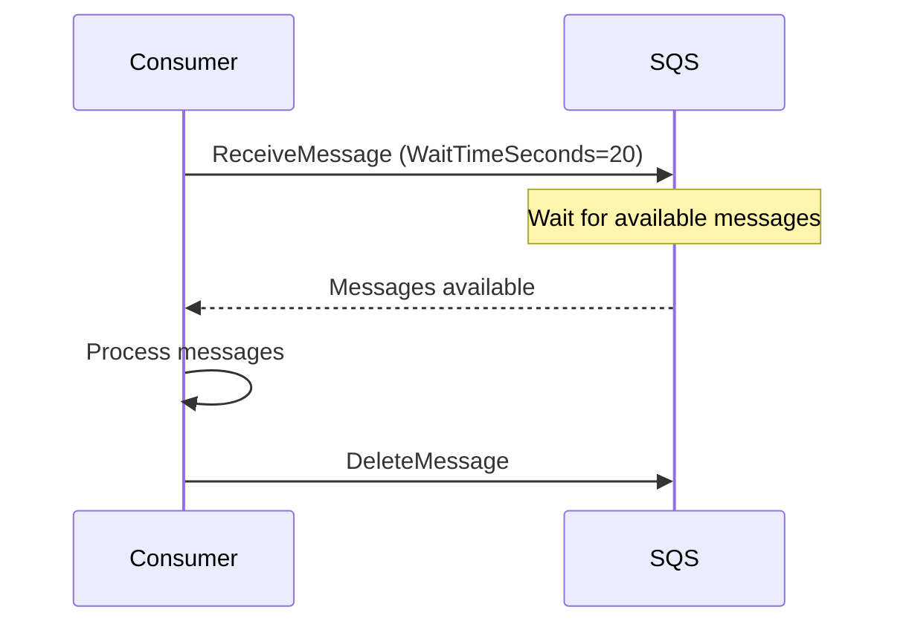
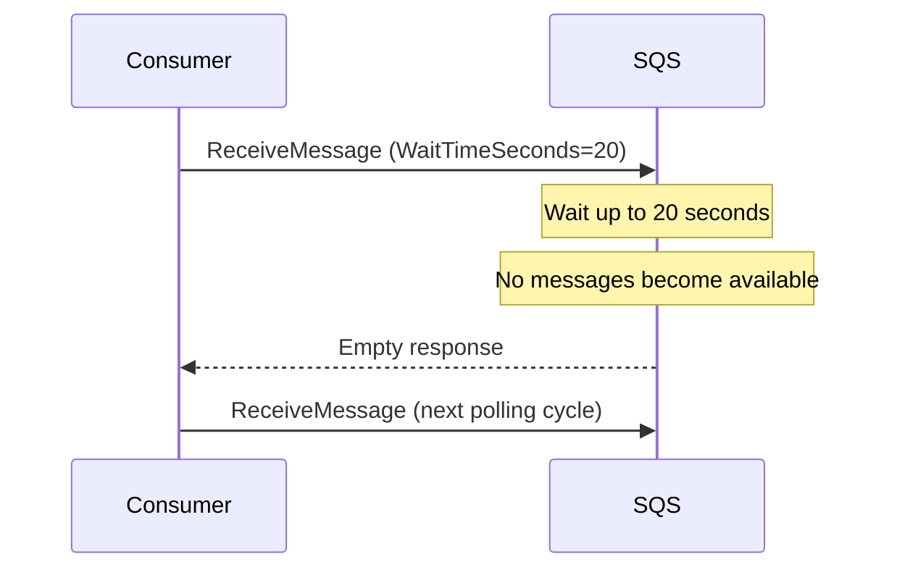
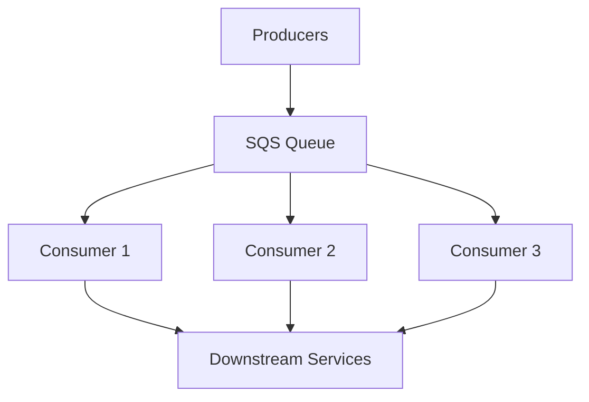

# 10- Long Polling

## Overview

Amazon Simple Queue Service (SQS) supports two message retrieval modes:

- **Short polling:** SQS responds immediately based on a weighted sampling of its distributed message servers.
- **Long polling:** SQS waits for a message to become available or for the configured wait period to expire before returning a response.

Long polling reduces empty responses when queues are temporarily idle. It is generally the preferred retrieval mode for production consumers because it reduces unnecessary API requests and improves message retrieval efficiency.

The maximum long-polling wait time is **20 seconds**.

Long polling does not change SQS message delivery guarantees, visibility timeout behavior, ordering, or message retention. It changes how consumers wait for messages.

## Short Polling vs Long Polling

### Short Polling

With short polling, SQS samples a subset of its distributed servers and returns messages available from that sample. It responds immediately, even when no messages are returned.

Because only a subset of servers is sampled for a request, short polling can return an empty response even when messages exist elsewhere in the queue.

This is called an *empty receive*.

### Long Polling

With long polling, SQS queries across its distributed message servers and waits for messages to become available, up to the configured wait time.

The request returns when:

- One or more messages become available.
- The configured wait time expires.

Long polling reduces empty responses caused by sampling and waiting for messages to arrive during the request.

### Comparison

| Characteristic | Short Polling | Long Polling |
|---|---|---|
| Wait behavior | Returns immediately | Waits for messages or timeout |
| Maximum wait | No intentional wait | 20 seconds |
| Server sampling | Weighted subset | Queries across SQS servers |
| Empty responses | More likely | Reduced |
| API request frequency | Can be high | Usually lower |
| Cost efficiency | Less efficient for idle queues | Generally more efficient |
| Message delivery guarantees | Unchanged | Unchanged |
| Typical use | Specialized low-latency retrieval patterns | Most production consumers |

## How Long Polling Works

Long polling is configured using `WaitTimeSeconds` on the `ReceiveMessage` API operation.

For example:

```python
response = sqs.receive_message(
    QueueUrl=queue_url,
    WaitTimeSeconds=20,
    MaxNumberOfMessages=10,
)
```

The consumer sends a request and waits for SQS to return a response.

If messages become available during the waiting period, SQS returns them. If no messages become available, SQS returns an empty response after the wait period expires.



When no messages arrive:



The wait is performed by the SQS service. The consumer does not need to repeatedly call `ReceiveMessage` during the waiting period.

## Configuring Long Polling

SQS supports long polling at two levels:

- Queue-level configuration using `ReceiveMessageWaitTimeSeconds`.
- Per-request configuration using `WaitTimeSeconds`.

The queue-level setting becomes the default for receive requests that do not specify their own wait time.

| Configuration | API parameter or attribute | Range |
|---|---|---|
| Queue-level wait time | `ReceiveMessageWaitTimeSeconds` | 0–20 seconds |
| Per-request wait time | `WaitTimeSeconds` | 0–20 seconds |

A per-request value overrides the queue-level default for that request.

### Configure Using AWS CLI

Configure a queue to use a 20-second long-polling interval:

```bash
aws sqs set-queue-attributes \
    --queue-url https://sqs.us-east-1.amazonaws.com/123456789012/order-processing \
    --attributes ReceiveMessageWaitTimeSeconds=20
```

Verify the configuration:

```bash
aws sqs get-queue-attributes \
    --queue-url https://sqs.us-east-1.amazonaws.com/123456789012/order-processing \
    --attribute-names ReceiveMessageWaitTimeSeconds
```

Example response:

```json
{
    "Attributes": {
        "ReceiveMessageWaitTimeSeconds": "20"
    }
}
```

### Configure Using Boto3

```python
import boto3
from botocore.exceptions import BotoCoreError, ClientError

sqs = boto3.client("sqs", region_name="us-east-1")

queue_url = (
    "https://sqs.us-east-1.amazonaws.com/"
    "123456789012/order-processing"
)


def configure_long_polling(
    queue_url: str,
    wait_seconds: int = 20,
) -> None:
    if not 0 <= wait_seconds <= 20:
        raise ValueError(
            "wait_seconds must be between 0 and 20"
        )

    try:
        sqs.set_queue_attributes(
            QueueUrl=queue_url,
            Attributes={
                "ReceiveMessageWaitTimeSeconds": str(
                    wait_seconds
                )
            },
        )

    except (ClientError, BotoCoreError) as exc:
        raise RuntimeError(
            "Failed to configure SQS long polling"
        ) from exc


configure_long_polling(queue_url)
```

For most production queues, a 20-second default is a reasonable starting point. Per-request configuration is useful when different consumers have different latency or resource constraints.

## Implementing a Long-Polling Consumer

A production consumer should continuously receive messages, process them, and delete them only after successful durable processing.

The following example uses Boto3 with:

- Long polling.
- Batch retrieval.
- Explicit message deletion.
- Exception handling.
- Graceful shutdown.
- A separate processing function.

```python
import json
import logging
import signal
import threading

import boto3
from botocore.config import Config
from botocore.exceptions import BotoCoreError, ClientError

logging.basicConfig(level=logging.INFO)
logger = logging.getLogger(__name__)

sqs = boto3.client(
    "sqs",
    region_name="us-east-1",
    config=Config(
        connect_timeout=5,
        read_timeout=30,
        retries={
            "mode": "standard",
            "total_max_attempts": 5,
        },
    ),
)

QUEUE_URL = (
    "https://sqs.us-east-1.amazonaws.com/"
    "123456789012/order-processing"
)

shutdown_event = threading.Event()


def process_message(message: dict) -> None:
    payload = json.loads(message["Body"])

    order_id = payload["order_id"]

    logger.info(
        "Processing order",
        extra={"order_id": order_id},
    )

    # Perform durable, idempotent business processing here.


def handle_message(message: dict) -> None:
    receipt_handle = message["ReceiptHandle"]

    try:
        process_message(message)

        sqs.delete_message(
            QueueUrl=QUEUE_URL,
            ReceiptHandle=receipt_handle,
        )

        logger.info(
            "Message processed and deleted",
            extra={"message_id": message["MessageId"]},
        )

    except (ClientError, BotoCoreError):
        logger.exception(
            "SQS operation failed",
            extra={"message_id": message["MessageId"]},
        )
        raise

    except Exception:
        logger.exception(
            "Message processing failed",
            extra={"message_id": message["MessageId"]},
        )
        raise


def poll_messages() -> None:
    while not shutdown_event.is_set():
        try:
            response = sqs.receive_message(
                QueueUrl=QUEUE_URL,
                MaxNumberOfMessages=10,
                WaitTimeSeconds=20,
                MessageSystemAttributeNames=[
                    "ApproximateReceiveCount"
                ],
            )

            messages = response.get("Messages", [])

            if not messages:
                continue

            for message in messages:
                if shutdown_event.is_set():
                    break

                try:
                    handle_message(message)
                except Exception:
                    # Leave the message undeleted.
                    # SQS can make it available again after
                    # its visibility timeout expires.
                    continue

        except (ClientError, BotoCoreError):
            logger.exception("Failed to poll SQS")
            shutdown_event.wait(5)


def request_shutdown(signum, frame) -> None:
    logger.info("Shutdown requested")
    shutdown_event.set()


signal.signal(signal.SIGTERM, request_shutdown)
signal.signal(signal.SIGINT, request_shutdown)

if __name__ == "__main__":
    poll_messages()
```

This is a basic sequential consumer. Production deployments should also define processing timeouts, visibility-timeout management, idempotency, bounded concurrency, and graceful handling of in-flight messages during shutdown.

The `read_timeout` is deliberately greater than the 20-second long-polling interval. This prevents the HTTP client from timing out before SQS has completed its receive request.

## HTTP Client Timeout Configuration

One of the most important long-polling configuration requirements is ensuring that the HTTP response timeout exceeds the SQS wait time.

Consider this configuration:

```python
sqs.receive_message(
    QueueUrl=queue_url,
    WaitTimeSeconds=20,
)
```

If the HTTP client's read timeout is 10 seconds, the client may time out before SQS finishes waiting.

This can cause:

- Unnecessary request failures.
- Retry attempts.
- Additional API requests.
- Ambiguous receive outcomes.
- Increased operational noise.

A practical configuration is:

```python
from botocore.config import Config

config = Config(
    connect_timeout=5,
    read_timeout=30,
)
```

The read timeout should be greater than the maximum `WaitTimeSeconds`, with sufficient allowance for network latency and response handling.

For example:

| SQS wait time | Suggested read timeout |
|---|---|
| 5 seconds | 10–15 seconds |
| 10 seconds | 15–20 seconds |
| 20 seconds | 25–30 seconds or more |

These are starting points, not universal values. Measure actual network behavior and configure timeouts accordingly.

### Networking Considerations

The consumer's HTTP client, proxy, service mesh, NAT path, and other network components must allow the long-running request to complete.

Check the following:

- HTTP read timeout exceeds the SQS wait time.
- Proxy or load-balancer idle timeout does not terminate the request prematurely.
- Connection pools support the expected number of concurrent receive requests.
- Retry behavior does not create excessive concurrent requests.
- Network interruptions are handled as normal transient failures.

If a consumer runs behind a proxy or service mesh, its connection idle timeout should also be reviewed.

## Long Polling with Multiple Consumers

A production SQS system commonly runs multiple consumers to increase processing capacity.

Each consumer can independently issue long-polling requests.



Consumers compete for messages from the same queue. Long polling does not broadcast each message to every consumer.

SQS distributes available messages among receive requests. Once a consumer receives a message, the message becomes invisible to other consumers during its visibility timeout, subject to SQS delivery semantics.

### Scaling Considerations

Long polling reduces empty receive requests, but it does not automatically scale consumer processing capacity.

Scale consumers based on:

- Available message backlog.
- Age of the oldest message.
- Processing throughput.
- Downstream service capacity.
- Number of in-flight messages.
- CPU and memory utilization.

Avoid scaling solely on the number of active long-polling connections. A consumer can be waiting for messages without doing useful processing.

For containerized consumers running in Docker or Kubernetes, ensure the deployment has enough CPU, memory, and network capacity for the configured number of concurrent polling requests.

## Long Polling and Batch Retrieval

Long polling can be combined with batch retrieval using `MaxNumberOfMessages`.

The parameter accepts values from 1 to 10.

```python
response = sqs.receive_message(
    QueueUrl=queue_url,
    MaxNumberOfMessages=10,
    WaitTimeSeconds=20,
)
```

This allows a consumer to receive up to 10 messages in one API response.

Batch retrieval can reduce request overhead and improve throughput, especially when processing many small messages.

However, receiving a batch introduces additional considerations:

- Each message has its own receipt handle.
- Each message must be processed independently.
- Failed messages should not be deleted.
- Visibility timeout must account for batch processing time.
- Processing concurrency should be bounded by downstream capacity.

A batch response does not guarantee that exactly 10 messages will be returned. SQS may return fewer messages even when additional messages exist.

For higher-throughput systems, use bounded concurrent processing rather than creating unlimited tasks for every received message.

## Long Polling and Visibility Timeout

Long polling and visibility timeout control different parts of the message lifecycle.

- Long polling determines how long a receive request waits for available messages.
- Visibility timeout determines how long a received message remains unavailable to other consumers.

For example:

```python
response = sqs.receive_message(
    QueueUrl=queue_url,
    MaxNumberOfMessages=10,
    WaitTimeSeconds=20,
    VisibilityTimeout=120,
)
```

Here:

- SQS can wait up to 20 seconds for messages.
- Each returned message is hidden for 120 seconds after receipt.
- The consumer must process and delete each message before visibility expires, or extend visibility when necessary.

The visibility timeout should be based on actual processing duration, not the long-polling interval.

For long-running processing, use `ChangeMessageVisibility` to extend the visibility period when appropriate. Remember that SQS has a maximum visibility period of 12 hours from the initial receive.

## Long Polling with AWS Lambda

When Lambda consumes SQS messages through an event source mapping, AWS manages polling on behalf of the function.

The event source mapping:

1. Polls the SQS queue.
2. Retrieves available messages.
3. Invokes the Lambda function with a batch.
4. Handles successful and failed records according to the configured batch response behavior.

You do not configure `WaitTimeSeconds` inside the Lambda handler for this integration. Polling behavior is managed by the Lambda event source mapping.

Relevant configuration includes:

- Batch size.
- Maximum batching window.
- Function timeout.
- Queue visibility timeout.
- Maximum concurrency.
- Partial batch response configuration.

For SQS-triggered Lambda functions, configure queue visibility timeout to at least six times the function timeout, plus the maximum batching window allowance, following AWS guidance.

Use partial batch responses with `ReportBatchItemFailures` when individual records can fail independently. This prevents successful records from being unnecessarily retried because another record in the same batch failed.

## Monitoring and Observability

Long polling reduces empty receive requests, so monitoring should focus on message flow and processing behavior rather than request volume alone.

Important CloudWatch metrics include:

| Metric | Purpose |
|---|---|
| `NumberOfMessagesReceived` | Tracks messages returned by receive operations |
| `NumberOfMessagesDeleted` | Tracks successful message deletions |
| `NumberOfEmptyReceives` | Helps identify empty receive responses |
| `ApproximateNumberOfMessagesVisible` | Tracks messages available for retrieval |
| `ApproximateNumberOfMessagesNotVisible` | Tracks messages currently in flight |
| `ApproximateAgeOfOldestMessage` | Helps identify processing delays |

Use these metrics to investigate:

- Consumers polling frequently without receiving messages.
- Backlogs growing faster than consumers can process them.
- Messages remaining in flight for unusually long periods.
- Processing failures and repeated redelivery.
- Consumer capacity that is insufficient for incoming traffic.

`NumberOfEmptyReceives` is particularly useful when comparing short-polling and long-polling behavior.

Also capture application-level metrics such as:

- Message processing duration.
- Receive-to-processing latency.
- Processing success and failure rates.
- Retry count.
- Downstream dependency latency.
- Consumer concurrency.

Do not interpret a low number of receive requests as proof of healthy processing. A consumer may be waiting efficiently while a backlog grows because processing capacity is insufficient.

## Cost and Performance Considerations

SQS pricing is based primarily on API requests and applicable data transfer or feature charges. Long polling can reduce unnecessary receive requests, particularly when queues are idle or receive messages intermittently.

### Example

Assume a consumer polls an idle queue every second using short polling.

It can generate approximately 3,600 receive requests per hour.

With 20-second long polling, the consumer can generate substantially fewer requests while waiting for messages, although actual request frequency depends on message arrival and consumer behavior.

Long polling also reduces application overhead associated with repeatedly handling empty responses.

### Performance Trade-offs

| Factor | Short Polling | Long Polling |
|---|---|---|
| Empty receive overhead | Higher | Lower |
| Idle queue API usage | Higher | Lower |
| Message retrieval | Immediate response | Waits for availability |
| Consumer request duration | Short | Potentially up to 20 seconds |
| Connection utilization | More frequent requests | Longer-lived requests |
| Best fit | Specialized low-latency scenarios | Most general-purpose consumers |

Long polling does not increase the maximum message-processing throughput of a consumer. Throughput still depends on message arrival rate, consumer concurrency, processing time, and downstream capacity.

## Common Mistakes and Production Pitfalls

| Mistake | Why it causes problems | Recommended approach |
|---|---|---|
| Setting HTTP read timeout below 20 seconds | The client may terminate the request before SQS responds | Set read timeout above `WaitTimeSeconds` |
| Assuming every receive returns 10 messages | SQS can return fewer messages | Handle variable batch sizes |
| Using long polling as a replacement for scaling | Waiting efficiently does not increase processing capacity | Scale consumers based on backlog and processing throughput |
| Treating empty responses as errors | An empty response is normal when no messages become available | Continue polling |
| Configuring long polling but ignoring proxy timeouts | Intermediate network components may close connections | Review proxy and service-mesh idle timeouts |
| Setting visibility timeout equal to long-poll duration | These settings control different lifecycle stages | Configure visibility based on processing duration |
| Running unlimited concurrent receive requests | Can create unnecessary connections and operational complexity | Bound polling concurrency |
| Assuming long polling prevents duplicate delivery | SQS delivery semantics remain unchanged | Implement idempotent consumers |
| Ignoring `NumberOfEmptyReceives` | Inefficient polling patterns may go unnoticed | Monitor empty receive behavior |
| Scaling only on CPU utilization | Consumers may be idle while queue age increases | Include queue backlog and message age in scaling policies |

## Best Practices

- Enable long polling for production SQS consumers unless a specific requirement justifies short polling.
- Use `ReceiveMessageWaitTimeSeconds=20` as a practical queue-level default.
- Set the HTTP read timeout higher than the configured SQS wait time.
- Configure proxy, service-mesh, and network idle timeouts to support long-running receive requests.
- Combine long polling with batch retrieval where it improves throughput.
- Keep consumer concurrency bounded and aligned with downstream capacity.
- Configure visibility timeout independently based on processing duration.
- Monitor empty receives, queue backlog, message age, and processing latency.
- Handle empty responses as normal polling outcomes.
- Implement idempotency and retry handling because long polling does not change SQS delivery guarantees.
- Use Lambda event source mapping configuration rather than implementing manual polling inside an SQS-triggered Lambda function.
- Validate polling behavior under idle, burst, and sustained-load conditions before production deployment.

## Key Takeaways

- Long polling allows SQS to wait up to 20 seconds for messages, reducing empty receive responses and unnecessary API requests.
- Configure long polling through `ReceiveMessageWaitTimeSeconds` at queue level or `WaitTimeSeconds` per receive request.
- Set HTTP read timeouts and intermediate network idle timeouts higher than the configured polling duration.
- Long polling improves retrieval efficiency but does not change delivery guarantees, visibility timeout behavior, or consumer processing capacity.
- Combine long polling with batch retrieval, bounded concurrency, idempotent processing, and queue-level monitoring for reliable production consumers.