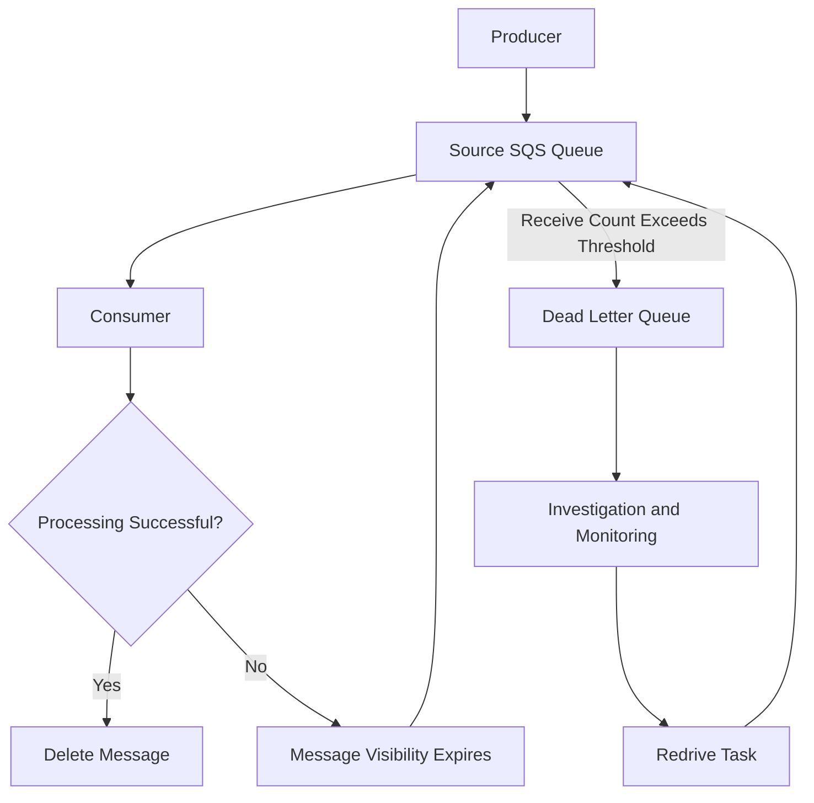
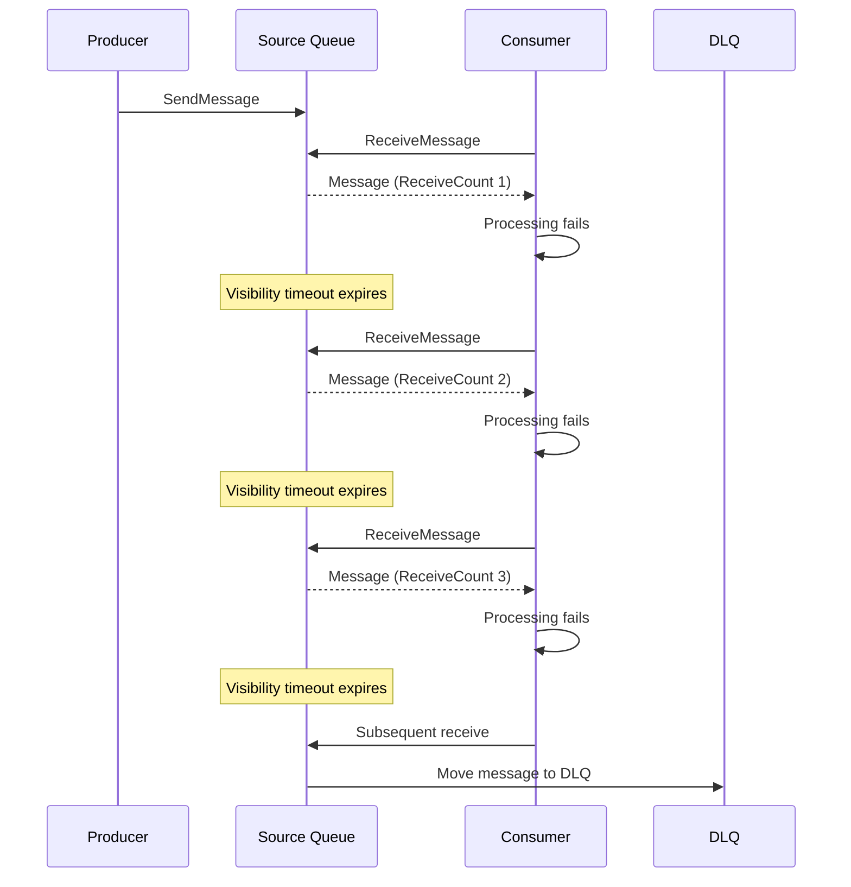
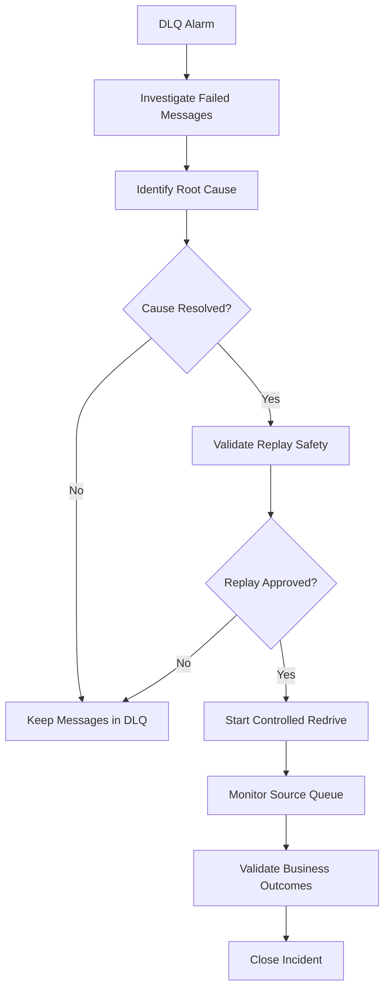

# 11- Dead Letter Queues and Redrive Policies

## Overview

Amazon Simple Queue Service (SQS) Dead Letter Queues (DLQs) isolate messages that cannot be processed successfully after repeated delivery attempts.

In a distributed system, message processing can fail for several reasons:

- Invalid message payloads.
- Application bugs.
- Downstream service failures.
- Database constraint violations.
- Missing dependencies or configuration.
- Unexpected schema changes.
- Poison messages that consistently crash consumers.

Without a failure-handling mechanism, problematic messages may repeatedly consume processing capacity and prevent healthy messages from progressing efficiently.

A DLQ provides an isolation boundary. Messages that exceed a configured receive-count threshold are moved from the source queue to a separate queue for investigation and recovery.

A **redrive policy** defines when messages should be moved to a DLQ. A **redrive task** moves messages from a DLQ back to a source queue or another destination queue for reprocessing.

These mechanisms improve reliability by separating normal message processing from failure investigation and recovery.

## Dead Letter Queue Architecture

A DLQ is an ordinary SQS queue configured as the dead-letter destination of another queue.

The original queue is called the **source queue**. The DLQ receives messages that repeatedly fail processing.



The source queue and DLQ are separate queues. They can have different:

- Retention periods.
- Access policies.
- Encryption settings.
- Monitoring alarms.
- Consumer configurations.
- Operational ownership.

A DLQ does not automatically fix failed messages. It preserves them for investigation, controlled recovery, or permanent rejection.

## How Dead Letter Queues Work

SQS uses the message's receive count and the source queue's redrive policy to determine when a message should be moved to its DLQ.

The redrive policy contains two important properties:

| Property | Description |
|---|---|
| `deadLetterTargetArn` | ARN of the destination DLQ |
| `maxReceiveCount` | Maximum number of receives before SQS moves the message to the DLQ |

The `maxReceiveCount` value determines the receive threshold. It does not represent a guaranteed number of completed application processing attempts.

### Message Processing Lifecycle

Consider a source queue configured with:

```json
{
    "maxReceiveCount": 3
}
```

A simplified lifecycle is:

1. A consumer receives the message.
2. SQS increments the message's receive count.
3. The consumer attempts processing.
4. Processing fails, or the consumer does not delete the message.
5. The visibility timeout expires.
6. The message becomes available for another receive.
7. Once the receive threshold is exceeded, SQS moves the message to the DLQ.

The message is not moved to the DLQ merely because application code raises an exception. The consumer normally leaves it undeleted, allowing the visibility timeout and subsequent receive operations to determine its fate.



The diagram illustrates the retry lifecycle conceptually. The exact receive and movement behavior is controlled by SQS and the configured redrive policy.

### Important Receive Count Behavior

`ApproximateReceiveCount` is an SQS system attribute that indicates how many times a message has been received.

It is not a count of successful or completed business-processing attempts.

For example, a consumer might receive a message and crash before executing any application logic. That receive can still contribute to the receive count.

This distinction matters when choosing `maxReceiveCount`.

## Configuring a Dead Letter Queue

A typical implementation requires:

1. Create a source queue.
2. Create a DLQ of the same queue type.
3. Configure a redrive policy on the source queue.
4. Configure appropriate retention and access policies.
5. Monitor the DLQ.
6. Define a controlled recovery process.

### Standard and FIFO Compatibility

The source queue and DLQ must have matching queue types.

| Source queue | DLQ |
|---|---|
| Standard | Standard |
| FIFO | FIFO |

A Standard queue cannot use a FIFO queue as its DLQ, and a FIFO queue cannot use a Standard queue as its DLQ.

For FIFO queues, moving messages to a DLQ can break the original sequence of messages within a message group. This is important when later messages depend on earlier events.

For example, if an order workflow contains:

- `order.created`
- `order.payment_confirmed`
- `order.shipped`

Moving `order.payment_confirmed` to a DLQ may allow subsequent messages to proceed depending on the consumer and queue behavior. Reprocessing the failed event later does not automatically restore the original business sequence.

Use DLQs with FIFO queues only when the application has an explicit strategy for handling sequence gaps and replay.

## Configuring Redrive Policies Using AWS CLI

Assume the following queues:

- Source queue: `order-processing`
- DLQ: `order-processing-dlq`

### Create the DLQ

```bash
aws sqs create-queue \
    --queue-name order-processing-dlq \
    --attributes MessageRetentionPeriod=1209600
```

The retention period is 14 days, expressed in seconds.

Retrieve the DLQ ARN:

```bash
aws sqs get-queue-attributes \
    --queue-url https://sqs.us-east-1.amazonaws.com/123456789012/order-processing-dlq \
    --attribute-names QueueArn
```

Example response:

```json
{
    "Attributes": {
        "QueueArn": "arn:aws:sqs:us-east-1:123456789012:order-processing-dlq"
    }
}
```

### Create the Source Queue

```bash
aws sqs create-queue \
    --queue-name order-processing
```

Retrieve its queue URL:

```bash
aws sqs get-queue-url \
    --queue-name order-processing
```

### Configure the Redrive Policy

Create a redrive policy containing the DLQ ARN and maximum receive count.

```json
{
    "deadLetterTargetArn": "arn:aws:sqs:us-east-1:123456789012:order-processing-dlq",
    "maxReceiveCount": 5
}
```

Apply the policy:

```bash
aws sqs set-queue-attributes \
    --queue-url https://sqs.us-east-1.amazonaws.com/123456789012/order-processing \
    --attributes '{
        "RedrivePolicy": "{\"deadLetterTargetArn\":\"arn:aws:sqs:us-east-1:123456789012:order-processing-dlq\",\"maxReceiveCount\":\"5\"}"
    }'
```

Verify the configuration:

```bash
aws sqs get-queue-attributes \
    --queue-url https://sqs.us-east-1.amazonaws.com/123456789012/order-processing \
    --attribute-names RedrivePolicy
```

The `maxReceiveCount` should be selected according to the failure characteristics of the workload.

A low threshold may move messages to the DLQ during a temporary outage. An excessively high threshold can waste processing capacity on messages that will never succeed.

## Configuring Using Boto3

Boto3 supports configuring queue attributes through `set_queue_attributes`.

The following example creates a DLQ and source queue, retrieves their ARNs, and configures the redrive policy.

```python
import json

import boto3
from botocore.exceptions import BotoCoreError, ClientError

sqs = boto3.client("sqs", region_name="us-east-1")


def get_queue_attributes(queue_url: str) -> dict:
    response = sqs.get_queue_attributes(
        QueueUrl=queue_url,
        AttributeNames=["QueueArn"],
    )

    return response["Attributes"]


def create_queue(name: str) -> str:
    response = sqs.create_queue(
        QueueName=name,
    )

    return response["QueueUrl"]


def configure_dlq(
    source_queue_url: str,
    dlq_arn: str,
    max_receive_count: int = 5,
) -> None:
    if max_receive_count < 1:
        raise ValueError(
            "max_receive_count must be at least 1"
        )

    redrive_policy = {
        "deadLetterTargetArn": dlq_arn,
        "maxReceiveCount": str(max_receive_count),
    }

    sqs.set_queue_attributes(
        QueueUrl=source_queue_url,
        Attributes={
            "RedrivePolicy": json.dumps(redrive_policy),
        },
    )


def main() -> None:
    try:
        dlq_url = create_queue(
            "order-processing-dlq"
        )

        source_queue_url = create_queue(
            "order-processing"
        )

        dlq_attributes = get_queue_attributes(dlq_url)
        dlq_arn = dlq_attributes["QueueArn"]

        configure_dlq(
            source_queue_url=source_queue_url,
            dlq_arn=dlq_arn,
            max_receive_count=5,
        )

        print("DLQ configured successfully")

    except (ClientError, BotoCoreError) as exc:
        raise RuntimeError(
            "Failed to configure SQS dead letter queue"
        ) from exc


if __name__ == "__main__":
    main()
```

This example assumes the queues do not already exist and that the execution role has the required permissions.

For production systems, queue creation and configuration should generally be managed through Terraform, CloudFormation, or another infrastructure-as-code workflow.

## Redrive Allow Policy

A redrive allow policy controls which source queues are permitted to use a queue as their DLQ.

It is configured on the DLQ, not the source queue.

This is useful when a DLQ should only accept messages from explicitly authorized source queues.

SQS supports these permission modes:

| Mode | Description |
|---|---|
| `allowAll` | Allows all source queues in the same account and Region, subject to service constraints |
| `denyAll` | Prevents source queues from using this queue as a DLQ |
| `byQueue` | Allows only explicitly listed source queue ARNs |

Example:

```json
{
    "redrivePermission": "byQueue",
    "sourceQueueArns": [
        "arn:aws:sqs:us-east-1:123456789012:order-processing"
    ]
}
```

Configure it using AWS CLI:

```bash
aws sqs set-queue-attributes \
    --queue-url https://sqs.us-east-1.amazonaws.com/123456789012/order-processing-dlq \
    --attributes '{
        "RedriveAllowPolicy": "{\"redrivePermission\":\"byQueue\",\"sourceQueueArns\":[\"arn:aws:sqs:us-east-1:123456789012:order-processing\"]}"
    }'
```

The `byQueue` policy supports a limited number of source queue ARNs. If the architecture requires more source queues, evaluate whether `allowAll` with appropriate account and Region boundaries is more suitable.

The redrive allow policy is distinct from an IAM queue policy. It controls DLQ source eligibility; it does not grant arbitrary principals permission to read, write, or delete messages.

## Redrive Policies vs Redrive Tasks

These concepts solve different problems.

### Redrive Policy

A redrive policy defines the automatic failure-handling behavior of a source queue.

It specifies:

- Which DLQ receives failed messages.
- How many receives are allowed before movement.

### Redrive Task

A redrive task moves messages from a DLQ to a destination queue for reprocessing.

SQS provides the `StartMessageMoveTask` API for managed message movement.

| Feature | Redrive policy | Redrive task |
|---|---|---|
| Purpose | Isolate repeatedly received messages | Recover or replay messages |
| Direction | Source queue to DLQ | DLQ to destination queue |
| Trigger | Receive count threshold | Explicit API request |
| Configuration | Queue attribute | SQS API operation |
| Typical use | Automatic failure handling | Controlled recovery |

A redrive task can move messages back to the original source queue or to another supported destination queue.

Using a separate destination queue can be useful when the original consumer is still unhealthy or when replay requires a different processing version.

## Moving Messages from a DLQ

SQS supports managed message movement through the `StartMessageMoveTask` API.

The operation returns a task handle that can be used to inspect progress and stop the task.

### Start a Redrive Task Using AWS CLI

```bash
aws sqs start-message-move-task \
    --source-arn arn:aws:sqs:us-east-1:123456789012:order-processing-dlq
```

By default, SQS uses the original source queue associated with the DLQ when determining the destination.

To specify a destination queue:

```bash
aws sqs start-message-move-task \
    --source-arn arn:aws:sqs:us-east-1:123456789012:order-processing-dlq \
    --destination-arn arn:aws:sqs:us-east-1:123456789012:order-processing-replay
```

A custom destination is useful when:

- The original consumer is still being repaired.
- A new consumer version must process historical messages.
- Replay needs a controlled environment.
- The application requires a separate validation workflow.

### Monitor a Redrive Task

```bash
aws sqs list-message-move-tasks \
    --source-arn arn:aws:sqs:us-east-1:123456789012:order-processing-dlq
```

The response provides information about active and recently completed movement tasks.

Important task attributes include:

- Task handle.
- Source ARN.
- Destination ARN.
- Approximate number of messages moved.
- Approximate number of messages to move.
- Task status.
- Failure reason, when available.

### Stop a Redrive Task

```bash
aws sqs cancel-message-move-task \
    --task-handle TASK_HANDLE
```

Stopping a task does not reverse messages that have already been moved.

Redrive operations should be monitored and controlled like any other production recovery operation.

## Redrive Using Boto3

```python
import boto3
from botocore.exceptions import BotoCoreError, ClientError

sqs = boto3.client("sqs", region_name="us-east-1")

DLQ_ARN = (
    "arn:aws:sqs:us-east-1:123456789012:"
    "order-processing-dlq"
)


def start_redrive(destination_arn: str | None = None) -> str:
    request = {
        "SourceArn": DLQ_ARN,
    }

    if destination_arn:
        request["DestinationArn"] = destination_arn

    try:
        response = sqs.start_message_move_task(
            **request
        )

        return response["TaskHandle"]

    except (ClientError, BotoCoreError) as exc:
        raise RuntimeError(
            "Unable to start SQS redrive task"
        ) from exc


def list_redrive_tasks() -> list[dict]:
    try:
        response = sqs.list_message_move_tasks(
            SourceArn=DLQ_ARN,
            MaxResults=10,
        )

        return response.get("Results", [])

    except (ClientError, BotoCoreError) as exc:
        raise RuntimeError(
            "Unable to retrieve redrive task status"
        ) from exc


if __name__ == "__main__":
    task_handle = start_redrive()

    print(f"Started redrive task: {task_handle}")

    for task in list_redrive_tasks():
        print(
            task.get("Status"),
            task.get("ApproximateNumberOfMessagesMoved"),
        )
```

A production recovery tool should also validate the destination, record operator identity, capture the reason for replay, and monitor the task until completion.

## Redrive Velocity and Controlled Recovery

A DLQ may contain thousands or millions of messages. Moving all messages back into a source queue too quickly can overwhelm consumers and downstream systems.

SQS supports a `MaxNumberOfMessagesPerSecond` parameter for controlling the redrive movement rate.

Example:

```bash
aws sqs start-message-move-task \
    --source-arn arn:aws:sqs:us-east-1:123456789012:order-processing-dlq \
    --max-number-of-messages-per-second 100
```

A controlled redrive rate helps protect:

- Consumer CPU and memory.
- Database connection pools.
- Downstream API quotas.
- Payment and inventory services.
- External partner integrations.

If the rate is omitted, SQS manages the movement rate automatically.

For production recovery, start with a conservative rate and increase it only after observing consumer throughput and downstream health.

A redrive task does not guarantee that every moved message will be processed successfully. Messages can fail again and return to a DLQ if the source queue's redrive policy is still active.

## Retention Period Considerations

DLQ retention is an important operational decision.

SQS message retention periods range from 60 seconds to 14 days.

The source queue and DLQ can have different retention periods.

| Queue type | Timestamp behavior when moved to DLQ | Retention consideration |
|---|---|---|
| Standard | Original enqueue timestamp is retained | DLQ retention should be longer than source retention |
| FIFO | Enqueue timestamp resets when moved to DLQ | DLQ retention should provide sufficient investigation time |

For Standard queues, the message's original enqueue timestamp continues to matter after movement to the DLQ. The DLQ retention period does not simply provide a fresh full retention window.

For FIFO queues, the enqueue timestamp resets when a message moves to the DLQ.

In both cases, configure enough retention time for:

- Alerting and incident detection.
- Investigation.
- Root-cause analysis.
- Application fixes.
- Controlled replay.
- Business reconciliation.

A short DLQ retention period can cause messages to expire before an incident is resolved.

## DLQ Monitoring and Alerting

A DLQ should never become an unattended message archive.

Monitor its depth and age continuously.

Important CloudWatch metrics include:

| Metric | Purpose |
|---|---|
| `ApproximateNumberOfMessagesVisible` | Messages waiting in the DLQ |
| `ApproximateNumberOfMessagesNotVisible` | Messages currently being processed or received |
| `ApproximateAgeOfOldestMessage` | Age of the oldest message, subject to queue-type timestamp semantics |
| `NumberOfMessagesSent` | Messages entering the queue |
| `NumberOfMessagesReceived` | Messages retrieved from the queue |
| `NumberOfMessagesDeleted` | Messages removed from the queue |

Create alarms for:

- DLQ message count greater than zero.
- Rapid increases in DLQ depth.
- Oldest message exceeding the investigation threshold.
- Unexpected DLQ growth after deployments.
- Redrive tasks failing or remaining active longer than expected.

For critical workflows, even one DLQ message may require investigation.

Example alarm configuration using AWS CLI:

```bash
aws cloudwatch put-metric-alarm \
    --alarm-name order-processing-dlq-not-empty \
    --namespace AWS/SQS \
    --metric-name ApproximateNumberOfMessagesVisible \
    --dimensions Name=QueueName,Value=order-processing-dlq \
    --statistic Maximum \
    --period 60 \
    --evaluation-periods 1 \
    --threshold 0 \
    --comparison-operator GreaterThanThreshold \
    --alarm-actions arn:aws:sns:us-east-1:123456789012:operations-alerts
```

The alarm should route to an operational notification channel such as SNS, incident management software, or an on-call system.

CloudWatch queue metrics are approximate. They are suitable for operational monitoring, not transactional accounting.

## DLQ Message Inspection

A DLQ should preserve enough information to identify and diagnose failed messages.

Useful message fields include:

- Business event ID.
- Event type.
- Entity identifier.
- Schema version.
- Original creation timestamp.
- Correlation ID.
- Producer service.
- Retry count, if maintained by the application.
- Relevant business metadata.

Example message:

```json
{
    "event_id": "evt-7a91c2",
    "event_type": "order.payment_confirmed",
    "schema_version": 2,
    "order_id": "ORD-10025",
    "payment_id": "PAY-10025",
    "created_at": "2026-11-19T10:30:00Z",
    "correlation_id": "corr-91f2",
    "producer": "payment-service"
}
```

SQS also exposes system attributes such as `ApproximateReceiveCount` and `SentTimestamp`.

Retrieve a message from the DLQ using Boto3:

```python
response = sqs.receive_message(
    QueueUrl=dlq_url,
    MaxNumberOfMessages=10,
    WaitTimeSeconds=10,
    MessageSystemAttributeNames=[
        "All"
    ],
    MessageAttributeNames=[
        "All"
    ],
)

for message in response.get("Messages", []):
    print("Message ID:", message["MessageId"])
    print("Body:", message["Body"])
    print(
        "Receive count:",
        message.get("Attributes", {}).get(
            "ApproximateReceiveCount"
        ),
    )
```

Receiving a message from a DLQ makes it temporarily invisible according to the DLQ's visibility timeout. Do not delete messages during investigation unless permanent disposal is intended.

For sensitive workloads, restrict DLQ access and avoid logging full message bodies if they contain personal or confidential information.

## Application-Level Failure Handling

A DLQ is a final isolation mechanism, not a substitute for application-level error classification.

Consumers should distinguish between retryable and permanent failures.

| Failure type | Example | Recommended handling |
|---|---|---|
| Transient | Database unavailable | Retry with bounded backoff |
| Rate limit | HTTP 429 | Respect retry guidance and apply backoff |
| Temporary dependency failure | HTTP 503 | Retry within a bounded policy |
| Invalid payload | Missing required field | Reject or route for investigation |
| Unsupported schema | Unknown event version | Quarantine and investigate |
| Business rule violation | Invalid state transition | Apply business-specific rejection handling |
| Programming error | Unexpected exception | Alert, investigate, and avoid uncontrolled retries |

A poison message is a message that repeatedly causes processing failure.

Examples include:

- Malformed JSON.
- Unsupported event schema.
- Invalid database references.
- Data that triggers an unhandled application exception.

A DLQ prevents such messages from being retried indefinitely under the configured receive-count policy.

### Python Consumer Example

```python
import json
import logging

logger = logging.getLogger(__name__)


class PermanentMessageError(Exception):
    pass


class RetryableMessageError(Exception):
    pass


def process_order_event(message: dict) -> None:
    try:
        payload = json.loads(message["Body"])

    except json.JSONDecodeError as exc:
        raise PermanentMessageError(
            "Invalid JSON payload"
        ) from exc

    order_id = payload.get("order_id")

    if not order_id:
        raise PermanentMessageError(
            "Missing order_id"
        )

    try:
        update_order_status(order_id)

    except TemporaryDatabaseError as exc:
        raise RetryableMessageError(
            "Temporary database failure"
        ) from exc


def handle_message(message: dict) -> None:
    try:
        process_order_event(message)

    except PermanentMessageError:
        logger.exception(
            "Permanent message failure",
            extra={"message_id": message["MessageId"]},
        )

        # Do not delete the message if the configured
        # redrive policy should eventually move it to the DLQ.
        raise

    except RetryableMessageError:
        logger.warning(
            "Retryable message failure",
            extra={"message_id": message["MessageId"]},
        )
        raise

    except Exception:
        logger.exception(
            "Unexpected processing failure",
            extra={"message_id": message["MessageId"]},
        )
        raise
```

This example deliberately leaves failed messages undeleted. SQS can redeliver them after the visibility timeout and eventually move them to the DLQ according to the redrive policy.

For permanent failures, an alternative is to publish the message directly to a quarantine queue and acknowledge the original message after the quarantine write succeeds. This requires careful handling of the dual-write failure window and idempotency.

Do not silently delete invalid messages without preserving the information required for audit and investigation.

## DLQ and Consumer Idempotency

Messages can be delivered more than once, including after redrive.

A successful redrive does not guarantee exactly-once processing.

Consumers should use a stable business event identifier to prevent duplicate side effects.

For example, a PostgreSQL-backed consumer can maintain an inbox table with a unique event ID.

```sql
CREATE TABLE processed_events (
    event_id UUID PRIMARY KEY,
    processed_at TIMESTAMPTZ NOT NULL DEFAULT NOW()
);
```

A transaction should atomically record the event and apply the business update.

```python
def process_event_transactionally(
    connection,
    event_id,
    order_id,
):
    with connection.transaction():
        result = connection.execute(
            """
            INSERT INTO processed_events (event_id)
            VALUES (%s)
            ON CONFLICT (event_id) DO NOTHING
            RETURNING event_id
            """,
            (event_id,),
        )

        inserted = result.fetchone()

        if inserted is None:
            return

        connection.execute(
            """
            UPDATE orders
            SET status = 'PAYMENT_CONFIRMED'
            WHERE order_id = %s
            """,
            (order_id,),
        )
```

The event record and business update must use the same database transaction.

This ensures that a replayed event does not repeat the same database side effect after successful processing.

External side effects, such as payment provider calls or email delivery, require their own idempotency strategy.

## Security Considerations

DLQs frequently contain messages that failed because of unexpected or malformed data. They should be treated as operationally sensitive resources.

Apply the following controls:

- Restrict `sqs:ReceiveMessage`, `sqs:DeleteMessage`, and redrive permissions.
- Use IAM roles with least privilege.
- Enable server-side encryption using SQS-managed encryption or AWS KMS.
- Restrict customer-managed KMS key permissions where applicable.
- Use queue policies to control cross-account access.
- Avoid exposing message bodies in application logs.
- Audit manual redrive operations.
- Protect replay tools with role-based access and approval workflows.
- Define retention policies that satisfy operational and regulatory requirements.

The role performing a redrive task requires the appropriate SQS permissions for the source and destination queues. KMS permissions may also be required when customer-managed encryption keys are used.

## Terraform Configuration

The following Terraform example creates a Standard source queue and a Standard DLQ.

```hcl
resource "aws_sqs_queue" "order_processing_dlq" {
  name                      = "order-processing-dlq"
  message_retention_seconds = 1209600

  sqs_managed_sse_enabled = true

  tags = {
    Environment = "production"
    Service     = "order-processing"
    Purpose     = "dead-letter-queue"
  }
}

resource "aws_sqs_queue" "order_processing" {
  name                       = "order-processing"
  visibility_timeout_seconds = 120
  message_retention_seconds  = 345600

  redrive_policy = jsonencode({
    deadLetterTargetArn = aws_sqs_queue.order_processing_dlq.arn
    maxReceiveCount     = 5
  })

  sqs_managed_sse_enabled = true

  tags = {
    Environment = "production"
    Service     = "order-processing"
  }
}
```

The example configures:

- A 14-day DLQ retention period.
- A 4-day source queue retention period.
- A 120-second source queue visibility timeout.
- A maximum receive count of five.
- Server-side encryption using SQS-managed encryption.

For FIFO queues, configure both queue names with the `.fifo` suffix and set `fifo_queue = true` on both resources.

### Redrive Allow Policy in Terraform

```hcl
resource "aws_sqs_queue_redrive_allow_policy" "order_dlq" {
  queue_url = aws_sqs_queue.order_processing_dlq.id

  redrive_allow_policy = jsonencode({
    redrivePermission = "byQueue"
    sourceQueueArns = [
      aws_sqs_queue.order_processing.arn
    ]
  })
}
```

The redrive allow policy restricts which source queue can designate this DLQ as its destination.

Use the AWS provider version declared by the project and validate resource support before deployment.

## Operational Recovery Workflow

A production DLQ recovery process should be controlled and auditable.

Recommended workflow:



Before starting a redrive task:

1. Identify why the messages failed.
2. Verify that the application or dependency issue is resolved.
3. Confirm that the destination queue and consumers are healthy.
4. Check whether replay can cause duplicate business side effects.
5. Select an appropriate redrive velocity.
6. Record the operator, reason, and task details.
7. Monitor the redrive task and downstream systems.
8. Verify that business operations completed correctly.

For financial, inventory, and order-processing systems, replay should include reconciliation against authoritative business records.

## Common Mistakes and Production Pitfalls

| Mistake | Why it causes problems | Recommended approach |
|---|---|---|
| Setting `maxReceiveCount` too low | Temporary outages can move healthy messages to the DLQ | Choose a threshold based on failure behavior and visibility timeout |
| Setting `maxReceiveCount` too high | Poison messages repeatedly consume resources | Use bounded retries and monitor repeated failures |
| Using different queue types | Standard and FIFO queues cannot be mixed for a source-DLQ relationship | Match source and DLQ types |
| Treating a DLQ as automatic recovery | Messages remain isolated until explicitly handled | Establish investigation and redrive procedures |
| Redriving before fixing the root cause | Messages can immediately fail again | Validate application and dependency health first |
| Redriving at an excessive rate | Consumers and downstream systems can become overloaded | Use controlled redrive velocity |
| Ignoring FIFO ordering implications | DLQ movement can create gaps in message-group sequences | Design explicit sequence recovery |
| Setting DLQ retention too short | Messages can expire before investigation is complete | Configure sufficient retention |
| Deleting messages during inspection | Evidence is permanently removed | Use restricted inspection tools and explicit deletion procedures |
| Assuming receive count equals processing attempts | A consumer may receive and crash before processing | Interpret `ApproximateReceiveCount` correctly |
| Ignoring idempotency during replay | Duplicate business side effects can occur | Use stable event IDs and transactional deduplication |
| Treating DLQ depth as a complete failure metric | A low count can hide rapid movement or downstream failures | Monitor message age, movement, processing errors, and application metrics |

## Best Practices

- Configure a DLQ for queues carrying business-critical or operationally important messages.
- Use matching Standard or FIFO queue types.
- Select `maxReceiveCount` according to the workload's retry behavior.
- Set DLQ retention long enough for investigation and recovery.
- Use a redrive allow policy to restrict authorized source queues.
- Monitor DLQ depth and oldest-message age continuously.
- Alert on unexpected DLQ activity.
- Preserve stable business event IDs and correlation metadata.
- Make consumers idempotent before enabling automated replay.
- Fix the underlying failure before starting a redrive task.
- Use controlled redrive velocity to protect downstream dependencies.
- Audit manual redrive operations and validate business outcomes.
- Treat DLQ access as privileged because messages may contain sensitive data.
- Use application-level failure classification to distinguish transient failures from permanent failures.

## Key Takeaways

- A DLQ isolates messages that exceed the source queue's configured receive threshold, preventing repeated failures from remaining indefinitely in normal processing.
- A redrive policy defines the DLQ destination and `maxReceiveCount`; a redrive task moves messages back into a processing queue.
- Source queues and DLQs must have matching types, and FIFO redrive can affect business ordering.
- Retention, monitoring, access control, and controlled redrive velocity are essential for reliable DLQ operations.
- Redriving messages can repeat business side effects, so consumers must implement idempotency and recovery must include root-cause validation.