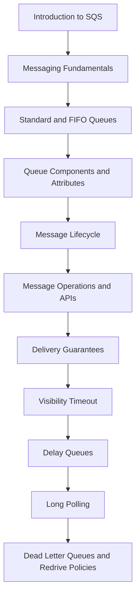

# README

## Overview

Amazon Simple Queue Service (SQS) is a fully managed message queuing service used to decouple distributed application components and enable reliable asynchronous communication.

SQS allows producers to publish messages without requiring consumers to be available at the same time. Consumers retrieve messages independently, process them, and delete them after successful processing.

It is commonly used in backend architectures involving microservices, event-driven systems, background workers, distributed job processing, and asynchronous workflows.

This section covers SQS fundamentals, queue behavior, message processing, reliability mechanisms, and production implementation patterns.

## Topics Covered

| File | Topic | Description |
|---|---|---|
| [01- Introduction to Amazon SQS.md](01-%20Introduction%20to%20Amazon%20SQS.md) | Introduction | SQS architecture, core capabilities, use cases, and integration with distributed systems. |
| [02- Asynchronous Messaging and Queue Fundamentals.md](02-%20Asynchronous%20Messaging%20and%20Queue%20Fundamentals.md) | Messaging Fundamentals | Asynchronous communication, producers, consumers, message brokers, and queue-based architecture. |
| [03- Standard and FIFO Queues.md](03-%20Standard%20and%20FIFO%20Queues.md) | Queue Types | Standard and FIFO queue behavior, ordering guarantees, deduplication, and throughput considerations. |
| [04- Queue Components and Attributes.md](04-%20Queue%20Components%20and%20Attributes.md) | Queue Configuration | Queue URLs, ARNs, attributes, retention, visibility timeout, encryption, and access policies. |
| [05- Message Lifecycle.md](05-%20Message%20Lifecycle.md) | Message Lifecycle | Message states, sending, receiving, visibility, deletion, retention, and redelivery. |
| [06- Message Operations and APIs.md](06-%20Message%20Operations%20and%20APIs.md) | SQS APIs | SendMessage, ReceiveMessage, DeleteMessage, batch operations, and Boto3 integration. |
| [07- Message Retention and Delivery Guarantees.md](07-%20Message%20Retention%20and%20Delivery%20Guarantees.md) | Delivery Semantics | At-least-once delivery, best-effort ordering, message retention, duplicate delivery, and reliability. |
| [08- Visibility Timeout.md](08-%20Visibility%20Timeout.md) | Visibility Timeout | Message invisibility after receipt, timeout configuration, extensions, and concurrent processing. |
| [09- Delay Queues.md](09-%20Delay%20Queues.md) | Delayed Processing | Queue-level delays, per-message timers, delayed retries, and scheduling alternatives. |
| [10- Long Polling.md](10-%20Long%20Polling.md) | Message Retrieval | Short polling, long polling, wait-time configuration, batch retrieval, and consumer optimization. |
| [11- Dead Letter Queues and Redrive Policies.md](11-%20Dead%20Letter%20Queues%20and%20Redrive%20Policies.md) | Failure Handling | DLQ configuration, redrive policies, message recovery, controlled replay, and failure investigation. |

## Learning Path

The documentation is organized to progress from SQS fundamentals to production-level message processing.

### Recommended Study Sequence

**Foundation**

- Understand asynchronous messaging and queue-based architecture.
- Learn the differences between Standard and FIFO queues.
- Understand queue attributes and message lifecycle.

**Message Processing**

- Practice sending, receiving, and deleting messages using Boto3.
- Understand delivery guarantees and duplicate handling.
- Configure visibility timeout and delayed processing.

**Production Reliability**

- Implement long polling and batch retrieval.
- Configure DLQs and redrive policies.
- Build idempotent consumers and controlled message recovery workflows.

## Key Engineering Concepts

The following concepts are central to designing reliable SQS-based backend systems:

| Concept | Engineering Importance |
|---|---|
| Decoupling | Allows producers and consumers to operate independently. |
| At-least-once delivery | Requires consumers to handle duplicate messages safely. |
| FIFO ordering | Preserves message order within individual message groups. |
| Visibility timeout | Prevents normally concurrent processing of a received message while the consumer works. |
| Long polling | Reduces unnecessary receive requests and empty responses. |
| Delay queues | Support short deferred message availability. |
| Dead Letter Queues | Isolate messages that repeatedly fail processing. |
| Idempotency | Prevents duplicate delivery or replay from repeating business side effects. |
| Redrive | Enables controlled recovery and reprocessing of failed messages. |

## Practical Implementation Focus

SQS concepts should be reinforced through backend engineering implementations.

Recommended implementation areas:

- Integrating SQS with Python applications using Boto3.
- Publishing messages from Django and FastAPI services.
- Building independent background workers.
- Running consumers in Docker containers and Kubernetes deployments.
- Persisting business state in PostgreSQL.
- Implementing idempotent message processing.
- Handling transient failures and retries.
- Configuring DLQs and controlled redrive workflows.
- Monitoring queue depth, message age, and processing failures.
- Managing SQS infrastructure using Terraform.

## Key Takeaways

- SQS provides asynchronous communication and decouples producers from consumers.
- Standard and FIFO queues have different ordering and deduplication characteristics.
- Visibility timeout, long polling, and delay queues control different aspects of message processing.
- DLQs, redrive policies, and idempotent consumers are essential for reliable failure handling.
- Production SQS systems require monitoring, controlled concurrency, security, and infrastructure-as-code.