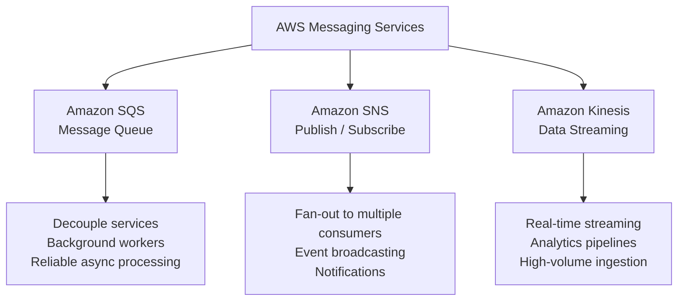
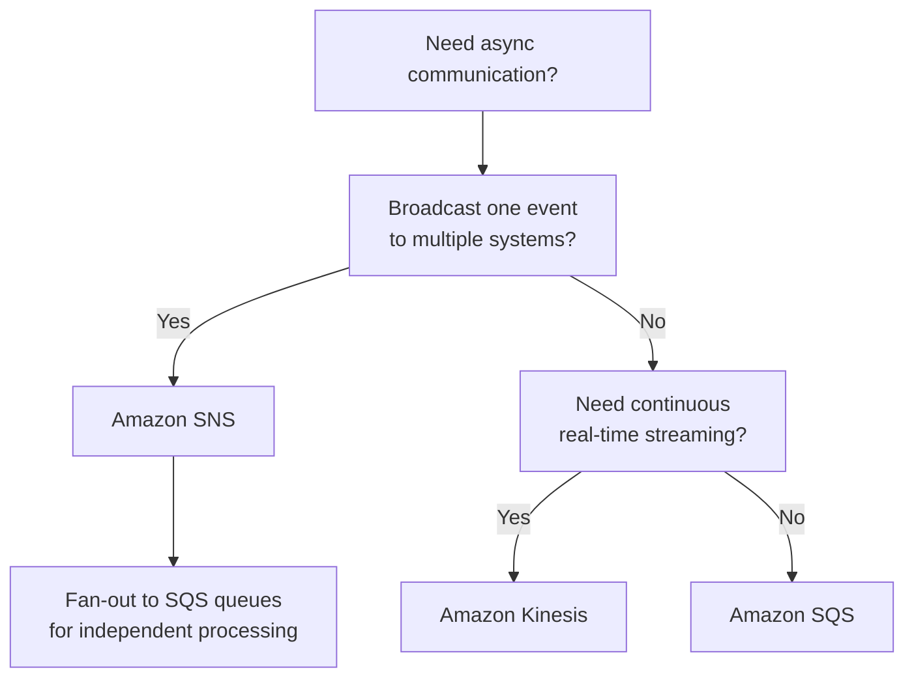
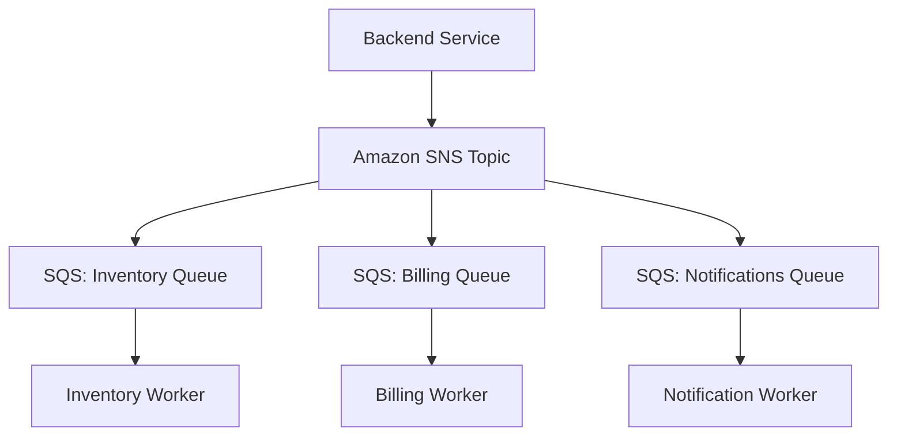
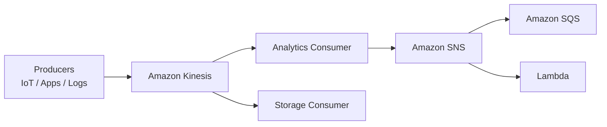

# AWS Messaging Services

## Overview

Modern cloud applications exchange massive amounts of data between services. AWS provides multiple messaging and streaming services to solve different communication problems across distributed systems.

This section covers the three core AWS messaging services used in backend engineering:

- **Amazon Kinesis** — real-time data streaming and event ingestion
- **Amazon SNS** — publish-subscribe message distribution
- **Amazon SQS** — reliable asynchronous message queuing

Although they appear similar, each service solves a different architectural problem. Choosing the correct service — or combining them — is essential for building scalable, reliable, and cost-effective systems.

---

## Contents

| # | Resource | Description |
|---|---|---|
| — | [SQS vs SNS vs Kinesis.md](./SQS%20vs%20SNS%20vs%20Kinesis.md) | Side-by-side comparison of all three services: communication models, ordering, retention, throughput, and decision guidance. |
| 01 | [Amazon Kinesis](./01-%20Amazon%20Kinesis/README.md) | Real-time data streaming: shards, partitions, producers, consumers, retention, replay, and capacity modes. |
| 02 | [Amazon SNS](./02-%20Amazon%20SNS/README.md) | Publish-subscribe messaging: topics, subscriptions, protocols, delivery flow, message attributes, and lifecycle. |
| 03 | [Amazon SQS](./03-%20Amazon%20SQS/README.md) | Message queuing: queue types, message lifecycle, visibility timeout, delay queues, long polling, and dead letter queues. |

---

## The Big Picture

---

## Service Summary

| Feature | Amazon SQS | Amazon SNS | Amazon Kinesis |
|---|---|---|---|
| Service Type | Message Queue | Publish / Subscribe | Data Streaming |
| Communication | Pull | Push | Pull |
| Stores Messages | Yes | No | Yes |
| Multiple Consumers | No (per message) | Yes | Yes |
| Message Ordering | FIFO queues only | FIFO topics only | Ordered per shard |
| Fan-Out | No | Yes | Yes |
| Real-Time Streaming | No | No | Yes |
| Retention | 1 min – 14 days | No storage | 1 day – 365 days |
| Throughput | Virtually unlimited (Standard) | Very high | Scales with shard count |
| Retry Support | Yes | Subscriber-dependent | Consumer-managed |
| Dead Letter Queue | Yes | Via supported subscribers | Consumer-managed |
| Best For | Background processing | Notifications and broadcasting | Streaming and analytics |

---

## When to Use Each Service

### Use Amazon SQS when

- Applications need to be decoupled from each other.
- Messages must be processed reliably by a single consumer.
- Retry mechanisms and dead letter queues are required.
- Background job processing is the primary use case.

### Use Amazon SNS when

- One event needs to reach multiple downstream systems simultaneously.
- Fan-out architecture is required.
- Mobile push notifications, email, or SMS delivery is needed.
- Triggering Lambda functions or SQS queues from a single publish is the goal.

### Use Amazon Kinesis when

- Continuous high-volume data streams need to be ingested and processed.
- Real-time analytics, dashboards, or pipelines are required.
- Multiple independent consumers must process the same stream.
- Data replay within a retention window is needed.
- IoT device telemetry or log aggregation is involved.

---

## Decision Guide

---

## Combined Architecture Patterns

These services are commonly used together in production systems.

### SNS → SQS Fan-Out

Publish one event to SNS and fan it out to multiple independent SQS queues. Each downstream service processes its own copy without affecting others.

### Kinesis → SNS → SQS

Stream high-volume events through Kinesis, process analytically, and trigger downstream notifications through SNS.

---

## Service Sections

### [01 — Amazon Kinesis](./01-%20Amazon%20Kinesis/README.md)

Amazon Kinesis Data Streams is an AWS-managed service for collecting, processing, and distributing real-time streaming data. It enables backend systems to ingest continuous event streams and make them available to multiple independent consumers with low latency.

| # | Document | Description |
|---|---|---|
| 01 | [Introduction to Amazon Kinesis](./01-%20Amazon%20Kinesis/01-%20Introduction%20to%20Amazon%20Kinesis.md) | Kinesis fundamentals, capabilities, use cases, and core service concepts. |
| 02 | [Kinesis Data Streams](./01-%20Amazon%20Kinesis/02-%20Kinesis%20Data%20Streams.md) | Stream creation, configuration, ingestion, consumption, and core APIs. |
| 03 | [Stream Architecture and Components](./01-%20Amazon%20Kinesis/03-%20Stream%20Architecture%20and%20Components.md) | Stream architecture, producers, consumers, records, shards, and data flow. |
| 04 | [Shards and Partitions](./01-%20Amazon%20Kinesis/04-%20Shards%20and%20Partitions.md) | Shard architecture, partition keys, hash ranges, scaling, and hot-shard considerations. |
| 05 | [Data Records and Record Lifecycle](./01-%20Amazon%20Kinesis/05-%20Data%20Records%20and%20Record%20Lifecycle.md) | Record structure, sequence numbers, partition keys, ingestion, and record lifecycle. |
| 06 | [Producers and Consumers](./01-%20Amazon%20Kinesis/06-%20Producers%20and%20Consumers.md) | Producer and consumer responsibilities, ingestion patterns, and processing architectures. |
| 07 | [Shard Iterators and Consumer Models](./01-%20Amazon%20Kinesis/07-%20Shard%20Iterators%20and%20Consumer%20Models.md) | Shard iterators, polling, enhanced fan-out, and consumer processing models. |
| 08 | [Data Retention and Replay](./01-%20Amazon%20Kinesis/08-%20Data%20Retention%20and%20Replay.md) | Retention configuration, replay strategies, checkpointing, recovery, and archival. |
| 09 | [Capacity Modes](./01-%20Amazon%20Kinesis/09-%20Capacity%20Modes.md) | Provisioned and on-demand capacity, throughput planning, scaling, and cost considerations. |

---

### [02 — Amazon SNS](./02-%20Amazon%20SNS/README.md)

Amazon Simple Notification Service is a fully managed publish-subscribe messaging service used to distribute messages from publishers to multiple subscribers. It enables event-driven architectures by decoupling message producers from downstream consumers.

| # | Document | Description |
|---|---|---|
| 01 | [Introduction to Amazon SNS](./02-%20Amazon%20SNS/01-%20Introduction%20to%20Amazon%20SNS.md) | SNS purpose, architecture, capabilities, and common backend use cases. |
| 02 | [Publish-Subscribe Messaging Model](./02-%20Amazon%20SNS/02-%20Publish-Subscribe%20Messaging%20Model.md) | Publishers, topics, subscribers, message distribution, and decoupling. |
| 03 | [Topics and Subscriptions](./02-%20Amazon%20SNS/03-%20Topics%20and%20Subscriptions.md) | Topic creation, subscription management, endpoint configuration, and relationships. |
| 04 | [Standard Topics and FIFO Topics](./02-%20Amazon%20SNS/04-%20Standard%20Topics%20and%20FIFO%20Topics.md) | Ordering, deduplication, throughput, and delivery semantics by topic type. |
| 05 | [Message Publishing and Delivery Flow](./02-%20Amazon%20SNS/05-%20Message%20Publishing%20and%20Delivery%20Flow.md) | Message publication, delivery workflows, acknowledgments, retries, and subscriber behavior. |
| 06 | [Message Attributes and Message Formats](./02-%20Amazon%20SNS/06-%20Message%20Attributes%20and%20Message%20Formats.md) | Message attributes, structured messages, protocol-specific payloads, raw delivery, and filtering. |
| 07 | [Subscription Protocols](./02-%20Amazon%20SNS/07-%20Subscription%20Protocols.md) | Supported endpoint protocols: SQS, Lambda, HTTP/S, email, SMS, mobile push, and Firehose. |
| 08 | [Subscription Lifecycle and Confirmation](./02-%20Amazon%20SNS/08-%20Subscription%20Lifecycle%20and%20Confirmation.md) | Subscription creation, endpoint confirmation, pending states, lifecycle management, and cleanup. |

---

### [03 — Amazon SQS](./03-%20Amazon%20SQS/README.md)

Amazon Simple Queue Service is a fully managed message queuing service used to decouple distributed application components and enable reliable asynchronous communication. SQS allows producers to publish messages without requiring consumers to be available at the same time.

| # | Document | Description |
|---|---|---|
| 01 | [Introduction to Amazon SQS](./03-%20Amazon%20SQS/01-%20Introduction%20to%20Amazon%20SQS.md) | SQS architecture, core capabilities, use cases, and integration with distributed systems. |
| 02 | [Asynchronous Messaging and Queue Fundamentals](./03-%20Amazon%20SQS/02-%20Asynchronous%20Messaging%20and%20Queue%20Fundamentals.md) | Asynchronous communication, producers, consumers, message brokers, and queue-based architecture. |
| 03 | [Standard and FIFO Queues](./03-%20Amazon%20SQS/03-%20Standard%20and%20FIFO%20Queues.md) | Queue behavior, ordering guarantees, deduplication, and throughput considerations. |
| 04 | [Queue Components and Attributes](./03-%20Amazon%20SQS/04-%20Queue%20Components%20and%20Attributes.md) | Queue URLs, ARNs, attributes, retention, visibility timeout, encryption, and access policies. |
| 05 | [Message Lifecycle](./03-%20Amazon%20SQS/05-%20Message%20Lifecycle.md) | Message states, sending, receiving, visibility, deletion, retention, and redelivery. |
| 06 | [Message Operations and APIs](./03-%20Amazon%20SQS/06-%20Message%20Operations%20and%20APIs.md) | SendMessage, ReceiveMessage, DeleteMessage, batch operations, and Boto3 integration. |
| 07 | [Message Retention and Delivery Guarantees](./03-%20Amazon%20SQS/07-%20Message%20Retention%20and%20Delivery%20Guarantees.md) | At-least-once delivery, best-effort ordering, retention, duplicate delivery, and reliability. |
| 08 | [Visibility Timeout](./03-%20Amazon%20SQS/08-%20Visibility%20Timeout.md) | Message invisibility after receipt, timeout configuration, extensions, and concurrent processing. |
| 09 | [Delay Queues](./03-%20Amazon%20SQS/09-%20Delay%20Queues.md) | Queue-level delays, per-message timers, delayed retries, and scheduling alternatives. |
| 10 | [Long Polling](./03-%20Amazon%20SQS/10-%20Long%20Polling.md) | Short polling, long polling, wait-time configuration, batch retrieval, and consumer optimization. |
| 11 | [Dead Letter Queues and Redrive Policies](./03-%20Amazon%20SQS/11-%20Dead%20Letter%20Queues%20and%20Redrive%20Policies.md) | DLQ configuration, redrive policies, message recovery, controlled replay, and failure investigation. |

---

## Common Mistakes

| Mistake | Why It Is Wrong |
|---|---|
| Using SNS as a queue | SNS does not store messages. Failed or unavailable subscribers lose the message. |
| Using SQS for streaming data | SQS is not optimized for continuous real-time data streams and high-volume ingestion. |
| Using Kinesis for simple background jobs | Kinesis adds unnecessary complexity for workloads that only require reliable message queuing. |
| Not combining services | Many production systems benefit from using SNS, SQS, and Kinesis together. |
| Ignoring idempotency | SQS delivers at-least-once. Consumers must handle duplicate messages safely. |
| Hot shards in Kinesis | Poor partition-key design concentrates traffic, limiting throughput. |

---

## Key Takeaways

- Amazon SQS provides reliable asynchronous message queuing with decoupled producers and consumers.
- Amazon SNS enables one-to-many event distribution through the publish-subscribe model.
- Amazon Kinesis is built for high-throughput real-time data streaming and analytics.
- SNS + SQS fan-out is the standard pattern for broadcasting events to multiple independent backend consumers.
- SQS consumers must be idempotent because at-least-once delivery means duplicates are possible.
- Kinesis shard design, partition-key selection, and consumer checkpointing are critical for production reliability.
- Understanding the strengths of each service — and when to combine them — is essential for designing scalable, resilient, event-driven cloud architectures.
