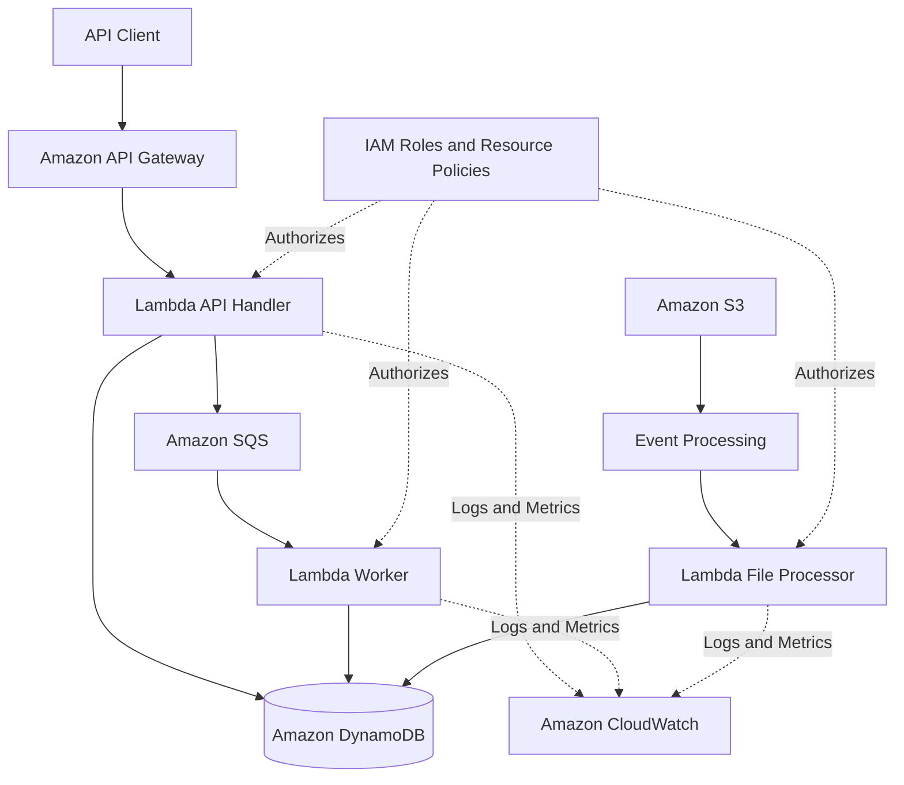
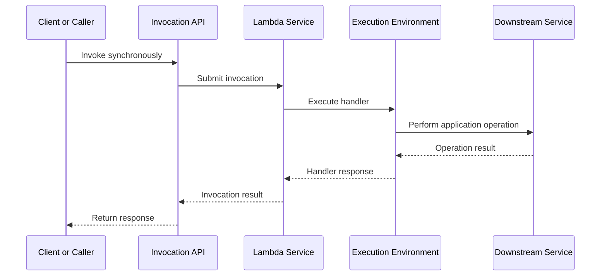
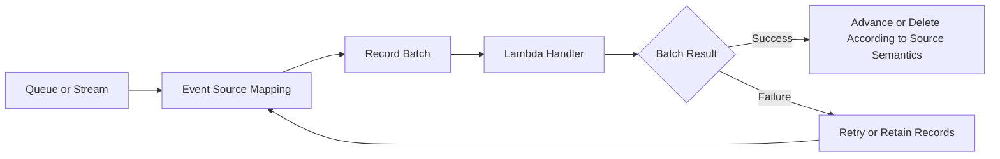
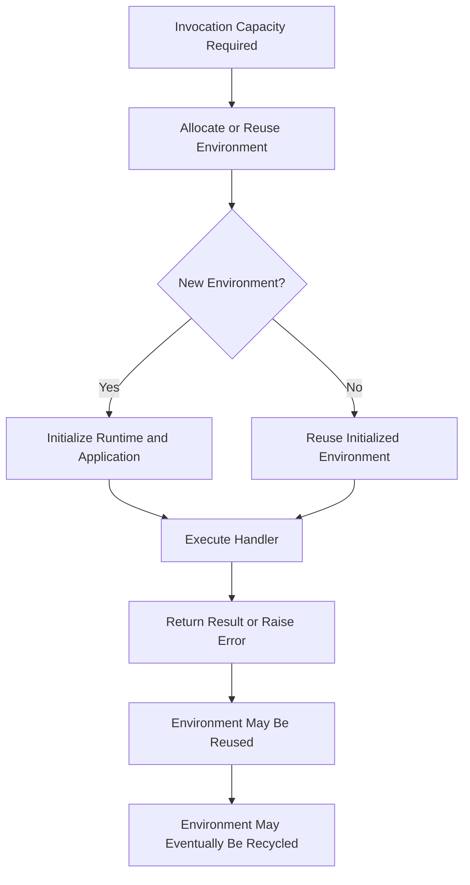
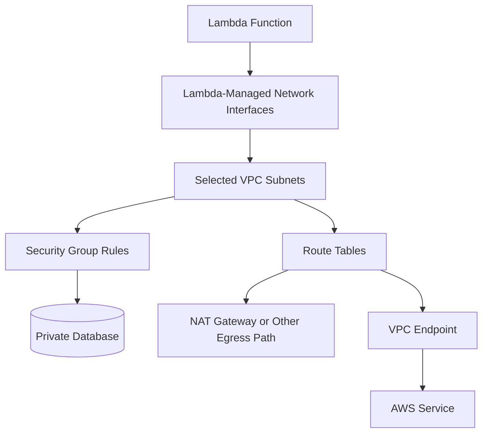

# 01- Lambda Core Architecture

## Overview

AWS Lambda is a managed, event-driven compute service that executes application code without requiring developers to provision or manage servers directly. It provides the execution layer for serverless applications, APIs, background processing, event-driven integrations, and distributed workflows.

Lambda architecture is best understood as a set of cooperating components rather than a single function. An invocation typically involves an event producer or caller, an invocation mechanism, a Lambda execution environment, application dependencies, downstream services, and operational systems for monitoring and failure handling.

Understanding these boundaries is essential when designing production systems because each component has different scaling behavior, permissions, failure modes, and delivery guarantees.

## Core Architectural Components

A typical Lambda-based application contains the following components.

| Component | Responsibility | Engineering consideration |
|---|---|---|
| Event producer or caller | Generates an event or initiates a request | Determines event format, delivery behavior, and ordering constraints |
| Invocation mechanism | Delivers an invocation request to Lambda | May use direct invocation or an event source mapping |
| Lambda service | Manages function execution and scaling | Controls execution-environment allocation and concurrency |
| Execution environment | Runs the configured runtime and handler | May be reused, but local state is not durable |
| Application dependencies | Libraries, SDK clients, configuration, and helper modules | Affect initialization time, package size, and maintainability |
| Downstream services | Databases, queues, APIs, storage, and other services | Can become the limiting factor for throughput and reliability |
| IAM and resource policies | Authorize execution and invocation | Control separate security boundaries |
| Observability services | Collect logs, metrics, traces, and alarms | Support diagnosis, alerting, and operational decisions |
| Failure-handling components | Queues, destinations, retry policies, and workflow recovery | Determine how failed work is recovered or replayed |

## High-Level Architecture

The following diagram shows a representative serverless backend using both synchronous API requests and asynchronous event processing.



This architecture separates request handling from longer-running background work. The API handler can validate a request, persist application state, and enqueue work without waiting for the worker to finish. The worker processes queued messages independently.

The S3 processing path is a separate event-driven workflow. Its exact invocation and retry behavior depends on the configured integration.

## Request and Event Flow

Lambda supports different invocation mechanisms. They share the same underlying function execution model, but the way work is delivered and failures are handled can differ significantly.

### Direct Invocation

A caller can invoke a Lambda function directly through the Lambda API, an AWS SDK, or an integrated service that invokes the function.

A synchronous request generally follows this flow:



For synchronous invocation, the caller receives the function's response or an invocation error. Application-level failures must be distinguished from transport or invocation failures.

For example, a handler may return an HTTP-style response with status code `500` while the Lambda invocation itself completes successfully from the Lambda service's perspective. The application integration determines how that response is interpreted.

### Asynchronous Invocation

With asynchronous invocation, the caller submits an event and Lambda accepts it for later processing. Lambda manages an internal event queue and attempts to invoke the function.

The caller does not wait for the handler's final result. Depending on the failure and configuration, Lambda can retry processing and can route failed events to a dead-letter queue or an on-failure destination.

Asynchronous invocation is useful when a producer should not wait for downstream processing, but it does not automatically provide exactly-once business processing.

### Event Source Mappings

For supported sources such as Amazon SQS, Kinesis Data Streams, and DynamoDB Streams, Lambda uses an event source mapping to poll or consume records and invoke the function with batches.



The exact behavior depends on the event source:

- SQS messages are normally deleted after successful processing through the event source mapping. Failed messages can become visible again after the visibility timeout.
- Kinesis and DynamoDB Streams use stream checkpoints and shard-based processing behavior.
- Batch failures can affect records beyond the individual record that caused the error unless partial batch response handling is configured and supported.

Do not assume all event source mappings have identical retry, ordering, or checkpoint semantics.

## Lambda Execution Environment

An execution environment provides the runtime context in which a Lambda handler runs. It includes the runtime, application code, initialized dependencies, and the resources needed to execute the function.

The Lambda service manages the lifecycle and availability of these environments.

### Lifecycle

A simplified execution lifecycle is:



Initialization can include importing Python modules, creating SDK clients, loading configuration, and preparing reusable resources. Initialization contributes to cold-start latency when a new execution environment must be created.

After an invocation, Lambda may reuse the environment for subsequent invocations. Reuse is an optimization, not a guarantee.

### Safe Environment Reuse

Python applications can initialize reusable clients outside the handler.

```python
import json
import os

import boto3

table_name = os.environ["ORDERS_TABLE"]
dynamodb = boto3.resource("dynamodb")
orders_table = dynamodb.Table(table_name)


def lambda_handler(event, context):
    order_id = event["order_id"]

    response = orders_table.get_item(
        Key={"order_id": order_id}
    )

    order = response.get("Item")

    if order is None:
        return {
            "statusCode": 404,
            "body": json.dumps({"error": "Order not found"}),
        }

    return {
        "statusCode": 200,
        "body": json.dumps(order, default=str),
    }
```

This example creates the DynamoDB resource and table reference during initialization and reuses them when the environment is reused.

Production considerations:

- Keep reusable clients and immutable configuration outside the handler when appropriate.
- Do not store authoritative business state in global variables.
- Avoid retaining user-specific data between invocations.
- Refresh or invalidate cached data when its consistency requirements demand it.
- Treat initialization failures and missing configuration as deployment or configuration problems that require diagnosis.
- Use connection and request timeouts appropriate to the downstream dependency.

## Invocation Architecture and Delivery Semantics

Lambda's execution model does not imply one universal delivery guarantee. Delivery semantics depend on the caller, integration, event source, and retry configuration.

| Invocation mechanism | Delivery behavior | Typical use case | Important concern |
|---|---|---|---|
| Synchronous invocation | Caller receives an invocation result | APIs and request-response operations | Caller must handle errors and timeouts |
| Asynchronous invocation | Event is accepted for later execution | Background tasks and event notifications | Retries can cause duplicate processing |
| SQS event source mapping | Lambda consumes batches from a queue | Decoupled workers | Visibility timeout, redelivery, and batch failures |
| Kinesis event source mapping | Lambda consumes stream records | Ordered stream processing | Checkpointing and shard-level processing |
| DynamoDB Streams event source mapping | Lambda consumes database change records | Change-driven processing | Ordering and retry behavior depend on stream processing |
| EventBridge target invocation | Events are routed to a target | Event routing and scheduled workflows | Event delivery retries and target failure handling must be configured appropriately |

### At-Least-Once Delivery and Idempotency

Many event-driven integrations can deliver a record more than once. A handler may complete its business operation but fail before the event source records successful processing. The record can then be delivered again.

The application must prevent duplicate delivery from producing unintended duplicate business effects.

A common approach is to assign a stable operation identifier and enforce uniqueness in durable storage.

For example, a payment-processing system might store an idempotency key alongside the transaction state. A repeated request with the same key should return the existing result rather than initiate another charge.

Exactly-once business outcomes generally require application-level controls, such as transactional writes, idempotency records, conditional updates, and carefully designed external side effects. Lambda alone does not make an arbitrary distributed workflow exactly once.

## Scaling and Concurrency Architecture

Lambda scales execution capacity according to incoming work and available concurrency. Each active invocation requires execution capacity, subject to the function's configuration and applicable service quotas.

For a simplified workload estimate:

\[
\text{Concurrency} \approx \text{Request rate} \times \text{Average duration}
\]

For example, if a function receives 120 requests per second and each invocation takes an average of 0.25 seconds:

\[
120 \times 0.25 = 30
\]

The estimated average concurrency is 30. Real workloads require additional analysis for traffic bursts, latency distributions, scaling behavior, and downstream capacity.

### Concurrency Controls

| Control | Purpose | Trade-off |
|---|---|---|
| Reserved concurrency | Reserves capacity for a function and limits its maximum concurrency | Can protect downstream systems but may throttle legitimate traffic |
| Provisioned concurrency | Keeps a configured number of execution environments initialized | Reduces initialization latency for supported workloads but introduces additional cost |
| Account and regional quotas | Bound the available execution capacity | May require quota planning and increase requests |
| Queue-based buffering | Absorbs bursts and decouples producers from consumers | Adds processing delay and requires queue failure handling |

### Protecting Downstream Systems

Lambda can scale faster than a database or third-party API can safely accept requests. A function that scales successfully can therefore overload a downstream dependency.

Use a deliberate capacity strategy:

- Estimate peak concurrency and expected downstream request rates.
- Set reserved concurrency when a function must not exceed a known dependency limit.
- Use SQS to buffer work that does not require immediate synchronous completion.
- Implement bounded retries and backoff for transient dependency failures.
- Use connection reuse and appropriate database connection management.
- Monitor throttles, queue age, database connections, request latency, and dependency errors.

Reserved concurrency is a limit on the function's concurrency, not a guarantee that its downstream dependencies will remain healthy.

## Security Architecture

Lambda security involves multiple independent authorization decisions.

### Execution Role

The execution role grants the running function permission to access AWS resources. Lambda assumes this role when executing the function.

Examples of runtime permissions include:

- Reading a specific object from an S3 bucket.
- Writing to a particular DynamoDB table.
- Sending messages to a designated SQS queue.
- Writing logs to CloudWatch.

A function that only reads from DynamoDB should not receive unrestricted access to all DynamoDB tables.

### Invocation Permissions

Invocation permissions determine who or what can invoke a function.

Depending on the integration, authorization may involve:

- The caller's identity-based IAM policy.
- The function's resource-based policy.
- Service-principal permissions for an AWS service.
- API Gateway authorization and route configuration.
- Function URL authentication and resource policy settings.

A permission allowing a service to invoke a function is separate from the function's execution role permissions.

### Deployment Permissions

The deployment identity needs permission to publish or update the function and any related resources. It should not automatically inherit the full permissions of the runtime execution role.

For production deployments:

- Prefer short-lived credentials and workload identity federation where supported.
- Separate deployment and runtime permissions.
- Restrict resource policies and execution roles to the minimum required access.
- Store secrets in an appropriate secret-management service.
- Audit changes and invocation activity using relevant AWS logging services.

## Networking and Downstream Connectivity

A Lambda function does not need VPC attachment merely to access publicly available AWS service endpoints. VPC attachment is appropriate when the function must reach private resources or use controlled network paths.

### VPC-Connected Lambda



VPC networking introduces additional dependencies:

- Subnet address capacity and network interface management.
- Security group rules and routing.
- DNS resolution and database endpoint configuration.
- Private connectivity to AWS services through suitable VPC endpoints.
- NAT gateways or another supported egress path when internet access is required.

Attaching Lambda to a public subnet does not automatically give it a public IP address or internet access. Network paths must be configured deliberately.

For database-backed workloads, estimate the maximum number of concurrent database connections before increasing Lambda concurrency. Where appropriate, consider connection pooling or Amazon RDS Proxy.

## Observability Architecture

Lambda observability combines function-level metrics, application logs, distributed tracing, and downstream service telemetry.

| Signal | What it reveals | Typical response |
|---|---|---|
| Invocations | Workload volume | Compare against expected traffic |
| Errors | Failed executions or application errors | Inspect logs and dependency failures |
| Duration | Execution time and latency trends | Profile slow operations and dependencies |
| Throttles | Concurrency or capacity restrictions | Review quotas and concurrency configuration |
| Concurrent executions | Active execution demand | Compare with function and account limits |
| Iterator age | Processing delay for supported stream sources | Investigate consumer throughput and backlog |
| Queue age and depth | Delayed or accumulating work | Investigate worker capacity and downstream failures |
| Application logs | Request context, exceptions, and business outcomes | Trace a failure using correlation identifiers |
| Distributed traces | Time spent across services | Identify slow or failing dependencies |

CloudWatch Logs and Lambda metrics provide the foundation for operational diagnosis. AWS X-Ray or other supported tracing integrations can help identify latency across service boundaries.

Logging should include useful identifiers and structured fields without exposing credentials, tokens, or sensitive payloads.

## Failure Handling and Reliability

Failure behavior depends on where the failure occurs.

| Failure domain | Example | Engineering response |
|---|---|---|
| Invocation | Caller cannot invoke the function | Verify IAM policies, resource policies, and integration configuration |
| Initialization | A required module cannot be imported | Verify runtime compatibility and deployment packaging |
| Handler execution | Application code raises an exception | Inspect structured logs and validate error handling |
| Downstream dependency | Database connection times out | Apply bounded retries, timeouts, and dependency-level capacity controls |
| Event processing | A batch contains a poison record | Use supported partial batch responses or an appropriate failure strategy |
| Asynchronous processing | A function repeatedly fails | Configure retry handling and a suitable failure destination |
| Networking | A private endpoint cannot be reached | Inspect routes, security groups, DNS, and connectivity |
| Capacity | Lambda or its dependency throttles requests | Adjust concurrency, buffer work, or increase capacity where appropriate |

A reliable architecture should explicitly define:

- Which failures are retryable.
- How retries are bounded.
- How duplicate business operations are prevented.
- Where exhausted or permanently failed work is stored.
- How failed work is inspected and replayed safely.
- Which alarms indicate user impact or accumulating backlog.
- Who owns operational recovery.

Retries should not be treated as a substitute for diagnosing persistent failures. Unbounded or poorly coordinated retries can amplify an outage.

## Architecture Decision Guide

| Requirement | Suitable approach | Main trade-off |
|---|---|---|
| Low-latency HTTP request handling | API Gateway with Lambda | Request duration and integration limits must fit the API workload |
| Direct HTTP access with simpler requirements | Lambda function URL | Offers fewer API-management capabilities than a dedicated API layer |
| Decoupled background processing | SQS with Lambda | Adds queueing delay and message lifecycle management |
| Event routing across producers and consumers | EventBridge with Lambda targets | Requires explicit delivery and failure-handling configuration |
| File processing after upload | S3 events with Lambda | Must handle duplicate notifications and object-processing failures |
| Database change processing | DynamoDB Streams with Lambda | Requires awareness of stream retention, checkpointing, and retry behavior |
| Multi-step business workflow | Step Functions with Lambda tasks | Adds orchestration configuration and service costs |
| Access to private databases | VPC-connected Lambda | Adds networking complexity and connection-capacity concerns |
| Latency-sensitive initialization | Provisioned concurrency or a compatible optimization | Requires workload-specific evaluation of latency, compatibility, and cost |
| Long-running or continuously active workloads | Evaluate ECS or Fargate | Container services may provide a better execution model for sustained workloads |

No single architecture is optimal for every workload. Selection should account for latency, execution duration, event volume, failure semantics, networking, operational ownership, and total cost.

## Production Architecture Checklist

Before deploying a Lambda-based backend, verify the following.

### Application Design

- [ ] Each function has a clear responsibility and manageable dependency surface.
- [ ] Reusable clients are initialized safely.
- [ ] Business state is stored durably rather than in execution-environment memory.
- [ ] Duplicate events cannot cause unintended business effects.
- [ ] Timeouts and downstream request limits are explicitly configured.

### Security

- [ ] Execution roles follow least privilege.
- [ ] Invocation permissions are limited to intended callers and services.
- [ ] Secrets are not hardcoded into source code or logs.
- [ ] VPC access and network egress are deliberate.
- [ ] Deployment identities are separate from runtime identities.

### Reliability and Scaling

- [ ] Retry behavior is understood for every invocation mechanism.
- [ ] Failure destinations, dead-letter queues, or equivalent recovery paths are configured where appropriate.
- [ ] Concurrency is compatible with downstream capacity.
- [ ] Queue backlogs and processing delays are monitored.
- [ ] Recovery and replay procedures are documented and tested.

### Operations

- [ ] Structured logs and actionable alarms are configured.
- [ ] Relevant metrics and distributed tracing are available.
- [ ] Deployment verification and rollback procedures are documented.
- [ ] Service quotas and regional feature support are verified.
- [ ] Cost estimates include integrations, networking, logs, and other billable resources.

## Key Takeaways

- Lambda architecture combines invocation mechanisms, managed execution environments, application dependencies, downstream services, IAM boundaries, and operational controls.
- Direct invocation and event source mappings have different delivery, retry, ordering, and failure semantics; design handlers and recovery procedures accordingly.
- Execution-environment reuse can improve performance, but local memory is not durable storage and must not be treated as authoritative business state.
- Concurrency and scaling must be designed around downstream capacity, idempotency, backpressure, and observable failure handling.
- Production-ready Lambda systems require least-privilege security, deliberate networking, meaningful monitoring, safe deployment practices, and tested recovery procedures.