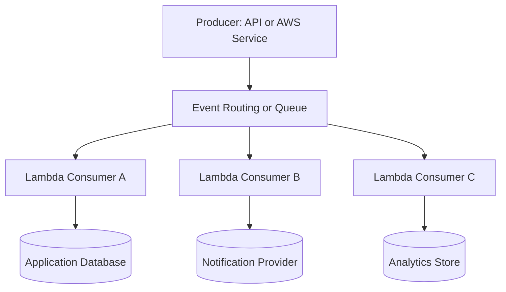
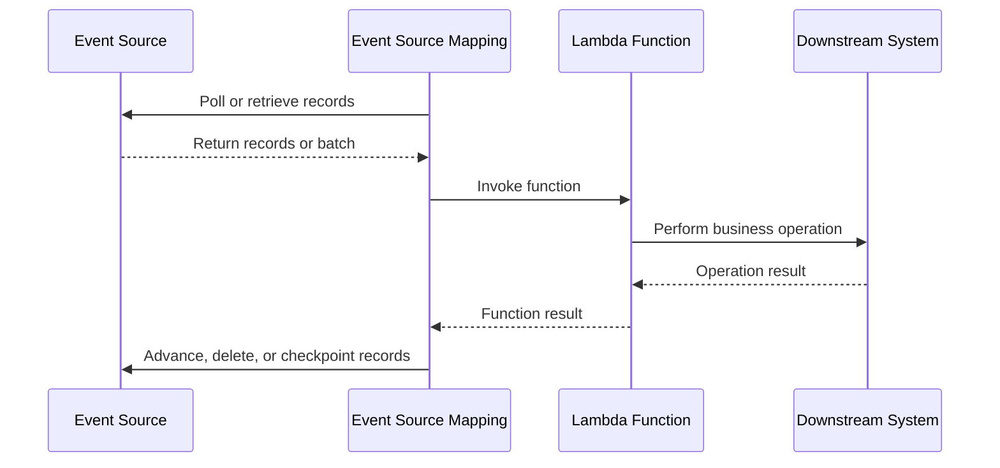
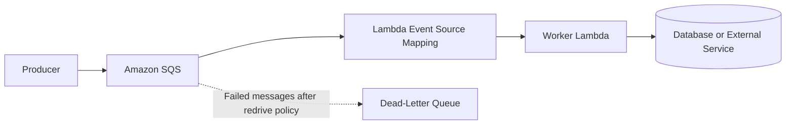
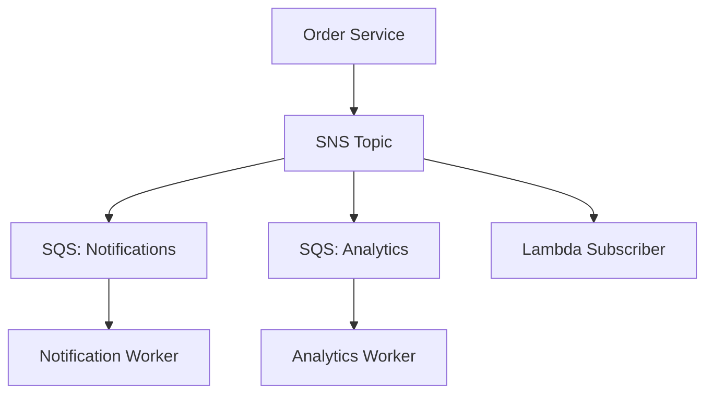
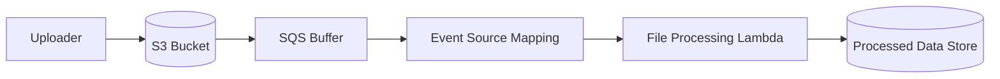
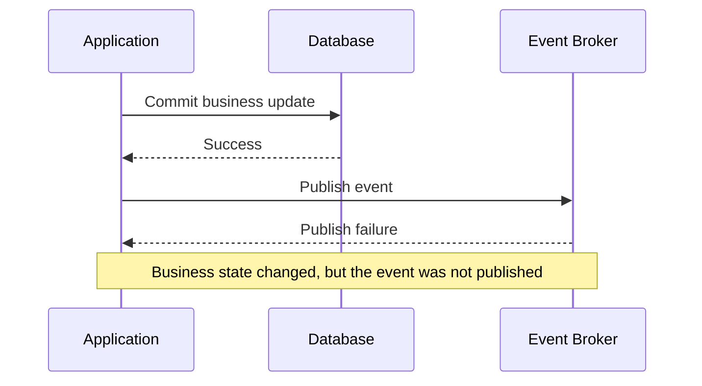
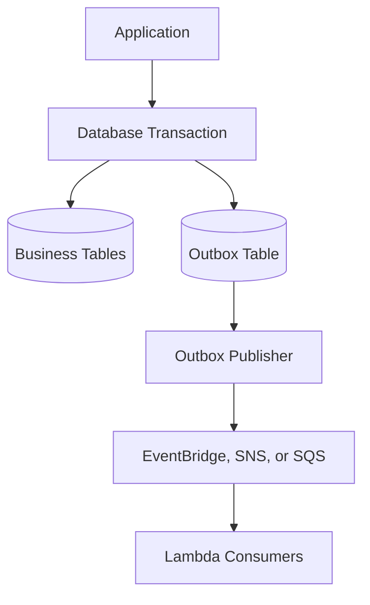
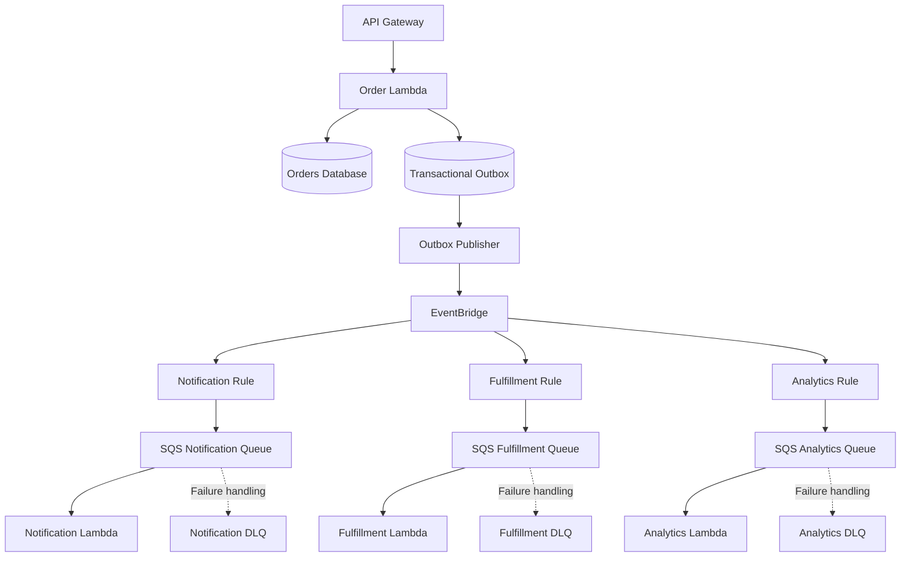

# 02- Event-Driven Architecture

## Overview

Event-driven architecture (EDA) is a software architecture in which components communicate by producing, routing, and consuming events. An event represents something that has happened, such as an order being placed, a file being uploaded, a payment being authorized, or a database record being modified.

In AWS serverless systems, AWS Lambda commonly acts as an event consumer or processor. AWS services such as Amazon S3, Amazon SQS, Amazon SNS, Amazon EventBridge, and Amazon DynamoDB Streams can initiate or facilitate event-driven processing without requiring the producer to manage the consumer's execution infrastructure.

The primary benefit is **decoupling producers from consumers**. A producer can publish an event without knowing which downstream functions will process it, how many consumers exist, or whether they are temporarily unavailable.

However, event-driven architecture introduces distributed-systems concerns:

- Events can be delivered more than once.
- Processing order may not be guaranteed.
- Failures can occur after a consumer has performed a side effect.
- Retries can increase downstream load.
- Events can be delayed, lost through misconfiguration, or retained until they expire.
- Observability becomes more difficult when a business operation spans multiple services.

AWS Lambda provides managed execution and scaling, but it does not eliminate these concerns. Reliable event-driven systems require deliberate decisions about delivery semantics, idempotency, retries, ordering, backpressure, security, and operational visibility.

## Core Concepts

### Events

An event is an immutable representation of a fact that has already occurred.

Examples include:

- `OrderCreated`
- `PaymentAuthorized`
- `CustomerUpdated`
- `FileUploaded`
- `InventoryReserved`

An event should generally describe a business occurrence rather than command a particular implementation.

For example:

```json
{
  "event_id": "evt-01J9ABC123",
  "event_type": "OrderCreated",
  "event_version": "1",
  "occurred_at": "2026-10-11T10:30:00Z",
  "source": "orders-service",
  "data": {
    "order_id": "ord-12345",
    "customer_id": "cus-789",
    "total_amount": 1499.00,
    "currency": "INR"
  }
}
```

This is an illustrative application-level event envelope, not a native AWS event format. AWS services have their own schemas, and integrations may wrap application data inside service-specific event structures.

Important fields include:

| Field | Purpose |
|---|---|
| `event_id` | Identifies an event for deduplication and tracing |
| `event_type` | Identifies the business occurrence |
| `event_version` | Supports controlled schema evolution |
| `occurred_at` | Records when the business event occurred |
| `source` | Identifies the producing component |
| `data` | Contains the event payload |

An event identifier should remain stable when the same logical event is retried or republished as a retry of that event. A genuinely new business occurrence should receive a new identifier.

### Producers

A producer creates or publishes an event.

Examples include:

- An API Lambda that records an order.
- An S3 bucket receiving a file.
- A DynamoDB table receiving a write.
- A scheduled job completing a business operation.
- A payment service receiving an authorization result.

A producer should avoid embedding downstream consumer logic into the operation that generates the event. Doing so reduces coupling and allows new consumers to be introduced independently.

### Consumers

A consumer receives an event and performs work.

Examples include:

- Sending a notification.
- Updating a search index.
- Generating a report.
- Processing an uploaded file.
- Updating an analytics store.
- Initiating a workflow.

Lambda is well suited to event consumers when processing can be completed within the service's execution constraints and the workload benefits from managed scaling.

### Event Routers and Brokers

An event router or broker distributes events to one or more destinations.

In AWS, the main choices serve different purposes:

| Service | Primary responsibility | Typical use case |
|---|---|---|
| Amazon EventBridge | Event routing, filtering, and delivery to targets | Business-event integration across services and applications |
| Amazon SNS | Topic-based message fan-out | Delivering a notification to multiple subscribers |
| Amazon SQS | Durable queueing and buffering | Decoupling producers from consumers and controlling processing pressure |
| Amazon Kinesis Data Streams | Ordered records within shards and streaming ingestion | High-volume streaming and real-time data processing |
| AWS Lambda event source mapping | Polling supported event sources and invoking Lambda | Consuming records from SQS, streams, and other supported sources |

These services are not interchangeable. Choose based on delivery semantics, buffering requirements, ordering, replay capabilities, throughput, and consumer behavior.

## Why Event-Driven Architecture Matters

### Reduced Coupling

In a synchronous architecture, a request handler may call several downstream services directly. The request's success can depend on the availability and latency of every dependency.

In an event-driven architecture, the producer can publish an event and let downstream consumers process it independently.

For example, an order service may need to persist an order and initiate downstream work. It should not necessarily wait for email delivery, analytics processing, and search-index updates to complete.

This improves isolation, but only if the producer has a reliable way to publish events. Writing to a database and publishing to a broker are separate operations unless a transactional mechanism connects them.

### Independent Scaling

Different consumers may have different processing requirements.

For example:

- Notifications may process quickly.
- Image processing may require substantial memory and CPU.
- Analytics processing may operate in batches.
- A reporting service may need a lower concurrency limit.

Separate queues and Lambda functions allow these workloads to scale and fail independently.

### Buffering and Backpressure

Queues absorb temporary differences between production and consumption rates.

If a producer generates 2,000 messages per second while consumers can process 1,000 messages per second, a queue can accumulate the difference temporarily.

A queue does not eliminate overload. If the long-term production rate exceeds the consumption rate, backlog and message age continue to grow.

### Independent Deployment

Consumers can evolve independently when they rely on a stable event contract.

This supports adding new capabilities without modifying the producer. However, schema changes must remain compatible with consumers that may process delayed or replayed events.

## Event-Driven Architecture with AWS Lambda

A common AWS architecture uses a producer, a routing or buffering service, and one or more Lambda consumers.



The routing service determines how events reach consumers. The specific delivery model depends on the integration.

For example:

- EventBridge uses rules to route matching events to targets.
- SNS pushes notifications to subscribed endpoints, including supported Lambda subscriptions.
- SQS is polled by a Lambda event source mapping.
- DynamoDB Streams and Kinesis Data Streams are consumed through event source mappings.
- S3 sends supported event notifications to configured destinations.

Do not assume every integration uses the same polling, retry, ordering, or acknowledgement behavior.

## AWS Event Delivery Models

Understanding the invocation model is essential before designing retries or failure handling.

### Direct Synchronous Invocation

A caller invokes Lambda and waits for the result.

Examples include:

- An application using the Lambda Invoke API with `RequestResponse`.
- API Gateway invoking Lambda for a request-response API.
- An application invoking a Lambda function directly through an SDK.

The caller receives the function's response or an invocation error.

Typical characteristics:

- The caller controls request timing and may implement its own retries.
- Function errors can be returned to the caller.
- The request path includes Lambda execution latency.
- Downstream processing time directly affects the caller's latency.

Use synchronous invocation when the caller needs the result before continuing.

### Direct Asynchronous Invocation

A caller submits an event using the Lambda Invoke API with `Event` invocation type.

Lambda accepts the event for asynchronous processing. The caller does not wait for the function's business result.

Typical characteristics:

- Lambda queues the event internally for processing.
- Function errors can trigger Lambda's asynchronous retry behavior.
- Events can be delivered more than once.
- An accepted invocation does not prove that business processing succeeded.

Use this model when an application needs asynchronous execution but does not require a separately managed queue.

For sustained workloads requiring explicit buffering, consumer-level backpressure, configurable retention, or queue inspection, SQS is often a better fit.

### Event Source Mappings

An event source mapping is a Lambda-managed integration that polls a supported event source, obtains records, and invokes a function.

Common sources include:

- Amazon SQS
- Amazon DynamoDB Streams
- Amazon Kinesis Data Streams
- Amazon MSK and self-managed Apache Kafka
- Amazon MQ

The exact supported options and failure behavior depend on the source type.



The final step is source-specific. SQS messages are deleted after successful processing and acknowledgement through the integration, while stream consumers advance their processing position or checkpoint according to source semantics.

A failed invocation may cause records to be retried, delayed, or retried together with other records. Configure batching and failure handling for the actual event source rather than assuming universal behavior.

### Delivery Model Comparison

| Property | Synchronous invocation | Asynchronous invocation | Event source mapping |
|---|---|---|---|
| Caller waits for result | Yes | No | Usually no external caller waits |
| Event buffering | Depends on caller or integration | Lambda-managed asynchronous queue | Source-managed queue or stream |
| Consumer controls | Limited by caller/integration | Lambda async configuration | Event source mapping configuration |
| Retry responsibility | Caller or integration-specific | Lambda async retry behavior | Source and mapping-specific |
| Explicit backlog inspection | Not inherent | Limited compared with a dedicated queue | Available through the underlying source |
| Ordering | Integration-specific | Not generally guaranteed | Source-specific |
| Best fit | Request-response work | Simple asynchronous tasks | Queue and stream consumption |

## Choosing the Right AWS Event Service

### Amazon EventBridge

EventBridge is useful when business events need to be routed to multiple targets based on event content.

A producer publishes an event to an event bus. Rules match fields in the event and route matching events to configured targets.

Typical use cases:

- Order lifecycle events.
- Cross-service integration.
- Operational automation.
- Scheduled tasks through EventBridge Scheduler.
- Routing events from supported AWS services.

Advantages:

- Content-based event filtering.
- Separation between event producers and consumers.
- Integration with many AWS services.
- Support for event buses and cross-account event routing scenarios.

Limitations and considerations:

- It is not a replacement for a work queue in every use case.
- Delivery and retry behavior depend on the target integration and rule configuration.
- Event buses are not general-purpose indefinite event stores.
- Event schema compatibility must be managed by the application.
- Archive and replay capabilities, where used, require deliberate retention and replay planning.

Example rule pattern for an application event:

```json
{
  "source": ["orders-service"],
  "detail-type": ["OrderCreated"],
  "detail": {
    "status": ["confirmed"]
  }
}
```

This pattern assumes the producer publishes events with the corresponding `source`, `detail-type`, and `detail` fields.

### Amazon SQS

SQS is a managed message queue that buffers work between producers and consumers.

A common design is:



SQS is appropriate when the system needs:

- Durable buffering.
- Backpressure between producers and workers.
- Queue-depth visibility.
- Configurable message retention.
- Redrive policies and dead-letter queues.
- Independent producer and consumer scaling.

Standard queues provide at-least-once delivery and best-effort ordering. FIFO queues provide ordering within message groups and deduplication capabilities, but application-level idempotency is still necessary for reliable business outcomes.

For Lambda consumers, configure the visibility timeout in relation to function timeout and expected processing duration. AWS recommends setting the queue visibility timeout to at least six times the function timeout, plus the maximum batching window when one is configured, to accommodate retries and throttling behavior.

This is a configuration guideline, not a guarantee that duplicate delivery can never occur.

### Amazon SNS

SNS is a managed publish/subscribe service. A topic can deliver notifications to multiple subscribers.

Use SNS when a single event needs to reach several independent consumers without requiring the producer to know each destination.

For example:



SNS can integrate with SQS and Lambda, among other supported targets.

For workloads where each consumer requires independent buffering and retry isolation, SNS-to-SQS-to-Lambda is often preferable to sending all consumers directly from a topic.

This architecture adds resources and configuration, so use it when the isolation and buffering benefits justify the additional complexity.

### Amazon S3 Events

S3 can emit notifications when objects are created, deleted, or otherwise modified through supported event types.

A common pattern is to process uploaded files asynchronously:



An S3 event notification can target supported destinations directly, including Lambda, SQS, SNS, and EventBridge.

An intermediate queue is useful when the workload requires explicit buffering, independent retries, or a dead-letter queue.

Important considerations:

- Notifications can be delivered more than once.
- Event ordering is not generally guaranteed.
- Object keys in event records require correct URL decoding.
- Processing the same object version twice must not corrupt business state.
- The event may arrive after the object has changed or been deleted.
- If processing must refer to an exact object version, enable S3 Versioning and retain the version identifier in the processing workflow.

Do not assume the object still contains the exact content associated with an event unless the workflow identifies and retrieves the intended version.

### DynamoDB Streams

DynamoDB Streams capture item-level modifications and expose a time-ordered sequence of change records.

Lambda event source mappings can consume these records to implement:

- Change propagation.
- Search index updates.
- Audit pipelines.
- Downstream event generation.
- Denormalized data maintenance.

Records are processed according to stream and shard semantics. Ordering is preserved at the appropriate key and shard level, not as a global order across all records.

A consumer should handle duplicate processing and failures without assuming that all changes across a table arrive in one total order.

### Event Service Decision Table

| Requirement | Preferred starting point | Reason |
|---|---|---|
| Route business events using event content | EventBridge | Rule-based routing |
| Buffer background work | SQS | Explicit queue and backlog management |
| Fan out notifications to subscribers | SNS | Topic-based publish/subscribe |
| Process object uploads | S3 notifications or EventBridge | Native object event integration |
| Process database changes | DynamoDB Streams | Change-data stream |
| Consume ordered streaming records | Kinesis Data Streams | Stream-oriented processing |
| Run a workflow with explicit state and branching | Step Functions | Managed orchestration |
| Run a simple asynchronous task | Lambda asynchronous invocation | Fewer components when queue controls are unnecessary |

These are starting points, not exclusive choices. Complex systems frequently combine services to meet reliability, throughput, ordering, and isolation requirements.

## Event Schema Design

Event contracts are long-lived interfaces between independently deployed components. Poorly designed schemas create tight coupling and make changes difficult to deploy safely.

### Separate Event Metadata from Business Data

Use a stable envelope for metadata and a versioned business payload.

For example:

```json
{
  "event_id": "evt-01J9ABC123",
  "event_type": "OrderCreated",
  "event_version": 1,
  "occurred_at": "2026-10-11T10:30:00Z",
  "source": "orders-service",
  "correlation_id": "req-7f0b4e",
  "data": {
    "order_id": "ord-12345",
    "customer_id": "cus-789",
    "currency": "INR",
    "total_amount": 1499.00
  }
}
```

Metadata supports routing, tracing, deduplication, and schema management. Business data contains the facts needed by consumers.

Avoid adding every internal database field to an event. Events should represent the intended contract, not expose an accidental copy of the producer's persistence model.

### Design for Schema Evolution

Consumers may process events produced by older application versions. Queues, retries, stream retention, and replay can extend the lifetime of an event beyond the producer's deployment.

Recommended practices:

- Add optional fields when backward compatibility permits.
- Define defaults for fields that may be absent.
- Avoid changing a field's meaning while keeping the same name.
- Avoid changing data types incompatibly.
- Introduce a new event version for incompatible changes.
- Test consumers against representative old and new payloads.
- Keep schema ownership explicit.

An event version should describe the schema contract, not merely the producer's software release.

### Do Not Use Events as Unbounded Data Containers

Large payloads increase serialization, transfer, processing, and retry costs. They may also exceed service-specific payload limits.

For large files or documents, publish a reference:

```json
{
  "event_id": "evt-file-123",
  "event_type": "FileUploaded",
  "event_version": 1,
  "data": {
    "bucket": "application-uploads",
    "key": "incoming/2026/10/report.csv",
    "version_id": "3HL4kqtJlcpXroDTDmjVBH40Nrjfkd",
    "content_type": "text/csv"
  }
}
```

The consumer can retrieve the object from S3 using its execution role.

The bucket, object key, and version identifier must be validated and authorized. Do not treat an event payload as trusted authorization input.

## Delivery Guarantees, Retries, and Idempotency

### At-Least-Once Delivery

At-least-once delivery means a message may be delivered one or more times until it is successfully handled or reaches a terminal condition defined by the integration.

Duplicate delivery can occur when:

1. A consumer performs a business operation.
2. The consumer fails before the event source records successful completion.
3. The event source retries the same event.
4. The consumer performs the operation again.

For example, a payment worker might charge a customer and then time out before acknowledging the message. Retrying the event without idempotency can charge the customer twice.

### Exactly-Once Business Outcomes

Do not equate a service's deduplication or delivery mechanism with exactly-once business processing.

A robust application often achieves effectively-once business outcomes by combining:

- Stable event identifiers.
- Idempotent handlers.
- Durable deduplication records.
- Database transactions.
- Unique constraints.
- Provider-supported idempotency keys.
- Reconciliation for ambiguous external outcomes.

For example, a database transaction can atomically insert an event identifier into a processed-events table and apply a business update. A unique constraint prevents a duplicate event from applying the same update again.

However, a database transaction cannot automatically make an unrelated external API call atomic. External side effects require their own idempotency mechanisms or reconciliation strategies.

### Implementing Idempotency in Python

The following simplified example demonstrates the transactional principle using PostgreSQL. The application must create the `processed_events` table with a unique constraint on `event_id`, and both the deduplication record and business update must use the same database transaction.

```python
from sqlalchemy import text
from sqlalchemy.orm import Session


def process_order_event(session: Session, event: dict) -> bool:
    event_id = event["event_id"]
    order_id = event["data"]["order_id"]

    with session.begin():
        inserted = session.execute(
            text("""
                INSERT INTO processed_events (event_id)
                VALUES (:event_id)
                ON CONFLICT (event_id) DO NOTHING
                RETURNING event_id
            """),
            {"event_id": event_id},
        ).scalar_one_or_none()

        if inserted is None:
            return False

        session.execute(
            text("""
                UPDATE orders
                SET processing_status = 'processed'
                WHERE order_id = :order_id
            """),
            {"order_id": order_id},
        )

    return True
```

This example assumes a SQLAlchemy session configured for PostgreSQL and a transaction-compatible database schema. A real implementation should also validate the payload, verify that the order exists, handle expected state transitions, and expose metrics for duplicate events.

The function returns `False` when the event was already processed. The transaction ensures that the deduplication record and update commit or roll back together.

Do not commit the deduplication record before applying the business update. Doing so could mark an event as processed even though the intended operation failed.

## Retry and Failure Handling

Retries are necessary for transient failures, but unbounded or poorly configured retries can amplify incidents.

### Classify Failures

| Failure type | Example | Recommended approach |
|---|---|---|
| Transient dependency failure | HTTP 503 from a downstream API | Retry with bounded backoff |
| Throttling | Downstream rate limit exceeded | Apply backpressure and retry within limits |
| Invalid event | Missing required field | Reject or quarantine the event |
| Authorization failure | Missing IAM permission | Correct permissions; avoid endless retries |
| Non-retryable business condition | Unsupported order state | Apply explicit business handling |
| Ambiguous external side effect | Request timed out after provider may have completed it | Use an idempotency key or reconcile before retrying |

### Use Dead-Letter Queues and Failure Destinations Appropriately

A dead-letter queue or failure destination preserves information about events that could not be processed successfully, allowing investigation and controlled recovery.

Their behavior differs by invocation model:

- SQS event source mappings use queue redrive policies and visibility behavior.
- Lambda asynchronous invocation supports retry configuration and failure destinations or dead-letter queues, subject to the integration and configuration.
- Stream event source mappings support source-specific retry, checkpoint, and failure-reporting options.

Do not assume one DLQ configuration covers every Lambda trigger.

When replaying failed events, verify that the root cause is fixed and that the consumer is idempotent. Replaying a poison message without correcting the underlying problem can repeatedly fail and block progress.

## Partial Batch Failures

When an event source mapping invokes Lambda with a batch of records, one invalid record can cause the whole batch to be retried if the integration treats the invocation as a single failure.

For supported event sources, partial batch response handling lets a consumer report which records failed so that successfully processed records do not need to be retried unnecessarily.

For SQS, enable the `ReportBatchItemFailures` response type on the event source mapping and return the identifiers of records that failed.

Example handler:

```python
import json
import logging

logger = logging.getLogger()
logger.setLevel(logging.INFO)


def lambda_handler(event, context):
    batch_item_failures = []

    for record in event.get("Records", []):
        message_id = record["messageId"]

        try:
            body = json.loads(record["body"])
            process_message(body)

        except Exception:
            logger.exception(
                "Message processing failed",
                extra={"message_id": message_id},
            )
            batch_item_failures.append(
                {"itemIdentifier": message_id}
            )

    return {
        "batchItemFailures": batch_item_failures
    }


def process_message(body: dict) -> None:
    # Validate the message and perform an idempotent operation.
    ...
```

The handler must return the response format expected by the event source mapping. Without the corresponding mapping configuration, the failure list may not produce the intended partial-retry behavior.

For stream sources, the required identifiers and checkpoint semantics differ. Follow the specific event source's contract.

## Backpressure and Concurrency Control

A queue can absorb bursts, but Lambda can scale consumers faster than downstream dependencies can safely handle.

For example, a large SQS backlog may cause Lambda to increase concurrency. If every invocation opens multiple PostgreSQL connections, the database can exhaust its connection limit even while Lambda itself is healthy.

Control processing pressure using:

- Reserved concurrency to cap function concurrency.
- Event source mapping maximum concurrency where supported.
- Batch size and batching windows.
- Queue visibility timeout and redrive settings.
- Downstream connection limits.
- Rate limiting and retry backoff.
- Separate queues for workloads with different priority or failure characteristics.

For SQS event source mappings, maximum concurrency and reserved concurrency should be configured together. If the mapping's concurrency demand exceeds the function's available concurrency, throttling can increase latency and retries.

### Estimate Concurrency

A useful approximation for stable workloads is:

\[
\text{Concurrency} \approx \text{Request rate} \times \text{Average duration}
\]

For example, if a function processes 150 events per second and average processing duration is 0.4 seconds:

\[
150 \times 0.4 = 60
\]

Approximately 60 concurrent executions are needed under these assumptions.

This is an estimate, not a capacity guarantee. Bursty arrivals, duration variance, batch processing, throttling, and downstream limits can change actual concurrency requirements.

## Transactional Event Publication

A common distributed-systems problem occurs when a service writes to a database and publishes an event as two separate operations.



Reversing the order creates the opposite failure: an event may be published even though the database transaction fails.

### Transactional Outbox Pattern

The transactional outbox pattern addresses this dual-write problem.

The application writes both the business change and an outbox record in the same database transaction. A separate publisher reads pending outbox records and publishes them to the event broker.



Advantages:

- Business state and event intent commit atomically.
- A publisher can retry events after transient broker failures.
- The outbox can provide an auditable record of publication attempts.

Limitations:

- The publisher must track delivery state and retry safely.
- Events may be published more than once.
- Outbox cleanup and retention require operational policies.
- Polling adds database load, while change-data-capture approaches introduce their own infrastructure and operational requirements.

Consumers must remain idempotent even when the producer uses an outbox.

## Event Filtering and Routing

Filtering events near the routing layer can reduce unnecessary Lambda invocations and processing cost.

For example, an EventBridge rule can route only confirmed orders to a fulfillment workflow. An SQS event source mapping can use supported filter criteria to avoid invoking a function for irrelevant records.

Filtering should be treated as a correctness boundary, not merely a performance optimization.

Before deploying a filter:

- Test matching and non-matching payloads.
- Verify the actual event envelope.
- Ensure required event types are not accidentally excluded.
- Monitor delivery and processing metrics.
- Keep filters version-controlled with infrastructure configuration.

A filter that silently excludes an event can be harder to diagnose than a visible function failure.

## Security Considerations

Event-driven systems have multiple authorization boundaries. A producer's ability to publish an event is separate from a Lambda function's ability to consume it or access downstream resources.

### Producer Permissions

The producer should receive only the permissions required to publish to the intended destination.

Examples include:

- `events:PutEvents` for publishing to an EventBridge event bus.
- `sqs:SendMessage` for sending to an SQS queue.
- `sns:Publish` for publishing to an SNS topic.

Scope resource permissions to the relevant ARN where supported.

### Lambda Invocation Permissions

For integrations that require Lambda resource-based permissions, explicitly authorize the intended AWS service or principal to invoke the function.

For example, an S3 bucket notification commonly requires a Lambda resource policy that allows the relevant S3 service principal to invoke the function, scoped to the expected bucket ARN and account where applicable.

A successful event publication does not necessarily mean that the consumer has permission to execute.

### Consumer Permissions

The Lambda execution role should grant only the permissions needed by the handler.

For example, an SQS consumer might require:

- Receiving and deleting messages.
- Reading queue attributes.
- Accessing specific database or storage resources.

The event payload itself is untrusted input. Validate fields, constrain resource references, and avoid allowing a payload to choose arbitrary S3 buckets, database tables, or external URLs without authorization checks.

### Protect Sensitive Data

Avoid placing secrets, access tokens, credentials, or unnecessary personal information in event payloads.

Events may be retained, replayed, logged, copied to multiple targets, or accessible to more services than the original database record.

Prefer passing resource identifiers and retrieving sensitive data through an appropriately authorized service when practical.

## Observability and Operations

Event-driven systems require visibility across producers, brokers, consumers, and downstream dependencies.

### Essential Signals

| Signal | What it reveals |
|---|---|
| Invocation count | Whether processing volume has changed |
| Error count and error rate | Whether handlers are failing |
| Duration and timeout rate | Whether processing is slowing down |
| Throttles and concurrency | Whether capacity limits are affecting execution |
| Queue depth | Whether work is accumulating |
| Oldest-message age | Whether processing delay is increasing |
| Failed-event count | Whether events are reaching failure handling |
| Duplicate-event count | Whether redelivery or producer behavior has changed |
| Downstream latency and errors | Whether dependencies are limiting throughput |

For SQS-based systems, monitor queue depth and the age of the oldest message together. A growing backlog with increasing message age usually indicates that consumers are not keeping up.

Use structured logs with fields such as:

```json
{
  "level": "INFO",
  "event_id": "evt-01J9ABC123",
  "event_type": "OrderCreated",
  "correlation_id": "req-7f0b4e",
  "lambda_request_id": "example-request-id",
  "outcome": "processed"
}
```

Do not log entire event payloads indiscriminately. Payloads may contain sensitive data, and high-volume logging can increase cost.

### Correlation Across Services

Propagate a correlation identifier through producer, broker, consumer, and downstream operations.

Where supported, integrate AWS X-Ray or OpenTelemetry-based instrumentation with compatible services and libraries. Trace continuity depends on the integration and propagation configuration; do not assume every event service automatically preserves a complete end-to-end trace.

Monitor business outcomes as well as Lambda execution metrics. A function can return successfully while producing an incorrect business result.

## Common Architecture Mistakes

### Using Direct Asynchronous Invocation for Every Workload

Lambda asynchronous invocation is convenient, but it does not provide all the operational controls of a dedicated queue.

Use SQS when explicit backlog management, consumer isolation, queue retention, or controlled worker concurrency is important.

### Assuming Events Are Processed Exactly Once

Retries and acknowledgement failures can produce duplicate processing.

Use stable event identifiers, idempotent business operations, durable deduplication where needed, and provider-supported idempotency for external side effects.

### Publishing Events Before the Business Transaction Commits

This can expose consumers to events describing state that never committed.

Use an outbox pattern or another reliable publication mechanism when consistency between database changes and event publication is important.

### Ignoring Poison Messages

A permanently invalid message may repeatedly fail and consume processing capacity.

Validate event schemas, distinguish permanent from transient errors, configure source-appropriate failure handling, and establish a safe replay process.

### Allowing Unbounded Consumer Scaling

A burst of events can overwhelm a database or external API even when Lambda scales successfully.

Set concurrency limits, batch appropriately, and design backpressure around downstream capacity.

### Treating Logs as the Only Monitoring Mechanism

Logs are useful for diagnosis but are insufficient for detecting backlog growth, silent filtering errors, or business-level processing failures.

Use metrics, alarms, structured logs, and traces together.

### Coupling Consumers to Internal Database Schemas

Publishing entire database records exposes implementation details and makes migrations risky.

Publish explicit event contracts and evolve them with compatibility in mind.

## Production Architecture Example: Order Processing

Consider an e-commerce backend that must persist orders, send notifications, update analytics, and initiate fulfillment.

A possible architecture is:



This design provides separate buffers and failure boundaries for notification, fulfillment, and analytics workloads.

### Design Decisions

- **Order persistence:** The API should not report a successful order unless the business transaction has committed.
- **Event publication:** Use a transactional outbox when losing an event after committing the order is unacceptable.
- **Consumer isolation:** Separate queues allow each workload to have its own concurrency, retry, and failure policy.
- **Idempotency:** Each consumer must tolerate duplicate events without repeating harmful business operations.
- **Ordering:** If fulfillment requires ordered state transitions, define the ordering key and use a suitable queue or state-management mechanism.
- **Observability:** Track order identifiers and correlation IDs across the entire workflow.
- **Security:** Give each Lambda function a dedicated execution role scoped to its dependencies.
- **Cost:** Avoid introducing a queue, rule, or function for every minor operation unless isolation or reliability requirements justify it.

### Failure Scenario

Suppose fulfillment succeeds in the external system, but the Lambda function times out before acknowledging its SQS message.

The message may become visible again and trigger a retry.

A robust fulfillment consumer should use a stable operation identifier with the fulfillment provider, or query the provider to determine whether the operation already succeeded. It should not blindly repeat a non-idempotent external action.

### Verification Checklist

Before production deployment, verify that:

- The producer and consumers use a documented event schema.
- Business state and event publication cannot silently diverge.
- Duplicate delivery does not duplicate business side effects.
- Queue visibility timeouts and function timeouts are compatible.
- Concurrency limits protect downstream dependencies.
- Poison messages have a defined failure path.
- Alarms cover processing errors, backlog growth, and message age.
- IAM permissions are least-privilege.
- Replay procedures are tested and safe.
- Infrastructure changes and event filters are reviewed and version-controlled.

## Key Takeaways

- Event-driven architecture decouples producers from consumers, but delivery semantics, ordering, retries, and failure isolation must be designed explicitly.
- Choose EventBridge for event routing, SQS for durable buffering and backpressure, SNS for fan-out, and streams for change or streaming data according to their distinct guarantees.
- Assume duplicate delivery is possible and implement idempotent handlers; delivery guarantees alone do not guarantee exactly-once business outcomes.
- Use transactional outbox patterns when database changes and event publication must remain consistent, and use source-appropriate retries, dead-letter handling, and partial batch responses.
- Production readiness requires least-privilege IAM, downstream-aware concurrency controls, structured observability, tested recovery procedures, and explicit cost management.