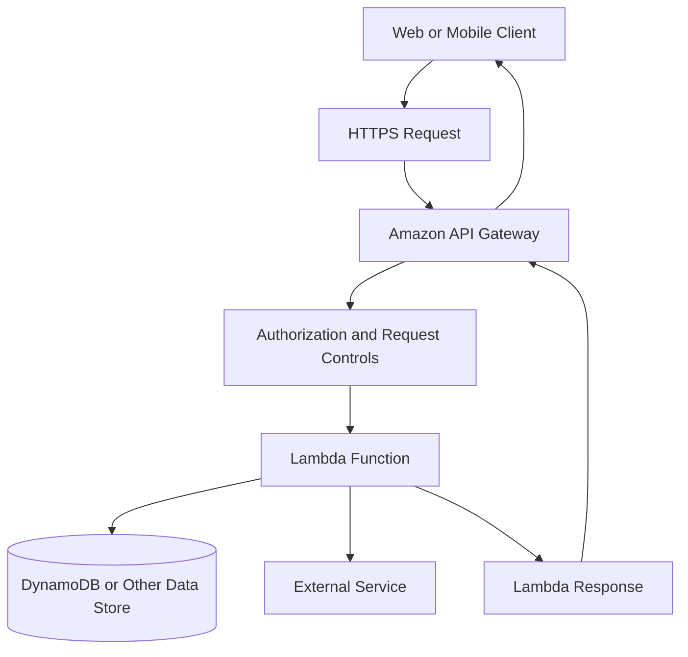
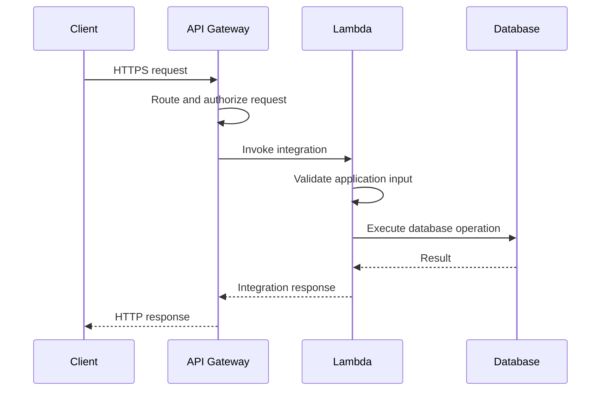
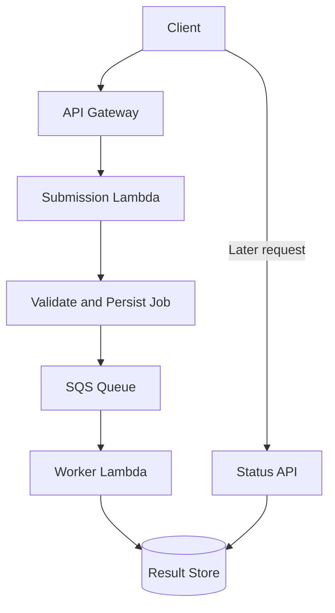

# 03- Lambda with API Gateway

## Overview

Amazon API Gateway and AWS Lambda form a common serverless architecture for building REST APIs, HTTP APIs, and backend integrations without managing application servers.

API Gateway acts as the API front door. It receives HTTP requests, applies routing and authorization policies, validates supported request components, enforces throttling, and invokes the configured integration. Lambda executes application logic and returns a response that API Gateway translates into an HTTP response.

This architecture is suitable for:

- REST APIs and backend services.
- Mobile and web application backends.
- Microservice endpoints.
- Lightweight CRUD APIs.
- Webhooks and partner integrations.
- APIs that trigger asynchronous processing.
- Serverless applications backed by DynamoDB, RDS, S3, or other AWS services.

The main architectural decision is not simply whether to use Lambda. It is choosing the appropriate API Gateway product, integration type, authorization model, request-processing boundary, and failure-handling strategy.

## Architecture and Request Lifecycle

### High-Level Architecture



API Gateway and Lambda have separate responsibilities:

| Component | Responsibility |
|---|---|
| Client | Sends HTTP requests and handles HTTP responses |
| API Gateway | Routing, API authorization, throttling, supported validation, integration configuration |
| Lambda | Business logic, application-level validation, orchestration, and downstream operations |
| Execution role | Authorizes Lambda to access AWS resources |
| Data store | Persists application state |
| CloudWatch | Stores configured logs and metrics |
| AWS X-Ray or compatible tracing | Supports request tracing when configured |

API Gateway authorization and Lambda execution permissions are different security boundaries. An API client may be authorized to invoke an endpoint while the Lambda execution role is still unable to access the database.

### Request Lifecycle

A typical request follows these steps:

1. A client sends an HTTPS request to an API Gateway endpoint.
2. API Gateway identifies the configured route and HTTP method.
3. Configured authorization, throttling, request validation, and other gateway-level controls are applied.
4. API Gateway invokes the Lambda integration.
5. Lambda initializes or reuses an execution environment and runs the handler.
6. The handler validates application-specific input and executes business logic.
7. Lambda returns an integration response.
8. API Gateway translates the result into an HTTP response.
9. The client receives the response.

The exact behavior depends on the API type, integration mode, authorizer configuration, and response format.

### Sequence Diagram



A request can fail before Lambda runs, while Lambda is executing, or while API Gateway is interpreting the integration response. Monitoring must distinguish these failure domains.

## Choosing the API Gateway Type

AWS provides multiple API Gateway options. The right choice depends on protocol requirements, feature requirements, cost, and integration behavior.

### HTTP API

HTTP APIs are designed for common HTTP API use cases with a relatively streamlined feature set.

Typical use cases:

- REST-style backend endpoints.
- CRUD services.
- Mobile and web application backends.
- JWT-authorized APIs.
- Lambda-backed microservices.

Advantages include a simpler configuration model and generally lower cost than REST APIs for comparable usage, subject to current regional pricing.

HTTP APIs support Lambda integrations and several authorization options, including IAM authorization, JWT authorizers, and Lambda authorizers where supported.

### REST API

API Gateway REST APIs provide a broader set of API management capabilities.

Typical use cases include:

- APIs requiring API keys and usage plans.
- Advanced request and response transformations.
- More extensive gateway-level validation and policy configuration.
- Existing API Gateway REST API deployments.
- Use cases that depend on REST API-specific features.

API keys and usage plans should not be treated as strong authentication mechanisms. Use an appropriate authorizer or IAM-based access control to establish identity and permissions.

### REST API vs HTTP API

| Capability | HTTP API | REST API |
|---|---|---|
| Lambda integration | Yes | Yes |
| Common HTTP routing | Yes | Yes |
| JWT authorizers | Supported | Different authorization configuration and feature set |
| IAM authorization | Supported | Supported |
| API keys and usage plans | Not supported in the same manner as REST APIs | Supported |
| Request/response transformations | More limited | More extensive configuration options |
| API management features | Streamlined feature set | Broader feature set |
| Cost | Generally lower for comparable usage | Generally higher for comparable usage |
| Best starting point | Most straightforward HTTP APIs | Requirements needing REST API-specific features |

Verify the current feature matrix and regional availability before committing to a product choice. Do not choose REST API by default merely because the application exposes REST-style resources.

## Lambda Integration Types

### Lambda Proxy Integration

Lambda proxy integration forwards request information to Lambda and expects Lambda to return a response in the format required by the integration.

The event commonly contains:

- HTTP method or route information.
- Path parameters.
- Query-string parameters.
- Headers.
- Request body.
- Request context, including available identity and gateway metadata.

The exact event structure differs between REST API payload format versions and HTTP API payload formats.

Proxy integration is useful because application logic remains in Lambda rather than being distributed across extensive API Gateway mapping templates.

### Lambda Non-Proxy Integration

Non-proxy integration allows more explicit request and response mapping between API Gateway and Lambda.

It can be useful when the gateway must transform requests or responses according to specific integration requirements.

However, extensive mapping configuration can make the request path harder to understand and test. Prefer proxy integration unless a concrete requirement justifies custom mapping.

### Integration Comparison

| Consideration | Proxy integration | Non-proxy integration |
|---|---|---|
| Request handling | Gateway passes a structured request event | Gateway can transform the request |
| Response handling | Lambda returns the expected response format | Gateway can transform the integration result |
| Configuration complexity | Usually lower | Usually higher |
| Application control | Primarily in Lambda | Shared between gateway mappings and Lambda |
| Best fit | Most application APIs | Specific transformation or integration requirements |

## Building a Python Lambda API

This section implements a small HTTP API using API Gateway and a Python Lambda handler.

The example uses an HTTP API with Lambda proxy integration and returns a JSON response. It does not create a database-backed CRUD service.

### Project Structure

```text
lambda-api/
    src/
        app.py
    tests/
        test_app.py
    requirements.txt
```

### Lambda Handler

Create `src/app.py`:

```python
import json
import logging
from typing import Any

logger = logging.getLogger()
logger.setLevel(logging.INFO)


def response(
    status_code: int,
    body: dict[str, Any],
) -> dict[str, Any]:
    return {
        "statusCode": status_code,
        "headers": {
            "Content-Type": "application/json",
            "Cache-Control": "no-store",
        },
        "body": json.dumps(body),
    }


def lambda_handler(event: dict, context: Any) -> dict:
    method = event.get("requestContext", {}).get(
        "http", {}
    ).get("method", "")

    route_key = event.get("routeKey", "")

    logger.info(
        "Handling request",
        extra={
            "request_id": context.aws_request_id,
            "http_method": method,
            "route_key": route_key,
        },
    )

    if method == "GET" and route_key == "GET /health":
        return response(
            200,
            {
                "status": "healthy",
                "request_id": context.aws_request_id,
            },
        )

    return response(
        404,
        {
            "error": "not_found",
            "message": "The requested resource does not exist.",
        },
    )
```

The handler reads the HTTP method from the HTTP API payload format and the configured route key from the event. This example assumes an HTTP API using a compatible payload format that includes `routeKey` and `requestContext.http.method`.

For a REST API integration, use the corresponding REST API event structure instead.

The health endpoint should not perform expensive dependency checks on every request. If dependency health is required, expose a separate readiness or diagnostic endpoint with appropriate access controls.

### Local Unit Test

Create `tests/test_app.py`:

```python
from types import SimpleNamespace

from src.app import lambda_handler


def test_health_endpoint():
    event = {
        "routeKey": "GET /health",
        "requestContext": {
            "http": {
                "method": "GET",
            }
        },
    }

    context = SimpleNamespace(
        aws_request_id="test-request-123"
    )

    result = lambda_handler(event, context)

    assert result["statusCode"] == 200
    assert result["headers"]["Content-Type"] == (
        "application/json"
    )
    assert '"status": "healthy"' in result["body"]
```

Run the test from the project root:

```bash
python -m pytest -q
```

The example requires `pytest` in the development environment. Add it to development dependencies or your preferred test dependency group.

## Deploying the API

For production systems, prefer Infrastructure as Code such as AWS SAM, AWS CDK, or Terraform rather than creating every resource manually.

The following workflow illustrates the main resources and their relationships. It is not a complete replacement for a deployment template.

### Required Resources

You need:

- A Lambda function.
- A Lambda execution role.
- An API Gateway HTTP API.
- A Lambda integration.
- A route such as `GET /health`.
- A default stage or explicitly configured stage.
- Permission for API Gateway to invoke the Lambda function.

The Lambda execution role controls what the handler can access. The Lambda resource-based policy controls whether API Gateway can invoke the function.

### Example AWS CLI Workflow

Set the deployment parameters first:

```bash
export AWS_PROFILE=development
export AWS_REGION=ap-south-1
export FUNCTION_NAME=health-api
export ACCOUNT_ID=$(aws sts get-caller-identity \
  --query Account \
  --output text)
```

Verify the account and Region before creating resources:

```bash
aws sts get-caller-identity
aws configure get region --profile "$AWS_PROFILE"
```

Package the Python source into a ZIP file:

```bash
cd lambda-api
zip -r function.zip src
```

For this package layout, configure the Lambda handler as `src.app.lambda_handler`. Ensure the Python import path and packaging layout are valid for the selected runtime.

Create the function only after preparing an execution role with an appropriate trust policy and logging permissions:

```bash
aws lambda create-function \
  --function-name "$FUNCTION_NAME" \
  --runtime python3.12 \
  --handler src.app.lambda_handler \
  --role "arn:aws:iam::${ACCOUNT_ID}:role/lambda-health-api-role" \
  --zip-file fileb://function.zip \
  --timeout 5 \
  --memory-size 256 \
  --region "$AWS_REGION"
```

The runtime value must be supported in the selected Region and account at deployment time. Confirm the current Lambda runtime lifecycle before choosing a runtime for a new production workload.

Create an HTTP API:

```bash
aws apigatewayv2 create-api \
  --name health-http-api \
  --protocol-type HTTP \
  --region "$AWS_REGION"
```

Capture the API ID from the command output:

```bash
export API_ID="<api-id-from-create-api>"
```

Create the Lambda integration:

```bash
aws apigatewayv2 create-integration \
  --api-id "$API_ID" \
  --integration-type AWS_PROXY \
  --integration-uri \
    "arn:aws:lambda:${AWS_REGION}:${ACCOUNT_ID}:function:${FUNCTION_NAME}" \
  --payload-format-version "2.0" \
  --region "$AWS_REGION"
```

Capture the integration ID:

```bash
export INTEGRATION_ID="<integration-id-from-create-integration>"
```

Create the route:

```bash
aws apigatewayv2 create-route \
  --api-id "$API_ID" \
  --route-key "GET /health" \
  --target "integrations/${INTEGRATION_ID}" \
  --region "$AWS_REGION"
```

Create a stage with automatic deployment:

```bash
aws apigatewayv2 create-stage \
  --api-id "$API_ID" \
  --stage-name '$default' \
  --auto-deploy \
  --region "$AWS_REGION"
```

Allow API Gateway to invoke the Lambda function:

```bash
aws lambda add-permission \
  --function-name "$FUNCTION_NAME" \
  --statement-id AllowHttpApiInvoke \
  --action lambda:InvokeFunction \
  --principal apigateway.amazonaws.com \
  --source-arn \
    "arn:aws:execute-api:${AWS_REGION}:${ACCOUNT_ID}:${API_ID}/*/GET/health" \
  --region "$AWS_REGION"
```

The execution ARN pattern should be scoped to the intended API, stage, and route. Avoid wildcard permissions broader than the integration requires.

Retrieve the API endpoint:

```bash
aws apigatewayv2 get-api \
  --api-id "$API_ID" \
  --query ApiEndpoint \
  --output text \
  --region "$AWS_REGION"
```

Test the endpoint:

```bash
curl -i "https://${API_ID}.execute-api.${AWS_REGION}.amazonaws.com/health"
```

The expected result is an HTTP 200 response with a JSON body indicating that the endpoint is healthy.

The commands above demonstrate resource creation order. For repeatable production deployment, use a tested Infrastructure as Code template, and verify each resource's returned identifiers and configuration before proceeding.

## Request and Response Design

### HTTP Status Codes

Lambda proxy integration expects a response containing an HTTP status code and a response body in the configured format.

Use status codes consistently:

| Status | Typical use |
|---|---|
| `200 OK` | Successful request with a response body |
| `201 Created` | Resource successfully created |
| `202 Accepted` | Request accepted for asynchronous processing |
| `204 No Content` | Successful request without a response body |
| `400 Bad Request` | Invalid request syntax or application input |
| `401 Unauthorized` | Authentication is missing or invalid |
| `403 Forbidden` | Caller is not authorized |
| `404 Not Found` | Resource or route does not exist |
| `409 Conflict` | Request conflicts with current resource state |
| `429 Too Many Requests` | Rate or concurrency limit exceeded |
| `500 Internal Server Error` | Unexpected application failure |
| `502 Bad Gateway` | Gateway integration or malformed response failure may be involved |
| `503 Service Unavailable` | Service or dependency temporarily unavailable |
| `504 Gateway Timeout` | Integration timeout or upstream timeout may be involved |

A gateway-generated error may have a different response format from a Lambda-generated error. Clients should not assume every error contains the application's standard JSON body.

### Validate Inputs at the Correct Boundary

API Gateway can validate supported request components depending on the API type and configuration. Lambda must still validate business rules and any input that the gateway does not validate.

For a Python backend, validate:

- Required fields and data types.
- Maximum payload sizes.
- Allowed enum values.
- Numeric ranges.
- Resource ownership.
- State transitions.
- Authorization for the requested operation.

Never trust client-provided user IDs, tenant IDs, or resource identifiers merely because the request passed API Gateway authorization.

### Do Not Return Internal Exceptions

Avoid returning stack traces, SQL errors, internal resource identifiers, or environment configuration in HTTP responses.

Log diagnostic details on the server side with a request identifier, while returning a stable error contract to the client.

## Authentication and Authorization

API Gateway provides several ways to control access. Select the model based on the client type and identity system.

| Mechanism | Typical use | Important consideration |
|---|---|---|
| IAM authorization | Trusted AWS callers signing requests with AWS credentials | Requires SigV4 and appropriately scoped IAM permissions |
| JWT authorizer | APIs accepting tokens from a compatible identity provider | Configure issuer, audience, and required claims appropriately |
| Lambda authorizer | Custom authorization decisions | Adds execution latency and requires careful caching and policy design |
| Cognito integration | User-facing APIs using Amazon Cognito identity capabilities | Ensure token validation and application authorization are correctly designed |
| API keys and usage plans | Client identification and usage metering for supported REST API configurations | Not a substitute for authentication or authorization |

For APIs exposed to browsers or mobile clients, avoid embedding AWS access keys in application code. Use an appropriate identity and token-based authorization strategy.

Authorization must also be enforced at the resource level. A valid JWT does not automatically grant access to every customer, order, or tenant in the application.

## Timeouts, Retries, and Idempotency

API Gateway and Lambda have separate timeout and failure behaviors. The API Gateway integration timeout must be compatible with the Lambda timeout and the API's latency requirements.

For interactive APIs:

- Keep the request path short.
- Avoid long-running data processing.
- Use bounded downstream timeouts.
- Return `202 Accepted` when work is durably accepted for asynchronous processing.
- Use SQS or another appropriate service to decouple longer tasks.
- Make write operations idempotent when clients may retry.

A client can receive a timeout even after Lambda has successfully completed a business operation. If the client retries a non-idempotent request, the operation may be duplicated.

For payment, order creation, and other high-impact writes, use an idempotency key and persist the result associated with that key. Define its scope, expiration, and behavior when the same key is reused with a different payload.

Do not rely on the API Gateway request ID alone as a business idempotency key. Different client retries can produce different request IDs.

## Asynchronous API Processing

A common pattern is to accept a request, persist the work request, and process it asynchronously.



The submission endpoint should return `202 Accepted` only after the job has been durably accepted according to the application's reliability requirements.

For example:

```json
{
  "job_id": "job-12345",
  "status": "accepted",
  "status_url": "/jobs/job-12345"
}
```

The client can poll a status endpoint or receive a notification when processing finishes.

If the job record and queue message must not diverge, consider a transactional outbox or another reliable publication design. Writing a job to a database and sending an SQS message are not one atomic operation by default.

## Networking and Database Connectivity

A Lambda function does not need to run inside a VPC merely because it uses API Gateway. API Gateway invokes the function through the managed service integration.

Place Lambda in a VPC when it needs access to private VPC resources, such as:

- A private RDS or Aurora database.
- Internal services reachable only through VPC networking.
- Private endpoints.
- Other resources protected by VPC security boundaries.

VPC attachment introduces networking configuration and can affect startup behavior and connectivity troubleshooting.

### Database Connection Exhaustion

Lambda can scale out rapidly. If every execution environment creates multiple persistent database connections, the total connection count can exceed the database's capacity.

Use the following practices:

- Reuse database clients and connections when safe across invocations.
- Avoid assuming execution environments are permanent.
- Set connection and query timeouts.
- Keep database transactions short.
- Bound Lambda concurrency according to database capacity.
- Consider Amazon RDS Proxy for supported RDS and Aurora workloads where connection pooling and management are needed.
- Use a managed or external connection pool only when its lifecycle and scaling behavior fit Lambda's execution model.

Do not store request-specific state in global variables. Reuse immutable configuration and safe clients, but keep user and transaction state local to each invocation.

## CORS Configuration

Cross-Origin Resource Sharing (CORS) determines whether browsers allow frontend JavaScript to access an API from a different origin.

Configure CORS at the appropriate boundary, usually API Gateway for an HTTP API when its CORS configuration is responsible for the response behavior.

Define:

- Allowed origins.
- Allowed HTTP methods.
- Allowed headers.
- Whether credentials are allowed.
- Any exposed response headers needed by the browser.

Avoid allowing every origin in production when the API is intended for a limited set of frontend domains.

If API Gateway manages CORS responses, avoid independently adding conflicting CORS headers in Lambda unless the selected configuration requires it. Test preflight `OPTIONS` requests and actual error responses, not just successful requests.

CORS is a browser security mechanism, not an authentication or authorization system.

## Observability and Troubleshooting

### Monitor Both API Gateway and Lambda

API Gateway can reject a request before Lambda is invoked. Lambda can also fail after API Gateway has successfully routed the request.

Monitor both layers.

| Signal | Diagnostic value |
|---|---|
| API request count | Traffic volume and unexpected changes |
| API 4xx responses | Client errors, authorization failures, throttling, and routing problems |
| API 5xx responses | Integration failures and server-side errors |
| Integration latency | Time spent waiting for the backend integration |
| Lambda duration | Handler execution time |
| Lambda errors | Function failures |
| Lambda throttles | Concurrency or capacity constraints |
| Lambda concurrent executions | Scaling and capacity behavior |
| Downstream latency | Database or external dependency bottlenecks |

Enable structured Lambda logging and use correlation identifiers to connect API requests to application operations.

Avoid logging authorization headers, bearer tokens, passwords, secrets, or complete sensitive request bodies.

### Troubleshooting Workflow

| Symptom | Possible cause | Diagnostic action |
|---|---|---|
| API returns `403` | Authorization failure, resource policy, or route access configuration | Inspect API authorizer settings, IAM permissions, and Lambda resource policy |
| API returns `404` | Incorrect path, method, route, or stage | Inspect routes and stage configuration |
| API returns `502` | Malformed Lambda proxy response or integration failure | Inspect Lambda logs and verify response structure |
| API returns `500` | Application error or gateway-side failure | Correlate API Gateway metrics with Lambda errors |
| API returns `504` | Integration timeout or slow downstream dependency | Inspect integration latency, Lambda duration, and downstream timeouts |
| API works locally but fails in AWS | Missing dependency, incorrect handler, configuration, or permissions | Inspect deployment package, runtime settings, and CloudWatch logs |
| Lambda is not invoked | Incorrect integration target, route, stage, or invocation permission | Inspect API integration and Lambda resource-based policy |
| Intermittent database errors | Connection exhaustion, network configuration, or dependency overload | Inspect database connections, security groups, routes, and concurrency |

Useful inspection commands include:

```bash
aws apigatewayv2 get-api \
  --api-id "$API_ID" \
  --region "$AWS_REGION"

aws apigatewayv2 get-routes \
  --api-id "$API_ID" \
  --region "$AWS_REGION"

aws apigatewayv2 get-integrations \
  --api-id "$API_ID" \
  --region "$AWS_REGION"

aws lambda get-function-configuration \
  --function-name "$FUNCTION_NAME" \
  --region "$AWS_REGION"

aws lambda get-policy \
  --function-name "$FUNCTION_NAME" \
  --region "$AWS_REGION"
```

These are read-only inspection commands. They help verify routing, integration targets, function configuration, and invocation permissions. Use the correct API Gateway command family for the API type being deployed.

## Performance and Cost Optimization

### Performance

API latency is influenced by several factors:

- API Gateway processing and network latency.
- Lambda initialization and runtime startup.
- Handler execution time.
- Database and external-service latency.
- Payload serialization and transfer.
- Concurrency and throttling.

Measure end-to-end latency rather than assuming Lambda execution duration represents total client-perceived latency.

Practical optimizations include:

- Selecting memory based on measured duration and cost.
- Reducing unnecessary dependencies.
- Reusing safe clients across invocations.
- Avoiding synchronous calls to unrelated downstream services.
- Applying connection and query timeouts.
- Using provisioned concurrency when predictable startup latency justifies its cost.
- Using response streaming only when the selected integration and client requirements support it.

### Cost

API Gateway and Lambda have separate billing models. Depending on the architecture, additional charges may arise from logging, tracing, data transfer, database usage, NAT gateways, and other integrated services.

Control costs by:

- Choosing HTTP API when its feature set satisfies the requirements.
- Avoiding unnecessary function invocations.
- Keeping payloads and log volume reasonable.
- Setting sensible timeouts and memory.
- Monitoring request volume and error-driven retries.
- Cleaning up development resources.
- Reviewing current regional pricing before production deployment.

Do not optimize solely for the lowest Lambda duration. The best configuration balances latency, reliability, downstream cost, and total system cost.

## Production Best Practices

- **Separate routing from business logic:** Keep API Gateway configuration focused on HTTP concerns and Lambda focused on application behavior.
- **Use least-privilege permissions:** Restrict API invocation permissions and Lambda execution-role permissions independently.
- **Validate every request:** Apply gateway-level controls where appropriate and enforce business validation inside the application.
- **Standardize responses:** Use consistent success and error contracts without exposing internal exceptions.
- **Design for retries:** Make state-changing operations idempotent and bound downstream retries.
- **Protect dependencies:** Configure timeouts, connection limits, concurrency controls, and graceful degradation.
- **Use Infrastructure as Code:** Version routes, integrations, permissions, stages, authorizers, and CORS configuration.
- **Deploy safely:** Use Lambda versions and aliases with an appropriate rollout strategy, and verify behavior through smoke tests.
- **Monitor end to end:** Track API Gateway errors and latency alongside Lambda metrics and downstream health.
- **Test failure paths:** Include authorization failures, malformed requests, timeouts, throttling, and unavailable dependencies.
- **Control exposure:** Use authentication, authorization, throttling, and appropriate resource policies for public and private APIs.
- **Review cost and quotas:** Validate current service limits, regional pricing, and downstream capacity before scaling traffic.

## Key Takeaways

- API Gateway provides the HTTP-facing boundary while Lambda executes backend logic; their authorization, timeout, error, and monitoring behaviors must be understood separately.
- Choose HTTP API for streamlined HTTP workloads and REST API when its additional management features are required.
- Proxy integration simplifies most Lambda-backed APIs, but the handler must return the response structure expected by the selected API and payload format.
- Design state-changing requests for retries, protect downstream systems with bounded timeouts and concurrency controls, and use asynchronous queues for work that should not remain in the HTTP request path.
- Production readiness requires least-privilege IAM, infrastructure automation, end-to-end observability, safe deployments, and tested failure handling.