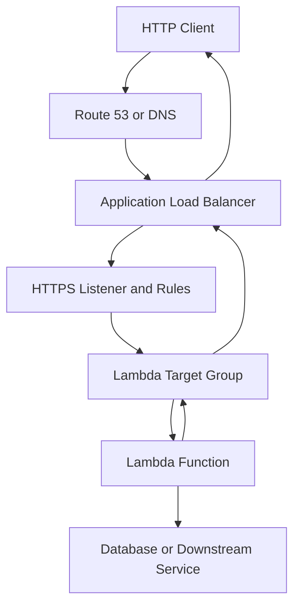
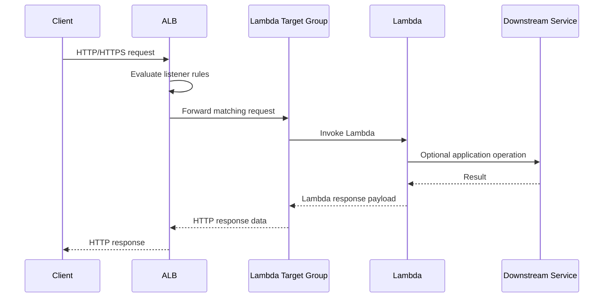
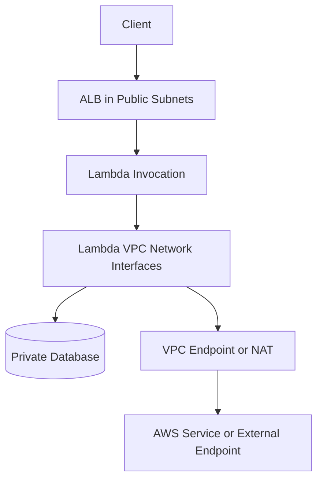
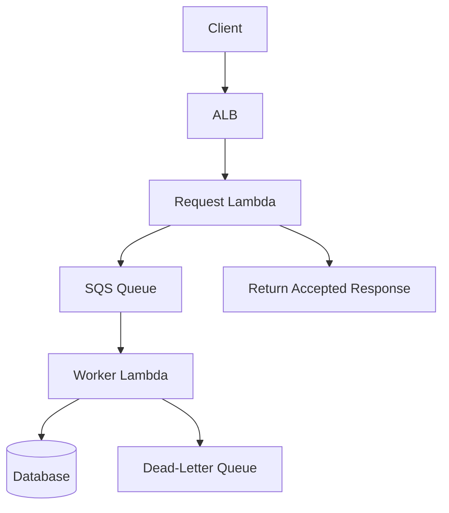

# 04- Lambda with Application Load Balancer

## Overview

AWS Lambda can integrate with an Application Load Balancer (ALB) to process HTTP and HTTPS requests without requiring you to manage application servers. ALB acts as the HTTP entry point, evaluates listener rules, and forwards matching requests to a Lambda function through a Lambda target group.

This integration is useful when an application already uses ALB for routing, needs host-based or path-based routing, or requires a common entry point for containerized services and serverless functions.

Unlike API Gateway, ALB is primarily a Layer 7 load balancer. It provides HTTP routing, TLS termination, health checks for conventional targets, and integration with multiple target types. When forwarding requests to Lambda, however, the target group has Lambda-specific behavior and limitations.

### When to Use ALB with Lambda

Use this integration when:

- An existing application uses ALB and needs to route selected HTTP paths to Lambda.
- A service combines ECS or EC2 targets with Lambda targets behind one load balancer.
- You need host-based or path-based routing with an existing ALB architecture.
- Private applications need HTTP routing through an internal ALB.
- You want to reuse established load-balancer listeners, TLS certificates, and domain routing.

Consider API Gateway when you need API-focused capabilities such as API keys, usage plans, request validation, native API authorization integrations, or API-specific throttling and management features.

## Architecture

An ALB listener receives the request and evaluates its rules in priority order. When a rule matches, ALB forwards the request to the configured Lambda target group. The target group invokes the function, and the function's response is translated into an HTTP response returned through ALB.



The downstream service in this diagram is optional. Lambda can also return a response without calling another service.

### Request Lifecycle



Important operational details:

- ALB terminates HTTPS when configured with an HTTPS listener and certificate.
- ALB invokes the Lambda function synchronously for this integration.
- The function must return a response in the format expected by ALB.
- Lambda execution errors, malformed responses, and integration failures can result in HTTP 5xx responses.
- ALB and Lambda have separate configuration, metrics, permissions, and failure domains.

## Components and Responsibilities

| Component | Responsibility |
|---|---|
| Application Load Balancer | Receives HTTP/HTTPS traffic and routes requests |
| Listener | Defines the protocol and port on which ALB accepts traffic |
| Listener rules | Match host headers, paths, and other supported conditions |
| Lambda target group | Associates a Lambda function with ALB routing |
| Lambda function | Executes application logic and returns a response |
| Lambda execution role | Grants the function access to AWS services and other resources |
| Lambda resource-based policy | Allows ALB to invoke the function |
| Security groups | Control network traffic to the ALB and any VPC-connected dependencies |
| CloudWatch | Stores Lambda logs and exposes Lambda and ALB metrics |

The Lambda execution role and Lambda invocation permission solve different problems. The execution role controls what the function can access after invocation. The resource-based policy controls which principal can invoke the function.

## Lambda Target Groups

ALB supports Lambda functions as targets through a target group whose target type is `lambda`.

Unlike an EC2 or IP target group, a Lambda target group does not distribute traffic across registered Lambda instances. It invokes the associated Lambda function.

### Target Group Characteristics

- The target type must be `lambda`.
- A Lambda function is registered as the target.
- The target group is associated with ALB listener rules.
- ALB requires permission to invoke the registered function.
- Lambda target groups do not use conventional instance-level health checks in the same way as instance or IP target groups.
- Lambda target groups have integration-specific limitations, including request and response size constraints.

For exact quotas and current restrictions, consult the [AWS documentation for Lambda as an ALB target](https://docs.aws.amazon.com/elasticloadbalancing/latest/application/lambda-functions.html).

### Registering a Lambda Target

The following example assumes that the ALB and Lambda function already exist.

```bash
aws elbv2 create-target-group \
  --name orders-lambda-tg \
  --target-type lambda
```

Register the function:

```bash
aws elbv2 register-targets \
  --target-group-arn "$TARGET_GROUP_ARN" \
  --targets Id="$LAMBDA_FUNCTION_ARN"
```

The commands above create a target group and register a target. They do not create an ALB, listener, security group, or routing rule.

Verify registration:

```bash
aws elbv2 describe-target-groups \
  --target-group-arns "$TARGET_GROUP_ARN"
```

Inspect registered targets:

```bash
aws elbv2 describe-target-health \
  --target-group-arn "$TARGET_GROUP_ARN"
```

For Lambda targets, interpret target-health output according to the Lambda target-group integration rather than assuming that EC2-style health checks are being performed.

## Lambda Invocation Permission

ALB must be allowed to invoke the Lambda function. This permission is defined through the Lambda function's resource-based policy.

The usual principal is the Elastic Load Balancing service principal:

`elasticloadbalancing.amazonaws.com`

Restrict the permission using the target group's ARN as the source ARN where supported.

```bash
aws lambda add-permission \
  --function-name orders-api \
  --statement-id allow-alb-orders-target \
  --action lambda:InvokeFunction \
  --principal elasticloadbalancing.amazonaws.com \
  --source-arn "$TARGET_GROUP_ARN"
```

This command modifies the function's resource-based policy. Ensure the target group ARN is the actual ARN of the target group that should invoke the function.

Verify the policy:

```bash
aws lambda get-policy \
  --function-name orders-api
```

### Security Considerations

Avoid granting broad invocation permissions when a specific target group is sufficient.

For example, a permission that allows a service principal to invoke a function without a meaningful source restriction can create an unnecessarily broad trust boundary.

Follow these principles:

- Restrict invocation permission to the intended ALB target group.
- Keep the Lambda execution role limited to the AWS resources the function actually uses.
- Use an HTTPS listener for external traffic when transport encryption is required.
- Keep database credentials and other secrets out of source code.
- Use Secrets Manager or Systems Manager Parameter Store for sensitive configuration.
- Review ALB security groups and Lambda VPC configuration independently.

The ALB invocation permission does not grant the function access to a database. Database access must be configured separately through networking, authentication, and the Lambda execution role or other appropriate identity mechanism.

## ALB Event Structure

When ALB invokes Lambda, it provides an event containing HTTP request information.

A typical event includes:

- `httpMethod`: HTTP method.
- `path`: Request path.
- `queryStringParameters`: Query parameters represented as a mapping when available.
- `headers`: Request headers.
- `body`: Request body.
- `isBase64Encoded`: Indicates whether the body is Base64 encoded.
- `requestContext`: Context associated with the request, including ALB-related information.

The precise event shape depends on the request and integration configuration. Do not assume that every optional field is present.

Example event:

```json
{
  "requestContext": {
    "elb": {
      "targetGroupArn": "arn:aws:elasticloadbalancing:region:account-id:targetgroup/orders-lambda-tg/example"
    }
  },
  "httpMethod": "GET",
  "path": "/orders/123",
  "queryStringParameters": {
    "include_items": "true"
  },
  "headers": {
    "accept": "application/json"
  },
  "body": "",
  "isBase64Encoded": false
}
```

This is a representative event for illustration, not a guarantee that every request contains exactly these fields.

## ALB-Compatible Lambda Responses

The function must return a response in the format expected by ALB.

A typical response contains:

| Field | Purpose |
|---|---|
| `statusCode` | HTTP status code |
| `statusDescription` | Optional status description |
| `headers` | HTTP response headers |
| `body` | Response body as a string |
| `isBase64Encoded` | Indicates whether the body is Base64 encoded |
| `cookies` | Optional response-cookie representation where supported by the integration format |

For JSON APIs, serialize the response body to a string. Returning a Python dictionary directly as the response body is not equivalent to returning a serialized JSON string.

### Python Handler Example

```python
import json
import logging
from typing import Any

logger = logging.getLogger()
logger.setLevel(logging.INFO)


def response(
    status_code: int,
    body: dict[str, Any],
) -> dict[str, Any]:
    return {
        "statusCode": status_code,
        "statusDescription": f"{status_code} {status_text(status_code)}",
        "headers": {
            "content-type": "application/json",
            "cache-control": "no-store",
        },
        "body": json.dumps(body),
        "isBase64Encoded": False,
    }


def status_text(status_code: int) -> str:
    descriptions = {
        200: "OK",
        400: "Bad Request",
        404: "Not Found",
        500: "Internal Server Error",
    }
    return descriptions.get(status_code, "Response")


def lambda_handler(event: dict[str, Any], context: Any) -> dict[str, Any]:
    method = event.get("httpMethod", "")
    path = event.get("path", "/")

    logger.info(
        "Request received",
        extra={
            "http_method": method,
            "path": path,
            "aws_request_id": getattr(context, "aws_request_id", None),
        },
    )

    if method == "GET" and path == "/health":
        return response(200, {"status": "ok"})

    if method == "GET" and path == "/orders/123":
        return response(
            200,
            {
                "order_id": "123",
                "status": "processing",
            },
        )

    return response(404, {"error": "not_found"})
```

This example demonstrates the response contract and basic routing. A production application should use a deliberate routing strategy, request validation, centralized error handling, and structured logging that does not expose sensitive information.

### Error Handling

Distinguish expected application errors from unexpected failures.

- Return a suitable 4xx response for invalid client input or missing resources.
- Return a 5xx response for unexpected server-side failures.
- Log exception details internally without returning stack traces to clients.
- Do not catch every exception and return `200 OK`.
- Avoid logging credentials, authorization headers, session tokens, or sensitive request bodies.

If the handler raises an uncaught exception or returns an invalid response, ALB may return an integration error rather than the intended application response. Validate the response contract in tests before deployment.

## Request and Response Size Constraints

ALB-to-Lambda integration has request and response payload limits. These limits are distinct from Lambda's general invocation payload limits and from API Gateway's limits.

Do not assume that an application working through direct Lambda invocation or API Gateway will automatically work unchanged behind ALB.

For large payloads:

- Store uploaded objects in Amazon S3 and pass object references through the application.
- Use presigned S3 URLs for direct client uploads and downloads when appropriate.
- Avoid using Lambda response bodies as a transport for large files.
- Verify the current ALB-Lambda request and response limits before selecting the integration.

For binary content, ensure the body encoding and `isBase64Encoded` flag are consistent with the expected integration behavior.

## Listener Rules and Routing

ALB listener rules can route traffic based on supported conditions, including host headers and URL paths.

Example routing design:

| Condition | Target |
|---|---|
| Host `api.example.com`, path `/orders/*` | Orders Lambda target group |
| Host `api.example.com`, path `/reports/*` | Reports Lambda target group |
| Host `app.example.com` | Web application target group |
| Default rule | Application-defined default target |

This allows Lambda and traditional targets to coexist behind a shared load balancer.

### Creating a Listener Rule

Assume an HTTPS listener and the target group already exist.

```bash
aws elbv2 create-rule \
  --listener-arn "$HTTPS_LISTENER_ARN" \
  --priority 20 \
  --conditions Field=path-pattern,Values='/orders/*' \
  --actions Type=forward,TargetGroupArn="$TARGET_GROUP_ARN"
```

The priority must be available on the listener. Rules are evaluated according to listener priority, and the default rule handles requests that do not match higher-priority rules.

Verify the rule:

```bash
aws elbv2 describe-rules \
  --listener-arn "$HTTPS_LISTENER_ARN"
```

Before changing listener rules in production, inspect the existing rule priorities and routing behavior. A broad path pattern or incorrect priority can send traffic to the wrong backend.

## Networking and VPC Integration

ALB and Lambda have different networking responsibilities.

The ALB must be configured with subnets and security groups appropriate for the traffic it receives. If the Lambda function accesses private resources, its VPC configuration must allow the required network paths.

For a Lambda function connected to a VPC:

- Select subnets with routes appropriate for the required resources.
- Configure Lambda security groups to allow required outbound connections.
- Configure downstream security groups to permit traffic from the Lambda security group.
- Verify DNS resolution and routing.
- Provide NAT or suitable VPC endpoints when outbound access to required services is necessary.
- Confirm that database connection limits can support the expected concurrency.

Placing Lambda in a public subnet does not automatically give it a public IP address or internet access. Outbound connectivity must be designed explicitly.

### Example Network Flow



The exact network path depends on the function's VPC configuration and destination. ALB invokes Lambda through the AWS service integration; it does not connect to the function through an ordinary HTTP port in the function's security group.

## Performance and Scaling

ALB can distribute incoming requests across configured targets, but Lambda's concurrency and downstream capacity remain important constraints.

### Factors Affecting Latency

- Lambda cold starts and initialization work.
- Function memory and CPU allocation.
- Runtime and dependency size.
- Database connection establishment.
- Downstream API latency.
- ALB listener processing and network latency.
- Retry behavior in clients and upstream systems.

Tune Lambda memory using representative workload measurements. Higher memory also provides more CPU allocation, which can reduce execution time for CPU-bound workloads.

### Concurrency Planning

Estimate the concurrency needed for the expected request rate:

\[
\text{Concurrency} \approx \text{Request Rate} \times \text{Average Duration}
\]

For example, if the function processes 150 requests per second and the average duration is 0.4 seconds:

\[
150 \times 0.4 = 60
\]

The workload needs approximately 60 concurrent executions at that average rate. Production planning should also account for traffic bursts, tail latency, retries, and downstream service capacity.

Use reserved concurrency when a function needs an explicit concurrency allocation or when protecting other workloads from an unbounded share of account concurrency. Provisioned concurrency can reduce initialization latency for supported configurations, but it introduces additional cost and must be configured for the relevant published version or alias.

ALB does not eliminate Lambda throttling. If the function reaches its concurrency limit, requests can fail even when the load balancer remains healthy.

## Reliability and Failure Handling

ALB invokes Lambda synchronously. This differs from Lambda's asynchronous invocation model, in which Lambda manages an internal event queue and retries eligible failures.

For synchronous ALB requests:

- The caller receives the response or an error.
- ALB does not provide a durable application queue for failed requests.
- Client or upstream retries can result in duplicate business operations.
- Lambda execution failures should be diagnosed using function logs and metrics.
- Downstream dependencies can fail independently of ALB and Lambda.

For long-running or bursty work, consider accepting the request and placing a message in SQS, then processing it asynchronously with Lambda.



This architecture decouples request acceptance from processing. It is appropriate when the API can return a job identifier or acceptance response instead of waiting for the entire operation to finish.

Use idempotency keys or another durable deduplication strategy for business operations that may be repeated. A successful HTTP response alone does not guarantee that the caller will never retry, especially when network failures obscure the outcome.

## Observability

Monitor ALB and Lambda together. A request may reach ALB successfully but fail during invocation, function execution, or a downstream operation.

### Important Metrics

| Layer | Metrics and signals |
|---|---|
| ALB | `RequestCount`, `HTTPCode_ELB_5XX_Count`, `HTTPCode_Target_5XX_Count`, `TargetResponseTime` |
| Lambda | `Invocations`, `Errors`, `Duration`, `Throttles`, `ConcurrentExecutions` |
| Application | Request outcome, validation failures, downstream latency, business-operation failures |
| Dependencies | Database connections, query latency, connection exhaustion, service error rates |

Metric names and dimensions should be verified against the current AWS documentation and the actual resource configuration.

### Logs

Lambda writes application output to CloudWatch Logs when its execution role has the necessary permissions. Include a correlation identifier when one is available and propagate it to downstream services.

Example:

```python
logger.info(
    "Order request completed",
    extra={
        "request_id": event.get("requestContext", {}).get("elb", {}).get(
            "targetGroupArn"
        ),
        "path": event.get("path"),
        "method": event.get("httpMethod"),
        "aws_request_id": context.aws_request_id,
    },
)
```

The target group ARN is an integration identifier, not a unique request identifier. In production, use a true request or trace identifier from the incoming request or a generated identifier, and avoid treating a shared resource ARN as a correlation ID.

### Alarm Recommendations

Create alarms for:

- Sustained increases in Lambda errors or throttles.
- High Lambda duration relative to the function timeout and application SLO.
- ALB 5xx responses.
- Increased target response time.
- Unexpected request volume changes.
- Downstream dependency saturation.

Use dashboards and logs to correlate the same time window across ALB, Lambda, and dependent services. A single error metric rarely identifies the root cause by itself.

## Security Best Practices

### Identity and Permissions

Maintain a clear separation between:

- The ALB's permission to invoke Lambda.
- The Lambda execution role's permission to access other services.
- The IAM identity used by deployment automation.
- Client authentication and authorization at the application boundary.

Do not assume that placing a Lambda function behind an ALB automatically authenticates users. If the application is exposed to untrusted clients, implement an appropriate authentication and authorization design.

### Transport Security

For external HTTP applications:

- Prefer HTTPS listeners with an appropriately managed certificate.
- Redirect HTTP to HTTPS where required.
- Apply suitable security group ingress restrictions.
- Review forwarded headers and trust only headers supplied by trusted infrastructure.
- Do not rely on a client-provided identity header without a trusted authentication mechanism.

### Secrets and Data

- Use Secrets Manager or Parameter Store for sensitive configuration.
- Grant access only to the secrets required by the function.
- Avoid logging sensitive headers and request bodies.
- Rotate credentials according to operational requirements.
- Review encryption and access controls for logs and stored data.

## Cost Considerations

The main cost components can include:

- ALB hourly and capacity-related charges.
- Lambda invocation requests and execution duration.
- CloudWatch Logs ingestion and retention.
- Data transfer.
- NAT gateways or other networking resources.
- Downstream services such as databases, queues, and storage.

ALB costs may be significant for low-volume workloads because the load balancer can incur charges even when request volume is small. For a simple public HTTP API, compare the total cost and operational capabilities of ALB, API Gateway, and Lambda function URLs before selecting an entry point.

Optimize cost by:

- Right-sizing Lambda memory based on measured duration and resource usage.
- Avoiding unnecessary initialization and dependency loading.
- Setting appropriate log retention.
- Removing unused target groups, listeners, load balancers, and networking resources.
- Monitoring request volume and downstream resource consumption.

Pricing varies by Region and configuration. Validate current pricing for the resources used by the deployment.

## ALB vs API Gateway vs Lambda Function URLs

| Capability | ALB + Lambda | API Gateway + Lambda | Lambda Function URL |
|---|---|---|---|
| Primary role | Layer 7 load balancing and routing | Managed API front door | Direct HTTP(S) endpoint for a function |
| Host/path routing | Listener rules | API routes and integrations | Limited to application-level routing within the function |
| Multiple backend types | Yes, including supported instance, IP, and Lambda targets | Through supported integrations | No general multi-target routing |
| API-specific features | More limited | Rich API management and authorization capabilities, depending on API type | Minimal built-in API management |
| Existing ALB reuse | Strong fit | Not required | Not required |
| Request handling | ALB-Lambda integration contract | API-type-specific integration contract | Function URL event and response contract |
| Operational overhead | Load balancer configuration and cost | API configuration and service-specific behavior | Simpler endpoint configuration |
| Common use case | Shared routing for serverless and conventional backends | Managed public or private API workloads | Simple HTTP access to a single function |

The correct choice depends on the application's routing needs, authentication requirements, traffic profile, and existing infrastructure.

## Common Mistakes

### Missing Invocation Permission

**Symptom:** ALB cannot invoke the Lambda function.

**Cause:** The function's resource-based policy does not allow the Elastic Load Balancing service principal to invoke it, or the source restriction is incorrect.

**Fix:** Inspect the function policy and verify that the correct target group ARN is authorized.

### Invalid Response Format

**Symptom:** The application returns an unexpected HTTP error.

**Cause:** The handler returns a malformed response, uses an incompatible body type, or sets Base64 encoding incorrectly.

**Fix:** Validate response fields and test representative requests, including empty bodies, JSON bodies, and binary responses where applicable.

### Assuming Lambda Has a Public IP

**Symptom:** A VPC-connected function cannot reach an external endpoint.

**Cause:** The function was placed in a subnet without an appropriate outbound route.

**Fix:** Verify route tables, NAT or endpoint configuration, security groups, and DNS resolution.

### Treating Synchronous Requests as Durable Jobs

**Symptom:** Work is repeated after a timeout or client retry.

**Cause:** The client retries because the response was lost or delayed, even though the original operation may have completed.

**Fix:** Make business operations idempotent. For long-running tasks, persist job state and move processing to a queue or workflow.

### Ignoring Downstream Limits

**Symptom:** Errors rise when traffic increases.

**Cause:** Lambda concurrency creates more simultaneous database connections or downstream requests than the dependency can handle.

**Fix:** Set concurrency controls, reuse connections safely, apply timeouts, and introduce buffering or backpressure where appropriate.

## Production Readiness Checklist

Before exposing an ALB-backed Lambda application to production, verify the following:

- [ ] The target group uses the Lambda target type and registers the intended function.
- [ ] The Lambda resource-based policy grants invocation only to the intended load-balancer target group.
- [ ] Listener rules have correct priorities, conditions, and target groups.
- [ ] The handler returns a valid ALB-compatible response for success and error paths.
- [ ] Request and response payload limits are compatible with the application.
- [ ] HTTPS, security groups, authentication, and authorization are configured appropriately.
- [ ] VPC routes, DNS, and downstream connectivity have been tested where applicable.
- [ ] Lambda timeout, memory, and concurrency have been configured using workload measurements.
- [ ] Retries and duplicate business operations are handled safely.
- [ ] CloudWatch logs, metrics, dashboards, and alarms cover both ALB and Lambda.
- [ ] Deployment and rollback procedures have been tested.
- [ ] Unused AWS resources are removed and current pricing has been reviewed.

## Key Takeaways

- ALB routes HTTP requests to Lambda through a Lambda target group and requires explicit Lambda invocation permission.
- The handler must return an ALB-compatible response, including a string response body and correctly configured encoding.
- ALB does not remove Lambda concurrency limits, downstream bottlenecks, or the need for idempotent business operations.
- Production reliability depends on coordinated monitoring of ALB, Lambda, and downstream dependencies, with least-privilege permissions and deliberate network design.
- Choose ALB, API Gateway, or Lambda function URLs according to routing requirements, API-management needs, security boundaries, and total operating cost.