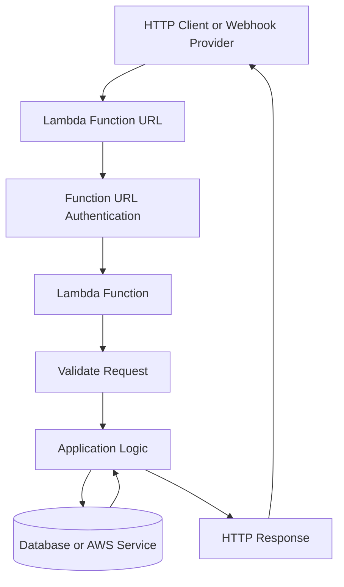
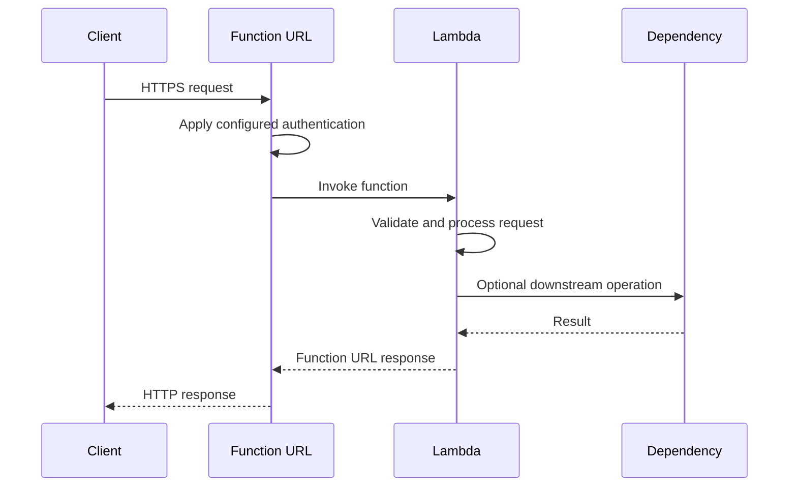
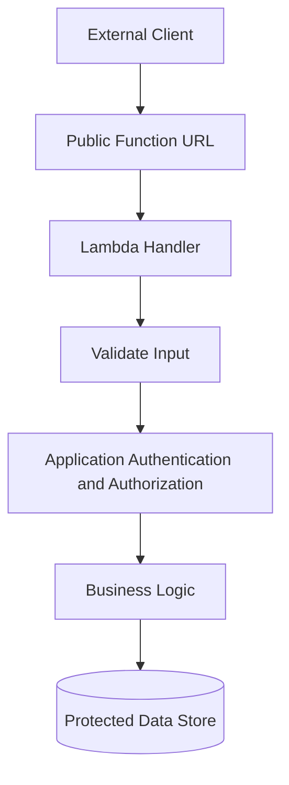
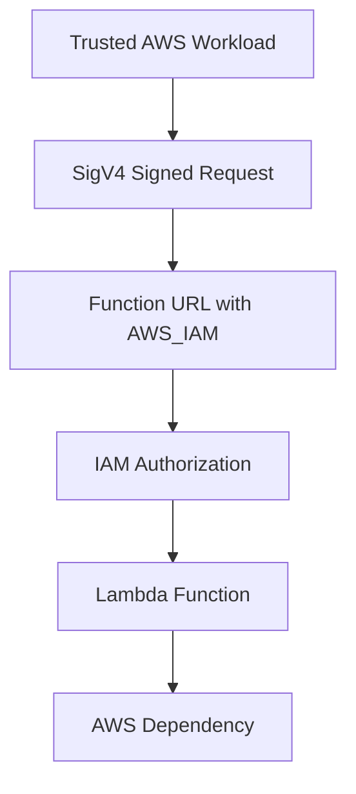
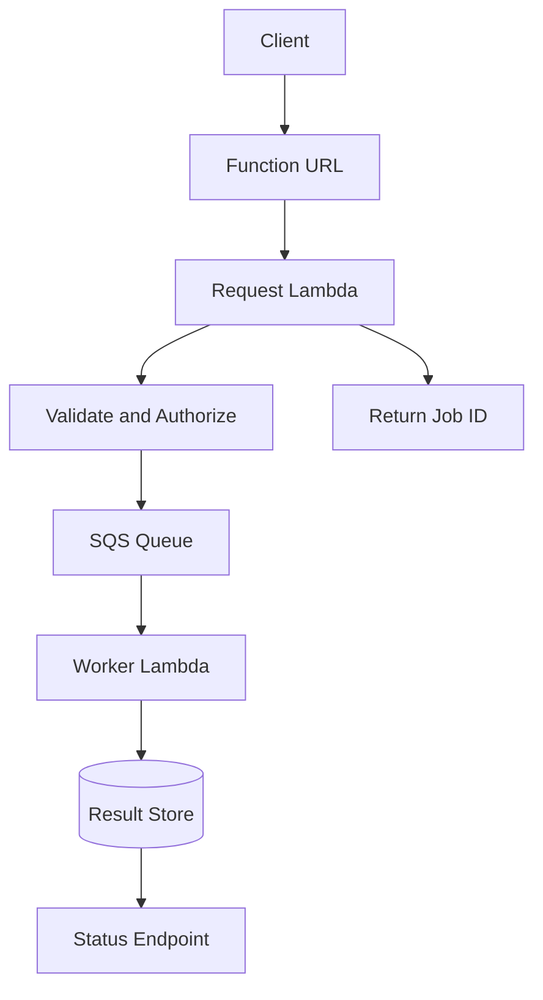

# 05- Lambda Function URLs Architecture

## Overview

AWS Lambda Function URLs provide an HTTPS endpoint directly associated with a Lambda function. They allow clients to invoke a function over HTTP without configuring API Gateway or an Application Load Balancer.

A Function URL is a lightweight HTTP entry point for a Lambda function. AWS manages the endpoint infrastructure, while the application remains responsible for request validation, business logic, response formatting, and any application-level authorization not provided by the configured authentication mechanism.

Function URLs are useful for internal tools, lightweight APIs, webhooks, prototypes, and services that need direct HTTP access to a Lambda function. They are not a complete replacement for API Gateway or ALB because they provide fewer routing, traffic-management, and API-governance capabilities.

## Architecture

A Function URL creates a direct request path from an HTTP client to a Lambda function.



The Function URL is associated with a specific Lambda function and can be configured for a published version or alias. It does not provide general-purpose routing across multiple backend services.

### Request Lifecycle



The function is invoked synchronously for an HTTP request. The client receives the response produced by the function or an error if the invocation or integration fails.

## When to Use Function URLs

Function URLs are a good fit when:

- A single Lambda function needs a straightforward HTTPS endpoint.
- A webhook provider needs to send HTTP requests to a Lambda-backed integration.
- A lightweight service does not need advanced API routing or API management.
- A development or internal tool needs direct HTTP access to a function.
- A small application can implement its own routing and validation inside the handler.

Consider another integration when the application needs capabilities that Function URLs do not provide natively.

| Requirement | Suitable option |
|---|---|
| Simple HTTP endpoint for one Lambda function | Function URL |
| Multiple API routes, API stages, and API-specific controls | API Gateway |
| Host-based and path-based routing across Lambda and other targets | Application Load Balancer |
| Durable asynchronous work | SQS or another event-driven service |
| Multi-step business workflow | Step Functions |
| Static content delivery and caching | CloudFront with an appropriate origin |

Function URLs can be used behind CloudFront when additional edge delivery or caching capabilities are needed, but this introduces extra configuration and does not automatically provide API Gateway features.

## Authentication and Authorization

Function URLs support two authentication modes:

- `AWS_IAM`
- `NONE`

These modes control access to the Function URL endpoint. They do not replace application-level authorization.

### AWS_IAM Authentication

With `AWS_IAM`, callers must authenticate with AWS credentials and sign requests using AWS Signature Version 4. The caller's IAM identity must have the permissions required to invoke the Function URL.

This mode is appropriate for trusted applications and services that can use AWS credentials, such as a backend running under an IAM role.

Relevant permissions include:

- `lambda:InvokeFunctionUrl` for invoking a Function URL.
- `lambda:InvokeFunction` where required by the Function URL invocation authorization model.

The exact policy requirements depend on the function qualifier and the applicable AWS authorization behavior. Follow the current [Function URL authentication documentation](https://docs.aws.amazon.com/lambda/latest/dg/urls-auth.html) when configuring permissions.

Example identity policy:

```json
{
  "Version": "2012-10-17",
  "Statement": [
    {
      "Sid": "InvokeOrdersFunctionUrl",
      "Effect": "Allow",
      "Action": [
        "lambda:InvokeFunctionUrl",
        "lambda:InvokeFunction"
      ],
      "Resource": "arn:aws:lambda:REGION:ACCOUNT_ID:function:orders-api"
    }
  ]
}
```

Replace the Region and account placeholders with actual values. For production, scope permissions to the intended function and qualifier rather than granting broad access to all Lambda functions.

### NONE Authentication

With `NONE`, the endpoint can be invoked without AWS IAM authentication, subject to the function's resource policy and applicable AWS authorization requirements.

This is useful for public webhooks and public HTTP endpoints. It also means the endpoint may be reachable by untrusted clients.

A public Function URL must not be treated as a private endpoint simply because its URL is difficult to guess.

For public endpoints:

- Authenticate users or webhook providers at the application layer when required.
- Validate request bodies and headers.
- Apply rate limiting or abuse protection through an appropriate architecture.
- Use idempotency for operations that may be retried.
- Avoid returning stack traces or internal infrastructure details.
- Never trust an arbitrary identity header supplied by the client.

### Resource-Based Permissions

Function URLs use Lambda resource-based policies to control who can invoke the function. IAM identity policies and resource-based policies are separate parts of the authorization model.

A policy that permits URL invocation is not equivalent to granting the function unrestricted access to AWS services. The execution role independently controls what the function can do after it starts.

For cross-account access or public invocation, verify both the endpoint's authentication configuration and the relevant identity and resource policies.

## Creating a Function URL

The following examples assume that the Lambda function already exists and that the AWS CLI is configured for the correct account and Region.

### Inspect the Function

```bash
aws sts get-caller-identity

aws lambda get-function-configuration \
  --function-name orders-api
```

These commands are read-only. They confirm the active AWS identity and retrieve the function configuration.

### Create a Function URL

For an existing function:

```bash
aws lambda create-function-url-config \
  --function-name orders-api \
  --auth-type AWS_IAM
```

For a public endpoint:

```bash
aws lambda create-function-url-config \
  --function-name orders-api \
  --auth-type NONE
```

The second command creates an unauthenticated Function URL configuration. It should be used only when public invocation is intentional and the application has suitable security controls.

To attach a Function URL to a published alias:

```bash
aws lambda create-function-url-config \
  --function-name orders-api \
  --qualifier production \
  --auth-type AWS_IAM
```

The `production` qualifier must identify an existing published version alias or other supported qualifier. Qualifier-specific configuration should be managed deliberately during deployment.

### Retrieve the URL

```bash
aws lambda get-function-url-config \
  --function-name orders-api
```

For a URL associated with an alias:

```bash
aws lambda get-function-url-config \
  --function-name orders-api \
  --qualifier production
```

The response includes the Function URL and its authentication configuration. Store the URL in the appropriate environment configuration rather than hardcoding it throughout the application.

### Update Authentication

```bash
aws lambda update-function-url-config \
  --function-name orders-api \
  --auth-type AWS_IAM
```

Changing the authentication mode changes the endpoint's access model. Before applying such a change in production, verify the resource-based policy and the permissions of all intended callers.

### Delete the Function URL

```bash
aws lambda delete-function-url-config \
  --function-name orders-api
```

For a qualifier-specific configuration, supply the same qualifier used when creating it.

Deleting the URL configuration removes that HTTP endpoint configuration; it does not delete the Lambda function itself.

## Python Handler Implementation

Function URLs use a request and response format based on the Lambda Function URL payload version. The event includes HTTP request information such as the method, path, headers, query parameters, and body.

A handler should validate input, return a valid HTTP response, and avoid exposing internal exceptions.

```python
import json
import logging
from typing import Any

logger = logging.getLogger()
logger.setLevel(logging.INFO)


def json_response(
    status_code: int,
    payload: dict[str, Any],
) -> dict[str, Any]:
    return {
        "statusCode": status_code,
        "headers": {
            "content-type": "application/json",
            "cache-control": "no-store",
        },
        "body": json.dumps(payload),
        "isBase64Encoded": False,
    }


def lambda_handler(
    event: dict[str, Any],
    context: Any,
) -> dict[str, Any]:
    method = event.get("requestContext", {}).get("http", {}).get("method", "")
    path = event.get("rawPath", "/")

    logger.info(
        "HTTP request received",
        extra={
            "method": method,
            "path": path,
            "aws_request_id": context.aws_request_id,
        },
    )

    if method == "GET" and path == "/health":
        return json_response(200, {"status": "ok"})

    if method == "POST" and path == "/orders":
        try:
            body = json.loads(event.get("body") or "{}")
        except json.JSONDecodeError:
            return json_response(400, {"error": "invalid_json"})

        if not isinstance(body, dict):
            return json_response(400, {"error": "invalid_request"})

        customer_id = body.get("customer_id")
        if not isinstance(customer_id, str) or not customer_id.strip():
            return json_response(400, {"error": "customer_id_required"})

        # Replace this placeholder with a validated business operation.
        return json_response(
            201,
            {
                "message": "Order request accepted",
                "customer_id": customer_id,
            },
        )

    return json_response(404, {"error": "not_found"})
```

This is a minimal application example. A production implementation should also enforce request-size limits, validate content types, implement authentication and authorization where needed, and handle business-operation failures consistently.

### Important Handler Considerations

- Use the correct event structure for Function URLs rather than assuming API Gateway or ALB events are identical.
- Parse JSON safely and validate the expected schema.
- Return a serialized string in the response body.
- Set response headers deliberately.
- Handle unexpected exceptions without exposing internal details.
- Use the Lambda context request ID for invocation-level diagnosis.
- Do not treat a health endpoint as proof that all downstream dependencies are healthy.

For larger applications, consider a lightweight router or framework adapter. Keep framework initialization outside the handler where possible so that reusable initialization work can benefit from execution-environment reuse.

## CORS Configuration

Cross-Origin Resource Sharing (CORS) controls whether browsers permit frontend JavaScript from one origin to access responses from another origin. It is a browser policy, not an authentication mechanism.

Function URLs support CORS configuration, including allowed origins, methods, headers, and related options.

Example:

```bash
aws lambda update-function-url-config \
  --function-name orders-api \
  --cors '{
    "AllowOrigins": ["https://app.example.com"],
    "AllowMethods": ["GET", "POST"],
    "AllowHeaders": ["content-type", "authorization"],
    "MaxAge": 300
  }'
```

Use a specific origin when the application has a known frontend. Avoid wildcard origins for sensitive browser-based applications unless the security implications have been evaluated.

CORS does not prevent direct HTTP clients from calling the endpoint. A script, command-line client, or malicious service can send requests regardless of browser CORS enforcement.

Also decide whether the application or the Function URL configuration should own CORS response headers. Avoid inconsistent or duplicated CORS headers that cause browser failures.

## Request and Response Processing

Function URLs expose HTTP semantics to the client, but the Lambda handler still performs application processing.

Typical request fields include:

| Field | Purpose |
|---|---|
| `rawPath` | Request path |
| `rawQueryString` | Raw query string |
| `headers` | Request headers |
| `queryStringParameters` | Parsed query parameters when present |
| `requestContext` | HTTP and invocation-related context |
| `body` | Request body |
| `isBase64Encoded` | Indicates Base64 encoding of the request body |

The precise shape depends on the configured payload version and request. Avoid assuming optional values always exist.

For binary request bodies, inspect `isBase64Encoded` and decode the body only when appropriate. For JSON requests, validate the body before using it.

### Response Format

A typical response includes:

- `statusCode`
- `headers`
- `body`
- `isBase64Encoded`

For JSON APIs, serialize the payload using `json.dumps()`. For binary responses, encode the body as required by the Function URL response contract and set the encoding flag consistently.

Do not return arbitrary Python objects directly as the response body.

### Payload Limits

Function URLs have request and response constraints. They also inherit Lambda's general runtime, execution, and invocation limitations, but the limits of the HTTP integration are not interchangeable with every other Lambda integration.

For large files or large response payloads:

- Upload directly to S3 using a presigned URL.
- Return an S3 object reference rather than embedding large files in JSON.
- Use CloudFront or another suitable delivery mechanism for large downloads.
- Verify current Function URL limits before designing around maximum payload sizes.

## Security Architecture

A Function URL introduces a public or IAM-authenticated HTTP entry point. Security should be designed around the endpoint, the function, and its dependencies.

### Public Endpoint



When the endpoint is public, application-level authorization is important for sensitive operations. A URL is not a secret, and CORS is not a substitute for access control.

### IAM-Authenticated Endpoint



The caller needs valid AWS credentials and appropriate permissions. Credentials should come from an approved identity mechanism such as an execution role, not from hardcoded access keys.

### Least-Privilege Execution Role

The function's execution role should contain only the permissions needed for application work. For example, a function that reads a particular S3 prefix should not automatically receive full access to every bucket.

Separate these permission categories:

- Caller permissions for invoking the URL.
- Function resource policy for allowing invocation.
- Lambda execution role for accessing downstream AWS resources.
- Deployment role for creating and updating infrastructure.

This separation limits the impact of compromised credentials or application vulnerabilities.

## Networking and Private Dependencies

Function URLs do not require the function to be attached to a VPC. A function can access supported AWS services using its execution role without VPC attachment when no private-network access is needed.

When a function connects to private resources such as an RDS database:

- Configure VPC subnets and security groups for Lambda.
- Allow required connections from the Lambda security group to the database security group.
- Verify routes and DNS resolution.
- Plan outbound access to AWS APIs and external services.
- Use suitable VPC endpoints or NAT where required.
- Account for concurrent database connections and connection reuse.

Attaching a function to a VPC does not turn its Function URL into a private endpoint by itself. Endpoint reachability and caller authorization are separate concerns.

For sensitive internal services, select an architecture that provides the required network isolation and access controls. Verify current Function URL connectivity behavior and supported networking configurations before relying on network placement as a security boundary.

## Performance and Scalability

Function URLs use Lambda's scaling and concurrency model. They do not remove account quotas, function concurrency limits, timeout constraints, or downstream service bottlenecks.

### Cold Starts

Cold starts can occur when Lambda creates a new execution environment and initializes the runtime and application dependencies.

Reduce initialization overhead by:

- Keeping dependencies minimal.
- Creating reusable SDK clients outside the handler.
- Avoiding expensive network calls during module import.
- Using a suitable memory configuration.
- Measuring latency under realistic traffic.

Provisioned concurrency can reduce initialization latency for configured published versions or aliases, but adds cost. Evaluate it against measured latency requirements and traffic patterns.

### Concurrency

A useful approximation is:

\[
\text{Concurrency} \approx \text{Request Rate} \times \text{Average Duration}
\]

If a function processes 80 requests per second and average execution duration is 0.25 seconds:

\[
80 \times 0.25 = 20
\]

The function needs approximately 20 concurrent executions at that average rate. Plan for bursts and tail latency rather than relying only on the average.

Use reserved concurrency when necessary to control a function's concurrency allocation or protect downstream services. Be aware that a low limit can cause throttling and failed requests.

### Database Connections

Lambda can scale faster than a traditional application server pool. A sudden increase in concurrent executions may create more database connections than the database can sustain.

Mitigations include:

- Reusing database clients and connections safely within an execution environment.
- Limiting concurrency based on downstream capacity.
- Using RDS Proxy where appropriate.
- Keeping transactions short.
- Setting connection and query timeouts.
- Buffering bursty workloads with SQS when synchronous processing is not required.

## Reliability and Idempotency

Function URL requests are synchronous. The client waits for a response, and client-side retries can repeat an operation when the original response is lost or delayed.

For example, a client submits an order. Lambda writes the order successfully, but the connection fails before the client receives the response. The client retries, potentially creating a duplicate order.

Use an idempotency strategy for operations that must not be duplicated.

Common approaches include:

- A client-supplied idempotency key.
- A durable database record that tracks request processing.
- Conditional writes that prevent duplicate business operations.
- Returning the previously recorded result for a repeated key.

Do not rely solely on in-memory state because execution environments can be replaced, and concurrent invocations may run in different environments.

### Moving Long-Running Work to a Queue

Function URLs are usually not the best choice when a request must initiate work that can exceed practical HTTP response expectations.



This pattern separates request acceptance from processing. It improves resilience for workloads that can be represented as durable jobs, but requires job-state management and a way for clients to retrieve results.

Use SQS dead-letter queues and appropriate retry settings for failed asynchronous processing. A queue changes the delivery and failure semantics; it does not automatically guarantee exactly-once business outcomes.

## Observability

Function URL requests should be observable through Lambda logs and metrics. Instrument application-level behavior because invocation counts alone do not explain business failures.

### Useful Metrics

| Metric or signal | Why it matters |
|---|---|
| `Invocations` | Measures function invocation volume |
| `Errors` | Detects unhandled execution failures |
| `Duration` | Shows execution latency |
| `Throttles` | Indicates concurrency or capacity restrictions |
| `ConcurrentExecutions` | Helps identify scaling pressure |
| Application 4xx and 5xx counts | Distinguishes client errors from application failures |
| Downstream latency and errors | Identifies dependency bottlenecks |

Use CloudWatch Logs for diagnostics and create alarms aligned with application service-level objectives.

Example logging:

```python
logger.info(
    "Request completed",
    extra={
        "path": event.get("rawPath"),
        "method": event.get("requestContext", {}).get("http", {}).get("method"),
        "aws_request_id": context.aws_request_id,
    },
)
```

Avoid logging sensitive headers, access tokens, passwords, or full request bodies by default.

For distributed tracing, propagate correlation identifiers across downstream calls and instrument dependencies as appropriate. Verify the supported tracing configuration and integration behavior for the chosen architecture.

## Deployment and Environment Management

A Function URL can be configured for a function or a supported qualifier. Production applications should use controlled deployment practices rather than updating the live function without verification.

Recommended practices:

- Separate development, staging, and production environments.
- Use infrastructure as code to manage Function URL configuration and permissions.
- Publish immutable Lambda versions for controlled releases.
- Use aliases to identify deployment targets.
- Verify the URL and authentication settings after deployment.
- Run smoke tests against the intended qualifier.
- Keep deployment credentials separate from runtime permissions.
- Roll back by directing the alias to a known-good version when the deployment model supports it.

A Function URL associated with a published version or alias follows that qualifier's configuration. Confirm that the endpoint points to the intended version during deployment.

Do not assume that changing function code, changing the URL configuration, and changing an alias are the same operation. They are distinct resources or configuration changes and should be validated independently.

## Cost Considerations

Function URLs do not eliminate the costs of the underlying Lambda workload. Relevant charges may include:

- Lambda requests and execution duration.
- Provisioned concurrency, if configured.
- CloudWatch Logs ingestion and retention.
- Data transfer.
- Downstream services such as databases, S3, queues, and NAT gateways.
- Optional services added for caching, protection, or observability.

A Function URL avoids the need to provision an ALB solely for HTTP access, but the cheapest design depends on workload volume, required features, and the cost of downstream resources.

Control costs by monitoring invocation volume, duration, logging, concurrency, and dependent services. Remove unused configurations and review current regional pricing before production rollout.

## Function URLs vs API Gateway vs ALB

| Dimension | Function URL | API Gateway | ALB |
|---|---|---|---|
| Main purpose | Direct HTTP access to a Lambda function | Managed API front door | Layer 7 load balancing and routing |
| Multiple backend routing | Not a general routing layer | Supported through API integrations | Supported through listener rules and target groups |
| Built-in API management | Limited | Extensive, depending on API type | Limited compared with API Gateway |
| Authentication options | AWS IAM or none at the URL level | Multiple options depending on API type | Usually handled by application or an additional authentication layer |
| Host/path routing | Application-level routing | API routes and stages | Listener rules |
| Simple setup | Strong fit | More configuration | More infrastructure |
| Long-running business workflows | Use asynchronous services or Step Functions as appropriate | Can front synchronous APIs | Can front synchronous HTTP workloads |
| Common fit | Lightweight endpoints and webhooks | Managed REST or HTTP APIs | Shared routing for containers, instances, and Lambda |

No single option is universally best. Select based on API governance, routing, security, latency, scaling, and operational requirements.

## Common Mistakes

### Assuming the URL Is Private

**Symptom:** An endpoint intended for internal use can be invoked by unintended callers.

**Cause:** The endpoint uses `NONE` authentication or has overly broad resource permissions.

**Prevention:** Review the authentication mode and resource-based policy. Implement application authorization when needed and choose an appropriate network architecture for internal services.

### Using CORS as Authentication

**Symptom:** The team assumes non-browser clients cannot call the endpoint because the CORS policy is restrictive.

**Cause:** CORS is a browser-enforced access policy, not a server-side authorization mechanism.

**Prevention:** Authenticate and authorize requests independently of CORS.

### Using the Wrong Event Schema

**Symptom:** The handler fails to read the method or path.

**Cause:** The code expects an API Gateway or ALB event instead of a Function URL event.

**Prevention:** Use the Function URL payload contract and add tests using representative events.

### Returning Invalid Responses

**Symptom:** Clients receive integration errors or unexpected HTTP status codes.

**Cause:** The handler returns a non-string body, invalid response fields, or inconsistent binary encoding.

**Prevention:** Centralize response construction and test JSON, empty-body, error, and binary response cases as applicable.

### Ignoring Duplicate Requests

**Symptom:** Retried requests create duplicate orders or payments.

**Cause:** The business operation is not idempotent, and a client retries after a timeout or lost response.

**Prevention:** Use durable idempotency keys and conditional writes for operations that must not be repeated.

### Overlooking Downstream Capacity

**Symptom:** Latency and failures increase during traffic bursts.

**Cause:** Lambda scales concurrent execution beyond what the database or downstream API can sustain.

**Prevention:** Measure capacity, control concurrency, reuse connections safely, and use queues for workloads that do not need synchronous completion.

## Production Readiness Checklist

- [ ] The Function URL is configured for the intended function or qualifier.
- [ ] The authentication mode matches the endpoint's exposure requirements.
- [ ] IAM identity policies and resource-based permissions are reviewed.
- [ ] Application-level authentication and authorization are implemented where needed.
- [ ] Request validation and response formatting are tested.
- [ ] CORS is configured for the intended browser origins, if required.
- [ ] Request and response size constraints have been reviewed.
- [ ] Lambda timeout, memory, and concurrency are configured using measured workload behavior.
- [ ] Database connectivity and connection limits are tested under concurrency.
- [ ] Duplicate requests and client retries are handled safely.
- [ ] Logs, metrics, dashboards, and alarms are in place.
- [ ] Deployment and rollback procedures are documented and tested.
- [ ] Current service pricing and downstream costs have been reviewed.

## Key Takeaways

- Lambda Function URLs provide direct HTTPS access to a single Lambda function without requiring API Gateway or ALB.
- `AWS_IAM` and `NONE` define different endpoint authentication models; neither removes the need for appropriate application authorization.
- Function URLs use Lambda's execution, concurrency, timeout, and scaling model, so downstream capacity and cold-start behavior still matter.
- Synchronous HTTP requests can be retried and duplicated; use durable idempotency and queue-based processing for appropriate workloads.
- Choose Function URLs for simplicity, API Gateway for API-management capabilities, and ALB for shared HTTP routing across supported backend targets.