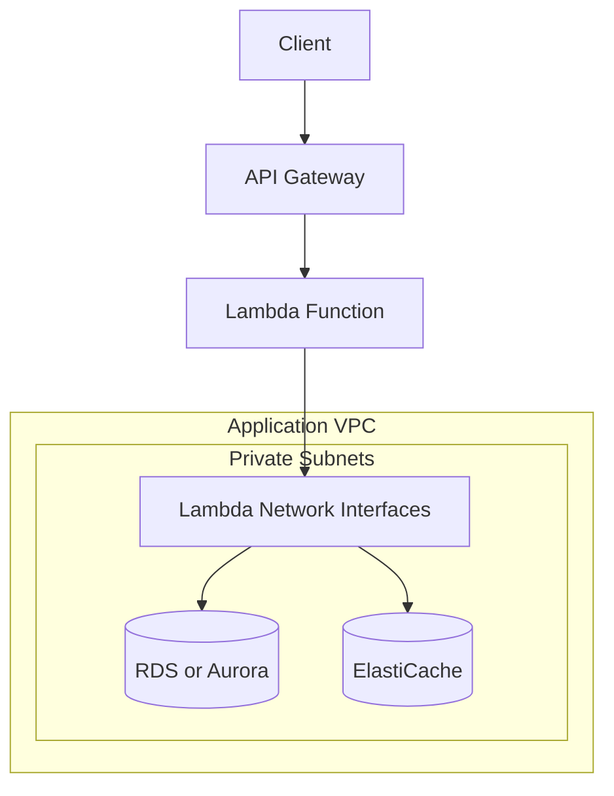
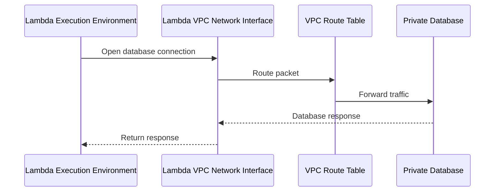
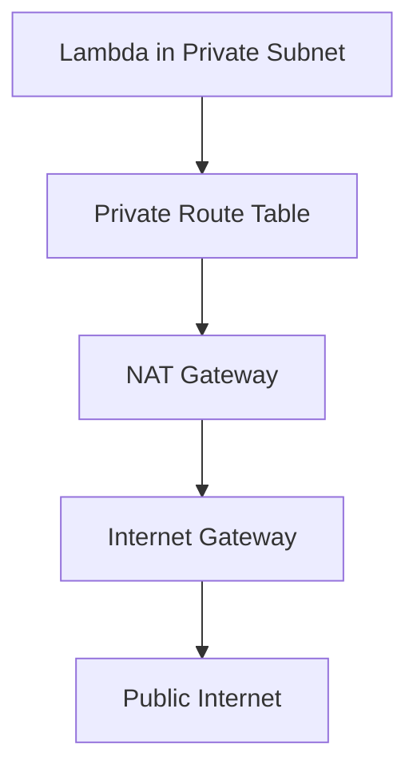
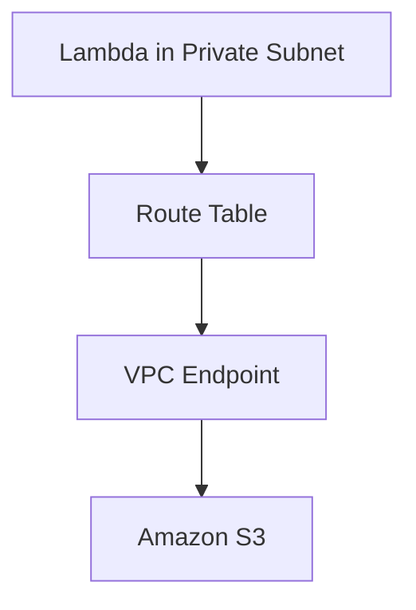

# 06- Lambda Inside a VPC

## Overview

AWS Lambda functions run in AWS-managed execution environments. By default, a function can access publicly reachable services through the connectivity provided by Lambda, but it does not automatically have network access to resources inside a customer's Amazon VPC.

When a function must connect to private resources such as Amazon RDS, Amazon ElastiCache, internal services, or private endpoints, configure it for VPC access.

VPC-connected Lambda functions use Elastic Network Interfaces (ENIs) to establish network connectivity to resources in the configured VPC. AWS manages the underlying Lambda execution infrastructure, while the application team remains responsible for subnet selection, routing, security groups, DNS, and downstream capacity.

VPC connectivity is a networking decision, not an invocation mechanism. A function can still be invoked through API Gateway, an Application Load Balancer, a Function URL, SQS, EventBridge, or direct Lambda invocation when it is configured for VPC access.

## Why Lambda Needs VPC Access

A Lambda function typically needs VPC connectivity when it must access resources that are not publicly reachable or are protected by VPC networking controls.

Common use cases include:

- Connecting to an RDS or Aurora database in private subnets.
- Accessing an ElastiCache Redis cluster.
- Calling internal HTTP services reachable only through private networking.
- Accessing resources in another VPC through VPC peering or Transit Gateway.
- Reaching on-premises services through VPN or Direct Connect.
- Accessing AWS services through VPC endpoints when private service connectivity is required.

VPC attachment does not automatically make a Lambda function private, nor does it automatically provide internet access. These behaviors depend on the invocation path, routing, security controls, and the destination being accessed.

## Default Networking vs VPC-Connected Lambda

| Capability | Lambda without VPC attachment | Lambda configured for VPC access |
|---|---|---|
| Access to publicly reachable services | Available through Lambda's managed networking, subject to service and application configuration | Requires suitable routes and outbound connectivity from the configured VPC |
| Access to private RDS instances | Not directly through private VPC addresses | Supported when networking and security controls permit |
| Access to private ElastiCache clusters | Not directly through private VPC addresses | Supported when networking and security controls permit |
| Access to VPC-local services | Not directly through private VPC addresses | Supported through VPC routing and security groups |
| Internet access | Available through Lambda-managed connectivity for applicable public destinations | Requires suitable VPC routing, such as NAT for IPv4 internet egress |
| Network configuration responsibility | Lower | Higher |
| Additional networking costs | No VPC-specific NAT or endpoint resources required solely for the function | NAT gateways, endpoints, and related networking resources may add costs |

A function does not need VPC attachment merely to call an AWS service using the AWS SDK. Attach it to a VPC when the workload requires private networking or a specific network path.

## Architecture

A common production architecture places Lambda and a database in the same VPC, with the database in private subnets.



The Lambda service manages the execution environments and the network integration. The function's configured subnets and security groups determine its network access to resources inside the VPC.

For private database access, the database security group should allow the database port from the Lambda security group rather than from broad CIDR ranges wherever practical.

## Core Networking Components

### VPC

A Virtual Private Cloud is a logically isolated network in AWS. It contains subnets, route tables, security groups, network ACLs, and other networking resources.

Lambda does not create a separate VPC for every function. You select an existing VPC and configure the function to use appropriate subnets and security groups.

### Subnets

A subnet is an IP address range within a VPC and belongs to one Availability Zone.

For production workloads:

- Select subnets in multiple Availability Zones when the architecture requires resilience across zones.
- Ensure the selected subnets have sufficient available IP addresses.
- Use private subnets for Lambda workloads that access private databases or internal services.
- Review the routes associated with each subnet.
- Do not assume that selecting a public subnet gives Lambda a public IP address.

Lambda's VPC networking behavior differs from launching a conventional EC2 instance in a subnet. Subnet selection alone does not give a function direct public internet access.

### Security Groups

Security groups are stateful virtual firewalls associated with network interfaces and supported resources.

A typical database architecture uses separate security groups:

- `lambda-sg`: associated with the Lambda function's VPC configuration.
- `database-sg`: associated with the database.

The database security group allows inbound connections from `lambda-sg` on the database port.

Example for PostgreSQL:

| Resource | Direction | Protocol and port | Source or destination |
|---|---|---|---|
| Lambda security group | Egress | TCP 5432 | Database security group, where supported by the chosen rules |
| Database security group | Ingress | TCP 5432 | Lambda security group |

Security groups are stateful, so response traffic for an allowed connection is automatically permitted. Ensure outbound rules and any additional network controls permit the required connection.

### Route Tables

Route tables determine where network traffic is sent.

Common routes include:

| Destination | Target | Purpose |
|---|---|---|
| VPC CIDR | Local | Communication within the VPC |
| Private destination CIDR | Peering or Transit Gateway | Access to connected networks |
| `0.0.0.0/0` in a private subnet | NAT gateway | IPv4 outbound internet access |
| Prefix list for an AWS service | VPC endpoint | Private connectivity to a supported AWS service |

A route to a NAT gateway provides outbound connectivity; it does not make the Lambda function directly reachable from the internet.

## How Lambda VPC Networking Works

When you configure a Lambda function for VPC access, you specify subnet IDs and security group IDs. Lambda uses managed network interfaces to provide connectivity between execution environments and the VPC.

The function still runs in Lambda-managed execution environments. The ENIs provide network connectivity; they are not equivalent to a dedicated EC2 instance assigned to each invocation.

### Network Flow



Important characteristics:

- Lambda manages the lifecycle of its VPC networking resources.
- Network interface provisioning and scaling behavior can affect initial setup or scaling characteristics.
- Multiple execution environments can share the configured VPC networking model.
- Network connectivity depends on the destination's routing and security controls.
- The function's IAM execution role does not replace network permissions enforced by security groups and routing.

Historically, Lambda VPC networking had more visible ENI-management overhead. Modern Lambda VPC networking uses service-managed Hyperplane ENIs, reducing the need to manage individual execution-environment network interfaces manually. Avoid designing capacity around an assumption that every concurrent invocation requires its own dedicated ENI.

## Configuring a Lambda Function for VPC Access

There are two main approaches:

- Configure VPC access when creating the function.
- Update an existing function's VPC configuration.

Before changing the configuration, verify the AWS account, Region, function, VPC, subnet IDs, and security group IDs.

### Inspect the Function

```bash
aws sts get-caller-identity

aws lambda get-function-configuration \
  --function-name orders-api
```

These commands are read-only. Inspect the returned `VpcConfig` to determine whether the function is already attached to a VPC.

### Inspect VPC Resources

List VPCs:

```bash
aws ec2 describe-vpcs \
  --query 'Vpcs[].{VpcId:VpcId,Cidr:CidrBlock,State:State}' \
  --output table
```

List subnets:

```bash
aws ec2 describe-subnets \
  --filters Name=vpc-id,Values="$VPC_ID" \
  --query 'Subnets[].{SubnetId:SubnetId,AZ:AvailabilityZone,CIDR:CidrBlock,AvailableIPs:AvailableIpAddressCount}' \
  --output table
```

List security groups:

```bash
aws ec2 describe-security-groups \
  --filters Name=vpc-id,Values="$VPC_ID" \
  --query 'SecurityGroups[].{GroupId:GroupId,Name:GroupName}' \
  --output table
```

These commands help identify candidate resources. They do not prove that the selected subnets have the required routes or that downstream security rules are correct.

Inspect route tables:

```bash
aws ec2 describe-route-tables \
  --filters Name=vpc-id,Values="$VPC_ID"
```

Review the route table associated with each selected subnet, including any explicit subnet association.

### Configure VPC Access

For an existing function:

```bash
aws lambda update-function-configuration \
  --function-name orders-api \
  --vpc-config SubnetIds=subnet-0123456789abcdef0,subnet-0fedcba9876543210,SecurityGroupIds=sg-0123456789abcdef0
```

Replace the example subnet and security group IDs with actual resources from the intended VPC.

This command changes the function's VPC configuration. Lambda may need time to complete the networking update, and the function can experience temporary operational impact while configuration changes are applied.

Wait for the update:

```bash
aws lambda wait function-updated \
  --function-name orders-api
```

Verify the configuration:

```bash
aws lambda get-function-configuration \
  --function-name orders-api \
  --query 'VpcConfig'
```

The returned configuration should contain the intended subnet and security group IDs. Then test the actual network path to the downstream dependency.

## IAM Permissions for VPC Configuration

The Lambda execution role requires permissions that allow Lambda to manage the networking resources used for VPC access. AWS provides the managed policy `AWSLambdaVPCAccessExecutionRole` for common VPC networking and logging permissions.

The policy commonly includes permissions such as creating, describing, and deleting network interfaces, as well as writing logs.

For a production deployment:

- Use the AWS-managed policy when its permissions fit the operational model.
- Review the current policy document and its permissions before adopting it.
- Understand which permissions are needed by Lambda during VPC configuration and execution.
- Keep application permissions separate from VPC networking permissions.
- Avoid granting broad EC2 administrative permissions to the function merely to enable VPC connectivity.

Example policy attachment:

```bash
aws iam attach-role-policy \
  --role-name orders-api-execution-role \
  --policy-arn arn:aws:iam::aws:policy/service-role/AWSLambdaVPCAccessExecutionRole
```

This command modifies the IAM role. Use the correct execution role name and review the policy before applying it.

Verify attached policies:

```bash
aws iam list-attached-role-policies \
  --role-name orders-api-execution-role
```

A role policy does not grant the function permission to connect through a blocked security group or missing route. IAM authorization and network reachability must be diagnosed independently.

## Private Database Connectivity

Connecting Lambda to a database is a common reason for VPC attachment. The function must have network connectivity, the database must accept the connection, and the application must use valid credentials and connection parameters.

### PostgreSQL Example

A Python application can use a PostgreSQL driver such as `psycopg` or `psycopg2`. The exact packaging approach depends on the chosen runtime and deployment artifact.

```python
import os

import psycopg


def get_connection():
    return psycopg.connect(
        host=os.environ["DB_HOST"],
        port=int(os.environ.get("DB_PORT", "5432")),
        dbname=os.environ["DB_NAME"],
        user=os.environ["DB_USER"],
        password=os.environ["DB_PASSWORD"],
        connect_timeout=5,
        sslmode="require",
    )
```

This example demonstrates connection parameters. In production, avoid retrieving long-lived database passwords directly from plain-text environment variables when a managed secret solution is more appropriate. Retrieve credentials securely and account for secret rotation.

Do not open a new database connection for every query without considering connection establishment cost and database capacity. Reuse connections safely within a warm execution environment when appropriate, and ensure that stale or dropped connections can be recovered.

### Database Security Group

The database security group should allow the database port from the Lambda security group.

For PostgreSQL:

```text
Database inbound rule:
Protocol: TCP
Port: 5432
Source: Lambda security group
```

This is preferable to permitting database access from `0.0.0.0/0`.

### Connection Exhaustion

Lambda can scale concurrent executions rapidly. If every execution environment opens its own database connection, the database may reach its connection limit.

Potential consequences include:

- Connection timeouts.
- Database errors during traffic spikes.
- Increased connection establishment latency.
- Exhausted database resources.
- Cascading failures and retries.

Mitigation strategies include:

- Use RDS Proxy where appropriate.
- Set Lambda concurrency based on database capacity.
- Reuse connections within execution environments safely.
- Keep transactions short.
- Configure connection and query timeouts.
- Avoid uncontrolled retries during database outages.

RDS Proxy can pool and manage database connections, but it does not remove the need to plan database capacity or transaction behavior.

## Internet Access from VPC-Connected Lambda

A function attached to a VPC does not automatically gain public internet access. For IPv4 internet egress, a common design routes traffic from private subnets through a NAT gateway.

### Private Subnet with NAT Gateway



The NAT gateway is placed in a public subnet with a route to an internet gateway. The private subnet's default route points to the NAT gateway.

This design permits outbound connectivity while preventing unsolicited inbound internet connections through the NAT gateway.

NAT gateways incur hourly and data-processing charges. If the function only needs to access supported AWS services, VPC endpoints may be more appropriate.

### Verify Outbound Connectivity

Check the subnet's route table and the NAT gateway state:

```bash
aws ec2 describe-nat-gateways \
  --filter Name=vpc-id,Values="$VPC_ID"
```

Inspect route tables:

```bash
aws ec2 describe-route-tables \
  --filters Name=vpc-id,Values="$VPC_ID"
```

These commands are read-only. Confirm that:

- The private subnet has the intended default route.
- The route points to an available NAT gateway.
- The NAT gateway's public subnet has a route to an internet gateway.
- Security groups and network ACLs permit the required traffic.
- DNS resolution works for the destination.

A successful route configuration does not guarantee that the destination is reachable. The destination may reject the request, DNS may fail, or TLS and application-level configuration may be incorrect.

## VPC Endpoints for AWS Services

VPC endpoints allow supported AWS service traffic to use private connectivity paths rather than requiring public internet egress.

Two important endpoint types are:

| Endpoint type | Typical use |
|---|---|
| Gateway endpoint | Private routing to supported services such as S3 and DynamoDB |
| Interface endpoint | Private connectivity to supported AWS services through endpoint network interfaces |

The supported services and endpoint behavior depend on the endpoint type and Region.

For example, a Lambda function in private subnets may use an S3 gateway endpoint to access S3 without routing those requests through a NAT gateway.



VPC endpoints can reduce NAT data-processing costs and provide a private network path. They still require appropriate IAM permissions, endpoint policies where applicable, DNS configuration for interface endpoints, and service-level authorization.

Do not assume that creating an endpoint automatically authorizes the function to access the service.

## DNS and Name Resolution

DNS issues can resemble routing or security group failures. A Lambda function may be able to reach an IP address but fail to connect using a hostname.

Verify:

- VPC DNS support and DNS hostnames settings.
- The correct database or service endpoint hostname.
- Private hosted zone associations.
- Route 53 Resolver rules when using custom DNS.
- Network reachability to any custom DNS infrastructure.
- The behavior of service endpoints from the selected VPC and Region.

For RDS, use the endpoint hostname supplied by the service rather than hardcoding an IP address. Database endpoints can resolve to different addresses as infrastructure changes.

## High Availability and Subnet Selection

For production workloads, select subnets across multiple Availability Zones when appropriate for the architecture.

Benefits include:

- Greater resilience to an Availability Zone disruption.
- Better alignment with multi-AZ databases.
- Flexibility for Lambda networking and scaling.

Considerations:

- Selected subnets should belong to the intended VPC.
- Their security groups must permit the required traffic.
- Routing must support the same required destinations.
- Subnets need sufficient available IP addresses for network interface operations.
- Cross-AZ data transfer and downstream architecture may affect costs and latency.

Selecting subnets in multiple Availability Zones does not make a single-AZ database highly available. The entire dependency architecture must support the intended availability target.

## Performance Implications

VPC attachment is not inherently a reason for every invocation to be slow. Performance depends on initialization, networking setup, connection establishment, DNS resolution, downstream latency, and the workload itself.

Common latency contributors include:

- Cold starts and runtime initialization.
- Initial connection establishment to databases.
- DNS resolution or custom DNS infrastructure.
- TLS handshakes.
- Cross-AZ traffic.
- NAT gateway or downstream service bottlenecks.

Practical recommendations:

- Measure cold-start and warm-invocation latency separately.
- Reuse SDK clients and suitable database connections.
- Avoid expensive network operations during module initialization unless required.
- Set explicit network and database timeouts.
- Use provisioned concurrency only when latency measurements justify the cost.
- Test the real network path rather than relying exclusively on local unit tests.

## Security Best Practices

### Apply Least Privilege

Use security groups that permit only the required protocols, ports, and destinations. Restrict database ingress to the Lambda security group when possible.

### Protect Secrets

Use Secrets Manager or Systems Manager Parameter Store for sensitive configuration. Grant access only to the specific secrets required by the function.

### Avoid Unnecessary Internet Egress

Use VPC endpoints for supported AWS services when appropriate. Route internet-bound traffic through controlled egress infrastructure when external connectivity is necessary.

### Separate Network and Application Permissions

A function needs both network reachability and appropriate identity permissions to access a protected service. Neither layer should be treated as a substitute for the other.

### Audit Configuration Changes

Use CloudTrail and appropriate operational controls to investigate changes to Lambda VPC configuration, security groups, route tables, and IAM policies.

## Troubleshooting VPC-Connected Lambda

Use a consistent diagnostic sequence:

**Symptom → Possible cause → Isolation → Verification → Correction → Prevention**

### Database Connection Timeout

**Possible causes:**

- Lambda and database are in different VPCs without a valid connection path.
- The database security group does not allow traffic from the Lambda security group.
- A route or network ACL blocks traffic.
- The database endpoint is incorrect.
- DNS resolution fails.
- The database is unavailable or overloaded.

**Diagnostic steps:**

1. Confirm the function's VPC, subnet, and security group configuration.
2. Confirm the database's VPC and security group.
3. Inspect routes and relevant network ACL rules.
4. Verify DNS resolution from an appropriate diagnostic environment.
5. Review database health and connection metrics.
6. Check Lambda logs for the actual driver exception and timeout location.

A successful Lambda invocation does not prove that the database connection succeeded. Inspect application-level logs and database metrics to verify the failure domain.

### Function Cannot Reach a Public API

**Possible causes:**

- The function is VPC-connected but the private subnet has no suitable NAT route.
- The NAT gateway or internet gateway is unavailable or incorrectly configured.
- DNS resolution fails.
- Security groups or network ACLs block the connection.
- The remote service rejects the request.

**Correction:**

Verify the route from the Lambda subnet, the NAT gateway's public-subnet route, DNS resolution, egress rules, and the remote service response. Use a VPC endpoint instead of NAT when the destination is a supported AWS service and that architecture fits the workload.

### IAM Errors Despite Valid Network Connectivity

**Possible causes:**

- The execution role lacks the required service action.
- A resource policy or endpoint policy denies access.
- The secret or resource ARN is incorrect.
- An organization policy or permission boundary restricts the action.

**Correction:**

Inspect the execution role, applicable resource policies, and service-specific authorization requirements. A reachable endpoint does not imply permission to use it.

### ENI or VPC Configuration Failures

**Possible causes:**

- Insufficient permissions for VPC configuration.
- Invalid subnet or security group IDs.
- Subnets belong to a different VPC.
- Resource or service limits are reached.
- Subnet IP capacity is insufficient.

**Correction:**

Inspect the Lambda configuration state, IAM permissions, subnet availability, and service quotas. Do not assume that every concurrency increase creates a separate ENI; Lambda manages VPC networking resources.

## Operational Checklist

Before deploying a VPC-connected Lambda function, verify the following:

- [ ] The function is attached to the intended VPC.
- [ ] Subnets are selected across appropriate Availability Zones.
- [ ] Subnets have sufficient available IP addresses.
- [ ] Route tables support all required network destinations.
- [ ] Lambda security groups permit required outbound connections.
- [ ] Database and service security groups allow traffic from the Lambda security group.
- [ ] DNS resolution and private hosted zone associations are correct.
- [ ] Internet egress uses NAT or another appropriate connectivity design where required.
- [ ] VPC endpoints and endpoint policies are configured when applicable.
- [ ] The execution role has the required networking and application permissions.
- [ ] Database connection counts and Lambda concurrency are planned together.
- [ ] Logs, metrics, alarms, and diagnostic procedures are available.
- [ ] NAT gateways, endpoints, and other network resources have been reviewed for cost.

## Key Takeaways

- Configure Lambda for VPC access when it must reach private resources; VPC attachment is not required merely to call AWS APIs.
- Subnets, route tables, security groups, DNS, and downstream permissions must all support the intended connection.
- VPC-connected Lambda does not automatically have public internet access; IPv4 internet egress commonly requires NAT or an appropriate alternative.
- Lambda scaling can exhaust database connections, so plan concurrency, connection reuse, timeouts, and RDS Proxy where appropriate.
- Diagnose network reachability, IAM authorization, and application failures as separate layers, and validate the complete request path.