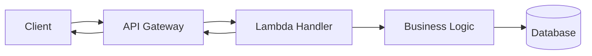
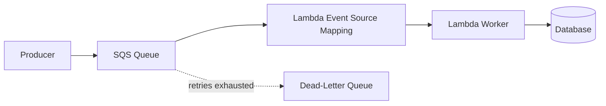
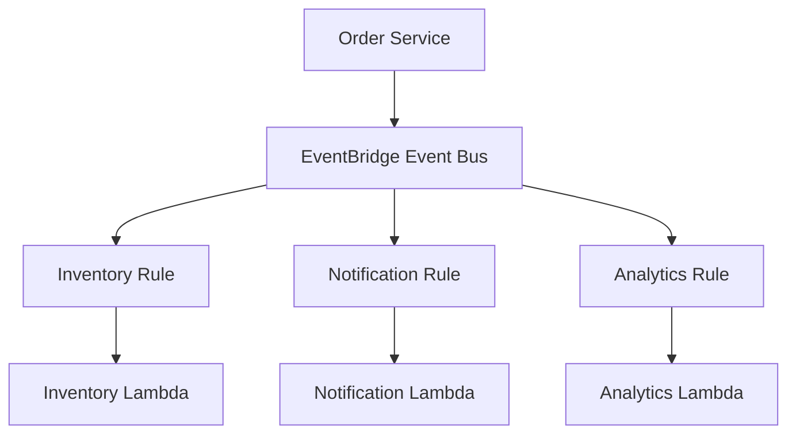
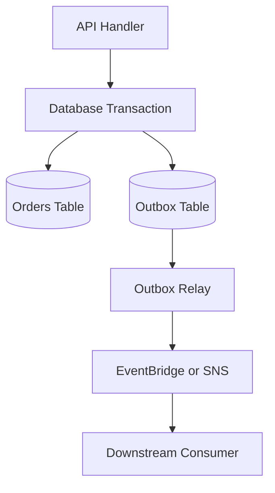
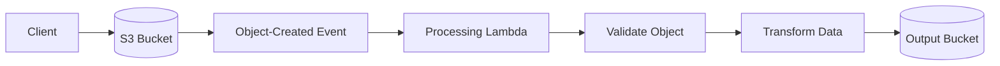
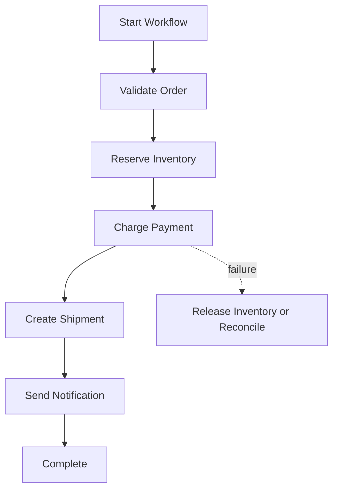
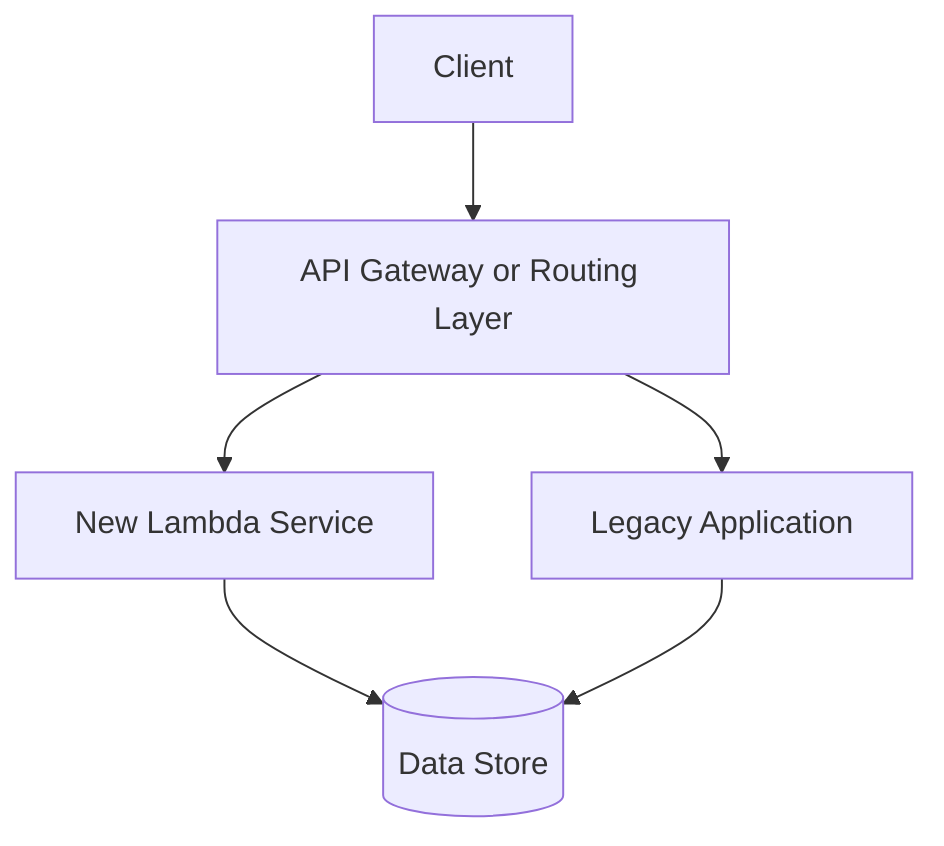

# 07- Lambda Design Patterns

## Overview

AWS Lambda design patterns define how functions interact with APIs, event sources, databases, queues, workflows, and other services to implement reliable serverless applications. A good design balances simplicity, scalability, failure isolation, latency, operational complexity, and cost.

Lambda is an execution service, not a complete application architecture. Production systems must account for duplicate events, retries, concurrency limits, downstream capacity, partial failures, security boundaries, and observability.

This document focuses on reusable design patterns, their implementation, trade-offs, and selection criteria for backend systems built with Python and AWS.

## Core Design Principles

### Keep Functions Focused

A Lambda function should generally have one clear responsibility, such as validating an API request, processing an uploaded file, or handling a queue message.

A focused function is easier to test, deploy, scale, and troubleshoot. However, splitting every small operation into a separate function can introduce unnecessary network calls, deployment overhead, and distributed failure points.

Prefer boundaries that reflect independent responsibilities, scaling requirements, security permissions, or failure domains.

### Design for Stateless Execution

Lambda execution environments may be reused, but they are not permanent application instances. Local memory and temporary files must not be treated as durable storage.

Use managed services for durable state:

- Amazon DynamoDB or Amazon RDS for application data.
- Amazon S3 for files and objects.
- Amazon SQS for queued work.
- AWS Step Functions for workflow state.
- ElastiCache or another suitable cache for shared transient data.

Module-level clients and connection pools can be reused when safe. Request-specific state, authorization decisions, and user data must not leak between invocations.

### Assume At-Least-Once Processing Where Applicable

Many event-driven integrations can deliver an event more than once. Retries can occur after a timeout or after a consumer processes a message but fails to acknowledge it successfully.

Design business operations to be idempotent: processing the same logical request repeatedly should not produce unintended duplicate effects.

Exactly-once business outcomes are usually achieved through application-level controls, transactional writes, idempotency records, or deduplication—not by assuming the transport delivers an event exactly once.

### Separate Synchronous and Asynchronous Work

Synchronous work is appropriate when the caller needs an immediate result. Asynchronous work is appropriate when processing can happen independently of the original request.

A common backend design accepts a request synchronously, persists the request or job, and sends longer-running work to SQS. The client receives a job identifier and checks status through a separate endpoint.

This prevents slow downstream systems from consuming API latency budgets and allows queue-based backpressure.

## Common Lambda Design Patterns

| Pattern | Primary use case | Typical AWS services |
|---|---|---|
| Request-response | Return a result directly to a caller | API Gateway, Lambda |
| Queue-based processing | Decouple producers from workers | SQS, Lambda |
| Event notification | React to changes or domain events | EventBridge, SNS, Lambda |
| Object processing | Process uploaded files | S3, Lambda |
| Stream processing | React to database changes | DynamoDB Streams, Lambda |
| Fan-out | Deliver one event to multiple consumers | SNS, EventBridge, SQS |
| Workflow orchestration | Coordinate multiple steps and recovery | Step Functions, Lambda |
| Scheduled execution | Run periodic jobs | EventBridge Scheduler, Lambda |
| Backend-for-frontend | Provide an API-specific backend | API Gateway, Lambda |
| Strangler migration | Gradually replace legacy functionality | API Gateway, Lambda, existing services |
| Read-model projection | Build query-optimized views from events | DynamoDB, Lambda, streams or queues |

These patterns can be combined. For example, an API can create an order synchronously, publish an event, and trigger separate consumers for notifications, analytics, and fulfillment.

## Request-Response Pattern

### Architecture

Use this pattern when a caller needs the function's result before continuing.



### Request Lifecycle

1. The client sends an HTTP request.
2. API Gateway authenticates or authorizes the request according to its configuration.
3. API Gateway invokes Lambda synchronously.
4. The handler validates the event and calls application logic.
5. The function returns a response or raises an error.
6. API Gateway translates the integration result into an HTTP response.

The exact response behavior depends on the integration type and configuration. For API Gateway proxy integrations, the function generally returns a structured response containing fields such as `statusCode`, `headers`, and `body`.

### Python Example

```python
import json
import logging

logger = logging.getLogger()
logger.setLevel(logging.INFO)


def lambda_handler(event, context):
    try:
        body = json.loads(event.get("body") or "{}")
    except (TypeError, json.JSONDecodeError):
        return {
            "statusCode": 400,
            "headers": {"content-type": "application/json"},
            "body": json.dumps({"error": "Invalid JSON body"}),
        }

    name = body.get("name")

    if not isinstance(name, str) or not name.strip():
        return {
            "statusCode": 400,
            "headers": {"content-type": "application/json"},
            "body": json.dumps({"error": "name is required"}),
        }

    return {
        "statusCode": 200,
        "headers": {"content-type": "application/json"},
        "body": json.dumps({"message": f"Hello, {name.strip()}"}),
    }
```

This example demonstrates request validation and response construction. A production application should keep business logic in separate modules, enforce authentication and authorization, and use structured logging without recording secrets or sensitive payloads.

### Advantages

- Simple request-response semantics.
- Immediate feedback to clients.
- Straightforward integration with REST APIs.
- Appropriate for lightweight reads and writes.

### Limitations and Pitfalls

- The caller waits for processing to complete.
- API and Lambda timeout limits constrain request duration.
- Slow dependencies increase latency and failure probability.
- Retrying a timed-out request can repeat a write that already succeeded.

For operations that modify state, use an idempotency key or another deduplication mechanism when clients may retry requests.

See `03- Lambda with API Gateway.md` for integration details.

## Queue-Based Processing Pattern

### Architecture

Use SQS to separate request acceptance from background execution.



The event source mapping polls SQS, batches messages, and invokes the function. This is different from directly invoking Lambda asynchronously through the Lambda API.

### When to Use It

- Sending emails or notifications.
- Generating reports.
- Processing large files.
- Running expensive business operations.
- Handling bursts of incoming work.
- Decoupling an API from unreliable downstream systems.

### Example: Queue Worker

```python
import json
import logging

logger = logging.getLogger()
logger.setLevel(logging.INFO)


def process_order(order_id: str) -> None:
    # Call the application service that processes the order.
    # It must safely handle repeated processing of the same order.
    logger.info("Processing order", extra={"order_id": order_id})


def lambda_handler(event, context):
    failures = []

    for record in event["Records"]:
        message_id = record["messageId"]

        try:
            payload = json.loads(record["body"])
            order_id = payload["order_id"]

            process_order(order_id)

        except Exception:
            logger.exception(
                "Message processing failed",
                extra={"message_id": message_id},
            )
            failures.append({"itemIdentifier": message_id})

    return {"batchItemFailures": failures}
```

For partial batch failure reporting to work, configure the SQS event source mapping with the `ReportBatchItemFailures` response type. Otherwise, the returned failure list will not provide the intended per-message retry behavior.

### Important Configuration Decisions

- **Batch size:** Larger batches reduce invocation overhead but increase processing time and the amount of work affected by a failure.
- **Visibility timeout:** Must accommodate the expected processing duration and retry behavior. AWS recommends configuring it to at least six times the function timeout for SQS event source mappings, with additional allowance for the maximum batching window when applicable.
- **Maximum concurrency:** Limits how quickly the mapping consumes messages and helps protect downstream dependencies.
- **Dead-letter queue:** Captures messages that exceed the source queue's configured receive threshold.
- **Idempotency:** Prevents repeated messages from causing duplicate business effects.

The DLQ is a recovery mechanism, not a complete operational strategy. Monitor its depth, identify root causes, and define a safe redrive procedure.

### Advantages

- Absorbs bursts and smooths traffic.
- Separates producer availability from worker availability.
- Supports controlled processing concurrency.
- Allows failed messages to be retried independently when partial batch responses are configured.

### Limitations

- Processing is delayed rather than immediate.
- Messages can be processed more than once.
- Queue age and backlog need monitoring.
- Poison messages can repeatedly fail without correct failure handling.

See `02- Event-Driven Architecture.md` for broader event-driven design principles.

## Event Notification and Fan-Out Pattern

### Architecture

Use SNS or EventBridge when a producer needs to notify multiple independent consumers.



Each consumer has its own responsibility and failure domain. EventBridge rules can route matching events to supported targets, while SNS provides topic-based pub/sub delivery.

### Choosing SNS or EventBridge

| Requirement | Typical choice |
|---|---|
| Straightforward pub/sub notification | SNS |
| Content-based event routing across applications | EventBridge |
| Durable work backlog with consumer-controlled processing rate | SQS |
| Multiple consumers with independent buffering | EventBridge or SNS with separate SQS queues |
| Workflow state and coordinated recovery | Step Functions |

A common resilient architecture routes events to separate SQS queues, with each queue consumed by its own Lambda function. This prevents a slow consumer from directly controlling the throughput of other consumers.

### Event Contract

Use explicit, versioned event schemas.

```json
{
  "source": "commerce.orders",
  "detail-type": "OrderPlaced",
  "detail": {
    "event_version": 1,
    "event_id": "evt-12345",
    "order_id": "ord-98765",
    "customer_id": "cust-456"
  }
}
```

The envelope resembles an EventBridge event. In a real integration, AWS-generated envelope fields such as the event ID, source, detail type, and timestamp should be handled according to the actual event source and schema.

Consumers should validate required fields, tolerate additive changes where appropriate, and define a deliberate compatibility policy for breaking schema changes.

### Reliability Considerations

- Event routing does not imply that all downstream business operations have completed.
- A producer should not assume that a consumer's side effects have succeeded merely because the event was published.
- Retries and delivery behavior vary by service and target.
- Independent queues, retry policies, and DLQs improve isolation.
- Events should contain stable identifiers and enough context for reliable processing without unnecessarily duplicating sensitive data.

Avoid using an event bus as a substitute for a transactional database. If publishing an event must remain consistent with a database transaction, consider the transactional outbox pattern.

## Transactional Outbox Pattern

### Problem

Suppose an API updates PostgreSQL and then publishes an event to EventBridge.

If the database transaction succeeds but event publication fails, the database contains a change that downstream services never learn about. If the event is published first and the database transaction fails, consumers may receive an event for a change that never committed.

These are dual-write failures.

### Architecture



Write the business change and an outbox record in the same database transaction. A separate relay publishes pending outbox records and marks them as dispatched.

### Implementation Considerations

An outbox table might contain:

- `event_id`: stable unique identifier.
- `aggregate_id`: the affected business entity.
- `event_type`: the event name.
- `payload`: serialized event data.
- `created_at`: event creation time.
- `published_at`: publication status or timestamp.

The relay can use polling, database change capture, or another suitable mechanism. Publication can still happen more than once if the relay crashes after publishing but before marking the record as published. Consumers must therefore remain idempotent.

### When to Use It

Use an outbox when losing a business event would create a correctness problem, such as order placement, payment state changes, or inventory reservations.

For less critical notifications, simpler best-effort publishing may be sufficient. Choose based on business consistency requirements rather than applying the outbox pattern indiscriminately.

## Idempotent Processing Pattern

### Why It Matters

Retries are a normal part of distributed systems. A Lambda invocation can perform a successful database write and then time out before the caller receives the response. The caller or event source may retry, repeating the same operation.

An idempotent operation makes repeated processing of the same logical request safe.

### Common Strategies

| Strategy | Appropriate use |
|---|---|
| Natural idempotency | Setting a resource to a known state |
| Unique constraint | Preventing duplicate records |
| Idempotency key | Deduplicating API or business requests |
| Conditional write | Preventing repeated state transitions |
| Transactional deduplication record | Coordinating business effects with processing state |

### DynamoDB Conditional Write Example

```python
import os

import boto3
from botocore.exceptions import ClientError

dynamodb = boto3.resource("dynamodb")
table = dynamodb.Table(os.environ["IDEMPOTENCY_TABLE"])


def claim_event(event_id: str) -> bool:
    try:
        table.put_item(
            Item={
                "event_id": event_id,
                "status": "IN_PROGRESS",
            },
            ConditionExpression="attribute_not_exists(event_id)",
        )
        return True

    except ClientError as exc:
        if exc.response["Error"]["Code"] == "ConditionalCheckFailedException":
            return False
        raise
```

This example demonstrates a conditional claim, not a complete idempotency implementation. Production code must define how `IN_PROGRESS` records expire, how abandoned work is recovered, and how completion is recorded. A duplicate that encounters an in-progress record must not automatically be treated as a successful completed operation.

When the business update and deduplication record can be committed in one database transaction, doing so usually provides stronger consistency than coordinating independent writes.

### Key Design Rules

- Choose a stable idempotency key derived from the logical operation.
- Define how long deduplication records must be retained.
- Distinguish in-progress, completed, and failed operations.
- Handle concurrent attempts safely.
- Avoid marking an operation complete before its durable business effect succeeds.
- Use provider-side idempotency features for external APIs when available.

## S3 Object Processing Pattern

### Architecture



Typical uses include document processing, image transformation, CSV ingestion, and data validation.

### Implementation Considerations

- Grant the function access only to the required buckets and prefixes.
- Decode object keys correctly because S3 event notification keys can be URL encoded.
- Treat object-created notifications as potentially duplicated.
- Make output writes deterministic or idempotent.
- Configure retry and failure handling appropriate to the chosen S3 notification path.
- Avoid recursive invocation when writing processed output to the same event-triggering prefix.

### Avoid Recursive Triggers

If a Lambda function reacts to object creation and writes another object to a prefix covered by the same notification, the function may repeatedly trigger itself.

Use separate input and output buckets or prefixes, and scope event notifications to the intended input objects. Recursive invocation protection can help mitigate some runaway scenarios, but it is not a substitute for correct event filtering and architecture.

### Large Object Processing

Do not load arbitrarily large files into memory. Prefer streaming reads, chunked processing, or a managed data-processing service when object size and workload justify it. Configure Lambda memory and ephemeral storage according to measured requirements.

For long-running or highly parallel processing, use SQS to split work into manageable units rather than forcing one invocation to handle the entire workload.

## Stream Processing Pattern

DynamoDB Streams can trigger Lambda through an event source mapping. Lambda processes records in batches and maintains stream-processing progress through checkpoints.

This pattern is useful for:

- Updating derived data.
- Triggering downstream business workflows.
- Maintaining search indexes or projections.
- Publishing changes to other systems.

### Important Considerations

- Record ordering and parallelism depend on the stream and event source mapping configuration.
- Failures can affect checkpoint progress and subsequent records.
- Duplicate processing is possible.
- Batch size and batching windows affect latency and throughput.
- Partial batch response behavior and bisect-on-error settings must be configured deliberately.
- Stream retention is finite, so prolonged processing failures can lead to records expiring before recovery.

For ordered entity-level processing, preserve the relevant partitioning and ordering semantics. Do not assume that records across all entities are globally ordered.

## Workflow Orchestration Pattern

### Problem

A business operation may require several dependent steps:

1. Validate a request.
2. Reserve inventory.
3. Charge a payment provider.
4. Create a shipment.
5. Send a notification.

Implementing all steps in one Lambda function creates tight coupling and complicates retries, compensation, and recovery.

### Architecture



AWS Step Functions manages the workflow state and transitions. Lambda functions implement individual tasks.

### Standard Workflows and Express Workflows

The choice depends on execution duration, throughput, state-transition behavior, and pricing model. Standard and Express workflows have different execution semantics, quotas, and billing models; verify the current service documentation before choosing.

Use a Standard Workflow when durable execution history and long-running orchestration are important. Express Workflows are designed for high-volume, short-duration workflows with different execution and history characteristics.

### Engineering Rules

- Keep each task focused and independently testable.
- Set task timeouts and retry policies explicitly.
- Retry only errors that are likely to be transient.
- Use exponential backoff and jitter where appropriate.
- Define compensation or reconciliation for partially completed business transactions.
- Make external side effects idempotent.
- Avoid retrying a payment operation blindly if the provider's outcome is uncertain.
- Send operationally unrecoverable failures to an observable recovery path.

A workflow engine coordinates execution; it does not automatically make the underlying business transaction atomic.

## Scheduled Job Pattern

Use EventBridge Scheduler to invoke Lambda on a schedule or at a specified time.

Typical workloads include daily reconciliation, periodic report generation, cleanup jobs, and scheduled synchronization.

### Recommended Design

- Make the job safe to run more than once.
- Define the expected schedule, time zone, and behavior around daylight-saving transitions where relevant.
- Configure retry behavior and a dead-letter queue where supported.
- Emit metrics for records processed, failures, and execution duration.
- Use checkpoints for long-running multi-stage jobs.
- Prevent overlapping executions if concurrent runs could corrupt state.

For large jobs, use a scheduled Lambda to enqueue work rather than processing the entire workload inside a single invocation.

## Backend-for-Frontend Pattern

A backend-for-frontend (BFF) provides API operations tailored to a particular client, such as a web application or mobile app.

Lambda can implement these endpoints behind API Gateway, aggregating data from multiple backend services.

### Advantages

- Client-specific response models.
- Reduced client-side orchestration.
- Independent scaling for API operations.
- Clear separation between presentation-oriented aggregation and core domain services.

### Trade-offs

- Aggregation adds network calls and latency.
- One slow dependency can delay the entire response.
- Multiple endpoints may duplicate business logic if boundaries are poorly defined.
- Excessive fan-out can overload downstream services.

Use bounded concurrency, timeouts, caching where appropriate, and partial-response behavior only when the API contract supports it. Avoid turning the BFF into a hidden monolith containing every business rule.

## Strangler Pattern for Legacy Migration

The strangler pattern gradually replaces legacy application functionality with new services while preserving existing behavior.



Start with a low-risk endpoint or capability, route it to the new implementation, validate behavior, and expand coverage incrementally.

### Risks

- Both systems may write to the same data.
- Business rules can diverge.
- Rollbacks may become difficult after schema changes.
- Cross-system transactions are difficult to maintain.
- Routing changes alone do not solve data ownership.

Use explicit ownership boundaries, compatibility tests, observability, and a rollback strategy. Avoid migrating a large domain all at once without validating data consistency and operational behavior.

## Read-Model Projection Pattern

A read-model projection creates a query-optimized representation of data from events or change streams.

For example, an order service may store normalized order data in its primary database while a Lambda consumer maintains a DynamoDB table optimized for customer order history.

### Data Flow

1. The source system commits a business change.
2. An event or change record is emitted.
3. Lambda validates the record and updates the projection.
4. The read API queries the projection.
5. Reconciliation jobs detect and repair divergence.

### Trade-offs

- Reads can be fast and tailored to query patterns.
- Write complexity and infrastructure increase.
- The projection may lag behind the source.
- Replay and rebuild procedures must be designed.
- Events may arrive late or more than once.

This is a practical form of CQRS when read and write requirements differ substantially. Avoid introducing separate models unless query performance, scale, or domain requirements justify the additional operational burden.

## Direct Asynchronous Invocation Versus SQS

Both approaches decouple the producer from the immediate execution of a function, but they have different operational properties.

| Dimension | Lambda asynchronous invocation | SQS with Lambda event source mapping |
|---|---|---|
| Buffering | Lambda manages an internal asynchronous queue | Explicit SQS queue |
| Consumer rate control | Function concurrency and asynchronous settings | Queue backlog plus mapping and concurrency controls |
| Message inspection | Invocation records and configured destinations | Messages remain in the queue until successfully handled or otherwise removed |
| Retry behavior | Lambda asynchronous retry and failure-destination configuration | SQS visibility timeout, redelivery, receive count, and DLQ configuration |
| Backpressure | Less direct control over queued backlog | Explicit backlog and consumer-rate management |
| Per-message batch failure | Not the same model as SQS batch responses | Supported through partial batch response configuration |
| Best fit | Simple fire-and-forget invocation | Durable workload buffering and consumer-controlled processing |

Use direct asynchronous invocation for simpler decoupled tasks when its retry and failure-handling model meets requirements. Prefer SQS when durable queue management, explicit backpressure, independent consumers, or message-level operational controls are important.

Neither approach guarantees exactly-once business effects.

## Concurrency and Backpressure Pattern

Lambda can scale rapidly, but downstream systems may not scale at the same rate.

For example, a burst of invocations can create too many database connections or overwhelm a third-party API.

### Control Mechanisms

- **Reserved concurrency:** Reserves concurrency for a function and can cap its maximum concurrent executions.
- **Provisioned concurrency:** Keeps execution environments initialized to reduce startup latency for supported invocation paths.
- **Event source mapping limits:** Can limit the rate or concurrency at which supported event sources invoke a function.
- **SQS buffering:** Absorbs bursts and allows processing to catch up gradually.
- **Timeouts and bounded retries:** Prevent excessive work from accumulating.
- **Downstream capacity controls:** Connection pools, rate limits, circuit breakers, and admission controls protect dependencies.

Reserved concurrency is not a database connection limit by itself. The application must still account for connections per execution environment, connection lifetime, and the maximum number of environments that can be active.

### Example Capacity Reasoning

Assume a function can scale to 100 concurrent executions and each execution can establish up to 5 database connections. The theoretical upper bound is 500 simultaneous connections if all executions reach that connection count.

The actual number depends on environment reuse, connection behavior, and workload concurrency, but capacity planning should consider the upper bound rather than only average traffic.

For relational databases, consider RDS Proxy or another appropriate connection-management strategy where supported. Queue-based processing can also limit the rate at which workers reach the database.

## Choosing a Design Pattern

Use the following decision guide as a starting point.

| Requirement | Recommended starting pattern |
|---|---|
| Caller needs an immediate response | Synchronous request-response |
| Work can finish after the request returns | SQS-based asynchronous processing |
| Multiple services need independent notification | EventBridge or SNS fan-out |
| Reliable database change publication is required | Transactional outbox |
| Uploaded objects need transformation | S3 event processing |
| Database changes trigger downstream updates | Stream processing |
| Multiple dependent steps need recovery | Step Functions |
| A job must run on a schedule | EventBridge Scheduler |
| Reads require a different data model | Read-model projection |
| Existing functionality must be migrated incrementally | Strangler pattern |
| Downstream capacity is lower than incoming traffic | Queue buffering and concurrency controls |

Pattern selection should be based on business guarantees, latency requirements, data consistency, expected throughput, recovery requirements, and the team's operational capability.

## Production Design Checklist

### Reliability

- [ ] Identify every retrying component and its retry policy.
- [ ] Make write operations idempotent.
- [ ] Configure DLQs or failure destinations where appropriate.
- [ ] Define redrive, replay, and reconciliation procedures.
- [ ] Use partial batch responses for supported event sources when appropriate.
- [ ] Protect downstream services through backpressure and concurrency controls.

### Security

- [ ] Use least-privilege execution roles.
- [ ] Restrict invocation permissions to required principals and sources.
- [ ] Keep secrets out of source code and logs.
- [ ] Validate event payloads and enforce authorization at the correct boundary.
- [ ] Protect deployment credentials and separate deployment permissions from runtime permissions.

### Observability

- [ ] Emit structured logs with stable request or event identifiers.
- [ ] Monitor errors, duration, throttles, concurrency, and relevant downstream metrics.
- [ ] Track queue age and DLQ depth for asynchronous workloads.
- [ ] Configure actionable alarms and define incident ownership.
- [ ] Use tracing and correlation identifiers across service boundaries.

### Performance and Cost

- [ ] Measure memory, duration, initialization latency, and downstream wait time.
- [ ] Configure timeouts and memory based on observed workloads.
- [ ] Reuse safe clients and connections across invocations.
- [ ] Minimize deployment package size and unnecessary dependencies.
- [ ] Evaluate the cost of invocation, duration, provisioned concurrency, data transfer, and integrated services.
- [ ] Review quotas and capacity limits before major traffic increases.

## Common Design Mistakes

| Mistake | Why it causes problems | Better approach |
|---|---|---|
| One function handles an entire business workflow | Couples unrelated steps and complicates recovery | Use focused functions and orchestration where justified |
| Assuming events are delivered exactly once | Duplicate side effects occur during retries | Implement idempotency and deduplication |
| Using asynchronous invocation for every background job | May provide insufficient queue visibility and backpressure | Use SQS when explicit buffering and consumer control are needed |
| Retrying all failures | Permanent errors waste capacity and delay recovery | Classify transient and permanent errors |
| Scaling Lambda without protecting databases | Connection exhaustion and downstream overload | Bound concurrency and use appropriate connection management |
| Publishing events after database writes without recovery | Database and event state can diverge | Use an outbox or another consistency mechanism |
| Treating Step Functions as a transaction manager | Completed external effects are not automatically rolled back | Design compensation and reconciliation |
| Logging full event payloads | Sensitive information may leak | Log safe identifiers and relevant metadata |
| Using a single DLQ without an operational plan | Failed work accumulates without recovery | Monitor, diagnose, and define controlled redrive |
| Splitting every operation into a separate function | Adds latency, cost, and distributed failure points | Split according to responsibility and failure boundaries |

## Key Takeaways

- Select Lambda patterns according to latency, durability, consistency, backpressure, and recovery requirements—not merely implementation convenience.
- Assume duplicate processing wherever the invocation or event-source semantics permit it, and design idempotent business operations.
- Use SQS for explicit buffering and consumer-rate control, EventBridge or SNS for event distribution, and Step Functions for multi-step orchestration.
- Protect downstream systems through bounded concurrency, safe connection management, timeouts, observability, and deliberate retry policies.
- Production readiness requires defined failure recovery, least-privilege permissions, actionable monitoring, and tested deployment and rollback procedures.