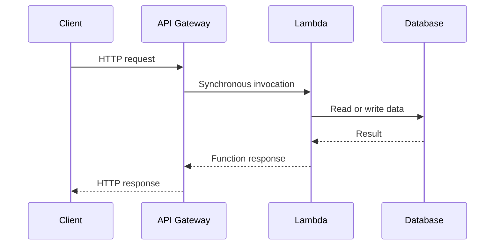
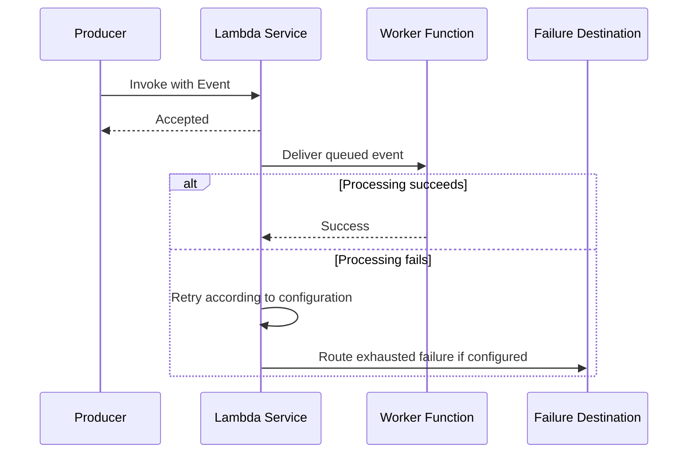
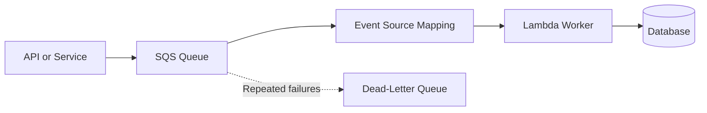
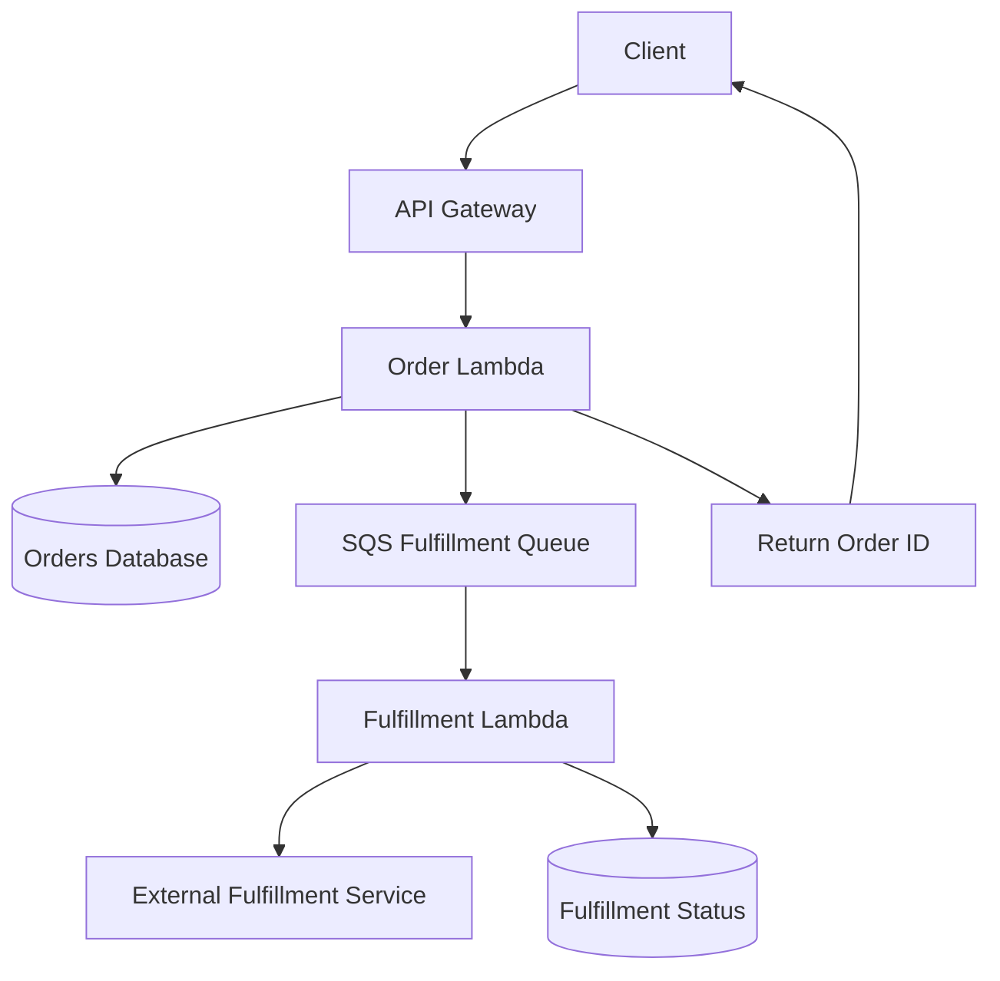
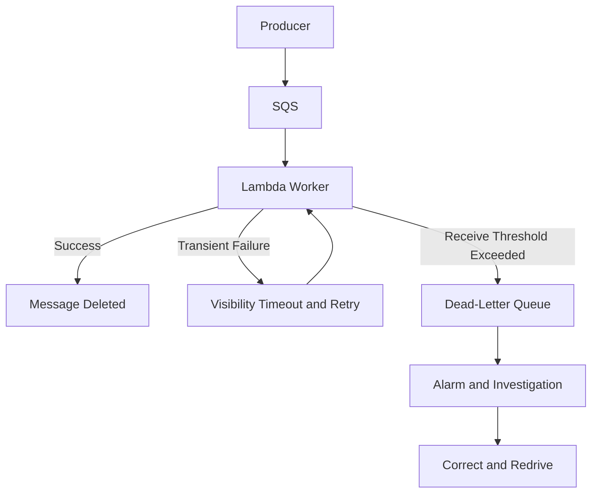

# 08- Synchronous vs Asynchronous Processing Architecture

## Overview

AWS Lambda supports synchronous and asynchronous invocation models, along with event source mappings that consume records from services such as Amazon SQS, Amazon Kinesis, and DynamoDB Streams. Choosing the correct processing architecture affects API latency, throughput, reliability, retry behavior, backpressure, and operating cost.

For backend systems, the central decision is whether the caller must wait for the business operation to finish or whether the operation can be accepted and completed later.

- **Synchronous processing:** The caller waits for the function's response.
- **Asynchronous invocation:** The caller submits an event and Lambda queues it for processing independently.
- **Queue-based processing:** A producer writes work to a durable queue, and Lambda consumes messages through an event source mapping.
- **Stream processing:** Lambda consumes records from a stream, with checkpointing and ordering behavior determined by the source and configuration.

These models are not interchangeable. A reliable architecture must account for their distinct delivery guarantees, retry mechanisms, failure handling, and capacity controls.

## Processing Models

### Synchronous Processing

In synchronous processing, the invoker waits for Lambda to finish and return a result.

Common examples include:

- API Gateway invoking a Lambda-backed REST API.
- An application directly invoking Lambda with `RequestResponse`.
- An Application Load Balancer invoking a Lambda target.
- A service requiring an immediate decision or validation result.



The response path depends on every synchronous dependency. If the database or another downstream service is slow, the caller experiences the additional latency.

**Advantages**
- Immediate success or failure feedback.
- Simple request-response semantics.
- Natural fit for REST APIs and interactive operations.
- Straightforward client-side handling of results.

**Limitations**
- The caller remains dependent on the processing duration.
- Gateway, client, and Lambda timeouts must be compatible.
- Slow dependencies consume latency budgets.
- A timeout does not always mean that the business operation failed.

The last point is especially important for write operations. The database transaction might commit successfully before a network timeout prevents the client from receiving the response. Retrying the request can therefore repeat the operation.

### Asynchronous Invocation

With Lambda's asynchronous invocation model, the invoker submits an event and Lambda accepts it for asynchronous processing. The invocation response indicates acceptance, not successful completion of the business operation.

A common use case is sending a notification after a business transaction has completed.



The producer does not receive the worker's eventual return value. It needs another mechanism—such as a status record, callback, notification, or event—to learn the final outcome.

**Advantages**
- Producer and worker are decoupled in time.
- The producer does not wait for business processing.
- Suitable for independent background tasks.
- Lambda manages asynchronous delivery and retry behavior.

**Limitations**
- The caller does not receive the final processing result.
- Duplicate delivery is possible.
- Lambda's internal asynchronous queue is not equivalent to an application-managed SQS queue.
- Failures require monitoring and configured recovery mechanisms.

Use asynchronous invocation when its managed queueing and retry semantics are sufficient. Choose SQS when explicit backlog visibility, durable queue operations, consumer-rate control, and message-level recovery are important.

### Queue-Based Processing

Queue-based processing places a message in SQS before a Lambda worker processes it.



This pattern is useful for bulk processing, background jobs, notifications, report generation, and workloads where the producer and consumer operate at different rates.

The queue buffers incoming work. Lambda's event source mapping polls SQS, receives batches, invokes the function, and deletes successfully processed messages according to the integration's processing semantics.

**Advantages**
- Explicit backlog management.
- Consumer concurrency can be controlled.
- Producers can continue submitting work during temporary consumer failures, subject to queue capacity and message retention.
- Independent workers can scale based on workload and downstream capacity.

**Limitations**
- Processing is delayed.
- Messages may be delivered more than once.
- Visibility timeout and redrive settings require careful configuration.
- Queue backlog can grow faster than workers can drain it.

SQS does not make processing exactly once. Standard queues provide at-least-once delivery, so consumers must tolerate duplicates. FIFO queues offer additional ordering and deduplication capabilities, but application-level business idempotency may still be necessary.

### Stream-Based Processing

Stream-based processing is appropriate when a system must react to a continuous sequence of records, such as DynamoDB changes or Kinesis data records.

Lambda event source mappings poll the stream, batch records, invoke the function, and track progress using source-specific checkpointing behavior.

This model differs from ordinary asynchronous invocation because the event source mapping manages consumption and progress through the source.

Important considerations include:

- Ordering guarantees depend on the stream type and partitioning model.
- A failed batch can affect checkpoint progress.
- Batch size and batching windows influence throughput and latency.
- Partial batch response support varies by event source.
- Stream retention is finite, so prolonged failures can cause records to expire before recovery.

Use stream processing for change propagation, projections, event-driven integration, and data processing. Use a queue when independent backlog management and message-level work distribution are the primary requirements.

## Comparing the Processing Models

| Dimension | Synchronous | Lambda asynchronous invocation | SQS with Lambda |
|---|---|---|---|
| Caller waits for processing | Yes | No | No |
| Final result returned to original caller | Usually | No | No |
| Buffering mechanism | No separate application queue required | Lambda-managed asynchronous queue | Explicit SQS queue |
| Retry mechanism | Generally controlled by caller or integration | Lambda asynchronous retry configuration | SQS redelivery and visibility timeout |
| Backlog visibility | Not applicable in the same way | More limited than an explicit queue | Queue depth and message age metrics |
| Consumer-rate control | Through request limits and concurrency | Through concurrency and asynchronous settings | Queue buffering and mapping controls |
| Duplicate handling | Needed when requests can be retried | Needed | Needed |
| Typical use case | Interactive API | Fire-and-forget background task | Durable background work |

The correct choice depends on the business contract, not merely on which invocation option is easiest to configure.

## Choosing Between Synchronous and Asynchronous Processing

### Use Synchronous Processing When

- The caller needs the result to proceed.
- The operation fits within the end-to-end latency budget.
- The work is bounded and does not require lengthy orchestration.
- A direct success or failure response is part of the API contract.

Examples include retrieving an order, validating a payment request, or updating a small resource where the client requires the result immediately.

### Use Asynchronous Processing When

- The operation can finish after the initial request returns.
- The producer should not wait for a slow dependency.
- Processing can be retried independently.
- The application needs to absorb traffic bursts.
- The final outcome can be communicated separately.

Examples include sending an email, generating a report, processing a large upload, or running a data synchronization job.

### Use a Hybrid Architecture When

Many production applications need both models.

For example, an order API can synchronously validate the request and persist the order, then enqueue fulfillment work for asynchronous processing.



The initial response confirms that the order was accepted according to the API's contract. It does not claim that fulfillment has completed.

If persisting the order and publishing work must be atomic, use a transactional outbox or another consistency mechanism. A naive sequence of committing a database transaction and then sending a message can lose work if the process fails between those operations.

## Designing Asynchronous APIs

### Return an Explicit Acceptance Response

For a long-running operation, return a job or resource identifier instead of keeping the HTTP request open until processing completes.

Example response:

```json
{
  "job_id": "job-8a1d3f",
  "status": "accepted",
  "status_url": "/jobs/job-8a1d3f"
}
```

A common HTTP response is `202 Accepted`, provided the operation has genuinely been accepted for later processing.

The API should define what acceptance means. For example, it might mean the job has been durably recorded in a database and queued, rather than merely that an in-memory operation has started.

### Expose Job Status

A status endpoint can return:

```json
{
  "job_id": "job-8a1d3f",
  "status": "processing",
  "created_at": "2026-10-11T10:30:00Z"
}
```

Possible states include:

- `ACCEPTED`
- `PROCESSING`
- `SUCCEEDED`
- `FAILED`

State transitions should be deliberate. For example, a worker should not mark a job as `SUCCEEDED` before its required durable effects have completed.

For workloads with external side effects, store enough information to investigate and recover from uncertain outcomes.

### Avoid Unbounded Synchronous Requests

Do not keep an HTTP connection open for work that may take a long time or whose duration is unpredictable. Long synchronous requests increase timeout risk, tie up client resources, and make retries harder to reason about.

A background-job architecture is usually better when work can be completed independently and reported later.

## Error Handling and Retry Semantics

### Synchronous Invocation

For synchronous invocation, function errors are returned to the invoker. The caller or integration determines whether and how to retry.

A client retry may repeat a write even when the original operation succeeded internally. Use idempotency keys, conditional writes, or transactional checks where duplicate effects would be harmful.

### Lambda Asynchronous Invocation

For standard Lambda asynchronous invocation, function errors and certain runtime failures are retried according to Lambda's asynchronous invocation behavior and configuration. The retry behavior differs from event source mappings, and some failures may occur before the handler runs.

Configure and understand:

- Maximum retry attempts.
- Maximum event age.
- On-failure destinations or dead-letter queues.
- CloudWatch alarms for errors and dropped or failed processing.
- Idempotency controls for side effects.

Do not assume that every failure will receive the same retry count or that every accepted event will eventually succeed. Configuration, event age, service behavior, and account-level conditions can affect outcomes.

### SQS Event Source Mapping

For SQS, failed messages become available again after their visibility timeout unless they are deleted or otherwise handled. Repeated receives can eventually move messages to a configured DLQ based on the redrive policy.

For a batch, the default behavior can cause successfully processed messages to be retried along with failed messages. To reduce unnecessary reprocessing, configure partial batch responses when appropriate.

Example Python handler:

```python
import json
import logging

logger = logging.getLogger()
logger.setLevel(logging.INFO)


def process_message(payload: dict) -> None:
    # Implement an idempotent business operation here.
    logger.info(
        "Processing job",
        extra={"job_id": payload["job_id"]},
    )


def lambda_handler(event, context):
    failures = []

    for record in event["Records"]:
        try:
            payload = json.loads(record["body"])
            process_message(payload)

        except Exception:
            logger.exception(
                "Message processing failed",
                extra={"message_id": record["messageId"]},
            )
            failures.append({
                "itemIdentifier": record["messageId"],
            })

    return {"batchItemFailures": failures}
```

For this response format to work as intended, configure the SQS event source mapping with `ReportBatchItemFailures`. Without that configuration, the mapping does not interpret the response as a partial batch failure report.

The handler should distinguish retryable errors from permanent business errors where possible. Invalid input may require quarantine or a controlled failure path rather than endless retries.

## Idempotency and Duplicate Processing

Duplicate processing is a normal distributed-systems condition. A worker can complete a database write but fail before the event source records successful processing. The same message can then be delivered again.

### Common Approaches

| Technique | How it helps |
|---|---|
| Stable event ID | Identifies repeated delivery of the same logical event |
| Database unique constraint | Prevents duplicate business records |
| Conditional update | Prevents invalid repeated state transitions |
| Idempotency record | Tracks whether an operation is in progress or complete |
| Transactional write | Commits related state changes atomically within a supported transaction boundary |
| Provider idempotency key | Reduces duplicate effects when calling a supporting external API |

A simplistic deduplication record is insufficient if it is marked complete before the business operation succeeds. A robust implementation distinguishes in-progress work, completed work, and recoverable failures.

For example, charging a payment provider and updating a local order are separate side effects. If the provider charge succeeds but the database update fails, retrying the entire workflow must not charge the customer again. Use provider idempotency support and a reconciliation strategy for uncertain outcomes.

## Backpressure and Downstream Protection

Asynchronous processing removes the need for the producer to wait, but it does not eliminate capacity constraints.

A queue can accumulate work faster than consumers can process it. If Lambda scales aggressively against a relational database or third-party API, the downstream system may fail under the resulting concurrency.

### Capacity Controls

- Limit worker concurrency where downstream capacity is constrained.
- Configure event source mapping scaling controls where supported.
- Use SQS to buffer bursts and separate producer throughput from consumer throughput.
- Set explicit function timeouts and connection limits.
- Apply bounded retries and exponential backoff with jitter when appropriate.
- Monitor queue age, backlog, Lambda throttles, and downstream saturation.

For example, if a database can safely support only 80 concurrent application connections, allowing hundreds of Lambda execution environments to create connections without coordination can exhaust the database even when Lambda itself is operating normally.

Reserved concurrency can cap a function's concurrent executions, but it does not directly enforce a database connection limit. Estimate the maximum connection demand per execution environment and choose concurrency limits accordingly.

## Reliability and Failure Isolation

A production architecture should define the recovery path for every asynchronous boundary.



A dead-letter queue is useful only when failures are observed and investigated. Define ownership, alert thresholds, diagnosis procedures, and a safe redrive process.

Before redriving messages, verify that the underlying issue has been corrected and that replay will not create duplicate business effects. For long-lived failures, preserve enough context to determine whether the message is safe to retry or requires manual reconciliation.

For asynchronous Lambda invocation, configure an appropriate failure destination or dead-letter queue. These mechanisms are distinct from an SQS source queue's own DLQ.

## Observability

Asynchronous systems require more than monitoring invocation errors. A request can be accepted successfully while its eventual processing fails.

### Recommended Signals

| Signal | Why it matters |
|---|---|
| Lambda `Errors` | Detects failed invocations |
| Lambda `Duration` | Shows execution time and approaching timeout risks |
| Lambda `Throttles` | Indicates concurrency or capacity constraints |
| Lambda `ConcurrentExecutions` | Helps explain scaling behavior |
| SQS `ApproximateAgeOfOldestMessage` | Detects increasing processing delay |
| SQS `ApproximateNumberOfMessagesVisible` | Shows queued backlog |
| DLQ message count | Indicates failed work requiring investigation |
| Business success/failure counters | Measures actual business outcomes |
| Job completion latency | Measures time from acceptance to completion |

Use structured logs with correlation IDs, event IDs, job IDs, and safe business identifiers. Avoid logging credentials, tokens, or sensitive payloads.

For asynchronous workflows, trace context may need to be propagated explicitly through message attributes or event payloads, depending on the services and instrumentation involved.

## Security Considerations

- Give producers permission to submit only the intended work.
- Give workers only the permissions needed for their responsibilities.
- Validate event contents even when they originate from internal services.
- Avoid placing secrets or unnecessary sensitive data in messages.
- Encrypt queues and other supported resources according to the security requirements.
- Restrict who can read, redrive, or purge dead-letter queues.
- Protect job-status endpoints with appropriate authentication and authorization.
- Keep deployment permissions separate from runtime execution permissions.

Queue messages can remain stored for a period and may be visible to authorized operators. Treat event payloads as durable data rather than temporary function arguments.

## Cost and Performance Considerations

Synchronous and asynchronous architectures distribute costs differently.

Synchronous processing may incur additional latency and retries when dependencies are slow. Asynchronous processing can improve resource utilization and absorb bursts, but introduces queue operations, longer completion latency, status tracking, and additional monitoring requirements.

Evaluate the full workflow rather than the Lambda invocation cost alone. Relevant costs can include:

- Lambda requests and execution duration.
- Provisioned concurrency, if configured.
- SQS requests and message retention.
- EventBridge or SNS events.
- API Gateway requests.
- Database capacity and connection-management services.
- Data transfer, logs, tracing, and monitoring.

Tune memory and concurrency using representative load tests. For queues, monitor whether the worker throughput is sufficient to drain the expected backlog within the business deadline.

## Decision Checklist

Before choosing a processing model, answer the following questions:

- [ ] Does the caller need the final business result immediately?
- [ ] Can the work be accepted durably before it starts?
- [ ] What happens if the caller times out after the business operation succeeds?
- [ ] Can the same event be processed more than once?
- [ ] What retry policy applies at each layer?
- [ ] Is explicit queue visibility or consumer-rate control required?
- [ ] How will permanently failing messages be investigated and recovered?
- [ ] Can the downstream database or service handle the maximum possible concurrency?
- [ ] How will the caller learn the final result of asynchronous work?
- [ ] Which metrics and alarms indicate that the system is falling behind?

## Key Takeaways

- Synchronous processing is appropriate when callers need an immediate result; asynchronous processing is appropriate when work can complete independently.
- Lambda asynchronous invocation and SQS event source mappings have different buffering, retry, visibility, and failure-handling semantics.
- Design for duplicate processing using idempotency, conditional writes, and provider-side deduplication where available.
- Use queues, concurrency controls, timeouts, and bounded retries to protect downstream systems and manage backpressure.
- Production asynchronous workflows require explicit status reporting, failure recovery, structured observability, least-privilege access, and cost monitoring.