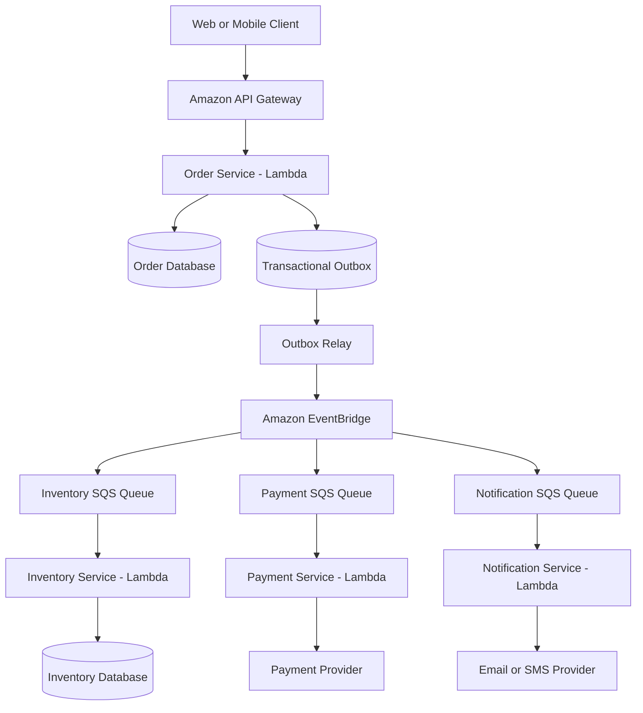
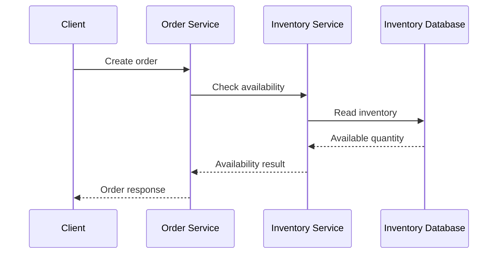
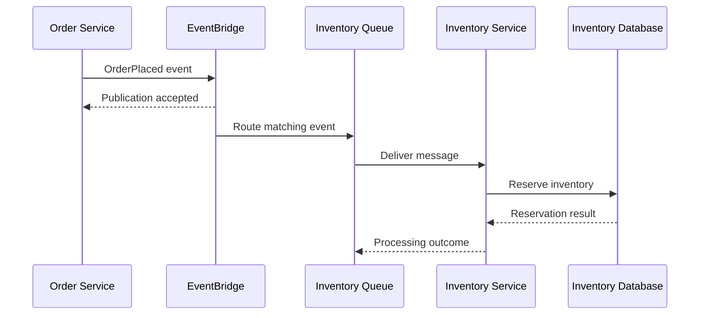
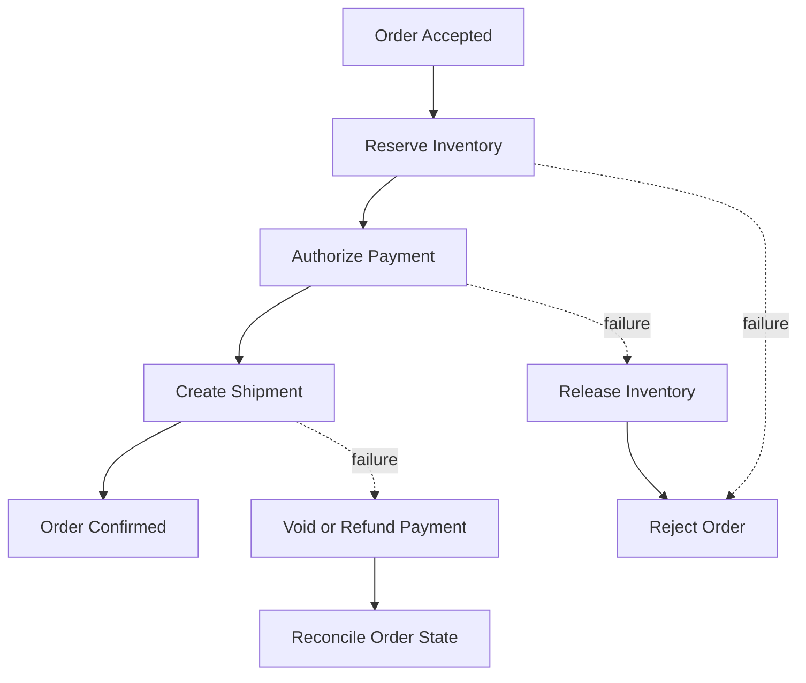

# 09- Serverless Microservices Architecture

## Overview

Serverless microservices architecture combines independently deployable business services with managed infrastructure and event-driven execution. AWS Lambda provides the compute layer, while services such as Amazon API Gateway, Amazon SQS, Amazon EventBridge, Amazon DynamoDB, and AWS Step Functions provide request routing, messaging, persistence, and orchestration.

The objective is not to turn every function into a microservice. It is to establish clear business boundaries, independent deployment and scaling, controlled communication, and reliable failure handling without operating application servers directly.

A production serverless microservices system still requires deliberate decisions about service ownership, data consistency, authorization, observability, deployment, retries, and operational recovery.

## Core Architectural Principles

### Define Services Around Business Capabilities

A microservice should own a cohesive business capability, such as orders, payments, inventory, or notifications.

For example:

- **Order Service:** Accepts orders and manages order lifecycle.
- **Payment Service:** Coordinates payment authorization and payment status.
- **Inventory Service:** Reserves and releases stock.
- **Notification Service:** Sends emails, SMS messages, or other notifications.

Each service may contain several Lambda functions. A service boundary should represent a meaningful ownership boundary, not simply a one-function-to-one-service mapping.

A single Lambda function may be sufficient for a small capability. Multiple functions may be appropriate when operations require different permissions, scaling behavior, event sources, or deployment lifecycles.

### Minimize Shared Ownership

Microservices should avoid sharing internal implementation details or directly modifying one another's data.

Prefer:

- APIs for synchronous operations.
- Events for notifying other services about completed business changes.
- Queues for buffering work and isolating consumers.
- Explicit contracts for request and event schemas.
- Independent deployment pipelines and service-level configuration.

Sharing a database can be a reasonable migration step, but allowing multiple services to modify the same tables creates tight coupling and makes independent evolution harder.

### Treat Network Calls as Failure Boundaries

A call from one Lambda function to another is a distributed-system interaction. It can fail because of timeouts, throttling, authorization problems, network failures, or downstream unavailability.

Every remote interaction should have an explicit timeout and an appropriate failure policy. Retries should be bounded and safe, and circuit breakers or other admission controls may be appropriate when dependencies are unstable.

Avoid long synchronous chains in which a single client request depends on many services completing successfully.

## Reference Architecture

Consider an e-commerce backend built around independently owned services.



This design separates the synchronous API from downstream processing. Each consumer has its own queue, allowing independent buffering, retry handling, and scaling.

The transactional outbox ensures that an order change and the intent to publish its event can be committed together in the order service's database. The relay publishes pending events. Consumers must still handle duplicate publication safely.

The architecture does not imply that every order operation is immediately complete. The API contract must distinguish order acceptance from successful inventory reservation, payment, and fulfillment.

## Synchronous Service Communication

Synchronous communication is appropriate when one service requires an immediate result from another service to complete its own operation.

Common mechanisms include:

- API Gateway exposing Lambda-backed APIs.
- HTTP APIs between services.
- Direct Lambda invocation when AWS-specific coupling is acceptable.
- gRPC between compatible services where its operational and networking requirements are justified.

### Request Flow



Every synchronous dependency adds latency and another potential failure point. If the inventory service is unavailable, the order service must decide whether to fail the request, return a retryable response, or use a different business workflow.

### When to Use It

- A caller needs a decision immediately.
- The dependency is essential to the current request.
- The number of dependencies is limited.
- Latency and availability requirements can be met across the full call chain.

### Production Recommendations

- Configure explicit connection and request timeouts.
- Propagate correlation IDs across service boundaries.
- Authenticate service callers and authorize individual operations.
- Use bounded retries only for retryable failures.
- Avoid retry multiplication across several service layers.
- Monitor dependency latency and error rates.
- Define whether a timeout means failure, unknown outcome, or a state requiring reconciliation.

A timeout is not proof that the remote operation did not execute. This matters especially for payment and other state-changing APIs.

## Asynchronous Service Communication

Asynchronous communication allows a service to publish work or an event without waiting for every consumer to finish.

Typical AWS components include:

- Amazon EventBridge for event routing.
- Amazon SNS for pub/sub notifications.
- Amazon SQS for durable queue-based work.
- Lambda event source mappings for queue and stream consumption.

### Event-Driven Flow



The precise acknowledgement and retry semantics depend on the producer, event bus, target, queue, and event source mapping. A successful publication does not mean that inventory has been reserved.

### Event Contracts

Events should represent meaningful business facts, such as `OrderPlaced`, `PaymentAuthorized`, or `InventoryReserved`.

A versioned event payload might look like this:

```json
{
  "event_id": "evt-12345",
  "event_type": "OrderPlaced",
  "event_version": 1,
  "occurred_at": "2026-10-11T10:30:00Z",
  "aggregate_id": "ord-98765",
  "data": {
    "order_id": "ord-98765",
    "customer_id": "cust-456"
  }
}
```

The exact envelope should match the chosen transport and schema conventions. EventBridge, for example, supplies its own event envelope fields; the application-specific data belongs in `detail`.

Good event contracts should:

- Include stable event identifiers.
- Identify the event type and schema version.
- Contain enough information for the consumer's responsibility.
- Avoid unnecessary sensitive data.
- Define compatibility rules for additive and breaking changes.
- Distinguish an event describing a completed fact from a command requesting an action.

For example, `OrderPlaced` describes something that happened. `ReserveInventory` is a command asking a service to perform work. Mixing these semantics can make ownership and retry behavior difficult to reason about.

## Choosing Between API Calls, Events, and Queues

| Requirement | Preferred starting point | Reason |
|---|---|---|
| Immediate response is required | Synchronous API | Caller needs the result |
| Notify several independent services | EventBridge or SNS | Supports event distribution |
| Buffer work until consumers can process it | SQS | Provides explicit backlog management |
| Run a multi-step business workflow | Step Functions or application-managed orchestration | Coordinates state and recovery |
| React to database changes | DynamoDB Streams or another suitable change-data source | Captures data changes |
| Perform scheduled work | EventBridge Scheduler | Supports scheduled invocation |
| Guarantee publication intent alongside a database transaction | Transactional outbox | Addresses the dual-write problem |

These mechanisms can be combined. EventBridge can route events to separate SQS queues, and each queue can trigger an independent Lambda consumer.

Do not choose asynchronous processing simply to avoid designing failure behavior. It changes when failures become visible and how they must be recovered.

## Service-Owned Data and Database Boundaries

Each service should be responsible for the data that defines its business capability.

For example:

| Service | Data ownership |
|---|---|
| Order Service | Orders, order status, order lifecycle |
| Inventory Service | Stock levels, reservations |
| Payment Service | Payment attempts, provider references, payment state |
| Notification Service | Delivery attempts and notification status |

A service can expose a read API or publish events for other services to consume. It should generally not allow other services to update its tables directly.

### Database per Service

This pattern means independent data ownership, not necessarily a mandatory separate database server for every service. Services can use separate databases, schemas, or logical data stores depending on isolation requirements and cost.

A separate database can improve security and independent scaling, but it also increases operational overhead. A shared database with strict ownership rules can be a practical intermediate architecture.

### Avoid Distributed Joins

A service should not need to join several other services' private databases to answer every request.

Alternatives include:

- API composition for small, latency-tolerant queries.
- Read-model projections for high-volume query paths.
- Events to maintain denormalized views.
- Carefully designed API response models.

Distributed reads can return inconsistent snapshots because data may change between service calls. A read-model projection improves query efficiency but introduces eventual consistency and replay requirements.

## Eventual Consistency

In an event-driven architecture, services may observe business changes at different times.

For example, after an order is accepted:

1. The order service commits the order.
2. The order event is published.
3. The inventory service reserves stock.
4. The payment service authorizes payment.
5. The order status is updated as the workflow progresses.

During this sequence, the order may exist while payment or inventory status remains pending.

### Design Implications

- Expose meaningful states such as `PENDING`, `PROCESSING`, `CONFIRMED`, and `FAILED`.
- Define which states are valid and which transitions are allowed.
- Use idempotent event handlers.
- Monitor processing delays and stuck workflows.
- Reconcile source data with downstream projections when necessary.

Do not promise immediate consistency to clients if the architecture only guarantees eventual propagation.

## Distributed Transactions and Sagas

A distributed business workflow often spans multiple services and databases. A database transaction cannot generally make independent writes across those systems atomic.

The saga pattern coordinates a sequence of local transactions. If a later step fails, the workflow may execute compensating actions to address earlier successful steps.



Compensation is a business operation, not a database rollback. A payment refund may take time, inventory may already have been released to another customer, and an external provider may return an uncertain outcome.

### Orchestration Versus Choreography

| Dimension | Orchestration | Choreography |
|---|---|---|
| Coordination | Central workflow controller | Services react to events |
| Workflow visibility | Explicit state machine and execution history when using Step Functions | Distributed across event producers and consumers |
| Coupling | Participants depend on workflow contracts | Participants depend on event contracts |
| Complex branching and recovery | Often easier to reason about centrally | Can become difficult as event interactions grow |
| Simple independent reactions | May add unnecessary overhead | Often a natural fit |

Use Step Functions when a workflow has explicit steps, branching, retries, timeouts, or compensation. Use choreography for independent reactions to business events. Large systems often combine both approaches.

## Idempotency and Duplicate Events

Distributed delivery can repeat events. For example, a worker may update a database successfully but fail before the message is acknowledged. The message can then be delivered again.

Consumers should be idempotent so repeated delivery does not create duplicate business effects.

### Recommended Techniques

- Use a stable `event_id` or business operation identifier.
- Enforce uniqueness with database constraints.
- Use conditional writes to prevent invalid state transitions.
- Store processing state when deduplication requires durable coordination.
- Use provider-supported idempotency keys for external side effects.
- Define a recovery process for incomplete operations.

Do not mark an event as processed before its required business effects have completed. Where possible, commit the deduplication record and the business update in one transaction.

Exactly-once delivery should not be assumed. Exactly-once business outcomes require deliberate application-level design and depend on the guarantees of the participating systems.

## Reliability, Retries, and Dead-Letter Queues

Each asynchronous boundary should have an explicit failure policy.

### Retry Design

Classify failures before retrying:

- **Transient failures:** Temporary network issues, throttling, or service unavailability may justify retries.
- **Permanent failures:** Invalid payloads, unsupported event versions, or authorization misconfiguration usually require correction rather than repeated execution.
- **Unknown outcomes:** A timeout after an external side effect may require reconciliation before another attempt.

Use bounded retries and exponential backoff with jitter where appropriate. Avoid retrying simultaneously at every layer, because nested retry policies can multiply requests and worsen an outage.

### Dead-Letter Queues

A dead-letter queue captures messages that cannot be processed under the configured retry and redrive policy.

Production handling should include:

- Alarms on DLQ depth.
- Ownership for investigating failures.
- Safe redrive procedures.
- Payload and schema validation.
- Idempotency checks before replay.
- Documentation of when manual reconciliation is required.

For SQS event source mappings, configure the source queue's redrive policy and understand the visibility timeout. For direct Lambda asynchronous invocation, configure an appropriate failure destination or dead-letter queue. These mechanisms have different semantics.

## Backpressure and Downstream Capacity

Lambda can scale faster than a database or external API can safely handle. Unbounded processing concurrency can exhaust connections, trigger provider rate limits, and increase failure rates.

### Capacity Controls

- Use SQS to buffer bursts.
- Set function concurrency limits according to downstream capacity.
- Configure event source mapping scaling controls where supported.
- Apply request timeouts and connection limits.
- Use connection reuse where safe.
- Consider RDS Proxy for supported relational database workloads.
- Monitor queue age, backlog, throttling, and dependency saturation.

Reserved concurrency limits a function's concurrent executions but does not directly cap database connections. Estimate the possible connections per execution environment and validate the resulting maximum demand.

A growing queue backlog can be a healthy temporary buffer or a sign of sustained capacity mismatch. Monitor message age alongside queue depth because the business deadline depends on how long work waits, not just how many messages remain.

## API Gateway and Service Entry Points

Amazon API Gateway is commonly used to expose Lambda-backed HTTP APIs to external clients.

It can provide routing, authorization integration, throttling, and other API management capabilities. Lambda functions should still validate requests and enforce application-level authorization.

### Design Recommendations

- Keep API handlers thin and delegate business logic to application modules.
- Define consistent error and response schemas.
- Validate request payloads and resource identifiers.
- Set timeouts that reflect the end-to-end latency budget.
- Avoid exposing internal service APIs directly to untrusted callers.
- Use asynchronous job submission for work that should not hold an HTTP request open.

For service-to-service communication, direct invocation, private HTTP endpoints, and event-driven messaging are all possible. Choose based on portability, network boundaries, authorization, observability, and operational requirements.

## Security Architecture

### Least-Privilege Execution Roles

Each Lambda function should receive only the permissions required for its responsibility.

For example:

- The order function can write to the order data store and publish the required event.
- The inventory worker can read and update inventory records.
- The notification worker can access the approved notification provider integration.
- The payment worker can retrieve its required secret and update payment state.

Avoid a single execution role with broad permissions across all services. A compromised function should not automatically gain access to every business data store.

### Service Invocation Permissions

Lambda invocation can be controlled through identity-based permissions and resource-based policies, depending on the caller and integration. AWS services that invoke Lambda often require an appropriate resource-based permission on the function.

For event-driven systems, restrict permissions to the intended service, account, resource, or event source where supported.

### Secrets and Sensitive Data

- Store credentials in Secrets Manager or another appropriate managed secret store.
- Avoid embedding secrets in source code, deployment artifacts, or event payloads.
- Do not log full request bodies containing sensitive information.
- Protect queue access and event archives according to data classification.
- Audit permission changes and deployment activity.

Security boundaries should align with service ownership. A service should not receive access to another service's secrets or private data merely because both run in the same AWS account.

## Observability Across Services

A single request may cross API Gateway, several Lambda functions, SQS queues, EventBridge rules, and external APIs. Each component needs its own telemetry, and the overall business operation needs a way to correlate them.

### Logging

Use structured logs containing fields such as:

- `correlation_id`
- `request_id`
- `event_id`
- `service_name`
- `operation`
- `outcome`
- `duration_ms`

Do not assume Lambda's invocation request ID is sufficient for tracing an entire business workflow. Generate or propagate a stable correlation identifier where appropriate.

### Metrics and Alarms

| Metric or signal | What it helps detect |
|---|---|
| Lambda errors and duration | Function failures and latency regressions |
| Lambda throttles and concurrency | Capacity constraints |
| SQS oldest-message age | Processing delays |
| SQS visible message count | Queue backlog |
| DLQ message count | Work requiring investigation |
| API latency and 5xx rate | User-facing failures |
| Business workflow completion time | Delayed or stuck workflows |
| External provider errors | Dependency instability |

Use CloudWatch metrics and logs, and consider distributed tracing where supported by the integration and instrumentation. Define service-level indicators and actionable alarms rather than relying only on individual function error counts.

## Deployment and Service Evolution

Each independently owned service should have a controlled deployment process.

### Recommended Practices

- Package and deploy services independently when boundaries justify it.
- Use infrastructure as code for functions, queues, permissions, routing, and monitoring.
- Separate development, testing, staging, and production configuration.
- Use Lambda versions and aliases for controlled releases.
- Run automated unit, integration, and contract tests.
- Verify event schemas and permissions during deployment.
- Use staged rollout and rollback procedures.
- Keep deployment credentials separate from runtime execution roles.

A deployment can succeed technically while breaking a consumer because of an incompatible event schema. Treat event contracts as part of the public interface between services.

Backward-compatible schema changes should generally be deployed before producers begin emitting new fields or event variants that older consumers cannot handle.

## Cost and Scaling Considerations

Serverless microservices can reduce the need to operate always-on compute, but each additional boundary introduces costs and operational work.

Consider:

- Lambda invocation count and execution duration.
- API Gateway requests.
- SQS requests and message retention.
- EventBridge events and routing.
- Database capacity and storage.
- Logging, tracing, and monitoring volume.
- Cross-service data transfer.
- Provisioned concurrency when configured.
- Retries, duplicate work, and failed processing.

Excessive fragmentation increases network calls, observability complexity, deployment pipelines, IAM policies, and troubleshooting effort. Start with clear business boundaries and split services when independent ownership, scaling, security, or deployment needs justify the additional complexity.

## Common Architectural Mistakes

| Mistake | Consequence | Better approach |
|---|---|---|
| Creating a separate service for every function | Excessive distributed complexity | Group functions by cohesive business capability |
| Sharing database writes across services | Tight coupling and inconsistent ownership | Assign data ownership and expose APIs or events |
| Building long synchronous call chains | High latency and cascading failures | Keep synchronous dependencies bounded |
| Assuming event publication means business completion | Incorrect user-visible status | Track downstream workflow state |
| Retrying non-idempotent operations | Duplicate charges or records | Use idempotency keys and conditional writes |
| Ignoring event schema compatibility | Consumer failures after deployment | Version contracts and test compatibility |
| Using a DLQ without alarms or recovery | Failed work accumulates unnoticed | Define ownership, alerting, and redrive procedures |
| Allowing unlimited Lambda concurrency | Database or provider overload | Apply backpressure and concurrency controls |
| Treating compensation as rollback | Incomplete business recovery | Design explicit compensation and reconciliation |
| Logging full events across every service | Sensitive-data exposure and high logging cost | Log safe identifiers and meaningful outcomes |

## Production Readiness Checklist

### Architecture and Data

- [ ] Each service has a clear business responsibility and data ownership boundary.
- [ ] Synchronous dependencies are bounded and have explicit timeouts.
- [ ] Event schemas are documented and compatibility-tested.
- [ ] Database changes and event publication use a consistency strategy appropriate to the business requirement.
- [ ] Eventual consistency is reflected in API contracts and state transitions.

### Reliability and Scaling

- [ ] Retry policies are bounded and account for duplicate delivery.
- [ ] Business operations are idempotent where retries can repeat side effects.
- [ ] Queues have suitable visibility timeouts, retention, and redrive policies.
- [ ] DLQs and failure destinations have alarms and recovery procedures.
- [ ] Lambda concurrency is compatible with downstream capacity.
- [ ] Long-running workflows support recovery and reconciliation.

### Security and Operations

- [ ] Execution roles follow least privilege.
- [ ] Secrets and sensitive payloads are protected.
- [ ] Service invocation permissions are scoped appropriately.
- [ ] Logs and metrics support end-to-end diagnosis.
- [ ] Service-level indicators and alarms are defined.
- [ ] Deployment pipelines include automated tests and safe rollout procedures.
- [ ] Cost, quota, and operational ownership are reviewed before launch.

## Key Takeaways

- Serverless microservices should be organized around cohesive business capabilities, independent data ownership, and meaningful deployment boundaries—not one function per service.
- Use synchronous APIs when callers need immediate results and events or queues when work can proceed independently; each communication model introduces different failure and consistency semantics.
- Design for duplicate events, eventual consistency, bounded retries, and downstream capacity constraints from the beginning.
- Use transactional outbox patterns, idempotency, sagas, and reconciliation where required to maintain business correctness across service boundaries.
- Production readiness depends on least-privilege security, end-to-end observability, compatible event contracts, controlled deployment, and explicit recovery procedures.