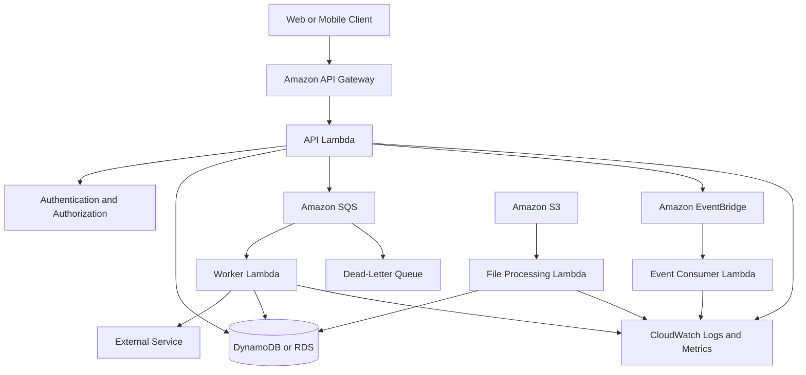
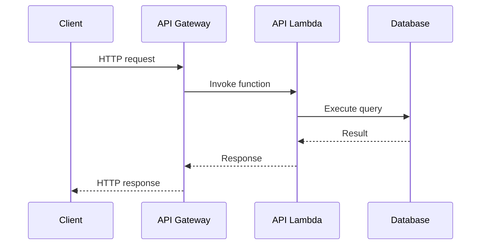
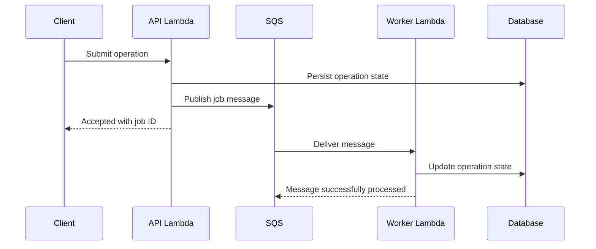
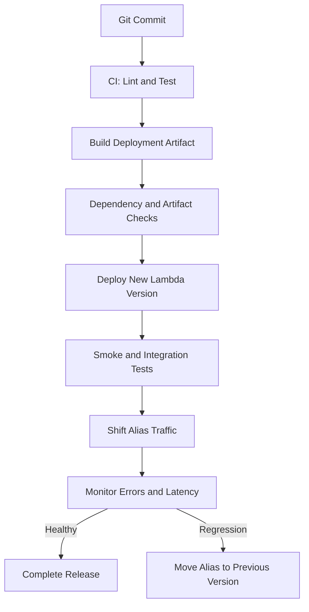

# 10- Lambda Production Architecture

## Overview

Production AWS Lambda architecture is about more than deploying individual functions. It requires designing reliable request flows, isolating failures, controlling concurrency, protecting downstream dependencies, securing service interactions, and making operational behavior observable.

Lambda is a managed compute service that executes code in response to events. AWS manages the underlying execution infrastructure, while the application team remains responsible for function logic, IAM permissions, networking configuration, data consistency, retries, deployment safety, monitoring, and cost control.

A production architecture typically combines Lambda with services such as API Gateway, Amazon SQS, Amazon EventBridge, Amazon S3, DynamoDB, Amazon RDS, Step Functions, and CloudWatch.

The central design principle is to choose the invocation model, failure-handling strategy, and service boundaries according to the workload rather than treating every operation as a synchronous function call.

### Production architecture objectives

- **Reliability:** Handle transient failures, duplicate events, partial processing, and downstream outages.
- **Scalability:** Accommodate variable traffic without overwhelming databases or external APIs.
- **Security:** Enforce least privilege across invocation permissions, execution roles, secrets, and network access.
- **Observability:** Connect requests, events, logs, metrics, traces, and failures.
- **Performance:** Control cold starts, initialization overhead, connection management, and processing latency.
- **Cost efficiency:** Match compute resources, concurrency, invocation patterns, and retention policies to workload requirements.
- **Operational safety:** Support controlled deployments, rollback, incident response, and recovery.

## Reference Production Architecture

A typical serverless backend separates synchronous request handling from asynchronous business processing.



This is a reference pattern, not a requirement to use every component. Each service introduces permissions, configuration, cost, and operational responsibilities.

For example, a small CRUD API might need only API Gateway, Lambda, and DynamoDB. An order-processing platform may require SQS, Step Functions, event routing, idempotency records, and multiple independently deployed consumers.

## Architecture Boundaries and Responsibilities

A production system should assign clear responsibilities to each component.

| Component | Primary responsibility | Important consideration |
|---|---|---|
| API Gateway | HTTP routing, request controls, integration with backend functions | Authentication, throttling, payload and timeout constraints |
| API Lambda | Validate requests, enforce business rules, coordinate immediate work | Keep execution bounded and avoid long-running workflows |
| DynamoDB or RDS | Durable application state | Capacity, transaction boundaries, connection limits, and consistency |
| SQS | Buffer work and decouple producers from consumers | Visibility timeout, retention, redrive policy, and consumer concurrency |
| EventBridge | Route events to independently managed targets | Delivery behavior, target retries, event contracts, and replay requirements |
| Step Functions | Coordinate multi-step workflows | State transitions, timeout policies, retries, and execution cost |
| CloudWatch | Logs, metrics, dashboards, and alarms | Useful dimensions, retention, alarm thresholds, and actionable signals |
| IAM | Define permitted actions and trust relationships | Separate invocation permissions from execution permissions |

### Establish explicit service boundaries

A Lambda function should have a cohesive responsibility, such as validating an order, processing a payment event, or generating a report.

Avoid both extremes:

- **Monolithic function:** One function handles unrelated APIs, business workflows, and infrastructure concerns, making testing and deployment difficult.
- **Excessive fragmentation:** Every trivial operation becomes a separate function, increasing network calls, IAM policies, deployment coordination, and operational complexity.

A practical boundary follows business capability, ownership, data consistency requirements, and independent scaling needs.

## Choosing the Invocation Architecture

Lambda supports several invocation patterns. Their failure semantics differ, so they must not be treated as interchangeable.

| Invocation mechanism | Typical use case | Failure handling |
|---|---|---|
| Synchronous invocation | HTTP APIs and direct request-response operations | Caller receives the invocation result or error and decides whether to retry |
| Asynchronous invocation | Event-triggered work where the producer does not wait for completion | Lambda manages retries for function errors according to asynchronous invocation settings |
| SQS event source mapping | Queue-backed background processing | Lambda polls the queue, invokes batches, and handles failed messages according to queue and mapping configuration |
| Kinesis or DynamoDB Streams event source mapping | Ordered or near-real-time stream processing | Checkpointing and retry behavior affect how progress advances through shards |
| EventBridge target | Event routing and integration across services | EventBridge delivery and target retry policies apply before target processing succeeds or fails |

A direct asynchronous Lambda invocation is not equivalent to placing a message in SQS. SQS provides explicit queue-level buffering, visibility control, retention, redrive policies, and consumer decoupling. Direct asynchronous invocation uses Lambda's managed asynchronous event queue and has different operational controls.

### Synchronous request path

Use a synchronous path when the caller needs an immediate result, such as retrieving an order or validating a request.



Keep synchronous operations short and bounded. Avoid waiting for email delivery, large file processing, report generation, or multiple slow external services when the client does not require those results immediately.

For long-running work, return an appropriate acceptance response and track the operation through a durable job identifier or workflow execution.

### Asynchronous request path



This pattern isolates request latency from background processing. It also introduces eventual consistency: the operation may be accepted before its final business outcome is known.

If the database write and queue publication must be atomic, consider a transactional outbox. Without such a mechanism, the database update can succeed while message publication fails, or the message can be published while a later database operation fails.

## Reliability and Failure Isolation

A production system must define what happens when every important dependency fails.

### Design for duplicate delivery

Many event-driven integrations provide at-least-once delivery under relevant conditions. Duplicate processing is therefore a normal design consideration, not an exceptional event.

Exactly-once business outcomes generally require application-level controls even when a particular service provides stronger guarantees for a narrower operation.

A robust consumer should:

1. Identify the business operation using a stable idempotency key.
2. Persist or otherwise reliably coordinate the processing state.
3. Detect completed operations before repeating side effects.
4. Make state transitions atomic where possible.
5. Handle retries without producing duplicate payments, emails, or records.

For example, an order ID combined with an operation type may form an idempotency key. A timestamp generated independently on every retry usually does not.

### Use bounded retries and dead-letter handling

Retries are useful for transient failures, but they can amplify an outage when every retry adds load to an already unhealthy dependency.

Use exponential backoff and jitter where the retry mechanism permits application-controlled scheduling. Configure service-managed retry policies according to their documented behavior.

For SQS consumers, configure:

- A visibility timeout appropriate to processing duration.
- A redrive policy with a suitable maximum receive count.
- A dead-letter queue with access controls and retention appropriate to the recovery process.
- Alerts for growing queue depth, message age, and dead-letter traffic.
- A controlled replay procedure that does not reintroduce the original failure.

For asynchronous Lambda invocation, configure the supported retry and failure-destination behavior. Do not assume SQS visibility timeouts or redrive settings apply to direct asynchronous invocation.

### Prevent cascading failures

Suppose a worker processes messages from SQS and calls an external payment API. If that API becomes slow, unlimited worker concurrency can increase in-flight requests and worsen the outage.

A safer design combines:

- Reserved concurrency to limit the function's maximum concurrent executions.
- Event source mapping concurrency controls where supported.
- Bounded retries and appropriate timeouts.
- Queue buffering to absorb temporary bursts.
- Idempotency to make redelivery safe.
- Circuit-breaking or dependency-health controls where application behavior requires them.
- Alarms for downstream latency, throttling, and queue age.

Reserved concurrency is a useful capacity boundary, but it is not a complete rate limiter. It does not independently guarantee a specific requests-per-second limit for every downstream dependency.

## Concurrency and Capacity Planning

Lambda scales execution environments in response to demand, subject to service quotas, function configuration, event source behavior, and available account capacity.

The architecture must protect downstream resources as well as the function itself.

### Estimate concurrency

A useful approximation for steady workloads is Little's Law:

\[
\text{Concurrency} \approx \text{Request rate} \times \text{Average duration}
\]

For example, if a function receives 200 requests per second and each invocation takes 0.25 seconds on average:

\[
200 \times 0.25 = 50
\]

The estimated average concurrency is 50. Real systems need headroom for traffic bursts, latency variation, retries, and uneven workload distribution.

This estimate is not a guarantee of required capacity. Tail latency and burst patterns can cause substantially higher instantaneous concurrency.

### Protect databases and APIs

Assume a worker function can use up to 300 concurrent execution environments. If each environment opens several database connections, the database may be overwhelmed even though Lambda itself scales successfully.

Before increasing concurrency, estimate:

- Maximum concurrent invocations.
- Connections per execution environment.
- Connection reuse and cleanup behavior.
- Database connection limits and connection establishment cost.
- Requests per second allowed by external dependencies.
- Retry traffic during failures.
- Whether a managed proxy or queue-based backpressure is appropriate.

For relational databases, consider Amazon RDS Proxy when its pooling and connection-management behavior suits the workload. It reduces some connection-management pressure but does not remove database capacity limits or eliminate the need for query optimization.

## Networking and Database Connectivity

Lambda functions attached to a VPC use the configured subnet and security-group networking. Correct configuration must account for routing, DNS, network access controls, and the destination's own security rules.

For private database access:

- Place Lambda networking interfaces in appropriate private subnets.
- Permit the necessary database port from the Lambda security group to the database security group.
- Verify subnet routes and network ACLs.
- Confirm DNS resolution and database endpoint configuration.
- Use private connectivity and endpoints for AWS services when appropriate.
- Provide NAT or another supported egress path when private functions must reach public endpoints.

A Lambda function attached to a private subnet does not automatically gain internet access. A route through a NAT gateway or another valid egress design may be required, depending on the destination.

### Diagnose connection exhaustion

Common causes include opening a new connection on every invocation, slow queries, long transactions, excessive concurrency, and connections remaining open after errors.

Prefer reusing clients and database connections when safe within an execution environment. However, execution-environment reuse is an optimization, not a guarantee of permanent process lifetime.

```python
import json
import os

import psycopg


DATABASE_URL = os.environ["DATABASE_URL"]


def lambda_handler(event, context):
    order_id = event["order_id"]

    with psycopg.connect(
        DATABASE_URL,
        connect_timeout=3,
    ) as connection:
        with connection.cursor() as cursor:
            cursor.execute(
                """
                SELECT id, status
                FROM orders
                WHERE id = %s
                """,
                (order_id,),
            )
            row = cursor.fetchone()

    if row is None:
        return {
            "statusCode": 404,
            "body": json.dumps({"error": "Order not found"}),
        }

    return {
        "statusCode": 200,
        "body": json.dumps(
            {"id": row[0], "status": row[1]}
        ),
    }
```

This example demonstrates parameterized SQL and bounded connection establishment. It deliberately does not implement a global connection pool; connection pooling, transaction management, and reuse must be designed for the selected driver, runtime, concurrency model, and database.

In a real API, validate the incoming identifier, use the application's established connection strategy, and avoid returning sensitive database details to callers.

## Security Architecture

Lambda security involves multiple independent authorization layers.

### Invocation permissions versus execution permissions

- **Invocation permission:** Determines which principal or AWS service can invoke the function.
- **Execution role:** Determines which AWS APIs the running function can call.
- **Resource policy:** Can grant invocation access to specified principals or services.
- **Network controls:** Restrict connectivity to databases, private endpoints, and other resources.
- **Deployment permissions:** Control who can publish code, modify configuration, update aliases, or change permissions.

Granting a service permission to invoke a function does not automatically grant the function permission to access a database or read a secret.

### Apply least privilege

An order-processing function should receive only the actions and resources it requires. Avoid broad policies such as `Action: "*"` and `Resource: "*"` unless a narrowly justified service-specific requirement demands them and the exposure has been evaluated.

Use separate roles for distinct functions when their responsibilities or data-access requirements differ. This limits the impact of a compromised dependency or application vulnerability.

For secrets, prefer AWS Secrets Manager or Systems Manager Parameter Store with appropriate encryption and IAM permissions. Environment variables are configuration, not a substitute for a complete secrets-management strategy.

### Secure event integrations

For each integration, verify:

- The invoking service's resource policy or supported permission mechanism.
- The function's execution role.
- The event source mapping role requirements, if applicable.
- Encryption requirements for queues, buckets, tables, and secrets.
- Cross-account trust and resource policies.
- CloudTrail coverage for relevant management events.
- CloudWatch log access and retention.
- Deployment artifact integrity and dependency security.

A function being private within a VPC does not make its code, IAM permissions, or invocation endpoints inherently secure.

## Observability and Incident Response

CloudWatch Logs, metrics, alarms, and tracing should provide enough information to distinguish application failures from platform throttling, downstream outages, and event-delivery problems.

### Monitor the right signals

| Signal | Why it matters | Typical response |
|---|---|---|
| Errors and failures | Indicates failed invocations or processing | Inspect exceptions, dependencies, and recent deployments |
| Duration and tail latency | Reveals slow requests and timeout risk | Profile initialization, network calls, and queries |
| Throttles | Indicates concurrency or quota pressure | Inspect reserved concurrency and account capacity |
| Concurrent executions | Shows capacity demand | Compare observed peaks with downstream limits |
| Queue depth and message age | Reveals backlog and processing lag | Inspect worker throughput and dependency health |
| Dead-letter message count | Identifies exhausted processing attempts | Inspect payloads and replay safely after correction |
| Iterator age for stream processing | Indicates consumer lag | Inspect processing duration, throttling, and shard throughput |
| Database connection count | Detects connection pressure | Review pooling, concurrency, and query duration |
| Cost and invocation volume | Identifies unexpected traffic or inefficient work | Investigate traffic changes and high-cost paths |

Metric names and dimensions vary by integration. For example, Lambda function metrics and event-source-specific metrics should be monitored separately where they expose different failure modes.

### Use structured logs

```python
import json
import logging

logger = logging.getLogger()
logger.setLevel(logging.INFO)


def lambda_handler(event, context):
    order_id = event.get("order_id")

    logger.info(
        json.dumps(
            {
                "event": "order_processing_started",
                "request_id": context.aws_request_id,
                "order_id": order_id,
            }
        )
    )

    try:
        # Invoke the application service here.
        result = {"order_id": order_id, "status": "accepted"}

        logger.info(
            json.dumps(
                {
                    "event": "order_processing_completed",
                    "request_id": context.aws_request_id,
                    "order_id": order_id,
                }
            )
        )

        return result

    except Exception:
        logger.exception(
            "Order processing failed: request_id=%s order_id=%s",
            context.aws_request_id,
            order_id,
        )
        raise
```

This example uses the Lambda request ID to correlate logs for a single invocation. For distributed workflows, propagate an application correlation ID or trace context across API requests, queue messages, and downstream calls.

Do not log authorization headers, access tokens, passwords, secret values, payment details, or unnecessary personal information. Structured logging is useful only when fields are consistent, safe, and searchable.

### Build actionable alarms

An alarm should have a clear owner, severity, and response procedure. Alerting on every individual error can create noise; alerting only on aggregate error counts can hide a critical failure in a low-volume service.

Combine service-level indicators such as error rate and latency with dependency signals such as queue age, database health, and throttling. Include dashboards and runbooks that help an operator identify the failing boundary.

## Deployment and Release Architecture

Production deployments should separate source changes, infrastructure changes, runtime configuration, and traffic migration.

A common deployment flow is:



Use infrastructure as code such as AWS SAM, AWS CDK, or CloudFormation to make resource configuration repeatable and reviewable.

### Versions and aliases

Published Lambda versions are immutable snapshots of function code and version-specific configuration. Aliases provide stable names that can point to versions and support controlled traffic shifting where configured.

A production release should generally:

1. Run automated checks and tests.
2. Deploy a candidate version.
3. Verify the deployed artifact and configuration.
4. Shift traffic through an alias or an appropriate deployment strategy.
5. Observe errors, latency, and downstream health.
6. Roll back traffic if required.

Rollback does not automatically reverse database migrations, external side effects, or messages already processed. Database schema changes should therefore follow compatible migration practices, and business workflows must tolerate deployments that temporarily run different application versions.

### Separate deployment and runtime roles

The CI/CD identity needs permission to deploy approved artifacts and update the required resources. The runtime execution role needs permission to perform application work. Keeping these responsibilities separate reduces unnecessary privilege and makes audit trails clearer.

For GitHub Actions, use an appropriately scoped OpenID Connect trust relationship with AWS where possible instead of long-lived AWS access keys. Restrict the trusted repository, branch or deployment environment, and permitted role assumptions.

## Cost and Performance Optimization

Lambda cost depends on factors including requests, configured memory, execution duration, architecture, and applicable additional features. Integrated services may introduce separate charges for API Gateway requests, queues, event delivery, logs, data transfer, NAT gateways, databases, and observability.

### Optimize the whole request path

Do not optimize Lambda duration in isolation. A faster function that generates excessive database queries or retries may increase total system cost and reduce reliability.

Prioritize:

- Right-sizing memory using realistic workload measurements.
- Reducing initialization and dependency-loading overhead.
- Reusing SDK clients and other safe execution-environment resources.
- Avoiding unnecessary network round trips.
- Batching work when the event source and latency requirements support it.
- Limiting retries that create duplicate downstream work.
- Setting log retention and avoiding high-cardinality custom metrics.
- Evaluating ARM-based execution where dependencies and performance tests support it.
- Reviewing NAT gateway, provisioned concurrency, and other fixed or capacity-related costs.

### Cold starts and initialization

Cold starts occur when Lambda needs to initialize a new execution environment. Initialization work, runtime choice, dependency size, VPC networking behavior, and other factors can affect startup latency.

Reduce avoidable initialization work and import only required dependencies. Provisioned concurrency can keep environments initialized for latency-sensitive workloads, but it incurs additional cost and requires capacity planning. SnapStart can reduce startup latency for supported runtimes and configurations, but it has compatibility constraints and is not a universal replacement for provisioned concurrency.

Validate current runtime and feature support before choosing an optimization. Benchmark both steady-state latency and cold-start behavior under realistic traffic.

## High Availability and Disaster Recovery

Lambda runs on managed infrastructure, but the complete application is only as available as its dependencies and integration design.

Consider:

- Regional architecture and the recovery requirements of each dependency.
- Multi-AZ configuration for supported regional databases and networking components.
- Durable event storage and retention for replayable workloads.
- Backup and restore requirements for databases, object storage, and configuration.
- Recovery time objective (RTO) and recovery point objective (RPO).
- Infrastructure-as-code reproducibility in a recovery environment.
- DNS, traffic routing, secret availability, and cross-account permissions during recovery.
- Testing recovery procedures rather than relying only on documented plans.

A multi-Region Lambda design is not automatically highly available. Data replication, idempotency across Regions, event duplication, conflicting writes, service quotas, and failover orchestration must be addressed explicitly.

For asynchronous workloads, preserve sufficient event or message history to support the required recovery process. Replaying events should be controlled and idempotent to avoid repeating irreversible business operations.

## Production Readiness Checklist

Before launching a Lambda-backed service, verify the following.

### Architecture and reliability

- [ ] Invocation model matches latency and delivery requirements.
- [ ] Function boundaries and data ownership are explicit.
- [ ] Duplicate events are handled safely.
- [ ] Retry limits, dead-letter handling, and replay procedures are documented.
- [ ] Timeouts are bounded and consistent with upstream and downstream limits.
- [ ] Concurrency controls protect critical dependencies.
- [ ] Partial batch failure behavior is configured where supported.

### Security

- [ ] Execution roles and resource policies follow least privilege.
- [ ] Secrets are not hard-coded or logged.
- [ ] Public endpoints have appropriate authentication and authorization.
- [ ] VPC routes, security groups, and private connectivity are verified.
- [ ] Deployment permissions are separated from runtime permissions.
- [ ] Dependencies and deployment artifacts are scanned and controlled.

### Operations

- [ ] Structured logs and correlation identifiers are available.
- [ ] Errors, duration, throttles, queue age, and dependency health are monitored.
- [ ] Alarms have owners and documented response steps.
- [ ] Log retention and sensitive-data handling are configured.
- [ ] Rollback and recovery procedures have been tested.

### Performance and cost

- [ ] Memory and timeout settings are benchmarked.
- [ ] Database connection and downstream request capacity are understood.
- [ ] Cold-start behavior is measured where latency-sensitive.
- [ ] Event payload sizes and service quotas are checked.
- [ ] Integrated service costs and data-transfer charges are considered.
- [ ] Cleanup and retention policies are defined for non-production resources.

## Key Takeaways

- Production Lambda architecture depends on selecting the right invocation model, service boundaries, and failure-handling strategy—not merely deploying functions.
- At-least-once delivery requires idempotent business processing; retries alone do not guarantee exactly-once outcomes.
- Concurrency, database connections, and downstream capacity must be designed together to prevent scaling from amplifying outages.
- Least-privilege IAM, structured observability, controlled deployments, and tested recovery procedures are essential production responsibilities.
- Optimize cost and latency across the complete request or event path, including queues, databases, networking, logging, and other integrated AWS services.