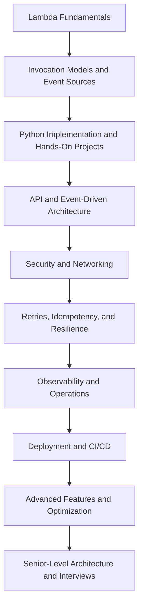

# AWS Lambda

## Overview

This directory contains the AWS Lambda engineering reference for the `backend-engineering-playbook` repository. It covers Lambda fundamentals, serverless architecture, event-driven processing, security, deployment, operational reliability, performance optimization, troubleshooting, and senior-level interview preparation.

The material is organized to help backend engineers progress from understanding the Lambda execution model to designing, implementing, and operating production-grade serverless systems using Python and AWS services.

## Documentation Scope

The documentation separates concerns into focused topics so that conceptual explanations, architecture decisions, operational procedures, and hands-on implementations remain maintainable.

| Area | Purpose |
|---|---|
| Concepts and fundamentals | Understand the execution model, handlers, invocation types, runtimes, configuration, and execution environments |
| Architecture | Design API backends, asynchronous processing systems, serverless microservices, and resilient event-driven workflows |
| Security | Configure execution roles, invocation permissions, resource policies, secrets, networking, and secure deployments |
| Advanced features | Evaluate provisioned concurrency, SnapStart, layers, extensions, container images, response streaming, and other capabilities |
| Best practices | Apply production patterns for idempotency, retries, concurrency, observability, testing, and cost control |
| Hands-on projects | Build working Lambda applications with API Gateway, DynamoDB, SQS, S3, EventBridge, and Step Functions |
| CLI | Manage functions, versions, aliases, permissions, event source mappings, and logs using AWS CLI |
| Troubleshooting | Diagnose runtime failures, timeouts, throttling, networking issues, authorization errors, and event-processing failures |
| Operations | Monitor production workloads, manage quotas, respond to incidents, optimize costs, and plan recovery |
| Deployment | Implement infrastructure as code, CI/CD, safe releases, traffic shifting, verification, and rollback |
| Interview preparation | Practice architecture decisions, debugging, service comparisons, and senior-level engineering scenarios |

## Navigation

| # | File | Description |
|---|---|---|
| 01 | [01- Lambda Core Architecture](./01-%20Lambda%20Core%20Architecture.md) | Lambda core architecture, execution environments, and fundamental service design. |
| 02 | [02- Event-Driven Architecture](./02-%20Event-Driven%20Architecture.md) | Event-driven architecture patterns, asynchronous processing, and decoupled system design. |
| 03 | [03- Lambda with API Gateway](./03-%20Lambda%20with%20API%20Gateway.md) | Synchronous HTTP API integration using Amazon API Gateway and Lambda. |
| 04 | [04- Lambda with Application Load Balancer](./04-%20Lambda%20with%20Application%20Load%20Balancer.md) | ALB-to-Lambda integration, routing, and load balancing architecture. |
| 05 | [05- Lambda Function URLs Architecture](./05-%20Lambda%20Function%20URLs%20Architecture.md) | Function URLs architecture, authentication, and direct HTTP access patterns. |
| 06 | [06- Lambda Inside a VPC](./06-%20Lambda%20Inside%20a%20VPC.md) | VPC-connected Lambda architecture, private networking, and secure resource access. |
| 07 | [07- Lambda Design Patterns](./07-%20Lambda%20Design%20Patterns.md) | Serverless design patterns, fan-out, saga, and event-driven workflow architectures. |
| 08 | [08- Synchronous vs Asynchronous Processing Architecture](./08-%20Synchronous%20vs%20Asynchronous%20Processing%20Architecture.md) | Comparing synchronous and asynchronous invocation models and when to use each. |
| 09 | [09- Serverless Microservices Architecture](./09-%20Serverless%20Microservices%20Architecture.md) | Building serverless microservices with Lambda, API Gateway, and event routing. |
| 10 | [10- Lambda Production Architecture](./10-%20Lambda%20Production%20Architecture.md) | Production-grade serverless architectures, resilience, and operational design. |

## Recommended Learning Path

Follow the documentation in an order that builds both implementation skills and production engineering judgment.

### Suggested progression

1. **Understand the execution model:** Learn handlers, initialization, invocation behavior, runtime configuration, timeouts, memory, and concurrency.
2. **Build basic integrations:** Implement HTTP APIs and event-driven functions using Python.
3. **Learn distributed processing:** Practice SQS consumers, EventBridge rules, stream processing, retries, idempotency, and dead-letter handling.
4. **Design for production:** Add least-privilege IAM, secure networking, structured logging, metrics, alarms, and failure isolation.
5. **Automate delivery:** Use infrastructure as code, automated tests, GitHub Actions, versioning, aliases, and deployment verification.
6. **Optimize and evaluate trade-offs:** Benchmark latency and cost, protect downstream dependencies, and compare Lambda with containers and other AWS services.

## Architecture Principles

The documentation follows several principles that apply across Lambda-backed systems.

### Prefer explicit invocation semantics

Choose synchronous invocation for operations that require an immediate response. Use queues, event routing, or workflow orchestration when processing can continue independently of the initiating request.

Direct asynchronous Lambda invocation and event source mappings have different retry, buffering, ordering, and failure-handling semantics. Configure each integration according to its documented behavior.

### Design for duplicate processing

Do not assume that an event will be processed only once. Use stable idempotency keys, durable state transitions, and safe handling of repeated requests or messages.

At-least-once delivery does not automatically provide exactly-once business outcomes.

### Protect downstream dependencies

Lambda can scale faster than a database or external API can absorb traffic. Plan concurrency, connection usage, timeouts, retries, and queue depth together.

### Treat security as an architectural concern

Use least-privilege execution roles, narrowly scoped invocation permissions, secure secret management, appropriate network boundaries, and separate deployment and runtime permissions.

### Make production behavior observable

Capture structured logs, relevant metrics, correlation identifiers, and traces. Monitor errors, latency, throttling, queue age, event-processing lag, and downstream health.

### Automate and verify deployments

Use repeatable infrastructure definitions, automated tests, immutable versions, controlled traffic migration, smoke tests, and documented rollback procedures. Remember that reverting function code does not automatically undo database migrations or external side effects.

## Hands-On and Production Validation

Each hands-on project should be independently verifiable and include:

- Objective, prerequisites, and required AWS services.
- Architecture diagram and request or event flow.
- Directory structure and relevant implementation files.
- Required IAM permissions and configuration.
- Deployment and execution instructions.
- Test scenarios, verification commands, and expected results.
- Common failure modes and troubleshooting guidance.
- Security, quota, and cost considerations.
- Cleanup commands for resources that may incur charges.
- Optional extensions for more advanced practice.

Before running exercises, verify the active AWS account and Region. Use a dedicated development environment where possible, apply least privilege, and delete resources that are no longer required.

## Key Takeaways

- This directory is a focused reference for implementing, securing, deploying, and operating AWS Lambda systems with production-oriented backend engineering practices.
- Learn invocation semantics, event-source behavior, retries, and idempotency before designing asynchronous workflows.
- Treat concurrency, downstream capacity, observability, security, and cost as interconnected architecture decisions.
- Use hands-on projects to validate concepts through repeatable deployments, tests, diagnostic commands, and explicit resource cleanup.
- Keep the documentation modular, maintain cross-references, and verify README links against the actual repository structure.