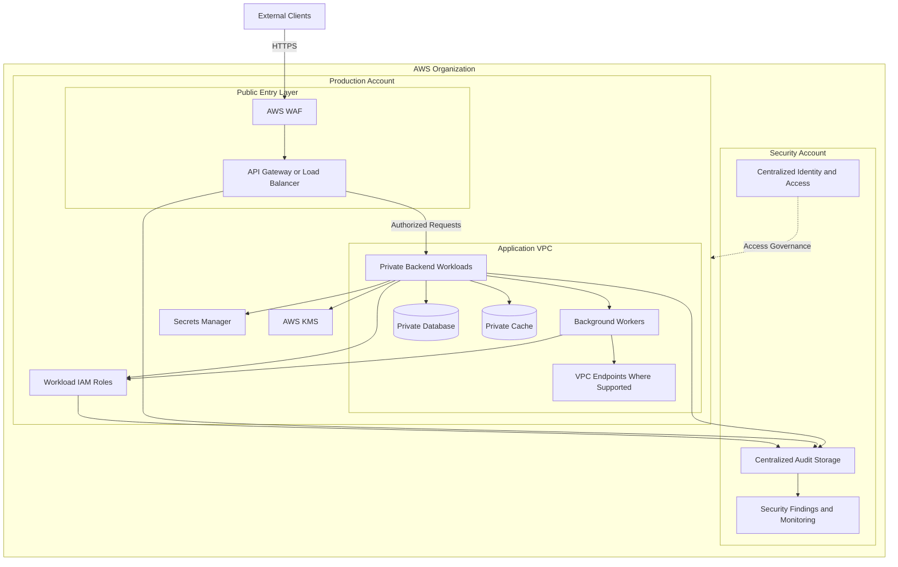
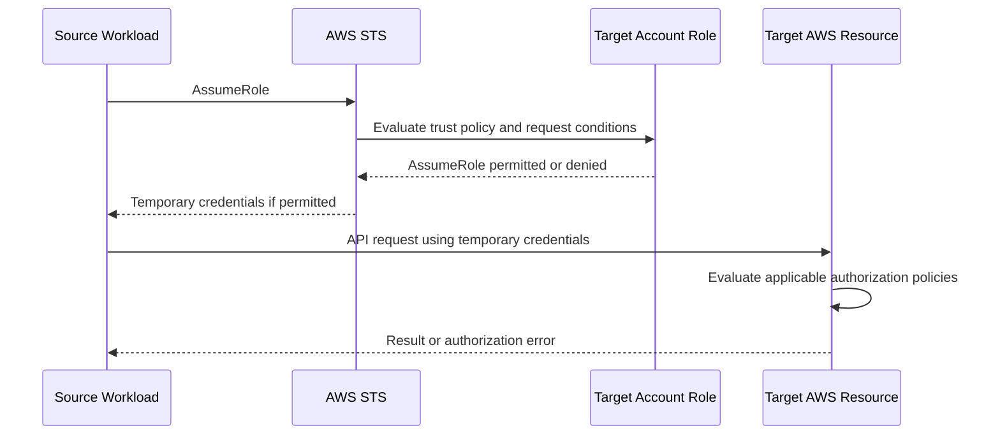
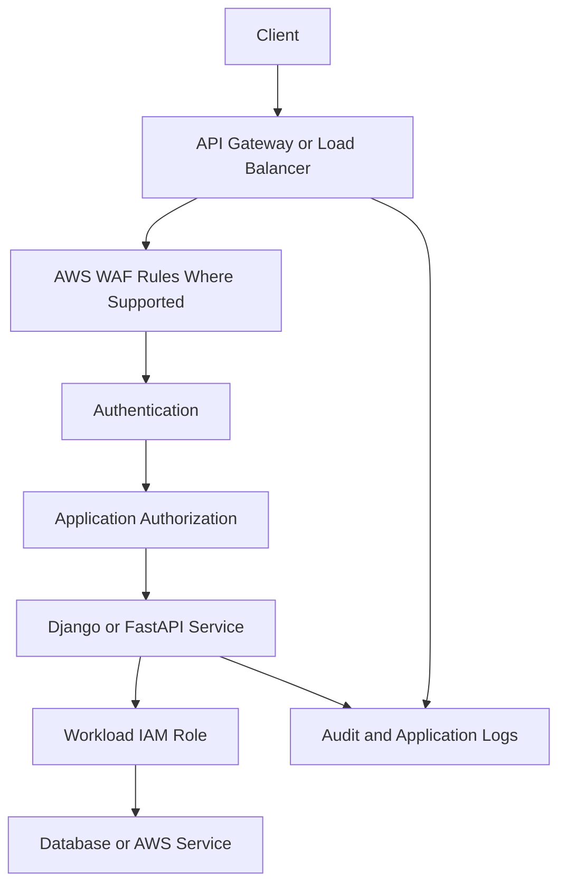
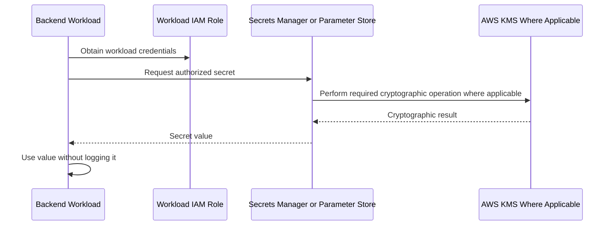
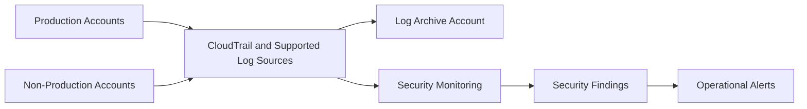

# 01- AWS Security Architecture

## Overview

AWS Security Architecture defines how identity, network boundaries, encryption, application authorization, monitoring, and incident response work together to protect cloud workloads. It translates individual security services and controls into a coherent system that limits unauthorized access, reduces attack surfaces, and supports reliable operations.

For backend systems built with Python, Django, FastAPI, REST APIs, microservices, containers, and serverless functions, security architecture must address both infrastructure-level threats and application-level risks.

A production-ready architecture should establish:

- Explicit trust boundaries between AWS accounts, workloads, services, and users.
- Least-privilege access through IAM roles and resource-specific policies.
- Private networking and controlled public entry points.
- Encryption in transit and at rest with appropriate key governance.
- Secure secret distribution and temporary workload credentials.
- Centralized audit logging, threat detection, and security findings.
- Defined containment, recovery, and evidence-preservation procedures.

Security architecture is not a single AWS service or a collection of independent configurations. It is the coordinated design of preventive, detective, and responsive controls.

## Architecture Goals and Design Principles

### Core Goals

| Goal | Architectural approach |
|---|---|
| Identity isolation | Use dedicated workload roles and explicit trust relationships |
| Least privilege | Scope actions, resources, and conditions to the required operations |
| Network isolation | Keep internal workloads private and restrict permitted communication paths |
| Data protection | Apply TLS, encryption at rest, and appropriate KMS controls |
| Secret protection | Retrieve secrets from managed services using workload identities |
| Threat detection | Centralize audit evidence and integrate threat detection and alerting |
| Blast-radius reduction | Separate accounts, workloads, data stores, and privileged operations |
| Operational resilience | Design incident containment, credential rotation, and recovery procedures |
| Continuous assurance | Validate policies, configurations, and security findings over time |

### Defense in Depth

Defense in depth uses multiple controls so that the failure of one control does not automatically compromise the entire system.

For example, a private PostgreSQL database should not depend only on its private subnet for protection. It should also have restrictive security-group rules, database authentication, appropriate database permissions, encryption, and audit or monitoring controls.

A typical layered design includes:

1. **Organization and account controls:** account separation, centralized identity, and service control policies where applicable.
2. **Identity controls:** IAM roles, temporary credentials, trust policies, and least-privilege permissions.
3. **Network controls:** VPC boundaries, security groups, network ACLs, private connectivity, and controlled ingress.
4. **Application controls:** authentication, authorization, input validation, tenant isolation, and rate limiting.
5. **Data controls:** encryption, KMS key policies, secrets management, and database access restrictions.
6. **Detection controls:** CloudTrail, GuardDuty, Security Hub, CloudWatch, and AWS Config capabilities.
7. **Response controls:** credential revocation, access restriction, evidence preservation, and recovery procedures.

No single layer should be treated as a substitute for the others.

## Shared Responsibility and Trust Boundaries

AWS secures the underlying cloud infrastructure, while customers remain responsible for security decisions involving their identities, data, application code, configurations, and workloads. The precise division depends on the AWS service and its deployment model.

For example, AWS manages more of the underlying runtime infrastructure for Lambda than for an EC2 instance whose operating system and installed software the customer manages.

### Important Trust Boundaries

| Boundary | Security concern | Primary controls |
|---|---|---|
| Organization to account | Uncontrolled account creation or privileged access | Organization governance, SCPs, centralized identity |
| Account to account | Unauthorized cross-account access | Explicit role trust, scoped permissions, external identity controls |
| Public client to API | Malicious requests and unauthorized operations | TLS, API authentication, WAF, application authorization |
| Application to AWS service | Compromised workload accessing unrelated resources | Workload IAM roles, resource policies, private endpoints where appropriate |
| Application to database | Lateral movement and unauthorized data access | Security groups, database credentials, database-level permissions |
| Application to secret store | Credential disclosure | Secrets Manager or Parameter Store, IAM, KMS where applicable |
| Workload to logging systems | Missing or tampered audit evidence | Centralized logging, restricted log permissions, retention controls |
| Operator to production | Excessive or untraceable administrative access | Federated access, MFA, temporary sessions, audit trails |

Trust boundaries should be explicit in architecture diagrams, infrastructure definitions, IAM policies, and operational procedures.

## Reference AWS Security Architecture

The following architecture illustrates a multi-account backend platform with controlled public ingress, private workloads, managed data services, and centralized security monitoring.



This is a logical reference architecture, not a requirement to place every component in the same account or VPC. Actual connectivity depends on the selected services, endpoint support, routing, DNS, and authorization configuration.

### Architectural Decisions

| Decision | Typical approach | Trade-off |
|---|---|---|
| Account structure | Separate production, non-production, and security responsibilities | More governance and cross-account administration |
| Public ingress | Expose only required API or load-balancing endpoints | Requires careful edge configuration and application authorization |
| Backend placement | Keep application and data workloads private where practical | Private connectivity and deployment access require planning |
| Workload identity | Assign dedicated roles to individual workloads | More roles and policies to maintain |
| Secret storage | Use Secrets Manager or Parameter Store according to requirements | Service cost, retrieval latency, and rotation complexity |
| Encryption keys | Use AWS-managed keys for simpler requirements or customer-managed keys when additional control is needed | Customer-managed keys require more policy and lifecycle governance |
| Audit storage | Centralize security-relevant evidence in a protected account | Cross-account configuration, storage costs, and retention management |
| Threat detection | Enable appropriate detection services and aggregate findings | Cost, alert volume, and investigation effort |

## Multi-Account Security Architecture

### Why Separate Accounts?

AWS accounts provide security and administrative boundaries. Separating workloads reduces the impact of compromised credentials, accidental changes, and overly broad permissions.

A typical organization may include:

- **Management account:** organization administration and tightly controlled organization-level operations.
- **Security account:** centralized security tooling, findings, and audit-log access.
- **Log archive account:** protected storage for centralized audit records.
- **Production accounts:** production applications and data.
- **Non-production accounts:** development, testing, and staging workloads.

The exact account structure depends on organizational scale, compliance requirements, operational ownership, and workload isolation needs.

### Organization-Level Controls

Service control policies (SCPs) define the maximum available permissions for affected principals in member accounts. They do not grant permissions and do not replace IAM policies.

Use SCPs to establish organization-wide guardrails, such as restricting selected high-risk operations or limiting use of services and Regions according to organizational policy. Validate exclusions and dependencies carefully to avoid blocking required administrative or recovery workflows.

### Cross-Account Access

Cross-account access typically involves a source principal assuming a role in a target account.



Successful role assumption is not sufficient to guarantee access to the target resource. The resulting session must still have the permissions required for the requested operation, and resource policies, explicit denies, organization controls, and other applicable authorization mechanisms can affect the result.

Use separate roles for deployment, runtime operations, read-only diagnostics, and emergency access where the separation materially reduces risk.

## Identity and Access Architecture

### Workload Identity

Every workload should use an identity appropriate to its execution environment.

| Workload | Preferred identity mechanism |
|---|---|
| EC2 application | IAM role associated through an instance profile |
| Lambda function | Dedicated Lambda execution role |
| ECS task | ECS task role for application permissions |
| EKS workload | A supported workload identity mechanism, such as EKS Pod Identity or IRSA where appropriate |
| External CI/CD system | Federated identity or OIDC-based role assumption where supported |
| Human operator | Federated access with MFA and controlled sessions |

Avoid sharing a single powerful role among unrelated services. A compromised worker should not automatically gain access to deployment controls, unrelated databases, or another service's secrets.

### IAM Policy Design

An effective IAM design combines narrowly scoped permissions with controlled trust relationships.

Review the following elements:

- **Identity-based policies:** define permissions attached to users, groups, or roles.
- **Resource-based policies:** specify which principals may access supported resources.
- **Trust policies:** determine which principals may assume a role.
- **Permission boundaries:** limit the maximum permissions available to supported IAM identities.
- **Session policies:** restrict permissions for supported role sessions.
- **SCPs:** establish maximum permission guardrails for applicable organization principals.
- **Explicit denies:** override allows when applicable to the authorization decision.

Not every policy type applies to every service or authorization path. Inspect the relevant service's authorization behavior when diagnosing access failures.

### Example: A Dedicated S3 Workload Role

A backend service that uploads objects to one application bucket should not need unrestricted S3 access.

An illustrative identity policy is:

```json
{
  "Version": "2012-10-17",
  "Statement": [
    {
      "Sid": "UploadApplicationObjects",
      "Effect": "Allow",
      "Action": [
        "s3:PutObject"
      ],
      "Resource": "arn:aws:s3:::<application-bucket>/uploads/*"
    }
  ]
}
```

This policy grants the specified object-upload action for the specified prefix. It does not grant listing, reading, deletion, or access to unrelated buckets.

Additional permissions may be required for particular upload patterns, encryption configurations, multipart workflows, or other application behavior. Add only the actions actually needed and validate the complete access path.

## Secure Backend API Architecture

A secure API design separates edge protection, caller authentication, application authorization, and AWS service permissions.

### Request Lifecycle



The diagram is conceptual. The actual ordering and placement of WAF, authentication, authorization, and backend processing depend on the selected AWS services and application design.

### Distinguish Authorization Layers

| Layer | Question answered | Example |
|---|---|---|
| Transport security | Is communication protected in transit? | HTTPS with valid TLS configuration |
| Caller authentication | Who is making the request? | JWT validation, OAuth-based authentication, or IAM authentication |
| Edge protection | Should the request be filtered or rate-limited? | WAF rules and supported rate-based rules |
| Application authorization | May this caller perform this business operation? | A tenant user may update only their own organization's records |
| AWS authorization | May the workload call this AWS API on this resource? | A Lambda role may read a particular S3 prefix |

Passing one layer does not imply passing the others.

For example, API Gateway IAM authorization uses AWS request-signing and authorization mechanisms. A JWT-protected FastAPI endpoint instead validates an application identity token. Neither mechanism automatically implements tenant-level object authorization.

### Public API Protection

For public APIs:

- Enforce HTTPS and appropriate TLS configuration.
- Select authentication and authorization mechanisms that fit the API's callers.
- Apply AWS WAF where supported and appropriate.
- Use rate limits and quotas to reduce abusive traffic.
- Validate input and enforce authorization at the application boundary.
- Keep internal data services inaccessible from unnecessary network paths.
- Avoid exposing sensitive implementation details in error responses.
- Record security-relevant events without logging credentials, tokens, or sensitive payloads.

AWS Shield provides DDoS protection capabilities. AWS WAF provides configurable web request filtering and supported rate-based controls. Neither replaces application authorization, secure IAM policies, or appropriate network boundaries.

## Network Security Architecture

### VPC Segmentation

A typical backend VPC separates public entry points from private application and data workloads.

| Component | Placement and controls |
|---|---|
| Public ingress | Public subnets only where the selected ingress service requires them |
| Backend services | Private subnets where practical, with controlled routing |
| Database | Private subnets, restrictive security groups, database-level authorization |
| Cache | Private network placement and access restricted to required clients |
| AWS service connectivity | VPC endpoints or other supported private connectivity where appropriate |
| Administrative access | Controlled management paths with auditable identity and access |

Private subnets do not automatically provide complete security. Routing, security groups, network ACLs, DNS, endpoint policies, and application authorization still require correct configuration.

### Security Groups and Network ACLs

Security groups are stateful virtual firewalls associated with supported resources. Network ACLs operate at the subnet boundary and are stateless.

Use security groups to express workload-to-workload communication requirements. Use network ACLs when subnet-level stateless filtering provides a meaningful additional boundary.

Avoid duplicating complex rules across layers without a clear threat-model justification; redundant controls can increase operational complexity and make incident diagnosis harder.

### Private Connectivity

VPC endpoints and AWS PrivateLink can reduce the need for public network paths for supported service-to-service communication.

Before adopting a private connectivity pattern, verify:

- Whether the target service and required API operations support the endpoint type.
- DNS behavior and endpoint resolution.
- Routing and security-group requirements.
- Endpoint policies, IAM policies, and resource policies.
- Availability, quotas, and additional costs.
- Whether application dependencies still require external internet access.

Private connectivity limits network exposure but does not independently authorize a request.

## Encryption and Key Management Architecture

### Encryption in Transit

Protect data moving between clients, APIs, services, and supported data endpoints using TLS. Validate certificate management, hostname verification, supported protocol versions, and renewal procedures.

Internal service communication should not be assumed safe solely because it occurs inside a VPC.

### Encryption at Rest

Use service-supported encryption capabilities for stored data.

| Resource | Architectural consideration |
|---|---|
| Amazon S3 | Configure appropriate default encryption and access controls; use customer-managed KMS keys when required |
| Amazon EBS | Encrypt volumes and snapshots according to workload and recovery requirements |
| Amazon RDS | Enable encryption for supported database storage and associated backups |
| CloudWatch Logs | Configure log-group encryption according to data classification and key-governance requirements |
| Secrets Manager | Use service encryption and manage KMS permissions when a customer-managed key is selected |

Encryption does not replace access control. A principal that is authorized to access data and use the required decryption permissions may still retrieve plaintext.

### AWS KMS Design

Choose the key-management model based on operational and governance requirements.

- **AWS-managed KMS keys:** provide service-managed key administration with less customer configuration.
- **Customer-managed KMS keys:** provide additional control over key policies, grants, lifecycle operations, and auditability.

Customer-managed keys can support more granular governance, but they add responsibilities for policy design, rotation, grants, recovery planning, and service integration.

### Envelope Encryption

Envelope encryption protects data using a data key while KMS manages or protects the key-encryption process. Applications should use supported SDK and service mechanisms rather than implementing custom cryptographic protocols.

When designing KMS integration, account for:

- Key policies and IAM permissions.
- Encryption context requirements where applicable.
- Data-key handling and memory exposure.
- Rotation and key lifecycle policies.
- Backup and recovery requirements.
- Service-specific encryption behavior.
- The effect of disabling or scheduling deletion of a key.

Loss of required KMS access can make otherwise available data unreadable. Key lifecycle changes should therefore be treated as operationally significant changes.

## Secrets Management Architecture

Store application secrets in AWS Secrets Manager or Systems Manager Parameter Store according to the required features, sensitivity, rotation model, and operational cost.

Avoid embedding secrets in source code, container images, Git history, deployment artifacts, or logs.

### Secret Retrieval Flow



The exact cryptographic flow depends on the service and encryption configuration; applications generally interact with the secrets service rather than directly performing the service's internal encryption workflow.

### Python Example

The following example retrieves a secret using Boto3 and the workload's configured credential provider chain. It does not embed AWS access keys or log the secret value.

```python
import json
import boto3
from botocore.exceptions import BotoCoreError, ClientError


def load_database_secret(secret_id: str, region_name: str) -> dict:
    client = boto3.client(
        "secretsmanager",
        region_name=region_name,
    )

    try:
        response = client.get_secret_value(SecretId=secret_id)
        secret_string = response.get("SecretString")

        if not secret_string:
            raise ValueError("Expected a string-form database secret")

        secret = json.loads(secret_string)

        required_fields = {"username", "password", "host", "dbname"}
        if not required_fields.issubset(secret):
            raise ValueError("Database secret is missing required fields")

        return secret

    except (BotoCoreError, ClientError):
        # Log a sanitized event through the application's logging system.
        # Do not log the response, credentials, or secret contents.
        raise RuntimeError("Unable to retrieve database configuration") from None
```

Operational considerations:

- Grant the workload only the required secret retrieval permissions.
- Ensure the workload can reach the secrets service through its configured network path.
- Grant required KMS permissions when the selected encryption configuration requires them.
- Cache secrets when appropriate to reduce latency and API costs.
- Define cache refresh behavior so rotated credentials become available within an acceptable period.
- Avoid catching errors without recording sanitized diagnostic context.
- Ensure downstream database connection pools can recover after credential rotation.

The example assumes a JSON string secret. Binary secrets and other secret formats require corresponding handling.

## Centralized Logging and Threat Detection

Security architecture requires reliable evidence of identity activity, API calls, configuration changes, and suspicious behavior.

### Core Services

| Service | Architectural role | Important consideration |
|---|---|---|
| AWS CloudTrail | Records supported AWS API activity | Configure required trails, event coverage, retention, and protected destinations |
| Amazon GuardDuty | Detects supported threats and suspicious activity | Review findings and route actionable alerts |
| AWS Security Hub | Aggregates and evaluates supported security findings and controls | Configure standards and integrations according to organizational requirements |
| Amazon CloudWatch | Collects metrics, logs, and alarms | Build actionable alarms and manage log retention and cost |
| AWS Config | Records resource configuration and evaluates supported rules | Define required resource coverage and compliance checks |

Service availability, feature support, Regions, and integration behavior should be verified for the target environment.

### Centralized Audit Architecture

A common pattern sends account-level audit evidence to a dedicated log archive account, with security tooling in a separate security account.



Protect audit storage from unauthorized modification and deletion. Restrict access to log-management roles, establish retention requirements, and ensure the incident-response team can access evidence when necessary.

Centralized logging is only effective when the required event sources are configured, records are delivered successfully, retention is sufficient, and alerts are reviewed.

## Preventive, Detective, and Responsive Controls

| Control category | Purpose | Examples |
|---|---|---|
| Preventive | Reduce the likelihood of unauthorized access or unsafe configuration | IAM least privilege, SCPs, security groups, KMS policies, WAF rules |
| Detective | Identify suspicious activity or configuration drift | CloudTrail analysis, GuardDuty, Security Hub, AWS Config, CloudWatch alarms |
| Responsive | Contain an incident and restore a safe state | Restricting access, revoking or rotating credentials, isolating workloads, restoring services |

A mature architecture combines all three categories and defines who owns each control, how it is verified, and what happens when it fails.

## Incident Containment and Recovery

Prepare for security incidents before they occur. A response plan should identify the decision-makers, available evidence, containment options, recovery dependencies, and escalation paths.

### Credential Compromise

When credentials may have been exposed:

1. Identify the affected identity, credential type, account, resources, and time window.
2. Preserve relevant CloudTrail records and other available evidence.
3. Restrict or revoke compromised credentials using the mechanism appropriate to their type.
4. Investigate API activity and identify affected resources or data.
5. Remove the exposure source, such as a repository secret, build artifact, or workload configuration.
6. Rotate affected application secrets and validate dependent services.
7. Verify that the compromised identity can no longer perform unauthorized operations.
8. Review permissions and deployment controls to prevent recurrence.

Temporary role credentials require a different containment approach from long-lived IAM access keys. Existing role sessions may remain usable until expiration unless an applicable restriction or revocation mechanism is used. Session revocation behavior depends on the identity and policy mechanisms involved.

### Suspicious API Activity

For unexplained AWS API calls:

- Establish the event time, principal, source IP where available, user agent, API operation, resource, and request context.
- Use CloudTrail evidence to determine whether the activity was authorized.
- Check the principal's effective permissions and role-assumption history where available.
- Identify related configuration changes and subsequent activity.
- Contain the identity or workload if the risk justifies it.
- Preserve evidence before making destructive changes whenever feasible.
- Validate remediation and review related accounts and workloads for similar exposure.

### KMS Access Failure

For suspected encryption-key access problems:

- Identify the affected key, workload identity, operation, and error.
- Inspect key state, key policy, grants, IAM permissions, and applicable conditions.
- Determine whether the caller has the required cryptographic permissions.
- Check whether encryption context or service-specific integration requirements apply.
- Avoid disabling or deleting keys as a troubleshooting shortcut.
- Verify access using the intended workload identity after a targeted change.

## Security Verification and Operations

### Architecture Review Checklist

Before releasing a workload, verify the following.

- [ ] Production and non-production environments have appropriate isolation.
- [ ] Workloads use dedicated roles with least-privilege permissions.
- [ ] Cross-account trust relationships are explicit and restricted.
- [ ] Public entry points are intentional and protected.
- [ ] Security groups permit only required traffic.
- [ ] Secrets are stored outside source code and build artifacts.
- [ ] Encryption requirements and KMS key policies are documented.
- [ ] Required CloudTrail coverage and protected log destinations are configured.
- [ ] Threat detection and security findings have clear ownership.
- [ ] CI/CD identities are restricted to the deployment responsibilities they require.
- [ ] Incident containment and credential rotation procedures have been tested.
- [ ] Recovery procedures account for encrypted data and key availability.
- [ ] Security changes are validated through automated checks and operational review.

### Example Read-Only Inspection Commands

The following AWS CLI commands inspect identity and security configuration. They do not intentionally modify the referenced security controls.

Check the active caller identity:

```bash
aws sts get-caller-identity
```

This confirms the AWS account and principal associated with the active credentials. It is a useful first step when diagnosing an unexpected authorization failure.

Inspect a role and its trust policy:

```bash
aws iam get-role \
  --role-name <role-name>
```

Review the role ARN, trust policy, and role metadata. This does not show every permission that the role can exercise.

List attached managed policies:

```bash
aws iam list-attached-role-policies \
  --role-name <role-name>
```

Inspect inline policies separately:

```bash
aws iam list-role-policies \
  --role-name <role-name>
```

Review a KMS key:

```bash
aws kms describe-key \
  --key-id <key-id> \
  --region <region>
```

This provides key metadata and state. Additional inspection may be required for key policies, grants, aliases, and service-specific permissions.

Inspect a secret without retrieving its value:

```bash
aws secretsmanager describe-secret \
  --secret-id <secret-id> \
  --region <region>
```

Review metadata and rotation configuration without printing the secret payload.

Inspect a security group:

```bash
aws ec2 describe-security-groups \
  --group-ids <security-group-id> \
  --region <region>
```

Review inbound and outbound rules against the expected communication paths.

Find CloudTrail events for a principal:

```bash
aws cloudtrail lookup-events \
  --lookup-attributes AttributeKey=Username,AttributeValue=<principal-name> \
  --start-time <start-time> \
  --end-time <end-time> \
  --region <region>
```

Interpret the returned events within the limitations of the configured event sources, Region, retention, and lookup capabilities. A missing result does not by itself prove that an action did not occur.

For incident response, use the narrowest relevant investigation scope first, then expand to related identities, resources, accounts, and time windows.

## Common Architecture Mistakes

| Mistake | Why it is risky | Recommended approach |
|---|---|---|
| One powerful role shared by all services | Compromise of one service increases the blast radius | Assign workload-specific roles |
| Treating a private subnet as complete protection | Other routes, permissions, or exposed endpoints may still allow access | Combine network restrictions with identity and application controls |
| Assuming encryption guarantees confidentiality | Authorized identities may still decrypt and retrieve data | Restrict data access and KMS permissions independently |
| Giving administrator access to resolve `AccessDenied` | Hides the actual authorization failure and creates excessive privileges | Inspect the principal, action, resource, conditions, and policy boundaries |
| Storing secrets in environment files committed to Git | Credentials may persist in history and artifacts | Use managed secret storage and secure delivery |
| Centralizing logs without protecting them | Attackers may delete, alter, or access sensitive audit evidence | Restrict access and establish retention and integrity controls |
| Enabling detection services without an alert workflow | Findings may accumulate without action | Assign ownership, severity, escalation, and response procedures |
| Using the same deployment identity for runtime workloads | Runtime compromise may expose deployment privileges | Separate deployment and runtime roles |
| Changing KMS policies without recovery planning | Data access may be interrupted | Review dependencies, test changes, and establish recovery procedures |
| Relying exclusively on WAF rules | Valid-looking requests may still violate application authorization | Enforce business and object-level authorization in the backend |

## Key Takeaways

- AWS Security Architecture combines account boundaries, workload identity, network isolation, data protection, monitoring, and incident response into one coherent design.
- Dedicated workload roles, explicit trust relationships, and least-privilege policies reduce the blast radius of compromised services.
- Private networking, encryption, and edge protection complement but never replace application authorization and AWS resource permissions.
- Centralized audit evidence and actionable detection workflows enable investigation, containment, and recovery when preventive controls fail.
- Production security requires continuous verification, tested incident procedures, and controlled changes to identities, network rules, secrets, and encryption keys.