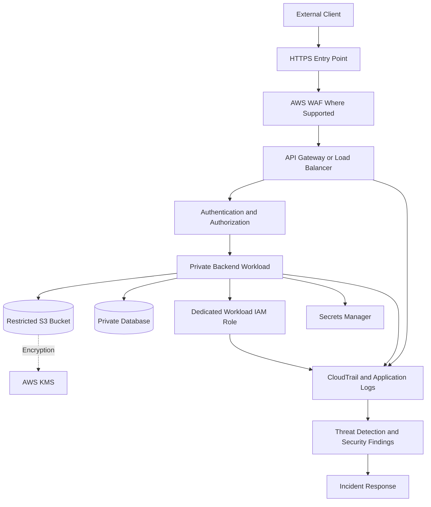

# 02- Defense in Depth

## Overview

Defense in depth is a security strategy that combines multiple, complementary controls to protect applications, identities, data, and infrastructure. Instead of relying on a single security mechanism, it establishes layers of protection so that the failure or bypass of one control does not automatically compromise the entire workload.

In AWS, defense in depth combines account boundaries, IAM authorization, network isolation, application security, encryption, secrets management, audit logging, threat detection, and incident response.

For backend systems built with Django, FastAPI, microservices, containers, and serverless workloads, this approach is particularly important because a single application may interact with public APIs, internal services, databases, queues, object storage, and other AWS resources.

The objective is not to maximize the number of security controls. It is to establish **independent, complementary, and verifiable controls at meaningful trust boundaries** while keeping the architecture maintainable and operationally reliable.

## Why Defense in Depth Matters

No individual security control can address every threat.

- Authentication verifies identity but does not necessarily authorize access to a specific resource.
- IAM restricts AWS API operations but does not replace application-level tenant authorization.
- Private networking reduces network exposure but does not prevent a compromised workload from accessing every reachable resource.
- Encryption protects data under defined conditions but does not prevent an authorized application from returning sensitive plaintext.
- Monitoring identifies suspicious activity but does not prevent every attack.
- Backups support recovery but do not stop data exfiltration or unauthorized access.

Defense in depth addresses these limitations by combining controls with different security responsibilities.

### Example: Compromised Backend Service

Consider a FastAPI service running on Amazon ECS that stores customer documents in S3 and metadata in PostgreSQL.

If an attacker exploits a vulnerability in the service, the resulting impact depends on the surrounding controls.

| Control | Without the control | With the control |
|---|---|---|
| Dedicated IAM task role | Compromised service may inherit excessive AWS permissions | Access is restricted to required resources and operations |
| S3 resource restrictions | The service may access unrelated buckets or objects | Access is limited by applicable identity and resource policies |
| Database authorization | The attacker may access unrelated tables or perform unnecessary operations | Database permissions restrict accessible data and operations |
| Private network boundaries | More resources may be reachable from the compromised workload | Connectivity is limited to required communication paths |
| Application authorization | An authenticated request may access another tenant's records | Object-level and tenant-level checks restrict the operation |
| Audit logging | Suspicious actions may be difficult to investigate | Available API activity and application events support investigation |
| Threat detection and alerting | Compromise may remain unnoticed | Relevant suspicious activity can generate findings or alerts |
| Incident response procedures | Containment and recovery may be delayed | Operators can restrict access, preserve evidence, and restore service systematically |

The goal is to reduce the probability of compromise, limit the blast radius, improve detection, and enable recovery.

## Security Layers

A practical AWS security design can be organized into the following layers.

| Layer | Primary purpose | Representative controls |
|---|---|---|
| Organization and governance | Establish account boundaries and guardrails | AWS Organizations, service control policies, account separation |
| Identity and access | Restrict who can perform which operations | IAM roles, trust policies, least privilege, temporary credentials |
| Network | Limit communication paths and exposure | VPCs, security groups, network ACLs, VPC endpoints |
| Edge and API | Filter unwanted traffic and secure entry points | HTTPS, API Gateway authorization, AWS WAF, rate-based rules |
| Application | Enforce business and data-access rules | Authentication, tenant isolation, input validation, object-level authorization |
| Data | Protect stored and transmitted information | TLS, encryption at rest, AWS KMS, database permissions |
| Secrets | Prevent credential exposure | Secrets Manager, Systems Manager Parameter Store, secret rotation |
| Detection | Identify suspicious activity and configuration drift | CloudTrail, GuardDuty, Security Hub, AWS Config, CloudWatch |
| Response and recovery | Contain incidents and restore secure operation | Credential revocation, workload isolation, evidence preservation, recovery procedures |

These layers are logical rather than strictly sequential. Some controls operate continuously, while others apply to specific requests, resources, or operational events.

## Defense-in-Depth Architecture

The following diagram illustrates a layered security design for a backend application deployed on AWS.



The architecture illustrates complementary controls, not a universal deployment template. WAF placement and API authorization depend on the selected AWS services. Encryption integration also varies by service and configuration.

A secure deployment must validate each control independently and verify that the controls collectively enforce the intended security boundaries.

## Identity and Access Controls

Identity controls restrict access based on the principal, requested action, target resource, and applicable policy conditions.

### Use Dedicated Workload Roles

Assign separate IAM roles to workloads with different responsibilities.

For example:

- An API service may need to read customer documents from a specific S3 prefix.
- A background worker may need to process messages from one queue and update selected database records.
- A deployment pipeline may need permissions to publish an application image and update a specific service.
- An operational role may need read-only access to inspect security configuration.

Sharing a broadly privileged role across these workloads increases the blast radius of a compromised component.

### Apply Least Privilege

A policy should grant only the actions and resources required by the workload.

The following illustrative identity policy allows a service to read objects from a specific S3 prefix.

```json
{
  "Version": "2012-10-17",
  "Statement": [
    {
      "Sid": "ReadCustomerDocuments",
      "Effect": "Allow",
      "Action": [
        "s3:GetObject"
      ],
      "Resource": "arn:aws:s3:::<application-bucket>/customer-documents/*"
    }
  ]
}
```

This policy does not independently grant permission to list the bucket, delete objects, or access unrelated resources. Additional permissions may be required by the actual application workflow or encryption configuration.

Review the complete authorization path, including resource policies, explicit denies, permissions boundaries, session policies, and applicable organization-level restrictions.

### Use Temporary Credentials

Prefer workload identities and temporary credentials over long-lived access keys embedded in application configuration.

Supported execution environments, including EC2, Lambda, and ECS, provide mechanisms for supplying workload credentials through their associated roles.

This reduces the need to distribute and rotate static credentials manually. It does not eliminate the need to restrict role permissions or respond to compromised workloads.

## Network and Edge Controls

Network controls limit which systems can communicate with one another. Edge controls reduce exposure to unwanted or abusive requests.

### Network Segmentation

Use VPC boundaries, routing, security groups, and supported private connectivity mechanisms to limit communication paths.

For a typical backend platform:

- Public entry points receive external traffic.
- Backend workloads run in private subnets where practical.
- Databases accept connections only from required application security groups.
- AWS service traffic uses supported VPC endpoints or other controlled connectivity paths where appropriate.
- Administrative access follows an explicitly designed and auditable path.

A private subnet is not a complete security boundary by itself. Routing, security-group rules, endpoint policies, IAM permissions, and application authorization must work together.

### Protect Public APIs

Use HTTPS, appropriate authentication, application authorization, and request validation. Where supported, AWS WAF can filter unwanted requests and apply rate-based rules.

AWS Shield provides DDoS protection capabilities, but neither Shield nor WAF replaces IAM least privilege or application-level authorization.

### Separate Network Reachability from Permission

A workload may be able to establish a network connection to an AWS service but still lack permission to call its API. Conversely, an IAM policy may allow an operation while network configuration prevents the request from reaching the service.

Troubleshoot these as separate dimensions:

1. Can the workload resolve the endpoint and establish a connection?
2. Does the network path permit the required traffic?
3. Does the caller have the required AWS permissions?
4. Does the resource policy permit the operation?
5. Does the application authorize the requested business operation?

This separation avoids unnecessary permission changes when the actual failure is network-related.

## Application and Data Controls

Infrastructure security cannot replace application-level security. Backend services must enforce business rules and protect sensitive data even when infrastructure access is correctly configured.

### Authentication and Authorization

Authentication establishes the caller's identity. Authorization determines whether that caller can perform a particular operation.

For example, an authenticated user should not automatically be allowed to retrieve every customer record through a Django REST Framework or FastAPI endpoint.

The application must validate ownership, tenant membership, and operation-specific permissions before returning or modifying data.

### Database Security

Apply defense in depth to database access through:

- Private network placement and restrictive security groups.
- Strong database authentication and managed credential storage.
- Database users with narrowly scoped privileges.
- Application-level authorization before accessing protected records.
- Encryption at rest and TLS where supported.
- Appropriate audit logging, backups, and recovery controls.

Avoid relying exclusively on the application to restrict access if database permissions can also limit the impact of a compromised connection.

### Encryption

Use TLS to protect data in transit and supported encryption mechanisms for data at rest.

AWS KMS can provide key-management capabilities for supported AWS services. Customer-managed keys offer additional policy and lifecycle control but introduce operational responsibilities.

Encryption must be combined with authorization. A workload that is legitimately authorized to read encrypted data may still obtain plaintext, so permissions governing both the resource and required cryptographic operations must be reviewed.

## Secrets and Credential Protection

Secrets are a separate security concern because credentials may grant access beyond the application that stores them.

Use AWS Secrets Manager or Systems Manager Parameter Store according to the required features, sensitivity, rotation requirements, and operational costs.

A secure secret-handling design should:

- Retrieve secrets using the workload's identity.
- Restrict retrieval permissions to the required secret.
- Avoid committing secrets to source control or embedding them in container images.
- Prevent credentials and secret payloads from appearing in logs.
- Define cache expiration and refresh behavior.
- Test credential rotation against application connection pools and dependent services.
- Revoke or rotate compromised credentials promptly.

### Example: Secure Secret Retrieval in Python

```python
import json
import boto3
from botocore.exceptions import BotoCoreError, ClientError


def get_database_configuration(
    secret_id: str,
    region_name: str,
) -> dict:
    client = boto3.client(
        "secretsmanager",
        region_name=region_name,
    )

    try:
        response = client.get_secret_value(SecretId=secret_id)
        secret_string = response.get("SecretString")

        if not secret_string:
            raise ValueError("Expected a string-form secret")

        secret = json.loads(secret_string)

        required_fields = {"username", "password", "host", "dbname"}
        if not required_fields.issubset(secret):
            raise ValueError("Required database fields are missing")

        return secret

    except (BotoCoreError, ClientError):
        # Record sanitized diagnostic information through the
        # application's logging system without logging secret values.
        raise RuntimeError("Database configuration retrieval failed") from None
```

The example assumes the secret is a JSON string. The application should validate the expected schema, handle failures appropriately, and ensure the returned values are not included in exception messages or logs.

## Preventive, Detective, and Responsive Controls

Defense in depth requires more than preventive mechanisms. Detection and response controls are necessary when an attack bypasses an existing safeguard.

| Category | Objective | AWS examples |
|---|---|---|
| Preventive | Reduce the likelihood of unauthorized activity | IAM policies, SCPs, security groups, KMS policies, WAF rules |
| Detective | Identify suspicious activity or unsafe configuration | CloudTrail, GuardDuty, Security Hub, AWS Config, CloudWatch |
| Responsive | Contain incidents and restore secure operation | Credential revocation, access restriction, workload isolation, recovery procedures |

### Centralized Detection

Use CloudTrail to investigate supported AWS API activity. GuardDuty can identify supported threats, while Security Hub can aggregate and evaluate supported security findings and controls. CloudWatch provides metrics, logs, and alarms, and AWS Config can record resource configurations and evaluate supported rules.

The exact coverage depends on configuration, service support, Region, retention, and integrations.

Security findings should have defined ownership, severity, escalation criteria, and response procedures. Enabling a detection service without an operational workflow can leave important findings unaddressed.

## Failure Scenarios and Control Independence

A well-designed security architecture anticipates failures at individual layers and avoids assuming that one successful control proves the entire request is safe.

| Scenario | Controls that limit impact | Operational response |
|---|---|---|
| Application vulnerability | Least-privilege role, tenant authorization, database permissions, network restrictions | Isolate the affected workload, investigate access, patch, and validate permissions |
| Leaked AWS credentials | Temporary credentials, scoped IAM permissions, audit logging | Restrict or revoke the affected credentials, investigate activity, and remove the exposure |
| Public resource misconfiguration | Resource policies, organization guardrails, configuration monitoring | Restrict exposure, assess data access, and verify remediation |
| Excessive database access | Database-level permissions, private networking, application authorization | Restrict database access and inspect affected records and sessions |
| KMS authorization failure | Documented key ownership, tested policies, monitoring | Inspect key state and policies, restore only required permissions, and verify data access |
| Suspicious AWS API activity | CloudTrail evidence, threat detection, alerting | Identify the principal, preserve evidence, contain access, and investigate affected resources |
| WAF false positive | Application monitoring, rule visibility, controlled rule changes | Inspect the matching rule, test a narrow exception, and verify that protection remains effective |
| Missing audit events | Logging coverage checks, delivery monitoring, protected log destinations | Verify configuration and delivery, identify the gap, and restore expected coverage |

### Investigate Before Expanding Permissions

For an `AccessDenied` error, determine:

1. Which principal made the request?
2. Which action and resource were involved?
3. Which identity and resource policies apply?
4. Is there an explicit deny, restrictive condition, permissions boundary, session policy, or organization control?
5. Does the operation require additional service-specific permissions?
6. Is the request using the expected account, Region, and credentials?

Do not resolve the error by granting administrator access. Make a targeted change only after identifying the authorization failure.

## Operational Verification

Defense in depth is effective only when controls are configured correctly and remain effective after deployment changes.

### Security Review Checklist

- [ ] Workloads use dedicated IAM roles with narrowly scoped permissions.
- [ ] Public exposure is intentional and documented.
- [ ] Security groups permit only required communication paths.
- [ ] Application authorization enforces ownership and tenant boundaries.
- [ ] Secrets are retrieved securely and never logged.
- [ ] Encryption settings and KMS permissions match data-protection requirements.
- [ ] CloudTrail coverage and protected log destinations are configured.
- [ ] Security findings have assigned owners and response procedures.
- [ ] CI/CD permissions are separated from runtime permissions.
- [ ] Incident containment and credential-revocation procedures are documented.
- [ ] Changes to IAM, network rules, and KMS policies are reviewed and tested.
- [ ] Recovery procedures account for data availability and encryption-key dependencies.

### Verify the Active AWS Identity

The following read-only command confirms the identity associated with the active AWS credentials:

```bash
aws sts get-caller-identity
```

Use it when investigating unexpected access behavior or validating an execution environment. It identifies the active principal and account but does not show the principal's full effective permissions.

### Inspect Network Rules

```bash
aws ec2 describe-security-groups \
  --group-ids <security-group-id> \
  --region <region>
```

Review inbound and outbound rules against the intended workload communication paths. This command inspects configuration without modifying the security group.

### Inspect Recent API Activity

```bash
aws cloudtrail lookup-events \
  --start-time <start-time> \
  --end-time <end-time> \
  --region <region>
```

Use the returned events to investigate relevant activity within the available lookup scope. Additional filtering and investigation may be necessary to identify a particular principal or resource. Missing results do not prove that an action never occurred.

## Common Mistakes

| Mistake | Consequence | Better approach |
|---|---|---|
| Treating defense in depth as adding as many controls as possible | Complexity increases without necessarily improving security | Select controls based on threats, trust boundaries, and failure modes |
| Relying only on network isolation | Authorized or compromised workloads may still access sensitive resources | Combine network controls with identity and application authorization |
| Assuming authentication implies authorization | Users may access resources outside their intended scope | Enforce object-level and tenant-level permissions |
| Using one powerful IAM role across services | A compromise can affect unrelated resources | Use dedicated workload identities |
| Treating encryption as a replacement for access control | Authorized callers may still retrieve plaintext | Restrict data access and cryptographic permissions |
| Enabling monitoring without defining response ownership | Findings may remain unresolved | Assign severity, ownership, escalation, and response procedures |
| Granting broad permissions to fix errors | Excessive access hides the underlying issue | Diagnose the authorization path and apply targeted changes |
| Ignoring control interactions | Individually valid configurations may fail when combined | Test complete request paths and negative authorization cases |
| Failing to retest after deployments | Infrastructure or application changes may weaken existing protections | Include security validation in CI/CD and operational reviews |

## Key Takeaways

- Defense in depth combines complementary identity, network, application, data, detection, and response controls to limit the impact of individual failures.
- Least-privilege workload roles and explicit application authorization reduce the blast radius of compromised services.
- Network isolation, encryption, and edge protection complement rather than replace authorization at each trust boundary.
- Centralized audit evidence and actionable detection workflows support timely investigation, containment, and recovery.
- Security controls must be independently verified and tested together as part of deployment, operations, and incident-response procedures.