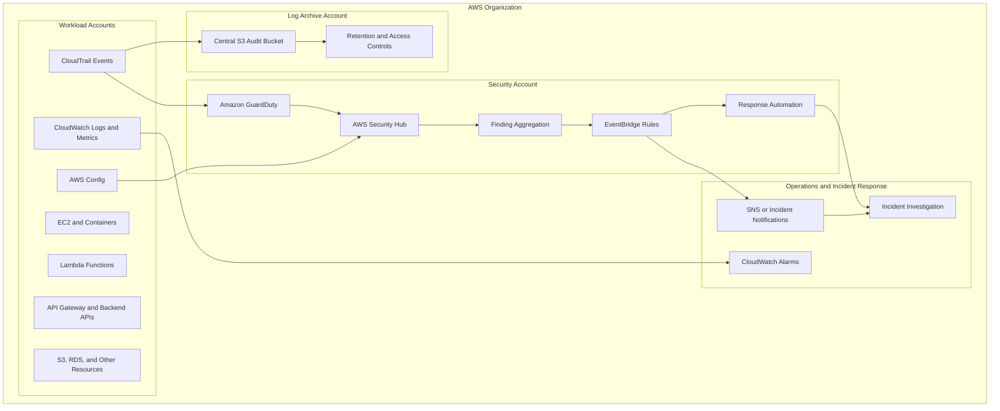
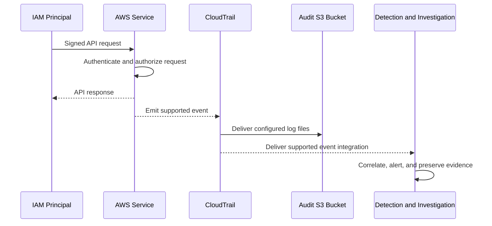
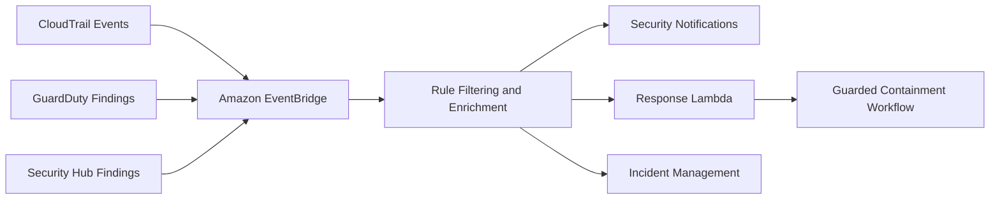
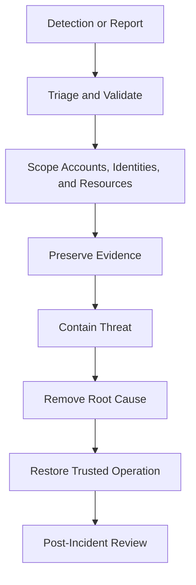

# 03- Security Monitoring and Threat Detection Architecture

## Overview

AWS security monitoring and threat detection provide continuous visibility into identity activity, API operations, network behavior, resource configurations, and potential compromise indicators across cloud workloads.

A production security architecture must do more than collect logs. It must convert security-relevant events into actionable findings, correlate activity across accounts and services, preserve evidence, and support timely containment and recovery.

For backend systems built with Django, FastAPI, API Gateway, Lambda, EC2, PostgreSQL, Redis, and microservices, monitoring should cover both the AWS control plane and the application data plane.

The primary objectives are to:

- Detect suspicious identity activity, credential misuse, and unauthorized API calls.
- Identify exposed resources and configuration drift.
- Centralize security findings across accounts and Regions.
- Maintain durable audit evidence for investigation and compliance.
- Alert the appropriate responders with sufficient context to act.
- Reduce detection time and contain incidents without unnecessarily disrupting workloads.

AWS provides several complementary services for these objectives. No single service provides complete security visibility.

## Security Monitoring Architecture

### Core monitoring components

| Service | Primary responsibility | Typical use |
|---|---|---|
| AWS CloudTrail | Records supported AWS API activity | Investigating who performed an operation, when, and against which resource |
| Amazon GuardDuty | Detects suspicious activity using supported telemetry and threat intelligence | Detecting credential compromise, anomalous behavior, and potential threats |
| AWS Security Hub | Aggregates and prioritizes security findings | Central security posture visibility and cross-account findings management |
| Amazon CloudWatch | Collects metrics and logs and evaluates alarms | Operational alerts, application logs, and detection rules based on configured telemetry |
| AWS Config | Records supported resource configurations and evaluates rules | Detecting noncompliant configurations and configuration drift |
| Amazon EventBridge | Routes supported events to targets | Triggering automated workflows when findings or audit events arrive |
| Amazon SNS | Distributes notifications | Sending alerts to subscribed endpoints |
| Amazon S3 | Stores objects, including audit logs and evidence | Long-term retention of CloudTrail logs and investigation artifacts |
| AWS Organizations | Establishes account hierarchy and organizational boundaries | Centralized governance and security administration |

These services have different purposes. CloudTrail records activity; GuardDuty identifies potential threats; Security Hub aggregates findings; CloudWatch supports telemetry and alerting; Config evaluates resource configuration; and EventBridge connects events to response workflows.

### Reference architecture

A multi-account environment should centralize security visibility while preserving workload isolation.



The diagram represents a logical design. Exact service integrations and event delivery paths depend on the enabled features, account configuration, and Region.

### Architectural boundaries

Use separate accounts for security administration, centralized audit logging, and application workloads when the organization's risk profile justifies the separation.

- **Workload accounts:** Run applications and own application resources.
- **Security account:** Hosts centralized security tooling, delegated administration, and finding workflows.
- **Log archive account:** Stores audit logs with tightly restricted write and administrative access.
- **Management account:** Owns organization-level administration and should not become a general-purpose workload account.

An account boundary limits the blast radius of many resource-level mistakes. It does not eliminate the need for correct IAM policies, organization policies, logging configuration, and incident-response procedures.

## Security Monitoring Principles

### Preventive, detective, and responsive controls

Security controls are more effective when they cover the complete lifecycle of an incident.

| Control category | Objective | Examples |
|---|---|---|
| Preventive | Reduce the likelihood of compromise | Least-privilege IAM, SCPs, private endpoints, encryption, MFA, secure deployment identities |
| Detective | Identify suspicious activity or policy violations | CloudTrail, GuardDuty, Security Hub, Config rules, CloudWatch alarms |
| Responsive | Contain and remediate incidents | Disable or restrict credentials, revoke sessions where supported, isolate workloads, update security groups, preserve evidence |

A detective control does not prevent an action by itself. For example, a CloudTrail event showing a suspicious `PutBucketPolicy` request provides evidence, but preventing or reversing the change requires separate authorization controls and response procedures.

### Monitor both control-plane and data-plane activity

**Control-plane activity** changes or inspects AWS resources. Examples include:

- `CreateAccessKey`
- `AttachRolePolicy`
- `PutBucketPolicy`
- `AuthorizeSecurityGroupIngress`
- `ScheduleKeyDeletion`
- `UpdateFunctionConfiguration`

**Data-plane activity** operates on data or invokes a workload service. Examples include supported S3 object operations, database queries, and application API requests.

CloudTrail coverage varies by service and event category. Data events may require explicit configuration and can incur additional charges. Application requests and database queries may require their own logging because CloudTrail does not record every operation performed inside an application or database.

For each workload, determine which events are required for security investigations, which are enabled, and how they are retained.

### Design detections around risk

A useful detection should answer:

- What happened?
- Which identity or principal initiated the activity?
- Which resource was affected?
- Was the operation successful?
- What is the potential impact?
- What evidence supports the alert?
- What action should the responder take?

Avoid generating alerts for every event without prioritization. Excessive low-value alerts increase response fatigue and can cause critical signals to be overlooked.

## AWS CloudTrail

### Purpose and behavior

AWS CloudTrail records supported activity in an AWS account. Events can include the caller identity, event source, event name, request context, affected resources when available, and result information.

CloudTrail is essential for auditability and investigation, but it is not a complete record of every event occurring inside an application.

Important event categories include:

| Event category | Description | Security use |
|---|---|---|
| Management events | Operations on AWS resources and account configuration | Detecting IAM changes, security-group changes, and resource policy modifications |
| Data events | Supported operations on data-plane resources | Investigating selected S3 object operations and other supported resource activity |
| Network activity events | Supported network-related activity events for configured resources | Investigating applicable network activity |
| Insights events | Identifies unusual API activity patterns for supported management events when enabled | Detecting certain changes in API call rates or error rates |

CloudTrail event categories and service coverage differ. Validate the current service-specific support and configuration before relying on an event for incident detection.

### Event flow



CloudTrail delivery and downstream processing are asynchronous. Do not assume an event is available immediately after an API call. Incident procedures should account for delivery delay, event ingestion latency, and possible differences between event sources.

### Create a multi-Region trail

A multi-Region trail is generally appropriate for centralized audit logging because it records supported management events across enabled Regions, including future Regions covered by the trail configuration. Organization trails can extend coverage across member accounts when configured and supported.

The following commands are examples for an authorized administrator. They create or configure security-sensitive resources and should be executed only after validating the organization's logging design.

```bash
aws cloudtrail create-trail \
  --name organization-audit-trail \
  --s3-bucket-name <LOG_ARCHIVE_BUCKET> \
  --is-multi-region-trail \
  --enable-log-file-validation

aws cloudtrail start-logging \
  --name organization-audit-trail
```

**Important parameters:**

- `--s3-bucket-name`: Destination bucket for delivered log files.
- `--is-multi-region-trail`: Enables collection across Regions covered by the trail.
- `--enable-log-file-validation`: Enables digest files that support integrity validation of delivered log files.
- `start-logging`: Starts recording for the trail.

Verify the resulting configuration:

```bash
aws cloudtrail describe-trails \
  --include-shadow-trails \
  --query 'trailList[].{Name:Name,HomeRegion:HomeRegion,MultiRegion:IsMultiRegionTrail,Validation:LogFileValidationEnabled,Bucket:S3BucketName}' \
  --output table

aws cloudtrail get-trail-status \
  --name organization-audit-trail
```

Interpret the results carefully. A configured trail does not prove that every desired event category is enabled or that the destination bucket has the intended retention and access controls.

Before production deployment, configure the S3 bucket policy, encryption, retention, access restrictions, monitoring for delivery failures, and any required organization-trail settings. A trail created in one account does not automatically provide organization-wide coverage.

### Protect audit logs

Audit logs are sensitive security evidence. A compromised administrator should not be able to silently remove all evidence of their activity.

Recommended controls include:

- Store logs in a dedicated log archive account.
- Restrict bucket writes to the required delivery principals.
- Restrict log reads to authorized investigation roles.
- Use S3 Block Public Access and least-privilege bucket policies.
- Enable encryption at rest and enforce TLS for applicable access paths.
- Use versioning and, where justified, S3 Object Lock with an appropriate retention mode.
- Monitor changes to trail configuration, bucket policies, retention, and encryption settings.
- Enable log file validation and periodically validate delivered logs.
- Retain logs according to investigation, compliance, and cost requirements.

Log file validation helps detect modification or deletion of log files after delivery, but it is not a substitute for access control, protected retention, or independent evidence storage.

### Query CloudTrail events

Use the AWS CLI to investigate recent events:

```bash
aws cloudtrail lookup-events \
  --lookup-attributes AttributeKey=EventName,AttributeValue=PutBucketPolicy \
  --start-time <START_TIME_ISO8601> \
  --end-time <END_TIME_ISO8601> \
  --region <REGION> \
  --max-results 50
```

This command searches management event history for the specified event name in the selected Region and time range. Event history is limited in scope and retention compared with a properly configured trail delivering logs to S3 or a queryable analytics system.

Inspect an event's `CloudTrailEvent` JSON field for details such as `userIdentity`, `eventSource`, `eventName`, `sourceIPAddress`, `userAgent`, `requestParameters`, and `errorCode`, when present.

Avoid copying raw events into tickets or chat systems without reviewing them for sensitive values and unnecessary personal or operational information.

## Amazon GuardDuty

### Purpose

Amazon GuardDuty analyzes supported telemetry and threat intelligence to identify potentially malicious activity. It can produce findings involving suspicious credentials, unusual API activity, network behavior, malware, and other supported threat categories.

GuardDuty is a detection service, not an authorization engine. A finding indicates a suspected threat or risky behavior and requires investigation before remediation.

### Common detection categories

| Category | Example concern | Investigation direction |
|---|---|---|
| Credential compromise | Credentials used from an unexpected context | Identify the principal, credential type, source, and recent activity |
| Reconnaissance | Unusual discovery or enumeration behavior | Inspect API history, identity permissions, and source context |
| Unauthorized access | Suspicious access patterns involving AWS resources | Correlate principal activity with resource policies and expected workload behavior |
| Network threats | Suspicious communication or traffic patterns covered by GuardDuty | Identify affected resources, network paths, and workload ownership |
| Malware-related findings | Potential malicious files or behavior in supported environments | Preserve evidence and follow the applicable response procedure |

Exact finding types, supported data sources, and regional availability vary. Use the current GuardDuty finding documentation when building automated decisions.

### Enable GuardDuty

Enable GuardDuty in the intended account and Region using an authorized security administrator:

```bash
aws guardduty create-detector \
  --enable \
  --region <REGION>
```

Inspect detectors:

```bash
aws guardduty list-detectors \
  --region <REGION>
```

Retrieve findings for a detector:

```bash
aws guardduty list-findings \
  --detector-id <DETECTOR_ID> \
  --region <REGION> \
  --finding-criteria '{"Criterion":{"severity":{"Gte":7}}}'
```

The severity filter is an example, not a universal response threshold. Tune thresholds according to the organization's threat model, environment, and operational capacity.

A detector in one Region does not automatically establish complete coverage across all accounts and Regions. Use delegated administration and organization-level configuration where appropriate, and verify the resulting coverage.

### Responding to findings

A GuardDuty finding should trigger a structured workflow:

1. Validate the finding type, severity, affected resource, and account.
2. Determine whether the activity is expected, authorized, or associated with a known deployment.
3. Correlate the finding with CloudTrail, application logs, network telemetry, and identity configuration.
4. Determine whether credentials, workloads, or data may be compromised.
5. Contain the affected identity or workload using a risk-appropriate procedure.
6. Preserve evidence and document the timeline.
7. Remediate the root cause and verify that the threat is no longer active.

Do not automatically terminate an instance or revoke a role merely because a finding exists. Automated containment can disrupt production workloads, destroy volatile evidence, or cause cascading failures.

## AWS Security Hub

### Purpose

AWS Security Hub provides a centralized view of security findings and supported security posture checks. It can aggregate findings from integrated AWS services and supported third-party products.

Security Hub complements individual detection services rather than replacing them.

Typical uses include:

- Aggregating GuardDuty findings.
- Collecting findings from supported integrations.
- Reviewing security posture against enabled standards and controls.
- Prioritizing findings by severity, resource, account, and status.
- Routing findings into incident-management workflows.

Security Hub capabilities and control availability depend on the enabled features, standards, Regions, and integrations.

### Organization-level aggregation

A centralized security account can serve as the delegated administrator for Security Hub where configured. Member accounts can then contribute findings to the designated aggregation setup.

The operational design should specify:

- Which account owns security administration.
- Which Regions and accounts are in scope.
- How findings are aggregated and deduplicated.
- Who owns triage and remediation.
- How findings are routed to ticketing or incident systems.
- How exceptions are approved, reviewed, and expired.

### Inspect findings

```bash
aws securityhub get-findings \
  --region <REGION> \
  --filters '{"SeverityLabel":[{"Value":"HIGH","Comparison":"EQUALS"},{"Value":"CRITICAL","Comparison":"EQUALS"}]}' \
  --max-results 20
```

This read-only command retrieves matching findings from the selected Region. The returned records include fields such as finding identifiers, severity, resource information, workflow status, and remediation details when available.

A high-severity finding is not automatically equivalent to an active incident. Prioritize using exploitability, exposure, data sensitivity, resource criticality, and evidence of active abuse.

## Amazon CloudWatch

### Purpose and role in security

Amazon CloudWatch provides metrics, log ingestion, queries, alarms, and dashboards. It is useful for security monitoring when the required telemetry is published or configured.

Examples include:

- Alarm on repeated application authentication failures.
- Alert when a workload emits an unexpected error spike.
- Detect unusual request rates from application logs.
- Monitor failed log delivery or security automation failures.
- Trigger investigation when configured metrics exceed a threshold.

CloudWatch does not automatically detect every security threat. Detection depends on the available data, log configuration, query logic, thresholds, and operational response.

### Application security logging

Backend applications should emit structured events that support investigation without recording credentials or sensitive payloads.

Example using Python logging:

```python
import json
import logging
from datetime import datetime, timezone

logger = logging.getLogger("security")
logger.setLevel(logging.INFO)


def record_authentication_failure(
    *,
    request_id: str,
    actor_id: str | None,
    reason_code: str,
) -> None:
    event = {
        "event_type": "authentication_failure",
        "timestamp": datetime.now(timezone.utc).isoformat(),
        "request_id": request_id,
        "actor_id": actor_id,
        "reason_code": reason_code,
    }

    logger.warning(json.dumps(event))
```

The application should configure its logging handler and log destination through its deployment environment. Do not include passwords, access tokens, session cookies, authorization headers, secret values, or full sensitive request bodies.

Use stable reason codes rather than raw exception messages when those messages might expose implementation details or user input.

### CloudWatch Logs metric filters and alarms

For selected log groups, metric filters can convert matching log events into metrics. CloudWatch alarms can then evaluate those metrics and notify responders.

For example, if an application emits a consistent `authentication_failure` event, a metric filter can count occurrences and an alarm can detect an unusual increase.

Operational considerations:

- Normalize log formats before building filters.
- Distinguish expected user mistakes from credential-stuffing indicators.
- Use dimensions carefully; high-cardinality dimensions can increase cost and complicate alarm design.
- Configure alarm actions and verify that notifications reach an actively monitored destination.
- Keep retention aligned with security and compliance requirements.
- Protect log-group access and monitor changes to logging configuration.

CloudWatch Logs Insights is useful for interactive investigation, but queries are not a replacement for a defined detection and response process.

## AWS Config

### Purpose

AWS Config records supported resource configuration changes and evaluates resources against rules. It helps identify security-relevant configuration drift.

Examples include:

- S3 buckets with prohibited public access configurations.
- Security groups that expose management ports broadly.
- Resources that do not meet approved encryption requirements.
- IAM-related configuration checks supported by the configured rules.
- Changes to selected security-sensitive resources.

AWS Config is not a real-time authorization boundary. Evaluation timing and coverage depend on the resource type, recording configuration, rule type, and service behavior.

### Configuration controls

A production implementation should define:

- Which resource types are recorded.
- Whether global resource types are covered where applicable.
- Which managed and custom rules are enabled.
- How noncompliant findings are routed.
- Which exceptions are accepted and who approves them.
- How rule evaluation failures and missing configuration data are monitored.

Before relying on a compliance result, verify that the relevant resources are recorded and the required rule is active in the appropriate account and Region.

## Event-Driven Detection and Response

### Architecture pattern

EventBridge can route supported security findings and audit events to response systems. This separates event producers from downstream actions and allows detection logic to evolve independently.



Use the integration that matches the required event type. Not every CloudTrail event, finding, or service event follows the same delivery path.

### Example EventBridge rule

The following event pattern matches GuardDuty findings with a high severity score. It is a filtering example; it does not itself perform containment.

```json
{
  "source": ["aws.guardduty"],
  "detail-type": ["GuardDuty Finding"],
  "detail": {
    "severity": [
      {
        "numeric": [">=", 7]
      }
    ]
  }
}
```

Deploy the rule with an appropriate event bus, target, permissions, retry behavior, and failure handling. Confirm the exact event structure using representative events from the environment.

### Safe automation design

Automated response should be idempotent, auditable, and bounded.

A robust workflow should:

- Validate the event schema and source.
- Confirm account, Region, finding type, and resource identity.
- Retrieve additional evidence before taking destructive action.
- Check whether the action has already been applied.
- Require approval for high-impact actions when appropriate.
- Use a dedicated execution role with narrowly scoped permissions.
- Record the decision, evidence references, and outcome.
- Retry transient failures without repeating unsafe side effects.
- Send failed or ambiguous cases to a human responder.

Avoid broad automation that disables all access keys, modifies every security group, or terminates resources based only on a generic severity label.

## Threat Detection Scenarios

### Suspicious IAM activity

**Signal:** A new access key is created for a privileged IAM user, or an unexpected policy attachment occurs.

**Investigation:**

1. Identify the caller from CloudTrail.
2. Inspect the event timestamp, source address, user agent, and request parameters.
3. Determine whether the activity matches an approved change or automation.
4. Inspect the principal's current policies and recent identity changes.
5. Search for follow-on activity such as role assumption, access to sensitive data, or changes to logging.

Relevant events may include `CreateAccessKey`, `AttachUserPolicy`, `AttachRolePolicy`, `PutRolePolicy`, and `UpdateAssumeRolePolicy`. Event availability and fields depend on the operation.

### Unauthorized resource exposure

**Signal:** A security group is modified to allow broad ingress, or a storage resource becomes publicly accessible.

**Investigation:**

1. Identify the resource and exact configuration change.
2. Inspect the associated CloudTrail event and caller.
3. Review the current configuration and its previous known state.
4. Determine whether the resource contains sensitive data or exposes a production service.
5. Apply the approved remediation and verify the resulting configuration.

A configuration finding does not establish that an attacker accessed the resource. Determine actual exposure and access using relevant network, service, and application evidence.

### Unexpected API activity

**Signal:** A workload or identity makes an unusual volume of API calls, or calls services outside its normal operating pattern.

**Investigation:**

- Compare the caller identity with the expected workload role.
- Inspect `eventSource`, `eventName`, `awsRegion`, and available source context.
- Correlate the timeline with deployments, scheduled jobs, and incident reports.
- Check for privilege escalation, data access, and resource modification.
- Review GuardDuty findings and other relevant telemetry.

Avoid treating source IP or user agent as definitive proof of identity. NAT, proxies, shared infrastructure, and SDK behavior can complicate attribution.

### Suspicious data access

**Signal:** Unexpected access to sensitive S3 objects or other monitored data-plane resources.

**Investigation:**

1. Confirm that the required data events were enabled for the resource and time period.
2. Identify the principal and object or resource involved.
3. Compare activity with normal application behavior.
4. Review resource policies, identity permissions, and access paths.
5. Check for unusual downloads, policy changes, or follow-on activity.

If data events were not enabled and no other suitable telemetry exists, the available audit evidence may be incomplete. Record that limitation instead of assuming the activity did not occur.

## Incident Response Workflow

### Standard lifecycle



The exact ordering can vary during an active incident. Immediate containment may be necessary before all evidence is collected, but preserve the most important available evidence before taking actions that could destroy it.

### Triage checklist

- Confirm the finding's source, timestamp, severity, and affected account.
- Identify the affected identity, resource, Region, and workload owner.
- Determine whether the event is expected or associated with a deployment.
- Establish the earliest known suspicious activity and the latest observed activity.
- Check for related findings and nearby API events.
- Assess exposure, privilege level, data sensitivity, and business impact.
- Assign an incident owner and document the current hypothesis.
- Preserve relevant log references and evidence before remediation when feasible.

### Credential compromise

If credentials may be compromised:

1. Identify the credential type: IAM access key, role session, federated session, application secret, or another credential.
2. Identify affected accounts, resources, and permissions.
3. Preserve the relevant CloudTrail events and application evidence.
4. Restrict or deactivate compromised credentials using a controlled procedure.
5. For temporary role credentials, investigate the issuing principal and role trust relationship, and use supported session-revocation or policy controls where applicable.
6. Rotate affected application secrets and update dependent workloads.
7. Review activity performed by the compromised identity.
8. Verify that unauthorized access has stopped and restore legitimate service access safely.

Deactivating an IAM access key prevents its future use once the change takes effect, but does not reverse actions already performed. Existing temporary credentials may remain valid until expiration unless a supported policy-based restriction or other applicable revocation mechanism blocks their requests.

Do not assume that rotating a secret alone contains an incident. Investigate whether the compromised credential was used to create additional credentials, modify trust policies, or establish persistence.

### Evidence preservation

Preserve evidence in a location with access controls independent of the suspected compromised workload or identity.

Useful evidence includes:

- CloudTrail events and relevant trail log files.
- GuardDuty and Security Hub finding records.
- AWS Config configuration history.
- CloudWatch logs, metrics, and alarm history.
- Application logs and deployment records.
- Relevant network telemetry and resource configurations.
- A timeline of containment and remediation actions.

Record collection times, source accounts, Regions, query parameters, and the identity performing the collection. Preserve original evidence where possible and perform analysis on controlled copies.

## Security Monitoring for Backend Applications

### Instrument application security events

AWS-level monitoring cannot fully explain application authorization failures, abuse of business workflows, or suspicious user behavior.

Backend services should emit structured events for security-relevant application actions, including:

- Authentication failures and account lockouts.
- Authorization denials for sensitive operations.
- Privileged administrative actions.
- Changes to roles, permissions, or tenant configuration.
- Repeated request failures consistent with abuse.
- Secret retrieval and dependency failures without recording secret contents.
- Unexpected changes to security-sensitive application configuration.

Use a correlation or request ID to connect API gateway, reverse proxy, application, and downstream service logs. Ensure the identifier cannot be manipulated to inject log content.

### Django and FastAPI considerations

For Django and FastAPI applications:

- Keep application authentication and authorization separate from AWS IAM authorization.
- Use IAM roles for AWS API access instead of static access keys.
- Avoid logging `Authorization`, `Cookie`, and secret-bearing headers.
- Record the outcome and reason category for security-sensitive authorization decisions.
- Restrict log access according to the sensitivity of logged identifiers and operational details.
- Define retention, sampling, and redaction policies.
- Avoid including full request bodies in security logs by default.

An AWS role authorizes a workload to call AWS services. It does not automatically authorize an end user to access a particular API endpoint or tenant's database records.

### Correlating AWS and application events

A useful investigation timeline combines:

| Evidence source | What it can establish |
|---|---|
| API Gateway access logs | Request metadata, response status, and configured request context |
| Application logs | Application-level identity, authorization decisions, and business operation results |
| CloudTrail | Supported AWS API activity and caller context |
| GuardDuty | Potential threats identified from supported telemetry |
| CloudWatch metrics | Rates, counts, and trends over time |
| AWS Config | Recorded resource configuration and compliance evaluation |
| Deployment records | Whether an observed change aligns with an approved release |

Do not assume these sources share a common identifier. Correlate using timestamps, principal identifiers, resource ARNs, request IDs where available, and a documented time-normalization strategy.

## Centralized Security Operations

### Account and Region coverage

Central monitoring is only useful when coverage is known and verifiable.

Maintain an inventory of:

- Organization accounts and their owners.
- Enabled Regions and approved Region restrictions.
- CloudTrail trails and their event selectors.
- GuardDuty detector and administrator relationships.
- Security Hub aggregation and integration settings.
- Config recorders, delivery channels, and rules.
- CloudWatch log groups, retention, and alert destinations.
- Security automation roles and their permissions.

Review this inventory regularly and after account creation, workload migration, or changes to organizational policies.

### Alert routing and escalation

Define severity using both technical evidence and business context.

| Priority | Example condition | Expected response |
|---|---|---|
| Critical | Strong evidence of active compromise or destructive privileged activity | Immediate incident escalation and containment assessment |
| High | Credible threat involving sensitive resources or privileged identities | Prompt investigation and risk-based containment |
| Medium | Suspicious activity with incomplete evidence or limited impact | Timely investigation and correlation |
| Low | Hygiene issue or low-risk policy deviation | Track remediation and verify closure |

These categories are operational examples, not universal AWS severity mappings. Establish response targets according to service criticality and organizational incident policy.

Every alert should identify an owner, an expected next action, and an escalation path. Test the entire path, including notification delivery and after-hours ownership.

### Security finding lifecycle

Track findings through explicit states:

- New: Received but not yet triaged.
- Investigating: Evidence collection and validation are in progress.
- Contained: Immediate risk has been restricted.
- Remediating: Root cause and affected configurations are being corrected.
- Resolved: The issue has been corrected and verified.
- Accepted risk: A documented exception has an owner, rationale, and review date.

Avoid closing findings solely because the affected resource is no longer visible or because a notification was acknowledged. Require evidence that the underlying risk is resolved or formally accepted.

## AWS CLI Investigation Workflows

The following commands are primarily read-only inspection operations. They require appropriate IAM permissions and may return different levels of detail based on the caller's access, service configuration, Region, and event retention.

### Verify the current identity

```bash
aws sts get-caller-identity
```

**Purpose:** Confirms the AWS account and principal associated with the active credentials.

**Interpretation:** Verify that the account and ARN match the intended operational role before investigating or changing security controls.

This command does not require an explicit allow in an identity policy, but an applicable explicit deny or other request restriction can still affect its use.

### Inspect CloudTrail configuration

```bash
aws cloudtrail describe-trails \
  --include-shadow-trails \
  --region <REGION>
```

**Purpose:** Lists trail configurations visible in the selected Region, including shadow trails when requested.

Check the destination bucket, multi-Region status, log file validation, and trail ownership. Follow up with `get-trail-status` to inspect logging status and recent delivery information.

### Investigate API activity

```bash
aws cloudtrail lookup-events \
  --lookup-attributes AttributeKey=EventName,AttributeValue=CreateAccessKey \
  --start-time <START_TIME_ISO8601> \
  --end-time <END_TIME_ISO8601> \
  --region <REGION> \
  --max-results 50
```

**Purpose:** Searches event history for access-key creation.

**Interpretation:** Inspect the caller identity, event time, source context, and relevant request details. Repeat for other event names when investigating a sequence of operations.

For larger investigations, use the organization's queryable log archive or analytics platform where configured. Event history is not a complete replacement for centralized long-term logging.

### Inspect GuardDuty findings

```bash
aws guardduty list-detectors \
  --region <REGION>

aws guardduty list-findings \
  --detector-id <DETECTOR_ID> \
  --region <REGION> \
  --finding-criteria '{"Criterion":{"severity":{"Gte":7}}}'
```

**Purpose:** Identifies configured detectors and retrieves findings matching the supplied criteria.

**Interpretation:** Review finding type, resource, severity, timestamps, and evidence fields. Retrieve full finding details using the relevant finding IDs when necessary.

### Inspect Security Hub findings

```bash
aws securityhub get-findings \
  --region <REGION> \
  --max-results 20
```

**Purpose:** Retrieves findings visible to the caller in the selected Region.

**Interpretation:** Check severity, workflow status, affected resources, and remediation guidance. Apply filters to narrow investigations and avoid relying on an unfiltered result set for complete coverage.

### Inspect AWS Config compliance

```bash
aws configservice describe-compliance-by-config-rule \
  --region <REGION>

aws configservice get-compliance-details-by-config-rule \
  --config-rule-name <CONFIG_RULE_NAME> \
  --region <REGION>
```

**Purpose:** Retrieves compliance summaries and evaluation details for a Config rule.

**Interpretation:** Determine whether a resource is compliant, noncompliant, not applicable, or awaiting evaluation. Investigate recording and evaluation failures before interpreting missing results as compliance.

### Inspect security groups

```bash
aws ec2 describe-security-groups \
  --group-ids <SECURITY_GROUP_ID> \
  --region <REGION>
```

**Purpose:** Retrieves ingress and egress rules for a security group.

**Interpretation:** Look for unintended public exposure, unnecessary protocols, broad CIDR ranges, and access to sensitive management ports. Consider the associated network interfaces and workloads before changing a rule.

### Inspect KMS key configuration

```bash
aws kms describe-key \
  --key-id <KEY_ID> \
  --region <REGION>

aws kms get-key-policy \
  --key-id <KEY_ID> \
  --policy-name default \
  --region <REGION>
```

**Purpose:** Inspects key metadata and the selected key policy.

**Interpretation:** Verify key state, usage, account and Region, policy permissions, and any applicable grants or IAM permissions. A key policy alone may not explain the complete authorization decision.

### Inspect secret metadata

```bash
aws secretsmanager describe-secret \
  --secret-id <SECRET_ARN_OR_NAME> \
  --region <REGION>
```

**Purpose:** Retrieves secret metadata, including configuration and rotation information when available.

**Interpretation:** Verify the secret's identity, lifecycle, and rotation configuration without retrieving its secret value.

Avoid using `get-secret-value` during routine inspection unless the value is specifically required and the investigator is authorized to access it.

## Monitoring Failure Modes

### Missing CloudTrail events

**Symptoms:**
- An expected API operation is absent from the query results.
- A trail exists, but the investigation cannot find relevant activity.
- Events appear in one Region but not another.

**Likely causes:**
- The wrong account, Region, or time range was queried.
- The event category was not enabled or the operation is not covered.
- Data events were not configured for the relevant resource.
- The event has not yet been delivered or ingested.
- Trail configuration, permissions, or delivery has failed.
- The operation occurred inside an application or database and is not represented by the expected CloudTrail event.

**Isolation and remediation:**

1. Confirm the principal's account using STS.
2. Check the event source, Region, and exact time window.
3. Inspect trail configuration and logging status.
4. Verify event selectors and service-specific coverage.
5. Check the destination bucket and delivery status.
6. Inspect application or service logs for evidence not covered by CloudTrail.
7. Document any gap in the available evidence.

**Prevention:** Maintain an event-coverage matrix, monitor logging configuration changes, and test representative security investigations periodically.

### GuardDuty detector or finding gaps

**Symptoms:**
- No findings are visible despite suspicious activity.
- Expected accounts or Regions do not appear in the security workflow.
- Findings are generated but never reach responders.

**Likely causes:**
- GuardDuty is not enabled in the affected account or Region.
- Organization-level configuration is incomplete.
- The activity is outside the service's supported detection coverage.
- Finding delivery or downstream routing is misconfigured.
- The finding exists but is filtered out by the query or event rule.

**Isolation and remediation:**

1. Inspect detectors in the affected Region.
2. Verify delegated administration and member-account coverage.
3. Check the exact query criteria and finding type.
4. Validate Security Hub or EventBridge integration where used.
5. Test the notification and response path with an approved test event.

**Prevention:** Track coverage centrally and test detection delivery independently from the underlying detection service.

### Security Hub findings are missing

**Symptoms:**
- Findings exist in a source service but are not visible in the central account.
- Findings appear in one Region but not another.
- A control appears not to evaluate expected resources.

**Likely causes:**
- Source-service integration is not enabled or functioning.
- Aggregation and account configuration are incomplete.
- The query targets the wrong Region or account.
- The relevant control or standard is not enabled.
- Permissions prevent access to expected findings.

**Remediation:** Inspect source-service findings, aggregation configuration, account and Region coverage, integration status, and query filters. Verify that the expected finding reaches the central workflow.

### CloudWatch security alerts do not fire

**Symptoms:**
- A log event exists but no alarm is triggered.
- The alarm remains in `INSUFFICIENT_DATA`.
- Notifications are not delivered.

**Likely causes:**
- The metric filter does not match the actual log format.
- The log group or metric namespace is incorrect.
- The alarm threshold or evaluation period is inappropriate.
- No metric data is emitted during the evaluation period.
- The alarm action, notification subscription, or downstream integration is misconfigured.

**Remediation:** Inspect the raw log event, validate the filter pattern, check the metric and alarm history, and test notification delivery. Confirm that the event is representative of the intended detection.

**Prevention:** Use versioned log schemas, test filters against sample events, and periodically exercise alert delivery.

### AWS Config shows unexpected compliance results

**Symptoms:**
- A resource is missing from a compliance report.
- A resource appears compliant despite a suspected configuration issue.
- Compliance evaluations remain delayed or unavailable.

**Likely causes:**
- Resource recording is disabled or incomplete.
- The resource type or Region is not covered.
- The rule is not configured or has not completed evaluation.
- The rule's scope does not match the resource.
- Evaluation or delivery failures prevent current results.

**Remediation:** Verify recording configuration, rule status, resource scope, and evaluation details. Inspect the current resource configuration independently before concluding that a security requirement is satisfied.

### EventBridge response automation fails

**Symptoms:**
- A finding is visible but no response workflow runs.
- The target receives malformed events.
- Automated actions fail intermittently or execute more than once.

**Likely causes:**
- The event pattern does not match the actual event.
- Target permissions are insufficient.
- The event target or Region is incorrect.
- Retries or duplicate delivery cause non-idempotent behavior.
- A target failure is not routed to an observable failure destination.

**Remediation:** Compare a real event with the rule pattern, inspect target configuration and execution logs, verify invocation permissions, and test retry behavior. Add idempotency controls and failure handling before enabling high-impact remediation.

## Production Security Monitoring Checklist

### Identity and access

- [ ] Use short-lived credentials and workload roles where supported.
- [ ] Require MFA or stronger controls for privileged human access.
- [ ] Monitor access-key creation, role trust changes, and privilege changes.
- [ ] Review cross-account trust policies and role-assumption paths.
- [ ] Apply least privilege to security tooling and response automation.
- [ ] Review privileged identities and unused credentials periodically.

### Audit and evidence

- [ ] Configure appropriate multi-Region and organization-level CloudTrail coverage.
- [ ] Enable required data events for sensitive resources.
- [ ] Centralize audit logs in a protected account.
- [ ] Configure encryption, retention, access controls, and log file validation.
- [ ] Monitor trail, bucket policy, and logging configuration changes.
- [ ] Test investigation procedures against representative events.

### Threat detection and posture

- [ ] Verify GuardDuty coverage across intended accounts and Regions.
- [ ] Configure Security Hub aggregation and required integrations.
- [ ] Enable relevant AWS Config recording and rules.
- [ ] Define actionable CloudWatch alarms for application security events.
- [ ] Route findings to owned, monitored response channels.
- [ ] Review false positives, missed detections, and stale findings.

### Response readiness

- [ ] Maintain documented severity definitions and escalation paths.
- [ ] Test credential containment and recovery procedures.
- [ ] Preserve evidence before destructive remediation when feasible.
- [ ] Scope response roles to specific accounts, resources, and actions.
- [ ] Make automation idempotent and observable.
- [ ] Run incident exercises and track follow-up actions.

## Cost, Scalability, and Reliability Considerations

Security monitoring costs depend on the services enabled, event volume, data sources, retention, query frequency, and response architecture.

| Cost or operational driver | Consideration |
|---|---|
| CloudTrail data events | Can produce substantial event volume and additional charges; select resources and event types based on risk |
| S3 log retention | Balance investigation and compliance needs against storage and retrieval costs |
| CloudWatch ingestion and queries | Normalize events, tune log volume, set retention, and avoid unnecessary high-cardinality metrics |
| GuardDuty | Costs depend on enabled protections and analyzed data sources; monitor usage and coverage |
| Security Hub | Costs depend on enabled capabilities and findings or checks according to the current pricing model |
| AWS Config | Resource recording and rule evaluations can generate ongoing charges |
| EventBridge and automation | Account for event volume, retries, target execution, and downstream logging |
| Cross-Region or cross-account architecture | Validate data transfer, service availability, and operational complexity |

Do not reduce security visibility solely to lower costs without assessing the resulting detection gap. Prioritize high-risk identities, sensitive data, exposed resources, and security-critical configuration changes.

Reliability considerations include:

- Designing alert delivery with retries and failure handling.
- Monitoring the monitoring system itself.
- Testing centralized service permissions after account or policy changes.
- Avoiding a single unmonitored notification destination.
- Keeping audit evidence independent from workload accounts.
- Defining operational ownership for service outages and ingestion delays.

Security monitoring is a production dependency. If it silently stops working, the organization may continue operating with a false sense of security.

## Common Mistakes

### Treating CloudTrail as a complete application audit log

CloudTrail records supported AWS API activity, not every application request, database query, or internal business operation. Add application-level and service-specific telemetry where required.

### Enabling services without validating coverage

An enabled service does not guarantee coverage of every account, Region, resource type, or event category. Maintain a coverage inventory and verify actual configuration.

### Alerting without ownership

An alert without an assigned owner, escalation path, and response procedure is only a signal. Define the expected action and validate the full delivery path.

### Automatically taking destructive action

High-severity findings may be false positives or require context. Use bounded automation, evidence collection, approval gates where appropriate, and rollback or recovery procedures.

### Allowing the workload administrator to erase all evidence

Centralize logs and separate log administration from workload administration. Use restrictive policies and retention controls to reduce the impact of a compromised workload account.

### Confusing security findings with confirmed compromise

A finding is evidence that warrants investigation, not necessarily proof that an attacker succeeded. Correlate independent sources and document uncertainty.

### Ignoring secret leakage in observability systems

Logs, traces, dashboards, alerts, and tickets can all leak credentials. Redact sensitive fields before emission and restrict access to the resulting telemetry.

### Granting administrator permissions to fix monitoring failures

An `AccessDenied` error should be investigated through the relevant service action, resource ARN, identity policy, resource policy, key policy, permissions boundary, SCP, session policy, and trust relationship. Add only the permissions required for the intended operation.

## Senior-Level Interview Questions

### Core monitoring concepts

**Why is CloudTrail not sufficient by itself for complete security monitoring?**

CloudTrail records supported AWS activity but does not capture every application-level action, database query, or service event. A complete monitoring strategy combines audit events, threat detection, configuration evaluation, operational telemetry, and application logs.

**What is the difference between GuardDuty and Security Hub?**

GuardDuty analyzes supported telemetry to detect potential threats. Security Hub aggregates findings and provides security posture visibility through supported integrations and controls. They complement rather than replace one another.

**How would you detect a security group being opened to the internet?**

Monitor supported CloudTrail events for security-group rule changes, evaluate the resulting configuration with AWS Config or another control, and route relevant findings through the security workflow. Investigate the resource's actual exposure and remediate according to the workload's requirements.

### Architecture and trade-offs

**How would you design centralized security monitoring for a multi-account organization?**

Use a dedicated security account for delegated administration and finding aggregation, a separate log archive account for audit evidence, organization-level coverage where supported, and EventBridge-based routing to owned response workflows. Verify account and Region coverage, protect the logging destination, and test alert delivery.

**How would you prevent a compromised workload administrator from deleting audit evidence?**

Separate log storage into a protected account, tightly restrict bucket and trail administration, monitor changes to logging configuration, and use retention protections such as S3 Object Lock where justified. Preserve evidence outside the compromised administrative boundary.

**When should a finding trigger automated containment?**

Automate only when the signal is sufficiently reliable, the response is bounded, and the potential disruption is understood. Require additional validation or human approval for ambiguous or destructive actions, and preserve evidence before containment when feasible.

### Incident response

**An unexpected access key was created for a privileged identity. What would you investigate?**

Identify the caller and creation time, inspect the related CloudTrail event, determine whether the change was approved, review subsequent activity by the identity, assess possible persistence or data access, and contain the credential if compromise is credible. Preserve evidence and verify the complete remediation.

**GuardDuty reports suspicious credential activity, but the workload is healthy. Is the finding safe to dismiss?**

No. Workload health does not establish that credentials are safe. Validate the identity, source context, associated API activity, and potential resource impact. Dismiss or archive the finding only under the organization's documented process with sufficient supporting evidence.

**What would you do if an investigation cannot find a required CloudTrail event?**

Verify the account, Region, time window, event category, selectors, trail status, and delivery path. Determine whether the operation was covered by CloudTrail at all. Search other telemetry and document any evidence gap instead of treating the missing event as proof that no activity occurred.

### Senior-level reasoning

**How do you measure the effectiveness of a security monitoring program?**

Evaluate coverage, detection latency, alert delivery reliability, time to triage, time to contain, false-positive and missed-detection trends, unresolved high-risk findings, and incident exercise outcomes. Interpret metrics in context rather than optimizing for alert volume or closure counts alone.

**What is the most important property of an automated response workflow?**

There is no single property independent of the threat model, but safe response requires correct event validation, least-privilege permissions, idempotency, observability, evidence preservation, and bounded actions. A workflow that reacts quickly but disrupts healthy production workloads or destroys evidence can increase incident impact.

## Key Takeaways

- Combine CloudTrail, GuardDuty, Security Hub, CloudWatch, and AWS Config according to their distinct responsibilities; no single service provides complete visibility.
- Centralize audit evidence in a protected account and verify logging coverage across the intended accounts, Regions, resources, and event categories.
- Treat findings as investigation signals, correlate independent evidence, and use risk-based containment rather than indiscriminate automated actions.
- Instrument backend applications with structured, redacted security events and correlate them with AWS telemetry using reliable identifiers and timestamps.
- Continuously test detection coverage, alert delivery, incident response, retention controls, and least-privilege permissions to ensure the monitoring architecture remains effective.