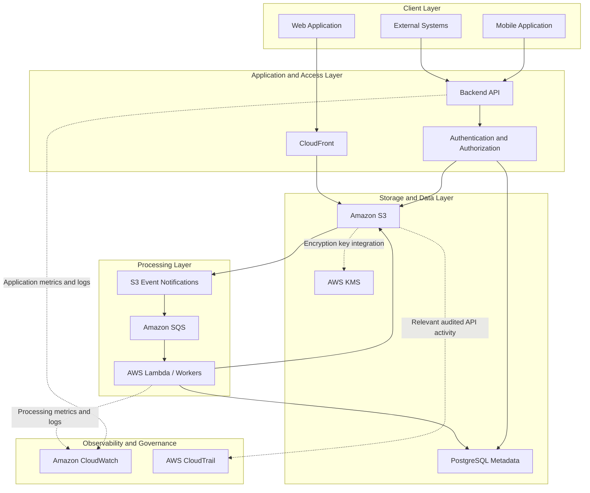
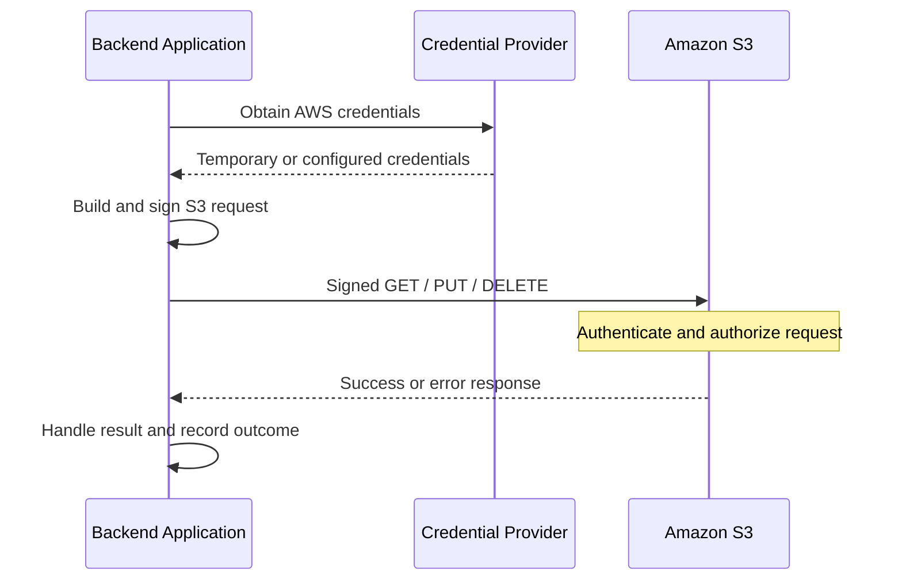
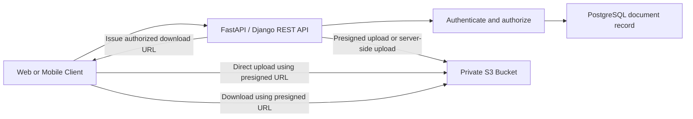
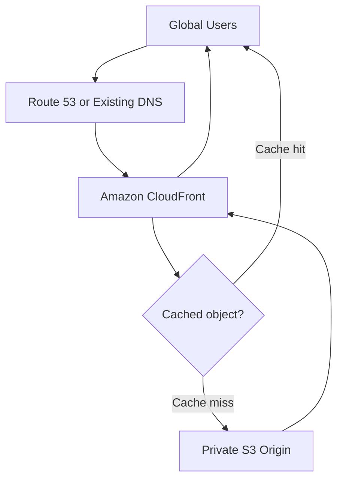
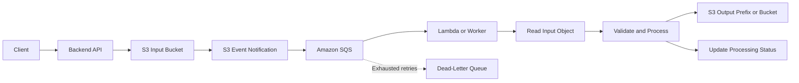
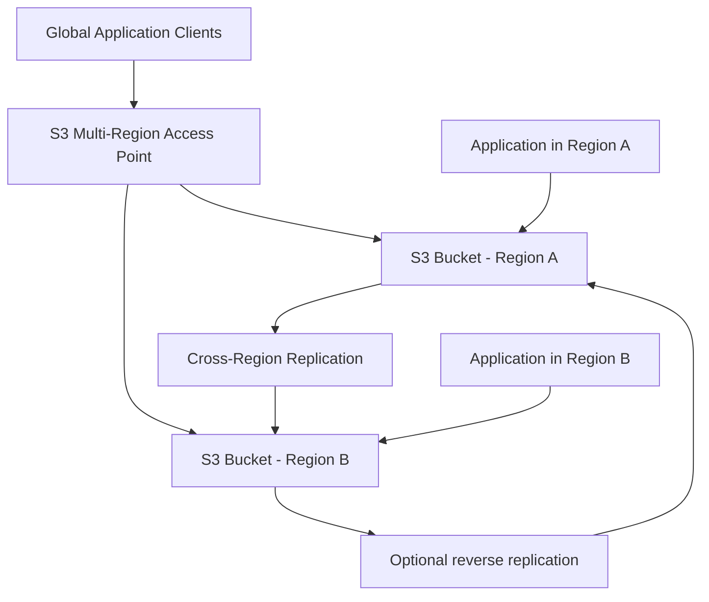
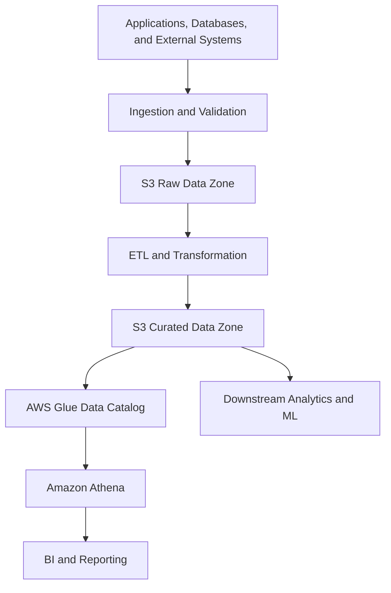
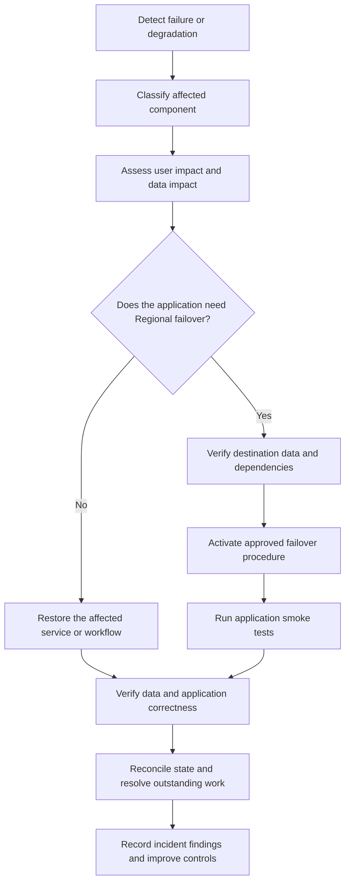

# 01- Amazon S3 Global Architecture

## Overview

Amazon Simple Storage Service (Amazon S3) is a managed object storage service that can serve as the durable data layer for applications, content delivery systems, event-driven workflows, analytics platforms, and distributed systems.

Understanding S3 architecture requires more than understanding buckets and objects. Production systems must also account for regional boundaries, request routing, network paths, authorization, replication, asynchronous processing, caching, failure recovery, and the costs of moving data between services and Regions.

A typical S3 architecture combines several layers:

- **Storage layer:** Buckets, objects, storage classes, versioning, and data protection.
- **Application layer:** APIs, authentication, authorization, business logic, and metadata databases.
- **Access layer:** Regional S3 endpoints, presigned URLs, access points, and Multi-Region Access Points.
- **Delivery layer:** CloudFront, DNS, caching, and edge delivery.
- **Processing layer:** Lambda, SQS, SNS, EventBridge, and background workers.
- **Analytics layer:** AWS Glue, Amazon Athena, and downstream data-processing services.
- **Operations layer:** CloudWatch, CloudTrail, S3 Inventory, monitoring, and recovery procedures.

The correct design depends on workload requirements. A backend that stores private customer documents has different architectural needs from a globally distributed media platform or a cross-Region analytics system.

This document explains how these components fit together and how to choose an architecture that satisfies security, performance, reliability, recovery, and cost requirements.

## Global Architecture Fundamentals

### AWS Regions and Availability Zones

An AWS Region is a separate geographic area containing multiple Availability Zones. Availability Zones are isolated infrastructure locations connected through low-latency, high-bandwidth networking.

Amazon S3's architecture depends on the bucket type and storage class being used.

For general-purpose buckets, S3 Standard is designed to store data redundantly across multiple Availability Zones within the selected Region. Other storage classes have different availability and redundancy characteristics. For example, S3 Express One Zone uses a single Availability Zone.

The important distinction is between regional resilience and multi-Region resilience.

| Architecture property | Single-Region S3 | Multi-Region S3 |
|---|---|---|
| Primary storage location | One AWS Region | Multiple AWS Regions |
| Infrastructure resilience | Depends on selected storage class and service guarantees | Adds geographic separation when appropriately configured |
| Cross-Region object availability | Not applicable to a single bucket by itself | Requires replication or another explicit data-distribution strategy |
| Regional disaster recovery | Requires a suitable recovery strategy | Can support regional recovery when data, applications, and dependencies are prepared |
| Data consistency across locations | Governed by S3's supported consistency guarantees within the bucket | Cross-Region replication is asynchronous |
| Operational complexity | Lower | Higher due to replication, routing, state management, and recovery |
| Cost | Usually lower for equivalent basic storage requirements | Potentially higher due to additional storage, replication, requests, and data transfer |

A multi-Region design should be driven by business recovery objectives, data residency requirements, or geographic latency requirements rather than introduced automatically.

References:

- [AWS Regions and Availability Zones](https://docs.aws.amazon.com/global-infrastructure/latest/regions/aws-regions-availability-zones.html)
- [Resilience in Amazon S3](https://docs.aws.amazon.com/AmazonS3/latest/userguide/disaster-recovery-resiliency.html)

### Buckets Are Regional Resources

A bucket belongs to an AWS Region. Objects in that bucket are managed through S3 endpoints and resource configurations associated with that bucket.

A general-purpose bucket is not a global database that automatically routes every request to whichever Region is closest to a client.

For example:

```text
Application in ap-south-1
             |
             v
Regional S3 endpoint
             |
             v
Bucket in ap-south-1
```

If the application needs an additional copy in another Region, the architecture must explicitly provide it through replication, application-managed writes, or another suitable distribution mechanism.

A separate S3 feature, Multi-Region Access Points, provides a global access endpoint for eligible buckets in multiple Regions. It does not eliminate the need to configure data replication, authorization, or recovery behavior.

### Bucket Namespaces and Service Boundaries

General-purpose S3 buckets support global naming within an AWS partition, with account regional namespaces also available. Other bucket types have their own naming and resource constraints.

The AWS partition is a separate boundary from a Region. Standard AWS Regions, AWS China Regions, AWS GovCloud (US), and the AWS European Sovereign Cloud use distinct partitions where applicable.

This matters when building infrastructure automation, cross-account storage architectures, and resource-discovery systems.

Do not assume that a bucket name, access point, or endpoint can be treated as interchangeable across partitions or bucket types.

Reference: [Amazon S3 bucket concepts](https://docs.aws.amazon.com/AmazonS3/latest/userguide/Welcome.html).

## Logical Architecture of an S3-Based System

A production S3 solution generally separates application behavior from object storage.



This diagram represents a logical architecture rather than a mandatory deployment.

The components have distinct responsibilities:

| Component | Responsibility |
|---|---|
| Clients | Submit requests and consume authorized content |
| CloudFront | Deliver content through an edge distribution and cache |
| Backend API | Enforce business rules, validate requests, and coordinate storage operations |
| PostgreSQL | Store ownership, document records, processing status, and business metadata |
| Amazon S3 | Store object data and associated object attributes |
| AWS KMS | Support encryption-key management when the selected encryption configuration requires it |
| SQS | Buffer work and help isolate processing from ingestion |
| Lambda or workers | Perform asynchronous processing |
| CloudWatch | Collect configured metrics, logs, and alarms |
| CloudTrail | Record configured and supported API activity for auditing |

Not every workload needs every component. A simple application may need only an API, a bucket, and a metadata database. Large-scale systems may add CloudFront, event processing, replication, centralized auditing, and analytics services.

## S3 Request Architecture

### Request Path

An S3 request generally involves a client, the appropriate endpoint, AWS authentication and authorization, and the requested object operation.

For applications using the AWS SDK, the request flow is usually:

1. The application obtains credentials through the configured AWS credential provider chain.
2. The SDK constructs an S3 API request.
3. The SDK signs the request using AWS Signature Version 4 where applicable.
4. The request is sent to the appropriate endpoint.
5. AWS evaluates the relevant authorization and resource controls.
6. S3 executes the operation and returns a response.
7. The application handles the response, including any applicable retryable error.



For workloads running on EC2, ECS, EKS, or Lambda, use the appropriate role-based credential mechanism rather than embedding long-lived credentials in application code.

The exact authentication and networking design depends on the client environment. Applications may connect through public AWS service endpoints or appropriately configured private networking options.

### Data Plane and Control Plane

It is useful to distinguish object data operations from resource configuration.

| Operation category | Examples | Architectural purpose |
|---|---|---|
| Object data operations | `GetObject`, `PutObject`, `DeleteObject`, `HeadObject`, `ListObjectsV2` | Read, write, inspect, list, or remove objects |
| Resource configuration | Bucket policy, versioning configuration, lifecycle configuration, replication configuration | Define how storage resources behave |
| Access configuration | IAM policies, bucket policies, access point policies, KMS key policies | Control which principals can perform which actions |
| Observability | CloudTrail events, CloudWatch metrics, inventory reports | Monitor activity and operational state |

These categories have distinct API permissions and operational requirements.

For example, permission to upload objects does not automatically grant permission to change a bucket policy. A deployment role that configures resources should not automatically be reused as the application role that reads customer documents.

### Strong Consistency Boundaries

S3 provides strong read-after-write consistency for supported object operations. A successful object write becomes visible to subsequent supported reads of that object.

However, this guarantee does not make an entire distributed workflow atomic.

A successful PUT does not guarantee that:

- An S3 event notification has already been processed.
- A replicated object is already available in another Region.
- A CloudFront cache has been invalidated.
- A database transaction has completed.
- A background job has finished processing the object.

Architectures must handle these separate boundaries explicitly.

Reference: [Amazon S3 consistency model](https://docs.aws.amazon.com/AmazonS3/latest/userguide/Welcome.html).

## Architecture Pattern: Private File and Document Storage

### When to Use It

Use this pattern for customer uploads, invoices, reports, private documents, media assets, and other files that must be protected by application-level authorization.

The backend manages business rules while S3 handles file storage.

### Architecture



### Request Flow

A typical document-upload workflow is:

1. The client authenticates with the backend.
2. The backend validates the request and checks tenant or user permissions.
3. The backend generates a unique object key.
4. The backend creates or updates the application's document record.
5. The backend either transfers the file itself or issues a presigned URL for direct upload.
6. The object is uploaded to S3.
7. The backend verifies the required upload conditions.
8. The document becomes available according to the application's state-management rules.

For direct uploads, the client sends file data directly to S3 rather than routing the entire payload through the backend.

This reduces application-server bandwidth consumption and can improve scalability for large files.

### Object Storage and Metadata Separation

A database record could look like this:

| Field | Example | Purpose |
|---|---|---|
| `document_id` | `doc_7f9a...` | Stable application-level identifier |
| `tenant_id` | `tenant_204` | Ownership and tenant authorization |
| `bucket_name` | `acme-documents-prod` | Storage location |
| `object_key` | `tenants/204/documents/doc_7f9a...` | S3 object identifier |
| `content_type` | `application/pdf` | Declared file type |
| `size_bytes` | `1048576` | Recorded object size |
| `status` | `AVAILABLE` | Business-level availability state |

The database should not blindly trust client-supplied object keys or content metadata.

Presigned URLs are bearer capabilities: a party holding a valid URL may use it for its permitted operation until its effective authorization or expiration conditions prevent further use. Protect the URLs and keep their lifetime appropriate to the use case.

Detailed file upload, presigned URL, and framework integration patterns belong in the Integrations and Security sections.

## Architecture Pattern: Global Content Delivery with CloudFront

### When to Use It

Use CloudFront when serving globally distributed websites, downloads, images, videos, scripts, or other frequently accessed content.

CloudFront places caching and content delivery closer to users, reducing repeated requests to the origin and potentially improving latency.

For private S3 content, a common architecture uses CloudFront with Origin Access Control (OAC) and a private S3 origin.

### Architecture



### Component Responsibilities

| Component | Responsibility |
|---|---|
| Route 53 or external DNS | Resolve the application domain to its configured endpoint |
| CloudFront | Cache and deliver content, apply distribution behaviors, and manage origin requests |
| Origin Access Control | Sign supported CloudFront origin requests to S3 |
| S3 bucket policy | Permit the intended CloudFront distribution to access the private origin |
| TLS certificate configuration | Support HTTPS for the configured application domain |
| Cache policy | Control which requests can share cached responses and how long content is cached |

Route 53 is not required if DNS is managed elsewhere. Its role is DNS management, not S3 data replication or object consistency.

### Important Design Decisions

**Keep the origin private.** A public bucket is unnecessary for the common CloudFront OAC architecture. Configure S3 and CloudFront policies so that only the intended distribution receives the necessary origin permissions.

**Separate immutable and mutable content.** Content-addressed filenames or versioned asset keys allow long cache lifetimes without requiring every deployment to invalidate all content.

**Protect personalized content.** Cache keys, authorization, cookies, query strings, and response headers must be configured so that one user's private response is not reused for another user.

**Plan cache invalidation.** An S3 overwrite does not automatically invalidate an already cached CloudFront response.

**Account for origin access.** OAC is an origin-access mechanism, not a substitute for application authorization and correct cache configuration.

References:

- [Restricting access to an S3 origin with CloudFront OAC](https://docs.aws.amazon.com/AmazonCloudFront/latest/DeveloperGuide/private-content-restricting-access-to-s3.html)
- [CloudFront caching](https://docs.aws.amazon.com/AmazonCloudFront/latest/DeveloperGuide/ConfiguringCaching.html)

## Architecture Pattern: Event-Driven Object Processing

### When to Use It

Use event-driven processing when uploads trigger independent or potentially expensive work, such as:

- Image resizing and thumbnail generation.
- Document parsing and extraction.
- Malware scanning.
- Media transcoding.
- Data validation and transformation.
- Analytics ingestion.
- Notifications and downstream workflow execution.

### Architecture

A robust pattern places a queue between ingestion and processing.



### Component Responsibilities

- The API authenticates the requester, validates upload intent, and records the expected work.
- The input bucket stores the original object.
- The S3 event notification connects object activity to the downstream messaging workflow.
- SQS buffers events and provides queue-level retry and visibility controls.
- Lambda or a worker processes the object and records its result.
- The output location stores derived artifacts separately from input data.
- A database records processing state and business-level outcomes.
- A dead-letter queue or equivalent failure-handling mechanism preserves messages that cannot be processed successfully.

A direct S3-to-Lambda notification can be suitable for simpler workloads. SQS becomes useful when the architecture needs buffering, decoupling, queue-level controls, and better isolation between ingestion rate and processing capacity.

### Delivery Semantics and Idempotency

S3 event notifications are asynchronous and can be delivered more than once. Event order is not guaranteed for all changes to an object.

Therefore, a worker must not assume that one event means exactly one execution or that the event is always newer than every event previously processed.

Implement appropriate idempotency using a workflow identifier, object version information, a durable processing record, or another workload-specific mechanism.

For object overwrites, a worker that always reads the current object by key might retrieve content newer than the content described by an older event. Use version-specific reads or another explicit coordination strategy when processing must correspond to the exact triggering object version.

Store generated output under a distinct prefix or bucket to avoid accidental recursive invocation.

Reference: [Amazon S3 Event Notifications](https://docs.aws.amazon.com/AmazonS3/latest/userguide/EventNotifications.html).

## Architecture Pattern: Multi-Region Storage and Access

### When to Use It

A multi-Region architecture can support:

- Disaster recovery for a regional outage.
- Geographic access requirements.
- Applications serving users from multiple geographic areas.
- Data residency requirements where storage is permitted in selected Regions.
- Multi-Region workloads with explicit failover requirements.

It is more complex than a single-Region architecture and requires deliberate design for replication, routing, write conflicts, security, and recovery.

### Core Components

| Component | Purpose |
|---|---|
| Source and destination buckets | Store objects in separate Regions |
| S3 Cross-Region Replication (CRR) | Asynchronously copy eligible object changes between Regions |
| Replication IAM role | Authorize the required replication operations |
| Versioning | Supports object-version-based replication and historical recovery workflows |
| Multi-Region Access Point (MRAP) | Provides a global S3 access endpoint that can route requests across configured Regional buckets |
| Application deployment in each Region | Supplies the compute and dependencies required to serve requests during a regional event |
| Monitoring and failover controls | Help detect replication lag, validate readiness, and redirect traffic when required |

MRAP is an access and routing abstraction. It does not automatically populate buckets with identical data or resolve conflicting application writes.

### Multi-Region Architecture



The diagram shows a possible two-Region topology. It is not a complete deployment template. Replication direction, bucket policies, application write behavior, and routing policies must match the workload.

### Read Routing Is Not Data Synchronization

MRAP routes data-access requests among underlying buckets according to its routing configuration. It is not a content-aware global database that checks whether a particular object is already present in every destination before routing a request.

If an object has not reached a selected destination bucket, a read routed there may fail even when the object exists in another Region.

For this reason, configure suitable replication when the application expects a consistent dataset across participating Regions.

### Single-Writer Versus Active-Active

Two common approaches are:

| Design | Write model | Benefits | Trade-offs |
|---|---|---|---|
| Active-passive | One Region handles authoritative writes; another is prepared for failover | Simpler conflict management and operational reasoning | Failover procedures and recovery objectives must be tested |
| Active-active | Applications may write in multiple Regions | Potentially lower geographic write latency and regional independence | Concurrent writes and replication conflicts require explicit application-level handling |

A single-writer design is often easier to operate when multiple clients update the same logical objects.

Active-active architectures require an explicit conflict-resolution and data-ownership model. S3 replication does not provide a general-purpose, globally serialized write transaction across multiple buckets.

### Recovery Objectives

Define recovery objectives before implementing replication.

- **Recovery Point Objective (RPO):** How much recent data loss the business can tolerate.
- **Recovery Time Objective (RTO):** How long the system may remain unavailable before recovery is required.

Asynchronous replication introduces a potential gap between a successful source write and the availability of that data at the destination. RPO cannot be derived solely from the existence of a replication rule.

Likewise, an S3 data copy does not establish that the full application can recover. Compute, databases, DNS, secrets, KMS keys, IAM permissions, external dependencies, and deployment artifacts may need their own recovery strategies.

References:

- [Amazon S3 Multi-Region Access Points](https://docs.aws.amazon.com/AmazonS3/latest/userguide/MultiRegionAccessPoints.html)
- [Configuring replication with Multi-Region Access Points](https://docs.aws.amazon.com/AmazonS3/latest/userguide/MultiRegionAccessPointBucketReplication.html)
- [Amazon S3 resilience and disaster recovery](https://docs.aws.amazon.com/AmazonS3/latest/userguide/disaster-recovery-resiliency.html)

## Architecture Pattern: Data Lake and Analytics

### When to Use It

S3 is commonly used as the storage foundation for data lakes because it can store large collections of structured, semi-structured, and unstructured data.

A data lake might hold application events, database exports, clickstream records, financial reports, logs, and batch-processing outputs.

### Architecture



### Design Responsibilities

| Layer | Responsibility |
|---|---|
| Source systems | Produce the data and define its source semantics |
| Ingestion | Validate, organize, and write data reliably |
| Raw zone | Preserve source data according to the retention and governance design |
| Transformation | Normalize schemas, filter records, and prepare datasets |
| Curated zone | Store standardized and query-ready data |
| Glue Data Catalog | Maintain table and schema metadata for supported analytics workflows |
| Athena | Query supported datasets using SQL |
| Access controls | Restrict access to datasets according to business and governance needs |

### Storage Layout

A data lake might organize datasets with meaningful prefixes:

```text
s3://acme-data-prod/
    raw/
        application-events/
            year=2026/month=10/day=13/
    curated/
        customer-activity/
            year=2026/month=10/day=13/
    analytics-results/
```

Prefix organization should reflect access patterns, lifecycle requirements, and query layout. It should not replace a suitable authorization model.

For analytical workloads, select file formats and partitioning schemes based on query patterns. Columnar formats such as Parquet can reduce the amount of data read for many analytical queries compared with row-oriented formats.

### Operational and Cost Considerations

- Separate raw, curated, and generated query results logically.
- Prevent sensitive data from becoming accessible through overly broad analytics permissions.
- Use appropriate partitioning and file sizes to limit unnecessary data scanning.
- Configure lifecycle policies according to retention and recovery requirements.
- Monitor query costs and S3 storage and request costs separately.
- Treat temporary query results as governed data when they may contain sensitive information.

Detailed data lake implementation belongs in the Integrations, Operations, and Hands-on sections.

References:

- [AWS Glue Data Catalog](https://docs.aws.amazon.com/glue/latest/dg/catalog-and-crawler.html)
- [Querying data with Amazon Athena](https://docs.aws.amazon.com/athena/latest/ug/what-is.html)

## Architecture Pattern: Multi-Tenant Storage and Cross-Account Sharing

### Multi-Tenant Storage

A multi-tenant application must ensure that a tenant can access only the files and operations authorized for that tenant.

One possible organizational layout is:

```text
tenants/
    tenant-204/
        documents/
    tenant-317/
        documents/
```

These prefixes are organizational conventions, not automatic security boundaries.

The backend should derive object keys from trusted identity and application data, not accept arbitrary bucket names or keys from the client without authorization.

The authorization model may use application-level checks, distinct IAM roles, access points, bucket policies, or separate buckets depending on the sensitivity and isolation requirements.

| Isolation approach | Advantages | Trade-offs |
|---|---|---|
| Shared bucket with tenant prefixes | Simple resource management and common configuration | Application and policy design must prevent cross-tenant access |
| Access points for selected access patterns | Separate access policies and endpoints for particular consumers | Additional configuration and resource management |
| Separate buckets per tenant or security domain | Stronger resource-level separation and easier per-bucket configuration in some designs | More provisioning, policy management, and operational overhead |
| Separate AWS accounts | Strong account-level governance and isolation boundaries | More complex cross-account operations and governance |

Select an isolation model based on compliance, blast-radius requirements, ownership boundaries, and scale.

### Cross-Account Storage

Organizations may centralize storage in one AWS account while allowing applications in other accounts to access approved datasets.

The architecture generally requires coordinated configuration of the relevant IAM policies, S3 resource policies, and KMS permissions where applicable.

Cross-account access should be explicit and scoped to the intended principals, resources, and actions. A resource being in a shared account does not automatically grant access to all other accounts in the organization.

Use dedicated deployment roles, carefully scoped bucket policies, and auditable changes to reduce the risk of unintended access.

Detailed controls belong in the Security section.

## Security and Trust Boundaries

Architecture diagrams should make trust boundaries explicit. The same bucket may be accessed by different principals with different permissions and network paths.

A production system should evaluate at least these boundaries:

| Boundary | Key engineering questions |
|---|---|
| Client to application | Is the requester authenticated? Is the requested action permitted? |
| Client to presigned URL | Does the URL expose only the intended capability, object, and lifetime? |
| Application to S3 | Does the workload use suitable credentials and least-privilege permissions? |
| CloudFront to S3 | Is the origin private, and is access restricted to the intended distribution? |
| S3 to event processing | Can events be duplicated, retried, delayed, or processed out of order? |
| Application to KMS | Are the applicable key policies and encryption permissions correct? |
| Account to account | Are both sides of the required cross-account authorization configured correctly? |
| Region to Region | Is replicated data protected, observable, and available according to recovery requirements? |

Additional controls can include TLS, private network paths, S3 Block Public Access, Object Ownership, CloudTrail, data classification, retention policies, and automated configuration checks.

These controls are not interchangeable. For example, a VPC endpoint policy does not replace IAM permissions, a private bucket does not replace tenant authorization, and encryption does not prevent an authorized application from leaking data.

References:

- [Amazon S3 security](https://docs.aws.amazon.com/AmazonS3/latest/userguide/security.html)
- [Amazon S3 access management](https://docs.aws.amazon.com/AmazonS3/latest/userguide/access-management.html)

## Performance and Scalability

S3 is designed for large-scale object storage and request workloads, but application performance depends on more than storage capacity.

Important architectural factors include request concurrency, object size, network path, transfer strategy, cache efficiency, client behavior, and downstream processing capacity.

### Direct Uploads Versus Proxied Uploads

| Design | Benefits | Limitations |
|---|---|---|
| Backend-proxied uploads | Centralized streaming, validation, and application control | Consumes backend network and connection capacity |
| Direct client-to-S3 uploads | Reduces backend data-plane load and supports scalable transfers | Requires secure presigned URL design and upload-completion validation |
| Multipart uploads | Supports parallel transfer of large objects and recovery from part-level failures | Requires completion handling and cleanup of abandoned uploads |
| CloudFront delivery | Improves distribution of cacheable content and reduces repeated origin fetches | Requires correct cache, invalidation, and access-control configuration |

Choose direct upload when clients transfer substantial amounts of data and the application can validate and finalize uploads safely. Proxying may be appropriate when strict server-side inspection must happen during transfer or when client access to S3 is unsuitable.

### Request Patterns

- Reuse initialized SDK clients where appropriate instead of repeatedly constructing them for every request.
- Apply bounded concurrency to background workers.
- Use multipart transfers for suitable large-object workloads.
- Avoid repeatedly listing very large prefixes when a database or index is more appropriate for application queries.
- Use CloudFront for appropriate content-delivery workloads.
- Configure retries with exponential backoff and jitter where suitable for retryable failures.
- Do not blindly retry non-idempotent business operations or assume that every failed response means the original request had no effect.

S3 request performance is highly scalable, but downstream API servers, databases, network paths, Lambda concurrency, and queue processing can still become bottlenecks.

Reference: [Amazon S3 performance guidelines](https://docs.aws.amazon.com/AmazonS3/latest/userguide/optimizing-performance.html).

## Reliability, Failure Domains, and Recovery

A robust architecture distinguishes S3 storage reliability from application availability.

S3 may remain operational while the application is unavailable because its API service, database, credentials, network configuration, or event-processing infrastructure has failed.

Similarly, an application may successfully accept a file while a downstream document-processing workflow is delayed.

### Failure Scenarios

| Failure scenario | Architectural consequence | Appropriate response |
|---|---|---|
| Backend API unavailable | Clients cannot complete application-managed operations | Deploy redundant application capacity and monitor dependencies |
| S3 request denied | Reads or writes fail despite the object possibly existing | Diagnose credentials, IAM, resource policies, and KMS authorization |
| Event processing delayed | Object exists, but its business-level processing is incomplete | Track workflow status and alert on processing age |
| Duplicate notification | A worker may process an object more than once | Make processing idempotent |
| Replication lag | A recent object may not yet exist in the destination Region | Monitor replication and account for RPO |
| Regional application failure | Storage may exist elsewhere while the application is unable to serve requests | Prepare regional compute, dependencies, routing, and recovery procedures |
| Accidental object deletion | The expected object may become unavailable | Apply an appropriate versioning, retention, and recovery strategy |
| CloudFront serves stale content | Users receive a cached representation | Apply suitable cache policies or invalidation procedures |

### Recovery Workflow



Failover should not be automated solely because one health check fails. A safe procedure needs evidence that the destination is ready and that its data, authorization, application dependencies, and routing behavior are appropriate.

After failover, consider how writes accepted in the alternate Region will be reconciled with the previously active Region. The recovery plan must address data divergence, not just traffic routing.

## Observability and Operational Architecture

Operational visibility should span object storage, applications, queues, replication, caching, and deployment systems.

| Tool or capability | Useful purpose | Important consideration |
|---|---|---|
| CloudWatch metrics and alarms | Monitor supported service metrics, application errors, and processing delays | Select dimensions and alarms that reflect actual business risk |
| CloudTrail | Audit supported AWS API activity | Enable the relevant events and retain logs for the required period |
| S3 data events in CloudTrail | Audit configured object-level activity | Data-event configuration can incur additional charges |
| S3 Inventory | Produce periodic reports of objects and selected attributes | Inventory is scheduled reporting, not a real-time query interface |
| S3 Storage Lens | Analyze storage usage and activity across eligible scopes | Select metrics and aggregation levels appropriate to operational needs |
| SQS metrics | Track queue depth, processing delays, and retry patterns | Use suitable alarms for growing backlogs and dead-letter activity |
| Replication metrics | Observe configured replication progress and failures | Monitoring does not itself repair replication configuration or missing permissions |
| Application logs | Correlate API operations with object keys, request identifiers, and workflow states | Avoid logging secrets, full presigned URLs, or unnecessary sensitive data |

A useful monitoring design correlates application request IDs, internal document IDs, object keys or version IDs when safe, queue message IDs, and processing states.

Use durable application-level workflow records when operators must determine whether an upload is merely stored, fully validated, processed, or available to users.

References:

- [Monitoring Amazon S3](https://docs.aws.amazon.com/AmazonS3/latest/userguide/monitoring-overview.html)
- [CloudTrail data events](https://docs.aws.amazon.com/awscloudtrail/latest/userguide/logging-data-events-with-cloudtrail.html)

## Cost Architecture

S3 architecture choices influence storage, requests, transfer, processing, monitoring, and recovery costs.

The cheapest design for stored bytes is not necessarily the cheapest system to operate.

| Cost category | Architecture considerations |
|---|---|
| Storage | Data volume, storage class, retention, version history, and replicated copies |
| Requests | PUT, GET, LIST, lifecycle actions, and other applicable requests |
| Data transfer | Cross-Region movement, traffic to clients, and transfer between services |
| CloudFront | Requests, data delivery, origin behavior, and cache efficiency |
| Processing | Lambda duration, compute resources, queue processing, and downstream services |
| Analytics | Athena data scanned, transformation resources, and output storage |
| Observability | Logging, CloudTrail data events, metrics, inventory, and analysis |
| Recovery | Additional storage, replication, testing, and regional standby resources |

Cost controls should reflect the workload rather than rely on one generic optimization.

Examples include:

- Applying lifecycle rules based on actual data-access and retention requirements.
- Avoiding unnecessary duplicated storage across Regions.
- Caching suitable objects with CloudFront.
- Preventing accidental recursive event processing.
- Cleaning up incomplete multipart uploads.
- Reducing repeated full-prefix listings when an index is more suitable.
- Tracking storage and request costs by environment and workload.
- Accounting for regional transfer and replication charges before introducing multi-Region designs.

Review current AWS pricing and service availability before finalizing an architecture:

- [Amazon S3 pricing](https://aws.amazon.com/s3/pricing/)
- [Amazon CloudFront pricing](https://aws.amazon.com/cloudfront/pricing/)

## Choosing an Architecture

Use this decision table to narrow the design based on the main workload requirement.

| Requirement | Starting architecture | Additional considerations |
|---|---|---|
| Private application documents | Backend API with private S3 bucket | Database metadata, tenant authorization, presigned URLs, recovery |
| Global static content | CloudFront with private S3 origin and OAC | Cache behavior, HTTPS, invalidation, asset versioning |
| Asynchronous object processing | S3 events routed through SQS to workers | Idempotency, retries, DLQ, workflow state |
| Large client uploads | Direct presigned upload to S3 | Validation, size limits, completion confirmation, multipart upload |
| Analytics and data lake | S3 raw and curated zones with Glue and Athena as appropriate | Partition design, file format, governance, query costs |
| Cross-Region disaster recovery | Replicated S3 buckets and tested application recovery | RPO/RTO, replication lag, deployment and database recovery |
| Globally distributed S3 access | Multi-Region Access Point with suitable underlying buckets | Replication, routing, authorization, consistency, and conflict management |
| Strong tenant isolation | Explicit application authorization with an appropriate bucket/account strategy | Blast radius, auditability, operational complexity |
| Centralized cross-account datasets | Resource policies and an appropriate access model | Least privilege, KMS access, organizational governance |

The best architecture is the simplest one that satisfies the workload's actual security, availability, recovery, latency, and governance requirements.

## Common Architectural Mistakes

| Mistake | Why it causes problems | Better approach |
|---|---|---|
| Assuming one S3 bucket is automatically global | A general-purpose bucket resides in a specific Region | Use replication and an appropriate access or recovery design when multiple Regions are required |
| Assuming MRAP synchronizes data | MRAP routes requests but does not ensure every object exists in every bucket | Configure and monitor replication for the required datasets |
| Treating replication as a backup | Undesired changes can be replicated, and replication does not provide every recovery guarantee | Design retention, versioning, backup, and recovery controls explicitly |
| Treating S3 events as exactly-once processing | Events can be duplicated or arrive out of order | Implement idempotent workers and durable workflow state |
| Using a public bucket to simplify CloudFront | Public access broadens the trust boundary unnecessarily | Use a private origin with OAC for the intended architecture |
| Storing business state only in object keys | Queries and state transitions become difficult to maintain | Store business metadata in an appropriate database or index |
| Assuming a successful PUT means the workflow is complete | Processing, database writes, and replication can remain pending | Model workflow states and validate every required completion step |
| Failing to design regional recovery | Replicated data alone does not recreate a complete application | Test compute, networking, access, databases, routing, and recovery procedures |
| Using the same broad IAM role for every component | Unnecessary permissions expand the blast radius | Assign narrowly scoped roles to APIs, workers, deployment systems, and administrators |
| Ignoring cache semantics | A CDN or application cache can serve older content after an S3 overwrite | Use intentional cache policies, invalidation, or versioned keys |

## Production Architecture Review Checklist

Before approving an S3 architecture, validate the following areas.

### Data and Storage

- [ ] Bucket Regions and storage classes match workload requirements.
- [ ] Bucket types and endpoints match the intended access pattern.
- [ ] Object keys follow deliberate and safe naming conventions.
- [ ] Versioning, lifecycle, retention, and recovery decisions are documented.
- [ ] Multi-Region replication is configured only where justified and is monitored.

### Access and Security

- [ ] Private data is not exposed through unintended public or cross-account access.
- [ ] IAM roles and bucket policies use least privilege.
- [ ] KMS permissions are included where applicable.
- [ ] Application authorization prevents unauthorized object access.
- [ ] CloudFront, presigned URLs, and caching respect the data's access requirements.

### Reliability and Processing

- [ ] Strong consistency guarantees are distinguished from workflow completion.
- [ ] Event-driven processing handles duplicates, retries, and out-of-order events.
- [ ] Failure handling and dead-letter procedures are defined where appropriate.
- [ ] Application and database state remain reconcilable after partial failures.
- [ ] Regional failover accounts for data freshness and dependency readiness.

### Operations and Cost

- [ ] Useful metrics, logs, and alarms are configured.
- [ ] Object-level auditing is enabled where required.
- [ ] Storage, request, transfer, and processing costs have been evaluated.
- [ ] Deployment changes can be validated and rolled back safely.
- [ ] Recovery procedures have been tested against documented RPO and RTO requirements.

## Further Reading

- [What Is Amazon S3?](https://docs.aws.amazon.com/AmazonS3/latest/userguide/Welcome.html)
- [Amazon S3 resilience and disaster recovery](https://docs.aws.amazon.com/AmazonS3/latest/userguide/disaster-recovery-resiliency.html)
- [Amazon S3 Multi-Region Access Points](https://docs.aws.amazon.com/AmazonS3/latest/userguide/MultiRegionAccessPoints.html)
- [Replicating objects within and across Regions](https://docs.aws.amazon.com/AmazonS3/latest/userguide/replication.html)
- [Private Amazon S3 origins with CloudFront](https://docs.aws.amazon.com/AmazonCloudFront/latest/DeveloperGuide/private-content-restricting-access-to-s3.html)
- [Amazon S3 security](https://docs.aws.amazon.com/AmazonS3/latest/userguide/security.html)
- [Optimizing Amazon S3 performance](https://docs.aws.amazon.com/AmazonS3/latest/userguide/optimizing-performance.html)
- [Monitoring Amazon S3](https://docs.aws.amazon.com/AmazonS3/latest/userguide/monitoring-overview.html)

## Key Takeaways

- Amazon S3 architecture combines regional storage, application access, content delivery, asynchronous processing, analytics, and operational controls according to workload requirements.
- A single-Region architecture can provide substantial resilience; multi-Region designs add geographic recovery and routing options but require explicit replication, data-consistency, and failover strategies.
- CloudFront, SQS, Lambda, PostgreSQL, Glue, Athena, and KMS solve different architectural problems and should be combined only where they provide a clear benefit.
- Strong consistency within S3 does not make distributed workflows atomic, guarantee exactly-once event processing, or eliminate replication lag and cache staleness.
- Production readiness depends on least-privilege access, idempotent processing, observability, tested recovery procedures, and a clear understanding of cost and failure boundaries.