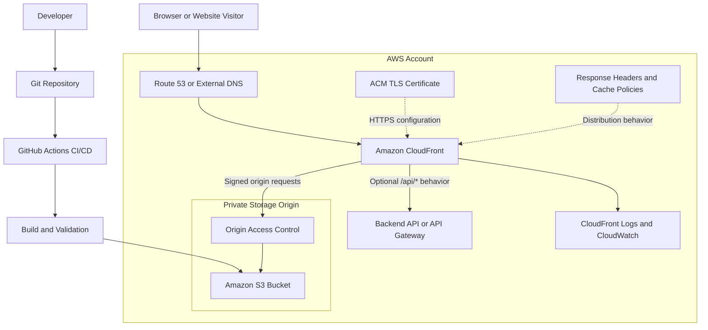
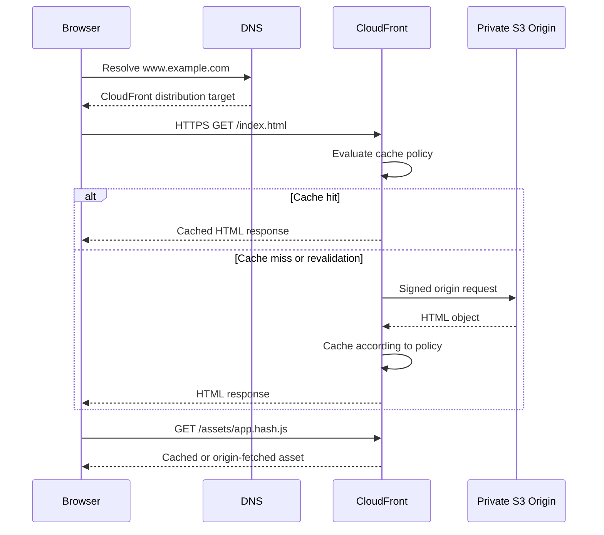
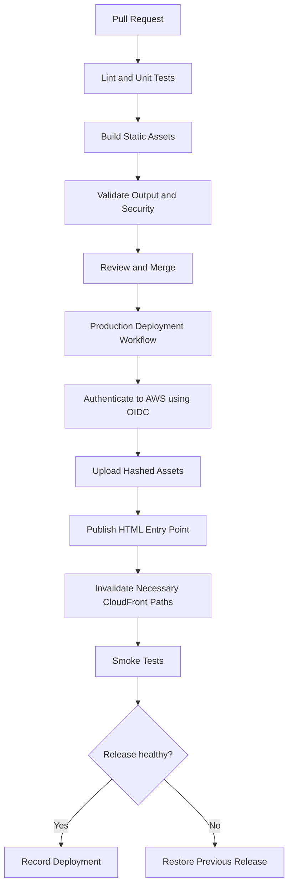

# 02- Static Website Architecture

## Overview

Amazon S3 and Amazon CloudFront provide a scalable architecture for hosting static websites without managing web servers. S3 stores website assets, while CloudFront distributes those assets through a content delivery network (CDN).

This architecture is suitable for:

- React, Vue, Angular, and other frontend applications built into static assets.
- HTML, CSS, JavaScript, images, fonts, and documentation sites.
- Marketing websites and landing pages.
- Public downloads and static documentation.
- Frontend applications that communicate with separate REST APIs.

For production deployments, the recommended architecture is generally a **private S3 bucket accessed through CloudFront using Origin Access Control (OAC)**. CloudFront handles HTTPS, caching, custom domains, and delivery, while the bucket remains inaccessible directly to anonymous users.

This approach is preferable to exposing an S3 bucket publicly. It also separates static content delivery from backend execution: dynamic business logic should run in an API service rather than being placed in static files.

Official references:

- [Hosting static websites on Amazon S3](https://docs.aws.amazon.com/AmazonS3/latest/userguide/WebsiteHosting.html)
- [Restricting access to an S3 origin with CloudFront OAC](https://docs.aws.amazon.com/AmazonCloudFront/latest/DeveloperGuide/private-content-restricting-access-to-s3.html)

## Architecture Goals

A production static website architecture should provide:

| Requirement | Architectural decision |
|---|---|
| Scalable content delivery | Use CloudFront to cache and deliver static assets |
| HTTPS | Configure CloudFront viewer HTTPS and a suitable TLS certificate |
| Private storage origin | Keep the S3 bucket private and use OAC |
| Custom domain | Configure the domain in CloudFront and create the appropriate DNS records |
| Performance | Use long-lived caching for immutable, versioned assets |
| Safe deployment | Validate builds and deploy assets before publishing the new HTML entry point |
| Rollback | Preserve prior releases and maintain a repeatable redeployment process |
| Security | Restrict origin access, apply response security headers, and avoid publishing secrets |
| Observability | Monitor CloudFront requests, origin errors, cache behavior, and deployment outcomes |
| Cost control | Optimize caching, storage retention, invalidations, and data transfer |

The architecture should be selected based on these requirements rather than simply enabling S3 website hosting and making the bucket public.

## Recommended Architecture

### High-Level Design



This is a logical architecture. The actual deployment should define the S3 bucket, CloudFront distribution, OAC, bucket policy, certificate, DNS records, cache policies, and CI/CD permissions explicitly.

### Component Responsibilities

| Component | Responsibility |
|---|---|
| Git repository | Stores frontend source code and deployment configuration |
| CI/CD pipeline | Runs checks, builds the website, and deploys approved artifacts |
| Amazon S3 | Stores compiled HTML, JavaScript, CSS, images, fonts, and other static assets |
| Amazon CloudFront | Serves content through edge locations and retrieves missing objects from the origin |
| Origin Access Control | Signs CloudFront requests to a supported S3 bucket origin |
| S3 bucket policy | Allows the intended CloudFront distribution to read the required objects |
| AWS Certificate Manager (ACM) | Provisions and manages the certificate used for the CloudFront custom domain |
| Amazon Route 53 or external DNS | Maps the website domain to the CloudFront distribution |
| CloudWatch and logging facilities | Support operational monitoring and request investigation |
| Backend API | Handles dynamic operations such as authentication, business logic, and database access |

A static website does not need an application server solely to serve HTML, CSS, JavaScript, and other static files. Adding a backend is justified when the application requires server-side computation, secure business operations, or persistent application state.

## Why CloudFront Should Front S3

CloudFront provides a delivery layer between visitors and the S3 origin.

When an object is cached at an edge location, CloudFront can serve subsequent requests without fetching that object from S3 again. When the object is absent or requires revalidation, CloudFront may request it from the origin according to the configured cache policy and request behavior.

The cache is distributed rather than a single globally shared copy. Consequently, an upload to S3 does not guarantee that every edge location immediately serves the new content.

### Request Flow



The request uses the website's HTTPS domain at the viewer-facing layer. For the recommended S3 REST API origin with OAC signing enabled, CloudFront communicates with S3 using its authenticated origin request mechanism.

### Key Benefits

- Reduces repeated origin requests for cacheable content.
- Improves latency for geographically distributed visitors.
- Supports custom domain names and HTTPS.
- Allows the S3 origin to remain private.
- Provides configurable cache behavior and security response headers.
- Supports monitoring and access logging.
- Separates static content delivery from backend application execution.

CloudFront introduces its own configuration, caching, invalidation, and cost considerations. It should be operated as a production service rather than treated as a transparent proxy with no independent behavior.

## S3 Origin Options

There are two distinct ways to connect an S3-hosted website to CloudFront. They are not interchangeable.

### Recommended: Private S3 REST API Origin with OAC

For a normal S3 bucket origin, configure CloudFront with the bucket's regional REST endpoint.

A simplified origin looks like:

```text
my-site-prod.s3.ap-south-1.amazonaws.com
```

Use the actual bucket Region in the origin configuration.

Keep the bucket private, enable all S3 Block Public Access settings, use Bucket owner enforced Object Ownership, and configure OAC to sign origin requests. The bucket policy should grant the intended distribution the required read permission.

Advantages:

- The bucket does not need anonymous public-read access.
- CloudFront can communicate with S3 over HTTPS using the recommended OAC configuration.
- Public content is delivered through the intended distribution.
- The approach supports S3 bucket-origin capabilities that are unavailable with the website endpoint.

Important limitation: an S3 REST API origin does not automatically provide all S3 website endpoint behavior. Index handling for nested routes, website redirects, and error-document behavior may need to be implemented in CloudFront or another application layer.

### Alternative: S3 Website Endpoint as a Custom Origin

An S3 website endpoint provides S3 static website hosting features such as configured index and error documents.

However, it has important limitations:

- Website endpoints support HTTP, not HTTPS, between CloudFront and the S3 origin.
- Website endpoints cannot use CloudFront OAC or OAI.
- Public website content generally requires public-read access to the website objects.
- S3 website hosting requires disabling the applicable Block Public Access protections and configuring public-read permissions.

This option may be appropriate when native S3 website endpoint behavior is essential and its public-origin constraints are acceptable. It is not the recommended default for production architectures that should keep the bucket private.

| Capability | Private REST origin with OAC | Website endpoint as custom origin |
|---|---|---|
| Private S3 bucket | Yes | Not for ordinary public website delivery |
| OAC | Supported | Not supported |
| HTTPS to S3 origin | Supported with recommended OAC signing | Not supported |
| S3 website index and error-document behavior | Must be implemented or mapped appropriately | Supported by website hosting configuration |
| CloudFront viewer HTTPS | Supported | Supported, although the origin connection remains HTTP |
| Recommended for a new private-origin design | Yes | Only when its constraints are specifically required |

References:

- [CloudFront OAC](https://docs.aws.amazon.com/AmazonCloudFront/latest/DeveloperGuide/private-content-restricting-access-to-s3.html)
- [S3 website endpoints](https://docs.aws.amazon.com/AmazonS3/latest/userguide/WebsiteEndpoints.html)
- [Configuring a static website on S3](https://docs.aws.amazon.com/AmazonS3/latest/userguide/HostingWebsiteOnS3Setup.html)

## CloudFront Distribution Design

A production distribution should define more than the origin hostname. Cache behavior, allowed methods, HTTPS, response headers, compression, custom domains, and route handling all influence correctness and security.

### Default Root Object

Configure the distribution's default root object as:

```text
index.html
```

This allows the distribution root URL to request the corresponding HTML entry point.

It does not automatically make every nested path resolve to `index.html`. A request such as `/dashboard/settings` needs explicit behavior when the website is a client-side single-page application.

### HTTPS and Custom Domains

For a custom website domain such as `www.example.com`:

1. Request or import an appropriate certificate into AWS Certificate Manager.
2. For a certificate attached to a CloudFront distribution, use an ACM certificate in `us-east-1`.
3. Add the hostname to the CloudFront distribution's alternate domain names.
4. Associate the certificate with the distribution.
5. Configure DNS to route the hostname to the distribution.
6. Set the viewer protocol policy to redirect HTTP to HTTPS or require HTTPS.
7. Verify certificate validity, hostname coverage, DNS resolution, and HTTPS responses.

For a Route 53-managed domain, an alias record can point to the CloudFront distribution. Other DNS providers can use their supported CNAME configuration for the relevant hostname.

The S3 website endpoint does not need a certificate for the recommended private REST-origin architecture; CloudFront handles the viewer-facing certificate, and S3 supports the authenticated HTTPS origin connection.

Reference: [Using HTTPS with CloudFront](https://docs.aws.amazon.com/AmazonCloudFront/latest/DeveloperGuide/using-https.html).

### Cache Behaviors

A useful default behavior for a static site permits only the HTTP methods required for content retrieval, normally `GET` and `HEAD`.

If the site also uses `/api/*`, configure a separate behavior pointing to the API origin. That behavior should use suitable allowed methods, caching rules, and authorization requirements for the backend.

Do not enable write methods to the S3 website origin unless the architecture specifically requires them and has the corresponding security controls.

## Handling Single-Page Application Routes

Frontend frameworks often implement routing in JavaScript. A visitor may navigate to a path such as:

```text
https://www.example.com/dashboard/settings
```

The browser requests that path from CloudFront directly. If CloudFront forwards the path to an S3 REST origin, S3 may look for an object whose key is `dashboard/settings`. Because the object does not exist, the request may return an error even though the application would render the route correctly after loading `index.html`.

### Recommended Routing Strategy

Use a CloudFront Function or another suitable request-rewriting mechanism to map application navigation paths to the frontend entry point, while leaving actual asset requests unchanged.

Conceptually:

```text
/dashboard/settings  -> /index.html
/assets/app.a1b2.js  -> /assets/app.a1b2.js
/favicon.ico         -> /favicon.ico
```

The function must not rewrite every missing object to the HTML document. Doing so can turn missing JavaScript, CSS, and image requests into HTML responses, producing confusing browser errors.

A route-rewriting design should distinguish navigational routes from asset requests. For example, an application can use a defined route convention, an explicit extension-based rule, or an asset path such as `/assets/*`.

If CloudFront custom error responses are used instead, configure error handling carefully. An S3 REST origin can return `403` for a missing object when the requester lacks listing permission, so mapping every `403` to the SPA entry point can conceal genuine authorization or origin configuration failures.

### Route Verification

Test at least the following:

| Request | Expected behavior |
|---|---|
| `/` | Returns the website entry point |
| `/index.html` | Returns the entry point |
| `/dashboard` | Returns the SPA entry point when configured |
| `/dashboard/settings` | Returns the SPA entry point when configured |
| `/assets/app.<hash>.js` | Returns JavaScript with the correct content type |
| `/assets/missing.js` | Returns an appropriate missing-asset response |
| `/favicon.ico` | Returns the icon or an appropriate not-found response |

Do not deploy a route-rewriting function without testing both valid application routes and missing static assets.

## S3 Bucket Security Configuration

The bucket used by the recommended architecture should remain private.

At a minimum, evaluate the following:

- Enable Block Public Access at the appropriate account and bucket scopes.
- Use Bucket owner enforced Object Ownership for a normal OAC-backed origin.
- Do not grant anonymous `s3:GetObject` access to the bucket.
- Do not grant CloudFront permissions to list the bucket unless the design requires it.
- Allow the intended CloudFront distribution to read the site objects.
- Use a dedicated deployment role to publish build artifacts.
- Keep production deployment permissions separate from visitor access.
- Enable versioning when it supports the required release and recovery process.
- Avoid storing secrets in client-side JavaScript, HTML, source maps, or public configuration files.

### Example Bucket Policy

The following policy illustrates how a private S3 bucket can authorize one CloudFront distribution to retrieve website objects.

Replace the bucket name, AWS account identifier, and distribution identifier with the real values. This policy is only one part of the access design; the distribution and OAC must also be configured correctly.

```json
{
  "Version": "2012-10-17",
  "Statement": [
    {
      "Sid": "AllowCloudFrontReadFromApprovedDistribution",
      "Effect": "Allow",
      "Principal": {
        "Service": "cloudfront.amazonaws.com"
      },
      "Action": "s3:GetObject",
      "Resource": "arn:aws:s3:::acme-static-site-prod/*",
      "Condition": {
        "StringEquals": {
          "AWS:SourceArn": "arn:aws:cloudfront::123456789012:distribution/E123EXAMPLE456"
        }
      }
    }
  ]
}
```

The condition restricts this grant to requests associated with the specified CloudFront distribution. Ensure the policy matches the deployed distribution's actual ARN.

Use the recommended OAC signing behavior rather than disabling request signing for a private origin.

The deployment role needs its own narrowly scoped permissions to upload and, when appropriate, remove objects. Those permissions should not be granted to the CloudFront service principal.

Detailed access-control and encryption requirements belong in the S3 Security section.

## Caching Strategy

Cache behavior has a direct impact on website performance, deployment correctness, and rollback safety.

### Separate Immutable Assets from the HTML Entry Point

Modern frontend builds commonly produce hashed filenames:

```text
index.html
assets/
    app.71d3ac9f.js
    styles.56b23a11.css
    logo.9f841c20.svg
```

The hash changes when the asset content changes. This makes it possible to cache each immutable asset for a long period while keeping the HTML entry point fresh enough to reference the latest release.

A typical strategy is:

| Content | Example Cache-Control | Reason |
|---|---|---|
| HTML entry point | `no-cache, max-age=0, must-revalidate` | Encourage revalidation so clients discover new asset references |
| Hashed JavaScript | `public, max-age=31536000, immutable` | Content is addressed by a versioned filename |
| Hashed CSS | `public, max-age=31536000, immutable` | Avoid re-downloading unchanged assets |
| Versioned images and fonts | `public, max-age=31536000, immutable` | Efficient caching when the URL changes with the content |
| Manifest files | Short-lived caching or revalidation | Contents may change between releases |
| Mutable JSON configuration | Short TTL or revalidation | Changes must become visible predictably |

The one-year immutable policy is suitable only when the asset URL truly changes whenever its content changes. Never reuse an immutable asset URL for different content.

CloudFront behavior also depends on its cache policy, origin cache headers, minimum and maximum TTL settings, and invalidation strategy. An object header alone does not describe the complete effective caching behavior.

### Deployment Ordering

Deploy a release so that HTML never references an asset that has not yet been uploaded.

A safe sequence is:

1. Build and validate the release.
2. Upload the new content-hashed assets.
3. Upload or update other required static files.
4. Publish the new HTML entry point after all referenced assets are available.
5. Invalidate the appropriate CloudFront paths when needed.
6. Run smoke tests against the public URL.
7. Monitor errors and revert to the previous release if necessary.

For hashed assets, keeping previous releases' files in S3 prevents an older cached HTML document from requesting an asset that has already been deleted.

## Deployment Workflow

### CI/CD Architecture

A typical deployment pipeline uses GitHub Actions or another CI/CD platform to build and publish the website.



### CI/CD Permissions

Use short-lived credentials from an IAM role assumed through GitHub Actions OIDC where that integration is available.

The deployment role should have only the permissions needed to:

- Upload required website objects.
- Delete obsolete objects only when the deployment process explicitly requires it.
- Create invalidations for the intended CloudFront distribution.
- Read deployment outputs or inspect resources if necessary.

Infrastructure provisioning permissions should be separated from routine content-publishing permissions.

Never commit AWS access keys to the repository or store them in frontend environment variables that become part of the public build.

### Example Deployment Commands

Assume a frontend build has generated a `dist/` directory containing `index.html` and an `assets/` directory.

Upload immutable assets first:

```bash
aws s3 sync dist/assets/ \
  s3://acme-static-site-prod/assets/ \
  --cache-control "public,max-age=31536000,immutable"
```

This example assumes every asset path is content-addressed or otherwise immutable. Keep old hashed assets long enough to support cached pages and rollback.

Publish the HTML entry point separately:

```bash
aws s3 cp dist/index.html \
  s3://acme-static-site-prod/index.html \
  --content-type "text/html; charset=utf-8" \
  --cache-control "no-cache,max-age=0,must-revalidate"
```

If the site also has other root-level files, such as a web manifest, robots file, or favicon, upload them with their intended content types and cache policies.

Create an invalidation when required:

```bash
aws cloudfront create-invalidation \
  --distribution-id E123EXAMPLE456 \
  --paths "/" "/index.html"
```

The invalidation request is asynchronous. Wait for its completion or perform smoke tests after it has completed, and verify the actual behavior through the CloudFront distribution.

Avoid using `aws s3 sync --delete` as an unconditional deployment default. It can delete files required by previously cached HTML or a rollback. If deletion is part of the release process, preserve a clear release-retention policy and validate the deletion plan.

## Infrastructure as Code

Manage the static website resources through Terraform, CloudFormation, or AWS CDK rather than relying exclusively on manual console configuration.

A production infrastructure definition typically includes:

| Resource | Purpose |
|---|---|
| S3 bucket | Stores the built website assets |
| S3 public-access block | Prevents accidental public exposure |
| S3 ownership controls | Enforces the intended object ownership model |
| S3 bucket policy | Grants the CloudFront distribution the required origin permissions |
| CloudFront origin access control | Signs requests to the private S3 origin |
| CloudFront distribution | Defines origins, cache behaviors, viewer protocol policy, and routing |
| Cache policy | Defines cache keys and TTL behavior |
| Response headers policy | Applies appropriate security and cache-related response headers |
| ACM certificate | Provides the custom-domain TLS certificate |
| DNS alias or CNAME | Routes the hostname to CloudFront |
| Deployment role | Allows the CI/CD system to publish approved assets |
| Logging and alarms | Support operation, security review, and incident investigation |

### Resource Dependencies

The deployment must account for dependencies between the resources.

For example, the bucket policy references the CloudFront distribution ARN, while CloudFront requires a configured origin and access-control resource. Infrastructure-as-code tools can manage these references, but the design must avoid circular dependencies in the resource graph.

Certificate validation and distribution deployment can take time. Separate infrastructure provisioning from routine static asset publishing when doing so simplifies permissions and release ownership.

Use distinct environments for development, staging, and production, with explicit configuration for bucket names, domains, distributions, and deployment roles.

The Deployment section should contain the complete Terraform, CloudFormation, or CDK implementation, including validation, review, deployment, rollback, and teardown procedures.

## Rollback and Release Recovery

A static website can fail even when all AWS resources appear healthy. A malformed JavaScript bundle, incorrect asset path, incompatible cached HTML, or broken routing rule can make the site unusable.

### Recommended Release Strategy

Maintain a record of each successful release, including:

- Build identifier or source commit.
- Artifact manifest and content hashes.
- Deployment timestamp.
- Relevant infrastructure and cache policy versions.
- Smoke-test results.
- Previous known-good release.

For critical systems, consider publishing assets under release-specific prefixes and switching the HTML entry point only after the release is verified. This makes it easier to preserve old assets and restore a prior release.

For example:

```text
releases/
    build-104/
        index.html
        assets/
    build-105/
        index.html
        assets/
```

The active website can be served through a controlled mapping or release-publication process. A release-prefix approach requires a deliberate routing design; simply uploading files under a different prefix will not make CloudFront serve them as the active site.

### Rollback Procedure

1. Identify the last known-good build.
2. Verify that its HTML and referenced assets are still available.
3. Restore the previous entry point or active-release mapping.
4. Invalidate affected CloudFront paths when required.
5. Wait for invalidation completion where applicable.
6. Verify the public website and critical routes.
7. Confirm that the browser can load JavaScript, CSS, images, and other required assets.
8. Retain the failed build and deployment logs for investigation.

S3 Versioning can help recover overwritten objects, but it is not a complete release-management process. Applications should preserve the artifact-level information necessary to identify and restore a compatible set of website files.

## Observability and Monitoring

Monitor both delivery performance and website correctness.

| Signal | What it helps identify |
|---|---|
| CloudFront request count | Traffic changes and usage patterns |
| Cache hit ratio | Whether the cache policy is reducing origin fetches effectively |
| HTTP error rates | Broken paths, origin authorization problems, and application asset failures |
| Origin errors | S3 access problems or missing objects |
| Latency metrics | Changes in delivery performance |
| Deployment success rate | Build, upload, invalidation, or release failures |
| Browser smoke tests | Broken routes, missing assets, and HTTPS issues |
| S3 and CloudFront costs | Unexpected growth in requests, storage, transfer, or invalidation usage |

CloudFront metrics and logs have different detail and delivery characteristics. Choose the available metrics, log destination, retention, and alerting strategy appropriate to the operating requirements.

For static sites, application-level logging can be limited because HTML and JavaScript are served without a traditional application server. Browser telemetry or synthetic checks may be required to detect errors that server-side service metrics cannot reveal.

Never include credentials, sensitive URL tokens, or confidential customer data in monitoring labels or deployment logs.

## Cost Considerations

The architecture removes the need to operate a dedicated web server for static file delivery, but it still has usage-based and configuration-dependent costs.

Relevant cost drivers include:

- S3 storage and requests.
- CloudFront HTTP and HTTPS requests.
- Data delivered to viewers.
- Data transfer between origins and other AWS services where applicable.
- CloudFront invalidation usage beyond any applicable free allowance.
- Request and logging charges for configured observability features.
- Retained old releases and previous object versions.

Cache optimization should focus on reducing repeated origin fetches without compromising release freshness or security.

Avoid invalidating every path for every deployment when only a few mutable entry-point files require invalidation. Conversely, do not allow old HTML to persist indefinitely when it references assets from an incompatible release.

Check current pricing before production deployment:

- [Amazon S3 pricing](https://aws.amazon.com/s3/pricing/)
- [Amazon CloudFront pricing](https://aws.amazon.com/cloudfront/pricing/)

## Common Failures and Diagnostic Guidance

| Symptom | Likely cause | Diagnostic approach |
|---|---|---|
| CloudFront returns `403` | Missing origin permission, incorrect bucket policy, missing object, or an access-control problem | Check the object key, CloudFront distribution ARN, OAC configuration, and bucket policy |
| CloudFront returns `404` | Incorrect URL or object key, or missing route rewrite | Check the S3 object, route behavior, and origin response |
| Website root does not load | Missing default root object or missing `index.html` | Verify the distribution configuration and object |
| SPA nested route fails | CloudFront forwards a route that does not correspond to an S3 object | Check URI rewriting or custom error handling |
| Browser reports mixed content | HTTPS page references resources using HTTP | Inspect the frontend build and all referenced resource URLs |
| New release is not visible | Cached HTML or assets, incorrect invalidation, or deployment order | Check response cache headers, CloudFront cache behavior, and build artifacts |
| JavaScript loads as HTML | A missing asset was rewritten to `index.html`, or the content type is incorrect | Inspect the actual response body and `Content-Type` header |
| Custom domain has TLS errors | Certificate, hostname, validation, or distribution association problem | Verify the certificate and alternate domain name configuration |
| Deployment succeeds but the page is broken | Incompatible build assets, missing runtime configuration, or frontend errors | Inspect browser console output, network requests, and the deployed artifact manifest |

### Useful Verification Commands

Check the root page over HTTPS:

```bash
curl -sSI https://www.example.com/
```

Check a specific asset:

```bash
curl -sSI https://www.example.com/assets/app.71d3ac9f.js
```

Inspect the distribution configuration:

```bash
aws cloudfront get-distribution \
  --id E123EXAMPLE456
```

Inspect the bucket's public-access block:

```bash
aws s3api get-public-access-block \
  --bucket acme-static-site-prod
```

Verify that an object is present in S3:

```bash
aws s3api head-object \
  --bucket acme-static-site-prod \
  --key index.html
```

These checks help distinguish delivery, origin, and deployment problems. A `403` from CloudFront should not automatically be treated as proof that the object is missing; investigate the origin and authorization configuration before changing permissions.

## Production Readiness Checklist

### Storage and Security

- [ ] S3 bucket remains private when using the recommended OAC architecture.
- [ ] Block Public Access is enabled at the intended account and bucket scopes.
- [ ] CloudFront OAC uses the recommended request-signing behavior.
- [ ] The bucket policy grants access only to the intended distribution.
- [ ] Deployment permissions are separate from visitor and application permissions.
- [ ] No secrets or sensitive configuration are included in published assets.

### Delivery and Routing

- [ ] CloudFront's origin points to the S3 REST endpoint for the private-origin design.
- [ ] The default root object is configured.
- [ ] SPA routes are handled explicitly when applicable.
- [ ] Missing assets return appropriate responses rather than the HTML entry point.
- [ ] HTTPS and the custom domain are correctly configured.
- [ ] Cache policies distinguish immutable assets from mutable entry-point files.
- [ ] Security response headers are configured for the website's requirements.

### Deployment and Recovery

- [ ] CI/CD validates and builds the website before publishing artifacts.
- [ ] New assets are uploaded before publishing the new HTML.
- [ ] Previous release assets remain available for rollback and cached pages.
- [ ] Invalidation paths are intentional and verified.
- [ ] Smoke tests validate the actual public distribution.
- [ ] Failed releases have a documented recovery procedure.
- [ ] Infrastructure is managed through reviewed, version-controlled configuration.

### Operations and Cost

- [ ] CloudFront errors, latency, and cache behavior are monitored.
- [ ] Deployment logs identify the build and source revision.
- [ ] Storage, transfer, request, and logging costs are understood.
- [ ] Old release retention and object cleanup are deliberate.
- [ ] Access and origin failures can be diagnosed without making the bucket public.

## Further Reading

- [Configuring a static website on Amazon S3](https://docs.aws.amazon.com/AmazonS3/latest/userguide/HostingWebsiteOnS3Setup.html)
- [Using CloudFront with an S3 origin](https://docs.aws.amazon.com/AmazonCloudFront/latest/DeveloperGuide/DownloadDistS3AndCustomOrigins.html)
- [Restricting access to an S3 origin with OAC](https://docs.aws.amazon.com/AmazonCloudFront/latest/DeveloperGuide/private-content-restricting-access-to-s3.html)
- [CloudFront caching](https://docs.aws.amazon.com/AmazonCloudFront/latest/DeveloperGuide/ConfiguringCaching.html)
- [CloudFront invalidations](https://docs.aws.amazon.com/AmazonCloudFront/latest/DeveloperGuide/Invalidation.html)
- [Using HTTPS with CloudFront](https://docs.aws.amazon.com/AmazonCloudFront/latest/DeveloperGuide/using-https.html)
- [Amazon S3 security best practices](https://docs.aws.amazon.com/AmazonS3/latest/userguide/security-best-practices.html)

## Key Takeaways

- A private S3 bucket behind CloudFront with Origin Access Control is the recommended default architecture for production static websites.
- CloudFront provides edge caching, HTTPS, custom-domain delivery, and request behaviors, while S3 stores the website's static artifacts.
- Cache policies, asset versioning, deployment ordering, and invalidation determine how safely new releases become visible to visitors.
- SPA routing, origin authorization, TLS, and missing-object behavior must be configured explicitly rather than assumed from S3 website hosting.
- Production readiness requires automated validation, scoped CI/CD permissions, release retention, monitoring, cost controls, and tested rollback procedures.