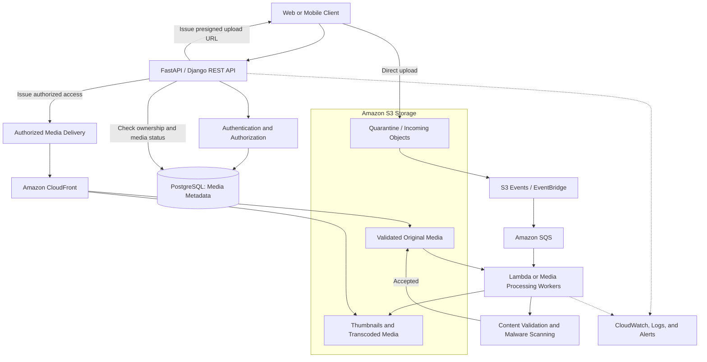
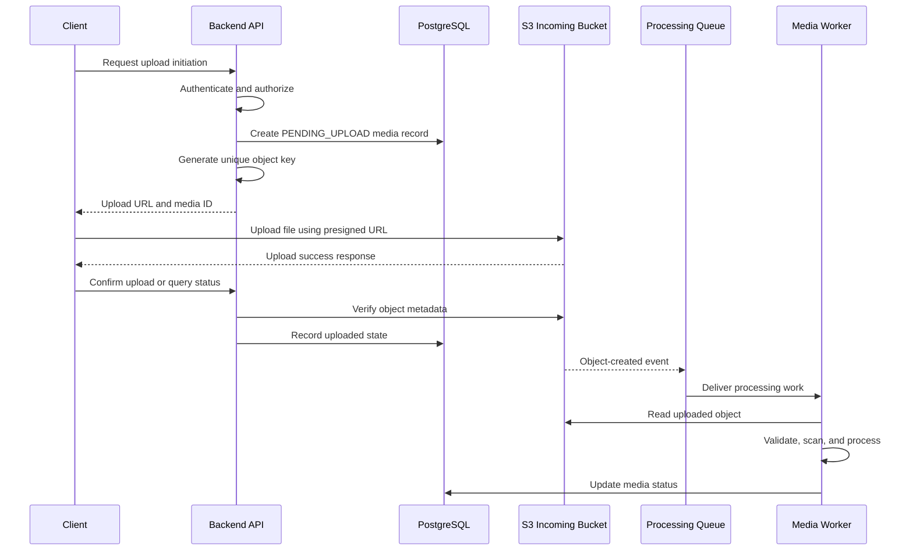
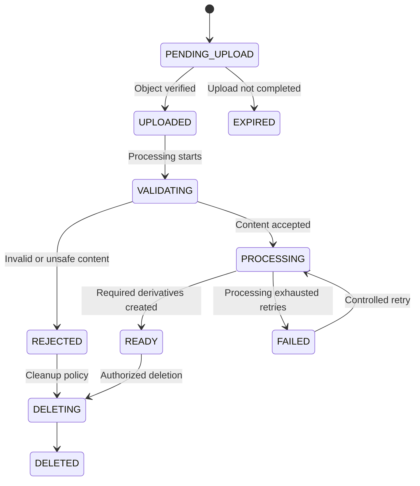
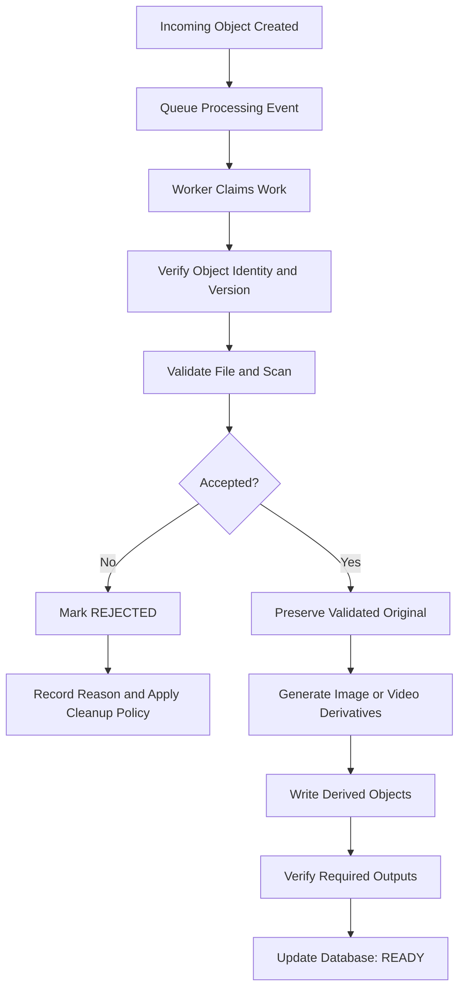
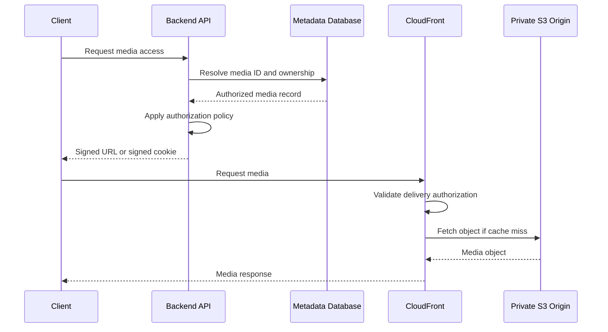

# 03- Media Storage Architecture

## Overview

Amazon S3 is a suitable storage layer for media-heavy backend systems because it separates durable object storage from application compute and content delivery. A production media platform can use S3 to store original images, videos, audio files, documents, thumbnails, transcoded media, and other derived artifacts.

A robust media storage architecture separates five responsibilities:

- **Ingestion:** Authenticate upload requests, validate upload intent, and transfer media into S3.
- **Metadata and authorization:** Maintain ownership, media status, processing state, and business relationships in a database.
- **Processing:** Validate uploaded content, scan files, extract metadata, generate thumbnails, and transcode supported formats.
- **Delivery:** Serve media through CloudFront, using caching and access restrictions appropriate to the content.
- **Operations:** Monitor processing failures, storage usage, transfer costs, security, retention, and recovery.

The primary architectural principle is to use S3 for binary object storage, a database for application state, asynchronous workers for expensive processing, and CloudFront for scalable content delivery where appropriate.

This design supports anything from a document-management application to a video platform serving millions of media requests. The appropriate components depend on file sizes, upload volume, processing requirements, privacy, latency, and recovery objectives.

## Architecture Requirements

Before choosing an implementation, establish the workload requirements.

| Requirement | Architectural consideration |
|---|---|
| Media types | Define supported image, video, audio, and document formats |
| Upload size | Choose server-mediated, direct, or multipart upload based on expected sizes and validation requirements |
| Upload concurrency | Ensure clients can transfer data without exhausting backend connections |
| Validation | Verify actual file content, not only the filename or declared MIME type |
| Processing | Determine whether files require scanning, resizing, transcoding, or metadata extraction |
| Access control | Enforce ownership and authorization before issuing access credentials or delivery URLs |
| Delivery latency | Use suitable caching and content delivery for frequently requested media |
| Privacy | Separate public assets from private user or tenant content |
| Recovery | Decide how original and derived media should be protected and restored |
| Retention | Define when originals, derivatives, abandoned uploads, and historical versions may be removed |
| Cost | Evaluate storage, requests, processing, delivery, replication, and media lifecycle costs |
| Observability | Track upload outcomes, processing latency, delivery failures, and storage growth |

These requirements influence the design of buckets, prefixes, application APIs, metadata schemas, queueing, worker concurrency, and delivery policies.

## Reference Architecture

A typical production media platform consists of an API service, a metadata database, private S3 storage, asynchronous processing, and a delivery layer.



This diagram describes the logical responsibilities, not a mandatory deployment. Validation and processing may run in a single worker or separate services. Original and derived media may reside in separate buckets or in separate prefixes within appropriately secured buckets.

For stricter isolation, use separate buckets for untrusted incoming data and validated production media. A separate delivery bucket or distinct access policy may also be appropriate for different security domains.

### Component Responsibilities

| Component | Responsibility |
|---|---|
| Web or mobile client | Select media, upload content, and request authorized access |
| Backend API | Authenticate users, authorize operations, issue upload instructions, and maintain workflow state |
| PostgreSQL | Store media IDs, owners, object keys, state, content attributes, and processing results |
| S3 incoming storage | Hold uploaded content pending validation |
| S3 original storage | Preserve accepted original media |
| S3 derived storage | Store thumbnails, optimized images, transcoded video, or extracted artifacts |
| S3 events and EventBridge | Route supported object events into asynchronous workflows |
| SQS | Buffer processing work and provide queue-level retry and failure isolation |
| Lambda or workers | Validate and transform media |
| CloudFront | Deliver content and cache eligible responses |
| CloudWatch and logging | Support operational monitoring and incident diagnosis |

Use each component for a clear responsibility. S3 should not be used as a replacement for relational queries, and PostgreSQL should not store large binary media inside ordinary application records without a workload-specific reason.

## Bucket and Object Organization

### Bucket Strategy

Bucket boundaries should follow security, environment, regional, and lifecycle requirements.

A possible design is:

| Bucket | Purpose | Access model |
|---|---|---|
| `acme-media-ingest-prod` | Newly uploaded, untrusted files | Restricted ingestion and validation access |
| `acme-media-originals-prod` | Accepted original media | Restricted application and worker access |
| `acme-media-derived-prod` | Thumbnails, previews, and transcoded outputs | Restricted worker writes and authorized delivery reads |

These are illustrative names. Actual names must follow S3 naming requirements and the organization's naming conventions.

A separate bucket per processing stage is not mandatory. A single bucket with carefully scoped prefixes may be sufficient for less complex systems. Use separate buckets when independent policies, retention requirements, deployment boundaries, or blast-radius isolation justify the operational overhead.

Do not make the entire bucket public simply because some media is intended to be publicly accessible.

### Object Key Design

Generate object keys on the server rather than trusting filenames supplied by clients.

For example:

```text
tenant-204/
    media/
        media-7a2f/
            original
            thumbnails/
                320.webp
                640.webp
            video/
                hls/
                    master.m3u8
                    segment-00001.ts
```

In this example:

- `tenant-204` identifies an organizational partition.
- `media-7a2f` is a server-generated media identifier.
- `original` identifies the original object without exposing the client filename.
- Derived objects have deterministic paths relative to the media record.

S3 object keys are identifiers, not a filesystem hierarchy. Prefixes help organize objects but do not automatically restrict access.

For a private media service, authorize access using the application record and identity of the requester. Do not assume that a tenant prefix alone enforces tenant isolation.

### Original and Derived Objects

Keep the original object separate from its derivatives.

A thumbnail can be regenerated if its transformation rules change. An original, however, may be expensive or impossible to reconstruct if it is deleted.

This separation supports:

- Reprocessing with new transformation settings.
- Multiple thumbnail sizes and output formats.
- Independent lifecycle policies for originals and derivatives.
- Easier diagnosis of processing failures.
- Safer deployment of new media-processing pipelines.

For public or private immutable assets, content-addressed or versioned keys can simplify caching. If a derivative changes, publish a new key or carefully invalidate the cached representation.

## Upload Architecture

### Why Direct-to-S3 Uploads Are Often Preferable

A backend-proxied upload sends file data through the API server before storing it in S3. This can be useful when strict inspection must happen inline, but it consumes application bandwidth, connections, and compute resources.

With a presigned upload URL, the API authorizes a specific upload operation and the client transfers file data directly to S3.

| Upload pattern | Advantages | Trade-offs |
|---|---|---|
| Backend-proxied upload | Centralized streaming and immediate application-level inspection | Higher backend bandwidth and connection usage |
| Presigned single-request upload | Simple direct uploads without routing file bytes through the API | Requires separate completion validation and careful URL restrictions |
| Multipart upload | Parallel part transfers and improved recovery for large files | Requires upload-session management, completion handling, and cleanup |
| Server-side controlled upload | Suitable for trusted internal services and automated ingestion | Still requires correct credential, retry, and idempotency behavior |

A direct upload should not make a media object immediately available to other users. Upload completion is separate from content validation and business-level publication.

### Recommended Upload Flow



The confirmation request is one possible implementation. An event-driven workflow can also move the record forward when a validated object event is received. Production designs should reconcile both paths so duplicate notifications or client retries cannot create inconsistent state.

### Upload State Model

Use an explicit state machine rather than relying on the existence of an object alone.



The exact states depend on the product. For example, a simple image service may not need a separate `UPLOADED` state. Video workflows may need more detailed transcode and packaging states.

The key invariant is that delivery authorization must check the application's publishable state. A newly uploaded but unvalidated object should not be exposed through the normal media delivery path.

### Presigned Upload Example with Boto3

The following Python example generates a short-lived presigned PUT URL for an application-generated object key.

```python
from datetime import timedelta
from uuid import uuid4

import boto3
from botocore.config import Config


class MediaUploadService:
    def __init__(self, bucket: str, region: str) -> None:
        self.bucket = bucket
        self.s3 = boto3.client(
            "s3",
            region_name=region,
            config=Config(
                retries={
                    "mode": "standard",
                    "max_attempts": 5,
                }
            ),
        )

    def create_upload_url(
        self,
        tenant_id: str,
        expected_content_type: str,
    ) -> dict[str, str]:
        media_id = str(uuid4())
        object_key = (
            f"tenants/{tenant_id}/incoming/{media_id}"
        )

        url = self.s3.generate_presigned_url(
            ClientMethod="put_object",
            Params={
                "Bucket": self.bucket,
                "Key": object_key,
                "ContentType": expected_content_type,
            },
            ExpiresIn=int(timedelta(minutes=5).total_seconds()),
        )

        return {
            "media_id": media_id,
            "object_key": object_key,
            "upload_url": url,
            "required_content_type": expected_content_type,
        }
```

The bucket and Region should come from trusted environment configuration. The example assumes `tenant_id` has already been validated and derived from authenticated application state; a caller must not be allowed to choose an arbitrary tenant identifier.

Before returning the URL, the API should persist a `PENDING_UPLOAD` record and enforce the user's upload quota and authorization.

Important limitations:

- A presigned PUT URL does not, by itself, enforce every application-level content or size rule.
- The client must send the signed `Content-Type` header if it is included in the signed request.
- A declared content type does not prove that the file contains valid media of that type.
- URL expiration limits the time available to make the request, but it is not a substitute for authorization and object validation.
- The IAM principal used to create the URL must have the required S3 permissions.
- The generated URL is a bearer capability and must not be logged or exposed unnecessarily.

If a strict upload size range must be enforced by S3 at upload time, evaluate a presigned POST policy with an appropriate `content-length-range` condition or another suitable upload-control mechanism. Also enforce size limits during processing, because client-side checks are not a security boundary.

Reference: [Uploading objects using presigned URLs](https://docs.aws.amazon.com/AmazonS3/latest/userguide/PresignedUrlUploadObject.html).

## Content Validation and Security

Media uploaded by an external user is untrusted, even when the filename ends with `.jpg`, `.mp4`, or `.pdf`.

A secure architecture separates declared attributes from verified content.

### Validation Layers

| Validation | Purpose |
|---|---|
| Authentication | Establish the identity of the uploader |
| Authorization | Confirm permission to create media under the selected tenant or account |
| Upload size controls | Prevent oversized transfers and abuse |
| File signature inspection | Compare actual bytes against supported media formats |
| Decoder or parser validation | Confirm that the content can be processed safely |
| Malware scanning | Identify suspicious files where required by the risk model |
| Image dimension limits | Prevent excessive memory use during decoding |
| Video duration and resolution limits | Control processing time, resource consumption, and product constraints |
| Metadata sanitization | Avoid trusting client-supplied filenames, EXIF fields, and other untrusted metadata |
| Publication gate | Make media available only after the required checks pass |

Validation should happen in a controlled processing environment with bounded memory, CPU, execution time, and concurrency.

Where possible, use patched media-processing libraries and isolate parsers from sensitive application credentials and unrelated workloads.

### Quarantine Pattern

A quarantine or incoming location prevents newly uploaded objects from being delivered as trusted content.

```text
Incoming object
      |
      v
Verify expected size and object identity
      |
      v
Inspect file signature and decode safely
      |
      v
Run malware scan when required
      |
      +---- Rejected ----> Record rejection and clean up according to policy
      |
      v
Store or promote validated original
      |
      v
Generate derivatives
      |
      v
Mark media READY
```

The original object may be copied to validated storage after acceptance, or the architecture may retain the object in place and change its application state. Either approach requires strict access boundaries so that unvalidated objects cannot be delivered through the approved media path.

### Avoiding Unsafe Object Access

Do not accept arbitrary bucket names and S3 keys in public API requests and then download those objects using a privileged service role.

Instead:

1. Accept an application-level media ID.
2. Load the corresponding record from the database.
3. Verify the caller's ownership or access permissions.
4. Retrieve the internally stored bucket and object key.
5. Perform only the authorized operation.

This prevents clients from using the API as a confused deputy to access unrelated objects.

Detailed IAM, bucket policy, malware-scanning, and presigned URL security requirements belong in the Security section.

## Media Processing Architecture

Image resizing, metadata extraction, thumbnail generation, and video transcoding can consume substantial CPU and memory. They should generally run outside the request-response path.

An asynchronous pipeline allows the API to respond promptly while workers handle the media independently.

### S3 Events and SQS

A common architecture uses S3 event notifications routed to SQS, followed by Lambda or dedicated processing workers.

The queue separates ingestion throughput from processing capacity. It also provides visibility into pending work and supports retry and dead-letter strategies.

Use direct S3-to-Lambda notifications for simpler workloads. Choose SQS when queue-level buffering, backpressure, or independent worker concurrency is valuable. EventBridge may be preferable when event routing requires broader filtering and fan-out.

AWS documents supported notification destinations and required permissions in the [S3 Event Notifications guide](https://docs.aws.amazon.com/AmazonS3/latest/userguide/EventNotifications.html).

### Processing Workflow



### Image Processing

Typical transformations include:

- Thumbnail generation.
- Resizing to fixed dimensions.
- Format conversion, such as supported source formats to WebP or AVIF.
- EXIF orientation correction.
- Optional stripping of sensitive metadata.
- Generation of preview images.

Do not decode unbounded image dimensions into memory. Validate maximum dimensions, pixels, frame counts where applicable, and output sizes.

For CPU-intensive transformations, a container-based worker may be more suitable than a short-lived function, depending on execution duration, memory, codec availability, and concurrency requirements.

### Video and Audio Processing

Large video and audio workloads commonly require a dedicated transcoding pipeline.

A typical workflow is:

1. Upload the original media to S3.
2. Verify completion and content identity.
3. Submit a transcode job to an appropriate processing service or worker.
4. Generate required output profiles and packaging.
5. Store outputs in a derived-media location.
6. Validate output manifests and segments.
7. Mark the asset ready for delivery.

For streaming delivery, formats such as HLS or MPEG-DASH may be appropriate. A regular MP4 object can support progressive download, while segmented streaming can provide adaptive bitrate playback for variable network conditions.

The selection depends on device support, video duration, latency requirements, codec requirements, and operating cost. S3 provides the storage layer; it does not perform video transcoding merely because an object is uploaded.

### Lambda Versus Dedicated Workers

| Workload | Typical processing choice | Considerations |
|---|---|---|
| Small image thumbnails | Lambda | Execution limits, memory, package dependencies, and concurrency |
| Moderate image transformations | Lambda or container worker | Transformation complexity and processing volume |
| Large video transcoding | Dedicated transcoding service or appropriately sized workers | CPU demand, codecs, output profiles, and processing duration |
| Large batch reprocessing | Batch or container-based workers | Parallelism, progress tracking, and cost |
| Metadata extraction | Lambda or workers | Parser security and CPU or memory requirements |

Select the processing platform based on measured runtime, memory requirements, operational complexity, and expected throughput.

## Idempotency and Failure Recovery

Asynchronous event processing must be safe under retries.

An S3 event can be delivered more than once, and queue consumers may repeat work after timeouts or worker failures. A processing worker should not create inconsistent database state or uncontrolled duplicate outputs simply because a message is delivered again.

### Idempotency Strategy

Use a stable processing identity based on the media ID, source object version or immutable key, and transformation version where appropriate.

For example:

```text
Processing identity:
    media_id + source_version + transform_version

Output identity:
    media/<media_id>/original-version/<source_version>/
    transforms/<transform_version>/thumbnail-320.webp
```

The exact key scheme can differ, but it should support controlled retries and distinguish outputs generated by different source versions or transformation rules.

Useful practices include:

- Track processing attempts and state in a durable database.
- Record the exact source version or identity being processed.
- Use deterministic keys for each transformation version.
- Make output creation safe to repeat.
- Use conditional database updates to prevent invalid state transitions.
- Handle duplicate queue messages without repeating completed business actions.
- Send repeatedly failing messages to a dead-letter queue when configured.
- Provide an explicit reprocessing operation for failed or outdated derivatives.

### Avoiding Recursive Event Processing

If a bucket event triggers a worker and the worker uploads a derived file to the same triggering location, it can create a processing loop.

Prevent this by:

- Using separate input and output buckets; or
- Configuring notifications for only the intended input prefix and excluding output locations.

For example, trigger processing only for `incoming/` objects, while writing derived files under `derived/`.

Reference: [Using AWS Lambda with Amazon S3](https://docs.aws.amazon.com/lambda/latest/dg/with-s3.html).

### Partial Failure Scenarios

| Failure | Risk | Recovery approach |
|---|---|---|
| Upload completes but client never confirms | Object exists without a completed application workflow | Reconcile pending records and verify objects |
| Database update fails after object upload | Storage and application state diverge | Retry safely and run reconciliation |
| Worker fails during transformation | Partial work or missing derivatives | Retry idempotently and track outputs |
| Duplicate event | Duplicate transformation or repeated notification | Check durable processing state |
| Source is overwritten during processing | Worker may process a different object than intended | Pin processing to a source version or immutable identity |
| Derived upload succeeds but final state update fails | Valid derivative exists while media appears incomplete | Verify expected outputs and resume the state transition |
| Queue backlog grows | New uploads remain unavailable for longer | Scale workers within resource limits and alarm on processing age |

A reliable system should be able to recover from a partial failure without blindly starting every stage again or incorrectly marking a media record as ready.

## Database Metadata Model

Use the database for business-level metadata rather than querying S3 to reconstruct application state on every request.

A simplified PostgreSQL model might contain the following fields.

### Media Table

| Field | Type | Purpose |
|---|---|---|
| `id` | UUID | Stable media identifier |
| `tenant_id` | UUID or domain-specific identifier | Ownership and authorization |
| `original_bucket` | Text | Bucket containing the validated source |
| `original_key` | Text | Key of the source object |
| `source_version_id` | Text, nullable | Version identifier where versioning is used |
| `content_type` | Text | Verified media type |
| `size_bytes` | Bigint | Actual source size |
| `checksum` | Text, nullable | Integrity or content identity metadata |
| `width` | Integer, nullable | Verified image or video width |
| `height` | Integer, nullable | Verified image or video height |
| `duration_ms` | Bigint, nullable | Video or audio duration where applicable |
| `status` | Text | Workflow state |
| `created_at` | Timestamp | Record creation time |
| `processed_at` | Timestamp, nullable | Successful processing time |

A separate derivatives table can represent multiple outputs:

| Field | Purpose |
|---|---|
| `media_id` | Reference to the media record |
| `variant` | Variant name, such as `thumbnail_320` or `hls_1080p` |
| `bucket` and `key` | Derivative location |
| `content_type` | Output media type |
| `size_bytes` | Output size |
| `transform_version` | Transformation implementation version |
| `status` | Derivative generation state |

This avoids hardcoding a fixed number of thumbnail fields into the media table and supports later introduction of new variants.

Do not rely on object tags or custom metadata as the only store for frequently queried relationships, tenant authorization, processing status, or transactional business state.

## Media Delivery Architecture

### CloudFront as the Delivery Layer

CloudFront is useful for frequently accessed images, video segments, audio, and large downloads.

For private media, keep S3 private and authorize delivery through the backend and CloudFront access controls. A common design uses CloudFront signed URLs or signed cookies, with OAC restricting access from CloudFront to the S3 origin.

The application should authorize the media request before creating a signed delivery capability.



CloudFront may serve a cached object without fetching it from S3 on every request. Access restrictions must therefore be applied at the CloudFront delivery layer as well as the S3 origin.

For private media delivery, evaluate signed URLs, signed cookies, TTLs, cache policy, and origin restrictions together.

### Signed URLs Versus Signed Cookies

| Access method | Suitable use case | Important consideration |
|---|---|---|
| S3 presigned URL | Direct upload or direct access to a particular S3 object | Allows the specifically signed S3 operation for a limited period |
| CloudFront signed URL | Authorized access to a particular delivery URL | Authorization is evaluated by CloudFront before serving the request |
| CloudFront signed cookies | Authorized access to multiple protected assets | Useful for streaming, playlists, or collections of media segments |

A video player may request one manifest and many individual media segments. Signed cookies can reduce the need to issue a separate signed URL for every segment when the selected CloudFront configuration supports the required access pattern.

The S3 origin must remain restricted if users are expected to access content only through CloudFront. Otherwise, users may bypass CloudFront's delivery authorization by requesting directly from the origin.

References:

- [CloudFront private content](https://docs.aws.amazon.com/AmazonCloudFront/latest/DeveloperGuide/PrivateContent.html)
- [CloudFront signed URLs](https://docs.aws.amazon.com/AmazonCloudFront/latest/DeveloperGuide/private-content-signed-urls.html)

### Cache Strategy

A media delivery cache policy should reflect whether the object is immutable, public, private, or subject to frequent updates.

| Content | Typical strategy | Reason |
|---|---|---|
| Public immutable image | Long cache lifetime and versioned key | High cache efficiency |
| Public generated thumbnail | Long cache lifetime when output identity is immutable | Avoid repeated S3 reads |
| Frequently updated profile image | Versioned key or controlled invalidation | Prevent stale images |
| Private invoice or document | Restricted CloudFront access and appropriate cache policy | Protect sensitive content |
| Video segments | Cache according to the streaming format and publication strategy | Reduce repeated origin reads |
| Private personalized media | Enforce authorization and carefully control cache-key behavior | Avoid cross-user content exposure |

Caching must not accidentally make one user's private media response reusable by another user. Review the full CloudFront cache key, authorization mechanism, signed URL or cookie behavior, and origin access design.

CloudFront caching is not a replacement for an application authorization decision when generating delivery capabilities.

## Large Files and Multipart Uploads

Large media files are often unsuitable for a single upload request because transfers can be interrupted, and retries may require retransmitting substantial amounts of data.

S3 multipart upload divides a single object into independently uploaded parts. Parts can be transferred in parallel, and a failed part can be retried without retransmitting all completed parts.

### Recommended Workflow

1. The API authenticates the requester and creates a pending media record.
2. The application initiates a multipart upload or provides an appropriate supported upload mechanism.
3. The client uploads parts using authorized URLs or another controlled transfer path.
4. The application records or validates the part completion information.
5. The upload is completed through the authorized workflow.
6. S3 assembles the object, making the completed object available through normal object operations.
7. The application verifies the object and moves it into the validation workflow.
8. Abandoned multipart uploads are cleaned up according to a defined policy.

The `CompleteMultipartUpload` operation is an important state boundary. Individual uploaded parts do not represent a completed media object.

### Integrity Verification

Use S3-supported checksums where appropriate. Do not assume that the ETag of a multipart-uploaded object is the MD5 checksum of the entire file.

The upload workflow should track the expected object identity and ensure that the completed object matches the intended media operation.

Reference: [Uploading and copying objects using multipart upload](https://docs.aws.amazon.com/AmazonS3/latest/userguide/mpuoverview.html).

### Cleanup

Incomplete multipart uploads can continue to incur storage charges for uploaded parts. Configure an appropriate lifecycle rule to abort incomplete multipart uploads after a suitable interval.

Do not delete an active multipart upload without considering whether a legitimate client is still using it. Define the upload-session expiration, completion, cancellation, and cleanup behavior explicitly.

## Multi-Tenant Media Isolation

A media platform may serve many users or organizations from shared infrastructure.

The authorization design must prevent a user from requesting another tenant's media by modifying a URL, media ID, or object key.

A secure download request should follow this sequence:

1. Authenticate the requester.
2. Resolve the media ID through the application database.
3. Verify the requested operation against the tenant or ownership policy.
4. Check that the media is ready for delivery.
5. Generate a delivery URL or other access capability for the verified object.
6. Record relevant audit information without logging bearer tokens.

Never allow a public endpoint to accept an arbitrary bucket and key and then return a presigned URL without checking ownership and authorization.

For stronger isolation, separate buckets, access points, IAM roles, or AWS accounts may be justified. Such boundaries should follow the risk and governance model rather than be selected solely based on tenant count.

## Lifecycle, Retention, and Recovery

Media storage costs often grow because originals, derivatives, historical versions, abandoned uploads, and failed processing artifacts accumulate.

Design lifecycle policies around actual usage and business retention requirements.

| Media category | Possible policy |
|---|---|
| Original user-uploaded media | Retain according to business and legal requirements |
| Regenerable thumbnails | Retain while referenced or regenerate on demand |
| Temporary validation files | Delete after successful promotion or after a bounded retention period |
| Abandoned multipart uploads | Abort incomplete uploads after the selected threshold |
| Historical versions | Retain or expire according to recovery and governance requirements |
| Failed transformation artifacts | Preserve diagnostic evidence when needed, then clean up safely |
| Transcoded media | Retain required streaming profiles and remove obsolete variants deliberately |

Do not expire an original merely because a derivative exists unless the business explicitly permits losing the original.

For regulated or confidential content, permanent deletion requires care. Object versioning, retention controls, and replication can affect what must be removed or retained. An application-level `DELETED` state is not equivalent to physically removing every applicable object version.

### Replication and Media Recovery

Replication can provide another copy of eligible media in a destination bucket or Region. It does not automatically establish that every newly uploaded object has already reached the destination.

A recovery architecture should verify:

- The intended originals and required derivatives are available.
- Replication is configured and monitored where used.
- KMS keys and authorization policies permit recovery operations.
- Application metadata can be restored or reconciled.
- Processing can regenerate missing derivatives where appropriate.
- The application and its dependencies can run in the recovery Region.

A second copy of the files is useful only if the system can identify the required objects and deliver them safely during recovery.

## Observability and Operational Metrics

Monitor the full media lifecycle rather than relying solely on S3 storage metrics.

| Metric or signal | Why it matters |
|---|---|
| Upload initiation and completion failures | Detect broken clients, authorization issues, and transfer problems |
| Upload completion latency | Identify slow transfers or overloaded ingestion paths |
| Pending upload age | Detect incomplete uploads and abandoned workflow records |
| Validation rejection count | Detect malicious, unsupported, or malformed files |
| Processing queue depth | Identify growing backlogs |
| Oldest queued message age | Estimate how long media is waiting for processing |
| Processing success and failure rates | Detect regressions in transformation workers |
| Processing duration by media type | Support capacity planning and resource selection |
| Missing derivative count | Detect incomplete media records or failed processing |
| CloudFront cache hit ratio | Evaluate delivery caching effectiveness |
| CloudFront error rate and latency | Detect origin access or delivery issues |
| Storage growth by media category | Support capacity, lifecycle, and cost analysis |
| Incomplete multipart upload count | Identify abandoned transfers and prevent unnecessary charges |

Use correlation identifiers such as the internal media ID, source object version where applicable, processing attempt ID, and queue message ID to trace a file through the system.

Never log presigned URLs or signed delivery URLs in full. Their query parameters or token-bearing components can grant access to media.

## Cost Optimization

Media platforms can incur significant costs in storage, requests, transfer, transcoding, and delivery.

The principal cost categories include:

- S3 object storage and requests.
- Multipart upload parts and abandoned uploads.
- CloudFront delivery and requests.
- Lambda or container-based processing.
- Video transcoding and packaging.
- Cross-Region replication and data transfer.
- Monitoring, access logging, inventory, and analytics.
- Retaining multiple resolutions, thumbnails, or historical variants.

Practical optimization strategies include:

- Store only the derivative sizes and formats required by actual clients.
- Use CloudFront for frequently requested content.
- Keep immutable assets cacheable using versioned object keys.
- Choose storage classes according to access frequency and retrieval requirements.
- Apply lifecycle policies to temporary data and regenerable artifacts where appropriate.
- Avoid repeated processing of already validated source versions.
- Bound worker concurrency and queue backlogs.
- Abort abandoned multipart uploads.
- Retain original media when needed for recovery or future transformations.
- Monitor processing cost by media type and workload.

For video workloads, measure both the cost of producing multiple renditions and the volume of delivered bytes. A larger set of output profiles may improve viewing quality but increases processing, storage, and operational complexity.

Review current service pricing before making a deployment decision:

- [Amazon S3 pricing](https://aws.amazon.com/s3/pricing/)
- [Amazon CloudFront pricing](https://aws.amazon.com/cloudfront/pricing/)
- [AWS Elemental MediaConvert pricing](https://aws.amazon.com/mediaconvert/pricing/)

## Common Architectural Mistakes

| Mistake | Consequence | Better approach |
|---|---|---|
| Uploading every media file through the API server | Unnecessary backend bandwidth and connection pressure | Use direct uploads where appropriate |
| Trusting a file extension or client MIME type | Invalid or malicious content can reach processing or delivery | Inspect actual content and validate using suitable parsers |
| Publishing media immediately after upload | Unvalidated content becomes available to users | Use explicit validation and publication states |
| Storing only S3 keys without business metadata | Ownership, queries, and workflow management become difficult | Keep application metadata in a database |
| Using user-provided keys directly | Key collisions, unsafe paths, and unauthorized access risks | Generate object keys from trusted application identifiers |
| Assuming an object-created event runs exactly once | Duplicate processing and inconsistent outputs | Make workers idempotent |
| Processing the current object without pinning its identity | A worker may process newer content than the triggering event intended | Use version-specific reads or immutable source identities |
| Writing outputs under the same triggering prefix | Recursive processing loops | Separate input and output locations or filter the event prefix |
| Making the entire bucket public | Private media can be exposed unintentionally | Keep origin storage private and control access deliberately |
| Using long-lived public-cache settings for mutable media | Clients continue seeing stale content | Use versioned keys or a controlled invalidation strategy |
| Deleting originals immediately after transcoding | Future reprocessing or recovery may become impossible | Define explicit retention and regeneration policies |
| Treating replication as synchronous | Recovery may attempt to read media that has not arrived | Monitor replication and account for lag |
| Logging signed URLs | Anyone with log access may obtain media access | Redact token-bearing URLs and sensitive query parameters |
| Treating a database status change as proof that every output exists | The application may expose missing derivatives | Verify required objects before transitioning to `READY` |

## Production Readiness Checklist

### Upload and Validation

- [ ] User identity and authorization are verified before an upload is authorized.
- [ ] Object keys are generated by the application.
- [ ] Upload size and supported content types are constrained.
- [ ] File content is validated independently of client-declared attributes.
- [ ] Untrusted uploads remain inaccessible through normal delivery.
- [ ] Multipart upload completion and abandoned-session cleanup are defined.
- [ ] Retry and upload-confirmation operations are safe.

### Processing

- [ ] Processing runs outside the request-response path where appropriate.
- [ ] Workers use least-privilege IAM roles.
- [ ] Duplicate and out-of-order events are handled safely.
- [ ] Failed work has a bounded retry and recovery mechanism.
- [ ] Input and output locations cannot cause recursive event processing.
- [ ] Required derivatives are verified before the media becomes ready.
- [ ] Reprocessing can be performed without corrupting existing assets.

### Delivery and Security

- [ ] Private originals remain private.
- [ ] CloudFront origin access is restricted when CloudFront is the authorized delivery path.
- [ ] The application checks ownership before issuing delivery capabilities.
- [ ] Signed URLs or cookies have an appropriate lifetime and access scope.
- [ ] Cache policies respect media privacy and mutability.
- [ ] Logs do not expose signed URL tokens or sensitive media metadata.

### Operations and Recovery

- [ ] Media states and object identities can be reconciled after partial failures.
- [ ] Queue depth, processing age, failures, and delivery errors are monitored.
- [ ] Retention and deletion rules preserve required originals and historical versions.
- [ ] Replication and disaster recovery are tested when required.
- [ ] Storage, processing, transfer, and delivery costs are measured.
- [ ] Recovery procedures can restore both media data and the application state needed to serve it.

## Further Reading

- [Amazon S3 security](https://docs.aws.amazon.com/AmazonS3/latest/userguide/security.html)
- [Uploading objects with presigned URLs](https://docs.aws.amazon.com/AmazonS3/latest/userguide/PresignedUrlUploadObject.html)
- [Multipart uploads in Amazon S3](https://docs.aws.amazon.com/AmazonS3/latest/userguide/mpuoverview.html)
- [S3 Event Notifications](https://docs.aws.amazon.com/AmazonS3/latest/userguide/EventNotifications.html)
- [Processing S3 events with Lambda](https://docs.aws.amazon.com/lambda/latest/dg/with-s3.html)
- [CloudFront private content](https://docs.aws.amazon.com/AmazonCloudFront/latest/DeveloperGuide/PrivateContent.html)
- [CloudFront signed URLs](https://docs.aws.amazon.com/AmazonCloudFront/latest/DeveloperGuide/private-content-signed-urls.html)
- [Amazon S3 replication](https://docs.aws.amazon.com/AmazonS3/latest/userguide/replication.html)

## Key Takeaways

- Separate media ingestion, metadata and authorization, asynchronous processing, and content delivery into clear architectural responsibilities.
- Use direct S3 uploads where appropriate, but validate uploaded content and complete the application workflow before publishing media.
- Design processing workers for duplicate events, retries, partial failures, and immutable source identities.
- Deliver media through CloudFront with suitable caching and access controls, keeping private origins and tenant authorization protected.
- Treat originals, derivatives, lifecycle policies, observability, and recovery as explicit design decisions rather than afterthoughts.