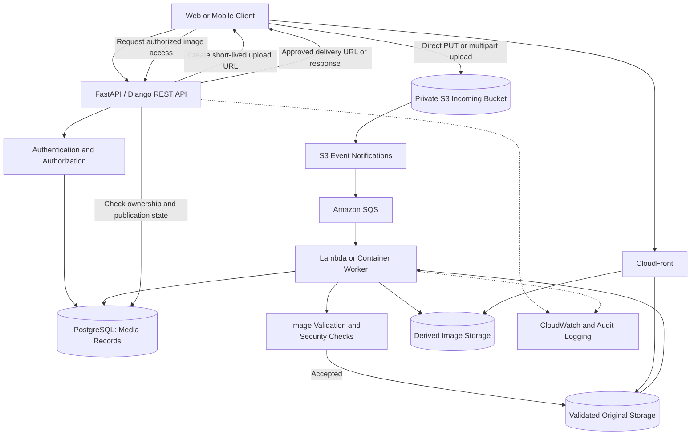
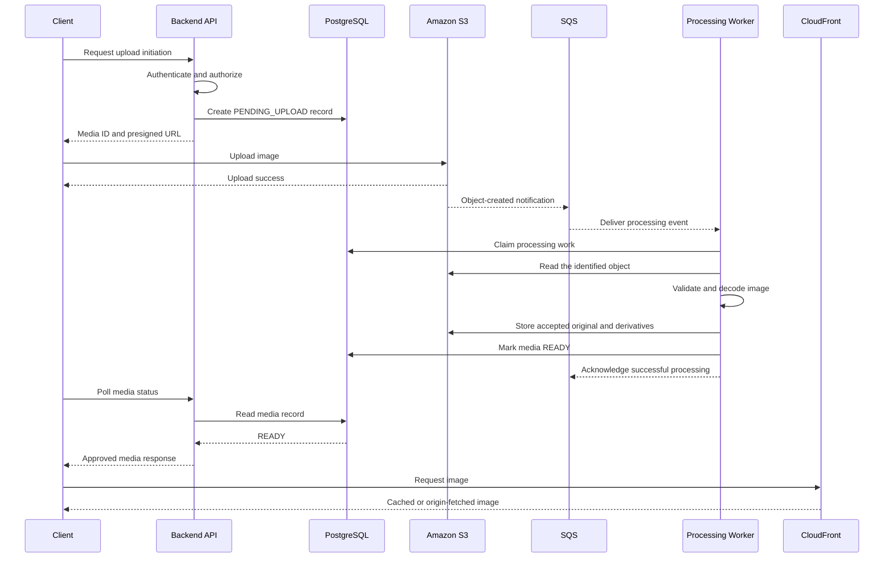
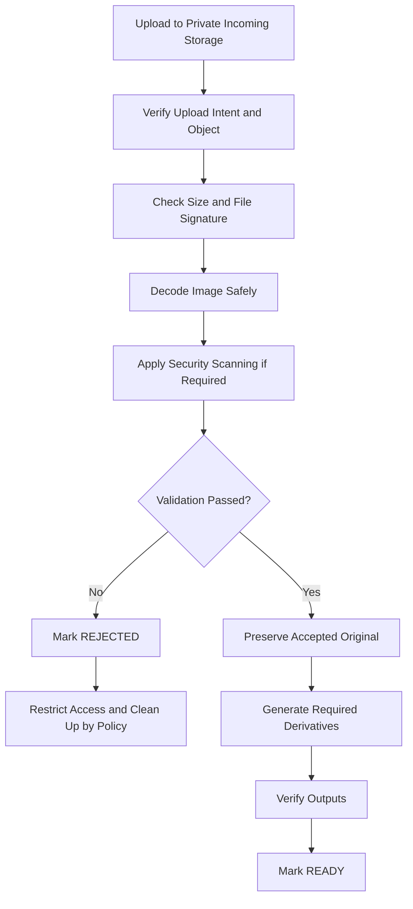
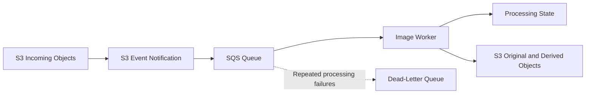
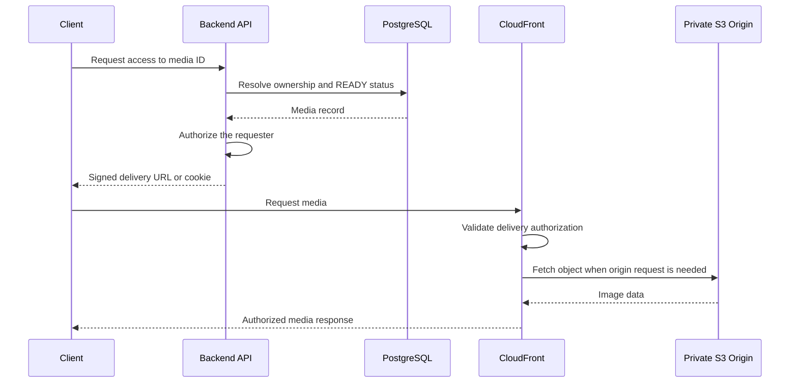

# 04- Image Upload Pipeline Architecture

## Overview

An image upload pipeline is a backend workflow that accepts image uploads, validates untrusted content, stores original files in Amazon S3, generates optimized derivatives, and makes approved images available to authorized consumers.

A production implementation must handle more than uploading a file. It must coordinate object storage, application metadata, authorization, asynchronous processing, retries, duplicate events, partial failures, and content delivery.

A robust architecture separates the following responsibilities:

- **Upload initiation:** Authenticate the user, enforce quotas, generate a unique object key, and authorize an upload.
- **Object storage:** Store incoming images in a private S3 location.
- **Validation:** Verify actual file content, dimensions, size, and any required security checks.
- **Image processing:** Generate thumbnails and optimized formats using isolated workers.
- **Workflow state:** Track ownership, upload status, processing status, and derivative locations in a database.
- **Delivery:** Serve approved images through CloudFront or another authorized access path.
- **Operations:** Monitor failures, processing delays, queue backlogs, storage growth, and costs.

For most applications accepting images directly from web or mobile clients, a suitable default is **presigned uploads to a private S3 bucket, asynchronous processing through SQS and workers, PostgreSQL for workflow metadata, and CloudFront for delivery where appropriate**.

This design reduces application-server bandwidth consumption, decouples upload latency from processing time, and supports independent scaling of ingestion, processing, and delivery.

## Architecture Requirements

Before implementing the pipeline, define the workload's security, operational, and performance requirements.

| Requirement | Architectural decision |
|---|---|
| Upload size | Define maximum size and select single-request or multipart upload |
| Supported formats | Define accepted formats and verify actual file content |
| Upload authorization | Authenticate users and enforce tenant or ownership restrictions |
| Object naming | Generate unique keys in the backend |
| Validation | Inspect file signatures, decode images safely, and enforce dimension limits |
| Processing | Choose suitable runtime, libraries, and worker concurrency |
| Workflow tracking | Maintain durable state independently of S3 object existence |
| Retry behavior | Make processing safe under duplicate messages and interrupted executions |
| Delivery | Select public, authenticated, or time-limited access according to the content |
| Data protection | Choose encryption, versioning, retention, and recovery controls |
| Monitoring | Track upload outcomes, queue age, processing latency, and delivery errors |
| Cost | Evaluate storage, API requests, processing, transfer, and CDN usage |

These choices should be explicit. For example, a public avatar service may allow broad read access to approved derivatives, while a medical imaging application requires private storage and strict authorization at every delivery boundary.

## Recommended Architecture

### High-Level Design



This is a logical architecture; not every deployment requires separate buckets for incoming, original, and derived images.

A simpler application can use separate prefixes within one private bucket. Separate buckets provide clearer boundaries when incoming content is untrusted, retention rules differ, or the operational risk of accidental exposure is significant.

### Component Responsibilities

| Component | Responsibility |
|---|---|
| Client | Select an image, upload it, and request processing or delivery status |
| Backend API | Authenticate requests, authorize uploads, generate object keys, and maintain media records |
| PostgreSQL | Store ownership, object references, status transitions, and processing results |
| S3 incoming bucket | Store newly uploaded, untrusted image objects |
| S3 original storage | Preserve accepted source images |
| S3 derived storage | Store thumbnails and optimized image variants |
| S3 Event Notifications | Signal supported object operations to the configured processing destination |
| SQS | Buffer work and isolate upload traffic from worker capacity |
| Lambda or container workers | Validate, decode, transform, and publish image outputs |
| CloudFront | Cache and deliver eligible content |
| CloudWatch | Provide configured metrics, logs, and alarms |

The API should not keep an HTTP request open while performing expensive image transformations. Upload completion and image processing are separate events in the application lifecycle.

## End-to-End Upload Lifecycle

The application should distinguish a file being uploaded from a file being valid and ready for delivery.

A recommended state model is:

| State | Meaning |
|---|---|
| `PENDING_UPLOAD` | The application created an upload intent, but the object is not yet verified |
| `UPLOADED` | An expected object has been observed and verified |
| `VALIDATING` | The system is inspecting the file and applying security checks |
| `PROCESSING` | The image passed validation and required transformations are running |
| `READY` | The original and all required derivatives are available |
| `REJECTED` | The file violates validation or security requirements |
| `FAILED` | Processing exhausted the configured retry policy or encountered a terminal error |
| `EXPIRED` | The upload intent expired without an acceptable completion |
| `DELETING` | An authorized deletion is in progress |
| `DELETED` | The application considers the media deleted after its deletion workflow completes |

The exact states may be simplified for smaller systems. The critical invariant is that an uploaded object is not automatically trusted or publishable.

### Sequence Diagram



This sequence illustrates an event-driven processing design. The actual queue and worker configuration must handle failures, duplicate messages, and messages that cannot be processed successfully.

## Upload Initiation

### Responsibilities of the Backend

When a client requests an upload, the backend should:

1. Authenticate the requester.
2. Check tenant ownership and upload permissions.
3. Validate the declared file size and content type against application policy.
4. Check user, tenant, and system-level quotas.
5. Generate a unique media ID and object key.
6. Create a `PENDING_UPLOAD` database record.
7. Generate a short-lived upload capability for the approved object key.
8. Return the media ID, upload URL, required headers, and expiration information.

The object key should come from trusted application-generated identifiers, not from a path supplied by the client.

For example:

```text
incoming/
    tenant-204/
        media-7f1d8e2c-.../
            source
```

The key does not need to preserve the original filename. Store a sanitized display filename in application metadata if the product requires one.

### Presigned Uploads

A presigned URL allows a client to upload to a specific S3 resource using permissions from the IAM principal that generated the URL. The client does not need its own AWS credentials.

For browser and mobile applications, direct-to-S3 uploads avoid sending the entire image payload through the backend.

A backend service can generate a presigned PUT URL with Boto3:

```python
from datetime import timedelta
from uuid import uuid4

import boto3
from botocore.config import Config


class ImageUploadService:
    def __init__(self, bucket: str, region: str) -> None:
        self.bucket = bucket
        self.s3 = boto3.client(
            "s3",
            region_name=region,
            config=Config(
                retries={
                    "mode": "standard",
                    "max_attempts": 5,
                }
            ),
        )

    def create_upload(self, tenant_id: str) -> dict[str, str]:
        media_id = str(uuid4())
        object_key = (
            f"incoming/{tenant_id}/{media_id}/source"
        )

        required_content_type = "image/jpeg"

        upload_url = self.s3.generate_presigned_url(
            ClientMethod="put_object",
            Params={
                "Bucket": self.bucket,
                "Key": object_key,
                "ContentType": required_content_type,
            },
            ExpiresIn=int(
                timedelta(minutes=5).total_seconds()
            ),
        )

        return {
            "media_id": media_id,
            "object_key": object_key,
            "upload_url": upload_url,
            "required_content_type": required_content_type,
        }
```

This is a service-layer example, not a complete endpoint. A production API must persist the upload intent before returning the URL, derive the tenant identifier from authenticated application state, and apply its upload-quota policy.

The caller must send the signed `Content-Type` header when using the URL. A declared content type does not prove that the uploaded bytes contain a valid JPEG.

### Important Presigned URL Limitations

A presigned PUT URL is not automatically a one-time upload token.

- It can generally be reused until it expires, provided the request remains authorized and satisfies its signed conditions.
- Reusing the same URL and key can overwrite the current object.
- Signing a `Content-Type` header does not validate the actual file format.
- A normal presigned PUT does not, by itself, enforce every desired upload-size range.

To reduce risks:

- Generate a different unpredictable object key for every upload attempt.
- Use a short expiration time appropriate to the expected transfer duration.
- Where supported by the selected API and client, sign an appropriate conditional write such as `If-None-Match: *` to prevent overwriting an existing current object.
- Consider bucket versioning for upload locations where preserving the exact uploaded version is important.
- Verify the object before trusting it.
- Treat the URL as a bearer capability and avoid logging it.

For a strict upload-size range enforced by S3, consider a presigned POST policy with a `content-length-range` condition or another appropriate upload mechanism. Enforce size limits again during server-side processing.

References:

- [Uploading with presigned URLs](https://docs.aws.amazon.com/AmazonS3/latest/userguide/PresignedUrlUploadObject.html)
- [Conditional writes in Amazon S3](https://docs.aws.amazon.com/AmazonS3/latest/userguide/conditional-writes.html)

## Upload Verification and Workflow Coordination

An S3 successful response confirms that the object upload operation succeeded. It does not prove that the image is safe, valid, supported by the application, or ready for publication.

The pipeline should verify at least:

- The object belongs to a known upload intent.
- The object key matches the key recorded by the application.
- The actual size is within the permitted range.
- The content type and image format satisfy application policy.
- The object version being processed matches the expected upload attempt, where versioning is used.
- The media record has not been deleted, expired, or otherwise invalidated.

### Event-Driven Versus Completion-Driven Processing

Two patterns are reasonable, but the system should define a canonical way to schedule processing.

| Pattern | Flow | Important consideration |
|---|---|---|
| S3 event-driven | Upload → S3 event → SQS → worker | Events may be duplicated or arrive out of order; processing must be idempotent |
| API completion-driven | Upload → completion API verifies object → durable work scheduling | The completion operation needs retry-safe state transitions and durable scheduling |
| Hybrid | Client confirmation plus S3 events and reconciliation | Both paths can observe the same upload, so they must share idempotency and state rules |

For an S3 event-driven pipeline, make sure each event references an object that belongs to a valid upload intent. Ignore or quarantine unexpected events rather than processing arbitrary objects.

For a completion-driven pipeline, avoid a failure window where PostgreSQL records an upload as complete but the application crashes before sending a queue message. A transactional outbox or another durable scheduling mechanism can bridge database state changes and message publication.

Do not independently launch uncoordinated processing from both the completion API and S3 notifications. If both paths are used, they must use the same durable idempotency strategy.

## Image Validation and Security

Treat every external upload as untrusted input. Client-side restrictions improve usability but are not a security boundary.

### Validation Layers

| Validation | Purpose |
|---|---|
| Authentication | Verify the uploader's identity |
| Authorization | Enforce ownership and tenant access |
| Upload size | Prevent oversized uploads and excessive storage use |
| File signature | Determine whether the content matches an accepted image format |
| Decoder validation | Verify the image can be parsed successfully |
| Dimension limits | Bound pixel count and memory consumption |
| Frame limits | Prevent unexpectedly expensive animated image processing |
| Metadata inspection | Identify and optionally remove sensitive EXIF and location information |
| Malware inspection | Detect malicious content when required by the risk model |
| Output validation | Confirm that generated derivatives are valid and meet expected dimensions |

Validate the actual bytes rather than relying only on extensions or request headers.

For example, an uploaded filename such as `photo.jpg` may contain non-JPEG data. Conversely, a valid image may use an extension that does not match the declared MIME type. The backend should use an explicit policy to decide which formats are accepted and reject ambiguous or unsupported content.

### Quarantine Pattern

Keep untrusted uploads separate from approved media.



Do not allow CloudFront or application download endpoints to expose quarantine objects. If a separate incoming bucket is used, give the upload capability access only to the intended incoming object and do not let the client choose the destination bucket.

### Image Decoding Risks

Image decoders process complex binary formats and may encounter malformed files or unusually large images.

Use maintained libraries and configure explicit limits for:

- Maximum compressed file size.
- Maximum width and height.
- Maximum total pixel count.
- Maximum number of frames.
- Processing time and worker concurrency.
- Maximum allowed output size.

Run expensive or risky parsing in a bounded worker environment. For high-risk systems, isolate media processing from application credentials and unrelated workloads.

## Image Processing Workers

Image transformations should generally execute asynchronously so that users do not need to wait for resizing or format conversion inside an API request.

The processing platform depends on expected runtime and resource requirements.

| Workload | Typical choice | Trade-offs |
|---|---|---|
| Small thumbnails | AWS Lambda | Simple scaling, but runtime and resource limits apply |
| Moderate image transformations | Lambda or container workers | Choose based on library dependencies, memory, CPU, and throughput |
| High-volume or CPU-intensive transformation | Container-based workers | More control over resources and dependency packaging |
| Large batch reprocessing | Queue-driven containers or batch processing | Useful for bounded parallelism and workload scheduling |

### Suggested Image Variants

A profile-image service might produce:

```text
media/<media-id>/
    original.jpg
    derivatives/
        thumbnail-96.webp
        thumbnail-320.webp
        display-1280.webp
```

These names are illustrative. The exact formats and resolutions should follow product requirements and actual usage patterns.

Store original and derived images separately, or use distinct prefixes. This allows the pipeline to regenerate derivatives without losing the original source.

A transformation version can be included in derivative keys when processing algorithms change:

```text
media/<media-id>/v2/thumbnail-320.webp
```

This makes it easier to introduce new transformations without overwriting objects that may still be referenced or cached by clients.

### Example Image Transformation

The following example uses Pillow to validate basic image dimensions and generate a normalized WebP thumbnail. It illustrates the transformation boundary; production workers should additionally implement the required size checks, logging, storage operations, and workflow updates.

```python
from io import BytesIO
import warnings

from PIL import Image, ImageOps, UnidentifiedImageError


MAX_INPUT_BYTES = 10 * 1024 * 1024
MAX_PIXELS = 25_000_000
THUMBNAIL_SIZE = (320, 320)


class InvalidImageError(ValueError):
    pass


def create_thumbnail(image_bytes: bytes) -> bytes:
    if not image_bytes or len(image_bytes) > MAX_INPUT_BYTES:
        raise InvalidImageError("Image size is outside permitted limits")

    Image.MAX_IMAGE_PIXELS = MAX_PIXELS

    try:
        with warnings.catch_warnings():
            warnings.simplefilter(
                "error",
                Image.DecompressionBombWarning,
            )

            with Image.open(BytesIO(image_bytes)) as source:
                if source.format not in {"JPEG", "PNG", "WEBP"}:
                    raise InvalidImageError(
                        "Unsupported image format"
                    )

                if getattr(source, "n_frames", 1) != 1:
                    raise InvalidImageError(
                        "Animated images are not supported"
                    )

                source.verify()

            with Image.open(BytesIO(image_bytes)) as source:
                image = ImageOps.exif_transpose(source)
                image.load()

                image.thumbnail(
                    THUMBNAIL_SIZE,
                    Image.Resampling.LANCZOS,
                )

                if image.mode not in {"RGB", "RGBA"}:
                    image = image.convert("RGBA")

                output = BytesIO()
                image.save(
                    output,
                    format="WEBP",
                    quality=82,
                    method=6,
                )
                return output.getvalue()

    except (
        UnidentifiedImageError,
        Image.DecompressionBombError,
        Image.DecompressionBombWarning,
        OSError,
    ) as exc:
        raise InvalidImageError(
            "The uploaded file is not a valid supported image"
        ) from exc
```

The example permits JPEG, PNG, and WebP and rejects animated images. Those are product decisions, not universal image-pipeline requirements.

A production implementation should keep the configured limits aligned with worker memory and processing capacity. Set any process-wide Pillow configuration once during worker initialization rather than changing it concurrently for individual requests in a shared process.

The `thumbnail` operation preserves the image's aspect ratio while fitting it within the specified dimensions. Applications requiring exact dimensions may need cropping or padding instead.

## Event-Driven Processing with S3 and SQS

### Why Use SQS?

S3 can send object notifications to supported destinations such as SQS, SNS, Lambda, and EventBridge. For a queue-based image pipeline, SQS can buffer events and decouple upload traffic from processing capacity.

The worker should process only expected object-created events from approved incoming locations.



### Required Configuration

The deployment needs to configure:

- The S3 bucket notification destination.
- The permissions needed for S3 to send messages to the queue.
- The SQS queue policy and encryption settings where applicable.
- The worker's permissions to receive and delete messages.
- The worker's S3 read and write permissions.
- The required database and processing permissions.
- Visibility timeout, retry behavior, and a dead-letter strategy.
- Queue monitoring and alarms.

The worker should not receive broad access to unrelated buckets just because it needs to process images.

### At-Least-Once Delivery and Idempotency

S3 Event Notifications are asynchronous and can be delivered more than once. Events can also be observed out of order.

Consequently, a worker must not assume that one object-created event means exactly one execution.

A useful idempotency identity is:

```text
bucket + object key + source version ID + transformation version
```

When S3 Versioning is enabled, the event's `versionId` can identify a particular object version. When versioning is not enabled, the design must take additional care to prevent repeated writes to a key from making the worker process unexpected content.

Consider a client uploading an image and then reusing its still-valid presigned URL to overwrite the same key. An earlier event may be delivered after the overwrite. A worker that always reads the current key could process content different from the content represented by the event.

For workflows that require exact source identity:

- Use a unique key per upload attempt.
- Enable versioning where appropriate and process the event's specific version.
- Consider conditional writes to prevent overwriting an existing current object.
- Persist the source identity associated with the accepted upload.
- Make publication conditional on the media record still representing the same source version.

Reference: [S3 Event Notifications](https://docs.aws.amazon.com/AmazonS3/latest/userguide/EventNotifications.html).

### Preventing Recursive Invocation

If an S3 event triggers a worker and the worker writes a derivative to the same triggering prefix, it may generate additional events and repeatedly invoke itself.

Use separate buckets or filter notifications so that only incoming objects trigger processing.

For example:

```text
incoming/     -> Trigger validation and processing
originals/    -> Accepted original images
derivatives/  -> Generated thumbnails and optimized images
```

If the bucket notification is restricted to `incoming/`, writing to `originals/` or `derivatives/` will not match that filter.

Validate the event filters during deployment and test that derived writes do not trigger the original processing workflow.

## Idempotency, State Transitions, and Partial Failures

A durable state model is essential because S3, SQS, workers, and PostgreSQL do not share one atomic transaction.

For example, the worker may successfully upload a thumbnail and then fail before updating the database. Retrying the message should not create inconsistent output or mark the wrong source version as ready.

### Recommended State-Transition Rules

- A media record may be claimed for validation only if it represents a valid upload attempt.
- Duplicate notifications should find an existing processing record or completed result.
- Terminal rejection must not be silently changed to `READY` by an unrelated stale event.
- A worker should publish readiness only after all required output objects are verified.
- Processing of one source version must not overwrite the state for a newer accepted source version.
- Retryable failures should retain enough information to resume safely.
- Permanently rejected inputs should be separated from transient processing failures.

### Example Failure Matrix

| Failure | Recovery behavior |
|---|---|
| Upload finishes but no client confirmation arrives | Reconcile the object and upload record, or expire the pending intent safely |
| Worker receives the same event again | Check idempotency state and avoid duplicating completed business operations |
| S3 read fails temporarily | Retry within a bounded policy |
| Image fails validation | Mark rejected, record a safe reason, and prevent delivery |
| Derivative upload succeeds but database update fails | Verify the deterministic output and safely complete the state transition |
| Database update succeeds but the worker fails before acknowledging the SQS message | Redelivered work should recognize the completed state and acknowledge safely |
| Worker repeatedly crashes on one input | Stop unbounded retries and route the message to the configured failure path |
| New image version arrives while older work remains pending | Verify source identity and prevent stale work from becoming the current published result |

For reliable API-to-queue coordination, use a transactional outbox when the database update and message publication must not lose work between independent operations.

## Database Model

A database should represent application state, ownership, and relationships between media records and generated derivatives.

A simplified schema could use two tables.

### Media

| Field | Purpose |
|---|---|
| `id` | Stable application-level media identifier |
| `tenant_id` | Ownership and authorization boundary |
| `upload_key` | Key assigned for the incoming object |
| `source_bucket` | Bucket containing the accepted original |
| `source_key` | Key of the accepted original |
| `source_version_id` | Version ID when versioning is used |
| `content_type` | Verified image content type |
| `size_bytes` | Verified source object size |
| `width` and `height` | Validated dimensions |
| `status` | Current application workflow state |
| `created_at` | Record creation time |
| `processed_at` | Successful processing time |

### Media Derivatives

| Field | Purpose |
|---|---|
| `id` | Derivative record identifier |
| `media_id` | Associated media record |
| `variant` | Thumbnail or transformation name |
| `bucket` and `key` | Derivative location |
| `content_type` | Verified output media type |
| `size_bytes` | Output size |
| `transform_version` | Transformation implementation version |
| `status` | Derivative workflow state |

This model supports multiple output variants without adding a separate database column for every possible thumbnail size.

Use a database transaction for related metadata state changes. S3 object operations must be coordinated separately because they cannot participate in the same PostgreSQL transaction.

## Delivery Through CloudFront

After successful validation and processing, images can be served through CloudFront.

For public images, a suitable distribution can cache approved content without requiring an authorization check for each request. For private images, the application must authorize the requester and provide a restricted delivery mechanism.

### Public and Private Delivery

| Delivery model | Suitable use case | Important considerations |
|---|---|---|
| Public derivative through CloudFront | Public avatars, product images, public gallery assets | Keep private originals inaccessible; use immutable or versioned keys where appropriate |
| CloudFront signed URL | Authorized access to a particular private image | Issue only after the backend checks access permissions |
| CloudFront signed cookies | Access to multiple protected resources | Useful when a page or gallery requires many private images |
| Short-lived S3 presigned GET | Direct, time-limited access to a specific S3 object | Bypasses CloudFront delivery and its cache when used directly |
| Backend-proxied download | Workloads requiring server-side filtering or processing before delivery | Consumes backend network and connection resources |

### Private Media Access Flow



For private media, origin access restrictions must prevent clients from bypassing CloudFront and retrieving objects directly from S3.

Review cache policies and authorization together. A private image must not become accessible to another user because its response was cached under an inappropriate cache key or because authorization was checked only when generating a URL that is reused too broadly.

CloudFront OAC can restrict the distribution's origin access to a private S3 bucket. OAC does not itself decide whether a user is allowed to view a particular image; the application and delivery authorization design must enforce that decision.

References:

- [CloudFront private content](https://docs.aws.amazon.com/AmazonCloudFront/latest/DeveloperGuide/PrivateContent.html)
- [CloudFront origin access control](https://docs.aws.amazon.com/AmazonCloudFront/latest/DeveloperGuide/private-content-restricting-access-to-s3.html)

## Lifecycle and Data Recovery

Image pipelines can accumulate originals, thumbnails, temporary objects, historical versions, and abandoned uploads.

A lifecycle strategy should distinguish irreplaceable source images from regenerable derivatives.

| Data category | Typical policy consideration |
|---|---|
| Original images | Retain according to product requirements, user expectations, and applicable regulations |
| Thumbnails and optimized derivatives | Regenerate when necessary if the original and transformation logic remain available |
| Incoming unvalidated objects | Remove according to a bounded retention and investigation policy |
| Abandoned uploads | Expire stale upload intents and clean up their objects safely |
| Incomplete multipart uploads | Configure lifecycle cleanup for abandoned parts |
| Historical versions | Retain according to recovery requirements and version-management policy |
| Failed-processing artifacts | Preserve diagnostic information where needed, then clean up deliberately |

Do not expire original images solely because a thumbnail exists. The original may be necessary for future resizing, a new output format, or recovery from a processing defect.

If versioning is enabled, deleting an object may create a delete marker rather than permanently removing every version. Lifecycle and deletion procedures should account for the bucket's versioning and retention configuration.

### Recovery Boundaries

Recovery should include both the stored image and the metadata needed to serve it.

For example, restoring an S3 object without restoring its ownership record, published status, or derivative references may leave the application unable to serve the image correctly.

A recovery plan should account for:

- Original objects and required derivatives.
- Database media records and processing state.
- Encryption keys and applicable access policies.
- Queue messages and unfinished processing work.
- Replication status where replication is used.
- Application deployment and delivery configuration.

Reference: [Amazon S3 replication](https://docs.aws.amazon.com/AmazonS3/latest/userguide/replication.html).

## Observability and Operational Metrics

Monitor the entire image lifecycle instead of observing only S3 storage capacity.

| Metric | Why it matters |
|---|---|
| Upload initiation failures | Identify API authorization and quota problems |
| Upload completion failures | Detect transfer errors and invalid upload intents |
| Pending upload age | Find abandoned uploads and stalled clients |
| Validation rejection count | Detect malformed, unsupported, or potentially malicious files |
| SQS queue depth | Identify processing backlog |
| Age of oldest queued message | Measure how long images are waiting for processing |
| Worker error rate | Identify decoder, dependency, or infrastructure failures |
| Processing latency | Support capacity planning and user-experience objectives |
| Derivative generation failures | Detect incomplete published media |
| Number of media records stuck in intermediate states | Identify workflow bugs and lost work |
| CloudFront cache hit ratio | Evaluate delivery cache effectiveness |
| CloudFront origin errors | Identify bucket permissions, missing objects, and delivery problems |
| Storage and request cost | Detect unexpected usage growth |
| Incomplete multipart upload count | Identify abandoned transfers and avoid unnecessary storage charges |

Use the internal media ID, source version ID where applicable, processing attempt ID, and queue message ID to correlate application logs with S3 activity.

Do not log presigned upload URLs or signed delivery URLs in full. Treat them as bearer capabilities because their possession may grant access.

## Cost and Scalability Considerations

The pipeline's cost comes from multiple components:

- S3 storage for incoming, original, and derivative objects.
- S3 requests associated with upload, validation, processing, and delivery.
- SQS message requests and worker invocations.
- Image decoding and transformation compute.
- CloudFront requests and data delivery.
- Cross-Region replication and transfer when configured.
- Logs, metrics, inventory, and audit events.

Useful optimization strategies include:

- Use direct uploads to reduce backend bandwidth for suitable workloads.
- Generate only image variants required by product clients.
- Bound worker concurrency to protect memory and database capacity.
- Use deterministic derivative keys to avoid unnecessary repeated work.
- Serve frequently requested images through CloudFront.
- Use long cache lifetimes for immutable, versioned outputs.
- Clean up abandoned multipart uploads and temporary objects.
- Choose lifecycle policies based on actual usage and retention requirements.
- Avoid repeated source downloads when a completed transformation can be safely reused.

Do not optimize storage costs by deleting data required for recovery or future transformations. The correct policy depends on whether the original image can be recreated and what the product promises to users.

Review current AWS pricing:

- [Amazon S3 pricing](https://aws.amazon.com/s3/pricing/)
- [Amazon CloudFront pricing](https://aws.amazon.com/cloudfront/pricing/)
- [AWS Lambda pricing](https://aws.amazon.com/lambda/pricing/)

## Common Architectural Mistakes

| Mistake | Consequence | Better approach |
|---|---|---|
| Routing every image byte through the API server | Increased network and connection pressure | Prefer direct S3 uploads when suitable |
| Trusting the file extension or MIME type | Invalid or malicious files may enter processing | Verify signatures and decode content safely |
| Publishing images immediately after upload | Unvalidated content becomes accessible | Use explicit validation and publication states |
| Using client-provided object keys | Key collisions and unauthorized object access become more likely | Generate unique server-controlled keys |
| Assuming a presigned URL is single-use | The object may be overwritten while the URL remains valid | Use unique keys, short expiration, and appropriate conditional-write or versioning controls |
| Treating S3 events as exactly-once delivery | Duplicate processing and inconsistent outputs | Implement durable idempotency |
| Ignoring source object version identity | A delayed event can process unexpected current content | Pin processing to the intended object version or immutable identity |
| Writing outputs to the triggering prefix | Recursive processing loops | Use separate output locations or precise notification filters |
| Combining database and S3 changes as though they were atomic | Partial failures leave inconsistent state | Use durable workflow states and reconciliation |
| Marking a media record ready before all required derivatives exist | Clients receive missing or incomplete content | Verify required outputs before publication |
| Making the entire bucket public | Private original images may be exposed | Restrict origin access and publish only approved content |
| Logging signed URLs | Logs may expose access capabilities | Redact token-bearing URLs and query parameters |
| Deleting original images too early | Images cannot be regenerated after transformation changes | Define explicit original retention and recovery policies |

## Production Readiness Checklist

### Upload and Validation

- [ ] Authenticate every upload-initiation request.
- [ ] Check tenant ownership, quotas, and allowed file types.
- [ ] Generate unique object keys on the server.
- [ ] Persist an upload-intent record before returning an upload URL.
- [ ] Use private incoming storage and appropriate upload permissions.
- [ ] Enforce upload size restrictions using suitable request controls and server-side verification.
- [ ] Validate actual image bytes and dimensions.
- [ ] Avoid exposing unvalidated images through delivery endpoints.

### Processing and Workflow State

- [ ] Use a queue or another appropriate asynchronous execution mechanism.
- [ ] Make duplicate event processing safe.
- [ ] Pin processing to the intended source version when required.
- [ ] Bound worker memory, CPU, execution time, and concurrency.
- [ ] Keep input and output locations distinct where event processing could become recursive.
- [ ] Retry transient failures with bounded policies.
- [ ] Configure a failure-recovery path for messages that repeatedly fail.
- [ ] Verify all required derivatives before marking media ready.
- [ ] Implement reconciliation for records and objects left inconsistent by partial failures.

### Security and Delivery

- [ ] Keep untrusted and private original images inaccessible to unauthorized users.
- [ ] Use least-privilege IAM roles for APIs and workers.
- [ ] Protect presigned URL capabilities and choose suitable expiration times.
- [ ] Enforce application ownership checks before issuing delivery access.
- [ ] Configure CloudFront and origin permissions appropriately.
- [ ] Ensure cache behavior matches whether the content is public, private, or mutable.
- [ ] Avoid including signed URLs or sensitive metadata in logs.

### Operations and Cost

- [ ] Monitor upload failures, queue backlog, processing age, and worker errors.
- [ ] Monitor missing derivatives and records stuck in intermediate states.
- [ ] Define lifecycle rules for temporary and obsolete data.
- [ ] Preserve originals when required for reprocessing or recovery.
- [ ] Account for S3 versioning and retention behavior during deletion.
- [ ] Track storage, processing, request, and delivery costs.
- [ ] Test the recovery procedure for both object data and application metadata.

## Further Reading

- [Uploading objects using presigned URLs](https://docs.aws.amazon.com/AmazonS3/latest/userguide/PresignedUrlUploadObject.html)
- [Conditional writes in Amazon S3](https://docs.aws.amazon.com/AmazonS3/latest/userguide/conditional-writes.html)
- [Amazon S3 Event Notifications](https://docs.aws.amazon.com/AmazonS3/latest/userguide/EventNotifications.html)
- [Processing S3 events with Lambda](https://docs.aws.amazon.com/lambda/latest/dg/with-s3.html)
- [Multipart uploads in Amazon S3](https://docs.aws.amazon.com/AmazonS3/latest/userguide/mpuoverview.html)
- [Amazon S3 security best practices](https://docs.aws.amazon.com/AmazonS3/latest/userguide/security-best-practices.html)
- [CloudFront private content](https://docs.aws.amazon.com/AmazonCloudFront/latest/DeveloperGuide/PrivateContent.html)
- [Amazon S3 replication](https://docs.aws.amazon.com/AmazonS3/latest/userguide/replication.html)

## Key Takeaways

- Separate upload initiation, untrusted storage, validation, asynchronous processing, workflow metadata, and media delivery into explicit architectural responsibilities.
- Presigned uploads reduce backend bandwidth, but the application must still verify object identity, size, content, ownership, and publication status.
- S3 events and queue processing require idempotency, bounded retries, and protection against duplicate or out-of-order work.
- Keep original images recoverable, generate derivatives deterministically, and publish media only after required outputs have been verified.
- Production readiness depends on least-privilege access, effective monitoring, safe lifecycle management, controlled caching, and recovery procedures that cover both S3 objects and application state.