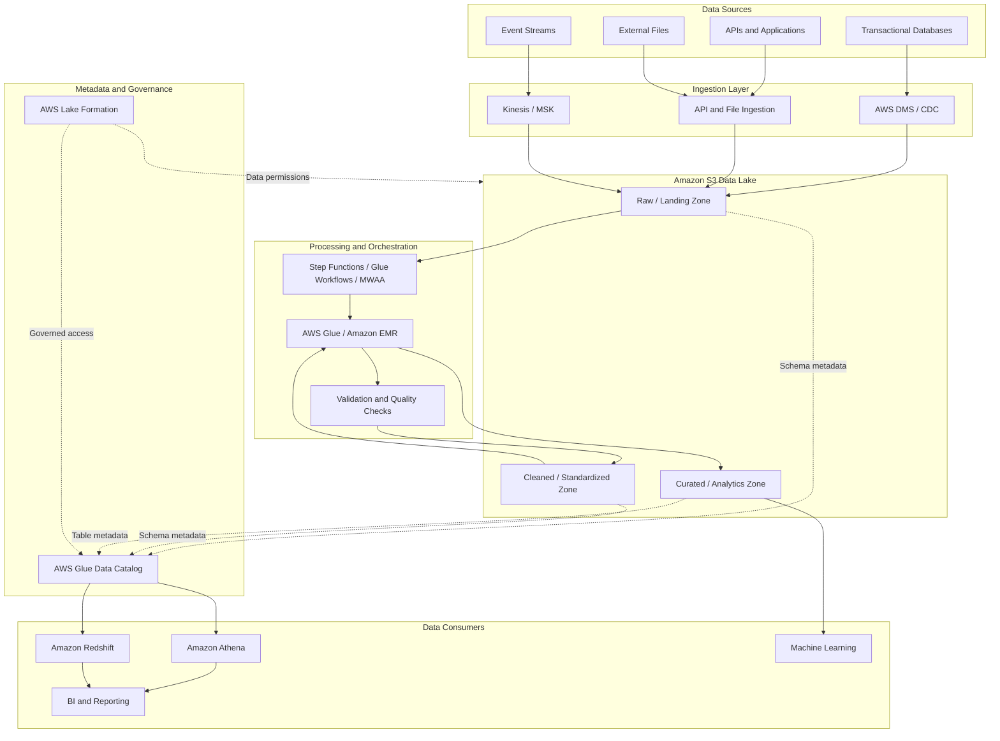
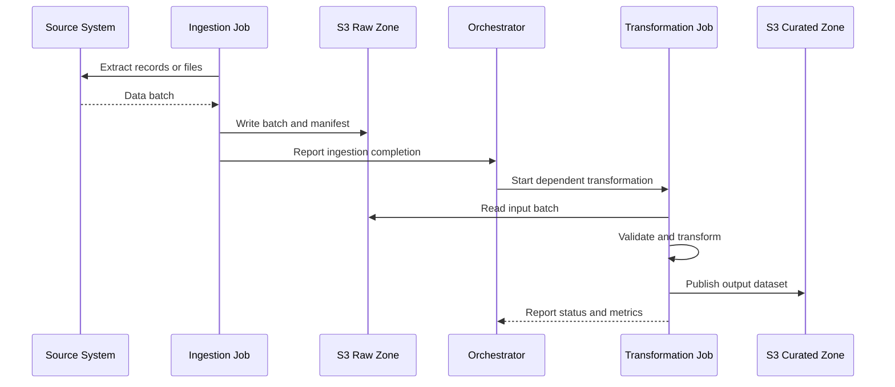
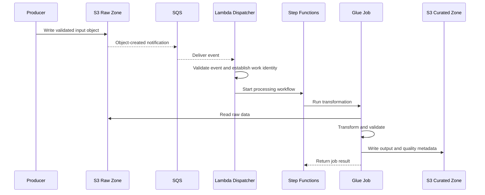
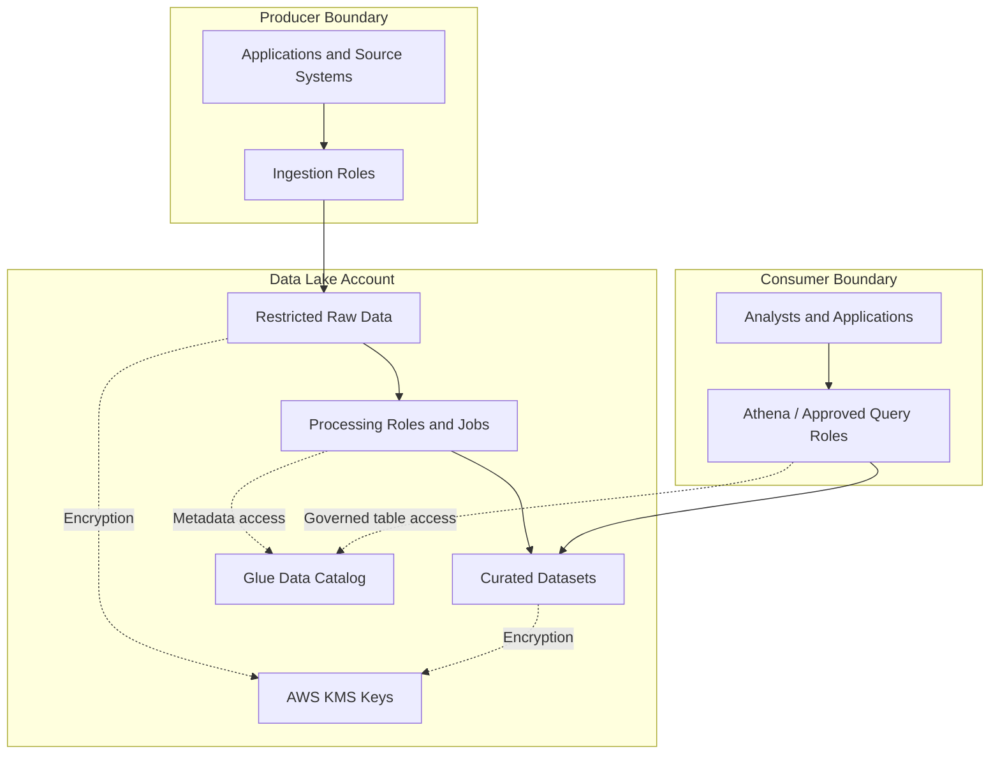

# 05- Data Lake Architecture

## Overview

A data lake is a centralized data storage architecture that stores structured, semi-structured, and unstructured data in its original or transformed form. Amazon S3 provides the storage foundation, while services such as AWS Glue, Amazon Athena, AWS Lake Formation, AWS Lambda, AWS Step Functions, and Amazon EMR provide ingestion, cataloging, transformation, governance, orchestration, and analytics capabilities.

Unlike a traditional data warehouse, a data lake separates data storage from processing and consumption. Multiple services can access the same stored datasets without requiring the data to be copied into a separate database for every workload.

An S3-based data lake is commonly used for:

- Centralized storage of data from transactional databases, APIs, event streams, applications, and third-party systems.
- Business intelligence, reporting, and ad hoc SQL analytics.
- Machine learning and data science workloads.
- Historical data retention and audit requirements.
- Data integration across business domains and AWS accounts.
- Batch processing, change data capture (CDC), and event-driven analytics.

The architecture must address more than storage. A production data lake requires explicit decisions about data organization, schema management, transformation reliability, access control, data quality, query performance, cost, and recovery.

## Architecture Overview

A typical S3-based data lake separates ingestion, storage, processing, metadata, governance, and consumption into distinct layers.



The architecture separates responsibilities:

| Layer | Primary responsibility | Typical components |
|---|---|---|
| Data sources | Produce business and operational data | PostgreSQL, MySQL, application APIs, event streams |
| Ingestion | Transfer data into the lake reliably | AWS DMS, Kinesis, Amazon MSK, Python ingestion jobs |
| Storage | Retain original, transformed, and analytical datasets | Amazon S3 |
| Processing | Validate, standardize, enrich, and aggregate data | AWS Glue, Amazon EMR |
| Orchestration | Coordinate dependencies, retries, and pipeline state | AWS Step Functions, Glue Workflows, Amazon MWAA |
| Catalog | Describe tables, schemas, partitions, and S3 locations | AWS Glue Data Catalog |
| Governance | Centralize fine-grained data permissions | AWS Lake Formation, IAM, S3 policies, AWS KMS |
| Consumption | Query, report, and analyze datasets | Amazon Athena, Amazon Redshift, BI and ML tools |

Not every data lake needs every service. For example, a small analytics platform may require only S3, Glue Data Catalog, and Athena. A multi-domain platform with CDC, data quality controls, complex dependencies, and strict governance may need several additional components.

## Storage Zones and Data Organization

A data lake commonly separates datasets into logical zones representing different stages of the data lifecycle.

### Raw or Landing Zone

The raw zone stores incoming data in its original or minimally transformed form.

Examples include:

- Database extracts and CDC records.
- API responses.
- JSON application events.
- CSV files received from external partners.
- Logs, documents, and other unstructured files.

The raw zone should preserve enough information to support reprocessing, auditing, and reconciliation. Do not overwrite incoming data merely because a downstream transformation changes.

Example layout:

```text
s3://company-data-lake-prod/
    raw/
        source=orders_db/
            ingestion_date=2026-10-13/
        source=payment_api/
            ingestion_date=2026-10-13/
        source=application_events/
            ingestion_date=2026-10-13/
```

Raw data can be retained separately from curated data so that downstream processing can be repeated when business logic or schemas change.

### Cleaned or Standardized Zone

The cleaned zone contains validated and normalized data. Typical processing includes:

- Type normalization and schema enforcement.
- Timestamp and timezone standardization.
- Duplicate detection.
- Invalid-record handling.
- Sensitive-field handling where required.
- Consistent column naming and business identifiers.

This layer should make data predictable for downstream consumers without prematurely imposing every reporting-specific business rule.

### Curated or Analytics Zone

The curated zone contains data modeled for specific analytical use cases.

Examples include:

- Daily sales aggregates.
- Customer activity datasets.
- Revenue and payment reconciliation tables.
- Product usage metrics.
- Fact and dimension datasets for reporting.

Curated data should have stable schemas, documented business semantics, explicit ownership, and measurable quality expectations.

Example:

```text
s3://company-data-lake-prod/
    curated/
        sales/
            orders/
                order_date=2026-10-13/
            daily_revenue/
                business_date=2026-10-13/
```

The folder names are object-key prefixes, not physical directories. Their organization is a design convention that must align with the table definitions, ingestion jobs, authorization model, and retention policy.

### Zone Design Trade-Offs

| Design choice | Benefit | Trade-off |
|---|---|---|
| Separate prefixes within one bucket | Simpler initial setup and fewer resources | Requires careful policy boundaries and ownership conventions |
| Separate buckets by zone | Clearer administrative and security boundaries | More infrastructure and cross-bucket configuration |
| Separate AWS accounts by environment or domain | Stronger isolation and governance boundaries | More complex deployment and cross-account access |
| Immutable raw datasets | Easier replay, audit, and reproducibility | Additional storage and retention costs |
| Curated datasets per business domain | Clear ownership and consumer contracts | Requires coordination across shared dimensions and definitions |

For larger organizations, separate production and non-production accounts, and explicit data ownership boundaries, are generally easier to govern than a single shared bucket containing every environment and workload.

## Data Ingestion Architecture

Ingestion design depends on the source system, required latency, volume, and recovery requirements.

### Batch Ingestion

Batch ingestion transfers data on a schedule or after a source export completes.

Typical use cases include:

- Daily database extracts.
- Periodic partner files.
- Scheduled REST API synchronization.
- Historical backfills.



A batch should have a defined identity, such as a source batch ID or extraction window. Record counts, checksums where appropriate, extraction timestamps, and processing statuses help reconcile the data transferred into the lake.

Do not trigger downstream processing solely because a file with an expected name exists. A partially uploaded or incomplete source batch can otherwise be consumed prematurely. Prefer an explicit completion manifest, a transactionally maintained batch status, or another reliable completion protocol.

### Database and CDC Ingestion

AWS Database Migration Service (AWS DMS) can capture database changes and deliver them to S3. Other CDC frameworks can provide similar capabilities.

A typical CDC flow is:

1. Read an initial snapshot or capture incremental changes from the source database.
2. Land records and change metadata in the raw zone.
3. Validate the incoming records and determine their source ordering or version information.
4. Deduplicate or reconcile repeated records.
5. Merge inserts, updates, and deletes into the target analytical dataset.
6. Track source checkpoints and processing progress.

CDC ingestion is not automatically equivalent to maintaining a transactional replica in S3. Record-level updates, deletes, ordering, and concurrent writes require deliberate handling in the processing layer or table format.

For workloads that require record-level merge operations, schema evolution, or reliable updates across multiple files, consider Apache Iceberg or another suitable table format instead of treating a collection of Parquet files as a mutable table.

### Streaming and Event-Driven Ingestion

Streaming ingestion supports near-real-time data delivery using services such as Amazon Kinesis Data Streams, Amazon Data Firehose, and Amazon MSK.

A common flow is:

1. Applications publish events to a stream.
2. The stream buffers and delivers records according to the configured delivery model.
3. Records are written to an S3 landing location in batches.
4. A processing workflow validates and transforms the data.
5. Validated results are published to queryable datasets.

S3 event notifications can initiate downstream workflows after objects are created. For architectures that require decoupling and durable buffering, notifications can be routed through Amazon SQS or Amazon EventBridge.

S3 event notifications are delivered at least once, and their delivery is not a globally ordered transaction log. Consumers must tolerate duplicate notifications and processing delays. See the [S3 Event Notifications documentation](https://docs.aws.amazon.com/AmazonS3/latest/userguide/EventNotifications.html).

### Choosing an Ingestion Pattern

| Requirement | Suitable pattern | Main consideration |
|---|---|---|
| Daily reporting | Scheduled batch ingestion | Batch completeness and late-arriving data |
| Database history and incremental changes | Snapshot plus CDC | Deduplication, update/delete semantics, checkpoints |
| Near-real-time event analytics | Stream ingestion to S3 | Buffering, partitioning, delivery latency |
| External partner files | File-based ingestion | Validation, manifests, duplicate files, quarantine |
| Large historical backfill | Partitioned batch processing | Throughput, concurrency, replay safety |
| API-based source synchronization | Scheduled or incremental API ingestion | Rate limits, pagination, cursor checkpoints |

Choose ingestion based on business latency requirements, not merely on whether a service supports streaming.

## Data Formats and Table Design

The physical data format has a direct impact on storage consumption, processing cost, and query performance.

| Format | Characteristics | Appropriate use |
|---|---|---|
| JSON | Human-readable, flexible schema, relatively high parsing overhead | Raw events, API payloads, heterogeneous source data |
| CSV | Widely supported and easy to exchange | Partner exports, simple tabular ingestion |
| Apache Parquet | Columnar, compressed, efficient for analytical queries | Standard choice for many curated analytical datasets |
| Apache ORC | Columnar storage designed for analytical processing | Workloads using compatible query and processing engines |
| Apache Avro | Schema-aware row-oriented format | Data exchange, event serialization, schema-managed pipelines |
| Apache Iceberg | Open table format with metadata-managed data files and table operations | Analytical tables requiring reliable updates, deletes, schema evolution, or snapshot-based operations |

A data lake can retain JSON or CSV in the raw zone while converting cleaned and curated datasets to Parquet.

Columnar formats let query engines read only the columns required by a query. Combined with compression, partition pruning, and column pruning, this can significantly reduce the amount of data scanned.

### Small-File Problem

Writing many tiny objects can increase metadata overhead and reduce analytical query efficiency. A dataset containing millions of very small Parquet files can be more expensive and slower to query than a smaller set of appropriately sized files.

A practical design should:

- Buffer incoming records when the source produces very small batches.
- Compact small objects into larger analytical files.
- Avoid creating partitions at excessively granular levels.
- Monitor file counts, average file size, and query scan volume.
- Use table-format maintenance features where available.

The appropriate file size depends on query engines, workload parallelism, compression, and dataset shape. It should be measured rather than treated as a universal constant.

### Partitioning Strategy

Partitioning organizes data into prefixes that query engines can selectively scan.

Common partition dimensions include:

- Business date.
- Event date.
- Source system.
- Region or business domain when query patterns justify it.

Example:

```text
s3://company-data-lake-prod/curated/orders/
    order_date=2026-10-11/
        part-00001.parquet
    order_date=2026-10-12/
        part-00001.parquet
    order_date=2026-10-13/
        part-00001.parquet
```

Partitioning should reflect common query predicates. A query filtering by `order_date` can skip unrelated date partitions when the table is correctly configured.

Avoid high-cardinality partition keys such as unique customer IDs or transaction IDs unless the workload specifically justifies the resulting layout. Excessive partition counts increase metadata and planning overhead.

Partitioning also does not replace file-level statistics, appropriate column types, or efficient file formats.

For Athena-specific partitioning behavior, see the [Athena partitioning documentation](https://docs.aws.amazon.com/athena/latest/ug/ctas-partitioning-and-bucketing-what-is-partitioning.html).

## Metadata and Schema Management

Amazon S3 stores objects, but object prefixes alone do not define a queryable table schema. Query engines need metadata describing the dataset.

### AWS Glue Data Catalog

The AWS Glue Data Catalog stores metadata such as:

- Database and table names.
- Column names and data types.
- S3 locations.
- Partition definitions.
- Table-format information.
- Schema and storage properties.

Amazon Athena can use the catalog to interpret S3 datasets and execute SQL queries without loading all the data into a database first.

AWS Glue crawlers can inspect supported data sources and infer or update table metadata. However, inferred schemas are not necessarily stable data contracts. Automatically accepting every schema change can create incompatible downstream datasets.

Use automated discovery when it fits the workload, and apply explicit schema and compatibility checks for production datasets whose structure is consumed by many teams.

### Schema Evolution

Schema changes must be coordinated across ingestion, transformations, catalog metadata, and consumers.

Examples of common changes include:

- Adding an optional column.
- Changing a field's data type.
- Renaming a business attribute.
- Introducing nested JSON fields.
- Changing timestamp semantics.
- Replacing an identifier or business key.

A safe schema evolution process should validate compatibility, document the change, test affected queries, and provide a migration or rollback strategy where needed.

For curated tables, prefer explicit schema contracts over relying exclusively on schema inference at query time.

### Example Athena Table

The following example registers an existing Parquet dataset in the Glue Data Catalog through Athena. It assumes that the S3 objects already use the specified schema and Hive-style date prefixes.

```sql
CREATE EXTERNAL TABLE IF NOT EXISTS analytics.orders (
    order_id STRING,
    customer_id STRING,
    status STRING,
    total_amount DECIMAL(12, 2),
    created_at TIMESTAMP
)
PARTITIONED BY (
    order_date STRING
)
STORED AS PARQUET
LOCATION 's3://company-data-lake-prod/curated/orders/';
```

For conventional Hive-style partitioned datasets, partition metadata must be registered or otherwise made discoverable before queries can use those partitions. This example uses string partition keys, which is a common Athena recommendation.

For example, where the dataset uses Hive-style partition paths and automatic partition discovery is not configured:

```sql
MSCK REPAIR TABLE analytics.orders;
```

This command can discover compatible Hive-style partition directories. For controlled production pipelines, consider explicitly registering partitions or using an appropriate metadata-management workflow rather than relying on repeated full discovery operations.

Query a limited date range:

```sql
SELECT
    order_date,
    status,
    COUNT(*) AS order_count,
    SUM(total_amount) AS total_revenue
FROM analytics.orders
WHERE order_date BETWEEN '2026-10-01' AND '2026-10-13'
GROUP BY
    order_date,
    status
ORDER BY
    order_date,
    status;
```

The query can benefit from partition pruning because it filters by `order_date`. Actual performance depends on the registered metadata, physical file layout, data distribution, and query engine.

## Transformation and Orchestration

A production data lake should distinguish transformation logic from orchestration logic.

### Transformation Responsibilities

Transformation jobs perform work such as:

- Parsing records and enforcing schemas.
- Validating required fields and business rules.
- Normalizing timestamps and data types.
- Removing duplicates.
- Joining datasets.
- Aggregating records.
- Writing cleaned or curated outputs.
- Recording data quality results.

AWS Glue provides managed ETL capabilities, including Spark-based processing. Amazon EMR is another option for workloads that require greater control over processing frameworks and cluster configurations. Lightweight transformations may also run in Lambda, but its execution, memory, and time limits must fit the workload.

Avoid using a single function or job for the entire lake when independent transformations have different scaling, retry, or operational requirements.

### Orchestration Responsibilities

An orchestration service coordinates task dependencies, branching, retries, timeouts, and execution status.

| Service | Suitable use cases | Trade-offs |
|---|---|---|
| AWS Step Functions | Explicit multi-step workflows and service coordination | Requires workflow design, state management, and appropriate retry policies |
| AWS Glue Workflows | Glue-centric ingestion and ETL coordination | Best suited to workflows primarily built around Glue components |
| Amazon MWAA | Airflow DAGs, complex schedules, and broad operator ecosystems | Includes environment, scheduler, and operational management considerations |
| EventBridge | Schedule-based and event-driven initiation | Is an event-routing and scheduling component, not a complete ETL engine |
| Lambda | Lightweight event handling and short-running transformations | Not suitable for every long-running or resource-intensive data job |

### Event-Driven Processing Flow



This is an illustrative architecture, not a guarantee that every event will be processed exactly once. Configure S3 event destinations, queue permissions, workflow permissions, retry policies, visibility timeouts, and dead-letter handling for the selected topology.

Where the pipeline can receive duplicate notifications, use a stable work identity and make side effects idempotent. For example, identify a work item using the source object key and version ID when versioning is enabled, along with any required processing-version identifier.

## Data Quality, Idempotency, and Publication

A successful job status does not automatically mean that the output is correct or complete.

A data pipeline should validate both technical correctness and business expectations before exposing new data to downstream consumers.

### Data Quality Controls

Useful validation rules include:

- Required fields are present.
- Column types match the expected schema.
- Primary or business keys satisfy uniqueness expectations.
- Row counts are within acceptable ranges.
- Monetary totals and record counts reconcile with the source.
- Timestamps fall within expected ranges.
- Duplicate and invalid records are identified and handled.
- Late-arriving records follow documented business rules.

Define the acceptable treatment of invalid records. Depending on the use case, they may be quarantined, rejected, or retained with an explicit quality status. Silently dropping them makes reconciliation difficult.

### Idempotent Processing

Retries are normal in distributed systems. A transformation must therefore define what happens when the same input is processed again.

Common techniques include:

- Deterministic output keys for a specific input batch and transformation version.
- Source object version IDs or immutable batch manifests.
- Deduplication using stable record identifiers.
- Checkpoints and processed-batch records.
- Atomic table operations when supported by the selected table format.
- Controlled publication of a completed output version.

Writing data to S3 and then recording success in a relational database are separate operations. A failure between them can leave output data without a matching status record, or a status record that does not accurately reflect the output. Recovery logic should reconcile these states rather than assuming the two operations are transactional.

### Safe Dataset Publication

One approach is to write each processing run to an isolated staging prefix:

```text
s3://company-data-lake-prod/
    staging/
        orders/
            run_id=20261013T120000Z/
    curated/
        orders/
            order_date=2026-10-13/
```

The workflow validates the staged output before publishing it. The publication step may update catalog metadata, commit a supported table-format transaction, or update a controlled dataset manifest, depending on the design.

Do not assume that writing multiple S3 objects or updating a group of partitions forms a single atomic transaction. When readers must see a consistent table state across multiple files or updates, choose a table format and write protocol that provide the required semantics.

## Integrations with AWS Services

### AWS Glue

Glue can discover supported source schemas, run ETL jobs, and maintain metadata in the Data Catalog.

Integration considerations:

- Give jobs access only to the required S3 prefixes, catalog resources, and encryption keys.
- Separate job execution roles from human operator roles.
- Configure retries and job timeouts based on workload behavior.
- Emit job metrics and validation results for operational alerting.
- Version transformation code and keep data contracts under source control.

See the [AWS Glue Data Catalog documentation](https://docs.aws.amazon.com/glue/latest/dg/catalog-and-crawler.html).

### Amazon Athena

Athena queries data in S3 using SQL and catalog metadata.

Integration considerations:

- Write query results to a dedicated, appropriately secured S3 location.
- Restrict access to both underlying datasets and query result objects.
- Use partition filters and columnar files to reduce scanned data.
- Monitor bytes scanned, execution duration, failures, and query concurrency.
- Validate results against expected source counts and business totals.

Athena provides query compute; it does not automatically repair poor file layout or enforce every business data contract.

### AWS Lake Formation

Lake Formation provides centralized governance for data lakes integrated with the Glue Data Catalog and supported analytics services.

Depending on the architecture, permissions may be defined at the database, table, column, row, or cell level. Lake Formation governance complements IAM rather than replacing the need to configure correct AWS identities, resource access, S3 permissions, and encryption permissions.

Check the interaction between IAM policies, Lake Formation permissions, S3 resource policies, and KMS key policies when diagnosing access failures.

See the [AWS Lake Formation documentation](https://docs.aws.amazon.com/lake-formation/latest/dg/what-is-lake-formation.html).

### Amazon SQS and EventBridge

SQS can buffer notifications and decouple producers from processing workers. EventBridge can route supported events and initiate workflows.

Design for duplicate delivery, retries, delayed events, and failures. Where a downstream processor must not start until an entire batch is ready, use an explicit batch-completion signal rather than interpreting every object-created event as a complete dataset.

### CloudWatch and CloudTrail

CloudWatch supports operational metrics, logs, dashboards, and alarms. CloudTrail records relevant AWS API activity and supports investigation of changes to resources and permissions.

Useful indicators include:

- Ingestion success and failure rates.
- Input and output record counts.
- Processing duration and queue age.
- Retry volume and dead-letter queue depth.
- Data quality failure counts.
- Bytes scanned by analytical queries.
- Glue job failures and durations.
- Replication or delivery delays when relevant to the architecture.

Enable the logging and data-event collection needed for the required audit scope. Do not assume all S3 object-level activity is automatically captured by CloudTrail without appropriate configuration.

## Security and Trust Boundaries

Data lakes often aggregate information from many applications and business domains. This makes the boundary between raw source data and broadly accessible analytical datasets particularly important.



The trust boundaries shown are conceptual. Actual access depends on configured identity policies, resource policies, service roles, catalog permissions, encryption settings, and network controls.

Key design principles:

- Keep raw data private and restrict access according to source sensitivity.
- Use separate IAM roles for ingestion, transformation, querying, and administration.
- Prefer temporary credentials through IAM roles over long-lived access keys.
- Encrypt datasets at rest and manage KMS permissions deliberately.
- Apply fine-grained governance where table-level permissions are insufficient.
- Avoid granting broad access to every prefix simply because all datasets share a bucket.
- Separate production data from development and testing environments.
- Audit changes to permissions and access to sensitive datasets according to compliance requirements.
- Define retention and deletion controls for raw and derived data.

Detailed access policies, encryption configurations, and security troubleshooting belong in the dedicated security documentation.

## Performance, Reliability, and Cost

### Query Performance

Query cost and latency depend heavily on how data is physically organized.

For analytical workloads:

- Prefer Parquet or another suitable columnar format for curated tables.
- Project only required columns.
- Filter by partition columns where appropriate.
- Compact small files.
- Avoid scanning entire historical datasets for routine incremental reports.
- Review query plans, scanned bytes, and execution metrics.
- Evaluate table formats such as Apache Iceberg when update, delete, or snapshot semantics are required.

Partitioning should be validated against actual query patterns. Excessive partitioning can make planning slower even when it reduces the amount of data read.

### Reliability and Recovery

Data lakes need recovery plans for both stored data and the pipelines that transform it.

Consider:

- Immutable or reproducible raw ingestion where source retention permits.
- S3 Versioning when it contributes to the required recovery model.
- Cross-Region Replication or other copy mechanisms for appropriate recovery objectives.
- Reprocessing from a known source batch or snapshot.
- Version-controlled transformation code and infrastructure.
- Backward-compatible schema migration where feasible.
- Automated checks for missing partitions and failed jobs.
- Documented recovery procedures that are actually tested.

Replication is not a substitute for every form of backup. It can propagate unwanted changes or deletions depending on configuration, and replicated data alone does not prove that dependent catalog entries, permissions, encryption keys, or processing workflows are ready for recovery.

### Cost Management

Typical cost drivers include S3 storage, requests, data transfer, transformation compute, query scans, logs, and retained historical data.

Reduce unnecessary cost by:

- Applying lifecycle policies consistent with retention and recovery requirements.
- Compressing data and choosing efficient storage formats.
- Avoiding duplicate full copies when incremental processing is sufficient.
- Compaction of small files where the query benefit justifies the processing cost.
- Limiting analytical scans through partitioning and columnar storage.
- Monitoring orphaned files, abandoned staging data, and incomplete multipart uploads.
- Separating raw retention requirements from shorter-lived intermediate outputs.
- Allocating costs to environments, domains, and workloads where possible.

Do not move analytical data to an archival storage class without evaluating retrieval latency, restore requirements, and whether the query engine can access the data in that class as expected.

## Advanced Architecture Patterns

### Apache Iceberg for Analytical Tables

Traditional Hive-style datasets represent tables through a set of files and catalog metadata. This is often sufficient for append-oriented analytics, but it becomes harder to manage when a table needs row-level updates, deletes, concurrent writers, or snapshot-based reads.

Apache Iceberg manages table metadata and data files to provide table-level operations such as schema evolution, partition evolution, snapshots, and supported row-level changes.

Use Iceberg when the business workload requires table semantics that plain Parquet files do not provide on their own.

Evaluate:

- Engine and catalog compatibility.
- Supported write and commit operations.
- Concurrent writer behavior.
- Compaction and snapshot expiration.
- Metadata growth and orphan-file cleanup.
- Recovery from failed or conflicting writes.
- Operational responsibility for maintenance.

Amazon Athena supports querying Apache Iceberg tables, subject to its documented capabilities and limitations. The exact feature support can depend on the Athena engine, table configuration, catalog integration, and region. See the [Athena Iceberg documentation](https://docs.aws.amazon.com/athena/latest/ug/querying-iceberg.html).

For new architectures focused specifically on Iceberg-based tabular data, evaluate Amazon S3 Tables and its managed table-maintenance capabilities where available and appropriate. It is a distinct architectural choice, not a requirement for every S3 data lake. See the [Amazon S3 Tables documentation](https://docs.aws.amazon.com/AmazonS3/latest/userguide/s3-tables.html).

### Multi-Account and Data Domain Architecture

Large organizations may isolate data producers, central storage, governance, and consumers across AWS accounts.

A typical model includes:

- Producer accounts responsible for source data and initial ingestion.
- A data platform account that hosts shared datasets and catalog resources.
- Domain-owned curated datasets with clear data contracts.
- Consumer accounts that query explicitly shared datasets.
- Central governance and auditing supported by appropriate AWS services.

This approach provides clearer ownership and reduces the need for every consumer to obtain broad permissions on a common bucket. It also introduces cross-account IAM, resource policy, catalog-sharing, encryption, and operational dependencies that must be tested.

### Cross-Region Data Lake Recovery

A multi-Region architecture can support regional recovery or geographic data requirements, but replication alone does not create a fully operational failover environment.

A complete recovery design must consider:

- Replication configuration and replication status.
- Destination bucket permissions and encryption keys.
- Catalog and table metadata availability.
- Processing and orchestration deployment in the recovery Region.
- Network paths, service quotas, and required integrations.
- Consumer configuration and query-result locations.
- Recovery Point Objective (RPO) and Recovery Time Objective (RTO).

Validate these dependencies through recovery exercises. Distinguish replicated objects from a fully usable data lake with working metadata, access controls, processing jobs, and consumer access.

## Hands-On Architecture Validation

Before deploying a full-scale data lake, build a small but real end-to-end pipeline using a representative dataset.

A useful implementation exercise is:

1. Ingest a CSV or JSON batch into a private S3 raw prefix.
2. Record the batch identity, source metadata, and expected record count.
3. Run a Glue job or another appropriate transformation to validate and convert the data into Parquet.
4. Write the cleaned output into a staging prefix.
5. Validate schema, record counts, required fields, and business totals.
6. Publish the output to a curated, date-partitioned S3 location.
7. Register the dataset in the Glue Data Catalog.
8. Query it with Athena using a selective partition filter.
9. Simulate a duplicate ingestion event and verify idempotent behavior.
10. Simulate a transformation failure and verify that incomplete output is not presented as a successful dataset.
11. Record processing metrics and clean up temporary resources and data according to the test plan.

The implementation should include infrastructure definitions, least-privilege roles, example input data, transformation code, automated validation, and teardown instructions. Use an AWS account only for components that need real AWS services, and verify potential charges before deployment.

## Production Readiness Checklist

### Data Layout and Contracts

- [ ] Raw, cleaned, and curated datasets have defined responsibilities.
- [ ] Prefixes and partition keys align with source and consumer requirements.
- [ ] Curated schemas and business semantics are documented.
- [ ] Schema changes have compatibility checks and an ownership process.
- [ ] Late-arriving records, duplicates, and deletes have defined behavior.

### Processing and Publication

- [ ] Each batch or work item has a stable identity.
- [ ] Retries are safe and duplicate events are tolerated.
- [ ] Data quality checks run before publication.
- [ ] Partial output cannot be mistaken for a completed dataset.
- [ ] Failed jobs have an actionable retry and recovery procedure.
- [ ] Source-to-target record counts or other suitable reconciliation metrics exist.

### Governance and Operations

- [ ] IAM, S3 resource policies, catalog permissions, and KMS access are tested together.
- [ ] Sensitive data has explicit access and retention rules.
- [ ] Processing jobs, event delivery, and query workloads have monitoring.
- [ ] Query efficiency and storage cost are measured.
- [ ] Recovery procedures cover data and required metadata or processing dependencies.
- [ ] Infrastructure and transformation code are version-controlled.
- [ ] Deployment, recovery, and cleanup procedures have been validated.

## Key Takeaways

- Amazon S3 provides the storage foundation, while ingestion, transformation, cataloging, governance, and query services have separate responsibilities.
- Organize data into raw, cleaned, and curated zones with explicit schemas, ownership, and data quality contracts.
- Use suitable file formats, partitioning, and compaction to reduce query scans and avoid small-file and excessive-partition problems.
- Design ingestion and transformation workflows for duplicate events, retries, partial failures, and reproducible recovery.
- Production readiness requires governed access, measurable data quality, operational monitoring, cost controls, and tested recovery procedures.
```