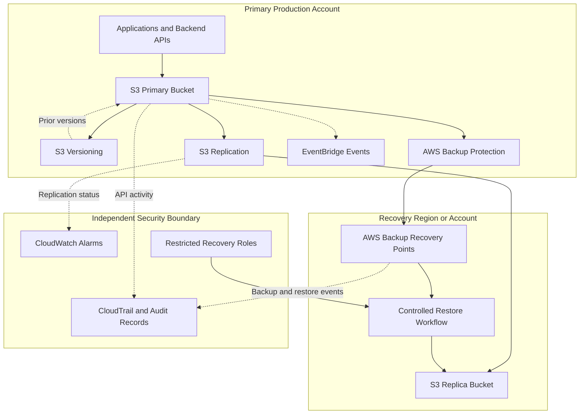
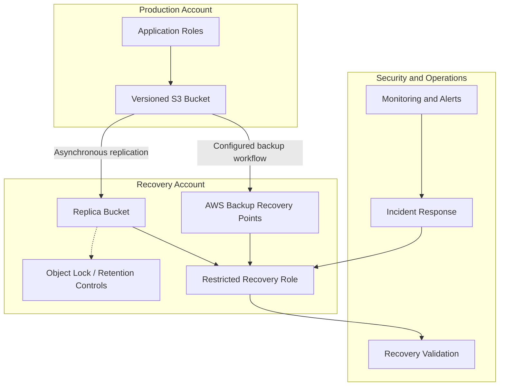
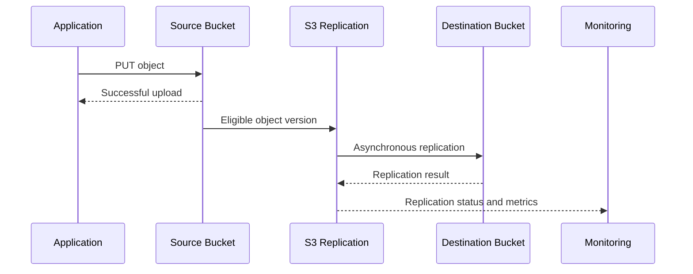
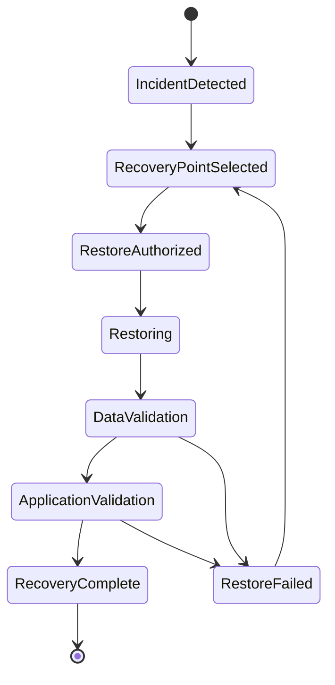

# 06- Backup and Recovery Architecture

## Overview

Amazon S3 backup and recovery architecture protects object data against accidental deletion, application defects, ransomware, compromised credentials, configuration mistakes, and regional disruptions. A production design must preserve recoverable data while ensuring that the application, metadata, permissions, and dependent services can be restored within defined business requirements.

Amazon S3 provides high durability for stored objects, but durability alone does not guarantee recoverability. A permanently deleted object, an overwritten configuration file, a corrupted application-generated document, or a destructive action performed by an authorized identity may leave the data technically consistent with the latest requested state while violating business expectations.

A complete S3 recovery architecture combines appropriate mechanisms for different failure scenarios:

- **S3 Versioning:** Recover previous object versions and reverse many accidental overwrites or deletions.
- **S3 Replication:** Maintain copies of eligible objects in another bucket, potentially in another AWS Region or account.
- **AWS Backup for Amazon S3:** Centrally manage backups, retention, and restoration, including supported continuous backup and point-in-time recovery.
- **S3 Object Lock:** Protect object versions against deletion or modification during defined retention periods.
- **Cross-account isolation:** Reduce the likelihood that compromised production credentials can destroy both primary and recovery data.
- **Application recovery procedures:** Restore databases, metadata, infrastructure, access policies, and dependent services alongside the objects.

These mechanisms have different failure boundaries. Replication helps maintain copies in another location, versioning preserves object history, backup provides a managed recovery mechanism, and Object Lock adds immutability. None should be treated as a complete substitute for all the others.

## Recovery Requirements: RPO and RTO

Recovery design should begin with explicit business requirements rather than selecting AWS services first.

### Recovery Point Objective

The Recovery Point Objective (RPO) defines the maximum acceptable amount of data loss measured in time.

For example, an RPO of 15 minutes means that recovery must restore the required data to a state no more than 15 minutes behind the relevant failure point.

An RPO is a business target, not a guarantee that a particular AWS configuration meets that target. Actual recoverability depends on the backup schedule, replication lag, event delivery, processing progress, and the selected recovery mechanism.

### Recovery Time Objective

The Recovery Time Objective (RTO) defines the maximum acceptable time to restore service after a disruption.

RTO should include more than copying objects. It can include detection, incident authorization, infrastructure provisioning, data restoration, permission validation, application startup, cache reconstruction, and end-to-end verification.

### Recovery Requirements by Workload

| Workload | Example RPO target | Example RTO target | Architectural implication |
|---|---|---|---|
| Public static website assets | Minutes to hours | Minutes to under an hour | Versioned assets, recoverable infrastructure, and CloudFront deployment rollback |
| Business-critical customer documents | Minutes | Within an hour | Versioning, independent backups, and tested application-level recovery |
| Financial records | Defined by regulatory and business requirements | Defined by business continuity requirements | Immutable retention, controlled restoration, auditing, and reconciliation |
| Data lake and analytical datasets | Hours, depending on source replay capability | Hours | Recoverable raw data, reproducible transformations, catalog recovery, and validation |
| Large media archive | Hours or longer, depending on requirements | Hours to days if acceptable | Backup or replication appropriate to the required recovery speed and retrieval behavior |
| Multi-Region application assets | Depends on replication lag and business tolerance | Defined failover objective | Cross-Region copies plus independently deployable application and access infrastructure |

These values are illustrative targets, not default AWS service guarantees. Set actual RPO and RTO values based on business impact, data volume, recovery testing, and cost.

## Recovery Architecture Patterns

A practical design normally uses several recovery layers.

### Architecture with Versioning, Replication, and AWS Backup



The diagram represents logical relationships rather than an automatic end-to-end failover implementation. In particular, a replica is not automatically promoted into a working application, and a backup recovery point does not automatically rebuild every dependency.

### Component Responsibilities

| Component | Responsibility | Important limitation |
|---|---|---|
| Primary S3 bucket | Serves current application data | Subject to authorized destructive operations and configuration changes |
| S3 Versioning | Preserves eligible previous object versions | Does not by itself protect against permanent version deletion |
| S3 Replication | Copies eligible objects to a destination bucket | Asynchronous; source mistakes can also be replicated |
| AWS Backup | Manages configured recovery points and restores | Recovery depends on backup configuration, retention, permissions, and service support |
| S3 Object Lock | Protects selected object versions under retention rules or legal holds | Does not prevent every kind of application or infrastructure disruption |
| Recovery account | Separates recovery resources from routine production administration | Must have independent access controls and operational procedures |
| CloudWatch and CloudTrail | Support alerting, event observation, and investigation | Logging must be configured for the events and data access that require auditing |
| Recovery automation | Coordinates restoration, validation, and application activation | Must be tested against actual failure scenarios |

## Select the Right Protection Mechanism

### S3 Versioning

Versioning retains multiple versions of an object under the same key.

If an application overwrites `documents/invoice-1042.pdf`, the previous object version remains available while retained. A regular delete request normally creates a delete marker rather than permanently deleting all versions.

Versioning is especially useful for:

- Accidental overwrites.
- Application defects that produce incorrect object content.
- Accidental deletions represented by delete markers.
- Recovering a known earlier version of a configuration or document.

However, privileged identities may still permanently delete versions, and lifecycle rules can eventually expire noncurrent versions. Versioning also adds storage consumption because retained versions are billed as stored objects.

See the [S3 Versioning documentation](https://docs.aws.amazon.com/AmazonS3/latest/userguide/Versioning.html).

### S3 Replication

S3 Same-Region Replication (SRR) and Cross-Region Replication (CRR) asynchronously copy eligible objects between buckets.

SRR is suitable for certain same-Region isolation, ownership, or data-distribution requirements. CRR is appropriate when data must also be available in a different Region for geographic resilience or disaster recovery.

Replication is useful when:

- A second copy must be maintained continuously.
- Recovery should avoid waiting for a complete backup restore.
- Data must be available in another Region.
- Separate accounts or ownership boundaries are required.
- Compliance or business rules require copies in designated locations.

Replication has important limitations:

- It is asynchronous, so the destination can lag behind the source.
- A destructive application operation or malicious overwrite can affect both locations, depending on the operation and configuration.
- Existing objects created before a replication rule was enabled are not automatically copied by live replication; S3 Batch Replication can address eligible existing objects.
- Replication alone does not guarantee that the destination application, policies, metadata, and dependencies can be restored.

See the [S3 replication documentation](https://docs.aws.amazon.com/AmazonS3/latest/userguide/replication.html).

### AWS Backup for Amazon S3

AWS Backup provides centralized backup policy management, recovery points, retention controls, and restore workflows for supported S3 resources.

It is useful when recovery must be governed across multiple buckets, accounts, or AWS services.

AWS Backup supports both periodic snapshot backups and continuous backup with point-in-time recovery for S3, subject to its documented constraints and configuration requirements.

According to the [AWS Backup S3 documentation](https://docs.aws.amazon.com/aws-backup/latest/devguide/s3-backups.html):

- Continuous backup supports point-in-time recovery within a retention window of up to 35 days.
- Periodic snapshot backups support longer retention, subject to the applicable service limits and configuration.
- Cross-Region or cross-account copies of continuous S3 recovery points are snapshot copies, not continuous point-in-time recovery copies.
- Continuous backup depends on S3 events being published to the default EventBridge event bus.

The last requirement is operationally significant: disabling the bucket's EventBridge notification setting can silently interrupt continuous backup tracking. Monitor this setting and do not rely solely on the apparent existence of an enabled AWS Backup plan.

See also [continuous backup and point-in-time recovery](https://docs.aws.amazon.com/aws-backup/latest/devguide/point-in-time-recovery.html).

### S3 Object Lock

S3 Object Lock uses a write-once-read-many (WORM) model to protect object versions during a configured retention period or legal hold.

Use it for immutable records, audit archives, and recovery datasets that must resist unauthorized or accidental deletion.

The main retention modes are:

| Mode | Protection behavior | Appropriate use |
|---|---|---|
| Governance | Protected versions generally cannot be deleted or have retention shortened without the required bypass permissions | Operational protection with controlled administrative exceptions |
| Compliance | Protected versions cannot be deleted or have their retention shortened during the compliance retention period, including by the account root user | Strong immutability for records with strict retention requirements |
| Legal hold | Keeps a specific object version protected until the hold is removed by an authorized identity | Indefinite protection while a legal or investigation requirement remains active |

Object Lock requires S3 Versioning. It protects the applicable object versions, not the entire application or every related AWS resource.

See the [S3 Object Lock documentation](https://docs.aws.amazon.com/AmazonS3/latest/userguide/object-lock.html).

## Replication Is Not the Same as Backup

This distinction is one of the most important parts of an S3 recovery design.

| Failure or requirement | Versioning | Replication | AWS Backup | Object Lock |
|---|---|---|---|---|
| Accidental overwrite | Can recover an earlier retained version | Can copy a new overwritten version to the destination | Can restore an available recovery point | Protects a retained locked version |
| Accidental delete | Can recover if prior version remains | Behavior depends on delete operation and replication configuration | Can restore from a suitable recovery point | Protects locked object versions from permanent removal during retention |
| Malicious deletion of historical versions | Does not independently prevent it | Destination may remain vulnerable without additional isolation | Provides an additional recovery boundary when properly configured | Protects covered versions according to retention rules |
| Regional outage | Does not create a separate regional copy | CRR provides a separate regional copy | Cross-Region copies may support recovery | Does not independently provide regional resilience |
| Recovery to a selected point in time | Depends on retained object versions | Depends on retained destination versions and available objects | Continuous S3 backup supports PITR within its supported window | Provides retained versions, but is not a general point-in-time restore service |
| Rapid read access to a destination copy | Within the original bucket | Potentially available in the destination bucket after replication completes | Usually requires a restore or access through supported backup mechanisms | Available subject to ordinary S3 permissions and configuration |

These mechanisms should be combined according to the required failure protection, not enabled indiscriminately. The selected configuration, retention, identity separation, and tested recovery procedure determine how much protection the architecture actually provides.

## Multi-Account and Cross-Region Recovery

A stronger recovery architecture separates the primary workload from the administrative identities and infrastructure that control recovery data.

### Trust Boundaries



The production application's runtime role should not have unrestricted permission to delete destination objects, modify recovery retention settings, or administer the recovery account.

Separate the following responsibilities wherever practical:

- Application access to production objects.
- Administration of source buckets and replication.
- Management of backup plans and retention policies.
- Administration of the destination account.
- Authorization to perform destructive recovery actions.
- Audit and security investigation.

A separate account is not sufficient on its own. Cross-account trust policies, AWS Organizations controls, recovery-role permissions, KMS key policies, and the administrative identities able to change those controls all contribute to the security boundary.

### Cross-Region Replication Flow



A successful source upload does not mean that the destination copy is already available. Applications that depend on immediate destination availability must account for replication delay rather than treating replication as a synchronous transaction.

### Replication Configuration Dependencies

A replication deployment generally requires:

- Versioning enabled on both source and destination buckets.
- An S3 replication configuration and an appropriate IAM role.
- Permissions for the role to read eligible source versions and replicate objects.
- Destination write permissions, especially for cross-account replication.
- Compatible encryption configuration and KMS permissions where customer-managed keys are used.
- Appropriate rule filters and storage-class or ownership settings.
- Monitoring and a recovery process for failed replication.

For an existing bucket, create a Batch Replication job when eligible pre-existing object versions need to be copied. Verify the job completion report instead of assuming that a successful rule deployment backfills historical data.

If Object Lock is used with replication, the destination bucket must also support Object Lock, and the replication role needs the relevant object retention and legal-hold permissions.

## Recovering from Common Failure Scenarios

A recovery architecture should define which mechanism is used for each incident type.

### Accidental Object Deletion or Overwrite

Preferred recovery path:

1. Identify the affected bucket, key, and incident time.
2. Inspect object versions and delete markers.
3. Choose the correct previous version based on version ID, timestamp, and application-level validation.
4. Restore the selected content.
5. Verify the object and dependent application behavior.
6. Record the recovery action and investigate the original cause.

Use S3 Versioning when the previous version remains available. Use AWS Backup when the required content is better recovered from a managed backup or when the source versions have been permanently removed.

### Ransomware or Compromised Credentials

A strong response should avoid blindly restoring over potentially contaminated data.

1. Contain the compromised identity and prevent additional destructive operations.
2. Preserve incident evidence and relevant audit records.
3. Identify a recovery point from before the compromise.
4. Validate the integrity and provenance of the recovery data.
5. Restore into a controlled destination or recovery environment.
6. Check policies, encryption permissions, application state, and dependent services.
7. Validate the recovered system before switching traffic.

Versioning alone should not be treated as ransomware protection. A compromised identity with permission to permanently delete versions can remove that recovery history. Immutable retention, separately controlled backups, and account isolation improve resilience.

### Regional Disruption

A regional recovery plan may use a CRR destination bucket or a cross-Region AWS Backup copy.

The recovery process must verify:

- Which objects and versions have reached the destination.
- Whether the recovery data meets the required RPO.
- Whether KMS keys and resource policies permit restoration and access.
- Whether application infrastructure and deployment artifacts exist in the recovery Region.
- Whether DNS, CloudFront, APIs, databases, and dependent services can be activated.
- Whether the restored system meets the required RTO.

A replica is a data protection mechanism, not a complete regional failover system. Applications must have a deliberate procedure for activating the recovery environment.

## Restore Workflow and Data Validation

Restoration should be controlled, auditable, and separated from the normal application write path.

### Restore State Machine



### Recommended Recovery Procedure

**Identify the recovery scope.** Determine the affected bucket, prefixes, object versions, approximate data volume, and any downstream records that reference those objects.

**Select a recovery point.** Prefer a known, validated backup or version from before the incident. Consider replication status, backup completion, retention, and the possibility that malicious or invalid data was already present.

**Authorize the restore.** Use a restricted recovery identity with only the permissions required to read the recovery data and write the designated restore destination.

**Restore to an isolated destination when appropriate.** A new bucket or recovery prefix can preserve the current state for investigation and allow validation before production data is changed.

**Validate recovered data.** Compare object counts, expected keys, checksums where applicable, metadata, timestamps, content types, and application-level business invariants.

**Validate dependencies.** Verify access policies, KMS permissions, database references, catalog metadata, event processing behavior, and required application configurations.

**Resume service deliberately.** Redirect traffic or resume processing only after the required validation criteria have passed.

**Preserve evidence and document the incident.** Record the recovery point, commands or API operations, restored object versions, validation results, and corrective actions.

### Example Recovery Runbook

| Phase | Required evidence | Exit criterion |
|---|---|---|
| Detection | Alerts, CloudTrail records, application errors, or integrity checks | Failure scope is identified |
| Containment | Restricted identities, halted destructive processes, protected evidence | Incident cannot continue through the same identified path |
| Recovery-point selection | Version IDs, backup metadata, replication status, timestamps | An approved recovery point is selected |
| Restoration | Backup job or object-level restore results | Required content has been restored |
| Integrity validation | Counts, checksums, object metadata, business reconciliation | Recovery data satisfies the defined integrity checks |
| Application validation | Smoke tests, authorization checks, dependent-service status | Critical workflows operate correctly |
| Service activation | Traffic or worker configuration, operational approval | Service meets the agreed recovery objective |
| Post-incident review | Audit evidence and incident report | Preventive actions are assigned and tracked |

## AWS CLI Verification and Recovery Examples

The following examples support operational investigation. Replace the bucket, key, and version ID values with those from the incident. Run read-only inspection commands before performing any destructive operation.

### Inspect Bucket Versioning

```bash
aws s3api get-bucket-versioning \
  --bucket company-documents-prod
```

Confirm that versioning is enabled before relying on prior versions as a recovery mechanism.

### List Object Versions and Delete Markers

```bash
aws s3api list-object-versions \
  --bucket company-documents-prod \
  --prefix documents/invoice-1042.pdf
```

Review the `Versions` and `DeleteMarkers` collections. Identify the exact version ID and verify that the selected version predates the incident.

### Download a Specific Object Version

```bash
aws s3api get-object \
  --bucket company-documents-prod \
  --key documents/invoice-1042.pdf \
  --version-id "<VERSION_ID>" \
  ./invoice-1042-recovered.pdf
```

This retrieves the selected version to a local destination. Protect the destination file according to the sensitivity of the original content.

### Restore a Previous Version to the Current Key

After validating the recovery candidate, copy the exact version back to the original key:

```bash
aws s3api copy-object \
  --bucket company-documents-prod \
  --key documents/invoice-1042.pdf \
  --copy-source 'company-documents-prod/documents/invoice-1042.pdf?versionId=<URL_ENCODED_VERSION_ID>'
```

The source identifier must use the correct URL-encoded object key and version ID. Verify the new current version and application behavior after the copy. This operation creates a new object version when versioning is enabled; it does not erase the incident history.

For a simpler workflow where version selection and destination are already known, the S3 console can also be used to restore a previous version.

### Verify Object Metadata

```bash
aws s3api head-object \
  --bucket company-documents-prod \
  --key documents/invoice-1042.pdf
```

Check the returned `VersionId`, `ContentLength`, `ContentType`, `LastModified`, and other relevant metadata. Metadata validation is useful but does not prove that a business document is logically correct.

### Verify Replication Configuration

```bash
aws s3api get-bucket-replication \
  --bucket company-documents-prod
```

This checks the replication configuration, not whether every expected object has successfully replicated. Inspect object replication status where available and use appropriate metrics, reports, or inventory-based checks for broader validation.

### Inspect AWS Backup Plans

```bash
aws backup list-backup-plans
```

Review the configured plan and its resource selections, retention, schedule, and continuous-backup settings. A configured plan alone does not establish that a recent recovery point is complete or restorable.

For a production incident, inspect the relevant recovery points and backup jobs in AWS Backup, then follow the documented restore workflow with the required recovery role and destination configuration.

## Monitoring and Recovery Verification

Backup and recovery controls need separate monitoring from ordinary application availability.

A bucket can continue serving requests while its backups are failing, replication is lagging, or historical versions are approaching expiration.

### Signals to Monitor

| Signal | Why it matters | Possible response |
|---|---|---|
| AWS Backup job failures | Expected recovery points may be missing | Investigate IAM, KMS, resource selection, and service configuration |
| Continuous backup status | Point-in-time tracking may have stopped | Verify versioning, EventBridge configuration, permissions, and recovery-point status |
| Replication latency or failure metrics | Destination objects may be missing or delayed | Investigate replication rules, role permissions, KMS access, and destination configuration |
| Unexpected version deletion | Recovery history may be reduced | Investigate CloudTrail and identity activity immediately |
| Lifecycle policy changes | Older versions or recovery data may expire unexpectedly | Validate the policy against approved retention requirements |
| Destination access failures | Data may exist but be unusable during an incident | Test destination policies, IAM roles, and encryption permissions |
| Restore validation failures | Recovery data may not satisfy business requirements | Investigate content integrity, schema, dependencies, or recovery-point selection |
| Unexpected backup storage growth | Backup or version retention may be retaining more data than expected | Review version counts, object churn, retention, and storage cost |

Use CloudWatch, CloudTrail, AWS Backup status information, S3 Inventory, and replication metrics as appropriate. Ensure alert delivery works independently of the application failure being monitored.

### Recovery Testing

A backup is only useful if it can restore the required application state.

Schedule restore exercises that cover:

- Recovering a deleted object from a retained previous version.
- Restoring an object from a managed backup.
- Testing a backup restore into an isolated destination.
- Verifying destination object availability after replication.
- Recovering after an intentionally simulated configuration mistake.
- Validating KMS permissions and restricted recovery-role access.
- Measuring actual restoration time and comparing it with the RTO.
- Verifying completeness against an expected object manifest or business reconciliation.

Record the tested recovery point, object counts, validation outcomes, elapsed time, blockers, and corrective actions. Do not report a recovery objective as proven until the required test has completed successfully.

## Security and Operational Pitfalls

### Treating Replication as a Backup

Replication protects against certain location and availability failures, but it is not independent historical recovery by itself. A bad overwrite can be copied to the destination, and a destination governed by the same compromised identities can remain vulnerable.

**Recommendation:** Combine replication with suitable version retention, managed backups, or immutable recovery copies according to the threat model.

### Leaving Version Retention Unbounded or Too Short

Keeping every version forever can create unnecessary storage costs. Expiring old versions too aggressively can remove the exact version needed during an incident.

**Recommendation:** Define retention by workload and recovery requirements, then test the retention policy against realistic recovery scenarios.

### Assuming Cross-Region Copies Have Point-in-Time Recovery

Cross-Region or cross-account copies of continuous S3 backup recovery points are snapshot copies. They do not preserve the source continuous recovery point's PITR behavior.

**Recommendation:** Explicitly define the recovery capabilities expected from every backup destination.

### Ignoring Encryption Dependencies

An object may exist in the recovery bucket but be inaccessible because the required KMS key or its permissions are unavailable.

**Recommendation:** Treat keys and key policies as part of the recovery dependency inventory. Test restoration with the actual recovery identity and destination configuration.

### Performing Unreviewed Restore Operations

Copying recovered objects over current data can destroy useful state or restore compromised content into production.

**Recommendation:** Use an isolated restore destination and validate data before production changes, particularly during security incidents.

### Confusing Backup Success with Application Recovery

Restoring S3 objects may not restore database rows, document metadata, access controls, indexes, catalog entries, DNS, or application infrastructure.

**Recommendation:** Define recovery procedures for the complete application, including S3 data and its dependent systems.

## Best-Practice Architecture Recommendations

For a typical production backend storing important customer documents, the following baseline is a reasonable starting point:

- Enable S3 Versioning on the primary bucket.
- Apply least-privilege permissions to application and administrative roles.
- Configure AWS Backup with a tested retention policy when centralized backup and managed restore are required.
- Use CRR when the regional recovery objective justifies maintaining an asynchronous second copy.
- Separate recovery administration and destination access from ordinary production write permissions.
- Use Object Lock when immutable retention is required by the threat model or compliance obligations.
- Monitor backup execution, continuous backup health, replication status, retention changes, and restoration failures.
- Maintain an incident runbook with approved recovery roles and explicit restoration steps.
- Test both object-level recovery and full application recovery.
- Measure actual RPO and RTO during exercises and revisit the architecture when business requirements change.

The exact combination depends on the data's importance, size, mutation rate, regulatory obligations, restore latency, and the acceptable cost of redundant storage and recovery infrastructure.

## Further Reading

- [Amazon S3 Versioning](https://docs.aws.amazon.com/AmazonS3/latest/userguide/Versioning.html)
- [Amazon S3 Replication](https://docs.aws.amazon.com/AmazonS3/latest/userguide/replication.html)
- [Replicating existing objects with Batch Replication](https://docs.aws.amazon.com/AmazonS3/latest/userguide/s3-batch-replication-batch.html)
- [Amazon S3 backups with AWS Backup](https://docs.aws.amazon.com/aws-backup/latest/devguide/s3-backups.html)
- [Restoring Amazon S3 data using AWS Backup](https://docs.aws.amazon.com/aws-backup/latest/devguide/restoring-s3.html)
- [Amazon S3 Object Lock](https://docs.aws.amazon.com/AmazonS3/latest/userguide/object-lock.html)
- [Resilience in Amazon S3](https://docs.aws.amazon.com/AmazonS3/latest/userguide/disaster-recovery-resiliency.html)

## Key Takeaways

- Versioning, replication, managed backups, and Object Lock protect against different failure scenarios and should be selected according to explicit recovery requirements.
- Define and test RPO and RTO for the complete application, including data restoration, permissions, infrastructure, and dependent services.
- Cross-account and cross-Region copies improve isolation and regional resilience, but asynchronous replication is not a substitute for historical, independently protected backups.
- Treat encryption keys, recovery identities, retention policies, and monitoring configuration as essential parts of the recovery architecture.
- Validate recoverability through repeatable restore exercises, data integrity checks, and measured recovery times rather than relying only on successful backup jobs.