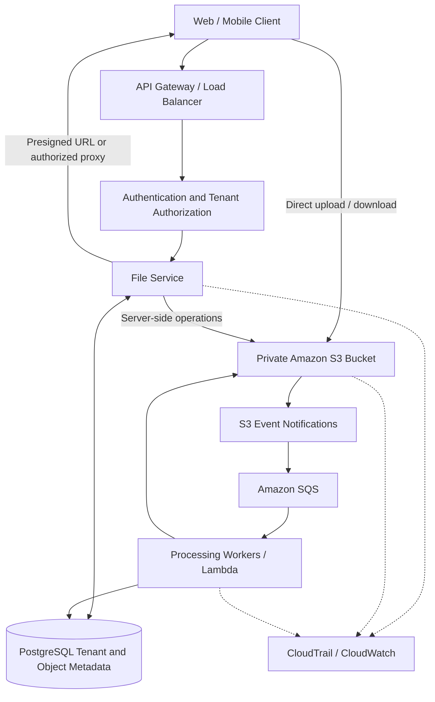
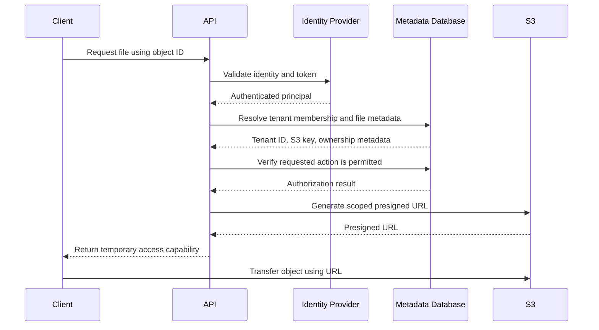
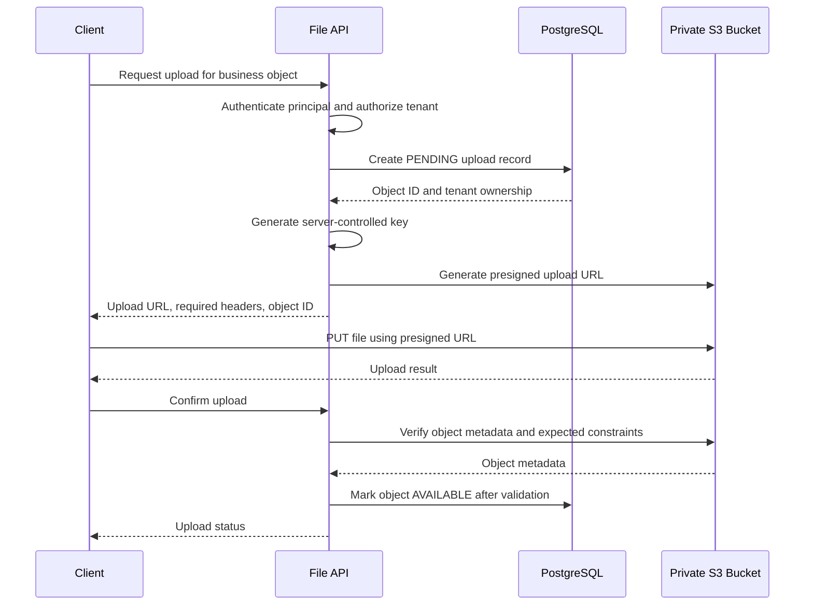
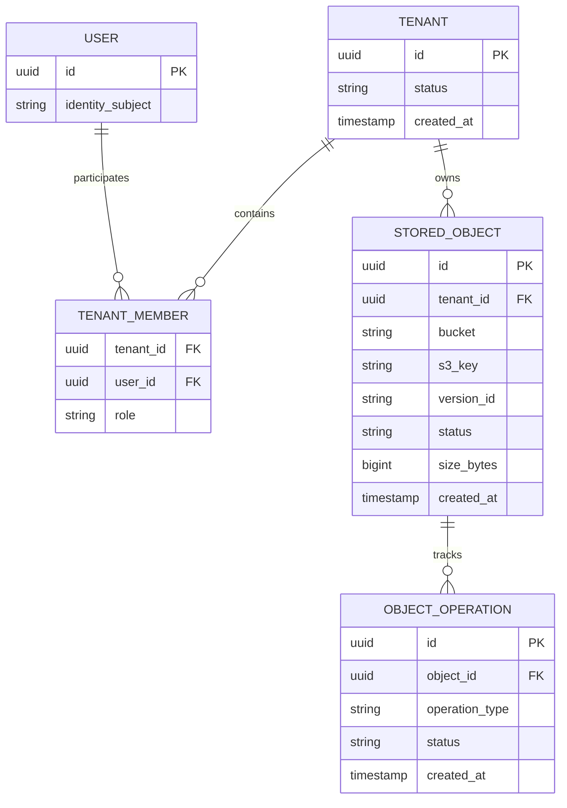
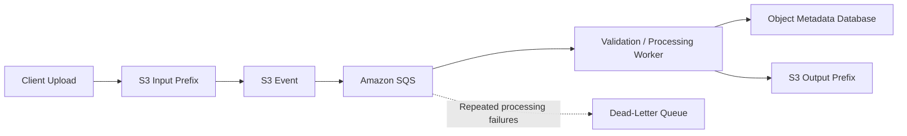

# 07- SaaS Multi-Tenant Storage Architecture

## Overview

A multi-tenant storage architecture allows a Software-as-a-Service (SaaS) platform to store and manage files belonging to multiple customers while enforcing tenant isolation, independent authorization, predictable performance, and appropriate data retention.

Amazon S3 provides highly scalable object storage for tenant documents, images, reports, exports, backups, and other application-managed files. However, S3 does not automatically understand the application's tenant model. The application must translate authenticated tenant identity into authorized object access.

A production design must answer several questions:

- How are tenant objects separated physically and logically?
- How does the system prevent one tenant from accessing another tenant's data?
- Should uploads pass through the backend or go directly from the client to S3?
- How are tenant-specific permissions enforced?
- How are encryption, deletion, retention, and recovery handled?
- How does the design scale as the number of tenants grows?
- How can operators investigate incidents without exposing customer data?

The central architectural principle is that **tenant identity must determine authorization, object ownership, and access scope throughout the request lifecycle**. An object key containing a tenant identifier is useful for organization, but a naming convention alone is not a security boundary.

## Reference Architecture

A typical SaaS storage architecture separates the application control plane from the object data plane.

- The **control plane** authenticates users, resolves tenant membership, validates permissions, records object metadata, and authorizes file operations.
- The **data plane** stores and transfers file contents using S3.
- The **metadata store** maintains the relationship between tenants, users, business entities, object identifiers, and S3 locations.
- The **processing plane** handles asynchronous scanning, transformations, notifications, and lifecycle events.



The client receives only the access capability authorized for the requested file. The backend retains responsibility for tenant authorization, object ownership, and business-level metadata.

The architecture normally uses a private bucket with S3 Block Public Access enabled. When clients transfer objects directly, the backend issues narrowly scoped, time-limited presigned URLs rather than exposing AWS credentials.

## Tenant Isolation Strategies

There is no single storage layout that fits every SaaS application. The appropriate strategy depends on tenant count, regulatory requirements, isolation guarantees, operational overhead, and customization needs.

### Shared Bucket with Tenant Prefixes

All tenants share one S3 bucket, with each tenant assigned a distinct prefix.

```text
s3://saas-files-prod/
    tenants/
        tenant_1001/
            documents/
            images/
            exports/
        tenant_1002/
            documents/
            images/
            exports/
        tenant_1003/
            documents/
            images/
            exports/
```

This is usually the simplest starting point for SaaS applications with many tenants.

**Advantages**

- Low infrastructure overhead.
- Shared lifecycle, monitoring, and storage configuration.
- Straightforward integration with a central file service.
- Efficient management of many tenant objects.

**Limitations**

- A shared execution role may have access to objects belonging to every tenant.
- An application authorization defect can expose data across tenants.
- Tenant-specific encryption, retention, and network requirements can require additional controls.
- Prefixes do not independently enforce access restrictions.

A shared bucket with prefixes is appropriate when a centrally controlled backend mediates access and the security model does not require a separate bucket or account boundary for every tenant.

### Bucket per Tenant

Each tenant receives a dedicated bucket.

```text
Tenant A ──> saas-tenant-a-prod
Tenant B ──> saas-tenant-b-prod
Tenant C ──> saas-tenant-c-prod
```

This approach provides distinct bucket-level configuration and access-policy boundaries.

Typical use cases include:

- Enterprise customers requiring custom retention or replication policies.
- Customers with separate encryption-key requirements.
- Contractual or regulatory isolation requirements.
- Tenant-specific cross-account access.
- Large customers with dedicated storage operations.

The trade-off is additional provisioning, naming, policy management, monitoring, lifecycle configuration, and infrastructure deployment complexity. Bucket quotas and account-level service limits must be considered before adopting this model for large numbers of tenants.

A dedicated bucket is not automatically a complete security boundary if administrative roles, KMS permissions, or infrastructure permissions remain broadly shared.

### Account per Tenant

Each tenant is placed in a separate AWS account, or in a tenant-specific account boundary managed by the SaaS platform.

This offers stronger isolation for identity administration, policies, resource configuration, and blast radius.

Use it when the requirements justify:

- Strict separation of administration.
- Customer-specific account ownership.
- Stronger compliance or organizational boundaries.
- Customer-controlled encryption and access policies.
- Independent infrastructure and operational responsibilities.

This model substantially increases account provisioning, deployment, governance, monitoring, and support overhead. It is usually reserved for workloads whose isolation requirements justify the cost.

### Choosing an Isolation Model

| Dimension | Shared bucket and prefixes | Bucket per tenant | Account per tenant |
|---|---|---|---|
| Physical storage separation | Shared bucket | Separate buckets | Separate account resources |
| Operational overhead | Low | Medium to high | High |
| Tenant-specific bucket configuration | Limited by shared configuration | Strong | Strong |
| Independent account administration | No | Not inherently | Yes |
| Central management | Straightforward | More resource orchestration | Requires multi-account governance |
| Typical workload | High-volume pooled SaaS | Enterprise or specially regulated tenants | Strongly isolated enterprise workloads |
| Main risk | Cross-tenant authorization defects | Misconfigured shared administration | Cross-account operational complexity |

A common production approach is a **hybrid model**: most customers use shared infrastructure, while customers with exceptional isolation requirements receive dedicated buckets or accounts.

## Tenant Identity and Object Ownership

### Resolve Tenant Identity from Trusted Context

The backend must obtain tenant identity from a trusted authentication and authorization process.

For example, a JWT may identify the authenticated user, while a database records the tenants to which that user belongs and the permissions granted within each tenant.

A request might contain:

```http
GET /api/files/file_8c1a4e
Authorization: Bearer <ACCESS_TOKEN>
```

The application must resolve the requested file and validate that the authenticated principal has permission to access it.

Do not trust a tenant ID supplied only in:

- A request body.
- A query parameter.
- A custom HTTP header.
- A client-controlled S3 key.
- A filename or object metadata field.

These values may participate in routing or filtering, but they must not independently establish authorization.

### Recommended Authorization Flow



Tenant authorization must happen before generating the presigned URL. Once issued, the URL functions as a bearer capability: anyone possessing it may use it within its effective permissions and validity, subject to relevant S3 policies and credential conditions.

### Never Use User-Controlled Keys as Authority

A dangerous API design accepts arbitrary object keys:

```json
{
  "tenant_id": "tenant_1001",
  "key": "tenants/tenant_1002/documents/confidential.pdf"
}
```

If the application signs or executes the requested operation without checking ownership, a tenant can attempt to access another tenant's object.

Instead, accept an application-level object identifier and resolve its storage location from trusted metadata:

```text
Authenticated principal
        |
        v
Tenant membership and permission check
        |
        v
Object ID lookup constrained by authorized tenant
        |
        v
Server-controlled S3 key
        |
        v
Authorized S3 operation
```

This approach makes authorization explicit and avoids treating S3 naming conventions as proof of ownership.

## Object Key Design

S3 object keys should be generated by the application and should not depend directly on an untrusted client-supplied filename or path.

A reasonable shared-bucket convention is:

```text
tenants/{tenant_id}/objects/{object_id}/original
```

For example:

```text
tenants/tenant_1001/objects/obj_7fa21d/original
tenants/tenant_1001/objects/obj_91c4ab/original
tenants/tenant_1002/objects/obj_20f8de/original
```

Use opaque object identifiers, such as UUIDs, to reduce accidental collisions and avoid exposing unnecessary business information in object keys.

The database may store the original filename separately for display:

| Field | Example | Purpose |
|---|---|---|
| `object_id` | `obj_7fa21d` | Stable application-level reference |
| `tenant_id` | `tenant_1001` | Ownership and authorization scope |
| `s3_bucket` | `saas-files-prod` | Storage location |
| `s3_key` | `tenants/tenant_1001/objects/obj_7fa21d/original` | Server-managed object address |
| `original_filename` | `invoice-october.pdf` | Display or download metadata |
| `content_type` | `application/pdf` | Validated content classification |
| `size_bytes` | `248192` | Object size |
| `checksum` | SHA-256 value | Integrity validation where required |
| `version_id` | S3 version ID | Reference to a specific stored version |
| `status` | `AVAILABLE` | Application lifecycle state |

Do not store secrets, authorization tokens, or sensitive customer information in object keys. Keys may appear in logs, audit records, operational tools, or URLs.

Object key prefixes also support policy scoping, lifecycle organization, and processing workflows. Nevertheless, the application must validate tenant ownership independently of the key.

## Upload Architecture

For large files, the preferred pattern is usually direct client-to-S3 upload using a presigned URL. This avoids routing the entire file through the application server.

### Direct Upload Flow



The `PENDING` state prevents the database from reporting a file as available before its object has been verified.

### Upload Authorization

When issuing an upload URL, the backend should:

1. Authenticate the requester.
2. Verify that the requester can upload for the selected tenant and business entity.
3. Generate an opaque object ID and a server-controlled S3 key.
4. Apply allowed file-size, content-type, and other business constraints.
5. Create a pending upload record.
6. Generate a short-lived presigned URL for the exact destination object.
7. Return only the required URL and request parameters.
8. Validate the completed upload before marking the file available.

For `PUT` presigned URLs, sign the relevant headers when the upload must use specific content types, checksums, or encryption settings. Where upload-policy conditions such as a content-length range are needed, a presigned POST policy may be more appropriate. In either case, verify the resulting object server-side before trusting its properties.

A client-supplied MIME type is not proof of file contents. Sensitive workflows should inspect the actual content, scan files where appropriate, and quarantine objects until validation completes.

### Prevent Object-Key Overwrites

A presigned URL for an existing key can be reused until it expires, subject to its effective permissions. A new upload to that same key may replace the object at that key.

Reduce the risk by:

- Using unique keys for each upload attempt or immutable object generation.
- Keeping upload URLs short-lived.
- Using S3 Versioning when previous versions need to be retained.
- Signing required headers and checksums where suitable.
- Tracking upload attempts and object versions in application metadata.
- Confirming which object version was validated before publishing it.

See the [Amazon S3 presigned URL documentation](https://docs.aws.amazon.com/AmazonS3/latest/userguide/using-presigned-url.html).

## Download Architecture

Downloads should follow the same tenant-aware authorization process as uploads.

A secure flow is:

1. The client requests a file using its application-level object ID.
2. The backend resolves the authenticated principal and tenant membership.
3. The backend queries metadata within the authorized tenant scope.
4. The backend checks the permission to download that object.
5. The backend returns a short-lived presigned GET URL or streams the content itself.
6. Access is logged according to the application's audit requirements.

Presigned URLs are appropriate for large downloads because S3 serves the data directly instead of consuming application worker bandwidth.

For sensitive or frequently accessed documents, the URL lifetime should be no longer than required. Avoid logging complete presigned URLs because they contain temporary access parameters.

### CloudFront for Tenant Content

CloudFront can deliver tenant files at scale, but private content introduces additional authorization and caching requirements.

A suitable architecture uses:

- A private S3 origin.
- CloudFront Origin Access Control (OAC), where applicable.
- Signed CloudFront URLs or signed cookies for suitable delivery patterns.
- Application authorization before issuing delivery capabilities.
- Cache behavior that prevents content from one tenant being served to another tenant.

A private origin ensures that clients cannot bypass the delivery layer and directly fetch private objects through an exposed bucket endpoint. However, OAC by itself does not authorize an end user to access a particular tenant's file. User authorization remains a separate responsibility.

Shared cache configurations require particular care. A cache key that ignores tenant-specific authorization or content variants can cause unintended cross-tenant disclosure. Configure the origin request, cache policy, and signed access mechanism together.

## Storage-Level Access Control

Tenant isolation should be enforced at multiple layers.

### Application-Level Authorization

The file service verifies that the principal is authorized for the tenant and object requested. This is essential for business permissions, such as document ownership, team membership, or role-specific access.

The application must also prevent insecure direct object reference (IDOR) vulnerabilities. Opaque object IDs make enumeration harder but do not replace authorization checks.

### IAM and Resource Policies

For a shared-bucket model, the backend's IAM role may have access to many or all tenant prefixes. In that design, application authorization is a critical security boundary.

Where direct S3 access by tenant-specific identities is required, additional controls can restrict access to the appropriate prefix using IAM policies, controlled principal tags or session policies, S3 Access Points, or S3 Access Grants.

The exact model depends on whether data access occurs through a trusted backend role or directly through customer or application identities.

For example, an IAM policy for a controlled tenant-specific role can scope object operations to a designated prefix:

```json
{
  "Version": "2012-10-17",
  "Statement": [
    {
      "Sid": "TenantObjectAccess",
      "Effect": "Allow",
      "Action": [
        "s3:GetObject",
        "s3:PutObject"
      ],
      "Resource": "arn:aws:s3:::saas-files-prod/tenants/tenant_1001/objects/*"
    }
  ]
}
```

This is an illustrative identity policy for a tenant-specific access role, not a complete bucket security configuration. It does not grant tenant isolation automatically when every tenant uses the same broad backend role. Bucket policies, explicit denies, role trust, KMS permissions, and any required list permissions must also be evaluated.

Do not dynamically construct a policy from an untrusted tenant ID and assume the resulting prefix is authorized. The principal or session to which the policy applies must be controlled by a trusted identity-to-tenant mapping.

### S3 Access Points and S3 Access Grants

**S3 Access Points** provide named S3 endpoints with individual access policies and optional network controls. They are useful when several applications or consumers need different access rules over shared datasets.

**S3 Access Grants** provide a model for granting S3 access to IAM principals or supported corporate directory identities by bucket, prefix, or object. They can help manage permissions across a large number of datasets and identities.

These services can improve the management of data access at scale, but they do not replace the SaaS application's business-level tenant authorization model.

Use them when their identity, policy, and data-access integration fits the architecture. Avoid introducing them solely to add another layer of complexity to a simple backend-mediated upload system.

References:

- [Amazon S3 access control](https://docs.aws.amazon.com/AmazonS3/latest/userguide/access-management.html)
- [Amazon S3 Access Grants](https://docs.aws.amazon.com/AmazonS3/latest/userguide/access-grants.html)

## Encryption and Tenant Data Protection

S3 encrypts new object uploads at rest by default, but a multi-tenant system still needs an explicit encryption and key-management design.

### Encryption Options

| Strategy | Advantages | Limitations | Suitable use case |
|---|---|---|---|
| SSE-S3 | Simple default server-side encryption | No independent customer-managed key boundary | Standard pooled SaaS storage |
| SSE-KMS with a shared customer-managed key | Centralized key management and auditing controls | A broadly authorized shared key may not provide tenant-specific key isolation | Centralized enterprise SaaS storage |
| SSE-KMS with tenant-specific keys | Can support separate key policies and stronger cryptographic administration boundaries | More key lifecycle, policy, quota, and cost management | Tenants requiring independent key controls |
| Client-side encryption | Application or customer controls encryption before data reaches S3 | Key distribution, recovery, search, and processing become more complex | Requirements that need application- or customer-controlled plaintext access |

A separate KMS key per tenant does not automatically guarantee isolation if a shared role can use all the keys. Ensure that key policies and IAM permissions align with the intended tenant boundary.

Likewise, revoking access to a key can render all objects encrypted under that key inaccessible. Key recovery and retention must be part of the data recovery design.

### Protect the Complete Data Path

The security model must consider:

- Encryption in transit between clients, APIs, and S3.
- S3 bucket policies and Block Public Access.
- Temporary upload and download capabilities.
- Access to object metadata in PostgreSQL.
- KMS key policies and grants where customer-managed keys are used.
- Logs, events, exports, backups, and processing outputs.
- Administrative access and support tooling.
- Tenant deletion and retention requirements.

An encrypted object can still be exposed to an unauthorized principal if its read permissions are wrong. Encryption and authorization solve different problems and must be validated independently.

## Metadata and Object Lifecycle Management

S3 stores the object content, while a relational database usually stores application-level metadata and state.

This separation allows business queries to operate on indexed metadata instead of repeatedly listing S3 objects.

### Example Metadata Model



This is a conceptual model. The actual schema should include appropriate indexes, uniqueness constraints, authorization relationships, timestamps, and operational fields.

For example, a file lookup should be scoped to the tenant:

```sql
SELECT id, bucket, s3_key, version_id, status, size_bytes
FROM stored_object
WHERE id = :object_id
  AND tenant_id = :authorized_tenant_id
  AND status = 'AVAILABLE';
```

The tenant identifier in this query must come from the authenticated and authorized application context, not a value trusted directly from the request.

### Maintain Consistent Object State

A database transaction and an S3 operation do not form one atomic transaction. Uploads, deletions, and background processing therefore need explicit state management.

Possible states include:

```text
PENDING_UPLOAD
      |
      v
UPLOADED
      |
      v
VALIDATING
      |
      +------> REJECTED
      |
      v
AVAILABLE
      |
      v
DELETION_PENDING
      |
      v
DELETED
```

The state machine prevents the API from treating an unvalidated upload as a published file. It also supports recovery from partial failures.

Examples include:

- S3 upload succeeds but the client never confirms completion.
- Upload confirmation arrives more than once.
- Metadata is created but the upload fails.
- Deletion starts but an S3 request times out.
- Background validation fails after the object has already been stored.

Use idempotency keys, durable operation records, retryable workers, and periodic reconciliation jobs to handle these cases.

## Event-Driven Processing

Many SaaS platforms need to inspect, transform, index, or extract metadata from uploaded files.

A common design is to trigger asynchronous processing after a new object is uploaded.



Use separate input and output prefixes when processing creates derived objects, so that output writes do not unintentionally trigger the same workflow again.

### Tenant-Safe Processing

The worker should derive tenant context from trusted application metadata or a validated server-generated key. Do not allow a client to choose an arbitrary output prefix.

The processing system should:

- Verify that the source object belongs to a valid tenant.
- Use a stable operation identifier.
- Handle duplicate event delivery.
- Track processing state and attempt count.
- Avoid writing output to another tenant's prefix.
- Limit worker permissions to the resources it needs.
- Record processing results without exposing sensitive file contents in logs.

S3 event notifications may be duplicated and are not an ordered transaction log. Consumers must be idempotent, and workflows should tolerate delayed delivery.

For workloads requiring durable buffering, SQS can decouple S3 events from processing workers. Configure visibility timeouts, retry policies, dead-letter queues, and alarms based on expected processing duration.

## Tenant Deletion and Data Retention

Removing a tenant is not simply deleting a database row or removing the objects currently visible under a prefix.

A production deletion workflow must identify all relevant data and apply the tenant's contractual, security, and retention obligations.

Potential resources include:

- Current S3 objects.
- Noncurrent versions and delete markers.
- Derived images, exports, and generated reports.
- Multipart uploads still in progress.
- Database metadata and pending operation records.
- Replicated copies.
- Backup recovery points.
- Search indexes, caches, and downstream analytical datasets.
- KMS keys or access grants associated with a tenant.

### Controlled Tenant Deletion

A robust workflow might follow these steps:

1. Mark the tenant as `DELETION_PENDING` and block new writes.
2. Revoke or expire tenant-specific access capabilities and disable relevant integrations.
3. Discover related objects, versions, derived files, and pending processing jobs.
4. Evaluate legal holds, retention rules, contractual requirements, and backup policies.
5. Delete or retain data according to the approved policy.
6. Verify the result using object inventories, manifests, or targeted S3 API checks.
7. Reconcile replicas and other managed copies.
8. Finalize metadata deletion and record an audit outcome.

For a versioned bucket, a normal delete operation may create a delete marker without permanently removing historical versions. Permanent removal of every version requires a deliberate version-aware procedure.

Similarly, deleting the active copy does not necessarily delete replicas or backups. Object Lock and legal holds may prevent deletion until their applicable requirements are satisfied.

Tenant deletion should therefore be designed as an auditable workflow with resumable steps, not a single database cascade.

## Scalability and Performance

### Storage and Request Scaling

S3 is designed to scale to large object populations and high request volumes. SaaS application bottlenecks frequently arise elsewhere:

- Database queries for object metadata.
- Excessive synchronous authorization checks.
- Application servers proxying large uploads.
- Inefficient file listings.
- Hot records or tenant-specific database contention.
- Excessive small-object processing.
- Downstream event-processing backlogs.

Use direct uploads and downloads where suitable, index tenant-scoped metadata queries, and avoid listing an entire shared bucket to answer application-level file queries.

### Tenant Fairness and Noisy Neighbors

A large tenant can consume a disproportionate share of upload bandwidth, transformation capacity, or storage budget.

Control this through application-level quotas and workload governance:

- Maximum file size and allowed content types.
- Per-tenant concurrent upload limits.
- Per-tenant request and processing rate limits.
- Storage quotas and usage accounting.
- Background processing concurrency limits.
- Lifecycle and retention policies suitable for each workload.
- Separate workloads or infrastructure for tenants requiring stronger performance isolation.

A shared bucket does not itself enforce a SaaS storage quota. The application must measure usage and prevent race conditions when concurrent requests approach a tenant's quota.

When multiple workers reserve storage capacity concurrently, use database transactions, conditional updates, or another atomic accounting mechanism instead of checking current usage and then incrementing it in separate unprotected operations.

### Cost Allocation

A shared bucket can make costs easier to centralize but can make tenant-level attribution more difficult.

Track usage at the application level:

- Logical bytes stored per tenant.
- Object counts and upload volumes.
- Download bandwidth or delivery activity where measurable.
- Transformation and scanning workloads.
- Retained versions and derived objects.
- Storage class distribution.
- Tenant-level API and processing request counts.

S3 object tags can support particular allocation and management scenarios, but a relational usage ledger is often more appropriate for application quotas and billing. Keep billing rules explicit about whether they count logical object size, retained versions, derived files, or other storage overhead.

## Observability and Auditing

Tenant-level observability helps diagnose incidents, enforce quotas, and investigate cross-tenant access risks.

Useful signals include:

| Signal | Purpose |
|---|---|
| Upload success and failure rates | Detect client or storage problems |
| Presigned URL issuance and use patterns | Identify unusual upload or download behavior where observable |
| Validation failures | Track malformed, oversized, or rejected files |
| Per-tenant object count and bytes | Enforce quotas and support billing |
| Queue age and processing failure count | Detect asynchronous processing backlogs |
| Unauthorized tenant/object access attempts | Detect authorization defects and abusive requests |
| Deletion workflow status | Verify completion of tenant offboarding |
| S3 and KMS authorization failures | Diagnose storage and encryption access issues |

Include correlation IDs, tenant IDs, and object IDs in application logs only when appropriate for the organization's privacy requirements. Never log complete presigned URLs or credentials.

CloudTrail can provide an audit record of relevant AWS API activity. Its usefulness for user-level investigation depends on the configured event coverage and the identity used to access the object. If all clients access S3 through a shared presigning role, CloudTrail's principal information may identify that role rather than fully identifying the end user. The application should separately audit who requested each presigned URL and for which tenant and object.

Establish retention and access controls for audit logs so that the investigation records remain protected from the same operational identities being investigated.

## Deployment and Environment Isolation

Infrastructure should be provisioned consistently across development, staging, and production.

A representative deployment includes:

- A private S3 bucket or tenant-specific storage resources.
- Versioning and encryption settings appropriate to the recovery requirements.
- Bucket policies and Block Public Access.
- IAM roles for the API, workers, and deployment pipeline.
- SQS queues and dead-letter queues if asynchronous processing is used.
- Event notification configuration.
- Database schema and migrations.
- Monitoring, alarms, and audit configuration.
- Lifecycle and retention rules.
- Infrastructure-as-code definitions and deployment verification.

Use Terraform, AWS CloudFormation, or AWS CDK to manage the infrastructure. Avoid creating tenant-specific resources through undocumented console operations or application code that lacks reconciliation and cleanup support.

For a shared-bucket architecture, tenant creation usually means provisioning or activating application metadata rather than creating a new bucket. For a bucket-per-tenant or account-per-tenant architecture, provisioning must be asynchronous, retryable, idempotent, and tracked as part of the tenant's lifecycle.

Deployment validation should verify not only that resources exist, but also that cross-tenant access is denied, encryption is enabled, the intended IAM role can perform its required operations, and unintended public access is blocked.

## Common Architecture Mistakes

### Relying on Tenant IDs in Object Keys

A key such as `tenants/tenant_1001/document.pdf` does not prevent a client from requesting another tenant's key if the API accepts arbitrary keys.

**Correction:** Resolve the storage key from tenant-scoped, trusted metadata after authorizing the request.

### Returning Presigned URLs Before Authorization

A valid URL gives its holder temporary access to the signed operation. Returning one for an object without verifying tenant ownership creates a direct data exposure.

**Correction:** Perform authorization before generating the URL, keep its lifetime short, and audit URL issuance.

### Treating Opaque IDs as an Authorization Mechanism

UUIDs and random identifiers reduce guessability, but they do not replace ownership checks.

**Correction:** Enforce tenant-scoped database queries and explicit permission checks for every file operation.

### Giving Every Worker Unrestricted Access

A shared processing role with unrestricted permissions across all buckets and prefixes increases the impact of a compromised worker or software defect.

**Correction:** Scope roles to the relevant prefixes, buckets, queues, and encryption keys. Use separate roles or account boundaries where appropriate.

### Treating Database State and S3 Operations as Atomic

S3 uploads or deletes can succeed while the database update fails, or vice versa.

**Correction:** Use explicit operation states, retries, reconciliation, and durable job tracking.

### Deleting Only Current Object Versions

A versioned bucket may retain prior versions and delete markers after an ordinary delete operation.

**Correction:** Use a version-aware deletion procedure and verify replicas, backups, and retention constraints.

### Ignoring Cache Isolation

Private tenant content can be exposed when cache behavior and authorization are designed independently.

**Correction:** Validate CloudFront origin configuration, signed access mechanisms, and cache policy together. Include the correct authorization-related cache behavior without needlessly fragmenting the cache.

## Production Readiness Checklist

### Identity and Isolation

- [ ] Tenant identity is derived from authenticated and authorized context.
- [ ] Every object operation checks the tenant's permission to access the object.
- [ ] Clients cannot choose arbitrary S3 keys or destination prefixes.
- [ ] Database lookups enforce tenant scope.
- [ ] IAM roles have only the required object, bucket, queue, and key permissions.
- [ ] Cross-tenant access attempts are covered by automated tests.

### Upload and Download

- [ ] Upload URLs are short-lived and target server-generated keys.
- [ ] File type, size, checksum, and other required constraints are validated.
- [ ] An uploaded object is not published before successful validation.
- [ ] Download URLs are generated only after authorization.
- [ ] Presigned URLs and credentials are excluded from logs.
- [ ] CloudFront caching, if used, preserves tenant content isolation.

### Reliability and Operations

- [ ] Object state transitions are explicit and retryable.
- [ ] Duplicate events and repeated client requests are handled safely.
- [ ] Failed uploads and deletions have reconciliation procedures.
- [ ] Tenant usage and quotas are measured consistently.
- [ ] Retention, backup, and deletion behavior are documented.
- [ ] Monitoring identifies processing failures and suspicious access patterns.
- [ ] Infrastructure deployment validates security controls.
- [ ] Tenant offboarding includes replicas, object versions, and dependent metadata.

## Further Reading

- [Amazon S3 access control](https://docs.aws.amazon.com/AmazonS3/latest/userguide/access-management.html)
- [Amazon S3 presigned URLs](https://docs.aws.amazon.com/AmazonS3/latest/userguide/using-presigned-url.html)
- [Amazon S3 Access Grants](https://docs.aws.amazon.com/AmazonS3/latest/userguide/access-grants.html)
- [Amazon S3 Access Points](https://docs.aws.amazon.com/AmazonS3/latest/userguide/access-points.html)
- [Amazon S3 Versioning](https://docs.aws.amazon.com/AmazonS3/latest/userguide/Versioning.html)
- [Amazon S3 Object Lock](https://docs.aws.amazon.com/AmazonS3/latest/userguide/object-lock.html)
- [Amazon CloudFront Origin Access Control](https://docs.aws.amazon.com/AmazonCloudFront/latest/DeveloperGuide/private-content-restricting-access-to-s3.html)

## Key Takeaways

- Tenant identity must determine authorization and object ownership; S3 key prefixes alone do not enforce tenant isolation.
- Shared buckets with tenant prefixes are operationally efficient, while dedicated buckets or accounts can provide stronger administrative and configuration boundaries.
- Presigned URLs enable scalable direct transfers but must be scoped to server-generated object keys, issued after authorization, and treated as bearer capabilities.
- Metadata consistency, idempotent event processing, lifecycle management, and tenant deletion require explicit workflows because database and S3 operations are not one atomic transaction.
- Production readiness depends on layered access controls, encryption, tenant-aware auditing, quota enforcement, tested recovery procedures, and automated cross-tenant security tests.