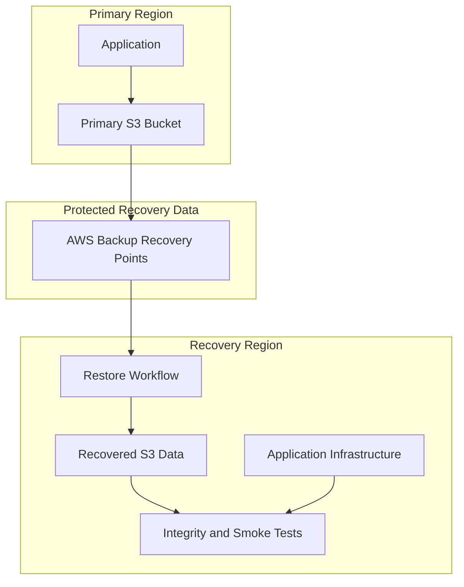
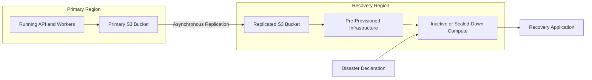
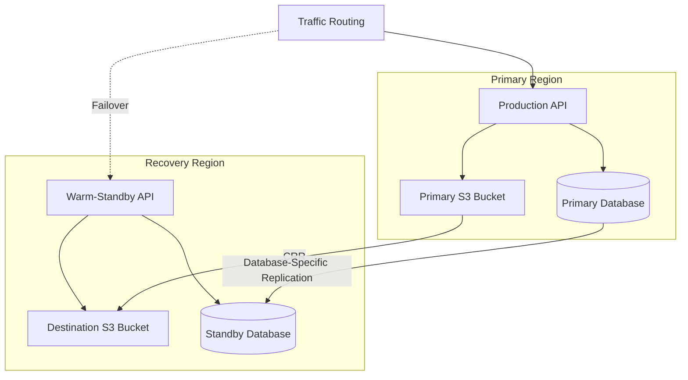
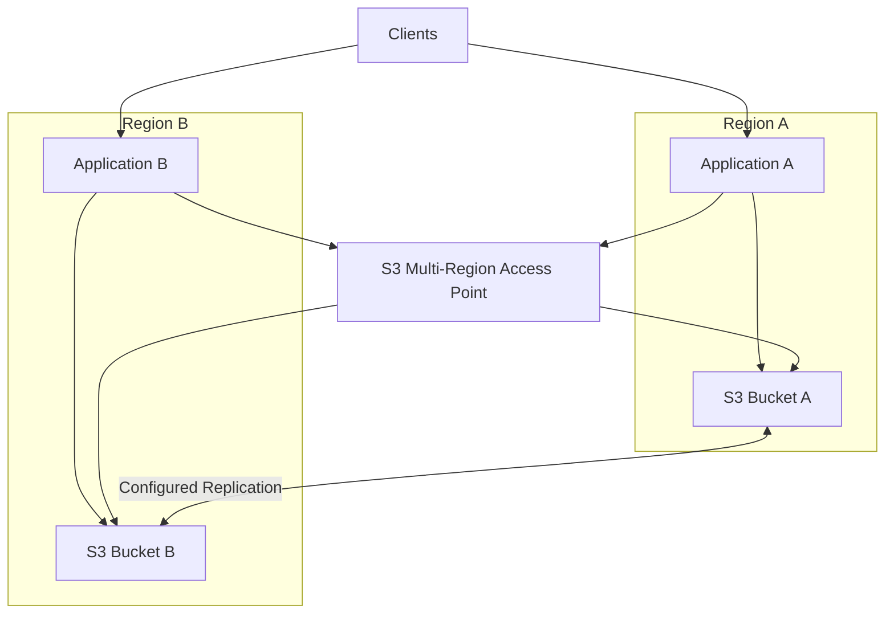
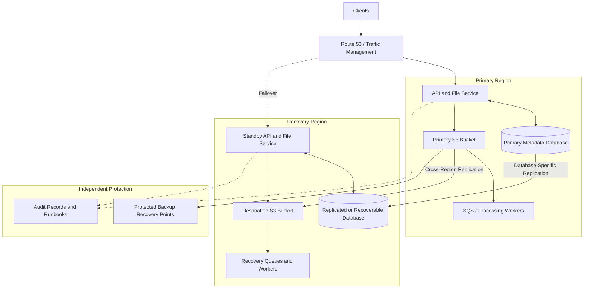
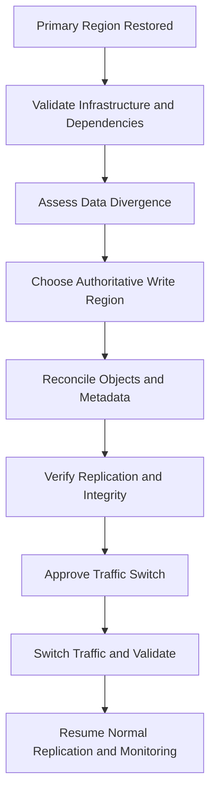

# 08- Disaster Recovery Architecture

## Overview

Disaster recovery (DR) is the architecture and operational process used to restore an application and its data after a major disruption makes the primary environment unavailable, unusable, or untrustworthy.

Amazon S3 provides highly durable object storage, but object durability alone does not guarantee application recoverability. Accidental deletion, corrupted uploads, compromised credentials, failed deployments, and regional outages can prevent an application from serving correct data even when S3 itself remains operational.

A production S3 disaster recovery architecture must protect and restore:

- Object data and the historical versions required for recovery.
- Application metadata and database records referencing S3 objects.
- Regional replicas, backup recovery points, and encryption keys.
- IAM permissions, bucket policies, and application identities.
- APIs, background workers, queues, and event-driven processing.
- Network configuration, traffic routing, and infrastructure.
- Data consistency during failover and subsequent failback.

The design should begin with business-approved Recovery Point Objective (RPO) and Recovery Time Objective (RTO) targets. These objectives determine whether backup and restore, pilot light, warm standby, or multi-Region active-active is appropriate.

**Core principle:** S3 replication and backups protect data in different ways. Neither automatically restores the entire application or guarantees that every required object is available at the moment of failover.

## Recovery Objectives

### Recovery Point Objective (RPO)

RPO defines the maximum acceptable amount of data loss, expressed as a period of time before a disruption.

For example, an RPO of 15 minutes means the business expects to recover to a state no more than 15 minutes behind the incident, according to the agreed measurement method.

For S3 workloads, achieved RPO depends on the protection mechanism, replication progress, backup availability, and application consistency requirements.

An RPO target is not automatically satisfied by enabling Cross-Region Replication (CRR). Replication is asynchronous, and recently written objects may not yet exist in the destination Region.

### Recovery Time Objective (RTO)

RTO defines the maximum acceptable elapsed time between a disruption and restoration of the required service.

The recovery duration can include:

- Detecting and declaring the incident.
- Authorizing the recovery procedure.
- Activating or deploying application infrastructure.
- Restoring or promoting the database.
- Verifying replicated or restored objects.
- Recovering access to encryption keys and application identities.
- Restarting queues and background workers.
- Redirecting traffic and validating business operations.

A rapid S3 routing change does not guarantee a rapid application recovery if the database, networking, authentication system, or processing infrastructure remains unavailable.

### Example Recovery Targets

| Workload | Illustrative RPO | Illustrative RTO | Potential strategy |
|---|---|---|---|
| Static website assets | Minutes to hours | Minutes | Recoverable origin data, versioned releases, and deployment rollback |
| Customer document storage | Minutes | Under one hour | Cross-Region replication, versioning, and independent backups |
| Business-critical file platform | Seconds to minutes, depending on the write model | Minutes | Warm standby with replication and controlled write ownership |
| Data lake | Hours, depending on source replay capability | Hours | Recoverable raw data, reproducible transformations, and metadata recovery |
| Global content platform | Defined by accepted write loss | Low latency | Multi-Region architecture with explicit consistency and failover procedures |

These values are illustrative rather than AWS guarantees. Establish actual objectives through business impact analysis and validate them through recovery exercises.

## Failure Domains and Protection Mechanisms

Different failure scenarios require different recovery mechanisms. A second Region protects against some regional failures but does not automatically protect against every destructive action or logical data error.

| Failure scenario | Main risk | Relevant protection |
|---|---|---|
| Accidental overwrite | Incorrect current object content | S3 Versioning and controlled restoration |
| Accidental deletion | Missing objects or historical versions | Versioning, backups, and retention controls |
| Compromised production credentials | Unauthorized modification or deletion | Separate recovery account, independent backups, and restrictive administrative permissions |
| Regional outage | Primary application and regional dependencies unavailable | Cross-Region data protection and a ready recovery environment |
| Corrupted business data | Objects remain accessible but contain invalid information | Historical recovery points, integrity checks, and application validation |
| Replication failure | Destination contains incomplete or stale data | Replication metrics, alarms, and reconciliation |
| KMS authorization failure | Objects exist but cannot be decrypted or accessed | Protected keys, validated recovery permissions, and tested key policies |
| Failed infrastructure deployment | APIs or processing workflows stop functioning | Infrastructure as code, deployment rollback, and recoverable configuration |
| Destructive lifecycle change | Required versions or objects expire | Retention governance, independent backups, and lifecycle validation |

### Match the Mechanism to the Failure

| Mechanism | Primary purpose | Important limitation |
|---|---|---|
| S3 Versioning | Recover previous object versions | Does not independently prevent permanent deletion of versions |
| S3 Replication | Maintain copies in another bucket, including another Region | Asynchronous; some unwanted changes can also propagate |
| AWS Backup | Centrally manage backup policies, retention, and restoration | Recovery depends on configuration, retention, service support, and usable recovery points |
| S3 Object Lock | Protect eligible object versions during retention periods or legal holds | Does not restore the complete application |
| Cross-account isolation | Reduce the impact of compromised production identities | Requires separate permissions and administration |
| Infrastructure as code | Recreate infrastructure consistently | Does not recover missing object data or guarantee application readiness |

For critical workloads, combine mechanisms according to the threat model rather than treating any single feature as a complete DR solution.

## Disaster Recovery Strategies

AWS disaster recovery designs commonly follow four patterns: backup and restore, pilot light, warm standby, and multi-site active-active.

### Backup and Restore

The recovery environment is created or activated after a disruption. Data is restored from protected recovery points, and the application is deployed or activated.



**Use when:**

- The business accepts a longer RTO.
- Data can be restored or reconstructed during the recovery window.
- Cost minimization is important.
- Application infrastructure can be provisioned through automation.

**Trade-offs:**

- Recovery time depends on data volume and restoration throughput.
- Infrastructure may need to be created during the incident.
- IAM, KMS, database, and networking dependencies can delay recovery.
- Recovery procedures require validation before production traffic resumes.

This design must include tested restoration procedures and access to the required deployment artifacts. Scheduled backups alone are insufficient.

### Pilot Light

A pilot-light architecture keeps essential recovery resources and regional data protection in place while maintaining some application components at low capacity or inactive.



**Use when:**

- RPO and RTO requirements are stricter than a restore-only design can satisfy.
- Core regional infrastructure should already be available.
- The application can be activated through documented automation.

**Trade-offs:**

- Additional activation steps increase recovery time.
- Dependencies must be started in the correct order.
- Regional quotas and service permissions must be prepared in advance.
- Database promotion and traffic routing require explicit coordination.

### Warm Standby

Warm standby maintains a functioning but reduced-capacity application environment in another Region. The standby can be scaled up and activated when required.



**Use when:**

- The business needs a short recovery time.
- Regional data and essential dependencies should already be available.
- A reduced-capacity environment is sufficient before scaling.
- The recovery environment can be activated through an approved procedure.

**Trade-offs:**

- The standby incurs ongoing cost.
- S3 and database replication must be coordinated.
- Scaling, traffic changes, and write ownership must be managed safely.

Warm standby is useful only when the recovery capacity can support the required workload. Test the expected traffic surge instead of assuming that autoscaling will instantly provide every resource.

### Multi-Site Active-Active

Both Regions serve traffic during normal operation. If one Region becomes unavailable, the surviving Region continues serving its supported workload.



**Use when:**

- Very low recovery time is required.
- Multi-Region traffic distribution is a business requirement.
- The application supports the necessary data consistency model.
- The cost and operational complexity are justified.

**Trade-offs:**

- Object replication is asynchronous, not a transaction across Regions.
- Concurrent writes can create divergent versions of the same logical object.
- Database consistency becomes more complicated.
- Failback requires reconciliation and clear write ownership.

Active-active does not automatically mean zero data loss. S3 replication does not merge competing updates into a single logically consistent version.

## Reference S3 Disaster Recovery Architecture

For a business-critical document service, a practical design includes a primary Region, a Cross-Region replicated bucket, a separately controlled backup mechanism, and a pre-provisioned recovery environment.



The database replication shown is conceptual. PostgreSQL records, S3 objects, queue state, and application state are independent resources. Their recovery mechanisms must be designed and tested separately.

### Component Responsibilities

| Component | Responsibility | Recovery requirement |
|---|---|---|
| Primary API and file service | Authenticates requests and manages files | Maintain a compatible deployable application version in the recovery Region |
| Primary S3 bucket | Stores original objects | Configure replication, versioning, and appropriate recovery controls |
| Destination S3 bucket | Maintains regional object copies | Validate replication completeness, policies, and encryption access |
| Metadata database | Stores tenant ownership, object state, and business relationships | Restore or replicate independently and reconcile against S3 |
| Recovery API | Serves requests after failover | Validate dependencies, identity permissions, and capacity |
| Processing workers | Scan, transform, and publish files | Restore worker permissions, queues, and safe retry behavior |
| Traffic routing | Directs requests to the active application | Change routing only after readiness checks pass |
| Independent backups | Provide historical recovery | Keep recovery points protected and test restoration |
| Audit and monitoring | Support detection and investigation | Keep recovery-related alerts and records accessible during a primary Region failure |

## Cross-Region Replication Design

S3 Cross-Region Replication asynchronously copies eligible object versions from a source bucket to a destination bucket in another Region.

### Configuration Dependencies

A typical CRR configuration requires:

- Versioning enabled on the source and destination buckets.
- An appropriate replication rule and destination bucket.
- An IAM replication role with the required permissions.
- KMS permissions when customer-managed encryption keys are involved.
- Correct destination ownership and access settings.
- Monitoring for replication status, failure, and lag.
- A strategy for historical objects that existed before the replication rule was enabled.

Enabling a replication rule does not automatically copy all pre-existing objects. S3 Batch Replication can be used for eligible existing object versions. Validate its completion report rather than assuming deployment of the rule has backfilled the destination.

### Replication Time and RPO

Replication latency depends on factors such as object size, Region pair, configuration, and service conditions.

S3 Replication Time Control (S3 RTC) provides more predictable replication latency for eligible traffic. AWS documentation describes a commitment that 99.99% of new objects are replicated within 15 minutes when the feature is configured appropriately. This is a replication service commitment, not a guarantee that every object required by an application will be present during a disaster.

See the [S3 replication documentation](https://docs.aws.amazon.com/AmazonS3/latest/userguide/replication.html) and [replication configuration reference](https://docs.aws.amazon.com/AmazonS3/latest/userguide/replication-add-config.html).

### Replication Is Not Historical Recovery

Replication can copy unwanted updates, and the destination can be exposed to destructive administrative changes if it is not independently protected.

For critical workloads:

- Use replication for regional availability.
- Use Versioning to recover retained previous versions.
- Use independent backups for historical recovery.
- Use Object Lock when immutable retention is required.
- Reconcile source and destination data during recovery.

The destination must be protected against the same identities and failure scenarios that threaten the primary bucket.

## Multi-Region Access Points and Failover

An S3 Multi-Region Access Point (MRAP) provides a global access endpoint associated with S3 buckets in multiple AWS Regions. It can simplify regional access patterns and support failover controls.

MRAP does not automatically synchronize application state or guarantee that regional buckets contain identical data.

### Active-Passive Routing

In active-passive mode, an active Region receives traffic while a passive Region does not. This can support controlled failover where a single Region should own writes.

AWS documents that an MRAP failover-routing transition completes within two minutes. This describes the routing change, not the total time to restore an application or verify destination data.

### Replication Requirements

For MRAP designs requiring synchronized object and metadata changes, AWS recommends two-way replication and replica modification synchronization where appropriate.

Before enabling failover:

- Configure the required replication directions.
- Verify encryption and destination permissions.
- Define which Region owns writes before and after failover.
- Avoid uncontrolled concurrent updates to the same logical object.
- Monitor replication status and outstanding operations.
- Validate the destination application's readiness independently of MRAP routing.

See [Using Amazon S3 Multi-Region Access Point failover controls](https://docs.aws.amazon.com/AmazonS3/latest/userguide/UsingFailover.html).

### Inspect MRAP Routing

```bash
aws s3control get-multi-region-access-point-routes \
  --region us-west-2 \
  --account-id 123456789012 \
  --mrap <MRAP_ARN>
```

Replace the placeholders with the relevant account ID and MRAP ARN. Use the response to inspect regional routing status.

Do not initiate failover solely because an alarm fired. Confirm the incident, validate the destination environment, authorize the change, and follow the write-ownership procedure.

## Backup and Historical Recovery

S3 replication and backup solve different problems. Replication is primarily intended to maintain another copy of eligible objects, whereas a backup mechanism can provide recovery points from before a destructive operation.

AWS Backup for Amazon S3 supports continuous backup with point-in-time recovery and scheduled or on-demand periodic backups, subject to documented capabilities and constraints.

Important considerations include:

- Continuous S3 backups support point-in-time recovery within a retention window of up to 35 days.
- Periodic snapshots can support longer configured retention, up to 99 years under the documented AWS Backup limits.
- Cross-Region and cross-account copies of continuous recovery points are snapshot copies; they do not retain the source recovery point's point-in-time recovery capability.
- Continuous S3 backup relies on S3 events delivered through Amazon EventBridge. Disabling the required EventBridge configuration can interrupt continuous backup tracking.
- Recovery permissions, encryption access, and destination configuration must be tested before an incident.

See the [AWS Backup S3 documentation](https://docs.aws.amazon.com/aws-backup/latest/devguide/s3-backups.html).

### Backup Restore Considerations

Restoring an S3 backup to an existing bucket is not necessarily a destructive replacement of the bucket's contents. AWS Backup documents that a restore does not overwrite existing objects or automatically remove objects added after the backup.

Consequently, restoring a backup may not recreate the entire historical bucket state simply by restoring into the original location.

For logical corruption or a suspected compromise, restore into an isolated destination where practical, validate the recovered objects, and explicitly decide how to reconcile them with the current environment.

See [Restoring Amazon S3 data using AWS Backup](https://docs.aws.amazon.com/aws-backup/latest/devguide/restoring-s3.html).

## Metadata and Object Consistency

Applications frequently maintain object ownership, processing status, versions, and business relationships in PostgreSQL or another database. The database and S3 do not participate in one distributed transaction.

A regional failover can therefore produce an inconsistent state even when the destination bucket is healthy.

### Example Failure

Consider a document service that performs these operations:

1. Creates a pending record in PostgreSQL.
2. Uploads a file to the primary S3 bucket.
3. Validates the uploaded content.
4. Marks the database record as available.
5. Encounters a regional failure before replication completes.

After failover, the recovery database might indicate that the document is available while the destination bucket does not yet contain the required object version.

### Recovery Reconciliation

A recovery workflow should:

- Compare expected object references with destination object availability.
- Validate the expected version ID where versioning is used.
- Verify checksums or application-level integrity metadata.
- Identify incomplete uploads and pending transformations.
- Requeue only operations that are safe to replay.
- Mark inconsistent records explicitly rather than silently serving incomplete data.

For multi-object datasets that require consistent publication, use immutable output generations, manifests, or a suitable table format with the required commit semantics. S3 alone does not provide an atomic transaction spanning multiple objects, a database commit, and cross-Region replication.

## Regional Failover Procedure

Failover should be an observable, authorized workflow rather than a collection of ad hoc commands.

### Detect and Declare

1. Confirm the disruption using application health checks, monitoring, and AWS service status information where relevant.
2. Determine whether the issue is an application defect, authorization failure, service problem, or regional outage.
3. Assess the likely impact and determine whether the incident meets predefined failover criteria.
4. Preserve audit evidence and prevent further destructive actions.
5. Fence or stop primary writes when continuing activity could result in conflicting states.

Do not assume that a failed health check proves a regional disaster. A KMS authorization problem, incorrect DNS configuration, or failed deployment can produce similar symptoms.

### Validate the Recovery Environment

Before routing production traffic to the recovery Region, verify:

- Required objects and versions are available.
- Replication completeness is acceptable for the agreed RPO.
- The recovery database is ready to serve the required role.
- IAM and KMS permissions allow the recovery application to use the data.
- APIs, networking, authentication, and dependent services are operational.
- Queues and workers can process events safely.
- Capacity is sufficient for expected traffic.
- Monitoring and incident logging remain operational.

### Activate and Verify

1. Deploy or activate the recovery application.
2. Promote or enable the appropriate database writer if required.
3. Establish the authorized recovery write path.
4. Change traffic routing or MRAP routing according to the chosen design.
5. Execute smoke tests for uploads, downloads, metadata lookups, and critical business operations.
6. Observe errors, latency, queue depth, and recovery-specific metrics.
7. Record the measured RPO, RTO, and any unresolved limitations.

Declare recovery complete only when the required business workflows have passed their validation criteria.

## Failback to the Primary Region

Failback returns the application to its original Region after that Region has recovered. It is a separate operation that requires coordination and data reconciliation.

The main risk is data divergence: the recovery Region may have accepted writes while the original Region was unavailable.



Before switching traffic:

- Determine which Region contains the authoritative data.
- Prevent uncontrolled writes to both Regions.
- Reconcile object versions and database state.
- Verify replication in the intended direction.
- Confirm encryption, IAM, and resource policies.
- Confirm the target Region can accept writes before routing clients to it.
- Preserve recoverable copies until failback has been verified.

Do not assume the original Region becomes authoritative automatically when it returns. Customer data created in the recovery Region may be newer and must be retained.

## Disaster Recovery Monitoring

DR monitoring must detect loss of recovery readiness, not merely outages in the primary application.

A source bucket may continue serving requests while replication fails, backup tracking stops, or the destination becomes inaccessible.

| Signal | Significance | Suggested response |
|---|---|---|
| Replication failures | Objects may not reach the destination | Inspect replication rules, IAM permissions, KMS access, and destination configuration |
| Replication latency | Destination may lag behind source writes | Compare lag with the RPO and investigate persistent delays |
| Backup job failures | Expected recovery points may be missing | Review backup status, retention, permissions, and configuration |
| Missing destination objects | Recovery data may be incomplete | Reconcile against manifests, inventory reports, or application metadata |
| Database replication lag | Object metadata may not match object availability | Validate cross-system consistency before failover |
| Recovery API health-check failures | Alternate environment may not be ready | Investigate dependencies and remediate before a disaster |
| KMS authorization failures | Existing objects may be inaccessible | Check key status, key policies, grants, and IAM permissions |
| Queue age or dead-letter growth | Processing may be falling behind | Check worker capacity and retry safety |
| Unexpected routing changes | Traffic may reach the wrong Region | Investigate MRAP or traffic-management changes |

Use CloudWatch for service and application metrics, CloudTrail for configured API activity, and S3 Inventory or reconciliation jobs to validate data completeness.

Ensure alert delivery and recovery instructions remain accessible even when the primary application or its monitoring dependencies are impaired.

## Disaster Recovery Testing

A disaster recovery plan is only credible when its procedures have been exercised.

Testing should cover object recovery, application activation, regional routing, and dependent services. A successful replication rule deployment is not evidence that the complete application can recover within its target RTO.

### Recommended Test Scenarios

| Scenario | Objective | Evidence |
|---|---|---|
| Individual object loss | Recover a previous object version | Version ID, checksum, and application validation |
| Missing destination object | Detect incomplete replication | Reconciliation output and recovery decision |
| Primary API failure | Activate recovery application | Time to readiness and smoke-test results |
| Simulated regional disruption | Exercise the regional failover runbook | Measured RPO, RTO, and routing evidence |
| KMS permission failure | Verify access to recovery data | Authorization diagnostics and validated key access |
| Processing backlog | Resume asynchronous work safely | Queue depth, duplicate handling, and completion metrics |
| Failback | Return to the primary Region without losing new data | Data reconciliation, integrity checks, and traffic-switch evidence |
| Infrastructure deployment failure | Restore or repair recovery resources | Deployment logs, validation output, and rollback evidence |

### Testing Principles

- Define the expected result before running each exercise.
- Use isolated test resources and non-production data where practical.
- Measure actual recovery time rather than relying on estimates.
- Verify data completeness, integrity, and business correctness.
- Test using the recovery role and permissions that would be used during a real incident.
- Record manual steps, approval requirements, and external dependencies.
- Convert failed exercises into corrective actions and repeat the tests.
- Revalidate after major changes to IAM, replication, encryption, or deployment infrastructure.

Destructive failover tests against production require an approved change plan, a tested rollback procedure, and clearly assigned incident ownership.

## Security and Operational Controls

Disaster recovery requires a meaningful security boundary between primary and recovery resources.

Recommended controls include:

- Use least-privilege IAM roles for replication, application operations, and recovery.
- Separate recovery administration from normal application deployment and runtime identities.
- Restrict modification of recovery policies, retention settings, and destination bucket configuration.
- Protect backup recovery points from the same destructive identities that control production.
- Keep relevant audit logs accessible during an incident.
- Ensure encryption keys and key policies support the intended recovery process.
- Maintain version-controlled infrastructure definitions and runbooks.
- Avoid depending exclusively on long-lived production credentials.
- Test restoration and access using the actual recovery identity.

Consider whether a compromised principal could delete source data, disable replication, modify the destination policy, or destroy backup recovery points. Cross-Region replication alone does not prevent all of these outcomes.

## Cost and Operational Trade-offs

DR cost depends on the strategy, data volume, replication frequency, backup retention, and recovery capacity.

| Cost area | Main driver | Optimization approach |
|---|---|---|
| Replicated S3 storage | Destination objects and retained versions | Review retention and storage-class choices |
| Cross-Region data transfer | Replicated data volume | Measure workload write volume and choose replication based on RPO |
| AWS Backup | Recovery-point storage and backup operations | Define retention tiers around recovery requirements |
| Standby compute | Always-on or partially provisioned resources | Select pilot light or warm standby where suitable |
| Monitoring | Replication metrics, logs, alarms, and inventory | Monitor critical datasets and align detail with operational needs |
| DR testing | Temporary resources and transfer or restore operations | Use repeatable test environments and controlled cleanup |

A cheaper strategy is not automatically appropriate. Select the design based on the business impact of downtime and data loss, then optimize within the approved recovery objectives.

## Common Disaster Recovery Mistakes

### Assuming S3 Is Automatically Multi-Region

An S3 bucket is a regional resource. A bucket in one Region does not automatically provide a usable data copy and application environment in another Region.

**Correction:** Configure the required replication or backup mechanism and prepare the dependent recovery infrastructure.

### Treating Replication as Zero Data Loss

Replication is asynchronous, so the destination may not contain the latest writes when failover is declared.

**Correction:** Monitor replication, measure the recoverable data point, and define how missing or delayed data will be handled.

### Restoring Objects Without Metadata

Objects may exist while the database records or application metadata referencing them remain unavailable or inconsistent.

**Correction:** Recover metadata and validate its relationship with destination objects before exposing them.

### Treating Traffic Switching as Complete Recovery

Changing a routing endpoint does not guarantee that the recovery application, database, KMS permissions, and queues are ready.

**Correction:** Use explicit readiness checks and complete data and application validation.

### Allowing Uncontrolled Concurrent Writers

Independent writes in both Regions can create divergent object versions and inconsistent business state.

**Correction:** Establish one authoritative write Region or implement a deliberate conflict-resolution design.

### Ignoring Standby Capacity and Cost

A standby may be too small to handle production traffic, while a full duplicate environment may cost more than the business requires.

**Correction:** Select the strategy using measured RPO and RTO requirements and verify recovery capacity under realistic load.

## Production Readiness Checklist

### Architecture and Data Protection

- [ ] Business-approved RPO and RTO targets exist.
- [ ] The recovery strategy is defined: backup and restore, pilot light, warm standby, or active-active.
- [ ] Destination buckets and recovery resources exist in the intended Region or account.
- [ ] Database, metadata, queues, and application dependencies have recovery mechanisms.
- [ ] The write-ownership model is explicit for failover and failback.
- [ ] Historical recovery is available where required.

### Security and Access

- [ ] Replication role permissions and destination policies are validated.
- [ ] Encryption keys and KMS permissions are usable during recovery.
- [ ] Recovery identities are separated from ordinary production writers where practical.
- [ ] Historical versions and backups satisfy retention requirements.
- [ ] Recovery does not depend solely on potentially compromised production credentials.

### Operations and Validation

- [ ] Disaster declaration and recovery authorization are documented.
- [ ] Failover and failback procedures are version-controlled.
- [ ] Routing and application readiness checks are tested.
- [ ] Recovery metrics and alerts remain useful during a primary Region failure.
- [ ] RPO and RTO are measured during scheduled recovery exercises.
- [ ] Failed exercises produce tracked corrective actions.
- [ ] Regional capacity, service quotas, and ongoing costs are reviewed.

## Further Reading

- [AWS Well-Architected Framework: Disaster Recovery](https://docs.aws.amazon.com/wellarchitected/latest/framework/rel_planning_for_recovery_disaster_recovery.html)
- [Amazon S3 Replication](https://docs.aws.amazon.com/AmazonS3/latest/userguide/replication.html)
- [S3 Replication Time Control](https://docs.aws.amazon.com/AmazonS3/latest/userguide/replication-add-config.html)
- [Amazon S3 Multi-Region Access Point Failover](https://docs.aws.amazon.com/AmazonS3/latest/userguide/UsingFailover.html)
- [Amazon S3 Backup with AWS Backup](https://docs.aws.amazon.com/aws-backup/latest/devguide/s3-backups.html)
- [Restoring Amazon S3 Data Using AWS Backup](https://docs.aws.amazon.com/aws-backup/latest/devguide/restoring-s3.html)
- [Disaster Recovery Options in the Cloud](https://docs.aws.amazon.com/whitepapers/latest/disaster-recovery-workloads-on-aws/disaster-recovery-options-in-the-cloud.html)

## Key Takeaways

- Select the disaster recovery strategy using explicit RPO and RTO requirements rather than S3 feature availability alone.
- Cross-Region Replication and Multi-Region Access Points improve regional resilience but do not guarantee zero data loss or complete application recovery.
- Recovery must account for S3 objects, database metadata, IAM and KMS permissions, application infrastructure, and asynchronous processing dependencies.
- Failover and failback require explicit write ownership, data reconciliation, routing control, and end-to-end validation.
- Prove recoverability through measured recovery exercises, tested runbooks, and independently protected recovery data.