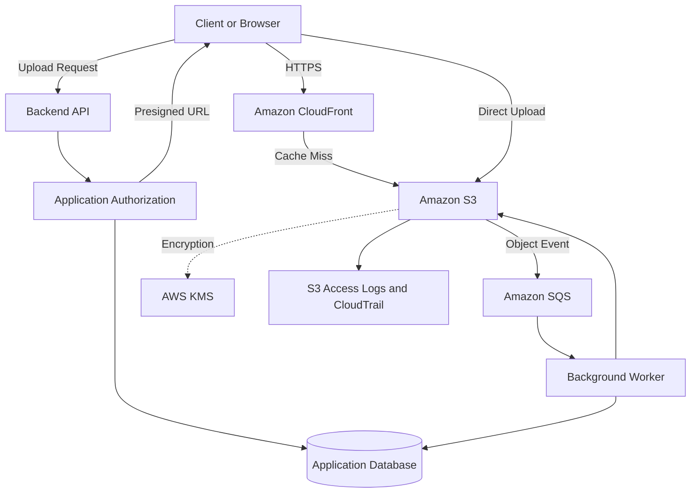

# README

## Overview

Amazon S3 architecture covers the structural patterns, component interactions, and design decisions required to build reliable, secure, and scalable storage systems on Amazon Web Services. It addresses how S3 fits into backend applications as a durable object store, how content is delivered at scale, how uploads and processing pipelines are structured, and how data is protected against loss, disruption, and unauthorized access.

This section of the Backend Engineering Playbook provides a structured reference for designing S3-backed architectures in Python applications, REST APIs, media platforms, SaaS products, data pipelines, and production backend systems.

The focus is on practical architectural engineering: understanding how S3 components interact with compute, delivery, security, and data services, designing for durability and availability, minimizing operational complexity, and building systems that remain maintainable as workloads scale.

## Navigation

| # | File | Description |
|---|---|---|
| 01 | [01- Amazon S3 Global Architecture](./01-%20Amazon%20S3%20Global%20Architecture.md) | S3 as a managed object storage service, global infrastructure, regional boundaries, and integration with application and delivery systems |
| 02 | [02- Static Website Architecture](./02-%20Static%20Website%20Architecture.md) | Hosting static websites on S3 with CloudFront, CDN distribution, custom domains, HTTPS, cache control, and deployment patterns |
| 03 | [03- Media Storage Architecture](./03-%20Media%20Storage%20Architecture.md) | Storing and serving images, video, audio, and derived artifacts at scale with lifecycle management and delivery integration |
| 04 | [04- Image Upload Pipeline Architecture](./04-%20Image%20Upload%20Pipeline%20Architecture.md) | End-to-end image upload pipelines, untrusted content validation, presigned URLs, derivative generation, and authorized delivery |
| 05 | [05- Data Lake Architecture](./05-%20Data%20Lake%20Architecture.md) | Centralized data storage on S3, ingestion patterns, Glue and Athena integration, partitioning strategies, and analytics workflows |
| 06 | [06- Backup and Recovery Architecture](./06-%20Backup%20and%20Recovery%20Architecture.md) | Protecting object data against deletion, ransomware, and regional disruption using versioning, replication, and recovery procedures |
| 07 | [07- SaaS Multi-Tenant Storage Architecture](./07-%20SaaS%20Multi-Tenant%20Storage%20Architecture.md) | Tenant isolation models, per-tenant boundaries, IAM-based authorization, independent retention, and predictable performance |
| 08 | [08- Disaster Recovery Architecture](./08-%20Disaster%20Recovery%20Architecture.md) | DR patterns for S3-backed systems, RTO and RPO targets, cross-region replication, failover procedures, and restoration workflows |

## Why S3 Architecture Matters

Amazon S3 is a foundational storage layer in most backend systems. Treating it as a simple file store without deliberate architectural decisions leads to systems that are difficult to secure, costly to operate, fragile under load, and hard to recover from failure.

Common architectural risks include:

- Public bucket exposure caused by misconfigured access controls or missing Block Public Access settings.
- Authorization bypasses when S3 access is not integrated with application-level identity and authorization.
- Data loss from missing versioning, absent cross-region replication, or unvalidated deletion workflows.
- Uncontrolled storage costs from unbounded object accumulation without lifecycle policies.
- Performance bottlenecks caused by poor prefix design, unthrottled upload concurrency, or missing CDN integration.
- Tightly coupled systems that cannot evolve independently when S3 events, processing pipelines, and application logic are not properly separated.
- Inadequate disaster recovery when backup and failover procedures are untested or assume unrealistic recovery times.

Effective S3 architecture combines a clear object model, deliberate access control, appropriate delivery patterns, durable backup and replication strategies, and operational observability rather than relying on default configurations.

## Documentation Structure

This section is organized into focused architecture documents covering global infrastructure, delivery, upload pipelines, analytics, backup, multi-tenancy, and disaster recovery.

| Area | Primary focus |
|---|---|
| Global architecture | S3 service model, regional storage, data residency, and integration with compute and delivery |
| Static website hosting | S3 and CloudFront for scalable content delivery, HTTPS, custom domains, and CI/CD deployment |
| Media storage | Original and derived media storage, transcoding pipelines, CDN delivery, and lifecycle management |
| Image upload pipeline | Presigned URL upload flows, untrusted content validation, derivative generation, and authorized access |
| Data lake | S3 as a data lake foundation, partitioning, cataloging, transformation, governance, and analytics |
| Backup and recovery | Versioning, cross-region replication, retention, deletion protection, and recovery procedures |
| Multi-tenant storage | Tenant isolation strategies, per-tenant IAM boundaries, storage namespace design, and access enforcement |
| Disaster recovery | DR tiers, RTO and RPO, replication, failover, restoration, and operational readiness |

Each architecture document is intended to be independently maintainable while connecting to the broader S3 and backend engineering model. Shared patterns should be referenced rather than duplicated across documents.

## Core Architectural Principles

### Separate Storage from Application Logic

S3 stores object data. Application logic, metadata, ownership records, workflow state, and business rules belong in the appropriate application layer, not in S3 object structure or bucket configuration alone.

Design the boundary between S3 and application state explicitly. Use a relational database to manage ownership and processing status while using S3 to store the actual object data.

### Authorize at the Application Boundary

S3 bucket policies and IAM roles control which AWS principals can access storage. They do not enforce application-level authorization — which users own which objects, which tenants can read which files, or which operations a given API caller is permitted to perform.

Design authorization explicitly at the application layer. Do not assume that a private bucket alone enforces all necessary access control.

### Design Object Keys Deliberately

Object keys are application identifiers. Define naming conventions that support the required access patterns, authorization boundaries, listing behavior, and lifecycle policies. Avoid using client-provided paths directly as storage keys without validation and normalization.

### Plan for Failure and Recovery

Durability does not replace the need for versioning, replication, backup, and tested recovery procedures. S3 provides high durability within a region, but it does not protect against accidental deletion, application defects, compromised credentials, or regional disruptions without additional controls.

Enable versioning, cross-region replication, and lifecycle policies where appropriate. Test recovery procedures before they are needed.

### Use Lifecycle Policies to Control Cost

Object storage costs accumulate continuously. Design lifecycle policies that transition objects to appropriate storage classes and expire objects that no longer need to be retained. Apply policies at the bucket or prefix level based on the access patterns and retention requirements of each object category.

### Prefer Event-Driven Processing

Decouple S3 storage operations from downstream processing using S3 event notifications, SQS, SNS, or EventBridge. This separation allows storage and processing to scale independently, simplifies retry and error handling, and reduces coupling between system components.

## How the Architecture Components Fit Together

The following diagram illustrates a representative backend architecture using Amazon S3 as the primary storage layer.

The diagram represents logical relationships rather than a complete deployment specification. The exact components depend on the workload, access patterns, data classification, security requirements, and operational model.

## Recommended Design Workflow

Use a repeatable process when designing or reviewing an S3-backed system.

1. **Define the object model.** Determine what objects will be stored, how they will be identified, what metadata they carry, and how they relate to application entities.
2. **Design the key structure.** Establish naming conventions that support the required access patterns, authorization boundaries, listing behavior, and lifecycle policies.
3. **Establish access control boundaries.** Identify which AWS principals and application users need access to which objects. Define bucket policies, IAM roles, and application-level authorization separately.
4. **Select a delivery pattern.** Determine whether objects are served directly from S3, through CloudFront, via presigned URLs, or through application-mediated download endpoints.
5. **Design the upload workflow.** Choose between server-mediated uploads and direct-to-S3 presigned URL uploads based on validation, authorization, and performance requirements.
6. **Plan for processing and events.** Define how object uploads trigger downstream processing and how failures, retries, and partial results are handled.
7. **Establish backup and recovery controls.** Enable versioning, define replication requirements, establish lifecycle policies, and document and test recovery procedures.
8. **Configure observability.** Enable S3 access logging, CloudTrail data events, and CloudWatch metrics for the storage patterns that require monitoring.
9. **Review continuously.** Reassess bucket policies, IAM permissions, public access settings, lifecycle policies, and cost as the system evolves.

## S3 Architecture in Backend Applications

S3 acts as a storage layer that backend services coordinate rather than a service that enforces all application behavior directly.

For Python applications built with Django, Django REST Framework, or FastAPI, the following boundaries apply:

| Layer | Architectural responsibility |
|---|---|
| API edge | Request authentication, authorization decisions, upload coordination, and download access control |
| Application logic | Ownership records, processing state, business rules, and coordination across services |
| S3 storage | Durable object storage, versioning, lifecycle management, and event emission |
| Delivery | CloudFront distribution, signed URLs, cache policies, and geographic availability |
| Processing | Background workers, event-driven pipelines, transformation, and validation |
| Security | IAM roles, bucket policies, encryption, Block Public Access, and audit logging |
| Operations | Lifecycle policies, cost controls, replication health, and recovery readiness |

S3 authorization for an AWS principal does not automatically authorize an application user to access every object in a bucket. Similarly, uploading to a private bucket does not automatically enforce object-level ownership or tenant isolation. Each trust boundary requires explicit design.

## Operational Standards

Apply the following standards when designing and reviewing S3-backed architectures.

- **Access control:** Keep buckets private by default. Apply Block Public Access at the account and bucket level. Use presigned URLs or CloudFront signed behavior to provide controlled access to authorized consumers.
- **Encryption:** Enable server-side encryption for all buckets. Use AWS KMS for workloads with key management, audit, or compliance requirements.
- **Versioning:** Enable versioning on buckets storing application data where accidental deletion or overwrite recovery is required.
- **Replication:** Configure cross-region replication for workloads with disaster recovery, compliance, or geographic availability requirements.
- **Lifecycle policies:** Define transition and expiration rules for every object category. Review and update policies as access patterns and retention requirements evolve.
- **Event processing:** Use SQS, SNS, or EventBridge to decouple storage events from downstream processing. Design for idempotent processing and retry safety.
- **Observability:** Enable S3 server access logging and CloudTrail data events for buckets that require audit evidence or operational monitoring.
- **Cost management:** Monitor storage usage, request volume, and data transfer costs. Use Storage Lens and Cost Explorer to identify optimization opportunities.
- **Recovery testing:** Validate versioning restoration, replication consistency, and backup recovery procedures before relying on them in production.

## Key Takeaways

- S3 architecture requires deliberate decisions about object identity, access control, delivery, processing, durability, and cost — default configurations are insufficient for production workloads.
- Application-level authorization and S3 access control must be designed together but operate independently at their respective trust boundaries.
- Object key design, lifecycle policies, versioning, and replication are foundational to reliable and cost-effective S3-backed systems.
- Event-driven processing, CDN delivery, and presigned URL workflows decouple storage from application logic and allow components to scale independently.
- Backup and disaster recovery require tested procedures, not just enabled features.
