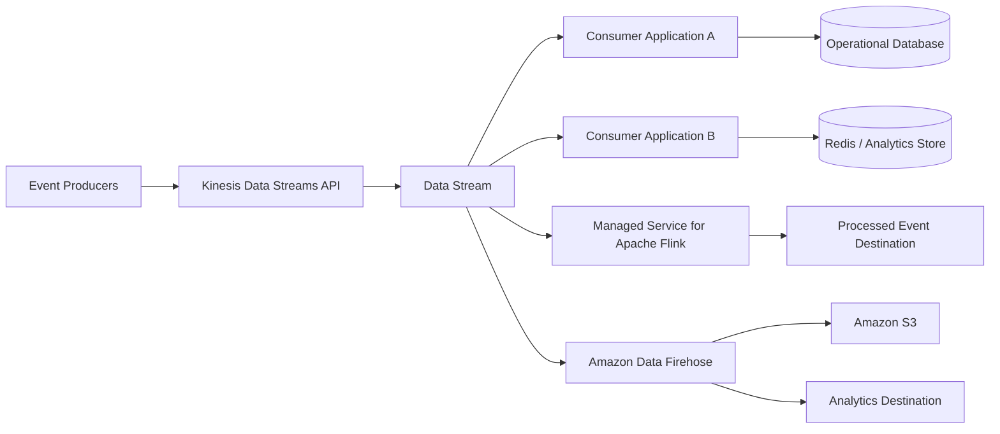
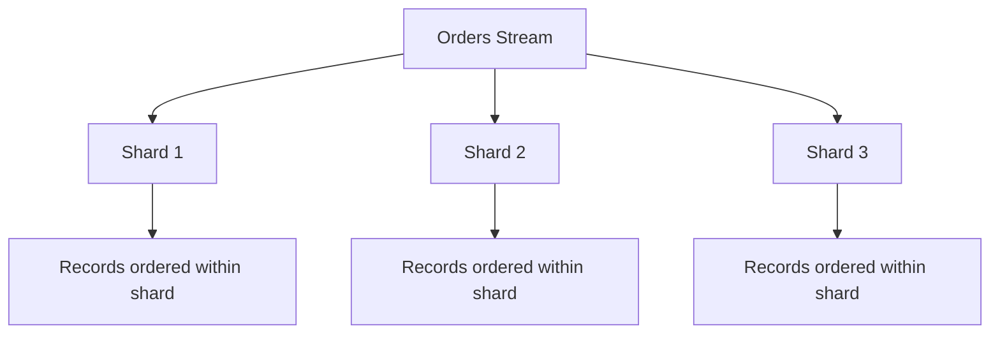
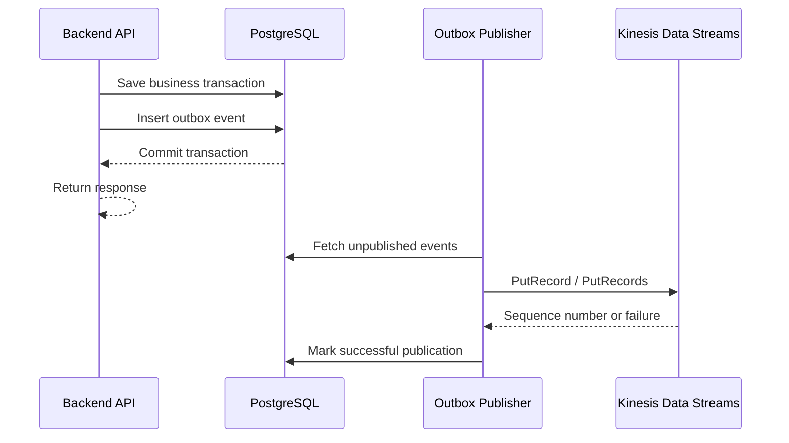
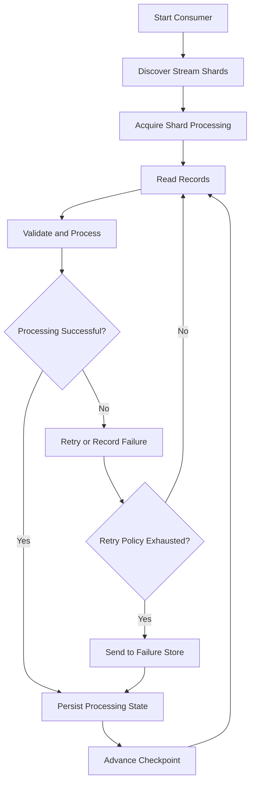
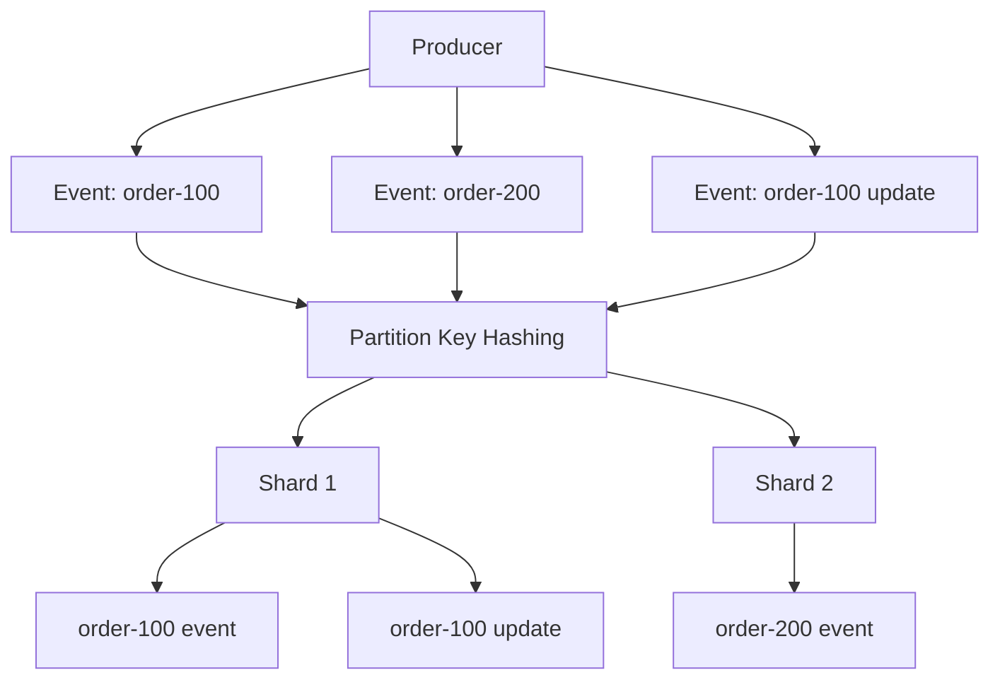
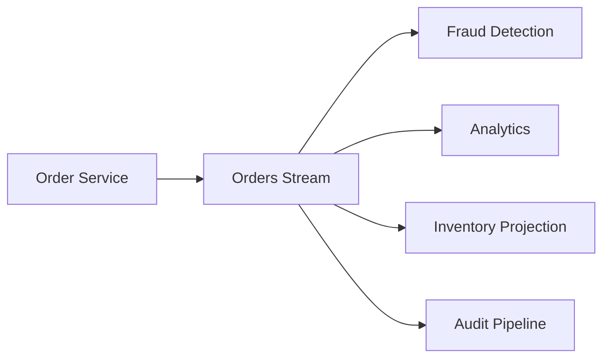
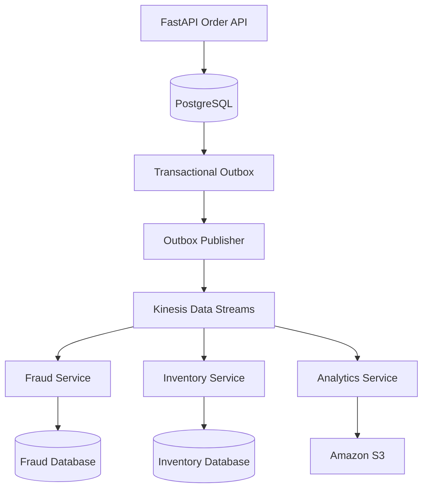

# 01- Core Streaming Architecture

## Overview

Amazon Kinesis is a family of AWS services for collecting, transporting, processing, and delivering streaming data. It supports architectures where applications continuously produce events and downstream systems consume them in near real time.

Unlike traditional request-response communication, streaming architectures process sequences of events over time. Producers publish records continuously, while consumers independently read and process those records according to their own processing requirements.

Amazon Kinesis is commonly used for:

- Application and infrastructure log ingestion.
- Real-time analytics and monitoring.
- Clickstream and user activity processing.
- IoT telemetry collection.
- Event-driven microservice integration.
- Data ingestion into data lakes and analytical platforms.
- Real-time fraud detection and anomaly detection.

Kinesis should be understood as a streaming data architecture rather than simply another messaging queue. Its components provide different capabilities, including durable stream retention, independent consumer processing, managed delivery, and stateful stream processing.

## Streaming Architecture Fundamentals

### What Is Streaming Data?

Streaming data is a continuous sequence of records generated by applications, devices, infrastructure, or external systems.

Examples include:

- An order service publishing order-created events.
- A payment service publishing transaction events.
- An application emitting request latency measurements.
- An IoT device sending temperature readings.
- A web application recording user interactions.

A streaming record typically contains:

| Field | Description |
|---|---|
| Event ID | Unique identifier for the logical event |
| Event type | Type of business or technical event |
| Event timestamp | Time the event occurred |
| Source | Application or system that generated it |
| Payload | Event-specific data |
| Schema version | Version of the event structure |

Example event:

```json
{
  "event_id": "evt-8f12a7",
  "event_type": "order.created",
  "event_timestamp": "2026-11-20T10:30:00Z",
  "source": "order-service",
  "schema_version": 1,
  "payload": {
    "order_id": "ord-1024",
    "customer_id": "cust-501",
    "amount": 1499.00,
    "currency": "INR"
  }
}
```

A streaming system must handle continuous ingestion, buffering, partitioning, consumer coordination, processing failures, and recovery.

### Streaming vs Traditional Messaging

Traditional messaging systems often focus on delivering messages to consumers. Streaming platforms additionally provide retained event logs that consumers can read independently.

| Characteristic | Traditional Queue | Streaming Platform |
|---|---|---|
| Primary model | Message delivery | Retained event log |
| Consumption | Usually competing consumers | Independent consumer applications |
| Message retention | Often until consumed or expired | Configurable retention |
| Replay | Often limited or unavailable after acknowledgment | Supported within retention |
| Consumer position | Usually managed through acknowledgment | Managed through sequence positions or checkpoints |
| Typical workload | Background jobs and task distribution | Continuous event ingestion and processing |
| Example | Amazon SQS | Amazon Kinesis Data Streams |

The distinction is architectural rather than absolute. Queues and streams can both support asynchronous processing, but they have different consumption and replay models.

### Why Streaming Architecture Exists

A synchronous architecture couples the producer to downstream processing.

For example, an order API might synchronously call inventory, analytics, notification, and reporting services. A slow downstream dependency can increase request latency or cause the entire operation to fail.

A streaming architecture separates event production from downstream consumption.

The order service publishes an event. Independent consumers process that event at their own pace.

This provides:

- Reduced coupling between services.
- Independent scaling of producers and consumers.
- Replay and recovery from retained records.
- Multiple downstream processing paths.
- Better support for continuous data processing.
- Isolation between ingestion and analytical workloads.

Streaming does not eliminate distributed-system complexity. It moves some of that complexity into partitioning, consumer progress, duplicate handling, event ordering, and recovery.

## Core Kinesis Architecture

Amazon Kinesis includes multiple services with different responsibilities.

| Service | Primary responsibility | Typical use |
|---|---|---|
| Amazon Kinesis Data Streams | Durable, partitioned streaming ingestion | Custom real-time event processing |
| Amazon Data Firehose | Managed delivery of streaming data to destinations | Loading data into S3 and analytics services |
| Amazon Managed Service for Apache Flink | Stateful stream processing | Real-time transformations, aggregations, and analytics |

Kinesis Data Streams is the core retained streaming layer. Data Firehose and Managed Service for Apache Flink solve different downstream processing and delivery problems.

### High-Level Architecture



A typical architecture contains the following stages:

1. Producers generate events.
2. Events are published to a Kinesis Data Stream.
3. The stream stores records in shards.
4. Consumer applications independently read records.
5. Consumers process, transform, aggregate, or forward events.
6. Processed data is delivered to databases, data lakes, search systems, or analytical platforms.

The producer does not need to know which downstream consumers exist. New consumers can be introduced without changing the producer, provided they have the required permissions and access to the stream.

## Kinesis Data Streams

### Core Concept

Amazon Kinesis Data Streams is a managed service for collecting and storing real-time streaming records.

A stream is a durable sequence of records distributed across one or more shards.

Producers write records into the stream. Consumers read records using APIs or enhanced fan-out subscriptions.

Records remain available for a configurable retention period, allowing consumers to process them independently and recover from interruptions.

### Why It Exists

Without a retained streaming layer, producers and consumers must coordinate closely.

If a consumer becomes unavailable, a direct delivery architecture may lose events or require the producer to maintain its own retry and buffering mechanisms.

Kinesis Data Streams provides:

- Durable record storage within the configured retention period.
- Partitioned ingestion and consumption.
- Independent consumer progress.
- Multiple consumer applications.
- Replay using sequence positions.
- Horizontal scaling through shard capacity or supported on-demand capacity modes.

### Stream and Record Model

A Kinesis stream contains records. Each record includes:

- Partition key.
- Data payload.
- Sequence number.
- Optional encryption and service-managed metadata.

The partition key determines which shard receives the record.

The sequence number identifies the record's position within the shard.



Ordering is guaranteed within a shard, not globally across the entire stream.

Records with the same partition key are routed to the same shard while the partitioning configuration remains applicable. This makes partition-key selection an important architectural decision.

### Shards

A shard is the fundamental unit of capacity and parallelism in a provisioned Kinesis Data Stream.

Each shard provides bounded ingestion and retrieval capacity. The commonly documented provisioned-mode limits include:

| Operation | Per-shard capacity |
|---|---:|
| Write throughput | Up to 1 MB/s or 1,000 records/s |
| Shared `GetRecords` read throughput | Up to 2 MB/s |
| Shared `GetRecords` transactions | Up to 5 transactions/s |

These limits are subject to service quotas and may change. Validate the current regional quotas and the selected stream capacity mode before deployment.

A stream with multiple shards distributes records across those shards.

For example, a stream with four evenly utilized provisioned shards has a theoretical aggregate write capacity of up to:

- 4 MB/s.
- 4,000 records/s.

Actual throughput depends on record sizes, partition-key distribution, API usage, throttling, and other service constraints.

### Partition Keys

A partition key is a string supplied by the producer when publishing a record.

Kinesis hashes the partition key and maps it to a shard.

Example:

```python
import json

import boto3

kinesis = boto3.client("kinesis", region_name="ap-south-1")


def publish_order_event(
    stream_name: str,
    order_id: str,
    event: dict,
) -> dict:
    response = kinesis.put_record(
        StreamName=stream_name,
        PartitionKey=order_id,
        Data=json.dumps(event).encode("utf-8"),
    )

    return {
        "shard_id": response["ShardId"],
        "sequence_number": response["SequenceNumber"],
    }
```

Using `order_id` as the partition key ensures that events for the same order are routed consistently to the same shard under the active partitioning configuration.

Partition-key selection involves a trade-off:

| Partition key | Benefit | Risk |
|---|---|---|
| Customer ID | Preserves customer-level ordering | Large customers may create hot keys |
| Order ID | Distributes independent orders | Does not preserve global ordering |
| Device ID | Preserves device-level ordering | High-volume devices may overload a shard |
| Random identifier | Distributes writes broadly | Does not preserve entity-level ordering |

A partition key should represent the smallest business entity for which ordering is required, while still distributing traffic sufficiently across the stream.

Avoid using a constant partition key for a high-volume stream. It can concentrate traffic on a single shard and create a hot-shard bottleneck.

## Producer Architecture

### Producer Responsibilities

A producer is any application or service that writes records into a Kinesis Data Stream.

Typical producers include:

- Python backend services.
- Django and FastAPI applications.
- Microservices.
- IoT gateways.
- Log collectors.
- Data ingestion applications.
- Third-party integrations.

A producer should handle:

1. Event construction.
2. Schema validation.
3. Event identification.
4. Partition-key selection.
5. Serialization.
6. Publishing.
7. Retry and error handling.
8. Publication observability.

### Producer Request Lifecycle



For business-critical events, the transactional outbox pattern prevents a database transaction from committing while the corresponding event publication intent is lost.

The application writes both the business change and an outbox record in the same database transaction. A separate publisher delivers pending events to Kinesis.

Publishing to Kinesis and updating PostgreSQL are not one atomic transaction. If the publisher crashes after Kinesis accepts a record but before the outbox row is marked as published, it may publish the same logical event again.

Use a stable event ID and idempotent downstream processing.

### Batch Publishing

`PutRecords` allows producers to submit multiple records in a single API request.

Batch publishing reduces request overhead and can improve ingestion efficiency.

```python
import json
import boto3
from botocore.exceptions import BotoCoreError, ClientError

kinesis = boto3.client("kinesis", region_name="ap-south-1")


def publish_batch(stream_name: str, events: list[dict]) -> None:
    records = [
        {
            "Data": json.dumps(event).encode("utf-8"),
            "PartitionKey": event["order_id"],
        }
        for event in events
    ]

    try:
        response = kinesis.put_records(
            StreamName=stream_name,
            Records=records,
        )
    except (ClientError, BotoCoreError):
        raise

    failed_count = response["FailedRecordCount"]

    if failed_count:
        for index, record_result in enumerate(response["Records"]):
            if "ErrorCode" in record_result:
                print(
                    "Record failed:",
                    index,
                    record_result["ErrorCode"],
                    record_result.get("ErrorMessage"),
                )
```

Important considerations:

- `PutRecords` accepts up to 500 records per request.
- A successful HTTP response does not mean every record was accepted.
- Inspect `FailedRecordCount` and individual record results.
- Retry only failed records.
- Use bounded exponential backoff with jitter.
- Preserve partition keys during retries.
- Avoid unbounded retry loops.

Unlike a transactional batch operation, `PutRecords` can partially succeed.

A retry can also affect ordering. If ordering matters for an entity, use an appropriate publishing strategy and account for the fact that a failed record may be retried after later records have been accepted.

### Producer Reliability

Production producers should implement:

- Stable event IDs.
- Explicit schema versions.
- Input validation.
- Bounded retries.
- Exponential backoff and jitter.
- Failed-record tracking.
- Request and record-level metrics.
- Durable buffering or an outbox for critical events.

Do not treat a successful network response as proof that every downstream consumer has processed the event.

## Consumer Architecture

### Consumer Responsibilities

A consumer reads records from a Kinesis stream and performs downstream processing.

Typical consumer operations include:

- Parsing and validating event payloads.
- Applying business rules.
- Updating databases.
- Publishing derived events.
- Aggregating metrics.
- Loading data into analytical systems.
- Forwarding records to external services.

Consumers operate independently. Multiple applications can process the same stream without competing for a single shared message acknowledgment.

### Consumer Lifecycle



The consumer must track its progress so that it can resume after a restart.

A checkpoint represents the consumer's durable processing position.

For applications using the Kinesis Client Library (KCL), checkpointing and shard coordination are managed through the library's processing model and lease infrastructure.

For custom consumers, the application must implement shard discovery, record retrieval, checkpoint persistence, and recovery correctly.

### Consumer Processing Guarantees

Kinesis does not automatically provide exactly-once execution of arbitrary consumer business logic.

A consumer can process a record and crash before saving its checkpoint. After restart, the record may be read and processed again.

This is an at-least-once processing scenario.

Use idempotency to prevent duplicate business effects.

Example:

```python
def process_order_event(event: dict, repository) -> None:
    event_id = event["event_id"]

    if repository.is_event_processed(event_id):
        return

    with repository.transaction():
        repository.apply_order_event(event)
        repository.mark_event_processed(event_id)
```

The business update and processed-event marker should be committed atomically when they share a transactional database.

For external side effects, such as sending an email or calling a payment provider, use an idempotency key supported by the destination or a durable workflow that can reconcile uncertain outcomes.

### Consumer Scaling

Consumer throughput depends on:

- Number of shards.
- Number of consumer applications.
- Consumer read mode.
- Processing latency.
- Downstream system capacity.
- Partition-key distribution.
- Batch size and processing concurrency.

Increasing the number of consumer processes does not automatically increase throughput for every read mode.

With shared `GetRecords` reads, consumers share shard read capacity. Enhanced fan-out provides dedicated read throughput per registered consumer per shard.

## Data Flow and Ordering

### Record Distribution

A producer supplies a partition key. Kinesis hashes the key and routes the record to a shard.

Each shard maintains its own ordered sequence of records.



The diagram illustrates the intended routing relationship. Actual shard assignment depends on the partition-key hash ranges and current shard layout.

### Ordering Guarantees

Kinesis provides ordering within a shard.

It does not provide a single global ordering guarantee across all shards.

If events for the same business entity must be processed in order:

- Use a stable partition key based on that entity.
- Ensure consumers process records in shard order.
- Avoid parallel processing that reorders dependent records.
- Account for retries and duplicate records.
- Handle shard splits and merges during resharding.

A common mistake is to assume that timestamps establish ordering. Event timestamps can be equal, delayed, generated by unsynchronized clocks, or arrive out of order.

Use sequence positions for stream ordering and event timestamps for business-time interpretation.

## Retention and Replay

### Record Retention

Kinesis Data Streams retains records for a configurable period.

The default retention period is 24 hours. Retention can be extended up to 365 days, subject to service configuration and pricing.

Retention allows consumers to:

- Recover after outages.
- Reprocess historical records.
- Rebuild derived data.
- Run new consumer applications against existing data.
- Investigate incidents using retained events.

Retention is not equivalent to permanent storage. Once records expire, they are no longer available from the stream.

For long-term archival and replay, consider delivering records to Amazon S3.

### Replay Architecture

A consumer can start reading from supported positions, such as:

- `TRIM_HORIZON`: earliest available record.
- `LATEST`: records arriving after the consumer begins reading.
- `AT_TIMESTAMP`: records at or after a specified timestamp.
- `AFTER_SEQUENCE_NUMBER`: records after a specified sequence number.
- `AT_SEQUENCE_NUMBER`: a specified sequence number.

Example:

```python
response = kinesis.get_shard_iterator(
    StreamName="orders-stream",
    ShardId="shardId-000000000000",
    ShardIteratorType="TRIM_HORIZON",
)

shard_iterator = response["ShardIterator"]
```

Replay should be treated as a controlled operational activity.

Before replaying:

- Confirm the target consumer and destination.
- Check whether downstream writes are idempotent.
- Avoid overwriting newer state with stale events.
- Estimate the volume and processing time.
- Monitor consumer lag and downstream capacity.
- Use a separate consumer application or isolated destination when necessary.

## Stream Processing Patterns

Streaming architectures commonly use several processing patterns.

### Event Enrichment

A consumer enriches incoming records with data from another system.

Example:

- An order event contains a customer ID.
- A consumer retrieves customer attributes.
- The consumer publishes an enriched event.

External lookups can increase latency and introduce dependencies. Cache frequently used reference data where appropriate, and avoid making an external API call for every record if the processing volume is high.

### Filtering

Consumers select records relevant to their responsibility.

For example:

- Fraud detection processes payment events.
- Analytics processes clickstream events.
- Inventory processing handles order and stock events.

Filtering in the consumer allows independent processing logic, but all records still consume stream read capacity.

### Aggregation

A consumer groups records over a time window.

Examples:

- Orders per minute.
- Revenue per region.
- Average request latency.
- Device temperature averages.

Stateful aggregation requires tracking intermediate state and defining how late or out-of-order events are handled.

Amazon Managed Service for Apache Flink provides managed stateful stream processing capabilities for these workloads.

### Fan-Out

A single stream can support multiple independent consumers.



This architecture allows new consumers to be introduced without modifying the producer.

However, every consumer introduces additional read capacity, processing cost, and operational responsibility.

## Consumer Read Models

Kinesis Data Streams supports shared-throughput consumption and enhanced fan-out.

| Capability | Shared `GetRecords` | Enhanced Fan-Out |
|---|---|---|
| Read mechanism | Polling | `SubscribeToShard` |
| Transport | API requests | HTTP/2 streaming |
| Read throughput | Shared per shard | Dedicated per registered consumer per shard |
| Consumer isolation | Limited by shared capacity | Better isolation |
| Typical use | Small number of consumers | Multiple high-throughput consumers |
| Operational complexity | Lower | Requires registered consumer management |

Enhanced fan-out provides up to 2 MB/s per shard per registered consumer.

Use shared reads when consumer count and throughput are modest. Consider enhanced fan-out when independent consumers need predictable read capacity and shared throughput becomes a bottleneck.

## Kinesis and Backend Microservices

### Event-Driven Microservice Architecture

Kinesis can decouple backend services that produce and consume high-volume event streams.

Example:



The order API does not synchronously call every downstream service.

Instead:

1. The API commits the order and an outbox event.
2. A publisher sends the event to Kinesis.
3. Independent consumers process the event.
4. Each consumer updates its own database or downstream system.
5. Consumers maintain their own processing progress.

This design supports independent deployment and scaling.

It also introduces eventual consistency. An order can be committed before inventory or analytics projections are updated.

Applications must distinguish between the successful creation of a business transaction and the eventual completion of downstream processing.

### Kinesis vs Kafka

Kinesis and Apache Kafka both support partitioned event streaming, but their operational models differ.

| Area | Kinesis Data Streams | Apache Kafka |
|---|---|---|
| Infrastructure | AWS-managed service | Self-managed or managed Kafka |
| Partitioning | Shards | Partitions |
| Ordering | Within a shard | Within a partition |
| Retention | Configurable stream retention | Configurable topic retention |
| Consumer coordination | KCL or custom application logic | Consumer groups and offsets |
| Scaling | Shard scaling or on-demand capacity | Partition and broker scaling |
| AWS integration | Native AWS integrations | Requires Kafka deployment or managed service |
| Portability | AWS-specific APIs | Broad ecosystem and deployment choices |

Choose Kinesis when AWS-native integration and managed operations fit the architecture.

Choose Kafka when its ecosystem, portability, protocol compatibility, or Kafka-specific capabilities are important requirements.

Do not select a streaming platform based only on theoretical throughput. Evaluate partitioning, operational expertise, consumer behavior, retention, cost, and failure recovery.

## Reliability and Failure Handling

### Producer Failures

Common producer failures include:

- Network timeouts.
- Throttling.
- Invalid records.
- Authorization failures.
- Service-side errors.
- Partial batch failures.

Recommended handling:

- Retry transient failures with exponential backoff and jitter.
- Do not retry permanent validation or authorization errors indefinitely.
- Track failed records.
- Persist critical publication intent in an outbox.
- Use stable event IDs.
- Alert on sustained publication failures.

A timeout can produce an ambiguous outcome: the service may have accepted the record even though the producer did not receive the response.

Retrying may therefore create duplicate logical events. Consumers should be idempotent.

### Consumer Failures

Consumer failures include:

- Application crashes.
- Invalid event payloads.
- Database outages.
- Downstream API failures.
- Processing timeouts.
- Checkpoint persistence failures.

Use a bounded retry policy and isolate poison records.

For permanently invalid records, persist the original payload, event ID, failure reason, and processing metadata in a durable failure store such as S3 or a dedicated database table.

Avoid silently skipping records. A skipped record can create inconsistent downstream state.

### Shard-Level Failures

Shard scaling and resharding change the stream's shard topology.

Consumers must handle:

- New shards.
- Closed parent shards.
- Child shard discovery.
- Shard ownership changes.
- Checkpoint recovery.

KCL provides shard coordination and lease management. Custom consumers must implement equivalent lifecycle handling.

## Security Architecture

### Encryption

Kinesis Data Streams supports server-side encryption using AWS KMS.

Encryption protects records at rest. Producers and consumers still need appropriate IAM permissions to write and read records.

Use least-privilege IAM policies.

Example producer policy:

```json
{
  "Version": "2012-10-17",
  "Statement": [
    {
      "Effect": "Allow",
      "Action": [
        "kinesis:PutRecord",
        "kinesis:PutRecords"
      ],
      "Resource": "arn:aws:kinesis:ap-south-1:123456789012:stream/orders-stream"
    }
  ]
}
```

A consumer should receive only the read actions it requires.

For enhanced fan-out, permissions may also be needed for registered consumer operations and subscription access.

### Network Security

For private workloads:

- Use VPC endpoints for supported Kinesis API access.
- Keep application traffic within private network paths where appropriate.
- Restrict endpoint policies.
- Avoid embedding AWS credentials in application images.
- Use IAM roles for workloads running on EC2, ECS, or EKS.

### Data Protection

Streaming payloads may contain customer or business information.

Apply:

- Data minimization.
- Schema validation.
- Sensitive-field masking where required.
- Appropriate retention periods.
- Restricted consumer access.
- Audit logging.
- Encryption in transit and at rest.

Avoid logging complete event payloads when they contain credentials, payment information, or personal data.

## Monitoring and Observability

Streaming systems require visibility into ingestion, processing progress, and downstream health.

### Important CloudWatch Metrics

| Metric | What it indicates | Operational use |
|---|---|---|
| `IncomingBytes` | Data ingested | Capacity planning |
| `IncomingRecords` | Record ingestion rate | Traffic monitoring |
| `WriteProvisionedThroughputExceeded` | Write throttling | Partition and capacity investigation |
| `ReadProvisionedThroughputExceeded` | Read throttling | Consumer capacity investigation |
| `GetRecords.IteratorAgeMilliseconds` | Age of records returned by `GetRecords` | Consumer lag monitoring |
| `ReadProvisionedThroughputExceeded` | Shared read capacity exceeded | Evaluate read distribution or EFO |
| `PutRecord.Success` | Successful single-record writes | Producer reliability |
| `PutRecords.Success` | Successful batch writes | Batch publishing reliability |

Metric availability and dimensions depend on the API, consumer type, and monitoring configuration. Use the relevant enhanced monitoring metrics for the selected consumption model.

### Consumer Lag

Consumer lag measures how far behind a consumer is from the latest records in the stream.

High lag can indicate:

- Insufficient consumer processing capacity.
- Slow database writes.
- Downstream API latency.
- Hot shards.
- Excessive retries.
- Consumer application failures.

Monitor lag per shard where possible. A stream-wide average can hide a single overloaded shard.

### Application-Level Metrics

CloudWatch service metrics are not sufficient to explain business processing health.

Instrument:

- Events received.
- Events successfully processed.
- Events rejected.
- Duplicate events detected.
- Processing latency.
- Checkpoint age.
- Retry count.
- Failure-store writes.
- Downstream dependency latency.

Use structured logs containing `event_id`, `event_type`, `shard_id`, and processing outcome. Avoid logging sensitive payload fields.

## Scalability and Capacity Planning

### Provisioned Capacity

In provisioned mode, shard count determines the stream's capacity.

A rough initial estimate can be calculated from expected write throughput:

```text
Required shards =
    max(
        ceil(total write bytes per second / 1 MB),
        ceil(total records per second / 1,000)
    )
```

This is a simplified estimate for provisioned write capacity. Account for read throughput, uneven partition-key distribution, burst traffic, record-size limits, and safety headroom.

For example, if a workload produces:

- 3 MB/s of data.
- 2,000 records/s.

The theoretical minimum is three shards based on byte throughput and two shards based on record throughput. The initial estimate is therefore three shards, before adding operational headroom.

### On-Demand Capacity

On-demand mode reduces the need to manage shard count directly.

It is useful when traffic is variable or capacity planning is difficult. It does not eliminate partition-key design, service quotas, or hot-shard considerations.

Validate scaling behavior and applicable capacity limits for the selected stream mode.

### Hot Shards

A hot shard receives disproportionately high traffic.

Common causes include:

- A constant partition key.
- A small number of highly active customers.
- Uneven device activity.
- A partitioning strategy that does not match workload distribution.

Mitigation strategies:

- Use high-cardinality partition keys.
- Introduce controlled key sharding where ordering requirements permit.
- Separate unusually high-volume workloads.
- Monitor per-shard throughput.
- Reshard or adjust capacity when appropriate.

Adding shards alone does not necessarily resolve a hot partition key. The partitioning strategy must distribute traffic.

## Cost Considerations

Kinesis costs depend on the selected capacity mode and enabled features.

Relevant cost drivers include:

- Provisioned shard capacity or on-demand ingestion and retrieval.
- Extended data retention.
- Enhanced fan-out consumers.
- PUT payload unit usage where applicable.
- Data transfer.
- AWS KMS requests and key usage.
- Downstream services such as Firehose, S3, and Managed Service for Apache Flink.

Cost optimization recommendations:

- Select a suitable capacity mode for traffic patterns.
- Avoid unnecessary enhanced fan-out consumers.
- Use batching where appropriate.
- Set retention based on actual recovery requirements.
- Archive long-term data to S3 when appropriate.
- Monitor ingestion and consumer utilization.
- Remove unused streams and registered consumers.

Do not reduce retention without validating replay and recovery requirements.

## Deployment and Infrastructure as Code

A production stream should be created and managed through infrastructure as code.

Example Terraform configuration:

```hcl
resource "aws_kinesis_stream" "orders" {
  name             = "orders-stream"
  retention_period = 168

  stream_mode_details {
    stream_mode = "PROVISIONED"
  }

  shard_count = 4

  encryption_type = "KMS"
  kms_key_id      = aws_kms_key.kinesis.arn

  tags = {
    Environment = "production"
    Application = "order-platform"
    ManagedBy   = "terraform"
  }
}
```

This example configures a provisioned stream with four shards and seven days of retention.

The KMS key must be defined separately with an appropriate key policy and permissions for the producer and consumer roles.

Production deployment practices:

- Keep stream configuration in version control.
- Separate development, staging, and production streams.
- Use environment-specific IAM roles.
- Enable encryption.
- Define retention explicitly.
- Configure CloudWatch alarms.
- Review shard capacity and partition-key distribution.
- Test consumer recovery and replay before production rollout.

## Common Engineering Mistakes

| Mistake | Why it is problematic | Recommended approach |
|---|---|---|
| Using a constant partition key | Concentrates traffic on a small number of shards | Choose high-cardinality keys |
| Assuming global ordering | Ordering is only guaranteed within a shard | Partition by the entity requiring ordering |
| Treating Kinesis as a task queue | Consumers have independent positions and retained records | Use SQS for competing task-consumer workloads when appropriate |
| Ignoring partial batch failures | Some records may fail even when the API request succeeds | Inspect every `PutRecords` result |
| Assuming exactly-once processing | Consumer retries can repeat business operations | Implement idempotent processing |
| Checkpointing before durable processing | A crash can permanently skip uncommitted work | Commit effects before advancing checkpoints |
| Adding consumers without capacity planning | Shared read throughput can become a bottleneck | Evaluate enhanced fan-out |
| Ignoring hot shards | Aggregate capacity can hide partition-level bottlenecks | Monitor shard-level metrics |
| Treating retention as archival | Expired records cannot be replayed from the stream | Archive important events to S3 |
| Replaying into production without safeguards | Old events can repeat or overwrite newer state | Use idempotency and controlled replay procedures |

## Production Architecture Checklist

### Event Design

- [ ] Every business event has a stable event ID.
- [ ] Event schemas are versioned.
- [ ] Partition keys reflect ordering requirements.
- [ ] Payloads avoid unnecessary sensitive data.
- [ ] Producers validate event structure before publishing.

### Producer Reliability

- [ ] Critical publication uses a transactional outbox or equivalent durable mechanism.
- [ ] Transient failures use bounded retries with jitter.
- [ ] `PutRecords` partial failures are handled individually.
- [ ] Ambiguous publication outcomes are safe to retry.
- [ ] Failed events are observable and recoverable.

### Consumer Reliability

- [ ] Consumers are idempotent.
- [ ] Checkpoints advance only after durable processing.
- [ ] Shard lifecycle changes are handled.
- [ ] Poison records have a failure-handling strategy.
- [ ] Replay procedures are documented and tested.

### Operations and Security

- [ ] Encryption at rest and in transit is configured.
- [ ] IAM policies follow least privilege.
- [ ] Consumer lag and shard throttling are monitored.
- [ ] Alarms cover ingestion and processing failures.
- [ ] Retention matches recovery requirements.
- [ ] Capacity and cost are reviewed regularly.

## Key Takeaways

- Amazon Kinesis Data Streams provides a durable, partitioned event log for continuous ingestion and independent consumer processing.
- Shards define capacity and parallelism; partition-key design determines data distribution and entity-level ordering.
- Kinesis guarantees ordering within a shard, not globally across the stream.
- Producers and consumers must handle partial failures, duplicate processing, retries, and checkpoint recovery.
- Production streaming systems require deliberate capacity planning, idempotency, observability, security, and replay strategies.