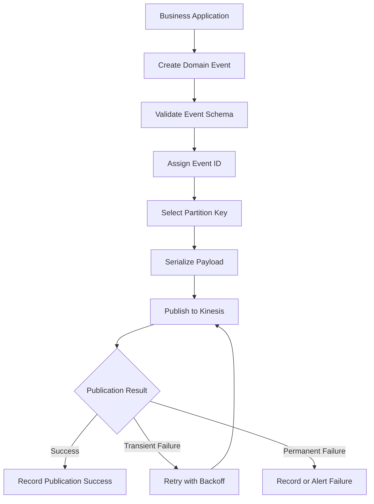
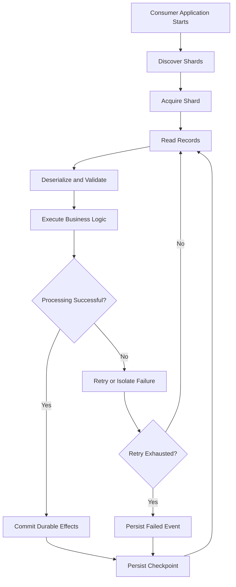
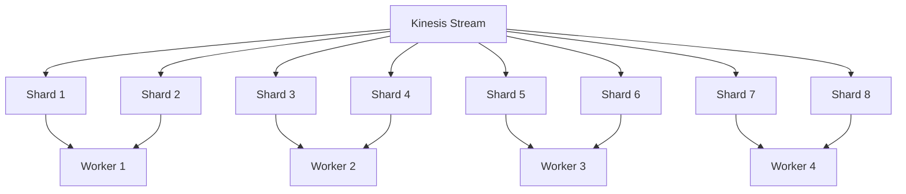
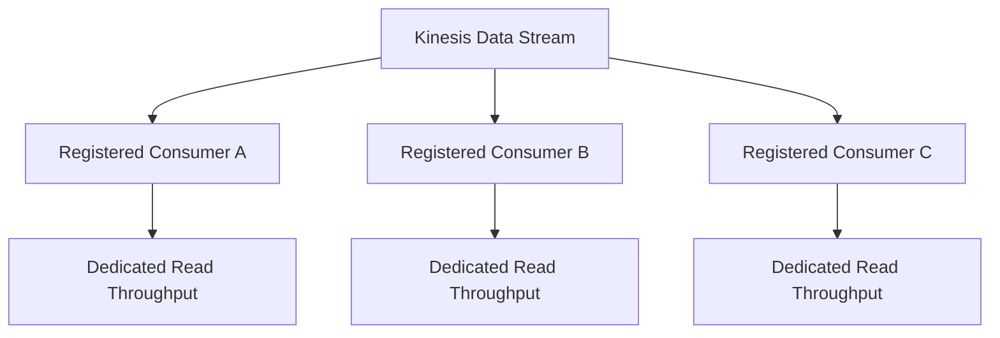
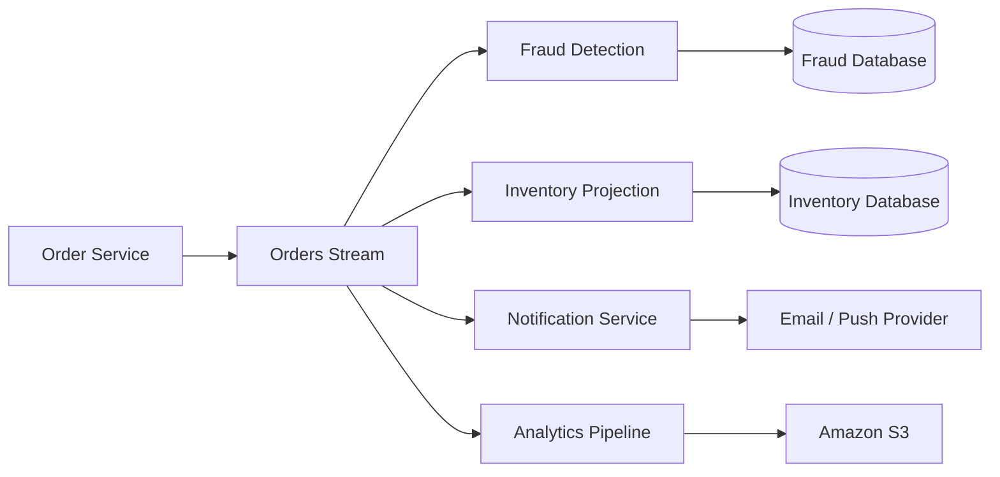
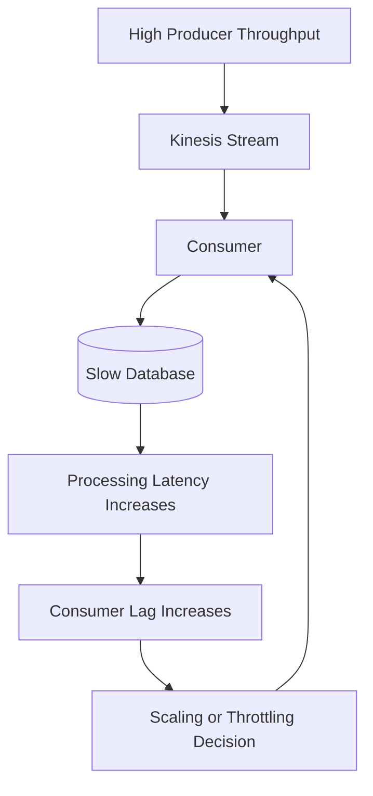
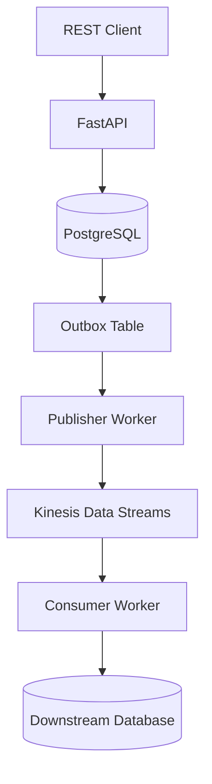

# 02- Producer-Consumer Architecture

## Overview

The producer-consumer architecture is the foundation of applications built on Amazon Kinesis Data Streams. Producers continuously publish records into a stream, while independent consumer applications read and process those records.

This architecture separates event generation from event processing. Producers do not need to know which applications consume their events, and consumers can operate independently with their own processing logic, scaling strategy, and recovery position.

In backend systems, this model is useful for:

- Decoupling microservices through asynchronous event distribution.
- Processing high-volume application and infrastructure events.
- Building real-time analytics and monitoring pipelines.
- Distributing business events to multiple downstream systems.
- Supporting independent consumer deployment and scaling.
- Reprocessing retained records after failures or application changes.

A production implementation must account for more than publishing and reading records. Partition-key selection, producer retries, consumer coordination, checkpointing, idempotency, backpressure, and downstream reliability determine whether the architecture remains correct under failure.

## Producer Architecture

### Producer Responsibilities

A producer is an application or service that writes records to a Kinesis Data Stream.

Typical producers include:

- Django and FastAPI applications.
- Backend microservices.
- Event collection agents.
- IoT gateways.
- Log aggregation systems.
- Data ingestion applications.
- Batch processing jobs.

The producer is responsible for constructing valid events, selecting partition keys, serializing payloads, publishing records, and handling publication failures.

A well-designed producer should not contain downstream consumer-specific business logic.

### Producer Data Flow



The producer should create a stable event before attempting publication. If a request times out and must be retried, the logical event ID should remain unchanged.

### Event Structure

Use a consistent event envelope across services.

```json
{
  "event_id": "evt-8f12a7",
  "event_type": "order.created",
  "event_version": 1,
  "occurred_at": "2026-11-20T10:30:00Z",
  "producer": "order-service",
  "partition_key": "ord-1024",
  "payload": {
    "order_id": "ord-1024",
    "customer_id": "cust-501",
    "amount": 1499.00,
    "currency": "INR"
  }
}
```

The envelope provides information needed for routing, validation, observability, and idempotent processing.

| Field | Purpose |
|---|---|
| `event_id` | Stable identifier for duplicate detection |
| `event_type` | Identifies the business event |
| `event_version` | Supports schema evolution |
| `occurred_at` | Records the business event time |
| `producer` | Identifies the originating service |
| `payload` | Contains event-specific data |

The Kinesis partition key is supplied separately in the `PutRecord` or `PutRecords` request. Including it in the payload can be useful for auditing, but the stream does not automatically derive its partition key from the payload.

### Publishing a Single Record

Boto3 provides the `put_record` API for publishing one record.

```python
import json

import boto3
from botocore.exceptions import BotoCoreError, ClientError


class KinesisProducer:
    def __init__(self, stream_name: str, region_name: str) -> None:
        self.stream_name = stream_name
        self.client = boto3.client(
            "kinesis",
            region_name=region_name,
        )

    def publish(self, event: dict, partition_key: str) -> dict:
        try:
            response = self.client.put_record(
                StreamName=self.stream_name,
                PartitionKey=partition_key,
                Data=json.dumps(event).encode("utf-8"),
            )
        except (ClientError, BotoCoreError):
            raise

        return {
            "shard_id": response["ShardId"],
            "sequence_number": response["SequenceNumber"],
        }
```

The response includes the shard ID and sequence number assigned to the record.

These values are useful for diagnostics and stream-position tracking. They should not be treated as globally ordered identifiers across all shards.

### Publishing Multiple Records

For higher-volume workloads, `PutRecords` reduces the number of API requests.

```python
import json

import boto3
from botocore.exceptions import BotoCoreError, ClientError


class BatchKinesisProducer:
    def __init__(self, stream_name: str, region_name: str) -> None:
        self.stream_name = stream_name
        self.client = boto3.client(
            "kinesis",
            region_name=region_name,
        )

    def publish_batch(self, events: list[dict]) -> list[dict]:
        records = [
            {
                "Data": json.dumps(event).encode("utf-8"),
                "PartitionKey": event["order_id"],
            }
            for event in events
        ]

        try:
            response = self.client.put_records(
                StreamName=self.stream_name,
                Records=records,
            )
        except (ClientError, BotoCoreError):
            raise

        failures = []

        for index, result in enumerate(response["Records"]):
            if "ErrorCode" in result:
                failures.append({
                    "index": index,
                    "error_code": result["ErrorCode"],
                    "error_message": result.get("ErrorMessage"),
                    "event_id": events[index]["event_id"],
                })

        return failures
```

Important characteristics of `PutRecords`:

- A request can contain up to 500 records.
- A request can partially succeed.
- Individual records have independent results.
- `FailedRecordCount` indicates how many records failed.
- Failed records should be retried selectively.
- A successful request does not imply that every record was accepted.

Do not retry the entire batch blindly. Successful records may already exist in the stream.

### Retry Strategy

Transient failures can occur because of throttling, temporary service errors, or network problems.

A producer should use bounded exponential backoff with jitter.

A typical delay calculation is:

\[
delay = \min(maxDelay,\ baseDelay \times 2^{attempt}) + jitter
\]

The retry policy should distinguish between transient and permanent errors.

| Failure | Recommended handling |
|---|---|
| Provisioned throughput exceeded | Retry with backoff and investigate capacity |
| Temporary service error | Retry with bounded backoff |
| Network timeout | Treat outcome as potentially ambiguous |
| Invalid record | Reject and report |
| Access denied | Fix IAM permissions; do not retry indefinitely |
| Invalid stream name | Correct configuration |

A timeout does not prove that Kinesis rejected the record. The service may have accepted it while the response was lost.

Use a stable event ID so downstream consumers can detect duplicate logical events.

## Partition-Key Design

### What Is a Partition Key?

A partition key is a string supplied by the producer for each record.

Kinesis hashes the key and maps the record to a shard based on the stream's shard hash ranges.

Records with the same partition key are routed to the same shard under the applicable stream topology.

This is important because ordering is guaranteed within a shard, not globally across the stream.

### Choosing a Partition Key

The partition key should reflect the entity whose event ordering matters.

| Partition key | Suitable workload | Potential problem |
|---|---|---|
| `order_id` | Order lifecycle events | Uneven order activity in unusual workloads |
| `customer_id` | Customer activity streams | Large customers can create hot keys |
| `device_id` | IoT telemetry | High-volume devices can overload a shard |
| `account_id` | Financial account events | Very active accounts can become bottlenecks |
| Random identifier | Independent events without ordering requirements | No entity-level ordering |

Example:

```python
response = client.put_record(
    StreamName="orders-stream",
    PartitionKey="ord-1024",
    Data=json.dumps(event).encode("utf-8"),
)
```

All events for `ord-1024` use the same partition key, helping preserve their order within the shard.

### Hot Partition Keys

A hot partition key causes disproportionate traffic to be routed to one shard.

For example, using `"orders"` as the partition key for every order event concentrates all records on the same shard.

Consequences include:

- Write throttling.
- Uneven shard utilization.
- Reduced aggregate stream throughput.
- Consumer processing bottlenecks.

Mitigation strategies include:

- Selecting high-cardinality partition keys.
- Distributing independent entities across keys.
- Separating unusually high-volume workloads.
- Introducing controlled key sharding where ordering requirements permit it.
- Monitoring per-shard throughput.

Adding shards does not necessarily resolve a hot partition key. The partitioning strategy must distribute traffic.

### Ordering and Partitioning Trade-Off

Partition-key selection determines both data distribution and ordering boundaries.

For example, using `customer_id` preserves customer-level ordering but may create hot keys for customers with unusually high activity.

Using `order_id` distributes independent orders more evenly but does not establish ordering across all orders belonging to a customer.

Choose the smallest business entity that requires ordered processing, then validate whether its traffic distribution is acceptable.

## Consumer Architecture

### Consumer Responsibilities

A consumer reads records from a Kinesis Data Stream and processes them independently.

Typical responsibilities include:

- Reading records from shards.
- Deserializing event payloads.
- Validating event schemas.
- Applying business rules.
- Updating databases.
- Publishing derived events.
- Sending data to analytics systems.
- Tracking processing progress.
- Handling failures and retries.

A consumer should own its processing state. One consumer application should not depend on another consumer's checkpoint or business transaction.

### Consumer Data Flow



The order of durable processing and checkpointing is critical.

A consumer should not advance its checkpoint before the corresponding business effects are durable. Otherwise, a failure can cause records to be skipped permanently.

### Reading Records with Boto3

A custom consumer can use the Kinesis APIs directly.

```python
import json
import boto3
from botocore.exceptions import BotoCoreError, ClientError


client = boto3.client(
    "kinesis",
    region_name="ap-south-1",
)


def read_shard(
    stream_name: str,
    shard_id: str,
    max_records: int = 100,
) -> list[dict]:
    iterator_response = client.get_shard_iterator(
        StreamName=stream_name,
        ShardId=shard_id,
        ShardIteratorType="LATEST",
    )

    shard_iterator = iterator_response["ShardIterator"]

    try:
        response = client.get_records(
            ShardIterator=shard_iterator,
            Limit=max_records,
        )
    except (ClientError, BotoCoreError):
        raise

    events = []

    for record in response["Records"]:
        event = json.loads(record["Data"].decode("utf-8"))
        events.append(event)

    return events
```

This example demonstrates the read operation, but it is not a complete production consumer.

A production implementation must also:

- Reuse the returned `NextShardIterator`.
- Handle iterator expiration.
- Manage shard discovery and lifecycle changes.
- Persist checkpoints.
- Recover after process restarts.
- Control polling frequency.
- Handle throttling and downstream failures.
- Coordinate multiple consumer workers.

A custom implementation must also distinguish a closed shard from a temporarily empty shard and discover child shards after resharding.

For applications requiring robust shard coordination, use the Kinesis Client Library (KCL) where appropriate.

### Shard Iterators

A shard iterator identifies the position from which a consumer reads records.

Common iterator types include:

| Iterator type | Behavior |
|---|---|
| `TRIM_HORIZON` | Starts from the earliest available record |
| `LATEST` | Starts with records arriving after iterator creation |
| `AT_SEQUENCE_NUMBER` | Starts at a specified sequence number |
| `AFTER_SEQUENCE_NUMBER` | Starts after a specified sequence number |
| `AT_TIMESTAMP` | Starts at or after a specified timestamp |

`LATEST` is appropriate for a new consumer that only needs future records.

`TRIM_HORIZON` is useful for replaying retained records.

Choose the iterator type deliberately. Starting at `LATEST` can omit records published before the consumer starts.

### Checkpointing

A checkpoint records how far a consumer has progressed through a shard.

Checkpointing allows the consumer to resume after a restart without always beginning from the earliest retained record.

For a custom consumer, checkpoints should be stored durably and associated with:

- Stream identity.
- Shard ID.
- Consumer application identity.
- Sequence number.
- Processing version where required.

For KCL consumers, the library provides checkpointing and shard lease management.

Checkpoint only after the corresponding processing has completed successfully.

If processing and checkpoint persistence are separate operations, a crash between them can cause a record to be processed again. This is expected and should be handled through idempotency.

## Consumer Coordination and Parallelism

### Shard Ownership

A shard is the unit of read parallelism.

A consumer application may use multiple workers to process different shards concurrently.

When multiple workers belong to the same logical consumer application, they need coordination to avoid conflicting shard ownership.

KCL uses a lease mechanism to coordinate shard processing among workers.

A lease identifies the worker responsible for processing a shard. When a worker becomes unavailable, another worker can acquire the lease and continue processing from the stored checkpoint.

### Consumer Parallelism

Consider a stream with eight shards and a consumer application with four workers.

A simplified assignment could look like this:



This is an illustrative assignment. Actual shard allocation depends on the consumer coordination implementation.

Adding workers beyond the number of available shards does not necessarily increase parallelism for that stream.

A single shard is normally processed by one worker at a time within a coordinated consumer application.

### Scaling Consumers

Consumer scaling should consider:

- Number of shards.
- Number of records per shard.
- Record processing latency.
- Downstream database capacity.
- CPU and memory utilization.
- Consumer lag.
- Retry frequency.

If a consumer processes records slower than they arrive, lag increases.

Adding workers can help when there are unassigned shards. It will not solve a slow processing operation within a single hot shard unless the processing architecture is redesigned.

## Consumer Processing Models

### Shared Throughput Consumption

Consumers can read records through `GetShardIterator` and `GetRecords`.

In this model, consumers share the shard's read throughput.

Provisioned shared-read limits commonly include up to 2 MB/s per shard and up to five `GetRecords` transactions per second per shard.

This model is appropriate when:

- There are relatively few consumers.
- Read throughput requirements are moderate.
- Consumers can tolerate shared capacity.
- Simpler integration is preferred.

A high number of polling consumers can compete for the same shard read capacity.

### Enhanced Fan-Out

Enhanced fan-out provides dedicated read throughput for registered consumers.

Each registered consumer receives up to 2 MB/s per shard and uses `SubscribeToShard` over HTTP/2.



Use enhanced fan-out when independent consumer applications require predictable read capacity and shared reads become a bottleneck.

Operational considerations:

- Register consumers before subscribing.
- Wait until the consumer is active.
- Handle subscription lifecycle and reconnects.
- Process continuation information correctly.
- Maintain durable checkpoints separately from subscription continuation state.
- Account for enhanced fan-out costs and service quotas.

Enhanced fan-out improves consumer isolation but does not provide exactly-once business processing.

### Kinesis Client Library

KCL is a client library for building distributed Kinesis consumers.

It provides functionality such as:

- Shard discovery.
- Lease coordination.
- Checkpoint management.
- Worker coordination.
- Shard lifecycle handling.
- Recovery after worker failure.

KCL is useful when a consumer application must operate across multiple processes or hosts and needs reliable shard assignment.

KCL uses a lease coordination mechanism backed by a durable table, commonly Amazon DynamoDB.

The application still owns business processing, error handling, idempotency, and downstream transaction management.

## Producer-Consumer Decoupling

### Independent Consumer Applications

A key benefit of Kinesis is that multiple consumer applications can read the same stream independently.

For example, an order service can publish an event once while several applications process it for different purposes.



Each consumer has its own progress and can be deployed independently.

This enables:

- Independent release cycles.
- Different processing speeds.
- Separate scaling policies.
- New consumers without producer changes.
- Isolated business responsibilities.

However, each consumer introduces additional operational cost and must have its own failure-handling strategy.

### Consumer Groups vs Independent Applications

Kafka uses consumer groups as a standard mechanism for distributing partitions among members of a group.

Kinesis uses a different model.

A Kinesis consumer application can use KCL or custom coordination to distribute shards among its workers. Independent consumer applications maintain separate processing positions.

Do not assume that Kafka consumer-group behavior maps directly to Kinesis APIs.

## Reliability and Delivery Semantics

### At-Least-Once Processing

Kinesis consumers can receive records more than once.

Consider this sequence:

1. A consumer reads a record.
2. The consumer updates PostgreSQL.
3. The consumer crashes before checkpointing.
4. Another worker resumes from the previous checkpoint.
5. The record is processed again.

The consumer must therefore tolerate duplicate delivery.

Use a stable event ID and persist processed-event state atomically with the business update.

Example PostgreSQL table:

```sql
CREATE TABLE processed_events (
    event_id VARCHAR(128) PRIMARY KEY,
    event_type VARCHAR(100) NOT NULL,
    processed_at TIMESTAMPTZ NOT NULL DEFAULT NOW()
);
```

The consumer can insert the event ID using a uniqueness constraint.

```sql
INSERT INTO processed_events (event_id, event_type)
VALUES (%s, %s)
ON CONFLICT (event_id) DO NOTHING;
```

The idempotency marker and corresponding business update should be part of the same transaction. Otherwise, a crash can leave the event marked as processed without applying its business effect, or apply the effect without recording the marker.

### Idempotent Consumer Design

A consumer should produce the same business outcome when it receives the same logical event multiple times.

Common techniques include:

- Unique event IDs.
- Database uniqueness constraints.
- Upserts.
- Idempotency keys for external APIs.
- Durable inbox tables.
- Transactional processing.

For example, an inventory consumer should not decrement stock twice because the same order event was delivered twice.

### Poison Records

A poison record is an event that repeatedly fails processing because of invalid data, incompatible schema, or a permanent business-rule error.

Repeatedly retrying such a record can block progress within a shard if processing is strictly sequential.

A production consumer should:

1. Identify the failure category.
2. Retry transient failures with a bounded policy.
3. Persist permanently failed records to a durable failure store.
4. Record the event ID and failure reason.
5. Alert on abnormal failure rates.
6. Advance processing only after the failure has been durably isolated.

Do not silently discard malformed events.

## Backpressure and Downstream Capacity

### What Is Backpressure?

Backpressure occurs when consumers cannot process records as quickly as producers publish them.

For example, a consumer may read events from Kinesis at a high rate but write them to PostgreSQL slowly because of connection limits or expensive queries.

The consumer's lag increases as unprocessed records accumulate.

### Backpressure Flow



Possible mitigations:

- Batch database writes.
- Use connection pooling.
- Optimize indexes and queries.
- Limit concurrent downstream operations.
- Scale consumers when shard parallelism permits.
- Buffer temporary downstream work.
- Apply bounded retries.
- Isolate slow external dependencies.

Avoid reading large volumes into memory while waiting for a slow downstream system.

A consumer should control batch size and concurrency according to its downstream capacity.

## Producer-Consumer Architecture with FastAPI

A common backend design uses FastAPI for event ingestion and a separate worker process for stream publishing or consumption.

The API should not perform expensive downstream processing in the request path.

Example architecture:



The API writes the business transaction and outbox event in one PostgreSQL transaction.

A separate publisher delivers pending events to Kinesis. A consumer worker processes the stream and updates downstream state.

This keeps the HTTP request path independent of downstream stream processing.

### Outbox Publisher Considerations

A publisher should:

- Claim pending outbox rows safely.
- Publish events with stable event IDs.
- Handle ambiguous publication outcomes.
- Retry transient failures.
- Mark records published only after successful acknowledgment.
- Avoid allowing one failed record to block the entire outbox indefinitely.

The outbox publisher can use PostgreSQL row locking, such as `FOR UPDATE SKIP LOCKED`, to distribute work among multiple publisher workers.

Kinesis and PostgreSQL do not share a distributed transaction. Duplicate publication remains possible and must be handled by consumers.

## Operational Monitoring

### Producer Metrics

Monitor:

- Published record count.
- Successful and failed publication requests.
- `PutRecords` partial failures.
- Throttling errors.
- Publication latency.
- Retry count.
- Outbox backlog.
- Oldest unpublished event age.

### Consumer Metrics

Monitor:

- Records received.
- Records processed.
- Processing failures.
- Duplicate events detected.
- Processing latency.
- Checkpoint age.
- Consumer lag.
- Downstream dependency latency.
- Failure-store volume.

### Kinesis Metrics

Important CloudWatch metrics include:

| Metric | Purpose |
|---|---|
| `IncomingRecords` | Measures incoming record volume |
| `IncomingBytes` | Measures incoming data volume |
| `WriteProvisionedThroughputExceeded` | Identifies write throttling |
| `ReadProvisionedThroughputExceeded` | Identifies shared-read throttling |
| `GetRecords.IteratorAgeMilliseconds` | Indicates age of records returned by polling consumers |
| `PutRecord.Success` | Tracks successful single-record writes |
| `PutRecords.Success` | Tracks successful batch writes |

Metric names and availability depend on the API and monitoring configuration. Enhanced fan-out consumers should also use their consumer-specific monitoring metrics.

### Alerting

Useful production alarms include:

- Sustained write throttling.
- Sustained read throttling.
- Consumer lag exceeding the processing SLO.
- No successful publications during expected traffic.
- Consumer processing failure spikes.
- Outbox backlog growth.
- Failure-store growth.
- Consumer checkpoint inactivity.

A low average lag does not guarantee healthy processing. Monitor per-shard lag where possible because one hot shard can be hidden by stream-wide averages.

## Security Considerations

### Producer Permissions

A producer should have only the permissions required to publish to its designated stream.

Typical write permissions include:

- `kinesis:PutRecord`
- `kinesis:PutRecords`
- `kinesis:DescribeStreamSummary` when required by the application

### Consumer Permissions

Consumers should receive only the read permissions required by their consumption method.

Depending on the implementation, this can include:

- `kinesis:DescribeStreamSummary`
- `kinesis:ListShards`
- `kinesis:GetShardIterator`
- `kinesis:GetRecords`
- `kinesis:SubscribeToShard`
- `kinesis:DescribeStreamConsumer`

Enhanced fan-out consumers also require appropriate access to the registered consumer resource.

### Security Practices

- Use IAM roles for EC2, ECS, and EKS workloads.
- Avoid static AWS credentials in application configuration.
- Enable server-side encryption with KMS where required.
- Restrict access to individual stream resources.
- Use VPC endpoints where appropriate.
- Apply least privilege to consumer roles.
- Avoid logging sensitive event payloads.
- Audit stream access and administrative operations.

## Common Mistakes and Production Pitfalls

| Mistake | Impact | Prevention |
|---|---|---|
| Using a constant partition key | Creates hot shards | Select high-cardinality keys |
| Assuming `PutRecords` is atomic | Successful records may be published while others fail | Inspect individual record results |
| Retrying an entire batch | Creates unnecessary duplicate records | Retry only failed records |
| Assuming a timeout means rejection | Can cause duplicate publication | Use stable event IDs |
| Checkpointing before database commit | Can permanently skip business effects | Commit effects before checkpointing |
| Assuming exactly-once processing | Duplicate business operations can occur | Implement idempotency |
| Adding workers without shard analysis | May not improve throughput | Scale according to shard parallelism |
| Ignoring consumer lag | Processing delay can grow unnoticed | Monitor lag and processing latency |
| Starting with `LATEST` during recovery | Older retained records may be skipped | Select the correct starting position |
| Processing poison records indefinitely | Can block progress within a shard | Isolate permanent failures durably |
| Sharing checkpoints across consumers | Causes incorrect recovery behavior | Maintain independent consumer state |
| Ignoring shard lifecycle changes | Consumers may stop processing new shards | Use KCL or implement shard discovery |

## Production Design Checklist

### Producer

- [ ] Events have stable unique identifiers.
- [ ] Event schemas are versioned.
- [ ] Partition keys reflect business ordering requirements.
- [ ] Payloads are validated before publishing.
- [ ] Batch partial failures are handled.
- [ ] Transient errors use bounded retries with jitter.
- [ ] Critical publication intent is persisted durably.
- [ ] Publication failures are observable.

### Consumer

- [ ] Each consumer application maintains independent progress.
- [ ] Shard ownership and lifecycle changes are handled.
- [ ] Processing is idempotent.
- [ ] Database effects are committed before checkpoints advance.
- [ ] Poison records have a durable failure path.
- [ ] Processing concurrency respects downstream capacity.
- [ ] Replay and recovery procedures are tested.

### Operations

- [ ] Producer and consumer metrics are collected.
- [ ] Per-shard throttling and lag are monitored.
- [ ] IAM permissions follow least privilege.
- [ ] Encryption is configured.
- [ ] Retention supports recovery requirements.
- [ ] Consumer scaling is based on measured processing capacity.
- [ ] Failure handling and incident recovery are documented.

## Key Takeaways

- Producers should publish stable, versioned events and select partition keys according to ordering and distribution requirements.
- Consumers operate independently and must manage shard processing, checkpoints, retries, and downstream failures.
- Kinesis processing should be designed for duplicate delivery; idempotency is essential for correct business outcomes.
- Consumer parallelism is constrained by shard topology, read capacity, and downstream processing throughput.
- Reliable producer-consumer systems require durable publication intent, controlled backpressure, observability, and tested recovery procedures.