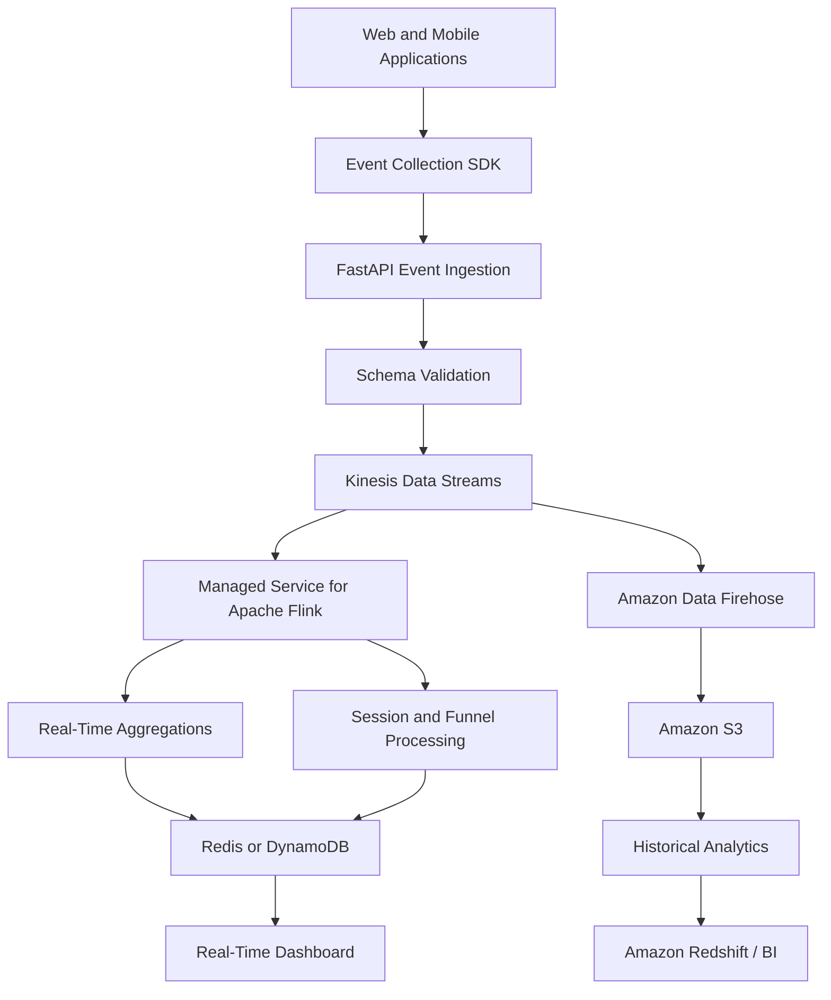
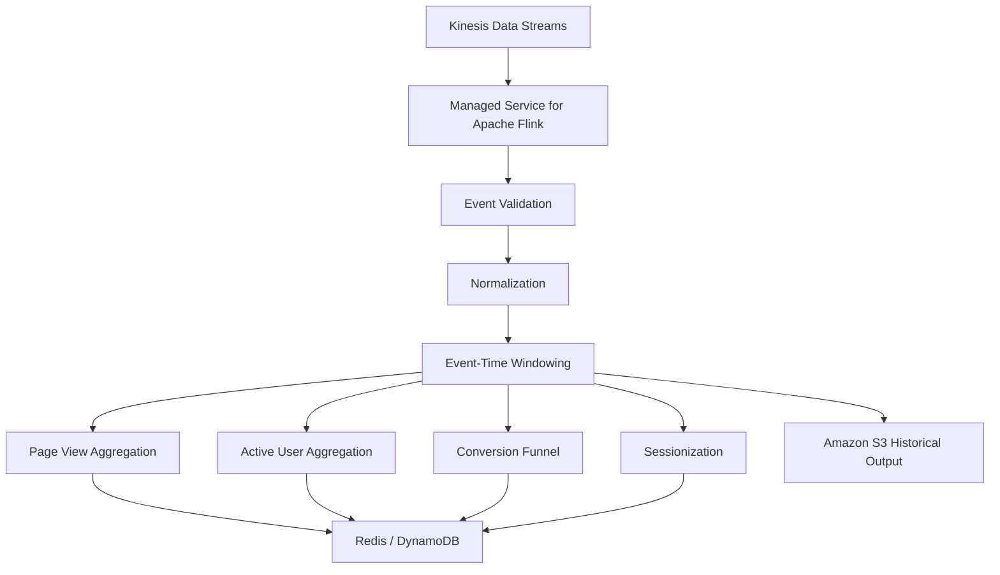
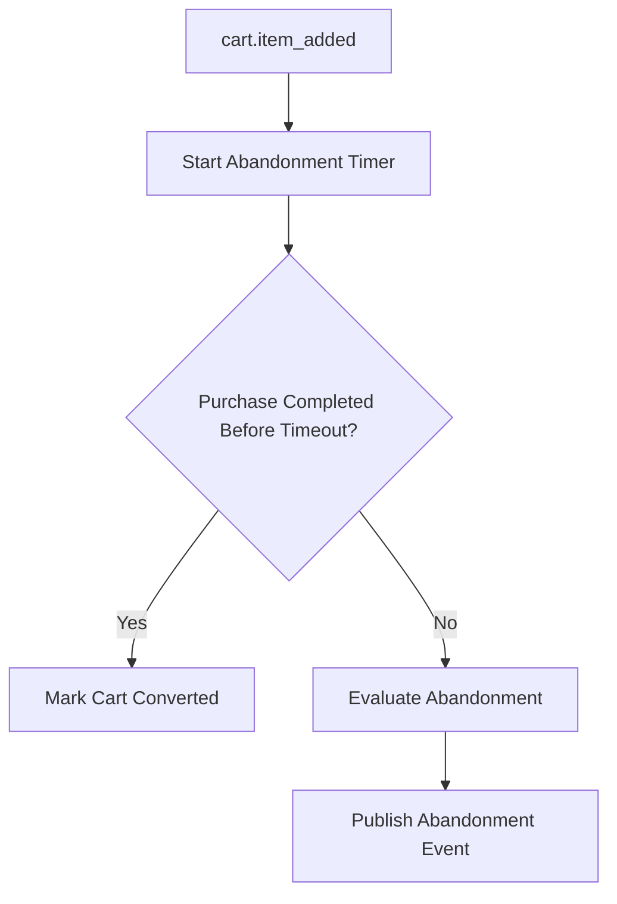
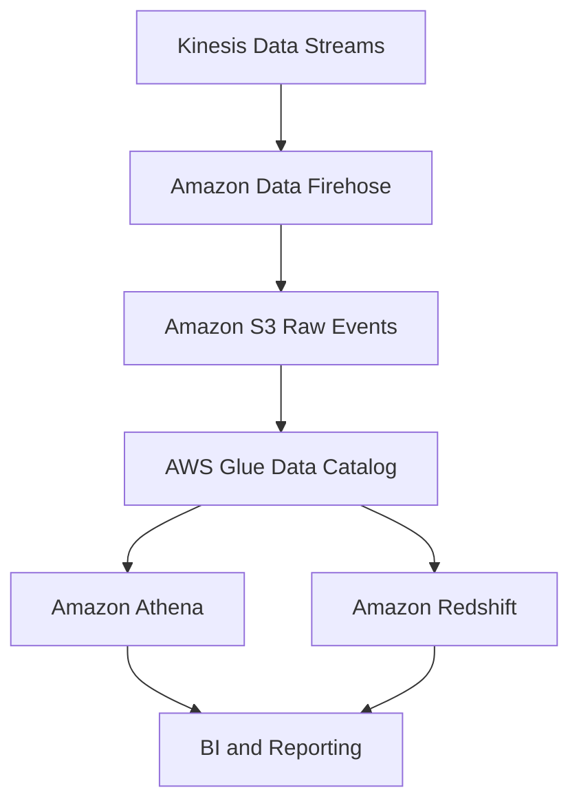

# 03- Real-Time Clickstream Analytics

## Overview

Real-time clickstream analytics captures, processes, and analyzes user interactions with websites, mobile applications, and digital platforms as events occur.

A clickstream is a chronological sequence of user activity, such as:

- Page views.
- Button clicks.
- Product searches.
- Product impressions.
- Add-to-cart actions.
- Checkout events.
- Purchase completions.
- Session starts and ends.
- Navigation transitions.

Amazon Kinesis Data Streams provides the ingestion layer for collecting these events at scale. Downstream consumers process the records independently to calculate metrics, identify user behavior patterns, update analytical stores, and trigger real-time business actions.

A typical implementation combines:

- Web or mobile applications for event generation.
- FastAPI or Django backends for event collection.
- Amazon Kinesis Data Streams for event ingestion.
- Amazon Managed Service for Apache Flink for stateful stream processing.
- Amazon S3 for historical storage.
- Amazon Data Firehose for managed delivery.
- Amazon Redshift or other analytical systems for reporting.
- Redis or DynamoDB for low-latency operational state.

The architecture must account for event duplication, out-of-order delivery, late events, sessionization, schema evolution, privacy, and downstream processing failures.

## Clickstream Event Architecture

### What Is a Clickstream Event?

A clickstream event represents an individual user interaction with a digital application.

An event should capture enough context to support analytics without collecting unnecessary personal information.

Example:

```json
{
  "event_id": "evt-91a7c2",
  "event_type": "product.viewed",
  "event_version": 1,
  "event_timestamp": "2026-11-20T10:30:15.123Z",
  "received_timestamp": "2026-11-20T10:30:15.310Z",
  "anonymous_id": "anon-7f12",
  "session_id": "session-82ab",
  "user_id": null,
  "page": {
    "url_path": "/products/laptop-15",
    "referrer": "/search?q=laptop"
  },
  "properties": {
    "product_id": "laptop-15",
    "category": "electronics",
    "price": 64999
  },
  "device": {
    "type": "desktop",
    "browser": "Chrome"
  }
}
```

Important fields:

| Field | Purpose |
|---|---|
| `event_id` | Unique identifier for duplicate detection |
| `event_type` | Identifies the interaction |
| `event_version` | Supports schema evolution |
| `event_timestamp` | Time the interaction occurred |
| `received_timestamp` | Time the ingestion system received it |
| `anonymous_id` | Identifies an anonymous visitor |
| `session_id` | Groups interactions into a session |
| `user_id` | Identifies an authenticated user when permitted |
| `page` | Contains navigation context |
| `properties` | Contains event-specific attributes |
| `device` | Contains device and browser context |

The distinction between event time and ingestion time is important. A browser may generate an event while offline and submit it later. Processing based only on ingestion time can produce inaccurate time-based analytics.

### Event Taxonomy

Define a consistent event taxonomy before implementing the pipeline.

| Event | Trigger | Example properties |
|---|---|---|
| `page.viewed` | User opens a page | `url_path`, `referrer` |
| `product.viewed` | User opens a product | `product_id`, `category` |
| `product.searched` | User submits a search | `search_term`, `result_count` |
| `cart.item_added` | User adds an item | `product_id`, `quantity` |
| `checkout.started` | Checkout begins | `cart_id`, `item_count` |
| `purchase.completed` | Payment and order completion succeed | `order_id`, `amount` |
| `session.started` | New session begins | `session_id`, `anonymous_id` |

Use consistent naming conventions and document the meaning of every event.

Avoid creating multiple event names for the same business action. For example, `product_clicked`, `product_opened`, and `product_viewed` should not represent the same interaction unless their semantics are explicitly different.

### Event Time and Processing Time

Clickstream analytics uses multiple notions of time.

| Time field | Meaning |
|---|---|
| Event time | When the user interaction occurred |
| Ingestion time | When the event entered Kinesis |
| Processing time | When a consumer processed the event |

Example:

A user views a product at 10:00 but submits the event after reconnecting to the network at 10:05.

- Event time: 10:00.
- Ingestion time: 10:05.
- Processing time: 10:05 or later.

For behavioral analytics, event time is generally the correct basis for time-window calculations.

Processing time remains useful for operational monitoring and latency measurement.

## High-Level Architecture

### End-to-End Data Flow



The architecture separates event ingestion, real-time computation, operational serving, and historical analytics.

### Component Responsibilities

| Component | Responsibility |
|---|---|
| Browser/mobile SDK | Generates interaction events |
| FastAPI/Django ingestion API | Validates and accepts events |
| Kinesis Data Streams | Buffers and retains streaming records |
| Managed Service for Apache Flink | Performs stateful stream processing |
| Amazon Data Firehose | Delivers streaming data to supported destinations |
| Amazon S3 | Stores historical event data |
| Redis | Serves low-latency metrics and dashboard state |
| DynamoDB | Stores scalable operational state and lookup data |
| Redshift | Supports analytical queries |
| Dashboard | Displays real-time and historical metrics |

Not every implementation requires every component. Select services according to event volume, latency requirements, processing complexity, and reporting needs.

## Event Collection Layer

### Browser and Mobile Event Collection

The collection layer captures user interactions and converts them into structured events.

Example JavaScript:

```javascript
const ANALYTICS_ENDPOINT = "/api/v1/events";

function trackEvent(eventType, properties = {}) {
  const event = {
    event_id: crypto.randomUUID(),
    event_type: eventType,
    event_version: 1,
    event_timestamp: new Date().toISOString(),
    anonymous_id: getAnonymousId(),
    session_id: getSessionId(),
    properties
  };

  const payload = JSON.stringify(event);

  if (navigator.sendBeacon) {
    const blob = new Blob(
      [payload],
      { type: "application/json" }
    );

    navigator.sendBeacon(ANALYTICS_ENDPOINT, blob);
    return;
  }

  fetch(ANALYTICS_ENDPOINT, {
    method: "POST",
    headers: {
      "Content-Type": "application/json"
    },
    body: payload,
    keepalive: true
  }).catch(() => {
    // Event delivery failures should not break the user interaction.
  });
}
```

Usage:

```javascript
trackEvent("product.viewed", {
  product_id: "laptop-15",
  category: "electronics"
});
```

The collection SDK should avoid blocking the user interface.

For important events, implement a bounded client-side retry or durable buffering strategy. Browser storage is not a guaranteed delivery mechanism, so business-critical events such as completed payments should be generated or verified by the backend rather than trusted exclusively from client telemetry.

### Client-Side Considerations

- Generate a stable event ID before retrying an event.
- Avoid sending unnecessary personal information.
- Batch events when request overhead is significant.
- Use bounded payload sizes.
- Handle offline and reconnect scenarios.
- Avoid blocking page navigation.
- Apply consent and privacy requirements before collecting optional analytics.
- Prevent accidental collection of credentials, payment data, and sensitive URL parameters.

Client-generated events are useful for behavioral analytics but should not be treated as authoritative business transactions.

## Backend Event Ingestion

### Why Use an Ingestion API?

A backend ingestion API provides a controlled boundary between client applications and Kinesis.

It can perform:

- Authentication and authorization.
- Schema validation.
- Payload size enforcement.
- Rate limiting.
- Event enrichment.
- Privacy filtering.
- Request-level observability.
- Controlled publication to Kinesis.

The API should remain lightweight. Expensive aggregations and analytical queries belong in downstream processing systems.

### FastAPI Event Ingestion Example

Install dependencies:

```bash
pip install fastapi uvicorn boto3 pydantic
```

Example implementation:

```python
import json
import os
from datetime import datetime, timezone
from typing import Any
from uuid import UUID

import boto3
from botocore.exceptions import BotoCoreError, ClientError
from fastapi import FastAPI, HTTPException
from pydantic import BaseModel, ConfigDict, Field


app = FastAPI()

kinesis = boto3.client(
    "kinesis",
    region_name=os.environ.get("AWS_REGION", "ap-south-1"),
)

STREAM_NAME = os.environ["KINESIS_STREAM_NAME"]


class ClickstreamEvent(BaseModel):
    model_config = ConfigDict(extra="forbid")

    event_id: UUID
    event_type: str = Field(min_length=1, max_length=100)
    event_version: int = Field(ge=1)
    event_timestamp: datetime
    anonymous_id: str = Field(min_length=1, max_length=128)
    session_id: str = Field(min_length=1, max_length=128)
    user_id: str | None = None
    properties: dict[str, Any] = Field(default_factory=dict)


@app.post("/api/v1/events", status_code=202)
def ingest_event(event: ClickstreamEvent) -> dict:
    normalized_event = event.model_dump(mode="json")

    normalized_event["received_timestamp"] = (
        datetime.now(timezone.utc).isoformat()
    )

    partition_key = event.session_id

    try:
        response = kinesis.put_record(
            StreamName=STREAM_NAME,
            PartitionKey=partition_key,
            Data=json.dumps(normalized_event).encode("utf-8"),
        )
    except (ClientError, BotoCoreError) as exc:
        raise HTTPException(
            status_code=503,
            detail="Event ingestion temporarily unavailable",
        ) from exc

    return {
        "accepted": True,
        "event_id": str(event.event_id),
        "shard_id": response["ShardId"],
    }
```

The API returns HTTP `202 Accepted` after Kinesis acknowledges the record.

This means the event was accepted by the ingestion layer. It does not mean downstream analytics processing or dashboard updates have completed.

### Ingestion API Production Considerations

The example demonstrates the core publishing flow. A production ingestion service should additionally implement:

- Authentication or abuse-resistant anonymous ingestion.
- Request and event size limits.
- Rate limiting.
- Strict event-type validation.
- Schema compatibility checks.
- Sensitive-field filtering.
- Batch publishing where appropriate.
- Partial batch failure handling.
- Request-level metrics.
- Durable buffering for critical publication requirements.

For high-volume ingestion, avoid making one synchronous Kinesis API call for every individual browser event if batching or an asynchronous publisher can meet the latency requirements.

An ingestion API can accept batches and publish them using `PutRecords`. It must inspect individual record results because batch publishing is not atomic.

## Kinesis Data Streams Configuration

### Stream Design

Kinesis Data Streams provides the ingestion and retention layer.

Partition-key selection is important because it controls shard distribution and ordering boundaries.

For clickstream analytics, possible keys include:

| Partition key | Advantage | Limitation |
|---|---|---|
| `session_id` | Preserves session-level ordering within a shard | Large sessions can create hot keys |
| `anonymous_id` | Groups anonymous visitor activity | High-volume visitors may create hot keys |
| `user_id` | Groups authenticated user activity | Uneven user activity can create skew |
| Random identifier | Distributes traffic broadly | Does not preserve session-level ordering |

Using `session_id` is often appropriate when session-level ordering is required.

However, a high-volume session can still become a hot partition key. Validate traffic distribution rather than assuming that a high-cardinality key guarantees uniform load.

### Terraform Example

```hcl
resource "aws_kinesis_stream" "clickstream" {
  name             = "clickstream-events"
  retention_period = 48

  stream_mode_details {
    stream_mode = "ON_DEMAND"
  }

  encryption_type = "KMS"
  kms_key_id      = aws_kms_key.clickstream.arn

  tags = {
    Environment = "production"
    Application = "clickstream-analytics"
    ManagedBy   = "terraform"
  }
}
```

This configuration creates an on-demand stream with 48 hours of retention and KMS encryption.

The KMS key must be defined separately with suitable key policies and permissions.

For predictable sustained workloads, provisioned capacity may be appropriate. For variable workloads, on-demand mode can reduce manual shard-capacity management.

Capacity mode does not remove the need to monitor partition-key skew, throttling, and consumer lag.

### Stream Retention Strategy

Retention should reflect recovery and replay requirements.

For example:

- Short retention for disposable operational telemetry.
- Extended retention when consumers may be unavailable for longer periods.
- S3 archival for long-term analytical history.

Kinesis retention is not a replacement for a durable analytical data lake.

## Real-Time Stream Processing

### Why Stream Processing Is Required

Raw clickstream events are generally unsuitable for direct dashboard queries.

A dashboard typically needs aggregated information such as:

- Active users in the last five minutes.
- Page views per minute.
- Product views by category.
- Add-to-cart conversion rate.
- Checkout abandonment.
- Purchase revenue.
- Traffic by device type.

A stream processor transforms individual events into useful metrics.

Amazon Managed Service for Apache Flink supports stateful processing, event-time windows, aggregations, joins, and continuous stream computation.

### Processing Architecture



A stream processing application can maintain independent state for different analytical computations.

For example, page-view aggregation may use a one-minute tumbling window, while sessionization may use an inactivity timeout.

### Windowing

Windowing groups events into time intervals.

Common window types include:

| Window | Behavior | Example |
|---|---|---|
| Tumbling | Fixed, non-overlapping intervals | Page views per minute |
| Sliding | Overlapping intervals | Active users over the last five minutes |
| Session | Groups events separated by an inactivity gap | User browsing sessions |

Example:

A tumbling one-minute window groups all page-view events whose event timestamps fall within the same minute.

A sliding five-minute window can calculate the number of active users during the most recent five minutes.

Window selection affects latency, memory requirements, state size, and metric interpretation.

### Event-Time Processing

Event-time processing uses the timestamp generated when the interaction occurred.

This is preferable for behavioral analytics because network delays and offline clients can cause records to arrive late.

Apache Flink uses watermarks to represent progress in event time and determine when windows can be evaluated.

A watermark does not guarantee that no earlier event will ever arrive. It is a progress estimate used by the processing application.

A practical design should define:

- Maximum expected event delay.
- Watermark generation strategy.
- Allowed lateness.
- Late-event handling.
- Reconciliation procedures.

If a late event arrives after a window has been finalized, the application must either update the result, emit a correction, or record the event for reconciliation.

### Windowing Example

Conceptual Flink SQL:

```sql
SELECT
    window_start,
    window_end,
    page_path,
    COUNT(*) AS page_views
FROM TABLE(
    TUMBLE(
        TABLE clickstream_events,
        DESCRIPTOR(event_time),
        INTERVAL '1' MINUTE
    )
)
GROUP BY
    window_start,
    window_end,
    page_path;
```

This query illustrates event-time tumbling-window aggregation. The source table must define an appropriate event-time attribute and watermark strategy.

The exact connector configuration depends on the deployed Flink runtime and source integration.

## Real-Time Analytics Use Cases

### Active Users

An active-user metric estimates the number of distinct users who interacted with the application during a time window.

Example:

```text
Active users (last 5 minutes) =
Distinct visitor identifiers with qualifying activity
during the last 5 minutes
```

The metric requires a clear definition of activity.

For example, a product view may count as activity, while a background heartbeat may not.

Exact distinct counting can require significant state. At high volume, approximate cardinality structures such as HyperLogLog can reduce memory usage, with an accuracy trade-off.

Consider whether the business requires exact or approximate counts.

### Page Views per Minute

Page-view aggregation is a common first streaming computation.

Example output:

```json
{
  "window_start": "2026-11-20T10:30:00Z",
  "window_end": "2026-11-20T10:31:00Z",
  "page_path": "/products/laptop-15",
  "page_views": 1842
}
```

The aggregation can be grouped by:

- Page path.
- Product category.
- Device type.
- Geographic region.
- Referrer category.

Avoid grouping on unrestricted high-cardinality values such as complete URLs containing unique query parameters. This can cause excessive state growth.

Normalize URLs and remove irrelevant tracking parameters before aggregation.

### Conversion Funnel

A conversion funnel measures how users progress through a sequence of business events.

Example:

```text
Product Viewed
      |
      v
Added to Cart
      |
      v
Checkout Started
      |
      v
Purchase Completed
```

A funnel can calculate:

| Stage | Unique sessions |
|---|---:|
| Product viewed | 10,000 |
| Added to cart | 3,500 |
| Checkout started | 2,100 |
| Purchase completed | 1,200 |

Conversion rate between two stages:

\[
Conversion\ Rate =
\frac{Users\ at\ Later\ Stage}
{Users\ at\ Earlier\ Stage}
\times 100
\]

For the example:

\[
Purchase\ Conversion =
\frac{1200}{10000} \times 100 = 12\%
\]

A production funnel must define:

- Identity used for counting.
- Attribution window.
- Whether stages must occur in strict order.
- Whether repeated events count once or multiple times.
- How anonymous-to-authenticated identity transitions are handled.
- How late events affect previously calculated results.

A simple count of event types is not a reliable conversion funnel. The system must correlate events belonging to the same user or session.

### Sessionization

Sessionization groups user events into sessions.

A common rule is to start a new session after a defined period of inactivity, such as 30 minutes.

Example:

```text
10:00:00 Product Viewed
10:04:00 Product Searched
10:12:00 Added to Cart
10:48:00 Checkout Started
```

If the inactivity threshold is 30 minutes, the checkout event starts a new session.

Sessionization requires maintaining per-user or per-session state.

Consider:

- Late-arriving events.
- Duplicate events.
- Browser tabs.
- Anonymous identity changes.
- Cross-device activity.
- Session expiration.
- Out-of-order delivery.

A session timeout is a business definition, not a Kinesis feature.

### Cart Abandonment

A cart abandonment pipeline identifies sessions where a user adds products to a cart but does not complete checkout within a defined period.

Example:



The timer should be managed through a stateful processing or scheduling design rather than relying on a short-lived application process.

A production implementation must prevent duplicate abandonment notifications and verify that the cart has not been converted through another event path.

## Identity and User Correlation

### Anonymous and Authenticated Users

Clickstream systems often receive events before a user logs in.

An anonymous visitor may later authenticate. The analytics platform may need to associate the anonymous browsing history with the authenticated identity.

A typical model uses:

- `anonymous_id` for anonymous browser or device activity.
- `user_id` for authenticated identity.
- `session_id` for an individual browsing session.

The association should follow the application's privacy and consent requirements.

Avoid treating IP addresses or browser fingerprints as universally reliable identity keys.

### Identity Resolution Considerations

- Define when anonymous events can be linked to an authenticated user.
- Prevent one user's activity from being associated with another user.
- Handle account switching on shared devices.
- Respect deletion and consent requests.
- Keep identity mappings access-controlled.
- Avoid exposing direct identifiers in general-purpose analytics datasets.

Identity resolution is a data-governance concern as much as a stream-processing concern.

## Serving Real-Time Analytics

### Redis as a Dashboard Read Model

A dashboard should not repeatedly scan the raw Kinesis stream.

Instead, the stream processor can update an operational read model.

Redis is suitable for low-latency metrics that need frequent access and can be reconstructed from the event stream or historical data.

Example key structure:

```text
analytics:pageviews:2026-11-20T10:30:00Z
analytics:active-users:5m
analytics:conversion:2026-11-20
```

A metric can be stored as a hash:

```text
HSET analytics:pageviews:2026-11-20T10:30:00Z \
     /products/laptop-15 1842
```

Example FastAPI endpoint:

```python
from fastapi import FastAPI
from redis.asyncio import Redis


app = FastAPI()

redis = Redis.from_url(
    "redis://redis:6379/0",
    decode_responses=True,
)


@app.get("/api/v1/analytics/pageviews")
async def get_pageviews(window: str = "current") -> dict:
    key = f"analytics:pageviews:{window}"
    metrics = await redis.hgetall(key)

    return {
        "window": window,
        "page_views": metrics,
    }
```

This is a simplified read API. A production implementation should validate the window parameter, define authorization, manage Redis connection lifecycle, and return a stable response schema.

### Redis Limitations

Redis is an operational serving layer, not necessarily the system of record for analytical history.

Consider:

- Key expiration.
- Memory consumption.
- Persistence configuration.
- High availability.
- Atomic updates.
- Rebuilding metrics after data loss.
- Handling out-of-order updates.

For metrics that must survive Redis loss, retain source events and provide a replay or reconstruction mechanism.

### DynamoDB as an Alternative

DynamoDB can store aggregated metrics and operational state when predictable key-based access is required.

Example item:

```json
{
  "pk": "PAGE#2026-11-20T10:30:00Z",
  "sk": "/products/laptop-15",
  "page_views": 1842,
  "updated_at": "2026-11-20T10:31:02Z"
}
```

Choose Redis or DynamoDB based on access patterns, durability requirements, query needs, and operational characteristics.

## Historical Analytics and Data Lake

### Why Store Raw Events?

Real-time aggregates answer current operational questions, but historical raw events support deeper analysis.

A data lake provides a durable location for:

- Historical reporting.
- Funnel analysis.
- Cohort analysis.
- Attribution analysis.
- Model training.
- Data reconciliation.
- Reprocessing after logic changes.

Amazon S3 is commonly used as the raw event storage layer.

### Delivery Architecture



Amazon Data Firehose provides managed buffering and delivery to supported destinations.

It is suitable when the requirement is managed delivery rather than a custom retained stream-processing application.

Firehose delivery is asynchronous. Successful record submission does not mean the record has already been written to S3.

### S3 Data Organization

A practical partition structure:

```text
s3://company-analytics/
    clickstream/
        year=2026/
            month=11/
                day=20/
                    hour=10/
                        part-0001.parquet
                        part-0002.parquet
```

Partitioning by event date supports time-based analytical queries.

Avoid excessive partition cardinality. Partitioning by unique user IDs or event IDs can produce too many small partitions and inefficient query execution.

### File Format

For analytical workloads, Parquet is generally preferable to raw JSON because it provides:

- Columnar storage.
- Compression.
- Predicate pushdown.
- Reduced scan volume for selected columns.
- Integration with Athena, Glue, and Redshift Spectrum.

Keep raw immutable events separately when required for audit and replay. Use transformed datasets for reporting.

## Data Quality and Schema Evolution

### Event Validation

Malformed or inconsistent events can corrupt analytical results.

Validation should occur at multiple stages:

1. Client-side validation for early feedback.
2. Backend validation for ingestion control.
3. Stream-processing validation for consumer safety.
4. Historical data-quality checks for reconciliation.

Do not trust browser-generated payloads as authoritative.

### Schema Versioning

Event structures evolve as products change.

For example, a product event may initially contain:

```json
{
  "event_type": "product.viewed",
  "product_id": "laptop-15"
}
```

A later version may introduce category information:

```json
{
  "event_type": "product.viewed",
  "event_version": 2,
  "product_id": "laptop-15",
  "category": "electronics"
}
```

Consumers should handle supported versions explicitly.

Recommended practices:

- Add optional fields where possible.
- Avoid changing field meaning without changing the schema version.
- Maintain backward compatibility.
- Reject or isolate unsupported versions.
- Monitor schema-validation failures.
- Document event ownership.

### Event Deduplication

Client retries, network ambiguity, and publisher retries can produce duplicate records.

Use `event_id` as the logical deduplication key.

A processor can maintain deduplication state for a bounded period, or use a durable store when the business requirement demands longer protection.

The deduplication retention period should exceed the expected retry and late-arrival horizon.

Do not assume Kinesis automatically deduplicates records by event ID. Kinesis Data Streams does not provide general-purpose application-level event deduplication.

## Reliability and Recovery

### Producer Reliability

The ingestion API can fail after receiving a request but before publishing the record.

For business-critical events, use a durable outbox or another persistent buffering mechanism.

For browser telemetry, a bounded client-side retry strategy may be acceptable, provided the analytics requirements tolerate occasional loss.

### Consumer Reliability

Stream processors and consumers should be designed for recovery.

Important considerations:

- Checkpoint processing state.
- Use durable sinks.
- Make updates idempotent.
- Monitor checkpoint failures.
- Handle shard topology changes.
- Isolate invalid events.
- Test recovery from downstream outages.

Managed Service for Apache Flink supports checkpointing and state recovery, but end-to-end exactly-once behavior depends on the source, sink, connector, and transaction semantics.

An external side effect such as sending an email or invoking an arbitrary REST API may still occur more than once.

### Replay Strategy

Retained Kinesis records can be reprocessed by a new consumer or from an earlier sequence position.

For long-term replay, use S3 as the durable historical source.

A replay process should:

- Use an isolated processing application where practical.
- Avoid overwriting current operational state unintentionally.
- Apply idempotency.
- Track replay progress.
- Control processing rate.
- Compare replayed output with existing aggregates.
- Support reconciliation and rollback procedures.

## Security and Privacy

Clickstream data can contain sensitive behavioral information.

A production design should implement privacy controls from the collection layer onward.

### Security Practices

- Use TLS for event submission.
- Require authentication where appropriate.
- Apply rate limits to anonymous ingestion.
- Use IAM roles for AWS workloads.
- Encrypt Kinesis and S3 data at rest.
- Restrict access to raw event datasets.
- Apply S3 bucket policies and public-access blocking.
- Audit access to identity mappings.
- Avoid logging full event payloads.

### Data Minimization

Do not collect information simply because it is available.

Avoid sending:

- Passwords.
- Authentication tokens.
- Payment card data.
- Full form contents.
- Sensitive query-string parameters.
- Unnecessary precise location information.
- Personal information unrelated to the analytics purpose.

Use pseudonymous identifiers where appropriate, and define retention and deletion processes according to applicable privacy requirements.

## Monitoring and Observability

A clickstream pipeline needs visibility across ingestion, processing, and serving.

### Ingestion Metrics

Monitor:

- Incoming record count.
- Incoming bytes.
- API request rate.
- API rejection rate.
- Kinesis publication failures.
- Batch partial failures.
- Ingestion latency.
- Throttling.

### Processing Metrics

Monitor:

- Records consumed.
- Records processed.
- Processing failures.
- Duplicate events.
- Watermark progress.
- Checkpoint duration and failures.
- Late-event count.
- Consumer lag.
- State size.
- Backpressure.

### Serving Metrics

Monitor:

- Redis write latency.
- Redis memory usage.
- Cache hit rate.
- Dashboard API latency.
- Metric freshness.
- Failed aggregation updates.

### Business Metrics

Operational metrics should be complemented with business-level checks.

Examples:

- Page views per minute.
- Active users.
- Add-to-cart rate.
- Checkout conversion rate.
- Purchase events.
- Revenue by product category.
- Percentage of events rejected by validation.

A healthy Kinesis stream does not guarantee correct analytics. Compare aggregate counts against authoritative business systems, especially for purchase and payment events.

## Scalability and Performance

### Throughput Planning

Estimate expected ingestion using:

\[
Throughput = EventsPerSecond \times AverageEventSize
\]

For example:

```text
Expected events: 5,000 per second
Average event size: 1 KB

Approximate ingestion:
5,000 KB/s
5 MB/s
```

This estimate excludes protocol overhead and capacity headroom.

For provisioned Kinesis streams, shard requirements depend on both record rate and byte throughput. On-demand mode changes capacity management but does not eliminate service limits or hot-shard risks.

### Processing Scalability

Scale stream processing according to:

- Incoming event rate.
- Number of partitions or shards.
- Processing complexity.
- Stateful operator workload.
- Downstream sink capacity.
- Backpressure.
- Checkpoint overhead.

Adding processing parallelism does not always improve throughput. A highly skewed partition key or slow external dependency can remain the bottleneck.

### State Management

Sessionization and distinct-user calculations can maintain substantial state.

Control state growth through:

- State TTL.
- Session expiration.
- Bounded windows.
- Cardinality reduction.
- Compact aggregation structures.
- Appropriate key selection.

A streaming application that retains state indefinitely can eventually exhaust memory or checkpoint storage.

## Cost Optimization

Important cost drivers include:

- Kinesis ingestion and retrieval.
- Provisioned shard capacity or on-demand usage.
- Extended stream retention.
- Enhanced fan-out consumers.
- Managed Service for Apache Flink application runtime.
- Data Firehose delivery.
- S3 storage and requests.
- Athena scanned data.
- Redshift compute.
- KMS requests.

Optimization practices:

- Avoid collecting unnecessary client events.
- Batch event publishing where appropriate.
- Use compact event schemas.
- Select retention according to recovery requirements.
- Convert historical data to Parquet.
- Partition S3 data for query patterns.
- Apply S3 lifecycle policies.
- Monitor high-cardinality aggregation state.
- Avoid unnecessary enhanced fan-out consumers.

Cost optimization should not compromise data correctness or recovery requirements.

## Common Mistakes and Production Pitfalls

| Mistake | Impact | Prevention |
|---|---|---|
| Trusting client events as business truth | Fabricated or incomplete business metrics | Verify important transactions on the backend |
| Using ingestion time for all analytics | Delayed events distort time windows | Use event-time processing |
| Ignoring duplicate events | Inflated page views and conversions | Deduplicate using stable event IDs |
| Assuming global event ordering | Incorrect session and funnel calculations | Partition by the entity requiring ordering |
| Using unrestricted URLs as aggregation keys | Excessive state cardinality | Normalize paths and remove irrelevant parameters |
| Treating event counts as unique users | Inflated user metrics | Use distinct-user logic |
| Ignoring late events | Incomplete time-window results | Define watermarks and late-event handling |
| Storing all state indefinitely | Increasing memory and checkpoint costs | Apply state TTL and bounded retention |
| Writing raw events directly into dashboard queries | Slow and expensive reporting | Maintain pre-aggregated read models |
| Treating Redis as the only data store | Metrics may be unrecoverable | Retain raw events in durable storage |
| Ignoring privacy requirements | Unnecessary exposure of user information | Apply consent, minimization, and access controls |
| Assuming Firehose delivery is immediate | Incorrect expectations about data freshness | Design for asynchronous delivery |

## Production Deployment Checklist

### Event Collection

- [ ] Event taxonomy is documented.
- [ ] Event IDs are stable across retries.
- [ ] Event timestamps use a consistent timezone.
- [ ] Payload schemas are versioned.
- [ ] Sensitive data is excluded.
- [ ] Client collection respects consent requirements.

### Ingestion

- [ ] API authentication and rate limiting are configured.
- [ ] Payload size limits are enforced.
- [ ] Kinesis publication failures are observable.
- [ ] Batch partial failures are handled.
- [ ] Critical event publication uses durable buffering.
- [ ] IAM roles follow least privilege.

### Stream Processing

- [ ] Partition keys reflect ordering requirements.
- [ ] Event-time and watermark policies are defined.
- [ ] Duplicate handling is implemented.
- [ ] Late events have a defined policy.
- [ ] State growth is bounded.
- [ ] Checkpoint recovery is tested.
- [ ] Downstream backpressure is monitored.

### Analytics and Storage

- [ ] Raw events are retained according to business requirements.
- [ ] Historical data is stored in an appropriate analytical format.
- [ ] S3 partitioning matches query patterns.
- [ ] Real-time metrics have freshness targets.
- [ ] Aggregates can be reconstructed or reconciled.
- [ ] Dashboards use pre-aggregated data.

### Security and Operations

- [ ] Encryption is enabled.
- [ ] Raw event access is restricted.
- [ ] Sensitive fields are excluded or masked.
- [ ] Consumer lag and processing failures are monitored.
- [ ] Data-quality checks are implemented.
- [ ] Cost and retention are reviewed regularly.

## Key Takeaways

- Real-time clickstream analytics uses Kinesis Data Streams to ingest user interaction events and decouple producers from downstream processing.
- Event taxonomy, stable event IDs, partition-key selection, and event-time timestamps determine the quality of analytical results.
- Managed Service for Apache Flink supports stateful processing, sessionization, windowed aggregation, and conversion-funnel computation.
- Redis or DynamoDB can serve low-latency analytical read models, while S3 provides durable historical storage and replay capabilities.
- Production clickstream systems require idempotency, late-event handling, privacy controls, bounded state, observability, and reconciliation against authoritative business data.