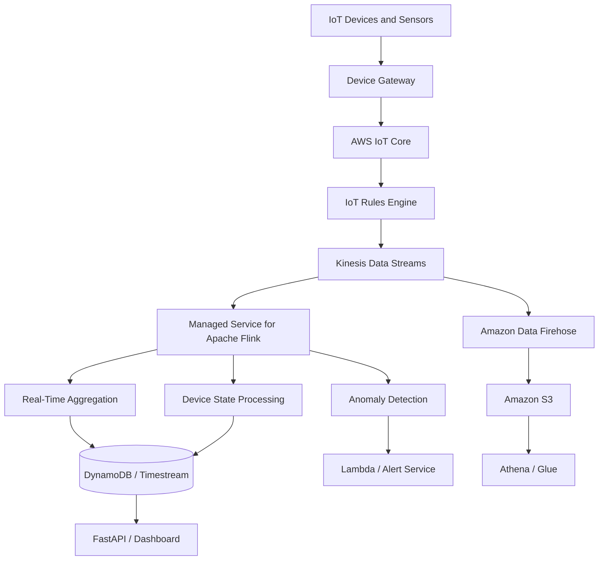
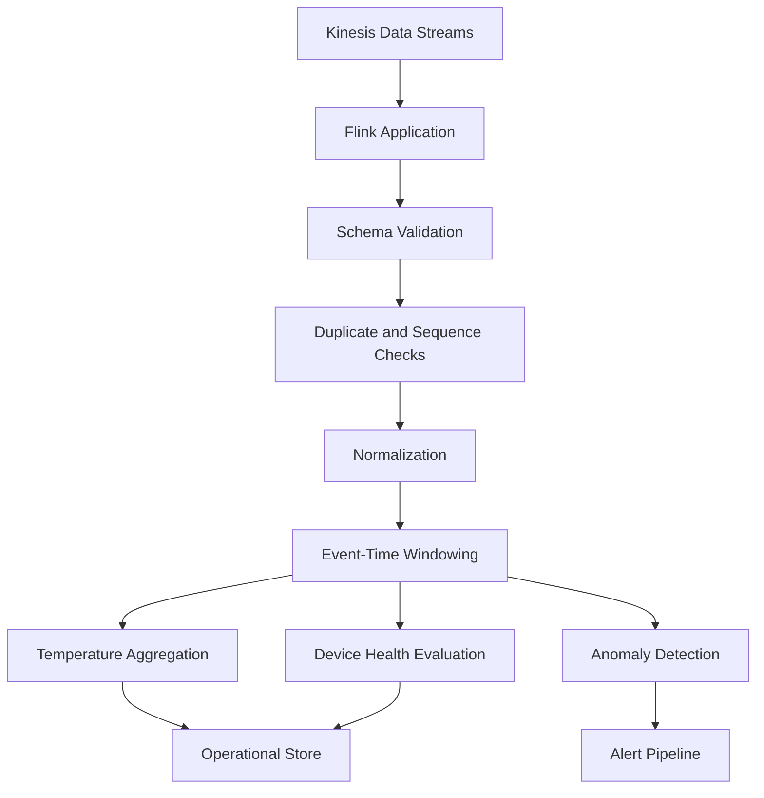
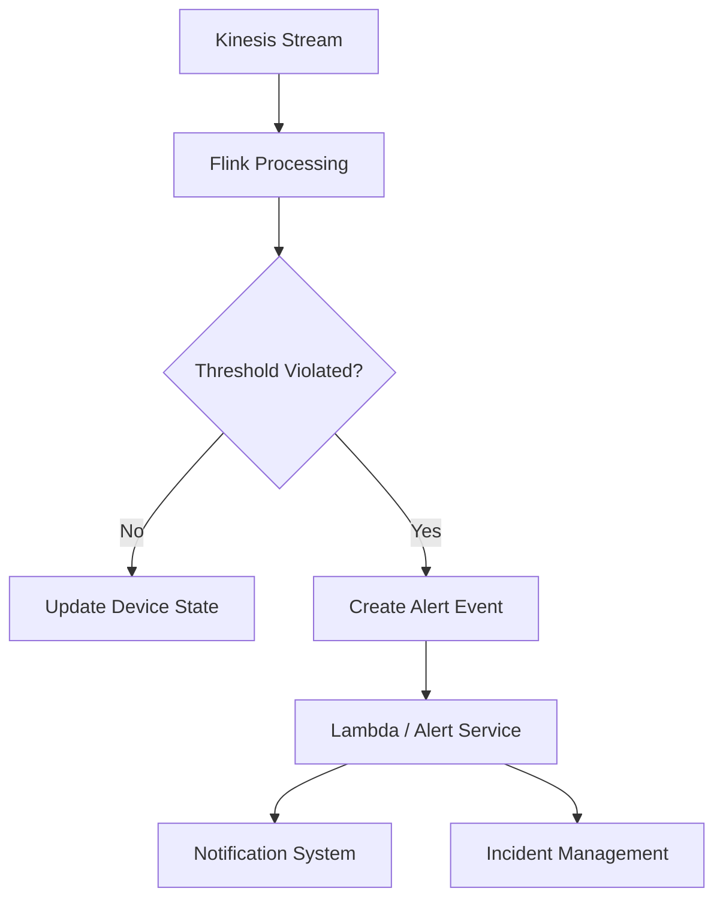

# 04- IoT Telemetry Processing Architecture

## Overview

IoT telemetry processing is the continuous collection, ingestion, transformation, and analysis of data generated by connected devices.

Devices such as industrial sensors, smart meters, vehicles, medical equipment, and environmental monitoring systems continuously produce telemetry records. These records may contain temperature readings, pressure measurements, device status, location information, battery levels, or operational metrics.

Amazon Kinesis Data Streams provides a scalable ingestion layer for processing this data in near real time. Multiple downstream consumers can independently process the same telemetry stream for monitoring, alerting, analytics, anomaly detection, and historical storage.

A typical AWS-based architecture combines:

- IoT devices and gateways for telemetry generation.
- AWS IoT Core for device connectivity and message ingestion.
- Amazon Kinesis Data Streams for retained streaming ingestion.
- Amazon Managed Service for Apache Flink for stateful stream processing.
- Amazon Data Firehose for managed delivery.
- Amazon S3 for historical telemetry storage.
- DynamoDB or Timestream for operational time-series access.
- Lambda or backend services for event-driven actions.
- CloudWatch for operational monitoring.

The architecture must handle device disconnections, intermittent connectivity, duplicate messages, out-of-order telemetry, clock drift, uneven device traffic, and large-scale device registration.

## IoT Telemetry Architecture Fundamentals

### What Is Telemetry?

Telemetry is the automated collection and transmission of measurements from remote devices to a central processing system.

Examples include:

| Domain | Telemetry |
|---|---|
| Industrial IoT | Machine temperature, vibration, pressure |
| Smart energy | Electricity consumption, voltage, current |
| Automotive | Vehicle speed, engine temperature, GPS coordinates |
| Environmental monitoring | Humidity, air quality, rainfall |
| Healthcare equipment | Device status and sensor measurements |
| Smart buildings | Occupancy, lighting, temperature |

A telemetry event should contain enough information to identify the device, measurement, and time at which the measurement was taken.

Example:

```json
{
  "event_id": "evt-9a81c2",
  "device_id": "sensor-10042",
  "event_type": "temperature.reading",
  "schema_version": 1,
  "event_timestamp": "2026-11-20T10:30:15.123Z",
  "sequence_number": 18452,
  "location": {
    "site_id": "factory-01",
    "zone": "production-line-03"
  },
  "measurements": {
    "temperature_celsius": 82.4,
    "humidity_percent": 61.2
  },
  "status": {
    "battery_percent": 78,
    "signal_strength_dbm": -64
  }
}
```

Important fields:

| Field | Purpose |
|---|---|
| `event_id` | Unique logical event identifier |
| `device_id` | Identifies the originating device |
| `event_type` | Identifies the telemetry category |
| `schema_version` | Supports event schema evolution |
| `event_timestamp` | Device measurement time |
| `sequence_number` | Helps detect gaps and duplicate device messages |
| `location` | Identifies the physical or logical device location |
| `measurements` | Contains sensor readings |
| `status` | Contains device health information |

The device timestamp and ingestion timestamp should be tracked separately. Device clocks can drift, and disconnected devices may upload buffered telemetry much later than the measurement time.

### Telemetry Characteristics

IoT workloads differ from ordinary application event streams.

| Characteristic | Engineering implication |
|---|---|
| High device count | Device identity and lifecycle management are important |
| Continuous events | Ingestion capacity must support sustained throughput |
| Intermittent connectivity | Devices need local buffering and retry strategies |
| Variable event frequency | Capacity planning must account for bursts |
| Device clock drift | Event-time processing requires timestamp validation |
| Duplicate messages | Consumers must be idempotent |
| Out-of-order records | Sequence and event-time handling are required |
| Small payloads at high volume | Request overhead and batching matter |
| Device-specific schemas | Schema versioning and compatibility are essential |

## High-Level Architecture

### End-to-End Data Flow



The architecture separates device connectivity, stream ingestion, real-time computation, operational storage, and historical analytics.

### Component Responsibilities

| Component | Responsibility |
|---|---|
| IoT device | Generates sensor measurements |
| Device gateway | Aggregates and forwards device messages |
| AWS IoT Core | Provides device connectivity, authentication, and message routing |
| IoT Rules Engine | Routes MQTT messages to configured AWS services |
| Kinesis Data Streams | Provides retained, partitioned telemetry ingestion |
| Managed Service for Apache Flink | Performs stateful stream processing |
| Amazon Data Firehose | Delivers streaming records to supported destinations |
| DynamoDB | Stores device state and operational metadata |
| Amazon Timestream | Stores time-series measurements |
| Amazon S3 | Stores historical telemetry data |
| Lambda | Executes event-driven processing |
| CloudWatch | Monitors device and stream processing health |

Not every workload requires all these services. For example, a small telemetry system may use IoT Core, a rules action, Lambda, and DynamoDB without introducing a separate Kinesis processing layer.

## Device Connectivity and Ingestion

### AWS IoT Core

AWS IoT Core provides managed connectivity between devices and AWS services.

Devices commonly communicate through MQTT, a lightweight publish-subscribe messaging protocol suitable for constrained networks and devices.

A device publishes telemetry to an MQTT topic:

```text
factory/factory-01/line-03/sensor-10042/telemetry
```

A device might publish:

```json
{
  "device_id": "sensor-10042",
  "event_timestamp": "2026-11-20T10:30:15Z",
  "temperature_celsius": 82.4,
  "humidity_percent": 61.2
}
```

AWS IoT Core can authenticate the device, authorize its MQTT operations, and route matching messages through IoT Rules.

### MQTT Topic Design

Topic names should support routing and access control without becoming unnecessarily complex.

Example:

```text
factory/{site_id}/{device_type}/{device_id}/telemetry
factory/{site_id}/{device_type}/{device_id}/status
factory/{site_id}/{device_type}/{device_id}/commands
```

| Topic | Purpose |
|---|---|
| `telemetry` | Sensor measurements |
| `status` | Device health and connectivity state |
| `commands` | Backend-to-device commands |

Use consistent topic naming and restrict device access to the topics it owns.

Avoid granting every device access to all topics within the environment.

### IoT Rules Engine

The AWS IoT Rules Engine evaluates incoming MQTT messages and routes them to configured destinations.

For example:

```sql
SELECT
    device_id,
    event_timestamp,
    temperature_celsius,
    humidity_percent
FROM 'factory/+/+/+/telemetry'
```

The rule can route matching records to a Kinesis Data Stream.

The rule should also account for malformed messages and routing failures through appropriate error actions and monitoring.

### IoT Rule to Kinesis

A Terraform example:

```hcl
resource "aws_iot_topic_rule" "telemetry" {
  name        = "telemetry_to_kinesis"
  description = "Routes IoT telemetry to Kinesis"
  enabled     = true

  sql         = <<SQL
SELECT
    *,
    topic() AS mqtt_topic,
    timestamp() AS ingestion_timestamp
FROM 'factory/+/+/+/telemetry'
SQL

  sql_version = "2016-03-23"

  kinesis {
    stream_name = aws_kinesis_stream.telemetry.name
    role_arn    = aws_iam_role.iot_kinesis_role.arn
    partition_key = "$${newuuid()}"
  }

  error_action {
    cloudwatch_logs {
      log_group_name = aws_cloudwatch_log_group.iot_rule_errors.name
      role_arn       = aws_iam_role.iot_logs_role.arn
    }
  }
}
```

This example uses a generated partition key to distribute records broadly. It does not preserve device-level ordering.

For device-level ordering, use a device-derived partition key when supported by the rule action configuration. Validate the exact partition-key expression and its evaluation behavior in the deployed AWS IoT rule.

The IAM role must trust the IoT service and allow the required Kinesis write operation on the target stream.

## Kinesis Data Streams Design

### Why Use Kinesis?

AWS IoT Core handles device connectivity and message routing. Kinesis Data Streams provides a retained, partitioned ingestion layer for independent downstream consumers.

This separation is useful when telemetry must feed multiple processing systems.

For example:

- One consumer calculates device health.
- Another detects abnormal sensor readings.
- Another updates time-series storage.
- Another archives raw records.
- Another produces operational alerts.

The device ingestion path does not need to know the internal implementation of these consumers.

### Partition-Key Strategy

The partition key determines which shard receives a record.

For IoT workloads, common choices include:

| Partition key | Benefit | Risk |
|---|---|---|
| `device_id` | Preserves device-level ordering | High-volume devices can create hot shards |
| `site_id` | Groups site-level telemetry | Large sites can create uneven traffic |
| `device_type` | Groups device categories | Low cardinality can create hot shards |
| Random identifier | Distributes records broadly | No device-level ordering guarantee |

Using `device_id` is often appropriate when events from an individual device must be processed in order.

A random key may be appropriate when events are independent and distribution is more important than ordering.

### Shard Capacity

In provisioned mode, a shard commonly supports up to:

- 1 MB/s or 1,000 records/s for writes.
- 2 MB/s for shared `GetRecords` reads.

These are per-shard limits and should be validated against current regional quotas and the selected stream configuration.

A simplified provisioned shard estimate is:

```text
Required shards =
    max(
        ceil(total incoming bytes per second / 1 MB),
        ceil(total incoming records per second / 1,000)
    )
```

For example:

```text
Devices: 10,000
Telemetry frequency: 1 event every 10 seconds
Average payload: 1 KB

Events per second:
10,000 / 10 = 1,000

Approximate write throughput:
1,000 KB/s = 1 MB/s
```

This represents a theoretical minimum of one shard based on the simplified write limits. Production capacity should include headroom for bursts, uneven partition-key distribution, and future growth.

On-demand mode can reduce manual capacity management for variable workloads, but it does not eliminate hot-key risks or service quotas.

## Device-Level Ordering and Sequence Management

### Why Ordering Matters

Telemetry records from a device often represent a sequence of physical measurements.

Consider:

```text
Sequence 101: Temperature = 80.2
Sequence 102: Temperature = 81.1
Sequence 103: Temperature = 82.4
```

If sequence 103 is processed before sequence 102, a state store that blindly overwrites the latest temperature can move backward.

Use a device-generated sequence number or another reliable ordering mechanism.

### Sequence Number Validation

A consumer can compare the incoming sequence number with the last successfully processed sequence number.

```python
def validate_sequence(
    incoming_sequence: int,
    last_processed_sequence: int,
) -> str:
    if incoming_sequence == last_processed_sequence + 1:
        return "in_order"

    if incoming_sequence <= last_processed_sequence:
        return "duplicate_or_stale"

    return "sequence_gap"
```

This is a simplified validation function. Real devices may reset counters after reboot, wrap counters, or use multiple independent measurement channels.

A production design should include a device boot identifier or sequence epoch when necessary.

### Partition Ordering vs Device Sequence

Kinesis provides ordering within a shard. It does not guarantee that records are processed globally in device sequence order across different shards.

Using `device_id` as the partition key helps keep records for a device in the same shard, but retries and device-side buffering can still introduce out-of-order events.

Device sequence numbers provide an additional validation mechanism.

## Stream Processing Architecture

### Managed Service for Apache Flink

Amazon Managed Service for Apache Flink provides managed infrastructure for stateful stream processing.

It is suitable for IoT workloads requiring:

- Rolling averages.
- Threshold detection.
- Device state tracking.
- Time-window aggregations.
- Anomaly detection.
- Late-event handling.
- Correlation across telemetry streams.

A processing application can read Kinesis records, validate telemetry, maintain keyed state, and publish derived results.

### Processing Pipeline



A Flink application should partition state by device identity when calculations depend on individual device history.

### Event-Time Processing

Device telemetry should generally be processed using event time rather than only processing time.

For example, a sensor may collect readings while disconnected and upload them after reconnecting.

The event timestamp represents when the measurement occurred. The processing timestamp represents when the application handled it.

Flink watermarks help estimate event-time progress and determine when windows can be evaluated.

Define:

- Maximum expected device delay.
- Allowed lateness.
- Watermark strategy.
- Late-event handling.
- State expiration.
- Reconciliation procedures.

A watermark is not proof that no older event will arrive. It is a progress estimate.

## Real-Time Telemetry Processing Patterns

### Rolling Average

A rolling average smooths noisy measurements.

For example, a monitoring system may calculate the average temperature for each device over the previous five minutes.

\[
Average = \frac{\sum_{i=1}^{n} Temperature_i}{n}
\]

Example:

```text
Device: sensor-10042

Readings:
80.2
81.1
82.4
81.8
82.0

Average:
81.5 °C
```

Use rolling averages when short-lived fluctuations should not trigger operational alerts.

However, averaging can hide sudden dangerous spikes. Combine rolling averages with absolute threshold checks where necessary.

### Threshold-Based Alerts

Threshold detection identifies measurements outside acceptable operating ranges.

Example:

```text
Temperature < 0 °C:
    Sensor validation required

Temperature between 0 and 85 °C:
    Normal

Temperature between 85 and 95 °C:
    Warning

Temperature > 95 °C:
    Critical alert
```

The thresholds should come from device specifications and operational requirements rather than arbitrary application constants.

A threshold processor should consider:

- Measurement units.
- Device-specific limits.
- Calibration.
- Missing readings.
- Repeated threshold violations.
- Hysteresis.
- Alert deduplication.

Hysteresis prevents repeated alert transitions when a measurement fluctuates around a threshold.

For example, an alert may activate above 95 °C and clear only after the temperature falls below 90 °C.

### Device Health Monitoring

Device health processing can detect:

- Battery degradation.
- Weak network signal.
- Missing heartbeat messages.
- Abnormal temperature.
- Unexpected device restarts.
- Sensor communication failures.

A device-state record might look like:

```json
{
  "device_id": "sensor-10042",
  "last_seen_at": "2026-11-20T10:30:15Z",
  "status": "healthy",
  "battery_percent": 78,
  "signal_strength_dbm": -64,
  "last_sequence_number": 18452
}
```

The state store should only accept updates that are newer than the currently stored device state.

### Missing Telemetry Detection

A device may stop publishing without sending an explicit failure event.

A monitoring system can compare the current time with the device's last-seen timestamp.

```text
If current_time - last_seen_at > expected_interval:
    Mark device as delayed

If current_time - last_seen_at > failure_threshold:
    Mark device as offline
```

The threshold should account for normal reporting intervals, network conditions, and device power-saving behavior.

Do not classify a device as offline based on a single missed message.

## Operational Storage

### DynamoDB for Device State

DynamoDB is suitable for storing the latest state of a device when access is primarily keyed by device ID.

Example item:

```json
{
  "device_id": "sensor-10042",
  "last_seen_at": "2026-11-20T10:30:15Z",
  "temperature_celsius": 82.4,
  "humidity_percent": 61.2,
  "battery_percent": 78,
  "sequence_number": 18452,
  "status": "healthy"
}
```

Use conditional updates to prevent stale events from overwriting newer state.

Conceptual update condition:

```text
Update only if incoming sequence_number > stored sequence_number
```

If devices can reset their sequence counters, compare a composite ordering value such as boot epoch plus sequence number.

### Amazon Timestream for Time-Series Data

Amazon Timestream is designed for time-series workloads.

It is appropriate for measurements that need time-based queries, such as:

- Temperature history.
- Energy consumption.
- Device utilization.
- Pressure trends.
- Sensor health measurements.

A typical time-series record contains:

- Timestamp.
- Dimensions such as device ID and site ID.
- Measurement name.
- Measurement value.
- Data type.

Use DynamoDB for device state and key-based operational access. Use Timestream when time-series querying is a primary requirement.

### Amazon S3 for Historical Telemetry

S3 provides durable storage for historical telemetry and large-scale analytical workloads.

Example layout:

```text
s3://company-iot-data/
    telemetry/
        year=2026/
            month=11/
                day=20/
                    hour=10/
                        part-0001.parquet
                        part-0002.parquet
```

A practical data-lake architecture uses:

- Raw events for original telemetry.
- Validated events for normalized data.
- Curated datasets for analytics.

Parquet is generally preferable for analytical datasets because it supports columnar reads and compression.

Avoid excessive partition cardinality, particularly partitioning by unique device IDs when the device population is large.

## Alerting and Event-Driven Actions

### Alert Pipeline

A telemetry processing application can publish derived events when abnormal conditions are detected.



Example alert event:

```json
{
  "alert_id": "alert-7f12",
  "device_id": "sensor-10042",
  "alert_type": "temperature.critical",
  "severity": "critical",
  "detected_at": "2026-11-20T10:30:20Z",
  "measurement": {
    "name": "temperature_celsius",
    "value": 97.2,
    "threshold": 95.0
  }
}
```

### Alert Reliability

Do not send a notification directly for every abnormal reading.

A sensor producing repeated critical measurements could generate thousands of notifications.

Use:

- Alert state transitions.
- Deduplication keys.
- Cooldown periods.
- Hysteresis.
- Escalation policies.
- Durable alert records.
- Notification retry mechanisms.

For critical alerts, persist the alert event before attempting external notification delivery.

## Python Telemetry Consumer Example

A custom Python consumer can read records from Kinesis and process telemetry.

The following example demonstrates a simplified single-shard polling consumer. It is not a replacement for KCL or a complete distributed consumer implementation.

```python
import json
import time

import boto3
from botocore.exceptions import BotoCoreError, ClientError


client = boto3.client(
    "kinesis",
    region_name="ap-south-1",
)


def process_telemetry(event: dict) -> None:
    device_id = event["device_id"]
    measurements = event["measurements"]

    temperature = measurements.get("temperature_celsius")

    if temperature is None:
        raise ValueError("Missing temperature measurement")

    if temperature > 95:
        print(
            "Critical temperature detected",
            {
                "device_id": device_id,
                "temperature": temperature,
            },
        )


def consume_shard(
    stream_name: str,
    shard_id: str,
) -> None:
    response = client.get_shard_iterator(
        StreamName=stream_name,
        ShardId=shard_id,
        ShardIteratorType="LATEST",
    )

    shard_iterator = response["ShardIterator"]

    while shard_iterator:
        try:
            response = client.get_records(
                ShardIterator=shard_iterator,
                Limit=100,
            )
        except (ClientError, BotoCoreError):
            time.sleep(2)
            continue

        for record in response["Records"]:
            event = json.loads(
                record["Data"].decode("utf-8")
            )

            process_telemetry(event)

        shard_iterator = response.get("NextShardIterator")

        if not response["Records"]:
            time.sleep(1)
```

Production improvements required:

- Persist checkpoints after durable processing.
- Handle iterator expiration.
- Discover new and closed shards.
- Implement bounded retries.
- Isolate malformed records.
- Implement idempotency.
- Add structured logging and metrics.
- Coordinate shard ownership across workers.
- Handle sequence gaps and device restarts.

For distributed processing, use KCL or a managed stream-processing application where appropriate.

## Reliability and Failure Handling

### Device Disconnections

IoT devices may lose network connectivity because of:

- Power failures.
- Network interruptions.
- Gateway outages.
- Mobile connectivity changes.
- Maintenance windows.

Devices should buffer telemetry locally when the business requirements demand recovery of measurements collected during outages.

A device should retry buffered records using a bounded strategy and preserve original event timestamps.

### Duplicate Telemetry

Duplicates can occur when:

- A device retries after a timeout.
- A gateway republishes buffered records.
- An ingestion service retries an ambiguous request.
- A consumer reprocesses records after recovery.

Use `event_id` or a composite device identity and sequence key to identify duplicate logical events.

Kinesis Data Streams does not automatically deduplicate application records based on their payload.

### Out-of-Order Events

Out-of-order telemetry can occur because of:

- Device-side buffering.
- Network delays.
- Multiple gateway paths.
- Concurrent publishing.
- Retry behavior.

Use event timestamps and device sequence numbers to identify stale records.

For state updates, prevent older measurements from replacing newer state.

For historical time-series analytics, retain original event timestamps even when records arrive late.

### Poison Records

Malformed telemetry should not repeatedly block processing.

Persist invalid records with:

- Original payload.
- Device ID when available.
- Event ID when available.
- Failure reason.
- Processing timestamp.
- Schema version.

Use a durable failure store and alert on abnormal failure rates.

## Security Architecture

### Device Authentication

AWS IoT Core supports device authentication and authorization.

Use per-device identities and certificates where appropriate.

Avoid shared credentials across a large device fleet because revoking one compromised device becomes difficult without affecting others.

### Authorization

Restrict devices to their own MQTT topic namespaces.

A device should not be able to publish telemetry under another device's identity.

Use IAM roles for AWS service integrations and restrict them to the required stream and storage resources.

### Encryption

Protect telemetry data using:

- TLS for device-to-cloud communication.
- Kinesis server-side encryption.
- KMS encryption for sensitive storage.
- S3 encryption and restrictive bucket policies.
- Encrypted database connections.

### Sensitive Telemetry

Some telemetry can reveal sensitive operational or personal information.

Apply:

- Data minimization.
- Device identity protection.
- Access controls.
- Retention policies.
- Audit logging.
- Payload validation.
- Secure credential rotation.

Avoid including credentials, device secrets, or unnecessary personal information in telemetry payloads.

## Scalability and Performance

### Ingestion Throughput

Estimate throughput using:

\[
Throughput = DeviceCount \times EventsPerSecondPerDevice \times AverageEventSize
\]

Example:

```text
Devices: 50,000
Reporting interval: 10 seconds
Average event size: 1 KB

Events per second:
50,000 / 10 = 5,000

Approximate throughput:
5,000 KB/s = 5 MB/s
```

This is a baseline estimate. Add headroom for bursts, reconnect storms, uneven device traffic, retries, and downstream processing.

### Reconnect Storms

When a network outage affects thousands of devices, many devices may reconnect simultaneously and upload buffered telemetry.

This can create a sudden ingestion spike.

Mitigation:

- Use randomized retry delays.
- Apply exponential backoff.
- Batch buffered telemetry where supported.
- Monitor ingestion throttling.
- Plan stream capacity for expected recovery bursts.
- Protect downstream databases from sudden write spikes.

### Hot Shards

A device-derived partition key can create a hot shard when one device produces substantially more telemetry than others.

Monitor shard-level utilization and identify high-volume keys.

If device-level ordering is not required, use a more distributed partitioning strategy.

If ordering is required, consider separating exceptionally high-volume devices into dedicated streams or designing a controlled sub-partitioning strategy with explicit ordering reconstruction.

### Consumer Scaling

Consumer capacity depends on:

- Shard count.
- Consumer read mode.
- Processing parallelism.
- Stateful operator workload.
- Downstream database throughput.
- Event size.
- Consumer lag.

Enhanced fan-out can provide dedicated read throughput for registered consumers.

For Flink workloads, adjust parallelism, state backend configuration, checkpoint settings, and sink concurrency according to measured performance.

## Monitoring and Observability

### Device Metrics

Monitor:

- Connected device count.
- Last-seen timestamp.
- Device heartbeat failures.
- Telemetry reporting frequency.
- Battery level.
- Signal strength.
- Sequence gaps.
- Device reconnect frequency.

### Kinesis Metrics

Important CloudWatch metrics include:

| Metric | Purpose |
|---|---|
| `IncomingRecords` | Measures incoming telemetry volume |
| `IncomingBytes` | Measures incoming data volume |
| `WriteProvisionedThroughputExceeded` | Identifies write throttling |
| `ReadProvisionedThroughputExceeded` | Identifies shared-read throttling |
| `GetRecords.IteratorAgeMilliseconds` | Indicates age of records returned by polling consumers |
| `PutRecord.Success` | Tracks successful single-record writes |
| `PutRecords.Success` | Tracks successful batch writes |

Metric availability depends on the stream mode, API, and monitoring configuration.

### Processing Metrics

Monitor:

- Records processed per second.
- Consumer lag.
- Processing latency.
- Late-event count.
- Duplicate count.
- Sequence gaps.
- Invalid telemetry count.
- Flink checkpoint duration.
- Flink backpressure.
- Sink write failures.

### Alerting

Useful alerts include:

- Device offline beyond its expected reporting interval.
- Sustained ingestion throttling.
- Consumer lag above the processing SLO.
- High invalid-event rate.
- Repeated checkpoint failures.
- Unusual device reconnect volume.
- Critical measurement threshold violations.
- Historical storage delivery failures.

A healthy stream does not guarantee healthy devices. Monitor device-level freshness independently of stream-level ingestion metrics.

## Cost Optimization

Relevant cost drivers include:

- AWS IoT Core connectivity and messaging.
- Kinesis ingestion and retrieval.
- Provisioned shard capacity or on-demand usage.
- Extended stream retention.
- Enhanced fan-out consumers.
- Managed Service for Apache Flink runtime.
- Amazon Data Firehose delivery.
- S3 storage and requests.
- Timestream or DynamoDB usage.
- KMS requests.

Optimization practices:

- Choose telemetry reporting intervals based on actual monitoring requirements.
- Avoid sending unchanged measurements unnecessarily.
- Use compact payloads.
- Batch records where appropriate.
- Select suitable Kinesis capacity mode.
- Apply S3 lifecycle policies.
- Convert historical data to Parquet.
- Bound stream-processing state.
- Avoid excessive high-cardinality metrics.

Do not reduce reporting frequency when doing so would compromise safety, regulatory, or operational requirements.

## Common Mistakes and Production Pitfalls

| Mistake | Impact | Prevention |
|---|---|---|
| Treating device timestamps as reliable | Incorrect event-time calculations | Validate timestamps and monitor clock drift |
| Using random partition keys without considering ordering | Device events can be processed out of order | Select partition keys based on ordering requirements |
| Using `device_id` without checking traffic skew | High-volume devices can create hot shards | Monitor per-shard traffic |
| Ignoring duplicate telemetry | Incorrect averages and device state | Deduplicate using stable event identifiers |
| Overwriting state with stale readings | Device state moves backward | Use conditional updates and sequence validation |
| Treating missing heartbeat as immediate failure | False device-offline alerts | Use reporting intervals and grace periods |
| Ignoring reconnect storms | Sudden ingestion and database overload | Use jittered retries and burst-capacity planning |
| Storing all telemetry in an operational database | Expensive writes and inefficient historical queries | Separate operational state from historical storage |
| Retaining unbounded Flink state | Memory and checkpoint growth | Use state TTL and bounded windows |
| Trusting all device payloads | Invalid or malicious data enters analytics | Validate identity, schema, and measurements |
| Sending an alert for every abnormal reading | Notification flooding | Use alert state transitions and deduplication |
| Assuming Kinesis provides application-level deduplication | Duplicate business effects | Implement consumer idempotency |

## Production Deployment Checklist

### Device and Connectivity

- [ ] Devices have unique identities.
- [ ] Device authentication and authorization are configured.
- [ ] MQTT topics follow a documented naming convention.
- [ ] Device payloads have schema versions.
- [ ] Devices handle temporary network outages.
- [ ] Buffered telemetry preserves original timestamps.
- [ ] Retry behavior includes randomized backoff.

### Stream Ingestion

- [ ] Kinesis partition keys reflect ordering requirements.
- [ ] Stream capacity accounts for normal and burst traffic.
- [ ] IoT Rules Engine permissions follow least privilege.
- [ ] Routing failures are observable.
- [ ] Retention matches recovery requirements.
- [ ] Encryption is enabled.

### Processing and Storage

- [ ] Duplicate and stale records are handled.
- [ ] Sequence gaps are monitored.
- [ ] Event-time and watermark policies are defined.
- [ ] Flink state growth is bounded.
- [ ] Device state updates reject stale measurements.
- [ ] Historical telemetry is stored durably.
- [ ] Invalid records have a failure-handling path.

### Security and Operations

- [ ] Device certificates and credentials have a rotation strategy.
- [ ] Sensitive telemetry is minimized.
- [ ] IAM roles follow least privilege.
- [ ] Device freshness is monitored.
- [ ] Consumer lag and processing failures are monitored.
- [ ] Reconnect storms are included in capacity testing.
- [ ] Recovery and replay procedures are tested.
- [ ] Cost and retention are reviewed regularly.

## Key Takeaways

- IoT telemetry architectures separate device connectivity, stream ingestion, real-time processing, operational state, and historical storage.
- AWS IoT Core manages device connectivity and MQTT message routing, while Kinesis Data Streams provides retained, partitioned ingestion for downstream consumers.
- Device identity, partition keys, timestamps, and sequence numbers are essential for handling ordering, duplicates, and stale measurements.
- Managed Service for Apache Flink supports stateful telemetry processing, threshold detection, rolling aggregations, and event-time analysis.
- Production IoT systems require device authentication, local buffering, reconnect-storm protection, bounded processing state, and device-level observability.