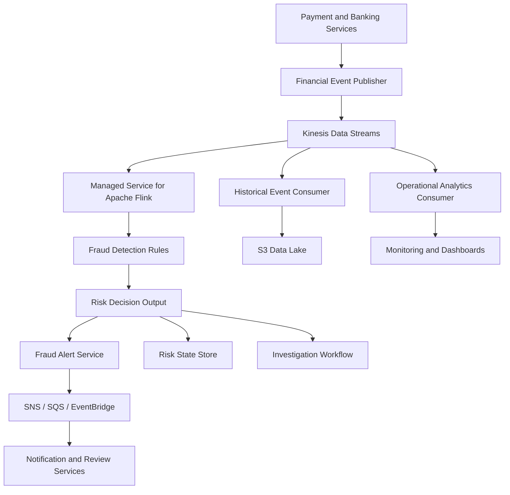
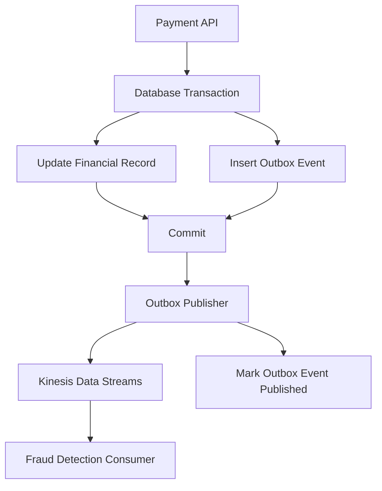
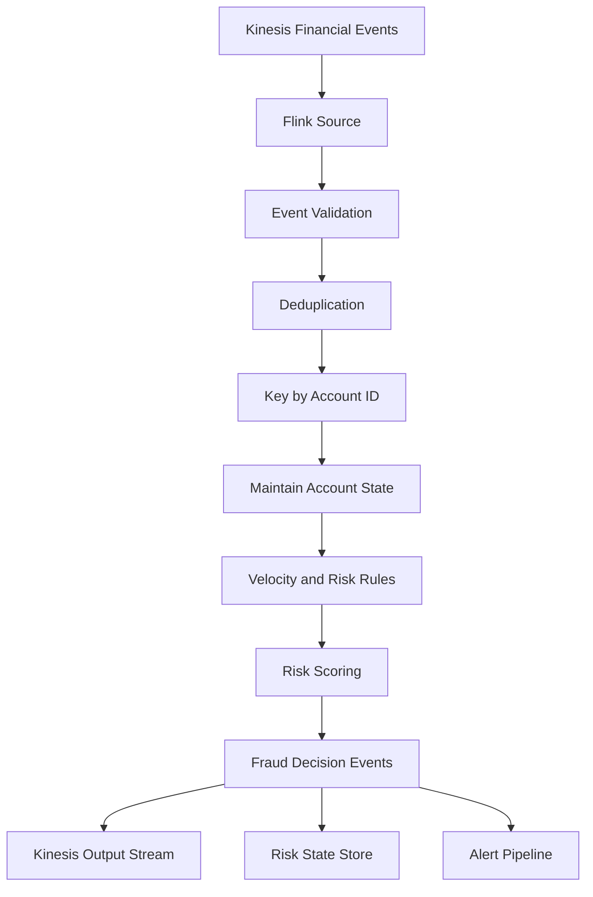
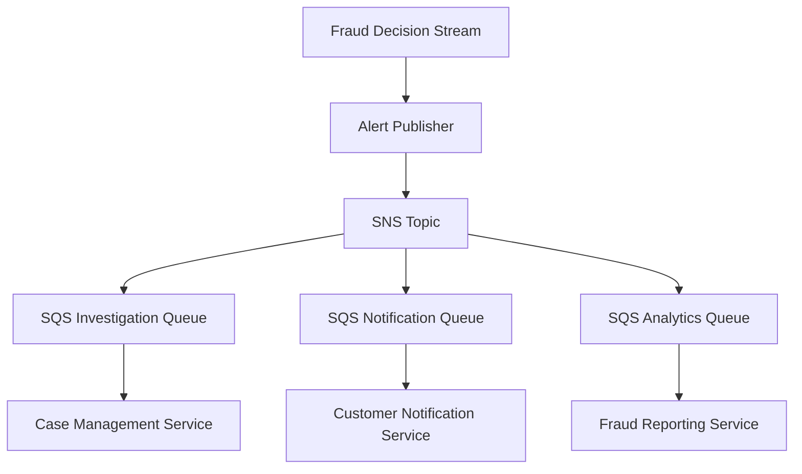
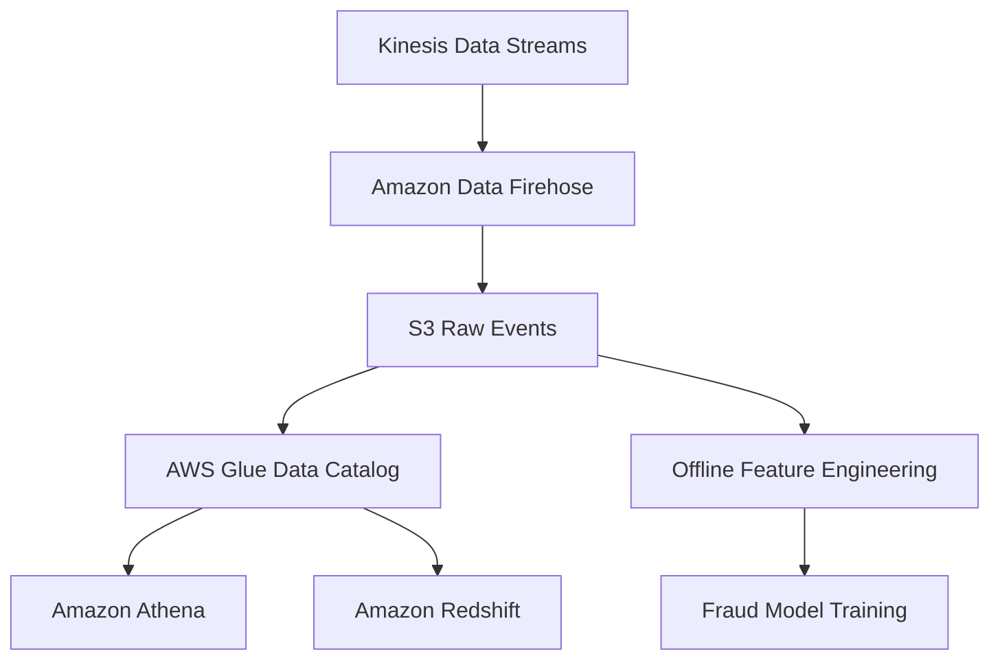

# 05- Fraud Detection and Financial Streaming

## Overview

Fraud detection and financial event processing are common real-time streaming workloads. Financial systems generate high-volume events such as payment authorizations, transfers, withdrawals, account logins, refunds, and transaction reversals. Detecting suspicious activity requires correlating these events with historical behavior, account state, device information, and risk indicators while keeping processing latency low.

Amazon Kinesis Data Streams provides a durable, partitioned event stream for ingesting financial events and distributing them to multiple independent consumers. Amazon Managed Service for Apache Flink supports stateful stream processing, event-time windows, aggregations, and complex event detection.

A typical architecture combines:

- **Amazon Kinesis Data Streams** for real-time financial event ingestion.
- **Amazon Managed Service for Apache Flink** for stateful fraud detection and streaming analytics.
- **Amazon DynamoDB or Redis** for low-latency account and device state.
- **Amazon S3** for historical event storage and investigation.
- **Amazon SNS, SQS, or EventBridge** for alert distribution and downstream workflows.
- **PostgreSQL or another transactional database** for authoritative financial records and investigation outcomes.

The key engineering challenge is not simply identifying suspicious transactions. It is processing financial events reliably, preventing duplicate business actions, maintaining consistent state, and ensuring that fraud decisions do not compromise transaction correctness.

## Why Financial Streaming Matters

Traditional batch-based fraud detection evaluates transactions after they have been collected. This approach is useful for historical analysis but can be insufficient when a suspicious transaction needs to be reviewed before authorization.

Streaming architectures evaluate events continuously as they arrive.

For example, a payment service may need to identify:

- Multiple transactions from the same account within a short interval.
- A sudden increase in transaction value.
- Transactions from geographically inconsistent locations.
- Repeated payment failures followed by a successful payment.
- A new device initiating a high-value transfer.
- Multiple accounts using the same device or payment instrument.
- Unusual withdrawal patterns compared with historical behavior.

A streaming system can detect these patterns and produce risk signals in near real time.

However, fraud detection should not automatically be confused with payment authorization. The payment service remains responsible for enforcing transaction rules and maintaining authoritative financial state.

## Financial Event Architecture

A financial streaming architecture separates transaction processing from fraud analytics.

The transaction service produces events after validating the relevant business operation. These events are published to Kinesis, where independent consumers perform fraud detection, analytics, monitoring, and archival.



### Main Components

| Component | Responsibility |
|---|---|
| Payment service | Validates and processes financial operations |
| Event publisher | Publishes validated financial events |
| Kinesis Data Streams | Distributes durable, ordered-within-shard events |
| Managed Service for Apache Flink | Performs stateful fraud detection |
| DynamoDB or Redis | Stores low-latency risk and behavioral state |
| S3 | Stores historical events for replay and investigation |
| Fraud alert service | Converts risk signals into operational alerts |
| SNS, SQS, EventBridge | Distributes alerts and downstream workflows |
| PostgreSQL | Stores authoritative financial and investigation records |

Each component should have a clearly defined responsibility. Fraud analytics should not become the source of truth for account balances or transaction settlement.

## Financial Event Modeling

The quality of a fraud detection system depends heavily on the events it receives.

Events should contain enough information to support detection, correlation, auditing, and replay without unnecessarily exposing sensitive financial data.

### Recommended Event Structure

A financial event should include:

- A globally unique event identifier.
- A business transaction identifier.
- An account or customer reference.
- An event type.
- The transaction amount and currency.
- Event occurrence time.
- Event publication time.
- A source or service identifier.
- A schema version.
- Relevant device or channel metadata.

Example:

```json
{
  "event_id": "evt_01JQ8K7X9M",
  "transaction_id": "txn_982731",
  "event_type": "PAYMENT_AUTHORIZED",
  "schema_version": 1,
  "account_id": "acc_10482",
  "amount": 12500.00,
  "currency": "INR",
  "merchant_id": "merchant_582",
  "channel": "MOBILE",
  "device_id": "device_7831",
  "country": "IN",
  "event_time": "2026-11-20T10:15:30.123Z",
  "published_at": "2026-11-20T10:15:30.180Z",
  "source": "payment-service"
}
```

The example uses synthetic identifiers. Production systems should avoid publishing unnecessary personally identifiable information, authentication secrets, card data, or complete payment credentials.

### Event Time vs Publication Time

Financial event processing must distinguish between different timestamps.

| Timestamp | Meaning | Usage |
|---|---|---|
| Event time | When the business event occurred | Fraud windows and behavioral analysis |
| Publication time | When the producer published the event | Producer latency analysis |
| Processing time | When the consumer processed the event | Processing latency and operational monitoring |

These timestamps are not interchangeable.

A transaction may occur at 10:15:30 but reach the stream several seconds later because of network delays or producer retries. Using processing time alone can distort velocity calculations and time-based fraud rules.

Use UTC timestamps and define how the system handles late or out-of-order events.

### Event Schema Evolution

Financial event schemas change as payment capabilities evolve.

Use explicit schema versions and backward-compatible changes wherever possible.

Recommended practices:

- Add optional fields rather than immediately removing existing fields.
- Define required fields and validation rules.
- Reject malformed financial events before publishing them.
- Maintain compatibility tests between producers and consumers.
- Version event contracts independently of application deployment versions.
- Preserve the original event for audit and replay where retention policies permit.

A schema registry or centralized event-contract repository can help maintain consistency across independently deployed services.

## Publishing Financial Events to Kinesis

The financial event publisher sends validated events to Kinesis Data Streams.

For financial workloads, partition-key design is especially important because it affects ordering, throughput distribution, and the ability to correlate events.

### Choosing a Partition Key

A partition key determines the shard to which a record is routed.

Common choices include:

| Partition key | Benefit | Limitation |
|---|---|---|
| `account_id` | Preserves account-level ordering within a shard | High-volume accounts can create hot shards |
| `customer_id` | Supports customer-level event correlation | Customers with many accounts can create uneven load |
| `transaction_id` | Distributes individual transactions | Does not preserve account-level ordering |
| `payment_instrument_id` | Supports instrument-level correlation | May create hot keys for shared instruments |

For account-centric fraud detection, `account_id` is often a useful starting point because account events can be processed in shard order.

However, a high-volume account can become a hot partition key. Capacity planning and workload testing are necessary before selecting the final strategy.

### Python Producer Example

The following example publishes financial events using Boto3.

```python
import json
import logging
import os
from datetime import datetime, timezone
from decimal import Decimal
from typing import Any

import boto3
from botocore.config import Config

logger = logging.getLogger(__name__)

kinesis = boto3.client(
    "kinesis",
    region_name=os.environ["AWS_REGION"],
    config=Config(
        retries={
            "mode": "standard",
            "max_attempts": 5,
        },
        connect_timeout=3,
        read_timeout=10,
    ),
)

STREAM_NAME = os.environ["KINESIS_STREAM_NAME"]


def publish_financial_event(event: dict[str, Any]) -> str:
    required_fields = {
        "event_id",
        "transaction_id",
        "event_type",
        "account_id",
        "amount",
        "currency",
        "event_time",
    }

    missing = required_fields.difference(event)

    if missing:
        raise ValueError(
            f"Missing required event fields: {sorted(missing)}"
        )

    payload = {
        **event,
        "published_at": datetime.now(
            timezone.utc
        ).isoformat(),
    }

    amount = Decimal(str(payload["amount"]))

    if amount <= 0:
        raise ValueError("Transaction amount must be positive")

    payload["amount"] = str(amount)

    response = kinesis.put_record(
        StreamName=STREAM_NAME,
        Data=json.dumps(payload).encode("utf-8"),
        PartitionKey=str(payload["account_id"]),
    )

    sequence_number = response["SequenceNumber"]

    logger.info(
        "Financial event published",
        extra={
            "event_id": payload["event_id"],
            "transaction_id": payload["transaction_id"],
            "sequence_number": sequence_number,
            "shard_id": response["ShardId"],
        },
    )

    return sequence_number
```

Important considerations:

- Use stable event identifiers across retries.
- Validate event contracts before publishing.
- Use decimal arithmetic for financial amounts.
- Avoid logging complete payment payloads.
- Monitor producer throttling and failed publication attempts.
- Treat network timeouts as potentially ambiguous outcomes: the record may have been accepted even if the producer did not receive confirmation.

A successful Kinesis API response confirms stream acceptance, not successful downstream fraud evaluation.

### Transactional Outbox Pattern

A critical problem occurs when a financial transaction commits to PostgreSQL but publishing its event to Kinesis fails.

For example:

1. A payment transaction is committed.
2. The application attempts to publish the event.
3. Kinesis is temporarily unavailable.
4. The database contains the transaction, but the streaming system never receives its event.

The transactional outbox pattern addresses this dual-write problem.



The payment record and outbox event are written in the same database transaction.

A separate publisher reads pending outbox records and publishes them to Kinesis. It marks an event as published only after receiving a successful response.

The publisher may still publish an event more than once if it crashes after Kinesis accepts the event but before the database records the successful publication.

Therefore, consumers must remain idempotent.

## Real-Time Fraud Detection Patterns

Fraud detection usually combines multiple rules rather than relying on a single transaction threshold.

A streaming processor maintains behavioral state and evaluates incoming events against that state.

### Transaction Velocity Detection

Velocity detection identifies unusually frequent transactions within a defined time window.

Example rule:

- More than five transactions from one account within one minute.
- Total transaction value exceeds a configured threshold.
- The account has not previously demonstrated similar behavior.

A simplified rolling-window calculation:

```python
from collections import deque
from datetime import datetime, timedelta, timezone
from decimal import Decimal


class TransactionVelocityDetector:
    def __init__(
        self,
        max_transactions: int = 5,
        window_seconds: int = 60,
    ) -> None:
        self.max_transactions = max_transactions
        self.window = timedelta(seconds=window_seconds)
        self.transactions: dict[
            str,
            deque[tuple[datetime, Decimal]]
        ] = {}

    def evaluate(
        self,
        account_id: str,
        amount: Decimal,
        event_time: datetime,
    ) -> bool:
        if event_time.tzinfo is None:
            raise ValueError("event_time must be timezone-aware")

        account_events = self.transactions.setdefault(
            account_id,
            deque(),
        )

        cutoff = event_time - self.window

        while account_events and account_events[0][0] < cutoff:
            account_events.popleft()

        account_events.append((event_time, amount))

        return len(account_events) > self.max_transactions
```

This example demonstrates the rule, not a production distributed implementation.

An in-memory dictionary is unsuitable for a horizontally scaled production consumer because:

- State disappears when the process restarts.
- Different workers may process events for the same account.
- Multiple application instances do not share state.
- Late and out-of-order events complicate window calculations.
- Memory usage grows with active accounts.

Use a stateful stream processor such as Managed Service for Apache Flink for distributed, fault-tolerant windowing.

### High-Value Transaction Detection

A high-value transaction rule compares the transaction amount with configured thresholds and account behavior.

Example:

```python
from decimal import Decimal


def evaluate_high_value_transaction(
    amount: Decimal,
    configured_limit: Decimal,
) -> bool:
    if amount < 0:
        raise ValueError("Amount cannot be negative")

    return amount >= configured_limit
```

A fixed threshold is easy to implement but insufficient as a standalone fraud model.

A more useful rule considers:

- Account-specific transaction limits.
- Historical transaction averages.
- Customer risk classification.
- Merchant category.
- Transaction channel.
- Device trust level.
- Recent account activity.

Thresholds should be configurable and versioned rather than embedded throughout application code.

### Geographic Anomaly Detection

Geographic anomaly detection identifies transactions from locations inconsistent with recent account activity.

For example:

- A customer makes a transaction in Kolkata.
- A second transaction occurs shortly afterward in another country.
- The time and distance between the events are inconsistent with plausible travel.

A production implementation should account for:

- IP geolocation accuracy.
- VPNs and proxy services.
- Mobile network routing.
- Device location permissions.
- Location spoofing.
- Legitimate travel and shared accounts.

IP geolocation is a risk signal, not proof of fraud.

### Device and Account Correlation

Fraud patterns can span multiple accounts.

Examples include:

- Several accounts using the same device.
- A device associated with previously confirmed fraud.
- Multiple payment instruments linked to one suspicious device.
- Repeated failed authentication attempts followed by successful payments.

This requires cross-account correlation, which may not be possible when events are partitioned only by account ID.

Possible approaches include:

- Maintaining a separate device-to-account relationship store.
- Publishing normalized device events to another stream.
- Using a secondary keyed aggregation pipeline.
- Performing enrichment against DynamoDB or another low-latency state store.

Avoid making every transaction perform an expensive synchronous database lookup. Use carefully managed local or distributed state, with explicit freshness requirements.

## Stateful Fraud Detection with Apache Flink

Amazon Managed Service for Apache Flink provides a managed environment for running Apache Flink applications.

It is suitable for fraud detection because it supports:

- Stateful stream processing.
- Event-time windows.
- Keyed state.
- Checkpointing.
- Recovery from failures.
- Continuous aggregations.
- Complex event processing.

### Processing Architecture



### Keyed State

Keyed state allows Flink to maintain separate state for each key.

For example, when events are keyed by `account_id`, the application can maintain:

- Recent transaction timestamps.
- Transaction count within a window.
- Total transaction amount.
- Recent device identifiers.
- Previous risk indicators.
- Last observed transaction time.

This allows the processor to evaluate an incoming event against the account's recent activity.

State should be bounded using appropriate retention and cleanup strategies. Unbounded state can increase checkpoint size, memory consumption, and recovery time.

### Event-Time Windows

Event-time processing evaluates events using their business occurrence timestamps rather than the time at which Flink receives them.

For example, a one-minute transaction velocity window should normally be based on transaction event time.

Watermarks indicate the progress of event time and help Flink determine when a window can be considered complete.

A production design must define:

- Watermark generation strategy.
- Allowed lateness.
- Handling of late events.
- State retention.
- Reprocessing behavior.
- Whether late events can revise an earlier fraud decision.

Late events should not silently disappear from financial investigation records. Depending on business requirements, they may trigger a revised risk assessment or a separate investigation event.

### Example Fraud Rule

Consider a rule that flags an account when more than five transactions occur within one minute.

Conceptually:

```text
Key: account_id

Window: 1 minute

Aggregation:
    transaction_count = COUNT(transactions)

Condition:
    transaction_count > 5

Output:
    FRAUD_RISK_SIGNAL
```

This is a logical rule definition, not a complete Flink application. The actual implementation must define event-time handling, state lifecycle, output semantics, and recovery behavior.

### Risk Scoring

Instead of returning only a Boolean fraud decision, a system can calculate a risk score from multiple signals.

Example:

| Signal | Illustrative score |
|---|---:|
| High transaction velocity | 25 |
| Unusual transaction amount | 20 |
| New device | 15 |
| Geographic anomaly | 20 |
| Previously flagged device | 40 |

The total score can be mapped to configurable decision bands.

| Score range | Illustrative action |
|---|---|
| 0–19 | Normal processing |
| 20–39 | Additional monitoring |
| 40–59 | Step-up verification |
| 60–79 | Manual review |
| 80–100+ | High-risk escalation |

These values are examples, not universal fraud thresholds. Real scoring models require historical data, calibration, validation, and ongoing monitoring.

Avoid treating a risk score as a probability unless the model has been trained and calibrated to support that interpretation.

## Fraud Decision Processing

A fraud detection system should distinguish between a risk signal and an authoritative business decision.

For example:

- A fraud processor identifies suspicious activity.
- It emits a risk signal.
- A payment orchestration service evaluates the signal against authorization policy.
- The payment service decides whether to approve, decline, or request additional verification.

This separation prevents asynchronous analytics from directly modifying financial state without the appropriate business controls.

### Decision Event Structure

```json
{
  "event_id": "risk_evt_78391",
  "transaction_id": "txn_982731",
  "account_id": "acc_10482",
  "decision": "REVIEW",
  "risk_score": 72,
  "risk_reasons": [
    "HIGH_TRANSACTION_VELOCITY",
    "NEW_DEVICE",
    "UNUSUAL_TRANSACTION_AMOUNT"
  ],
  "rule_version": "fraud-rules-v4",
  "model_version": "risk-model-v2",
  "evaluated_at": "2026-11-20T10:15:31.000Z"
}
```

Decision events should contain enough information to explain why a transaction was flagged.

Store rule and model versions so investigators can reconstruct which logic produced a decision.

### Synchronous vs Asynchronous Fraud Evaluation

The placement of fraud detection in the transaction lifecycle depends on the business requirement.

| Approach | Processing model | Suitable use case |
|---|---|---|
| Synchronous authorization checks | Fraud service responds before authorization completes | High-risk payment decisions requiring immediate action |
| Asynchronous streaming detection | Fraud processor evaluates events after publication | Monitoring, anomaly detection, investigation |
| Hybrid architecture | Fast synchronous checks plus deeper streaming analysis | High-volume financial platforms |

A streaming pipeline should not be assumed to complete before a payment authorization response is returned.

If a transaction must be evaluated before approval, use an explicit synchronous decision interface with bounded latency and defined failure behavior. Kinesis can still receive the resulting event for analytics and monitoring.

## Idempotency and Duplicate Financial Events

Kinesis consumers generally operate with at-least-once processing behavior when records are retried or applications recover from failures.

A record can be processed more than once.

This is especially important in financial systems because duplicate processing can produce:

- Duplicate fraud alerts.
- Incorrect transaction velocity counts.
- Duplicate investigation cases.
- Repeated notifications.
- Incorrect account risk state.

Use stable event identifiers and durable deduplication.

### Idempotency Strategy

A consumer can maintain a processed-event table:

```sql
CREATE TABLE processed_financial_events (
    event_id VARCHAR(128) PRIMARY KEY,
    transaction_id VARCHAR(128) NOT NULL,
    processed_at TIMESTAMPTZ NOT NULL DEFAULT NOW()
);
```

The consumer inserts the event identifier and applies the corresponding database changes within one transaction.

Conceptually:

```sql
BEGIN;

INSERT INTO processed_financial_events (
    event_id,
    transaction_id
)
VALUES (
    :event_id,
    :transaction_id
)
ON CONFLICT (event_id) DO NOTHING;

-- Apply business changes only if the event was newly inserted.

COMMIT;
```

The application must check whether the insert actually created a row before applying the business changes.

For stronger correctness, the deduplication record and the resulting business state update must be committed atomically.

Do not assume that Kinesis sequence numbers provide business-level deduplication. They identify records within the stream and are not substitutes for stable event IDs.

### Idempotency Requirements

| Area | Recommended approach |
|---|---|
| Producer retries | Reuse the same event ID |
| Consumer retries | Deduplicate using event ID |
| Fraud alerts | Use deterministic alert or case identifiers |
| Database updates | Use transactional writes |
| External notifications | Use an outbox and downstream idempotency |
| Stream replay | Preserve original event IDs |
| Risk state | Make updates replay-safe |

## Ordering and Financial Event Consistency

Kinesis preserves record ordering within a shard. It does not provide global ordering across the stream.

Partitioning events by account ID can preserve account-level ordering when those events are routed to the same shard.

However, ordering alone does not guarantee correct business processing.

Potential problems include:

- Producer retries that publish records in a different order.
- Multiple producer instances publishing concurrently.
- Events arriving late.
- Consumers processing records in parallel.
- Duplicate events.
- Account activity split across different partition keys.

For financial workloads:

- Use stable partition keys aligned with the consistency boundary.
- Include event timestamps and sequence metadata where useful.
- Detect stale or duplicate events.
- Define how conflicting updates are resolved.
- Keep authoritative transaction ordering in the transactional system.

For critical account operations, use a database transaction or another authoritative consistency mechanism rather than relying solely on stream ordering.

## Checkpointing and Recovery

Flink checkpointing periodically persists application state and source positions so that processing can recover after failures.

A checkpoint represents a consistent recovery point, subject to the source and sink guarantees of the application.

Production configuration should consider:

- Checkpoint interval.
- Checkpoint timeout.
- Minimum time between checkpoints.
- State backend.
- Checkpoint storage.
- Recovery time.
- Backpressure.
- Source and sink connector capabilities.

A checkpoint does not automatically make every external side effect exactly once.

For example, if a Flink application sends an HTTP request to an external fraud case system and then fails before completing a checkpoint, the request may be repeated after recovery.

Use idempotent output operations, transactional sinks where supported, or an intermediate durable event stream.

## Fraud Alerts and Downstream Processing

Fraud decisions should be distributed through a dedicated alert pipeline rather than coupling the streaming processor directly to every downstream application.

A common design is:



This architecture separates detection from operational response.

### Alert Delivery Considerations

- Use SQS queues to absorb downstream processing spikes.
- Configure dead-letter queues for repeatedly failing messages.
- Make alert consumers idempotent.
- Preserve transaction and event identifiers.
- Apply access controls to sensitive alert data.
- Monitor queue age and processing failures.
- Avoid sending sensitive transaction information through email or SMS.

An alert is not the same as a confirmed fraud case. Case management should track investigation status, evidence, decisions, and resolution history.

## Historical Fraud Analysis and Replay

Real-time detection is only one part of a fraud platform.

Historical data supports:

- Fraud trend analysis.
- Model training.
- Rule calibration.
- False-positive analysis.
- Regulatory investigations.
- Incident reconstruction.
- Retrospective detection.

Amazon S3 can store historical event data for analytical workloads.

A common architecture uses Amazon Data Firehose to deliver stream records to S3.



Use separate storage layers where appropriate:

| Storage layer | Purpose |
|---|---|
| Kinesis Data Streams | Short-term event distribution and replay |
| S3 raw zone | Durable historical event archive |
| S3 curated zone | Validated and transformed datasets |
| DynamoDB | Low-latency account and device risk state |
| PostgreSQL | Transactional and investigation records |
| Redis | Optional short-lived, low-latency cached state |

### Replay Strategy

A replay process should not blindly send historical events into live financial workflows.

Use a dedicated replay environment or output stream.

Recommended controls:

1. Identify the time range and source dataset.
2. Validate event schema versions.
3. Preserve original event IDs and event timestamps.
4. Mark replayed records with replay metadata.
5. Use isolated output destinations.
6. Prevent replayed events from triggering real payment operations or customer notifications.
7. Compare replay results with historical decisions.
8. Record replay execution metadata for audit.

Kinesis retention is finite. S3 should be the long-term source for historical reprocessing.

## Security and Compliance

Financial event streams can contain sensitive information. Security must be applied across producers, streams, consumers, state stores, and archival systems.

### Encryption

Use encryption at rest for:

- Kinesis Data Streams.
- S3 buckets.
- DynamoDB tables.
- PostgreSQL storage.
- Checkpoint and state storage.

Use TLS for network communication and enforce HTTPS for service integrations.

For Kinesis Data Streams, configure server-side encryption with AWS KMS where required by the security model.

### IAM Least Privilege

Use separate IAM roles for producers, consumers, and processing applications.

| Role | Example permissions |
|---|---|
| Producer | `kinesis:PutRecord`, `kinesis:PutRecords` |
| Consumer | Required stream read operations |
| Flink application | Source read, sink write, checkpoint access |
| Archival service | Required stream read and S3 write |
| Investigation service | Read access to approved risk and case data |

Avoid granting broad permissions such as `kinesis:*` or unrestricted S3 access.

Restrict KMS permissions to the required keys and operations.

### Data Protection

Recommended controls:

- Do not store card verification values or authentication secrets in events.
- Tokenize payment instrument references.
- Minimize personally identifiable information.
- Apply data retention and deletion policies.
- Restrict access to raw financial events.
- Audit administrative and data-access operations.
- Protect S3 buckets against public access.
- Use separate environments and accounts for development, testing, and production.

Compliance requirements depend on the payment and financial services involved. Apply relevant PCI DSS, privacy, and financial regulatory controls to the complete data lifecycle.

## Scalability and Capacity Planning

Fraud workloads can experience sudden traffic increases during sales, payroll periods, market activity, or payment campaigns.

Capacity planning must consider both throughput and partition distribution.

### Shard Capacity

For provisioned Kinesis Data Streams, a shard commonly supports up to:

- 1 MB/s or 1,000 records/s for writes.
- 2 MB/s for shared-consumer reads.

These are per-shard limits, subject to service quotas and the selected operating mode.

A rough provisioned shard estimate is:

```text
required_shards =
    max(
        ceil(total_write_bytes_per_second / 1_MB),
        ceil(total_write_records_per_second / 1000)
    )
```

This estimate assumes reasonably distributed partition keys. It does not account for hot shards, read demand, operational headroom, or every service quota.

For production systems:

- Measure average and peak event size.
- Estimate peak transaction rates.
- Include burst capacity.
- Monitor partition-key distribution.
- Test consumer throughput independently.
- Evaluate on-demand capacity when traffic is unpredictable.
- Validate regional quotas before deployment.

On-demand capacity reduces manual shard management but does not eliminate hot partition keys or all service limits.

### Consumer Scaling

Consumer capacity depends on the processing model.

For Flink:

- Scale application parallelism according to source and operator throughput.
- Monitor backpressure.
- Avoid unnecessary network shuffles.
- Keep keyed state bounded.
- Tune checkpoint frequency and state size.
- Test recovery under peak load.

Enhanced Fan-Out provides dedicated read throughput for registered consumers. It can be useful when multiple independent fraud, analytics, and archival consumers need to read the same stream without competing for shared read throughput.

## Monitoring and Observability

Fraud detection requires both infrastructure monitoring and business-level monitoring.

A stream can be healthy while fraud processing is incorrect. Conversely, fraud alerts can increase because of a genuine change in transaction behavior rather than an infrastructure failure.

Monitor both categories.

### Kinesis Metrics

| Metric | Purpose |
|---|---|
| `IncomingBytes` | Measures incoming data volume |
| `IncomingRecords` | Measures incoming event volume |
| `WriteProvisionedThroughputExceeded` | Detects write throttling |
| `ReadProvisionedThroughputExceeded` | Detects shared-read throttling |
| `GetRecords.IteratorAgeMilliseconds` | Indicates consumer processing lag |
| `PutRecord.Success` | Tracks successful producer requests |

Metric availability and dimensions depend on the stream mode, API, and monitoring configuration.

### Flink Metrics

Monitor:

- Records received and emitted.
- Source lag and processing latency.
- Backpressure.
- Checkpoint duration.
- Checkpoint failures.
- Restart frequency.
- Operator utilization.
- State size.
- Watermark progress.
- Late-event counts.

### Business Metrics

| Metric | Why it matters |
|---|---|
| Fraud signals per minute | Tracks detection volume |
| High-risk transaction percentage | Identifies unusual risk patterns |
| False-positive rate | Measures unnecessary intervention |
| Fraud confirmation rate | Measures detection effectiveness |
| Average decision latency | Measures responsiveness |
| Duplicate event rate | Identifies producer or replay issues |
| Late-event rate | Measures event-time quality |
| Investigation backlog | Measures operational capacity |

Use structured logs and distributed tracing to correlate events across services.

Include identifiers such as:

- `event_id`
- `transaction_id`
- `account_id` or a protected reference
- `correlation_id`
- `rule_version`
- `model_version`

Avoid exposing sensitive identifiers or complete payment payloads in logs and traces.

## Reliability and Disaster Recovery

Financial streaming systems must recover without losing critical business events or generating duplicate business actions.

### Reliability Practices

- Use a transactional outbox for critical event publication.
- Configure retries with exponential backoff and jitter.
- Preserve stable event IDs across retries.
- Implement consumer-side idempotency.
- Monitor consumer lag.
- Use Flink checkpoints and appropriate recovery configuration.
- Archive events to S3.
- Use dead-letter or quarantine workflows for invalid records.
- Test recovery from producer, consumer, and downstream failures.

### Failure Scenarios

| Failure | Expected handling |
|---|---|
| Producer cannot reach Kinesis | Retain outbox event and retry |
| Kinesis throttles producer | Back off and retry safely |
| Consumer crashes | Resume from durable processing position |
| Flink checkpoint fails | Alert and investigate recovery health |
| Duplicate event arrives | Deduplicate using event ID |
| Invalid event arrives | Quarantine with diagnostic metadata |
| Alert service is unavailable | Buffer through SQS |
| Risk store is unavailable | Apply explicitly defined fallback behavior |
| Historical archive delivery fails | Monitor delivery errors and reconcile |

### Multi-Region Considerations

For high-availability financial platforms, disaster recovery must account for more than stream availability.

Define:

- Recovery Time Objective (RTO).
- Recovery Point Objective (RPO).
- Cross-Region data replication strategy.
- Producer failover behavior.
- Consumer checkpoint recovery.
- State-store replication.
- Duplicate processing controls.
- Regional service dependencies.
- Reconciliation procedures.

Do not assume that Kinesis automatically provides a complete multi-Region active-active architecture.

A cross-Region design needs explicit decisions about event ownership, replication, ordering, deduplication, and failover.

## Cost Considerations

Financial streaming costs depend on ingestion volume, retention, consumer architecture, processing capacity, and historical storage.

| Component | Main cost drivers |
|---|---|
| Kinesis Data Streams | Provisioned or on-demand capacity, retention, enhanced fan-out and related usage |
| Managed Service for Apache Flink | Application processing capacity and runtime |
| DynamoDB | Read/write capacity, storage, and data transfer |
| Redis | Node or serverless capacity and storage |
| S3 | Storage class, requests, retrieval, and data transfer |
| Amazon Data Firehose | Ingestion and transformation usage |
| CloudWatch | Metrics, logs, alarms, and retention |
| SNS and SQS | Requests, delivery, and data transfer |

Cost optimization should not compromise fraud detection correctness.

Useful practices include:

- Right-size Flink parallelism and application capacity.
- Avoid unnecessary duplicate stream consumers.
- Use S3 lifecycle policies for historical datasets.
- Choose retention based on replay requirements.
- Reduce oversized event payloads.
- Avoid excessive high-cardinality custom metrics.
- Use Enhanced Fan-Out only when dedicated read throughput justifies its cost.
- Monitor state growth and checkpoint overhead.

## Testing Strategy

Fraud detection requires more than ordinary unit tests.

Test both the correctness of individual rules and the behavior of the complete streaming pipeline.

### Unit Tests

Validate:

- Velocity calculations.
- High-value transaction rules.
- Risk scoring.
- Duplicate event handling.
- Timestamp validation.
- Schema compatibility.
- Late-event handling.

Example:

```python
from datetime import datetime, timedelta, timezone
from decimal import Decimal


def test_velocity_detector_flags_excess_transactions():
    detector = TransactionVelocityDetector(
        max_transactions=3,
        window_seconds=60,
    )

    start = datetime.now(timezone.utc)

    results = [
        detector.evaluate(
            account_id="acc-100",
            amount=Decimal("100.00"),
            event_time=start + timedelta(seconds=i),
        )
        for i in range(4)
    ]

    assert results == [False, False, False, True]
```

### Integration Tests

Test the interactions between:

- Producer and Kinesis.
- Kinesis and Flink.
- Flink and the risk state store.
- Fraud output and alert consumers.
- S3 archival and historical replay.

### Failure and Load Tests

Simulate:

- Duplicate records.
- Out-of-order events.
- Late arrivals.
- Kinesis throttling.
- Consumer restarts.
- Checkpoint failures.
- Downstream database outages.
- Sudden traffic spikes.
- Hot partition keys.
- Large event payloads.

For fraud rules, also test false-positive and false-negative behavior using representative historical datasets.

## Common Mistakes and Production Pitfalls

| Mistake | Why it is problematic | Recommended approach |
|---|---|---|
| Treating stream order as global order | Kinesis ordering is limited to a shard | Define partitioning and business ordering boundaries |
| Assuming exactly-once business processing | Retries and external side effects can repeat | Use durable idempotency |
| Using processing time for all fraud windows | Delayed events distort behavioral calculations | Use event time and watermarks |
| Storing all state in application memory | State is lost on restart and not shared across workers | Use Flink keyed state or a durable state store |
| Using only fixed transaction thresholds | Legitimate high-value customers may be flagged | Combine thresholds with behavioral signals |
| Treating IP geolocation as proof | VPNs and routing can produce misleading locations | Use it as one risk indicator |
| Sending every event to every downstream service | Creates tight coupling and unnecessary traffic | Use independent consumers and alert queues |
| Publishing directly after a database commit | Creates a dual-write failure window | Use the transactional outbox pattern |
| Ignoring duplicate events | Can inflate velocity counts and duplicate alerts | Deduplicate with stable event IDs |
| Replaying historical events into production workflows | Can trigger duplicate operational actions | Use isolated replay destinations |
| Logging complete financial payloads | Increases exposure of sensitive information | Log sanitized metadata |
| Assuming a risk signal blocks payment authorization | Asynchronous processing may complete after authorization | Use an explicit synchronous decision path when required |

## Production Deployment Checklist

### Event Design

- [ ] Event schema is versioned and documented.
- [ ] Every event has a stable unique identifier.
- [ ] Event time and publication time are distinct.
- [ ] Sensitive information is minimized or tokenized.
- [ ] Producer validation rejects malformed events.

### Streaming Infrastructure

- [ ] Kinesis partition-key strategy is load-tested.
- [ ] Capacity and service quotas are reviewed.
- [ ] Retention meets replay requirements.
- [ ] Encryption is enabled.
- [ ] IAM permissions follow least privilege.
- [ ] Consumer lag alarms are configured.

### Fraud Processing

- [ ] Rules and model versions are recorded.
- [ ] Event-time and late-event policies are defined.
- [ ] Flink checkpoints and recovery are tested.
- [ ] State retention is bounded.
- [ ] Duplicate events are handled safely.
- [ ] Risk decisions are explainable and auditable.

### Downstream Processing

- [ ] Fraud alerts are distributed through durable workflows.
- [ ] Consumers are idempotent.
- [ ] Dead-letter queues and recovery procedures exist.
- [ ] Replay cannot trigger unintended financial actions.
- [ ] Investigation workflows preserve decision history.

### Operations

- [ ] Infrastructure and business metrics are monitored.
- [ ] Logs and traces avoid sensitive data.
- [ ] Load and failure tests are completed.
- [ ] RTO and RPO are documented.
- [ ] S3 archival and reconciliation are validated.
- [ ] Cost and capacity alarms are configured.

## Key Takeaways

- Kinesis Data Streams provides durable event distribution, while Managed Service for Apache Flink supports stateful, event-time-based fraud detection.
- Partition keys should align with the fraud correlation boundary, but hot keys and cross-account relationships require explicit architectural consideration.
- Financial event publication should use a transactional outbox, stable event identifiers, and idempotent consumers to handle retries and duplicate delivery.
- Fraud risk signals must remain separate from authoritative payment decisions unless an explicit synchronous authorization workflow is implemented.
- Production fraud systems require explainable decisions, historical replay, secure data handling, operational monitoring, and tested disaster recovery.