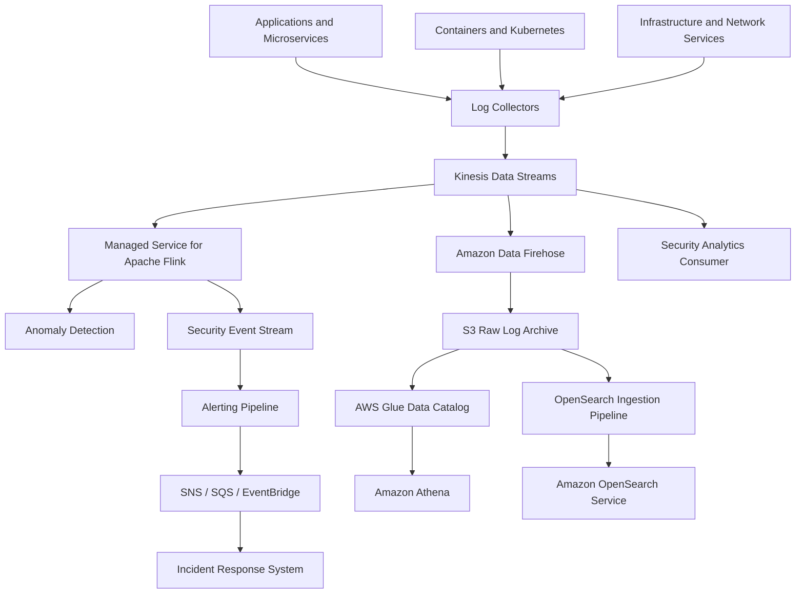
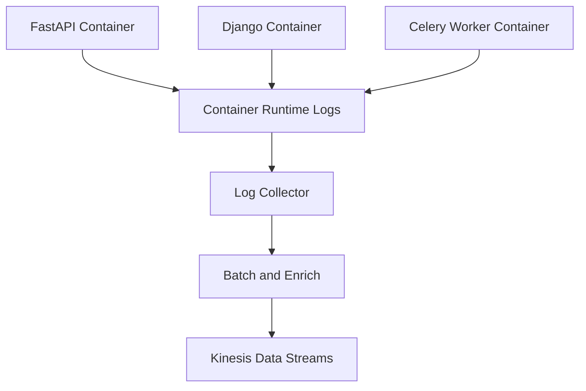
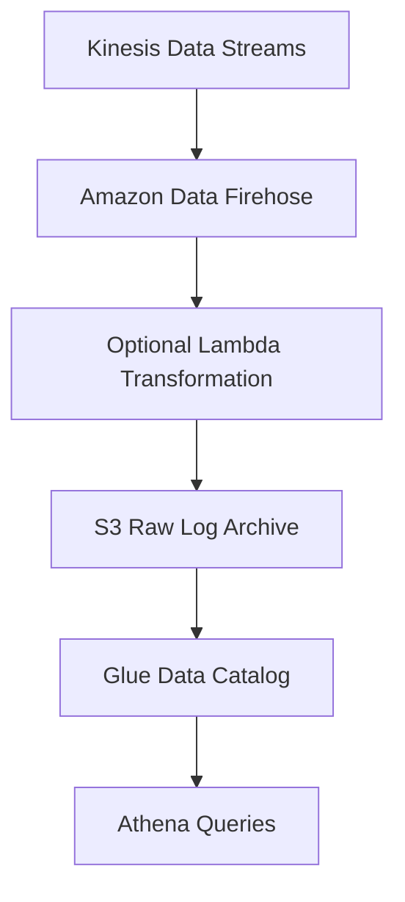
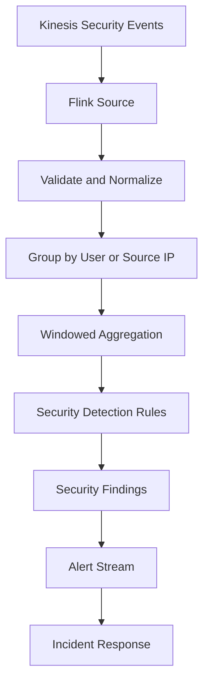
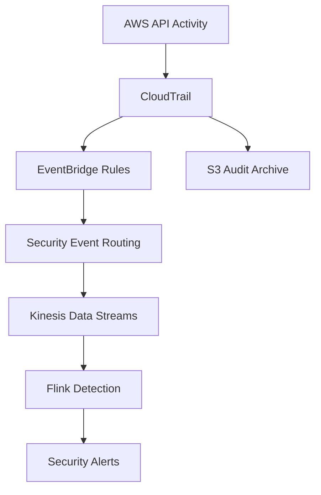
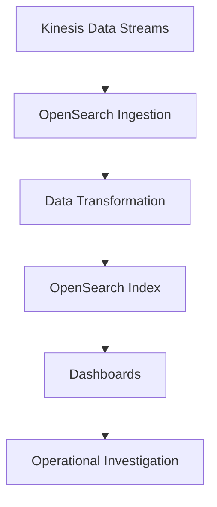

# 06- Log Aggregation and Security Monitoring

## Overview

Log aggregation and security monitoring are essential capabilities in distributed backend systems. Applications, infrastructure components, databases, containers, and network services continuously generate operational and security events. Collecting these events in a centralized platform makes it possible to investigate incidents, detect suspicious activity, identify application failures, and monitor system behavior.

Amazon Kinesis Data Streams provides a scalable ingestion layer for distributing log and security events to independent consumers. Amazon Data Firehose can deliver streaming data to destinations such as Amazon S3, while Amazon Managed Service for Apache Flink can perform real-time filtering, aggregation, and anomaly detection.

A typical architecture combines:

- **Amazon Kinesis Data Streams** for high-throughput event ingestion and distribution.
- **Amazon Data Firehose** for managed delivery to S3 and supported destinations.
- **Amazon Managed Service for Apache Flink** for real-time stream processing.
- **Amazon S3** for durable log archival and historical analysis.
- **Amazon CloudWatch** for AWS service metrics, application logs, and alarms.
- **Amazon OpenSearch Service** for searchable log analytics where required.
- **Amazon Athena** for SQL-based analysis of archived logs.
- **Amazon GuardDuty and AWS Security Hub** for AWS security findings and centralized security posture management.

The architecture should separate log collection, transport, processing, storage, detection, and response. This prevents individual applications from becoming tightly coupled to monitoring systems and allows security analytics to evolve independently.

## Why Centralized Log Aggregation Matters

In a distributed application, a single user request may pass through multiple services.

For example:

1. Nginx receives an HTTP request.
2. A FastAPI service authenticates the user.
3. A payment service processes the request.
4. PostgreSQL stores the transaction.
5. Redis provides cached account information.
6. An asynchronous Celery worker sends a notification.

Each component generates different logs. Investigating a failed transaction requires correlating these events across service boundaries.

Centralized log aggregation provides:

- A unified view of application and infrastructure activity.
- Cross-service request correlation.
- Faster incident investigation.
- Detection of suspicious authentication and access patterns.
- Historical analysis of operational trends.
- Evidence for security investigations and compliance processes.
- Independent consumers for alerting, analytics, and archival.

Without centralized collection, logs remain distributed across machines, containers, and individual services. This makes incident response slower and increases the risk of losing evidence when infrastructure is replaced or terminated.

## Log Aggregation Architecture

A production architecture should use an ingestion layer that is independent of the application services generating the logs.



### Architecture Components

| Component | Responsibility |
|---|---|
| Applications | Generate structured application and audit logs |
| Log collectors | Collect, enrich, batch, and forward events |
| Kinesis Data Streams | Buffer and distribute streaming records |
| Managed Service for Apache Flink | Filter, aggregate, and detect suspicious patterns |
| Amazon Data Firehose | Deliver streaming data to supported destinations |
| S3 | Store raw and processed log archives |
| AWS Glue Data Catalog | Maintain metadata for analytical datasets |
| Athena | Query archived logs using SQL |
| OpenSearch | Provide searchable log analytics |
| SNS, SQS, EventBridge | Distribute alerts and trigger response workflows |

Not every deployment requires all these components. For example, CloudWatch Logs can be sufficient for many application workloads. Kinesis becomes useful when multiple independent consumers, custom processing, replay, or high-throughput event distribution are required.

## Log Sources and Event Types

A centralized monitoring platform should collect logs from multiple layers.

| Source | Example events | Monitoring purpose |
|---|---|---|
| Nginx | HTTP access and error logs | Request failures, suspicious traffic |
| FastAPI / Django | Application errors and authentication events | Application behavior and access monitoring |
| PostgreSQL | Authentication failures and query errors | Database security and performance |
| Redis | Connection and authentication events | Cache availability and access monitoring |
| Docker | Container lifecycle and application output | Container troubleshooting |
| Kubernetes | Pod events and control-plane audit logs | Workload and cluster security |
| AWS CloudTrail | AWS API activity | Infrastructure access auditing |
| VPC Flow Logs | Network flow metadata | Network traffic analysis |
| AWS services | Service-specific operational logs | Infrastructure monitoring |

### Operational Logs vs Security Logs

These log categories overlap but serve different purposes.

| Category | Primary objective | Example |
|---|---|---|
| Application logs | Explain application behavior | Payment processing exception |
| Access logs | Record incoming requests | HTTP 401 or 403 response |
| Infrastructure logs | Monitor system operations | Container restart |
| Audit logs | Record security-relevant actions | IAM policy modification |
| Network logs | Observe network communication | Unexpected outbound connection |
| Security findings | Identify threats or vulnerabilities | GuardDuty finding |

Security-relevant events should not be discarded simply because they are not associated with an application error.

For example, repeated failed login attempts may produce successful HTTP responses from the authentication endpoint while still indicating suspicious activity.

## Structured Logging

Structured logging is preferable to unstructured text because it allows consistent filtering, aggregation, and correlation.

A structured event uses predictable fields rather than relying on regular expressions to extract information from arbitrary messages.

### Recommended Log Schema

```json
{
  "timestamp": "2026-11-20T10:15:30.123Z",
  "level": "WARNING",
  "service": "payment-service",
  "environment": "production",
  "event_type": "AUTHENTICATION_FAILURE",
  "message": "Authentication attempt rejected",
  "request_id": "req_78391",
  "trace_id": "trace_10482",
  "user_reference": "user_hash_123",
  "source_ip": "203.0.113.10",
  "http_method": "POST",
  "http_status": 401,
  "schema_version": 1
}
```

The IP address and user reference above are illustrative. Production systems should apply appropriate data minimization, access controls, and retention policies.

### Recommended Fields

| Field | Purpose |
|---|---|
| `timestamp` | Event occurrence time |
| `level` | Severity |
| `service` | Producing service |
| `environment` | Deployment environment |
| `event_type` | Machine-readable event classification |
| `message` | Human-readable description |
| `request_id` | Request correlation |
| `trace_id` | Distributed tracing correlation |
| `user_reference` | Privacy-preserving user reference |
| `source_ip` | Network investigation |
| `schema_version` | Event schema compatibility |

Use stable field names across services. A centralized schema makes queries and detection rules easier to maintain.

### Python Structured Logging

A Python service can emit structured JSON logs using a logging formatter.

```python
import json
import logging
from datetime import datetime, timezone


class JsonFormatter(logging.Formatter):
    def format(self, record: logging.LogRecord) -> str:
        payload = {
            "timestamp": datetime.now(
                timezone.utc
            ).isoformat(),
            "level": record.levelname,
            "service": "payment-service",
            "message": record.getMessage(),
        }

        for field in (
            "request_id",
            "trace_id",
            "event_type",
        ):
            value = getattr(record, field, None)

            if value is not None:
                payload[field] = value

        if record.exc_info:
            payload["exception"] = self.formatException(
                record.exc_info
            )

        return json.dumps(payload)


logger = logging.getLogger("payment-service")
logger.setLevel(logging.INFO)

handler = logging.StreamHandler()
handler.setFormatter(JsonFormatter())

logger.addHandler(handler)
logger.propagate = False

logger.warning(
    "Authentication attempt rejected",
    extra={
        "request_id": "req_78391",
        "trace_id": "trace_10482",
        "event_type": "AUTHENTICATION_FAILURE",
    },
)
```

In production, configure logging once during application startup and avoid attaching duplicate handlers when application modules are reloaded.

For Django and FastAPI deployments, ensure that application logs are written to standard output or standard error when running inside containers. A platform-level collector can then forward them without requiring applications to manage log files.

### Logging Security

Never log:

- Passwords.
- Authentication tokens.
- Session cookies.
- Private keys.
- Database credentials.
- Card verification values.
- Full payment credentials.
- Sensitive request or response bodies without an approved security requirement.

Use explicit allowlists for fields rather than logging entire request objects.

Sanitize user-controlled values to prevent log injection and avoid allowing untrusted input to create misleading log entries.

## Collecting Logs from Containers

Containerized applications should write logs to standard output and standard error.

A collector deployed as a sidecar, daemon, or node-level agent can read container logs and forward them to the ingestion layer.



### Collector Responsibilities

A production collector should support:

- Local buffering during temporary network failures.
- Batching to reduce API overhead.
- Retry with exponential backoff and jitter.
- Event timestamp preservation.
- Metadata enrichment.
- Payload size validation.
- Backpressure handling.
- Secure transport.
- Monitoring of dropped and rejected events.

Avoid implementing a custom log-forwarding thread inside every application unless the workload requires it. A dedicated collector reduces application complexity and centralizes transport behavior.

### Kubernetes Considerations

In Kubernetes, common deployment choices include:

- DaemonSet-based node-level collectors.
- Sidecar collectors for isolated workloads.
- Managed log collection integrations.

A DaemonSet is often suitable when logs are collected from multiple pods on each node. Sidecars can be useful when applications require specialized processing or isolation.

The collector must be configured with appropriate permissions and resource limits. A misconfigured collector can consume significant node memory or disk space when the destination becomes unavailable.

## Ingesting Logs into Kinesis Data Streams

Kinesis Data Streams provides a durable streaming layer between log producers and downstream consumers.

It is useful when:

- Multiple consumers need independent access to the same events.
- Log processing requires custom transformations.
- Consumers need to replay records within the retention period.
- Event throughput is high or variable.
- Security analytics must run independently from archival delivery.

### Partition-Key Design

Partition keys determine how records are distributed across shards.

For log aggregation, common partition-key choices include:

| Partition key | Advantage | Limitation |
|---|---|---|
| `service` | Preserves service-level ordering | Large services can create hot shards |
| `host_id` | Distributes events across hosts | Does not preserve service-wide ordering |
| `tenant_id` | Supports tenant-level analysis | Large tenants can become hot keys |
| `event_id` | Distributes records broadly | Does not preserve related-event ordering |

For general log ingestion, distributing records across many keys is often preferable to using a single service name.

A high-volume service that publishes all records under one partition key can overload a single shard even when the overall stream has sufficient capacity.

### Python Kinesis Producer

```python
import json
import logging
import os
import uuid
from datetime import datetime, timezone

import boto3
from botocore.config import Config

logger = logging.getLogger(__name__)

kinesis = boto3.client(
    "kinesis",
    region_name=os.environ["AWS_REGION"],
    config=Config(
        retries={
            "mode": "standard",
            "max_attempts": 5,
        },
        connect_timeout=3,
        read_timeout=10,
    ),
)

STREAM_NAME = os.environ["KINESIS_LOG_STREAM"]


def publish_log_event(event: dict) -> str:
    if not isinstance(event, dict):
        raise ValueError("Log event must be a dictionary")

    payload = {
        **event,
        "event_id": event.get("event_id", str(uuid.uuid4())),
        "ingested_at": datetime.now(
            timezone.utc
        ).isoformat(),
    }

    required_fields = {"timestamp", "service", "level"}

    missing = required_fields.difference(payload)

    if missing:
        raise ValueError(
            f"Missing required fields: {sorted(missing)}"
        )

    response = kinesis.put_record(
        StreamName=STREAM_NAME,
        Data=json.dumps(payload).encode("utf-8"),
        PartitionKey=payload["event_id"],
    )

    logger.debug(
        "Log event published",
        extra={
            "event_id": payload["event_id"],
            "shard_id": response["ShardId"],
        },
    )

    return response["SequenceNumber"]
```

This example demonstrates single-record publication. High-volume collectors should generally use `PutRecords` batching to reduce request overhead.

`PutRecords` can partially fail. Producers must inspect the per-record results and retry only failed records. Retries should preserve event IDs because a timeout or ambiguous response can result in duplicate publication.

For production log pipelines, collectors should also maintain a local buffer or durable spool so that temporary Kinesis outages do not immediately cause log loss.

## Amazon Data Firehose for Log Delivery

Amazon Data Firehose provides managed delivery of streaming records to supported destinations, including Amazon S3.

It is useful when the primary requirement is to move streaming data into storage or an analytics destination without managing a separate consumer application.

### Firehose vs Kinesis Data Streams

| Capability | Kinesis Data Streams | Amazon Data Firehose |
|---|---|---|
| Primary purpose | Durable stream ingestion and distribution | Managed delivery to destinations |
| Independent consumers | Multiple consumers | Destination-oriented delivery |
| Replay | Within stream retention | Requires source archive or another replay mechanism |
| Custom consumer logic | Application-managed | Optional supported transformations |
| Buffering | Stream and consumer controlled | Managed delivery buffering |
| Processing | Consumer applications or Flink | Optional transformation and format conversion |

A common design uses Kinesis Data Streams for multiple consumers and Data Firehose for archival delivery.

Firehose is not a replacement for a replayable event stream. It should not be treated as a long-term event-processing log.

### S3 Delivery Architecture



Use S3 prefixes that support operational partitioning:

```text
s3://central-security-logs/
    environment=production/
        service=payment-service/
            year=2026/
                month=11/
                    day=20/
                        hour=10/
```

Partitioning by date and other frequently queried dimensions can improve query efficiency. Avoid excessive partition cardinality, such as creating a separate S3 prefix for every request ID.

## Real-Time Security Monitoring with Flink

Amazon Managed Service for Apache Flink can process security events continuously and identify suspicious patterns.

Typical use cases include:

- Repeated authentication failures.
- Unusual API access rates.
- Privilege escalation activity.
- Unexpected service-to-service communication.
- Repeated access-denied responses.
- Suspicious administrative operations.
- Unusual traffic from a source IP.
- Unexpected changes in security-sensitive resources.

### Security Monitoring Pipeline



### Failed Authentication Detection

Consider a rule that detects repeated failed authentication attempts from one source IP.

Example rule:

```text
Key: source_ip

Window: 5 minutes

Aggregation:
    failed_attempts = COUNT(AUTHENTICATION_FAILURE)

Condition:
    failed_attempts >= 10

Output:
    SECURITY_ALERT
```

A production implementation should account for:

- NAT gateways and shared corporate IP addresses.
- Distributed attacks using multiple source IPs.
- Legitimate users repeatedly entering incorrect credentials.
- Account-specific attack patterns.
- Late and duplicate events.
- Authentication failures generated by automated systems.

A source-IP-only rule can produce false positives. Combine source IP, account reference, device, endpoint, and other contextual signals where appropriate.

### Detection Rules and Severity

A monitoring platform should classify events by severity and confidence.

| Severity | Example | Typical response |
|---|---|---|
| Informational | New application deployment | Record and correlate |
| Low | Occasional failed login | Monitor |
| Medium | Repeated authentication failures | Investigate or rate-limit |
| High | Unexpected privileged API activity | Generate security incident |
| Critical | Confirmed compromise indicators | Trigger incident response procedure |

Severity should reflect the impact and confidence of the finding, not simply the number of events.

### Stateful Detection

Flink keyed state can maintain counters and recent activity for each user, IP address, device, or service identity.

For example, a security processor can maintain:

- Failed login count.
- Last successful authentication.
- Recent source addresses.
- Recent privilege changes.
- API request frequency.
- Previously observed suspicious indicators.

State must be bounded and managed carefully. A stream keyed by highly variable identifiers can create large state volumes and expensive checkpoints.

## Enriching Security Events

Raw events often lack enough context for accurate security detection.

Enrichment adds additional information before or during processing.

Examples include:

| Enrichment source | Additional context |
|---|---|
| IAM inventory | Principal and role information |
| Asset inventory | Resource ownership and environment |
| IP intelligence | Known suspicious network indicators |
| User directory | User type and access classification |
| Service registry | Expected service-to-service relationships |
| Threat intelligence | Known malicious indicators |

Enrichment can be implemented through:

- Flink broadcast state for relatively small reference datasets.
- DynamoDB for low-latency keyed lookups.
- Redis for cached enrichment data.
- Periodic reference-data updates.
- Separate enrichment streams.

Avoid synchronous calls to external APIs for every log record. This increases latency, creates external dependencies, and can cause processing backpressure.

Enrichment data should include a version or observation timestamp so that investigations can distinguish current context from historical context.

## AWS Security Event Integration

Kinesis can serve as an ingestion and distribution layer for AWS security-related events, but it does not replace AWS security services.

### CloudTrail

AWS CloudTrail records account activity and API calls made through AWS management interfaces, SDKs, command-line tools, and supported services.

Examples include:

- IAM policy changes.
- Security group modifications.
- S3 bucket policy changes.
- Kinesis stream configuration changes.
- Resource deletion.
- Changes to encryption configuration.

CloudTrail can deliver events to CloudWatch Logs and S3. EventBridge can route matching events to downstream targets, including supported streaming destinations through appropriate integrations.

A typical architecture is:



Use CloudTrail as the authoritative AWS API activity source for the configured trail and event categories. Do not assume that an application log can provide equivalent evidence of AWS resource changes.

### VPC Flow Logs

VPC Flow Logs capture metadata about IP traffic to and from network interfaces, subnets, or VPCs.

They can help identify:

- Unexpected communication patterns.
- Repeated rejected traffic.
- Unusual outbound connections.
- Unexpected access between network segments.
- Traffic volume anomalies.

Flow Logs do not capture packet contents. They should be treated as network metadata rather than packet-level inspection.

They can be delivered to supported destinations such as CloudWatch Logs, S3, or Data Firehose, depending on the configuration.

### GuardDuty and Security Hub

Amazon GuardDuty analyzes supported AWS data sources to identify potential threats and generates security findings.

AWS Security Hub centralizes security findings and security posture information from supported integrations.

These services complement custom Kinesis-based monitoring:

| Service | Responsibility |
|---|---|
| CloudTrail | Records AWS API activity |
| VPC Flow Logs | Records network flow metadata |
| GuardDuty | Detects potential threats using supported telemetry |
| Security Hub | Aggregates security findings and posture information |
| Kinesis | Distributes custom or integrated event streams |
| Flink | Performs custom stateful event processing |

Do not rebuild managed threat-detection capabilities unnecessarily. Use custom streaming rules for application-specific behavior and correlation that managed services do not cover.

## Querying Historical Logs with Athena

Amazon Athena allows SQL queries over data stored in S3.

It is useful for:

- Historical incident investigations.
- Authentication trend analysis.
- Error-rate analysis.
- Security event correlation.
- Compliance reporting.
- Retrospective anomaly analysis.

AWS Glue Data Catalog can maintain the table metadata used by Athena.

### Example Log Table

A simplified external table might look like:

```sql
CREATE EXTERNAL TABLE security_logs (
    timestamp STRING,
    level STRING,
    service STRING,
    event_type STRING,
    request_id STRING,
    trace_id STRING,
    source_ip STRING,
    http_status INT
)
PARTITIONED BY (
    environment STRING,
    year STRING,
    month STRING,
    day STRING
)
STORED AS PARQUET
LOCATION 's3://central-security-logs/';
```

The exact table definition must match the stored file format and schema. JSON logs require an appropriate SerDe configuration, while Parquet requires compatible column types and metadata.

### Querying Failed Authentication Events

```sql
SELECT
    source_ip,
    COUNT(*) AS failed_attempts
FROM security_logs
WHERE event_type = 'AUTHENTICATION_FAILURE'
  AND environment = 'production'
  AND year = '2026'
  AND month = '11'
  AND day = '20'
GROUP BY source_ip
HAVING COUNT(*) >= 10
ORDER BY failed_attempts DESC;
```

This query identifies source addresses associated with repeated authentication failures for the selected partition.

For large datasets:

- Use Parquet or another columnar format.
- Partition by frequently filtered dimensions.
- Avoid scanning unnecessary date ranges.
- Compact small files.
- Use projected columns instead of `SELECT *`.
- Apply retention and lifecycle policies.

## Log Search with OpenSearch

Amazon OpenSearch Service is useful when teams need interactive search, filtering, dashboards, and log exploration.

A typical architecture sends selected log events from the ingestion layer to an OpenSearch ingestion pipeline and then into OpenSearch indexes.



OpenSearch can support:

- Full-text search.
- Structured filtering.
- Time-based dashboards.
- Error and security-event exploration.
- Aggregations.
- Incident investigation.

However, OpenSearch should not automatically become the permanent archive for every log event.

Use S3 for durable, cost-effective historical storage and OpenSearch for workloads that require interactive search.

### Index Management

Production deployments should define:

- Index naming conventions.
- Index templates and mappings.
- Retention policies.
- Index lifecycle management.
- Shard and replica strategy.
- Capacity monitoring.
- Access-control policies.

Avoid creating a separate index for every application request or individual event. Excessive index and shard counts increase cluster overhead.

## Reliability and Data Loss Prevention

Log aggregation systems must tolerate failures without silently losing security evidence.

Potential failure points include:

- Collector crashes.
- Local disk exhaustion.
- Network interruptions.
- Kinesis throttling.
- Consumer lag.
- Flink application failures.
- Firehose delivery failures.
- S3 permission errors.
- OpenSearch ingestion failures.

### Reliability Controls

| Failure | Recommended handling |
|---|---|
| Collector cannot reach Kinesis | Buffer locally and retry |
| Kinesis throttles writes | Apply backoff and retry |
| Producer times out | Preserve event ID and handle possible duplicate |
| Consumer crashes | Recover from durable processing position |
| Flink checkpoint fails | Alert and investigate recovery health |
| Firehose delivery fails | Monitor delivery errors and use configured backup/error handling |
| OpenSearch is unavailable | Retain durable source data and retry ingestion |
| Invalid log event | Quarantine with diagnostic metadata |

For security-sensitive events, define an explicit policy for events that cannot be delivered.

For example, an authentication service may continue accepting requests during a temporary monitoring outage, but the system should record the delivery failure and preserve security events through a durable local buffer or outbox.

Critical audit events may require stronger delivery guarantees and a separate durable persistence path.

### Duplicate Events

Retries and recovery can produce duplicate log events.

Use a stable `event_id` and deduplicate where duplicate processing would affect:

- Security alert counts.
- Incident creation.
- Billing or usage calculations.
- Compliance evidence.
- Automated remediation.

Do not assume that Kinesis provides application-level deduplication.

### Event Ordering

Kinesis ordering is limited to records within a shard.

For log aggregation, global ordering is usually unnecessary. Preserve event timestamps and correlation identifiers so that investigators can reconstruct event sequences.

For security rules that depend on ordering, choose partition keys based on the relevant entity, such as user ID or device ID.

## Security and Access Control

Centralized logs often contain sensitive information about users, infrastructure, and application behavior. A compromised logging platform can expose a large portion of an organization's operational environment.

### IAM Least Privilege

Use separate IAM roles for:

- Log collectors.
- Kinesis producers.
- Stream consumers.
- Flink applications.
- Firehose delivery.
- S3 archival.
- OpenSearch ingestion.
- Investigation and analytics users.

Grant only the actions and resources each role requires.

For example, a producer generally needs permission to publish records, not to delete streams or modify retention settings.

### Encryption

Apply encryption at rest and in transit.

| Layer | Security control |
|---|---|
| Collector to Kinesis | TLS |
| Kinesis Data Streams | Server-side encryption with AWS KMS where required |
| Firehose to S3 | Encrypted delivery |
| S3 | SSE-S3 or SSE-KMS according to security requirements |
| OpenSearch | Encryption at rest and node-to-node encryption |
| Application logs | Sanitization and data minimization |
| IAM | Least-privilege access |

Restrict KMS key usage through IAM policies and key policies.

### Log Integrity and Auditability

For sensitive audit logs:

- Restrict deletion and modification permissions.
- Use S3 versioning where appropriate.
- Consider S3 Object Lock when immutable retention is required.
- Enable CloudTrail for relevant administrative activity.
- Separate security archive ownership from application teams.
- Monitor changes to logging configuration.
- Record access to sensitive log datasets.

A log pipeline should not allow the same application role that generates an audit event to freely modify or delete the centralized archive.

### Retention and Privacy

Retention policies should reflect operational, legal, and regulatory requirements.

Do not retain all logs indefinitely by default.

Consider:

- Data classification.
- Applicable privacy requirements.
- Regulatory retention periods.
- Investigation requirements.
- Data deletion obligations.
- Storage and query costs.

Use separate retention policies for raw application logs, security audit records, and derived analytics datasets.

## Monitoring the Logging Pipeline

A monitoring platform must monitor itself.

A pipeline that silently drops events can create a false sense of security.

### Kinesis Metrics

| Metric | Purpose |
|---|---|
| `IncomingBytes` | Measures ingestion volume |
| `IncomingRecords` | Measures incoming event count |
| `WriteProvisionedThroughputExceeded` | Detects write throttling |
| `ReadProvisionedThroughputExceeded` | Detects shared-read throttling |
| `GetRecords.IteratorAgeMilliseconds` | Measures consumer lag |

Metric availability and dimensions depend on the stream mode, API, and monitoring configuration.

### Firehose Metrics

Monitor relevant delivery metrics, including:

- Incoming records and bytes.
- Delivery success.
- Delivery failures.
- Delivery-to-destination latency.
- Data transformation failures.
- Backup and error output volume.

Metric names and availability depend on the destination and configuration.

### Flink Metrics

Monitor:

- Records received and emitted.
- Processing latency.
- Backpressure.
- Checkpoint duration.
- Checkpoint failures.
- Restart frequency.
- State size.
- Watermark progress.
- Late-event counts.

### Business and Security Metrics

Infrastructure metrics alone do not indicate whether security monitoring is effective.

Track:

| Metric | Purpose |
|---|---|
| Log ingestion rate | Detects changes in event volume |
| Missing-event rate | Identifies collection gaps |
| Event processing delay | Measures monitoring freshness |
| Failed authentication count | Detects access anomalies |
| Privileged operation count | Tracks sensitive administrative activity |
| Security alerts by severity | Tracks detection output |
| Duplicate event rate | Identifies retry and replay behavior |
| Incident response time | Measures operational effectiveness |
| Collector buffer utilization | Detects delivery pressure |

### Pipeline Health Monitoring

Use independent alarms for:

- No incoming records when traffic is expected.
- Unexpected drops in ingestion volume.
- Increasing consumer lag.
- Repeated delivery failures.
- Flink checkpoint failures.
- Collector buffer exhaustion.
- Security alert processing delays.

For critical environments, use synthetic events to verify that the complete ingestion and alerting path is functioning.

## Scalability and Capacity Planning

Log volume can increase rapidly during incidents because errors, retries, and security events often occur together.

Capacity planning should account for normal traffic and failure-driven bursts.

### Kinesis Shard Capacity

For provisioned Kinesis Data Streams, a shard commonly supports:

- Up to 1 MB/s or 1,000 records/s for writes.
- Up to 2 MB/s for shared-consumer reads.

These are per-shard limits and should be validated against current service quotas and stream configuration.

A rough estimate is:

```text
required_shards =
    max(
        ceil(write_bytes_per_second / 1_MB),
        ceil(write_records_per_second / 1000)
    )
```

The estimate assumes reasonably distributed partition keys.

Add headroom for:

- Traffic spikes.
- Large log events.
- Consumer read demand.
- Hot partition keys.
- Operational growth.

On-demand capacity can reduce manual shard management, but it does not remove service quotas or hot-key problems.

### Consumer Scaling

Scale consumers based on processing throughput and lag.

For Flink:

- Tune parallelism based on source and operator throughput.
- Monitor backpressure.
- Keep state bounded.
- Avoid unnecessary repartitioning.
- Tune checkpoint intervals.
- Test recovery under peak event volume.

For independent consumers that require dedicated read throughput, Enhanced Fan-Out can reduce contention with shared reads.

## Cost Optimization

Centralized logging can become expensive because log volumes grow continuously and multiple copies may be retained.

| Component | Main cost drivers |
|---|---|
| Kinesis Data Streams | Provisioned or on-demand capacity, retention, enhanced fan-out |
| Amazon Data Firehose | Ingestion, transformation, and delivery usage |
| Managed Service for Apache Flink | Application processing capacity |
| S3 | Storage, requests, retrieval, and data transfer |
| Athena | Data scanned by queries |
| OpenSearch | Compute, storage, replicas, and data transfer |
| CloudWatch | Log ingestion, retention, metrics, and alarms |
| KMS | Key usage and API requests |

Recommended practices:

- Filter noisy, low-value events before expensive downstream processing.
- Use structured logs to avoid oversized messages.
- Store historical data in compressed columnar formats.
- Apply S3 lifecycle policies.
- Avoid excessive OpenSearch indexing.
- Use appropriate retention periods.
- Monitor Athena scanned bytes.
- Right-size Flink parallelism.
- Avoid unnecessary duplicate copies of raw logs.

Do not remove security-critical events merely to reduce ingestion costs. Use event classification and retention tiers instead.

## Disaster Recovery

Logging infrastructure should remain available during application and infrastructure failures.

Define recovery requirements for:

- Collectors and local buffers.
- Kinesis streams.
- Flink applications.
- S3 archival.
- OpenSearch indexes.
- Security alert delivery.

A disaster recovery strategy should include:

1. Cross-Region archival or replication where required.
2. Infrastructure definitions stored in version control.
3. Documented recovery procedures.
4. Reprocessing from durable archives.
5. Validation of IAM and KMS dependencies.
6. Alert routing verification after failover.
7. Regular recovery exercises.

Kinesis stream retention is finite. S3 should be used for long-term archival and historical reprocessing.

A cross-Region design must explicitly address stream replication, consumer offsets, duplicate handling, ordering, and destination recovery. Do not assume that a second Region automatically provides an active-active logging pipeline.

## Common Mistakes and Production Pitfalls

| Mistake | Why it is problematic | Recommended approach |
|---|---|---|
| Using unstructured logs everywhere | Makes filtering and correlation difficult | Standardize structured event schemas |
| Logging secrets and credentials | Exposes sensitive data in centralized storage | Apply field allowlists and sanitization |
| Using one partition key for all events | Creates a hot shard | Distribute keys based on workload |
| Treating Firehose as a replayable stream | It is a managed delivery service, not a retained event log | Use Kinesis Data Streams or S3 for replay |
| Ignoring partial `PutRecords` failures | Some records may be dropped despite a successful API response | Inspect per-record results |
| Assuming global event ordering | Kinesis only guarantees ordering within a shard | Preserve timestamps and correlation IDs |
| Sending every event directly to OpenSearch | Increases indexing and storage costs | Archive raw data to S3 and index selectively |
| Using synchronous enrichment APIs per event | Introduces latency and external dependencies | Use cached or stream-based enrichment |
| Ignoring collector disk usage | Buffers can exhaust node storage during outages | Configure bounded buffers and alerts |
| Treating HTTP errors as complete security evidence | Some attacks use valid requests and successful responses | Monitor semantic security events |
| Keeping logs indefinitely | Increases cost and privacy exposure | Define data-specific retention policies |
| Monitoring only infrastructure metrics | A healthy stream can still contain incomplete or incorrect data | Monitor event completeness and security outcomes |

## Production Deployment Checklist

### Log Collection

- [ ] Applications emit structured logs.
- [ ] Request and trace identifiers are propagated.
- [ ] Sensitive fields are excluded or sanitized.
- [ ] Collectors use bounded local buffers.
- [ ] Retry and backpressure behavior is configured.
- [ ] Collector health and dropped-event metrics are monitored.

### Streaming Infrastructure

- [ ] Kinesis partition-key strategy is load-tested.
- [ ] Capacity and service quotas are reviewed.
- [ ] Encryption is enabled.
- [ ] IAM permissions follow least privilege.
- [ ] Consumer lag alarms are configured.
- [ ] Retention meets replay requirements.

### Processing and Storage

- [ ] Flink processing handles duplicate and late events.
- [ ] Checkpointing and recovery are tested.
- [ ] Firehose delivery failures are monitored.
- [ ] S3 archival is validated.
- [ ] Athena tables match the stored schema.
- [ ] OpenSearch retention and index policies are configured.

### Security Monitoring

- [ ] CloudTrail and relevant network logs are collected.
- [ ] Security event schemas are standardized.
- [ ] Detection rules have defined severity levels.
- [ ] Alerts are delivered through durable workflows.
- [ ] Incident response procedures are documented.
- [ ] Audit logs are protected against unauthorized modification.
- [ ] Sensitive log access is audited.

### Operations

- [ ] End-to-end ingestion latency is monitored.
- [ ] Missing-event detection is implemented.
- [ ] Capacity and cost alarms are configured.
- [ ] Historical replay is tested.
- [ ] Disaster recovery procedures are validated.
- [ ] Retention and privacy requirements are documented.

## Key Takeaways

- Kinesis Data Streams provides durable event ingestion and distribution for log and security monitoring workloads that require multiple consumers, custom processing, or replay.
- Amazon Data Firehose and S3 provide managed archival delivery, while Athena and OpenSearch support historical analysis and interactive search.
- Structured logging, stable event identifiers, correlation IDs, and data sanitization are essential for reliable investigation and secure log management.
- Managed Service for Apache Flink enables stateful, real-time detection, but production rules must account for duplicates, late events, bounded state, and checkpoint recovery.
- Monitor the logging pipeline itself, protect audit records, and define explicit retention, incident response, and disaster recovery procedures.