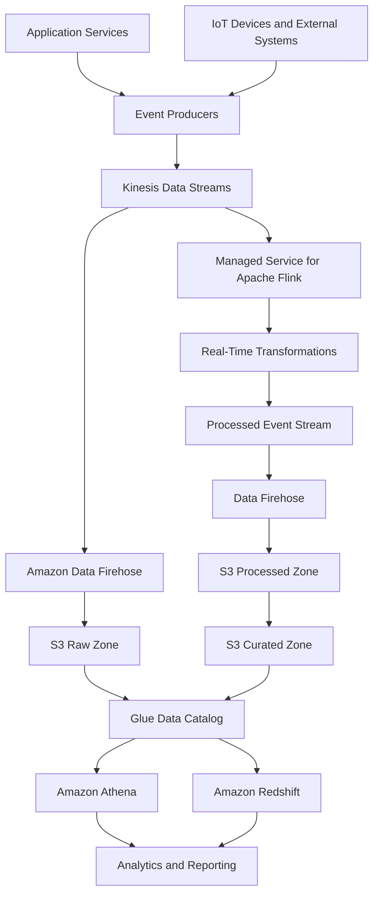
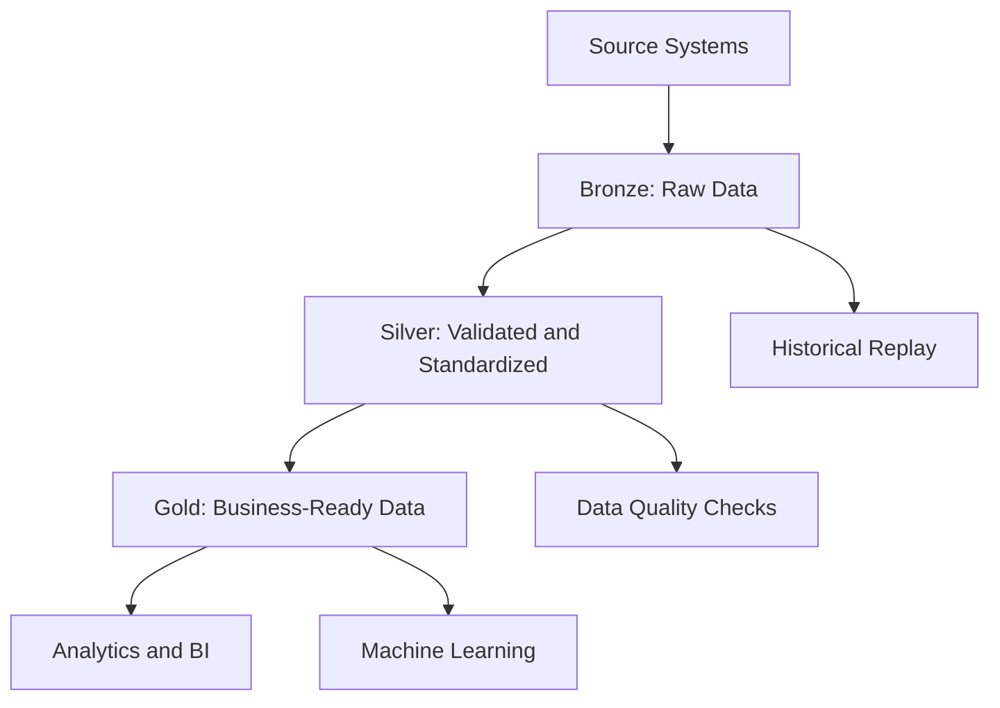
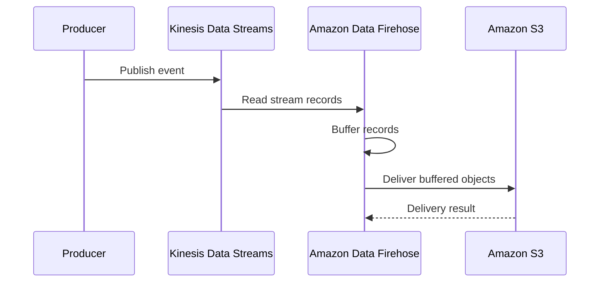
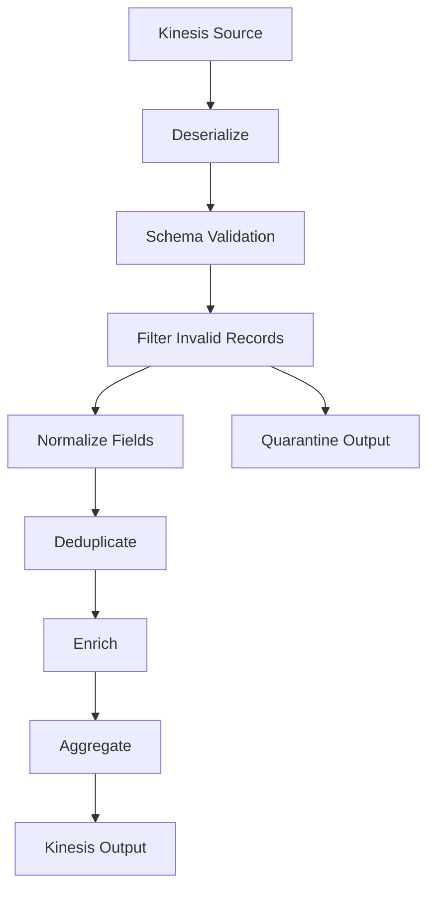
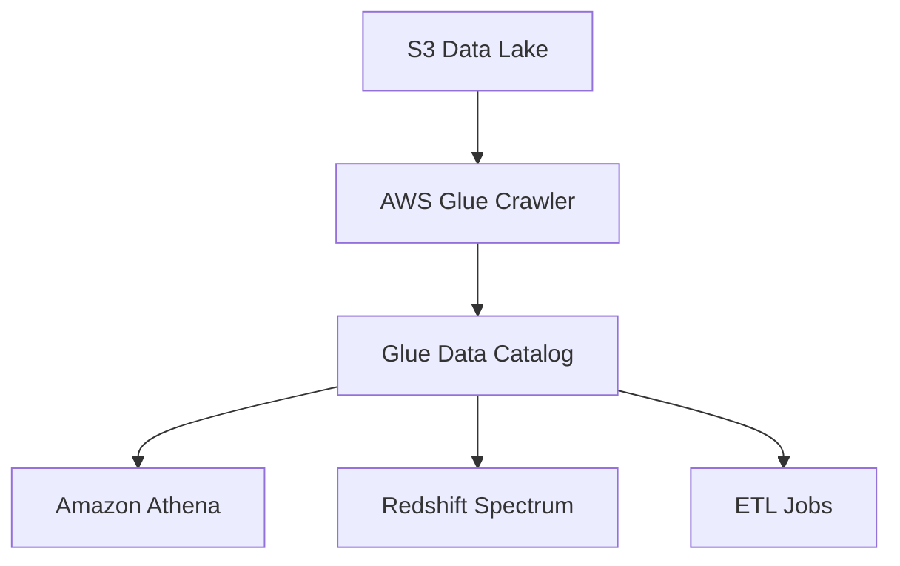
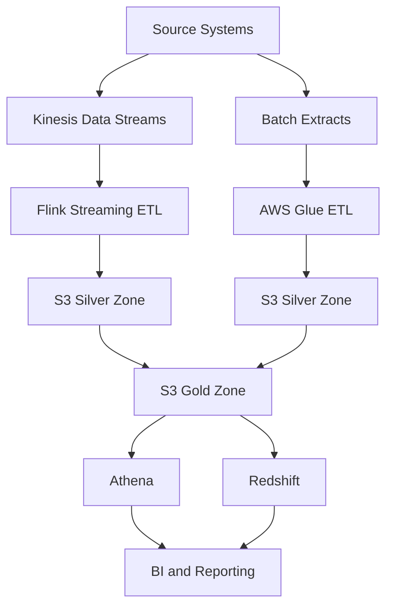

# 07- Streaming ETL and Data Lake Architecture

## Overview

Streaming ETL (Extract, Transform, Load) processes continuously arriving events and makes transformed data available for downstream analytics, reporting, and operational systems.

Traditional batch ETL collects data over a defined period and processes it on a schedule. Streaming ETL processes records continuously or in small batches, reducing the delay between event generation and data availability.

Amazon Kinesis Data Streams provides the ingestion and distribution layer for streaming workloads. Amazon Managed Service for Apache Flink supports stateful stream processing and transformations, while Amazon Data Firehose provides managed delivery to destinations such as Amazon S3.

A typical AWS streaming data lake architecture combines:

- **Amazon Kinesis Data Streams** for event ingestion and distribution.
- **Amazon Managed Service for Apache Flink** for real-time transformations and aggregations.
- **Amazon Data Firehose** for managed data delivery.
- **Amazon S3** for raw, transformed, and curated datasets.
- **AWS Glue Data Catalog** for table metadata and schema discovery.
- **AWS Glue** for cataloging and batch transformation workflows.
- **Amazon Athena** for SQL-based analytics.
- **Amazon Redshift** for analytical workloads requiring a data warehouse.
- **Amazon QuickSight** for business intelligence and dashboards.

The architecture should preserve raw source data, make transformations reproducible, and separate ingestion from analytical consumption.

## Streaming ETL Architecture

A streaming ETL pipeline continuously receives events, validates them, transforms their structure, and writes them to downstream storage.



The architecture supports two related processing paths:

- **Raw ingestion:** Preserves original events for historical analysis and reprocessing.
- **Streaming transformation:** Produces validated and enriched events for downstream consumption.

Keeping these paths separate makes it possible to change transformation logic without losing the original source data.

## Streaming ETL vs Batch ETL

Both processing models are useful in a modern data platform.

| Characteristic | Batch ETL | Streaming ETL |
|---|---|---|
| Input | Bounded datasets | Continuously arriving events |
| Processing | Scheduled execution | Continuous or micro-batch execution |
| Latency | Minutes to hours | Milliseconds to minutes, depending on architecture |
| Processing state | Usually job-scoped | Often maintained across events |
| Replay | Reprocess historical datasets | Replay retained events or archived data |
| Complexity | Relatively straightforward | Requires event-time and state management |
| Typical services | AWS Glue, EMR | Kinesis, Managed Service for Apache Flink |
| Use cases | Daily reporting, historical analysis | Fraud detection, monitoring, real-time analytics |

Streaming ETL does not eliminate batch processing. Most production data lakes use both.

For example, a payment platform may calculate transaction risk continuously while running a nightly batch job to reconcile transactions and generate financial reports.

## Data Lake Architecture

A data lake stores data in its original or transformed form in a centralized storage system.

Amazon S3 is commonly used as the storage foundation because it supports large datasets, durable object storage, lifecycle policies, and integration with AWS analytics services.

A well-designed data lake separates data according to its processing stage.

### Data Lake Zones

| Zone | Purpose | Typical content |
|---|---|---|
| Raw | Preserve source events | Original JSON, Avro, or Parquet records |
| Validated | Store schema-checked records | Validated and normalized events |
| Curated | Store analytics-ready datasets | Enriched and transformed records |
| Consumption | Support application and BI workloads | Aggregates, reporting datasets, feature datasets |
| Quarantine | Isolate invalid or unprocessable records | Malformed events and validation errors |

These zones are logical data-management boundaries. They can be implemented using separate S3 prefixes, buckets, or accounts depending on security and governance requirements.

### Medallion Architecture

The Bronze, Silver, and Gold pattern is a common way to organize data lake transformations.

<text>

</text>



| Layer | Equivalent zone | Responsibility |
|---|---|---|
| Bronze | Raw | Preserve source data with minimal modification |
| Silver | Validated | Clean, normalize, deduplicate, and enrich |
| Gold | Curated | Publish business-oriented datasets and aggregates |

The main advantage is separation of concerns. A change in business reporting logic should not require rewriting the original source events.

## Event Ingestion with Kinesis Data Streams

Kinesis Data Streams provides a durable stream that producers can write to and independent consumers can read from.

Typical producers include:

- Django and FastAPI applications.
- Payment and order-processing services.
- IoT platforms.
- Microservices.
- Log collectors.
- External integration services.

### Producer Responsibilities

A producer should:

- Validate the event contract.
- Generate a stable event identifier.
- Include event occurrence time.
- Serialize the event consistently.
- Select an appropriate partition key.
- Handle throttling and transient failures.
- Preserve events when publication fails.

Example event:

```json
{
  "event_id": "evt_78391",
  "event_type": "ORDER_CREATED",
  "schema_version": 1,
  "order_id": "ord_10482",
  "customer_id": "cust_2091",
  "amount": 2499.00,
  "currency": "INR",
  "event_time": "2026-11-20T10:15:30.000Z"
}
```

### Partition-Key Selection

The partition key determines which shard receives a record.

| Partition key | Suitable scenario | Risk |
|---|---|---|
| `customer_id` | Customer activity aggregation | High-volume customers can create hot shards |
| `order_id` | Independent order processing | Does not preserve customer-level ordering |
| `device_id` | IoT telemetry | High-volume devices can create hot shards |
| `event_id` | Broad distribution | Related events are not necessarily colocated |

Choose partition keys according to the ordering and processing boundary required by downstream consumers.

### Python Producer Example

```python
import json
import os
from datetime import datetime, timezone
from uuid import uuid4

import boto3
from botocore.config import Config


kinesis = boto3.client(
    "kinesis",
    region_name=os.environ["AWS_REGION"],
    config=Config(
        retries={
            "mode": "standard",
            "max_attempts": 5,
        },
        connect_timeout=3,
        read_timeout=10,
    ),
)

STREAM_NAME = os.environ["KINESIS_STREAM_NAME"]


def publish_event(event: dict) -> str:
    required_fields = {
        "event_type",
        "customer_id",
    }

    missing = required_fields.difference(event)

    if missing:
        raise ValueError(
            f"Missing required fields: {sorted(missing)}"
        )

    payload = {
        **event,
        "event_id": event.get("event_id", str(uuid4())),
        "schema_version": 1,
        "published_at": datetime.now(
            timezone.utc
        ).isoformat(),
    }

    response = kinesis.put_record(
        StreamName=STREAM_NAME,
        Data=json.dumps(payload).encode("utf-8"),
        PartitionKey=str(payload["customer_id"]),
    )

    return response["SequenceNumber"]
```

For high-volume producers, use `PutRecords` to batch events and inspect individual record results. A successful batch API response does not guarantee that every record was accepted.

For critical business events, use a transactional outbox when the source database transaction and stream publication must remain consistent.

## Raw Data Ingestion into S3

The raw zone preserves source events before business transformations.

This is important for:

- Historical replay.
- Audit and investigation.
- Schema migration.
- Rebuilding curated datasets.
- Comparing transformation versions.
- Recovering from processing defects.

Amazon Data Firehose can consume records from Kinesis Data Streams and deliver them to S3.

### Firehose Delivery Flow



Firehose uses managed buffering based on configured buffer size and interval hints. Actual delivery timing can exceed the configured interval.

It is a delivery service, not a replacement for a replayable retained stream.

### S3 Raw Zone Layout

A practical structure uses date-based prefixes:

```text
s3://company-data-lake/
    bronze/
        orders/
            year=2026/
                month=11/
                    day=20/
                        hour=10/
        payments/
            year=2026/
                month=11/
                    day=20/
                        hour=10/
```

Partition by dimensions that support common analytical filters.

Avoid creating excessive small partitions. High-cardinality fields such as transaction IDs are usually poor partition dimensions.

### Raw Data Preservation

The raw layer should preserve the original event payload whenever possible.

Recommended metadata includes:

- Event identifier.
- Source system.
- Event type.
- Schema version.
- Event timestamp.
- Ingestion timestamp.
- Processing or replay metadata.

Do not silently overwrite original source fields during ingestion.

If transformations are necessary, preserve the original record or retain an immutable raw copy before modifying the event.

## Streaming Transformations with Apache Flink

Amazon Managed Service for Apache Flink provides a managed runtime for Apache Flink applications.

It supports continuous processing, stateful transformations, event-time windows, and checkpoint-based recovery.

It is suitable for workloads such as:

- Event validation.
- Data normalization.
- Enrichment.
- Deduplication.
- Windowed aggregations.
- Real-time metrics.
- Anomaly detection.
- Stream-to-stream transformations.

### Transformation Pipeline



### Common Transformations

| Transformation | Purpose |
|---|---|
| Validation | Reject malformed or incomplete records |
| Normalization | Standardize field names, timestamps, and types |
| Filtering | Remove irrelevant events |
| Deduplication | Prevent repeated logical events from inflating results |
| Enrichment | Add reference data |
| Aggregation | Calculate counts, totals, and time-window metrics |
| Routing | Send records to different destinations |

A transformation should be deterministic wherever possible. This makes replay and historical recomputation more predictable.

### Event-Time Processing

Event time represents when the original business event occurred.

Processing time represents when the streaming application processes the record.

These timestamps differ when producers are delayed, network communication is interrupted, or consumers fall behind.

For analytical calculations such as hourly revenue, event time is generally more appropriate.

Flink uses watermarks to track event-time progress and determine when time windows can be evaluated.

A production application must define:

- Watermark strategy.
- Allowed lateness.
- Late-event handling.
- Window boundaries.
- State retention.
- Recovery behavior.

Late events should not be silently discarded when they affect financial or business reporting. Depending on requirements, they may update an aggregate, trigger a correction, or enter a separate reconciliation workflow.

### Windowed Aggregation Example

Consider an order analytics pipeline that calculates order count and total revenue per customer over a five-minute window.

Conceptually:

```text
Key: customer_id

Window: 5 minutes

Aggregations:
    order_count = COUNT(orders)
    total_revenue = SUM(order_amount)

Output:
    customer_id
    window_start
    window_end
    order_count
    total_revenue
```

A Flink implementation would key the stream by `customer_id`, assign event-time timestamps and watermarks, apply a five-minute window, and emit the aggregate.

The application must also define how late records affect previously emitted results and how downstream consumers handle corrected aggregates.

## Data Validation and Schema Management

Data quality is a critical part of streaming ETL.

Invalid records should not silently enter curated datasets.

### Validation Rules

Common validation checks include:

- Required fields are present.
- Field types match the event schema.
- Timestamps are valid and timezone-aware.
- Numeric values are within acceptable ranges.
- Event identifiers are unique where required.
- Enumerated fields contain supported values.
- Schema versions are supported.

Example:

```python
from datetime import datetime
from decimal import Decimal


def validate_order_event(event: dict) -> None:
    required_fields = {
        "event_id",
        "order_id",
        "customer_id",
        "amount",
        "currency",
        "event_time",
    }

    missing = required_fields.difference(event)

    if missing:
        raise ValueError(
            f"Missing fields: {sorted(missing)}"
        )

    amount = Decimal(str(event["amount"]))

    if amount < 0:
        raise ValueError("Order amount cannot be negative")

    if len(event["currency"]) != 3:
        raise ValueError("Invalid currency code")

    event_time = datetime.fromisoformat(
        event["event_time"].replace("Z", "+00:00")
    )

    if event_time.tzinfo is None:
        raise ValueError("Event time must include timezone")
```

In production, use a formal schema definition and a validation library rather than duplicating validation rules across producers and consumers.

### Schema Evolution

Schemas change as applications introduce new fields and event types.

A safe schema evolution strategy should:

- Use explicit schema versions.
- Prefer backward-compatible changes.
- Add optional fields before requiring them.
- Maintain compatibility tests.
- Define how old records are interpreted.
- Preserve original schema metadata in raw storage.

AWS Glue Data Catalog stores table and partition metadata for analytical datasets. It is not, by itself, a complete event-contract governance solution.

For streaming event contracts, use an explicit schema registry or another controlled schema-management process where appropriate.

## Deduplication and Idempotent Processing

Streaming systems can deliver duplicate records because of retries, producer failures, and consumer recovery.

A transformation pipeline must distinguish between a unique record and a unique business event.

For example, a payment event may be published twice with the same `event_id` after an ambiguous producer timeout.

### Deduplication Strategy

Use a stable event identifier and retain deduplication state for an appropriate period.

Possible implementations include:

- Flink keyed state with bounded retention.
- DynamoDB for durable event-ID tracking.
- A database uniqueness constraint.
- An idempotent downstream sink.

Deduplication state should not grow indefinitely. Define a retention period based on replay and duplicate-arrival requirements.

### Idempotent Sink Processing

For database sinks, use a transaction that records the event identifier and applies the business update atomically.

For file-based data lakes, deduplication may require a downstream compaction or merge process because ordinary S3 object writes do not provide row-level transactional updates.

Do not assume that a Kinesis sequence number is a globally unique business event identifier.

## Writing Processed Data to S3

Transformed records can be delivered to S3 through Amazon Data Firehose or a custom consumer.

The choice depends on processing and delivery requirements.

| Approach | Suitable use case |
|---|---|
| Data Firehose | Managed delivery with buffering and supported transformations |
| Flink to Kinesis output | Multiple downstream stream consumers |
| Flink with supported S3 sink | Continuous file-oriented output |
| Custom Kinesis consumer | Specialized file naming, partitioning, or delivery logic |

For custom consumers, writing one S3 object per event is generally inefficient. Buffer records by time, size, or partition before writing files.

### File Format Selection

| Format | Characteristics | Typical use |
|---|---|---|
| JSON | Human-readable, flexible | Raw event storage |
| CSV | Simple tabular format | Interoperability and exports |
| Parquet | Columnar, compressed, typed | Analytical datasets |
| Avro | Schema-oriented row format | Event interchange and schema evolution |
| ORC | Columnar analytical format | Large-scale analytical processing |

For analytical workloads, Parquet is often a suitable curated format because it supports column pruning and efficient compression.

Keep raw source data in its original format when preservation and replay requirements justify it.

### Small File Problem

Continuous streams can generate many small objects.

For example, writing every incoming event as a separate S3 object increases:

- Object listing overhead.
- Query planning overhead.
- Metadata management cost.
- Athena query overhead.
- Downstream compaction work.

Use buffering and compaction to create appropriately sized files.

The ideal file size depends on workload, query engine, and partition strategy. Avoid treating a single target size as a universal rule.

## AWS Glue Data Catalog

AWS Glue Data Catalog stores metadata about datasets, including:

- Database names.
- Table definitions.
- Column names and types.
- S3 locations.
- Partition information.
- Schema metadata.

It allows analytics services such as Athena and Redshift Spectrum to discover and query data.

### Catalog Architecture



A Glue crawler can inspect supported data formats and infer table metadata.

However, automatically inferred schemas should be reviewed before production use.

For controlled production datasets, explicit table definitions and schema deployment through infrastructure as code are often more predictable than relying entirely on crawlers.

### Partition Management

Partition metadata allows query engines to avoid scanning unrelated data.

For example:

```text
environment=production/
year=2026/
month=11/
day=20/
```

Athena can use these partitions to limit the amount of data scanned.

Use partition projection when appropriate for predictable partition structures, especially when managing very large numbers of date-based partitions.

## Querying the Data Lake with Athena

Amazon Athena provides serverless SQL queries over supported datasets stored in S3.

It is useful for:

- Historical reporting.
- Operational analytics.
- Data quality investigation.
- Business metrics.
- Security analysis.
- Ad hoc exploration.

### Example Table

A simplified Parquet table can be defined as:

```sql
CREATE EXTERNAL TABLE orders (
    event_id STRING,
    order_id STRING,
    customer_id STRING,
    amount DECIMAL(18, 2),
    currency STRING,
    event_time TIMESTAMP
)
PARTITIONED BY (
    year STRING,
    month STRING,
    day STRING
)
STORED AS PARQUET
LOCATION 's3://company-data-lake/silver/orders/';
```

The table definition must match the actual Parquet schema and partition layout.

### Example Analytical Query

Calculate daily order revenue:

```sql
SELECT
    year,
    month,
    day,
    currency,
    COUNT(*) AS order_count,
    SUM(amount) AS total_revenue
FROM orders
WHERE year = '2026'
  AND month = '11'
  AND day = '20'
GROUP BY
    year,
    month,
    day,
    currency
ORDER BY currency;
```

### Athena Optimization

- Store analytical datasets in Parquet or ORC.
- Partition by commonly filtered dimensions.
- Avoid excessive partition cardinality.
- Select only required columns.
- Compact small files.
- Use compression.
- Monitor bytes scanned.
- Separate raw and curated query workloads.

Athena charges based on data scanned for common query models. Poor partitioning and uncompressed formats can increase query cost significantly.

## Batch and Streaming Integration

A mature data lake commonly uses both streaming and batch processing.

Streaming pipelines provide low-latency data availability. Batch pipelines perform large-scale recomputation, reconciliation, and historical transformations.



### When to Use Each

| Requirement | Recommended approach |
|---|---|
| Real-time fraud signals | Streaming ETL |
| Live operational metrics | Streaming ETL |
| Daily financial reconciliation | Batch ETL |
| Historical data backfill | Batch ETL |
| Continuous data normalization | Streaming ETL |
| Rebuilding a curated dataset | Batch ETL |
| Low-latency customer activity aggregates | Streaming ETL |

A useful design is to make streaming and batch transformations share the same business rules where possible.

This reduces the risk of producing different results for the same event depending on which processing path handled it.

## Data Lake Governance and Security

A centralized data lake can contain sensitive customer, financial, and operational information.

Security should be enforced at the storage, catalog, query, and application layers.

### IAM and Access Control

Use separate IAM roles for:

- Producers.
- Stream consumers.
- Flink applications.
- Firehose delivery.
- Glue jobs.
- Athena users.
- Data lake administrators.

Grant only the required actions on specific resources.

Avoid giving application services unrestricted access to raw and curated data lake buckets.

### S3 Security

Recommended controls:

- Enable S3 Block Public Access.
- Use encryption at rest.
- Enforce TLS for data transfer.
- Restrict bucket policies.
- Use least-privilege IAM policies.
- Enable access logging or appropriate audit monitoring.
- Use versioning where recovery requirements justify it.
- Apply lifecycle and retention policies.
- Consider S3 Object Lock for immutable records.

### Data Classification

Classify datasets according to sensitivity.

| Classification | Example | Access approach |
|---|---|---|
| Public | Approved public reference data | Broad access |
| Internal | Operational metrics | Internal role-based access |
| Confidential | Customer transaction data | Restricted access |
| Highly sensitive | Credentials or regulated personal data | Strictly controlled access and minimization |

Avoid placing secrets or authentication credentials in the data lake.

### Lake Formation

AWS Lake Formation can help manage permissions over data lake resources, including databases, tables, and columns.

It can complement IAM and S3 policies by providing more granular data access governance.

A production design should define how IAM permissions, Lake Formation permissions, and S3 access policies interact.

Do not assume that catalog-level permissions alone protect the underlying S3 objects from every access path.

## Reliability and Recovery

Streaming ETL pipelines must handle failures without losing records or corrupting analytical datasets.

### Failure Scenarios

| Failure | Recommended handling |
|---|---|
| Producer cannot publish | Retry and retain event in a durable outbox |
| Kinesis throttling | Apply backoff and retry |
| Consumer crashes | Resume from durable processing position |
| Flink checkpoint failure | Alert and investigate recovery |
| Invalid record | Route to quarantine |
| Firehose delivery failure | Monitor delivery errors and backup configuration |
| S3 write failure | Retry safely and reconcile output |
| Glue job failure | Retry with controlled execution and inspect rejected records |
| Athena query failure | Investigate schema, permissions, and data layout |

### Checkpointing

Flink checkpointing captures application state and source positions for recovery.

A checkpoint does not automatically guarantee exactly-once effects in every external destination.

For example, a custom consumer that writes to S3 may create duplicate output files after a restart unless its output protocol is designed for recovery.

Use sink connectors with documented delivery semantics, deterministic output strategies, and reconciliation processes.

### Replay and Backfill

Historical replay is essential when:

- Transformation logic changes.
- A processing defect is discovered.
- A schema migration is required.
- Historical aggregates must be rebuilt.
- A downstream dataset is corrupted.

Use S3 raw data as the long-term replay source because Kinesis retention is finite.

A replay process should:

1. Select the required source time range.
2. Validate source schema versions.
3. Preserve original event identifiers and event timestamps.
4. Run transformations in an isolated processing environment.
5. Write to a separate output prefix or dataset version.
6. Validate row counts and business aggregates.
7. Publish the rebuilt dataset only after validation.

Never replay historical data directly into production side-effecting workflows without explicit safeguards.

## Scalability and Performance

Streaming ETL performance depends on ingestion throughput, transformation complexity, state size, sink throughput, and partition distribution.

### Kinesis Capacity

For provisioned Kinesis Data Streams, a shard commonly supports:

- Up to 1 MB/s or 1,000 records/s for writes.
- Up to 2 MB/s for shared-consumer reads.

A rough shard estimate is:

```text
required_shards =
    max(
        ceil(write_bytes_per_second / 1_MB),
        ceil(write_records_per_second / 1000)
    )
```

This estimate assumes reasonably distributed partition keys and does not account for hot shards, read demand, headroom, or every service quota.

On-demand capacity can reduce manual shard management but does not eliminate service quotas or hot-key problems.

### Flink Performance

Monitor and tune:

- Source throughput.
- Operator parallelism.
- Backpressure.
- Network shuffles.
- State size.
- Checkpoint duration.
- Sink throughput.
- Watermark progress.

A slow downstream sink can cause backpressure throughout the processing topology.

### S3 Performance

For analytical datasets:

- Use columnar formats.
- Compress files.
- Avoid excessive small files.
- Choose partition dimensions carefully.
- Compact data where necessary.
- Separate frequently queried datasets from archival data.

### Data Freshness

Measure end-to-end data latency:

```text
event_time
    -> ingestion_time
    -> processing_time
    -> s3_delivery_time
    -> query_availability_time
```

This helps identify whether delays occur at ingestion, processing, delivery, cataloging, or query execution.

## Monitoring and Observability

Monitor both the streaming infrastructure and the quality of produced datasets.

### Kinesis Metrics

| Metric | Purpose |
|---|---|
| `IncomingBytes` | Measures ingestion volume |
| `IncomingRecords` | Measures event count |
| `WriteProvisionedThroughputExceeded` | Detects write throttling |
| `ReadProvisionedThroughputExceeded` | Detects shared-read throttling |
| `GetRecords.IteratorAgeMilliseconds` | Indicates consumer lag |

Metric availability and dimensions depend on stream mode, API, and monitoring configuration.

### Flink Metrics

Monitor:

- Records received and emitted.
- Processing latency.
- Backpressure.
- Checkpoint duration and failures.
- Restart frequency.
- State size.
- Late-event counts.
- Sink failures.

### Data Quality Metrics

| Metric | Purpose |
|---|---|
| Invalid record count | Detects schema and validation failures |
| Duplicate event count | Measures duplicate delivery |
| Quarantine volume | Identifies unprocessable data |
| Late-event count | Measures event-time quality |
| Record count by partition | Detects incomplete datasets |
| Data freshness | Measures availability delay |
| Schema version distribution | Tracks producer adoption |
| Reconciliation difference | Detects missing or duplicated data |

### End-to-End Monitoring

Use synthetic events or controlled test datasets to validate the complete path from producer to analytical query.

A successful Kinesis write does not prove that an event was transformed, archived, cataloged, and made queryable.

Monitor each stage independently.

## Cost Optimization

Data lake costs are influenced by ingestion, transformation, storage, queries, and data movement.

| Service | Main cost drivers |
|---|---|
| Kinesis Data Streams | Provisioned or on-demand capacity, retention, enhanced fan-out |
| Managed Service for Apache Flink | Application processing capacity |
| Amazon Data Firehose | Ingestion, transformation, and delivery |
| S3 | Storage, requests, retrieval, and data transfer |
| AWS Glue | Crawler and ETL job usage |
| Athena | Data scanned by queries |
| Redshift | Compute and storage |
| CloudWatch | Metrics, logs, and retention |

Recommended practices:

- Store raw and curated data separately.
- Use compressed columnar formats for analytics.
- Apply S3 lifecycle policies.
- Avoid excessive small files.
- Right-size Flink parallelism.
- Optimize Athena partitioning.
- Avoid unnecessary Glue crawlers.
- Monitor data duplication and retention.
- Use appropriate S3 storage classes for historical data.

Do not remove raw data solely to reduce storage costs when it is required for audit, replay, or regulatory purposes.

## Common Mistakes and Production Pitfalls

| Mistake | Why it is problematic | Recommended approach |
|---|---|---|
| Treating Firehose as a replayable stream | Firehose is a managed delivery service | Retain raw data in S3 or use Kinesis retention |
| Writing one S3 object per event | Creates excessive small files | Buffer and compact records |
| Using only processing time | Produces incorrect time-window analytics when events are delayed | Use event time and watermarks |
| Ignoring schema evolution | Breaks downstream consumers | Version event contracts and test compatibility |
| Overwriting raw events | Removes the ability to reproduce transformations | Preserve immutable raw data |
| Using high-cardinality S3 partitions | Increases metadata and query overhead | Partition by common analytical filters |
| Assuming exactly-once external writes | Recovery can repeat external side effects | Use idempotent sinks and reconciliation |
| Ignoring partial batch failures | Some records may be rejected | Inspect per-record results |
| Relying entirely on Glue crawlers | Inferred schemas can be inconsistent | Use controlled schemas for production datasets |
| Replaying data into live workflows | Can repeat notifications and business actions | Use isolated replay destinations |
| Ignoring late events | Produces incomplete aggregates | Define late-event and correction policies |
| Monitoring only infrastructure | A healthy stream can still produce incorrect data | Monitor data quality and freshness |

## Production Deployment Checklist

### Ingestion

- [ ] Event schemas are documented and versioned.
- [ ] Producers generate stable event identifiers.
- [ ] Partition keys are load-tested.
- [ ] Producer retries and buffering are configured.
- [ ] Partial batch failures are handled.
- [ ] Critical publication uses an appropriate durability strategy.

### Streaming Processing

- [ ] Flink validation and transformation logic is tested.
- [ ] Event-time and watermark policies are defined.
- [ ] Deduplication is implemented where required.
- [ ] State retention is bounded.
- [ ] Checkpointing and recovery are validated.
- [ ] Invalid records are routed to quarantine.

### Data Lake

- [ ] Raw events are preserved.
- [ ] S3 prefixes follow a consistent partition strategy.
- [ ] Curated data uses appropriate formats.
- [ ] Small-file compaction is implemented where needed.
- [ ] Glue Catalog schemas match stored data.
- [ ] Athena query performance is tested.

### Security and Governance

- [ ] IAM roles follow least privilege.
- [ ] S3 Block Public Access is enabled.
- [ ] Encryption is configured.
- [ ] Sensitive fields are classified and protected.
- [ ] Data retention and deletion policies are defined.
- [ ] Access to sensitive datasets is audited.

### Operations

- [ ] Ingestion and processing lag are monitored.
- [ ] Data quality metrics are available.
- [ ] Delivery failures trigger alerts.
- [ ] Historical replay is tested.
- [ ] Batch and streaming results are reconciled.
- [ ] Cost and capacity alarms are configured.
- [ ] Disaster recovery procedures are documented.

## Key Takeaways

- Kinesis Data Streams provides durable event ingestion and distribution, while Managed Service for Apache Flink performs continuous stateful transformations.
- A well-designed data lake preserves raw events and separates validated, curated, and consumption-ready datasets.
- Amazon Data Firehose simplifies managed delivery to S3, while Glue Data Catalog and Athena support metadata management and SQL analytics.
- Reliable streaming ETL requires schema evolution, event-time handling, deduplication, checkpoint recovery, and explicit late-event policies.
- Production data lakes need data-quality monitoring, least-privilege access, controlled retention, historical replay, and cost-aware storage and partitioning.