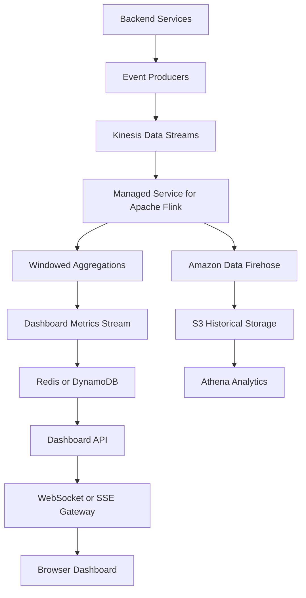
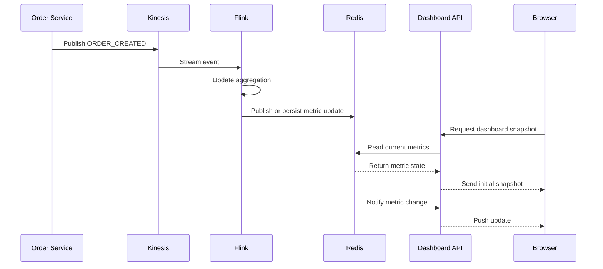
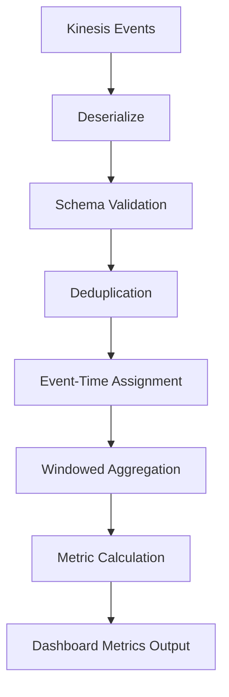
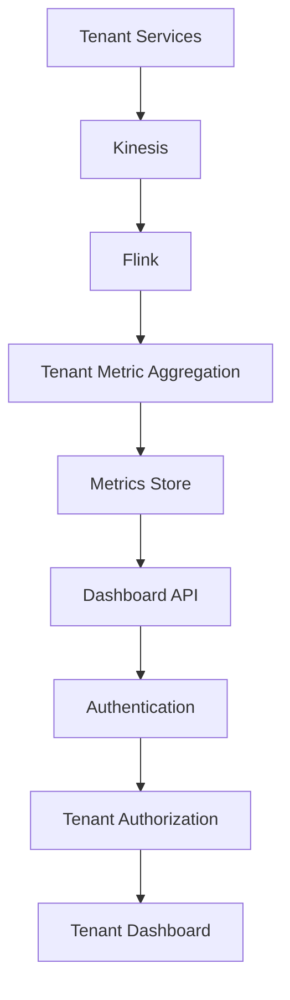
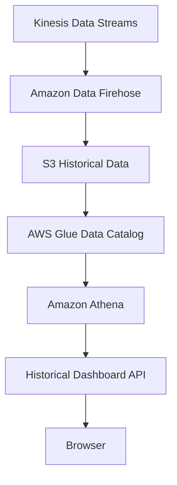

# 08- Real-Time Dashboard Architecture

## Overview

Real-time dashboards provide continuously updated visibility into application activity, business metrics, infrastructure health, and operational events.

Traditional dashboards typically query databases or analytical systems at fixed intervals. This approach works for historical reporting but can introduce delays, increase database load, and become inefficient when many users request frequent updates.

A streaming architecture separates event ingestion, aggregation, state management, and dashboard delivery. Amazon Kinesis Data Streams provides the event ingestion layer, Amazon Managed Service for Apache Flink processes incoming events, and a serving layer exposes precomputed metrics to dashboard clients.

A typical implementation combines:

- **Amazon Kinesis Data Streams** for real-time event ingestion.
- **Amazon Managed Service for Apache Flink** for continuous aggregation and stream processing.
- **Amazon DynamoDB or Redis** for low-latency dashboard state.
- **Amazon API Gateway or Application Load Balancer** for API access.
- **AWS Lambda, FastAPI, or Django** for dashboard APIs.
- **WebSockets or Server-Sent Events (SSE)** for browser updates.
- **Amazon S3 and Athena** for historical analytics.
- **Amazon CloudWatch** for infrastructure and pipeline monitoring.

The primary architectural principle is to calculate metrics continuously and serve precomputed results rather than repeatedly scanning raw events whenever a dashboard is opened.

## Why Real-Time Dashboards Matter

Many backend systems need visibility into operational or business activity while it is happening.

Examples include:

| Domain | Dashboard metrics |
|---|---|
| E-commerce | Orders per minute, revenue, checkout failures |
| Banking | Transaction volume, suspicious activity, payment failures |
| SaaS platforms | Active users, API requests, tenant activity |
| Logistics | Shipment status, delivery events, fleet activity |
| IoT | Device connectivity, sensor readings, threshold violations |
| Infrastructure | Request rate, error rate, CPU utilization, latency |
| Customer support | Open tickets, response times, queue backlog |

A dashboard can support operational decisions that depend on current system state.

For example, an e-commerce operations team may need to detect a sudden increase in payment failures before it affects a large percentage of customers.

A real-time dashboard can expose this change within seconds, depending on the ingestion, processing, and delivery pipeline.

## Real-Time Dashboard Architecture

A production architecture separates the event-processing pipeline from the dashboard-serving layer.



### Component Responsibilities

| Component | Responsibility |
|---|---|
| Backend services | Generate business and operational events |
| Kinesis Data Streams | Buffer and distribute streaming records |
| Managed Service for Apache Flink | Validate, aggregate, and transform events |
| Metrics stream | Distribute calculated dashboard updates |
| Redis or DynamoDB | Store the latest dashboard state |
| Dashboard API | Authenticate clients and retrieve metrics |
| WebSocket or SSE | Deliver updates to connected browsers |
| S3 | Store historical events and aggregates |
| Athena | Support historical analysis |

The streaming processor should not communicate directly with every connected browser. It should update a serving layer that can efficiently support multiple dashboard clients.

## Event-Driven Dashboard Data Flow

Consider an e-commerce platform displaying:

- Orders per minute.
- Revenue per minute.
- Payment failures.
- Active customers.
- Average order value.

The processing flow is:

1. An order service publishes an `ORDER_CREATED` event.
2. A payment service publishes a `PAYMENT_COMPLETED` or `PAYMENT_FAILED` event.
3. Kinesis receives the events.
4. Flink validates and aggregates records.
5. The processor publishes updated metrics.
6. A metrics consumer updates Redis or DynamoDB.
7. The dashboard API retrieves the latest snapshot.
8. WebSocket or SSE connections deliver updates to browsers.



The initial snapshot and subsequent updates are separate responsibilities. A client should not have to wait for the next streaming event to display the current dashboard state.

## Designing Dashboard Events

A dashboard pipeline should use structured events with consistent schemas.

Example order event:

```json
{
  "event_id": "evt_78391",
  "event_type": "ORDER_CREATED",
  "schema_version": 1,
  "order_id": "ord_10482",
  "customer_id": "cust_2091",
  "amount": 2499.00,
  "currency": "INR",
  "event_time": "2026-11-20T10:15:30.000Z"
}
```

### Recommended Event Fields

| Field | Purpose |
|---|---|
| `event_id` | Stable event identifier |
| `event_type` | Identifies the business event |
| `schema_version` | Supports schema evolution |
| `event_time` | Business event occurrence time |
| `published_at` | Producer publication time |
| `customer_id` | Customer-level aggregation |
| `order_id` | Order-level correlation |
| `amount` | Financial aggregation |
| `currency` | Prevents combining different currencies incorrectly |

Use UTC timestamps and preserve the original event time.

For financial dashboards, amounts must be aggregated separately by currency unless an explicit and versioned currency-conversion process is applied.

### Event Contract Management

Event producers and consumers may be deployed independently.

Use versioned schemas and compatibility checks to prevent a producer change from breaking dashboard processing.

Recommended practices:

- Require stable event identifiers.
- Define mandatory and optional fields.
- Validate events before publication.
- Avoid changing existing field meanings.
- Use explicit schema versions.
- Preserve original events for historical recomputation.

## Kinesis Data Streams for Dashboard Ingestion

Kinesis Data Streams provides the ingestion layer for continuously arriving dashboard events.

It is useful when:

- Multiple consumers need the same event stream.
- Dashboard aggregation must be independent of application services.
- Event replay is required within the retention period.
- Producers need asynchronous event publication.
- Event throughput varies significantly.

### Partition-Key Design

Partition keys determine how records are routed to shards.

| Partition key | Suitable workload | Limitation |
|---|---|---|
| `customer_id` | Customer activity dashboards | High-volume customers can create hot shards |
| `tenant_id` | SaaS tenant metrics | Large tenants may dominate a shard |
| `device_id` | IoT dashboards | High-volume devices can create hot keys |
| `order_id` | Independent order events | Does not preserve customer-level ordering |

Choose partition keys according to the ordering requirements of the aggregation.

For global dashboard metrics, records may be distributed across shards and aggregated by the downstream processor.

### Python Producer Example

```python
import json
import os
from datetime import datetime, timezone
from uuid import uuid4

import boto3
from botocore.config import Config


kinesis = boto3.client(
    "kinesis",
    region_name=os.environ["AWS_REGION"],
    config=Config(
        retries={
            "mode": "standard",
            "max_attempts": 5,
        },
        connect_timeout=3,
        read_timeout=10,
    ),
)

STREAM_NAME = os.environ["KINESIS_STREAM_NAME"]


def publish_order_event(order: dict) -> str:
    required_fields = {
        "order_id",
        "customer_id",
        "amount",
        "currency",
    }

    missing = required_fields.difference(order)

    if missing:
        raise ValueError(
            f"Missing required fields: {sorted(missing)}"
        )

    event = {
        **order,
        "event_id": str(uuid4()),
        "event_type": "ORDER_CREATED",
        "schema_version": 1,
        "event_time": datetime.now(
            timezone.utc
        ).isoformat(),
    }

    response = kinesis.put_record(
        StreamName=STREAM_NAME,
        Data=json.dumps(event).encode("utf-8"),
        PartitionKey=str(event["customer_id"]),
    )

    return response["SequenceNumber"]
```

For high-throughput workloads, use `PutRecords` batching and inspect individual record results. A batch request can partially fail.

For critical business events, use a transactional outbox when the database commit and event publication must remain consistent.

## Stream Processing with Apache Flink

Amazon Managed Service for Apache Flink provides a managed runtime for continuous event processing.

It supports:

- Event-time processing.
- Windowed aggregations.
- Keyed state.
- Stateful transformations.
- Checkpointing.
- Recovery.
- Continuous output to downstream systems.

A dashboard processor typically converts individual business events into aggregated metrics.

### Aggregation Architecture



### Common Dashboard Aggregations

| Metric | Calculation |
|---|---|
| Orders per minute | Count of order events |
| Revenue per minute | Sum of valid order amounts |
| Payment failure rate | Failed payments / total payment attempts |
| Average order value | Revenue / order count |
| Active customers | Distinct customers within a defined interval |
| API error rate | Failed requests / total requests |
| Average latency | Sum of measured latency / request count |

Each metric needs a clearly defined business meaning.

For example, active users could mean users active in the previous minute, previous five minutes, or current session. The dashboard should communicate the selected definition.

### Event-Time vs Processing-Time Aggregation

Event time represents when the business event occurred.

Processing time represents when Flink processed the event.

Use event time when metrics must reflect actual business activity.

For example, a delayed order event should contribute to the minute in which the order was created, not necessarily the minute in which the stream processor received it.

Flink uses watermarks to track event-time progress.

A production implementation should define:

- Watermark strategy.
- Allowed lateness.
- Window boundaries.
- Late-event handling.
- State retention.
- Correction behavior.

Late events may require updating previously emitted metrics. The serving layer must support corrections rather than assuming every aggregate is final when first published.

### Windowing Strategies

| Window type | Behavior | Dashboard example |
|---|---|---|
| Tumbling | Fixed, non-overlapping windows | Orders per minute |
| Sliding | Overlapping windows | Requests in the previous five minutes |
| Session | Groups events separated by inactivity | User activity sessions |
| Global | Aggregates across all records | Total event count |

Choose window semantics based on the metric definition.

A sliding window can provide smoother operational views but may increase state and computation requirements.

## Calculating Dashboard Metrics

Consider an e-commerce dashboard with the following metrics:

```text
orders_per_minute = COUNT(ORDER_CREATED)

revenue_per_minute = SUM(ORDER_CREATED.amount)

payment_failure_rate =
    COUNT(PAYMENT_FAILED) / COUNT(PAYMENT_ATTEMPTED)

average_order_value =
    total_revenue / total_orders
```

These formulas require additional business rules.

For example:

- Exclude cancelled orders if the metric represents completed sales.
- Avoid counting payment retries as separate customer orders.
- Aggregate currencies independently.
- Handle refunds as separate financial events.
- Define how duplicate events affect counts.
- Specify whether late events revise earlier windows.

For operational dashboards, approximate metrics may be acceptable. Financial reporting should use authoritative transaction data and reconciliation processes.

## Dashboard State and Serving Layer

The serving layer stores precomputed metrics so that dashboard requests remain inexpensive.

Two common choices are Redis and DynamoDB.

### Redis

Redis is useful for:

- Low-latency metric reads.
- Frequently updated counters.
- Short-lived dashboard snapshots.
- Pub/Sub notifications.
- Caching calculated aggregates.

Advantages:

- Very low read latency.
- Simple data structures.
- Efficient counters and hashes.
- Pub/Sub support for transient notifications.

Limitations:

- Pub/Sub messages are not durable.
- Data may be lost depending on persistence and failover configuration.
- Memory usage can become expensive.
- Consumers can miss notifications while disconnected.

Use Redis for fast serving and transient notifications, not as the only durable record of business events.

### DynamoDB

DynamoDB is useful for:

- Durable metric snapshots.
- Tenant-level dashboard state.
- Time-bucketed aggregates.
- Scalable key-based reads.
- Persistent operational counters.

Advantages:

- Managed scalability.
- Durable storage.
- Flexible access patterns.
- Conditional updates.

Limitations:

- Query patterns must be designed around partition and sort keys.
- Hot partitions can limit throughput.
- Complex analytical queries are not its primary purpose.

### Comparison

| Requirement | Redis | DynamoDB |
|---|---|---|
| Very low-latency reads | Excellent | Low latency |
| Transient notifications | Pub/Sub | Requires another delivery mechanism |
| Durable snapshots | Configuration-dependent | Managed durable storage |
| Time-series key access | Possible with careful design | Suitable with appropriate key design |
| Complex analytical queries | Not suitable | Not suitable |
| Operational management | Depends on deployment model | Managed service |

A hybrid architecture can use DynamoDB for durable metric snapshots and Redis for fast reads and notifications.

## Designing the Metrics Data Model

A dashboard serving layer should use predictable keys and bounded data structures.

Example Redis key design:

```text
dashboard:global:current
dashboard:tenant:tenant-123:current
dashboard:orders:minute:2026-11-20T10:15:00Z
dashboard:payments:minute:2026-11-20T10:15:00Z
```

Example Redis hash:

```text
HSET dashboard:global:current \
    orders_per_minute 125 \
    revenue_per_minute 245000.00 \
    payment_failures 4 \
    updated_at 2026-11-20T10:15:30Z
```

A snapshot can be returned as a single logical response.

For high-frequency updates, avoid rewriting large JSON documents when only one metric changes.

Use appropriate Redis data structures or store independently versioned snapshots.

### Snapshot Metadata

A dashboard snapshot should include:

```json
{
  "dashboard_id": "global",
  "window_start": "2026-11-20T10:15:00Z",
  "window_end": "2026-11-20T10:16:00Z",
  "updated_at": "2026-11-20T10:16:02Z",
  "version": 1842,
  "metrics": {
    "orders_per_minute": 125,
    "revenue_per_minute": 245000.00,
    "payment_failures": 4
  }
}
```

The version and update timestamp help clients detect stale or out-of-order updates.

Do not assume that every update reaches every browser exactly once.

## Dashboard API Design

A backend API should expose a stable interface for retrieving dashboard snapshots.

FastAPI or Django REST Framework can provide the HTTP API.

### Example API Endpoints

| Endpoint | Method | Purpose |
|---|---|---|
| `/api/dashboard/summary` | GET | Retrieve current dashboard metrics |
| `/api/dashboard/orders` | GET | Retrieve order metrics |
| `/api/dashboard/payments` | GET | Retrieve payment metrics |
| `/api/dashboard/history` | GET | Retrieve historical aggregates |
| `/api/dashboard/stream` | GET | Establish an SSE connection |
| `/ws/dashboard` | WebSocket | Establish a bidirectional connection |

Use query parameters for time ranges, tenant selection, and metric filters.

The API should validate authorization before returning tenant-specific data.

### FastAPI Snapshot Endpoint

```python
import json
import os

from fastapi import FastAPI, HTTPException
from redis.asyncio import Redis


app = FastAPI()

redis = Redis.from_url(
    os.environ["REDIS_URL"],
    decode_responses=True,
)


@app.get("/api/dashboard/summary")
async def dashboard_summary():
    try:
        snapshot = await redis.hgetall(
            "dashboard:global:current"
        )
    except Exception as exc:
        raise HTTPException(
            status_code=503,
            detail="Dashboard metrics are temporarily unavailable",
        ) from exc

    if not snapshot:
        raise HTTPException(
            status_code=503,
            detail="Dashboard metrics are not initialized",
        )

    return {
        "metrics": snapshot,
    }
```

In a production implementation:

- Use dependency injection for Redis connections.
- Apply authentication and authorization.
- Validate tenant access.
- Configure connection pooling and timeouts.
- Return typed response models.
- Avoid exposing internal Redis errors.
- Include snapshot freshness metadata.
- Handle stale snapshots explicitly.

## Delivering Updates to Browsers

After the dashboard loads its initial snapshot, the browser needs a mechanism to receive updates.

The two common choices are WebSockets and Server-Sent Events.

### WebSockets

WebSockets provide persistent, bidirectional communication between a browser and server.

They are suitable when:

- The client needs to send frequent messages.
- The server needs to push updates continuously.
- The application supports interactive real-time workflows.
- Multiple message types share one connection.

Examples include collaborative dashboards and live operational consoles.

### Server-Sent Events

SSE provides a persistent HTTP connection through which the server sends events to the browser.

It is suitable when:

- Updates primarily flow from server to browser.
- The client does not need bidirectional messaging.
- Standard HTTP infrastructure is preferred.
- Automatic browser reconnection is useful.

### Comparison

| Feature | WebSocket | SSE |
|---|---|---|
| Communication | Bidirectional | Server to client |
| Transport | WebSocket protocol | HTTP |
| Browser support | Broad | Broad |
| Automatic reconnection | Application-managed | Built into EventSource |
| Client-to-server messages | Supported | Use separate HTTP requests |
| Typical use | Interactive real-time applications | Live metrics and notifications |

For a dashboard that only displays metrics, SSE is often sufficient. WebSockets are useful when client-to-server interaction is also required.

## Implementing Server-Sent Events

An SSE endpoint can subscribe to metric updates and stream them to connected clients.

The following example uses Redis Pub/Sub for transient notifications.

```python
import asyncio
import json
import os

from fastapi import FastAPI, Request
from fastapi.responses import StreamingResponse
from redis.asyncio import Redis


app = FastAPI()

redis = Redis.from_url(
    os.environ["REDIS_URL"],
    decode_responses=True,
)


@app.get("/api/dashboard/stream")
async def dashboard_stream(request: Request):
    async def event_generator():
        pubsub = redis.pubsub()

        await pubsub.subscribe("dashboard:updates")

        try:
            while not await request.is_disconnected():
                message = await pubsub.get_message(
                    ignore_subscribe_messages=True,
                    timeout=1.0,
                )

                if message and message["type"] == "message":
                    yield (
                        f"event: dashboard_update\n"
                        f"data: {message['data']}\n\n"
                    )
                else:
                    yield ": keep-alive\n\n"

                await asyncio.sleep(0.1)
        finally:
            await pubsub.unsubscribe("dashboard:updates")
            await pubsub.aclose()

    return StreamingResponse(
        event_generator(),
        media_type="text/event-stream",
        headers={
            "Cache-Control": "no-cache",
            "X-Accel-Buffering": "no",
        },
    )
```

Redis Pub/Sub is transient. If a browser disconnects, it can miss updates.

The client should therefore:

1. Retrieve a fresh snapshot after connecting.
2. Apply updates using their version or sequence metadata.
3. Detect stale updates.
4. Re-fetch the snapshot after reconnection.

For durable update delivery, use a persistent stream or event log rather than relying solely on Pub/Sub.

## Browser-Side Dashboard Updates

The browser should retrieve the initial state and then subscribe to updates.

Example:

```javascript
async function loadDashboard() {
    const response = await fetch(
        "/api/dashboard/summary",
        {
            credentials: "include"
        }
    );

    if (!response.ok) {
        throw new Error("Unable to load dashboard");
    }

    return response.json();
}

async function initializeDashboard() {
    const snapshot = await loadDashboard();

    renderDashboard(snapshot);

    const events = new EventSource(
        "/api/dashboard/stream",
        { withCredentials: true }
    );

    events.addEventListener("dashboard_update", (event) => {
        const update = JSON.parse(event.data);
        applyDashboardUpdate(update);
    });

    events.onerror = () => {
        console.warn("Dashboard stream interrupted");
    };
}

initializeDashboard().catch(console.error);
```

For production browser applications:

- Avoid applying stale updates.
- Re-fetch snapshots after reconnecting.
- Handle authentication expiration.
- Close connections when the dashboard is no longer active.
- Throttle rendering when update frequency is high.
- Keep the browser-side state model separate from transport handling.

## Handling High-Frequency Updates

A busy system may generate thousands of events per second.

Sending every raw event to every connected browser is usually inefficient.

Instead, aggregate events and publish dashboard updates at a controlled frequency.

For example:

```text
Raw event rate:        20,000 events/second
Aggregation interval:  1 second
Dashboard updates:     1 update/second per dashboard scope
```

The dashboard does not necessarily need to render every underlying event.

### Update Strategies

| Strategy | Description | Suitable workload |
|---|---|---|
| Per-event updates | Publish every processed event | Low-volume interactive views |
| Fixed-interval snapshots | Publish aggregated state periodically | Operational dashboards |
| Delta updates | Publish only changed metrics | High-frequency dashboards |
| Hybrid updates | Periodic snapshots plus incremental changes | Large-scale dashboards |

Use delta updates when network bandwidth is a concern, but provide periodic full snapshots to recover from missed changes.

### Backpressure

Backpressure can occur at several stages:

- Kinesis consumer processing.
- Flink aggregation.
- Metrics storage writes.
- API request handling.
- WebSocket or SSE delivery.
- Browser rendering.

A slow browser should not block the streaming processor.

Use bounded per-client queues and define an explicit policy for slow consumers. For example, discard superseded metric updates and send the latest snapshot rather than allowing an unbounded backlog to accumulate.

## Multi-Tenant Dashboard Architecture

SaaS applications often require dashboards scoped by tenant.

The architecture must isolate tenant data at the event, processing, storage, and API layers.



### Tenant Isolation

Recommended practices:

- Include tenant identifiers in validated event contracts.
- Partition or key state using tenant identity where appropriate.
- Enforce tenant authorization in the API.
- Avoid trusting tenant IDs supplied only by browser query parameters.
- Use tenant-aware storage keys.
- Prevent cross-tenant cache collisions.
- Apply tenant-specific quotas where required.

For example:

```text
dashboard:tenant:tenant-123:current
dashboard:tenant:tenant-456:current
```

The API should derive the authorized tenant from the authenticated identity and verify access before reading the corresponding metrics.

### Noisy Neighbor Protection

A single tenant may generate substantially more events than others.

Mitigations include:

- Per-tenant rate monitoring.
- Fair processing and resource allocation.
- Partition-key distribution analysis.
- Bounded tenant-specific state.
- API rate limits.
- Tenant-specific update frequency controls.

Do not allow a high-volume tenant to consume all dashboard-serving capacity.

## Historical Dashboard Data

Real-time metrics and historical reporting have different storage and query requirements.

A real-time serving layer should provide fast access to current snapshots. Historical data should be stored in an analytical platform.

A common architecture uses Amazon Data Firehose to deliver streaming records to S3.



Historical datasets can support:

- Hourly and daily trends.
- Revenue comparisons.
- Customer activity reports.
- Historical error rates.
- Capacity planning.
- Business performance analysis.

Use pre-aggregated datasets for frequently requested reports rather than repeatedly scanning raw events.

### Real-Time vs Historical Serving

| Requirement | Serving layer |
|---|---|
| Latest metric snapshot | Redis or DynamoDB |
| Current active users | Streaming aggregation state |
| Last hour's activity | Time-bucketed aggregates |
| Monthly revenue | Analytical dataset or warehouse |
| Historical transaction investigation | S3 and Athena |
| Complex business reporting | Redshift or another analytical engine |

A dashboard can combine real-time and historical data, but it should expose the freshness and calculation method of each metric.

## Reliability and Consistency

A real-time dashboard is an eventually consistent view of events unless the system implements stronger coordination.

There may be a delay between:

- A business transaction being committed.
- The event being published.
- Kinesis accepting the record.
- Flink processing the record.
- The metrics store being updated.
- The browser receiving the update.

The dashboard should not be treated as the authoritative source for financial or transactional state.

### Duplicate Events

Kinesis consumers may process records more than once because of retries and recovery.

Use stable event identifiers and deduplication where duplicate events would distort aggregates.

For example, processing the same `ORDER_CREATED` event twice must not increase the order count twice.

### Exactly-Once Considerations

Flink checkpointing can support consistent recovery of application state, but exactly-once behavior depends on source and sink capabilities.

An arbitrary Redis write or HTTP request is not automatically part of a distributed transaction with the Flink checkpoint.

For dashboard aggregates:

- Use idempotent updates.
- Include aggregate window identifiers.
- Use deterministic keys.
- Store snapshot versions.
- Make replay behavior explicit.
- Reconcile important metrics against authoritative data.

### Snapshot and Update Race Conditions

A browser may request a snapshot while updates are arriving.

A safe client protocol should use versioned snapshots and updates:

1. Retrieve the latest snapshot and version.
2. Subscribe to updates.
3. Ignore updates older than the current version.
4. Apply newer updates.
5. Re-fetch the snapshot after reconnecting or detecting a gap.

For systems requiring strict gap detection, use a durable update sequence or a stream with replay support.

## Security Considerations

Dashboards often expose sensitive business and operational information.

Security must be enforced across event ingestion, storage, APIs, and browser connections.

### Authentication and Authorization

Use established identity mechanisms such as:

- OAuth 2.0 and OpenID Connect.
- Managed identity integrations.
- Secure session-based authentication.
- Short-lived access tokens.

Authorization should be enforced on the backend.

Never rely solely on frontend controls to restrict access to tenant or administrative metrics.

### Transport and Storage Security

Recommended controls:

- Use TLS for API and streaming connections.
- Encrypt Kinesis and storage services at rest.
- Apply IAM least privilege.
- Restrict Redis network access.
- Use private networking where appropriate.
- Protect API credentials and secrets.
- Avoid exposing raw customer or financial events to browsers.

### WebSocket and SSE Security

For persistent browser connections:

- Authenticate the connection.
- Authorize every requested dashboard scope.
- Validate origin where applicable.
- Apply connection limits.
- Rate-limit subscriptions.
- Handle token expiration.
- Avoid placing long-lived credentials in URLs.
- Close unauthorized or idle connections.

For SSE, browser authentication behavior and cross-origin configuration should be designed deliberately. Native `EventSource` does not support arbitrary authorization headers, so cookie-based authentication or a carefully designed alternative may be appropriate.

## Scalability and Performance

Real-time dashboards must scale across event producers, processing applications, serving APIs, and connected browsers.

### Kinesis Capacity Planning

For provisioned Kinesis Data Streams, a shard commonly supports:

- Up to 1 MB/s or 1,000 records/s for writes.
- Up to 2 MB/s for shared-consumer reads.

A rough shard estimate is:

```text
required_shards =
    max(
        ceil(write_bytes_per_second / 1_MB),
        ceil(write_records_per_second / 1000)
    )
```

This estimate assumes reasonably distributed partition keys and does not account for hot shards, read demand, or every service quota.

On-demand capacity can reduce manual shard management but does not remove service quotas or hot partition keys.

### Flink Scaling

Monitor:

- Source throughput.
- Operator parallelism.
- Processing latency.
- Backpressure.
- Checkpoint duration.
- State size.
- Sink throughput.

Scale parallelism based on actual processing bottlenecks rather than simply increasing application capacity.

### API Scaling

Dashboard APIs should be stateless where possible.

Use:

- Horizontal application scaling.
- Redis or DynamoDB for shared state.
- Connection pooling.
- API rate limits.
- Bounded response sizes.
- Caching for stable historical queries.

For persistent connections, account for connection capacity separately from ordinary HTTP request throughput.

### Browser Scaling

Large numbers of simultaneous dashboard clients can create significant connection and fan-out costs.

Use:

- Shared metric updates rather than per-client stream processing.
- Controlled update frequency.
- Connection limits.
- Bounded queues.
- Snapshot-based recovery.
- Load balancing with appropriate connection handling.

Do not create a separate Kinesis consumer for every dashboard browser.

## Monitoring and Observability

Monitor both the streaming pipeline and the dashboard delivery path.

### Kinesis Metrics

| Metric | Purpose |
|---|---|
| `IncomingBytes` | Measures ingestion volume |
| `IncomingRecords` | Measures event count |
| `WriteProvisionedThroughputExceeded` | Detects write throttling |
| `ReadProvisionedThroughputExceeded` | Detects shared-read throttling |
| `GetRecords.IteratorAgeMilliseconds` | Indicates consumer lag |

Metric availability depends on stream mode, API, and monitoring configuration.

### Flink Metrics

Monitor:

- Records received and emitted.
- Processing latency.
- Backpressure.
- Checkpoint duration.
- Checkpoint failures.
- Restart frequency.
- State size.
- Late-event counts.

### Dashboard Metrics

| Metric | Purpose |
|---|---|
| Event-to-dashboard latency | Measures freshness |
| Snapshot age | Detects stale serving data |
| API response time | Measures backend performance |
| Active connections | Tracks connected browsers |
| Update delivery rate | Measures push throughput |
| Dropped updates | Identifies backpressure |
| Reconnection count | Detects network instability |
| Snapshot refresh failures | Measures recovery problems |
| Metric reconciliation difference | Detects incorrect aggregation |

A dashboard should expose its own data freshness, such as:

```text
Last updated: 10:15:32 UTC
Data delay: 2.4 seconds
```

This prevents users from assuming that a stale metric is current.

## Cost Considerations

Real-time dashboard costs depend on event volume, stream capacity, processing resources, storage, API traffic, and persistent connections.

| Component | Main cost drivers |
|---|---|
| Kinesis Data Streams | Provisioned or on-demand capacity, retention, enhanced fan-out |
| Managed Service for Apache Flink | Application processing capacity |
| Redis | Memory, compute, and persistence configuration |
| DynamoDB | Read/write capacity, storage, and data transfer |
| API Gateway | API requests and connection usage |
| Application Load Balancer | Load balancer capacity and data processing |
| S3 | Storage, requests, and retrieval |
| Athena | Data scanned |
| CloudWatch | Metrics, logs, alarms, and retention |

Cost optimization practices:

- Aggregate events before dashboard delivery.
- Avoid publishing unnecessary metric updates.
- Use appropriate snapshot intervals.
- Right-size Flink capacity.
- Bound Redis memory usage.
- Optimize historical queries.
- Use S3 lifecycle policies.
- Monitor persistent connection counts.
- Avoid unnecessary duplicated processing.

The objective is to deliver the required freshness without processing or transmitting more data than the dashboard needs.

## Disaster Recovery

A dashboard should recover gracefully when part of its data pipeline becomes unavailable.

Define recovery behavior for:

- Kinesis ingestion.
- Flink processing.
- Metrics storage.
- Dashboard APIs.
- Persistent browser connections.
- Historical storage.

Recommended practices:

- Retain source events for an appropriate replay window.
- Archive important events to S3.
- Configure Flink checkpoints.
- Use durable storage for important snapshots.
- Rebuild metrics from raw events when necessary.
- Make dashboard clients reconnect automatically.
- Re-fetch snapshots after reconnection.
- Test recovery from Redis, Flink, and regional failures.

A Redis outage should not require reconstructing all business history from memory. Durable source events and historical aggregates should remain available.

## Common Mistakes and Production Pitfalls

| Mistake | Why it is problematic | Recommended approach |
|---|---|---|
| Sending every raw event to browsers | Creates excessive network traffic and rendering work | Aggregate before delivery |
| Querying the transactional database for every dashboard refresh | Adds production database load | Use a dedicated serving layer |
| Treating dashboard values as authoritative | Streaming data is eventually consistent | Use the transactional system for authoritative state |
| Using Redis Pub/Sub as a durable event log | Disconnected clients miss messages | Use snapshots and durable replay where needed |
| Ignoring duplicate events | Inflates counts and revenue metrics | Deduplicate using stable event IDs |
| Using processing time for business windows | Delayed events distort metrics | Use event time and watermarks |
| Using one partition key for all events | Creates hot shards | Distribute partition keys appropriately |
| Sending every update to every client | Increases fan-out and bandwidth costs | Scope subscriptions and aggregate updates |
| Ignoring slow consumers | Causes unbounded queues and memory growth | Bound queues and replace stale updates with snapshots |
| Exposing tenant IDs without authorization | Can lead to cross-tenant data leakage | Enforce tenant access on the backend |
| Assuming SSE or WebSocket delivery is exactly once | Reconnects and network failures can cause missed updates | Use versioned snapshots and idempotent updates |
| Ignoring data freshness | Users may mistake stale data for current data | Expose update timestamps and pipeline latency |

## Production Deployment Checklist

### Event Ingestion

- [ ] Event schemas are versioned.
- [ ] Events contain stable identifiers.
- [ ] Partition keys are load-tested.
- [ ] Producer retries and partial failures are handled.
- [ ] Critical events use an appropriate durability strategy.

### Stream Processing

- [ ] Flink aggregation rules are tested.
- [ ] Event-time and watermark policies are defined.
- [ ] Duplicate and late events are handled.
- [ ] State retention is bounded.
- [ ] Checkpointing and recovery are validated.

### Serving Layer

- [ ] Redis or DynamoDB access patterns are defined.
- [ ] Snapshot versions are maintained.
- [ ] Metric updates are idempotent.
- [ ] Storage capacity and retention are monitored.
- [ ] Historical data is available independently of transient state.

### API and Browser Delivery

- [ ] Dashboard APIs enforce authentication and authorization.
- [ ] Tenant isolation is validated.
- [ ] SSE or WebSocket reconnection is implemented.
- [ ] Slow-client behavior is bounded.
- [ ] Snapshot refresh handles missed updates.
- [ ] Persistent connection capacity is load-tested.

### Operations and Security

- [ ] End-to-end data freshness is monitored.
- [ ] Kinesis and Flink lag alarms are configured.
- [ ] Sensitive data is excluded from browser payloads.
- [ ] TLS and encryption at rest are enabled.
- [ ] Cost and capacity alarms are configured.
- [ ] Disaster recovery and historical replay are tested.

## Key Takeaways

- Kinesis Data Streams and Managed Service for Apache Flink provide the ingestion and aggregation foundation for real-time dashboard architectures.
- Precomputed metrics stored in Redis or DynamoDB reduce dashboard query latency and protect transactional databases from repeated analytical reads.
- WebSockets support bidirectional communication, while SSE is suitable for server-to-browser metric updates.
- Production dashboards must handle duplicate and late events, eventual consistency, missed notifications, slow consumers, and snapshot recovery.
- Secure multi-tenant access, end-to-end freshness monitoring, historical replay, and controlled update frequency are essential for scalable dashboard delivery.