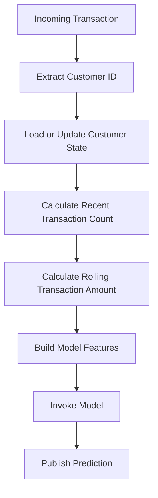
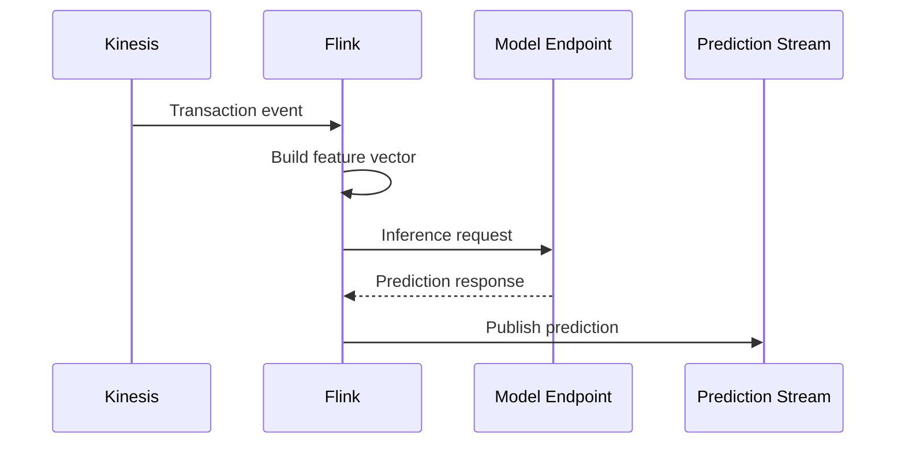
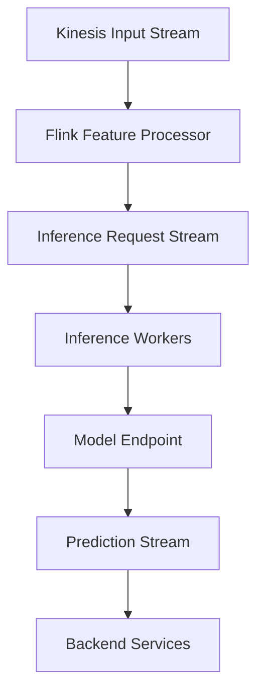
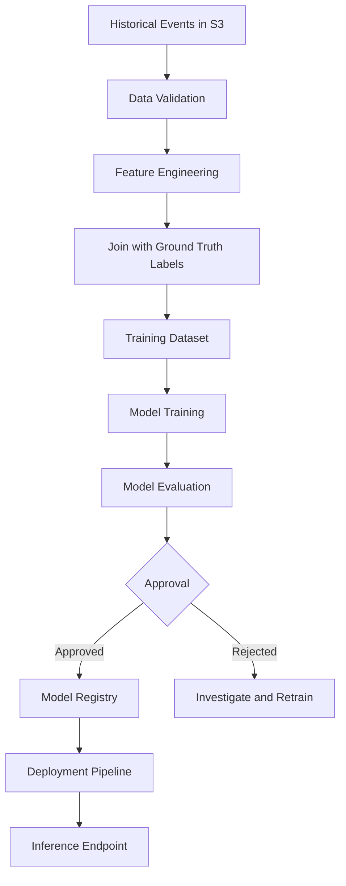

# 09- Machine Learning Streaming Pipeline

## Overview

A machine learning streaming pipeline processes continuously arriving events, applies real-time feature transformations and model inference, and publishes predictions to downstream systems with low latency.

Unlike batch machine learning, where data is collected and processed periodically, streaming inference evaluates events as they arrive. This enables backend systems to make decisions using recent activity rather than waiting for a scheduled batch job.

Amazon Kinesis Data Streams provides the event ingestion layer for this architecture. Amazon Managed Service for Apache Flink processes streams, performs feature engineering, and can invoke model inference services. Amazon SageMaker or a separately deployed model-serving application can host the inference endpoint. Predictions are then delivered to applications, databases, alerting systems, or analytical storage.

Typical use cases include:

- Real-time fraud detection and transaction risk scoring.
- Recommendation ranking based on recent user activity.
- Predictive maintenance using IoT telemetry.
- Anomaly detection in application and infrastructure metrics.
- Real-time customer behavior classification.
- Dynamic risk assessment and operational alerting.

The central engineering challenge is coordinating event ingestion, feature computation, model inference, and downstream delivery while maintaining acceptable latency, reliability, and prediction consistency.

## Architecture Components

A production streaming ML pipeline typically contains the following components:

| Component | Responsibility |
|---|---|
| Application or device producers | Generate events and publish them to Kinesis |
| Kinesis Data Streams | Buffer and distribute incoming events |
| Managed Service for Apache Flink | Perform transformations, feature engineering, filtering, and windowed aggregation |
| Feature store or state store | Provide historical and recent feature values |
| Model serving endpoint | Execute inference against a deployed model |
| Prediction stream | Distribute inference results to downstream consumers |
| Redis or DynamoDB | Serve low-latency prediction results |
| PostgreSQL | Persist business decisions and transactional records |
| Amazon Data Firehose | Deliver streaming data to S3 |
| Amazon S3 | Store raw events, features, predictions, and training datasets |
| SageMaker | Support model training, deployment, and model lifecycle management |
| CloudWatch | Monitor stream health, processing latency, and inference performance |

A common architecture separates online inference from offline model training. The online path prioritizes latency and availability, while the offline path supports historical analysis, training, and model evaluation.

## Reference Architecture

```mermaid
flowchart TD
    A[Applications and IoT Devices] --> B[Kinesis Data Streams]
    B --> C[Managed Service for Apache Flink]

    C --> D[Feature Engineering]
    D --> E[Online Feature Store]
    E --> F[Model Serving Endpoint]

    F --> G[Prediction Stream]
    G --> H[FastAPI or Django Backend]
    H --> I[Redis or DynamoDB]
    H --> J[PostgreSQL]
    H --> K[Business Actions and Alerts]

    B --> L[Amazon Data Firehose]
    L --> M[Amazon S3 Raw Data]

    G --> N[Amazon Data Firehose]
    N --> O[Amazon S3 Prediction Data]

    M --> P[Offline Training Pipeline]
    O --> P
    P --> Q[SageMaker Training]
    Q --> R[Model Registry]
    R --> S[Model Deployment]
    S --> F
```



The architecture has two major paths:

- **Online inference path:** Processes incoming events and produces predictions for operational decisions.
- **Offline training path:** Uses historical events, features, and outcomes to train and evaluate new models.

Keeping these paths separate prevents training workloads from competing with latency-sensitive inference workloads.

## Event Ingestion with Kinesis Data Streams

Kinesis Data Streams acts as the ingestion and buffering layer between event producers and streaming processors.

Producers may include:

- Django and FastAPI services.
- Payment and transaction services.
- Web applications.
- IoT devices connected through AWS IoT Core.
- Kafka-to-Kinesis integration services.
- Infrastructure and application telemetry collectors.

### Event schema design

Streaming ML systems should use versioned event schemas.

A transaction event might look like this:

```json
{
  "event_id": "evt-8f3a1c",
  "event_type": "transaction.created",
  "schema_version": 1,
  "event_time": "2026-11-20T10:15:30Z",
  "customer_id": "customer-1024",
  "transaction_id": "txn-92831",
  "amount": 12500.50,
  "currency": "INR",
  "merchant_id": "merchant-451",
  "device_id": "device-882"
}
```

Important schema fields:

| Field | Purpose |
|---|---|
| `event_id` | Stable identifier for deduplication |
| `event_type` | Identifies the business event |
| `schema_version` | Supports controlled schema evolution |
| `event_time` | Time the business event occurred |
| `customer_id` | Entity used for feature aggregation |
| `transaction_id` | Business transaction identifier |
| `device_id` | Device-level correlation |

Use UTC timestamps and distinguish event time from ingestion time. A delayed event should not automatically be treated as a newly occurring business event.

### Partition key selection

The partition key determines which shard receives a record.

For customer-centric fraud detection:

```python
partition_key = event["customer_id"]
```

This can preserve ordering for events belonging to the same customer when they are routed to the same shard.

However, partitioning by a highly active customer can create a hot shard. A partition key should reflect the required ordering boundary and expected traffic distribution.

Do not assume that Kinesis provides global ordering. Ordering is guaranteed only within an individual shard.

### Publishing events with Boto3

```python
import json
import os
from datetime import datetime, timezone

import boto3

client = boto3.client(
    "kinesis",
    region_name=os.environ["AWS_REGION"],
)

STREAM_NAME = os.environ["KINESIS_STREAM_NAME"]


def publish_transaction(event: dict) -> dict:
    payload = {
        **event,
        "event_time": datetime.now(timezone.utc).isoformat(),
        "schema_version": 1,
    }

    response = client.put_record(
        StreamName=STREAM_NAME,
        Data=json.dumps(payload).encode("utf-8"),
        PartitionKey=str(payload["customer_id"]),
    )

    return {
        "shard_id": response["ShardId"],
        "sequence_number": response["SequenceNumber"],
    }
```

Production considerations:

- Generate a stable `event_id` before publishing.
- Use explicit connection and request timeouts.
- Implement bounded retries with exponential backoff and jitter.
- Handle ambiguous publish failures through downstream idempotency.
- Monitor throttling and write failures.
- Use IAM roles instead of hardcoded AWS credentials.
- Use the transactional outbox pattern when a database transaction and event publication must remain consistent.

A successful `PutRecord` response confirms stream acceptance, not successful downstream inference.

## Stream Processing and Feature Engineering

Managed Service for Apache Flink processes events continuously and maintains state for streaming computations.

It is useful when model inputs depend on recent activity rather than only the current event.

Examples include:

- Number of transactions made by a customer in the previous five minutes.
- Average transaction amount over the previous hour.
- Number of failed login attempts in the previous ten minutes.
- Device temperature moving average.
- Number of distinct merchants visited by a customer during a time window.

### Stateless transformations

Stateless transformations operate on individual records without retaining information from earlier events.

Examples:

- Parsing JSON.
- Validating required fields.
- Normalizing currencies.
- Removing invalid records.
- Converting timestamps.
- Extracting numerical features from event attributes.

These transformations are generally inexpensive and can be performed before invoking model inference.

### Stateful transformations

Stateful processing maintains information across multiple events.

For example, a fraud model may require the number of transactions made by a customer in the previous five minutes.



Stateful processing introduces additional concerns:

- State size and retention.
- Checkpointing.
- Late-arriving events.
- Event-time window semantics.
- Recovery after processor failure.
- Key distribution and state partitioning.

### Event-time processing

Streaming systems must distinguish three timestamps:

| Timestamp | Meaning |
|---|---|
| Event time | When the source event occurred |
| Ingestion time | When Kinesis accepted the record |
| Processing time | When Flink processed the record |

Event-time processing is important when events arrive late or out of order.

For example, a mobile application may temporarily lose network connectivity and upload events several minutes later.

Flink watermarks estimate event-time progress and help determine when a window can be considered sufficiently complete.

A production pipeline should explicitly define:

- Watermark generation strategy.
- Allowed lateness.
- Late-event handling.
- Window cleanup behavior.
- Whether late events update previous results or are routed separately.

## Feature Engineering

Feature engineering transforms raw events into numerical or categorical values suitable for model inference.

A feature is an input variable used by a machine learning model.

For a transaction fraud model, features might include:

| Feature | Description |
|---|---|
| `transaction_amount` | Current transaction amount |
| `transactions_last_5m` | Number of recent transactions |
| `amount_last_1h` | Total transaction amount during the previous hour |
| `average_amount_30d` | Historical average transaction amount |
| `unique_merchants_24h` | Number of distinct merchants visited |
| `device_age_days` | Age of the device associated with the customer |
| `failed_attempts_10m` | Recent failed authentication attempts |

### Online and offline feature consistency

One of the most important ML production problems is training-serving skew.

Training-serving skew occurs when the feature calculation used during model training differs from the calculation used during online inference.

For example:

- Training calculates transaction counts using event time.
- Online inference calculates counts using processing time.
- Training excludes cancelled transactions.
- Online inference includes them.
- Training uses a historical average over 30 days.
- Online inference uses a different time range.

The model may perform well during evaluation but produce unreliable predictions in production.

Use a consistent feature definition across training and serving.

A feature specification should define:

- Feature name and data type.
- Entity key.
- Calculation logic.
- Time window.
- Null and default behavior.
- Event-time semantics.
- Feature version.
- Source event dependencies.

### Online feature storage

A feature store or low-latency state store provides features needed during inference.

Possible storage choices:

| Technology | Suitable use case | Limitation |
|---|---|---|
| Redis | Low-latency counters and recent feature values | Memory cost and persistence trade-offs |
| DynamoDB | Durable, scalable key-value feature access | Query patterns must be designed around access keys |
| SageMaker Feature Store | Managed online and offline feature management | Additional service integration and cost |
| Flink managed state | Features calculated directly in the streaming processor | Not a general-purpose application feature API |
| PostgreSQL | Relational historical features and business records | Not ideal for high-volume, low-latency feature lookups |

For example, Redis can maintain recent customer transaction counters:

```python
from redis import Redis

redis_client = Redis.from_url(
    "redis://redis:6379/0",
    decode_responses=True,
)


def increment_transaction_count(customer_id: str) -> int:
    key = f"customer:{customer_id}:transactions:5m"

    pipeline = redis_client.pipeline()
    pipeline.incr(key)
    pipeline.expire(key, 300)

    result = pipeline.execute()
    return int(result[0])
```

This is a simplified counter implementation. A production rolling-window feature must define how events expire from the window, how duplicate events are handled, and how concurrent updates are coordinated.

A simple key expiration does not implement an exact sliding-window count.

## Model Serving and Real-Time Inference

Model serving exposes a trained model through an inference interface.

The streaming processor constructs a feature vector and sends it to the model endpoint. The endpoint returns a prediction, probability, score, or classification.

Common deployment options include:

- Amazon SageMaker real-time inference endpoints.
- SageMaker asynchronous inference endpoints.
- A custom FastAPI model-serving application.
- A containerized model server running on Amazon ECS or Amazon EKS.
- A managed model inference platform integrated with the streaming processor.

### Synchronous inference

In synchronous inference, the stream processor sends a request and waits for the model response.



Advantages:

- Simple request-response processing.
- Prediction is available before the event-processing step completes.
- Easier to correlate input and output.

Limitations:

- Model endpoint latency affects stream processing throughput.
- Endpoint outages can create backpressure.
- Excessive concurrent requests can exhaust endpoint capacity.
- Network timeouts can produce ambiguous inference outcomes.

Synchronous inference is appropriate when the model response is needed immediately and the endpoint can meet the required latency and throughput.

### Asynchronous inference

Asynchronous inference separates feature processing from prediction execution.

The streaming processor publishes inference requests to a dedicated stream or queue. Independent workers consume requests, invoke the model, and publish prediction results.



Advantages:

- Decouples stream processing from model endpoint availability.
- Allows independent scaling of inference workers.
- Supports buffering during temporary model-serving outages.

Limitations:

- Adds prediction latency.
- Requires correlation between requests and results.
- Requires handling duplicate inference requests.
- Business workflows must support delayed predictions.

Use asynchronous inference when prediction throughput is high, inference latency is variable, or downstream consumers can process results later.

### Model endpoint request format

A model-serving API should accept a versioned request contract.

```json
{
  "request_id": "infer-72831",
  "event_id": "evt-8f3a1c",
  "model_version": "fraud-model-12",
  "feature_version": "fraud-features-4",
  "features": {
    "transaction_amount": 12500.50,
    "transactions_last_5m": 4,
    "amount_last_1h": 28000.00,
    "unique_merchants_24h": 3
  }
}
```

A response might look like:

```json
{
  "request_id": "infer-72831",
  "event_id": "evt-8f3a1c",
  "model_version": "fraud-model-12",
  "prediction": {
    "risk_score": 0.91,
    "risk_class": "high"
  },
  "inference_time_ms": 42
}
```

The request and response should include stable identifiers and model metadata for traceability.

## Model Serving with FastAPI

FastAPI can host custom inference logic when a managed inference endpoint is not required.

A production deployment should load the model once during application startup rather than loading it for every request.

The following example demonstrates the API contract and lifecycle. The actual model-loading and prediction logic must be adapted to the selected framework.

```python
from contextlib import asynccontextmanager
from typing import Literal

from fastapi import FastAPI, HTTPException
from pydantic import BaseModel, Field


class FeatureVector(BaseModel):
    transaction_amount: float = Field(ge=0)
    transactions_last_5m: int = Field(ge=0)
    amount_last_1h: float = Field(ge=0)
    unique_merchants_24h: int = Field(ge=0)


class InferenceRequest(BaseModel):
    request_id: str
    event_id: str
    model_version: str
    feature_version: str
    features: FeatureVector


class Prediction(BaseModel):
    risk_score: float
    risk_class: Literal["low", "medium", "high"]


class InferenceResponse(BaseModel):
    request_id: str
    event_id: str
    model_version: str
    prediction: Prediction


@asynccontextmanager
async def lifespan(app: FastAPI):
    app.state.model = load_model()
    yield
    app.state.model = None


app = FastAPI(
    title="Streaming ML Inference API",
    lifespan=lifespan,
)


def load_model():
    # Replace with framework-specific model loading.
    return FraudModel()


class FraudModel:
    def predict_proba(self, features: dict) -> float:
        raise NotImplementedError


@app.post("/v1/predict", response_model=InferenceResponse)
async def predict(request: InferenceRequest):
    model = app.state.model

    try:
        features = request.features.model_dump()
        score = float(model.predict_proba(features))
    except Exception as exc:
        raise HTTPException(
            status_code=500,
            detail="Model inference failed",
        ) from exc

    if not 0 <= score <= 1:
        raise HTTPException(
            status_code=500,
            detail="Model returned an invalid probability",
        )

    risk_class = (
        "high" if score >= 0.8
        else "medium" if score >= 0.5
        else "low"
    )

    return InferenceResponse(
        request_id=request.request_id,
        event_id=request.event_id,
        model_version=request.model_version,
        prediction=Prediction(
            risk_score=score,
            risk_class=risk_class,
        ),
    )
```

This example intentionally leaves `FraudModel` implementation framework-specific.

Production improvements should include:

- Model artifact verification and controlled loading.
- Request authentication and authorization.
- Explicit model and feature compatibility checks.
- Request size limits.
- Concurrency and worker configuration.
- Inference timeouts.
- Structured logs and metrics.
- Health and readiness endpoints.
- Graceful shutdown.
- Model warm-up before accepting traffic.

Do not assume an `async def` endpoint makes CPU-bound model inference non-blocking. CPU-intensive inference may require process workers, a dedicated inference runtime, or a separate serving system.

## Prediction Delivery and Business Integration

Predictions should be published as independent events rather than directly coupling the model processor to every business service.

A prediction event might contain:

```json
{
  "prediction_id": "pred-72831",
  "event_id": "evt-8f3a1c",
  "entity_id": "txn-92831",
  "prediction_type": "transaction_fraud_risk",
  "model_name": "fraud-detection",
  "model_version": "12",
  "feature_version": "4",
  "risk_score": 0.91,
  "risk_class": "high",
  "prediction_time": "2026-11-20T10:15:31Z"
}
```

Downstream consumers may:

- Update transaction risk state.
- Trigger manual review.
- Send notifications.
- Update customer risk profiles.
- Persist prediction history.
- Feed monitoring and model evaluation pipelines.

### Prediction persistence

Use storage according to the access pattern.

| Storage | Responsibility |
|---|---|
| Redis | Short-lived, low-latency prediction lookup |
| DynamoDB | Scalable key-value prediction state |
| PostgreSQL | Durable business decisions and relational audit records |
| S3 | Historical prediction datasets and offline analysis |
| OpenSearch | Search and operational investigation |

A prediction is not automatically a business decision.

For example, a fraud model may assign a high-risk score, but the payment service should apply business rules, authorization requirements, and risk policies before declining a transaction.

### Idempotent prediction processing

Kinesis consumers generally operate with at-least-once processing semantics. A record may be processed again after a failure or checkpoint recovery.

Use stable event or prediction identifiers to prevent duplicate business effects.

A PostgreSQL table can enforce uniqueness:

```sql
CREATE TABLE transaction_predictions (
    prediction_id TEXT PRIMARY KEY,
    event_id TEXT NOT NULL,
    model_name TEXT NOT NULL,
    model_version TEXT NOT NULL,
    risk_score NUMERIC(8, 7) NOT NULL,
    risk_class TEXT NOT NULL,
    prediction_time TIMESTAMPTZ NOT NULL,
    created_at TIMESTAMPTZ NOT NULL DEFAULT NOW(),

    CONSTRAINT unique_event_model_version
        UNIQUE (event_id, model_name, model_version)
);
```

Use an appropriate uniqueness key for the business contract. If a new model version is allowed to generate a new prediction for the same event, include the model version in the uniqueness boundary.

## Offline Training Pipeline

A streaming inference system requires a separate training workflow.

Historical data should be collected from event streams and prediction outputs, then prepared for training and evaluation.

A typical workflow:

1. Capture raw events from Kinesis.
2. Deliver events to S3 using Amazon Data Firehose.
3. Validate and transform historical records.
4. Join events with labels and business outcomes.
5. Generate training features.
6. Split datasets into training, validation, and test sets.
7. Train and evaluate the model.
8. Register the approved model version.
9. Deploy the model to an inference endpoint.
10. Monitor the deployed model.



Amazon SageMaker can support training, model registration, deployment, and monitoring workflows.

Other services such as AWS Glue, Amazon Athena, and Amazon S3 can support historical data preparation.

### Training-serving consistency

The same feature definitions should be used in both online inference and offline training.

A reliable feature pipeline should track:

- Feature definition version.
- Source event schema version.
- Transformation code version.
- Training dataset version.
- Model artifact version.
- Model deployment version.

This metadata makes it possible to investigate why a prediction was produced and reproduce the feature vector used at inference time.

### Avoiding data leakage

Data leakage occurs when training data contains information that would not have been available when the prediction was originally made.

For time-dependent problems, split datasets chronologically rather than randomly when appropriate.

For example, a fraud model trained on transaction outcomes must not use chargeback information that became available days after the transaction as an input feature for that same transaction.

## Model Versioning and Deployment

A model version should be treated as a deployable artifact with explicit dependencies.

A deployment manifest may contain:

```yaml
model:
  name: fraud-detection
  version: "12"
  artifact_uri: s3://ml-artifacts/fraud/model-12/
  framework: xgboost
  framework_version: "2.x"

features:
  schema_version: "4"

inference:
  endpoint_name: fraud-inference
  timeout_ms: 500
  max_retries: 2
```

The manifest is illustrative. Actual framework and runtime versions must be pinned to supported versions.

### Deployment strategies

| Strategy | Description | Considerations |
|---|---|---|
| Rolling deployment | Gradually replace the deployed model | Requires compatibility and capacity planning |
| Blue-green deployment | Maintain old and new model environments | Simplifies rollback but temporarily increases cost |
| Canary deployment | Send a small percentage of traffic to the new model | Requires traffic routing and comparison metrics |
| Shadow deployment | Evaluate a new model without using its predictions for decisions | Useful for production evaluation without changing business behavior |

### Model rollback

A rollback should restore a known-good model artifact and its compatible feature contract.

Do not roll back only the model binary if the new deployment also changed:

- Feature definitions.
- Preprocessing logic.
- Input schema.
- Output schema.
- Threshold configuration.
- Prediction interpretation.

Model and feature compatibility should be validated before deployment.

## Handling Backpressure and Inference Failures

Inference endpoints can become the bottleneck in a streaming architecture.

For example, Kinesis may ingest 20,000 events per second while the model endpoint can process only 5,000 inference requests per second.

The difference accumulates as processing lag.

### Common causes

- Model endpoint capacity is insufficient.
- Model inference is CPU- or GPU-intensive.
- Feature lookups are slow.
- Network latency increases.
- Downstream prediction publishing is throttled.
- The processor performs blocking calls.
- A retry policy creates excessive repeated work.

### Engineering strategies

**Decouple ingestion from inference**

Use a dedicated inference request stream or queue when model capacity differs significantly from ingestion throughput.

**Batch inference**

Where the model and business latency requirements permit it, group multiple feature vectors into one inference request.

Batching improves throughput but increases per-event waiting time and requires careful handling of partial failures.

**Bound concurrency**

Limit concurrent requests to the model endpoint. Unbounded asynchronous tasks can exhaust memory, sockets, or endpoint capacity.

**Apply timeouts**

Set explicit connection and response timeouts. A request that waits indefinitely can block processing progress.

**Use bounded retries**

Retry transient failures with exponential backoff and jitter. Do not retry permanent validation errors.

**Isolate poison events**

Malformed or incompatible events should be routed to a failure stream or durable quarantine store instead of repeatedly blocking the entire shard.

**Monitor consumer lag**

Kinesis iterator age and Flink processing metrics help identify whether processing capacity is keeping up with ingestion.

### Failure handling matrix

| Failure | Recommended response |
|---|---|
| Invalid event schema | Route to quarantine or dead-letter workflow |
| Feature lookup timeout | Retry within a bounded budget or apply an explicit fallback |
| Model endpoint unavailable | Buffer inference requests or use a defined fallback policy |
| Model returns invalid output | Reject prediction and raise an operational alert |
| Prediction publishing fails | Retry using stable identifiers |
| Database unavailable | Retry through an idempotent persistence workflow |
| Duplicate event | Detect using stable event identifiers |
| Late event | Apply the defined event-time and correction policy |

Fallback behavior must be defined by the business domain.

For a fraud system, silently assigning a low-risk score when inference fails may create unacceptable risk. The correct fallback may be manual review, delayed authorization, or a conservative decision.

## Reliability and Delivery Guarantees

A streaming ML pipeline spans several independently failing services.

Exactly-once processing at one stage does not automatically provide exactly-once business effects across the entire architecture.

Consider the following sequence:

1. Flink reads a transaction.
2. Flink invokes the model endpoint.
3. The endpoint produces a prediction.
4. Flink publishes the prediction.
5. Flink fails before checkpoint completion.
6. The transaction is processed again after recovery.

The model may be invoked twice, and the prediction may be published more than once.

Use:

- Stable event identifiers.
- Idempotent feature updates.
- Durable checkpoints.
- Idempotent prediction persistence.
- Bounded retries.
- Dead-letter or quarantine workflows.
- Reconciliation jobs.
- Explicit replay procedures.

### Checkpointing and state recovery

Managed Service for Apache Flink supports checkpointing and savepoints.

Checkpointing captures processing state and source positions so the application can recover after failures.

However, external HTTP calls and arbitrary database writes are not automatically transactional with Flink checkpoints.

If an external side effect is repeated after recovery, the destination must support idempotency or a transactional integration pattern.

### Replay and reprocessing

Kinesis Data Streams supports replay within the configured retention period.

For longer-term replay, retain source events in S3.

A replay workflow should:

- Use a separate processing environment when possible.
- Preserve original event identifiers and event timestamps.
- Record the replay window and processing version.
- Prevent replayed events from triggering unintended business actions.
- Support controlled publication of corrected predictions.
- Track the model and feature versions used for reprocessing.

Amazon Data Firehose is useful for managed delivery to S3, but it is not a retained replayable stream.

## Monitoring and Observability

Streaming ML systems require both infrastructure monitoring and model-quality monitoring.

Infrastructure metrics indicate whether the pipeline is operating correctly. Model metrics indicate whether predictions remain useful.

### Kinesis and Flink monitoring

| Metric or signal | Why it matters |
|---|---|
| Incoming records | Measures ingestion volume |
| Write throttles | Indicates stream capacity or hot-shard problems |
| Read throttles | Indicates consumer throughput pressure |
| Iterator age | Indicates consumer processing lag |
| Flink checkpoint duration | Identifies slow checkpointing |
| Failed checkpoints | Indicates recovery and state consistency risks |
| Backpressure | Identifies downstream bottlenecks |
| Processing latency | Measures event-to-processing delay |
| Late-event count | Indicates event-time quality issues |

### Model serving monitoring

| Metric | Purpose |
|---|---|
| Inference requests | Measures model workload |
| Inference latency | Tracks endpoint responsiveness |
| Inference errors | Identifies model-serving failures |
| Timeout rate | Detects capacity and network problems |
| Model invocation throughput | Measures serving capacity |
| Feature lookup latency | Identifies feature-store bottlenecks |
| Invalid prediction count | Detects output contract violations |

### Model quality monitoring

Operational metrics alone cannot establish model quality.

Track:

- Prediction score distributions.
- Classification rates.
- Precision and recall when labels become available.
- False-positive and false-negative rates.
- Feature distribution changes.
- Missing feature rates.
- Feature freshness.
- Model performance by customer segment or relevant cohort.
- Prediction drift.
- Data drift.

Ground-truth labels often arrive later than the original event. Model evaluation should account for this delay.

For example, a fraud model may receive chargeback labels days or weeks after the transaction. A monitoring pipeline should not treat the absence of an immediate label as evidence that a prediction was correct.

### Observability architecture

Use correlation identifiers across the pipeline:

```text
event_id
  -> Kinesis record
  -> Flink processing
  -> inference request
  -> model response
  -> prediction event
  -> business decision
```

Structured logs should include:

- Event ID.
- Prediction ID.
- Model name and version.
- Feature version.
- Processing stage.
- Processing duration.
- Failure category.

Avoid logging sensitive raw features or personal data unnecessarily.

## Security Considerations

Streaming ML pipelines may process customer, financial, behavioral, and device data. Security controls should cover ingestion, processing, inference, storage, and model artifacts.

### IAM permissions

Use least-privilege IAM roles for each component.

Typical permissions include:

| Component | Example permissions |
|---|---|
| Producer service | `kinesis:PutRecord`, `kinesis:PutRecords` |
| Flink application | Read from designated stream and write to designated output stream |
| Inference worker | Invoke the approved model endpoint |
| Firehose delivery role | Write to approved S3 locations |
| Training pipeline | Read approved training data and write model artifacts |
| Deployment pipeline | Register and deploy approved model versions |

Avoid granting broad permissions such as `kinesis:*`, `s3:*`, or `sagemaker:*` to application roles without a specific requirement.

### Encryption

Use encryption in transit and at rest:

- TLS for application-to-service communication.
- Kinesis server-side encryption with AWS KMS where required.
- S3 server-side encryption.
- Encrypted databases and caches.
- KMS-backed encryption for model artifacts where appropriate.

### Data protection

Apply data minimization before publishing events.

Avoid placing unnecessary personal information in:

- Kinesis records.
- Model feature vectors.
- Prediction events.
- Logs.
- Training datasets.

Use tokenized or pseudonymous identifiers when possible.

Apply retention and deletion policies consistently across raw events, derived features, prediction history, and training datasets.

### Model artifact security

Model artifacts should be treated as executable or otherwise security-sensitive supply-chain inputs.

Controls should include:

- Trusted artifact sources.
- Artifact integrity verification.
- Restricted model registration and deployment permissions.
- Dependency vulnerability scanning.
- Controlled model promotion.
- Versioned model artifacts.
- Audit logs for model changes.

Do not load arbitrary user-provided model files into a production inference service.

## Scalability and Performance

Scaling should account for the throughput of every stage, not only the Kinesis stream.

### Capacity planning

Estimate the expected event rate and average record size.

For example:

- Incoming events: 10,000 records/second.
- Average event size: 2 KB.
- Average inference request size: 1 KB.
- Average prediction size: 500 bytes.

Approximate input data rate:

```text
10,000 records/sec × 2 KB
= 20,000 KB/sec
≈ 20 MB/sec
```

This is an approximate payload calculation. Actual capacity planning must account for service-specific record limits, request overhead, shard distribution, consumer behavior, and regional quotas.

### Scaling dimensions

| Component | Scaling approach |
|---|---|
| Kinesis Data Streams | Provisioned shard scaling or on-demand capacity |
| Flink | Parallelism, operator capacity, and state distribution |
| Feature store | Partitioning, throughput configuration, and caching |
| Model endpoint | Instance count, instance type, and inference concurrency |
| Inference workers | Horizontal scaling based on request backlog |
| Redis | Memory sizing, clustering, and key distribution |
| PostgreSQL | Connection pooling, indexing, and read/write scaling |
| S3 | Partition design and efficient file delivery |

### Avoiding hot partitions

Partitioning by a single highly active customer or device can overload one shard.

Choose partition keys based on the ordering requirement and distribution of traffic.

If per-entity ordering is mandatory, do not randomly distribute that entity's records across multiple shards. Instead, address throughput through a different partitioning strategy, aggregation, or stream design.

### Model endpoint capacity

Measure real inference throughput using production-like payloads.

Capacity depends on:

- Model size.
- Framework and runtime.
- CPU or GPU requirements.
- Batch size.
- Input dimensionality.
- Concurrent requests.
- Serialization and network overhead.

Do not estimate inference capacity solely from the number of endpoint instances.

## Cost Considerations

The main cost drivers include:

- Kinesis Data Streams capacity and retention.
- Managed Service for Apache Flink application resources.
- SageMaker inference endpoint instances.
- Online feature storage.
- Redis or DynamoDB capacity.
- S3 storage and requests.
- Data transfer.
- CloudWatch logs and metrics.

Cost optimization strategies:

- Use on-demand Kinesis capacity when workload patterns justify it.
- Right-size provisioned shards based on measured throughput.
- Avoid excessive stream retention when S3 archival satisfies replay requirements.
- Use inference batching when latency requirements allow it.
- Scale model endpoints based on actual workload patterns.
- Use appropriate instance types for the model.
- Keep feature vectors compact.
- Apply S3 lifecycle policies to historical datasets.
- Control high-volume debug logging.
- Monitor idle inference capacity.

A low-cost architecture that cannot meet inference latency or availability requirements is not an effective production design. Evaluate cost alongside business impact and service-level objectives.

## High Availability and Disaster Recovery

A production pipeline should define recovery behavior for each component.

| Component | Resilience strategy |
|---|---|
| Kinesis Data Streams | Use service-managed availability and appropriate retention |
| Flink | Enable checkpointing and configure recovery behavior |
| Model endpoint | Deploy sufficient capacity and define fallback behavior |
| Feature store | Use durable storage and tested recovery procedures |
| Redis | Configure appropriate replication and persistence |
| PostgreSQL | Use managed backups and point-in-time recovery |
| S3 | Enable appropriate versioning and lifecycle policies |
| Model artifacts | Store versioned artifacts and deployment metadata |

For cross-Region recovery, define:

- How source events are replicated or re-ingested.
- How model artifacts are made available.
- How feature state is reconstructed.
- How inference endpoints are redeployed.
- How prediction duplication is prevented.
- How consumers resume from a known processing position.

A disaster recovery plan should be tested through controlled failure exercises rather than relying only on documented procedures.

## Testing Strategy

Testing should cover event contracts, feature calculations, model behavior, infrastructure integration, and recovery.

### Unit tests

Test:

- Event parsing and validation.
- Feature transformations.
- Window aggregation logic.
- Model input construction.
- Prediction response validation.
- Idempotency logic.
- Failure classification.

Example:

```python
def build_features(event: dict, state: dict) -> dict:
    return {
        "transaction_amount": float(event["amount"]),
        "transactions_last_5m": int(
            state["transactions_last_5m"]
        ),
        "amount_last_1h": float(
            state["amount_last_1h"]
        ),
    }


def test_build_features():
    event = {"amount": 12500.50}
    state = {
        "transactions_last_5m": 4,
        "amount_last_1h": 28000.00,
    }

    result = build_features(event, state)

    assert result == {
        "transaction_amount": 12500.50,
        "transactions_last_5m": 4,
        "amount_last_1h": 28000.00,
    }
```

### Integration tests

Validate:

- Kinesis producer and consumer integration.
- Flink transformations.
- Feature-store connectivity.
- Model endpoint request and response contracts.
- Prediction stream publishing.
- Database persistence.
- IAM permissions.

### Load tests

Simulate realistic workloads and measure:

- Sustained ingestion rate.
- Peak event volume.
- Inference throughput.
- End-to-end prediction latency.
- Consumer lag.
- Feature lookup latency.
- Error rates under load.
- Recovery after temporary endpoint failure.

### Model validation

Validate model quality independently from infrastructure correctness.

A pipeline can process every record successfully while producing poor predictions.

Model validation should include:

- Holdout evaluation.
- Time-based validation.
- Segment-level performance.
- Threshold analysis.
- Feature distribution checks.
- Comparison with the currently deployed model.

## Infrastructure as Code Example

The following Terraform example creates a Kinesis stream for incoming ML events.

```hcl
resource "aws_kinesis_stream" "ml_events" {
  name             = "ml-events-stream"
  retention_period = 48

  stream_mode_details {
    stream_mode = "ON_DEMAND"
  }

  encryption_type = "KMS"
  kms_key_id      = aws_kms_key.ml_stream.arn

  tags = {
    Environment = var.environment
    Application = "streaming-ml"
  }
}

resource "aws_kms_key" "ml_stream" {
  description             = "KMS key for streaming ML events"
  enable_key_rotation     = true
  deletion_window_in_days = 30

  tags = {
    Environment = var.environment
    Application = "streaming-ml"
  }
}

output "ml_events_stream_name" {
  value = aws_kinesis_stream.ml_events.name
}

output "ml_events_stream_arn" {
  value = aws_kinesis_stream.ml_events.arn
}
```

In a production Terraform project:

- Pin the AWS provider version.
- Define `environment` as an input variable.
- Manage KMS key policies explicitly.
- Separate stream, processor, model, and storage infrastructure into appropriate modules.
- Use remote state with locking.
- Restrict IAM policies to the exact stream and model resources.
- Configure alarms and dashboards.
- Manage model endpoint deployment separately from stream infrastructure where release cadence differs.

## Common Mistakes and Production Pitfalls

| Mistake | Why it causes problems | Recommended approach |
|---|---|---|
| Treating Kinesis as a model-serving service | Kinesis transports records; it does not execute models | Use Flink and a dedicated inference runtime |
| Calling the model for every event without capacity planning | Endpoint overload creates lag and timeouts | Load test and control inference concurrency |
| Using different training and serving features | Produces training-serving skew | Version and reuse feature definitions |
| Assuming exactly-once inference | Retries and checkpoint recovery can repeat calls | Use stable identifiers and idempotent effects |
| Ignoring event time | Late events can distort rolling features | Define watermarks and lateness policies |
| Using an unbounded retry loop | Causes backpressure and resource exhaustion | Apply bounded retries and quarantine |
| Partitioning every event by one global key | Creates a hot shard | Select partition keys based on entity distribution |
| Treating prediction as a final business decision | Model output may not satisfy business authorization rules | Apply domain-specific decision policies |
| Deploying a new model without feature compatibility checks | Model inputs may be incompatible | Validate model and feature versions together |
| Monitoring only infrastructure metrics | Model quality can degrade without infrastructure failures | Monitor drift and delayed ground-truth metrics |
| Using Redis as the only prediction history | Cache loss can destroy required audit data | Persist durable business records separately |
| Replaying historical events into live business consumers | Can repeat notifications or financial actions | Isolate replay and control side effects |

## Production Deployment Checklist

### Ingestion and processing

- [ ] Event schema is versioned.
- [ ] Every event has a stable identifier.
- [ ] Partition keys satisfy ordering and distribution requirements.
- [ ] Stream capacity is based on measured workload.
- [ ] Flink checkpointing and recovery are configured.
- [ ] Event-time and late-event policies are documented.

### Features and inference

- [ ] Feature definitions are versioned.
- [ ] Training and serving transformations are consistent.
- [ ] Model request and response contracts are validated.
- [ ] Inference timeouts and concurrency limits are configured.
- [ ] Model endpoint capacity is load-tested.
- [ ] Fallback behavior is explicitly defined.

### Reliability and security

- [ ] Consumers are idempotent.
- [ ] Retry policies are bounded.
- [ ] Invalid events have a quarantine path.
- [ ] IAM permissions follow least privilege.
- [ ] Encryption is enabled where required.
- [ ] Sensitive data is minimized and protected.
- [ ] Model artifacts are versioned and access-controlled.

### Operations

- [ ] Kinesis and Flink metrics are monitored.
- [ ] Inference latency and errors are monitored.
- [ ] Model drift and prediction quality are monitored.
- [ ] Alerts have actionable thresholds.
- [ ] Replay and recovery procedures are tested.
- [ ] Model rollback has been validated.
- [ ] Costs are monitored across ingestion, processing, and inference.

## Key Takeaways

- Kinesis Data Streams provides durable event ingestion and replay within configured retention; Flink performs continuous feature engineering and stream processing.
- Online inference should be designed around explicit latency, throughput, concurrency, and failure requirements.
- Consistent, versioned feature definitions are essential to prevent training-serving skew.
- At-least-once delivery and checkpoint recovery require idempotent feature updates, prediction publishing, and downstream business effects.
- Production ML pipelines must monitor both infrastructure health and model quality, including data drift, prediction drift, and delayed ground-truth performance.