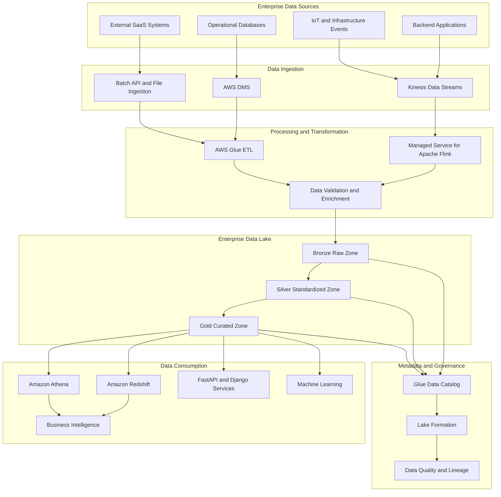
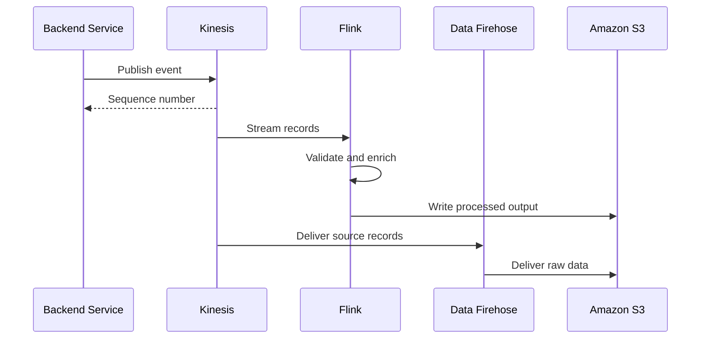
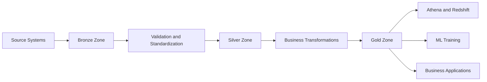
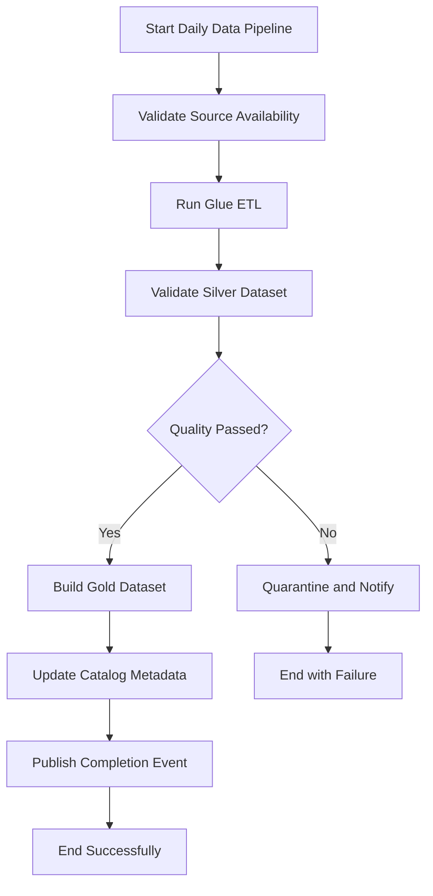
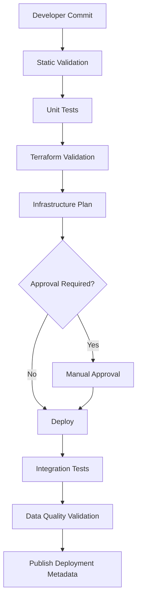

# 10- Enterprise Data Platform Architecture

## Overview

An enterprise data platform provides a centralized, governed, and scalable foundation for collecting, processing, storing, transforming, and serving data across an organization.

It integrates operational applications, streaming systems, analytical storage, data processing engines, and business intelligence tools into a coherent architecture.

Amazon Kinesis Data Streams provides real-time event ingestion within this platform. It allows applications and services to publish continuous event streams that can be processed independently by multiple consumers. Amazon S3 provides durable data lake storage, while services such as AWS Glue, Amazon Athena, Amazon Redshift, and Managed Service for Apache Flink support data transformation and analytical workloads.

A typical enterprise data platform supports two complementary processing models:

- **Streaming processing:** Processes events continuously as they arrive.
- **Batch processing:** Processes accumulated historical data on a scheduled or demand-driven basis.

Modern architectures combine both approaches to support operational dashboards, real-time recommendations, financial reporting, machine learning, compliance, and enterprise analytics.

## Enterprise Data Platform Architecture

A data platform should separate data ingestion, storage, processing, governance, and consumption responsibilities.

This separation allows individual components to scale independently and prevents analytical workloads from tightly coupling with operational applications.

### Core architecture layers

| Layer | Responsibility | AWS services and technologies |
|---|---|---|
| Data sources | Generate operational and external data | Django, FastAPI, PostgreSQL, MySQL, SaaS APIs, IoT |
| Ingestion | Capture streaming and batch data | Kinesis Data Streams, Amazon Data Firehose, AWS DMS, AWS Glue |
| Processing | Transform, validate, enrich, and aggregate data | Managed Service for Apache Flink, AWS Glue, Lambda |
| Storage | Retain raw, transformed, and curated datasets | Amazon S3, Amazon Redshift |
| Metadata and governance | Catalog, classify, secure, and discover data | AWS Glue Data Catalog, AWS Lake Formation |
| Serving | Expose data to applications and analytical consumers | Athena, Redshift, DynamoDB, Redis, APIs |
| Analytics | Query and visualize enterprise data | Amazon Athena, Amazon Redshift, QuickSight |
| Orchestration | Coordinate data workflows | AWS Step Functions, Amazon MWAA, EventBridge |
| Observability | Monitor pipeline health and quality | Amazon CloudWatch, CloudTrail |

### Reference architecture



The architecture supports both continuous event processing and scheduled data transformation. Raw data is retained independently of derived datasets so that transformations can be corrected and historical data can be reprocessed.

## Data Ingestion Architecture

Enterprise platforms usually ingest data from multiple systems with different protocols, schemas, delivery guarantees, and throughput characteristics.

A reliable ingestion layer should normalize transport and metadata without forcing every source into an identical business schema.

### Streaming ingestion with Kinesis Data Streams

Kinesis Data Streams is suitable for continuous event ingestion from:

- Microservices.
- Transaction processing systems.
- Application activity streams.
- IoT platforms.
- Security monitoring systems.
- Operational telemetry.

A typical event flow is:

1. An application generates a business event.
2. The producer publishes the event to Kinesis.
3. Kinesis assigns the record to a shard based on its partition key.
4. Independent consumers read the stream.
5. Consumers transform, persist, or forward the event.



Multiple consumers can independently process the same stream. For example:

- Flink calculates real-time operational metrics.
- Data Firehose archives raw events to S3.
- A fraud detection consumer evaluates transactions.
- A monitoring consumer identifies suspicious activity.

Consumer isolation prevents one downstream workload from owning the entire ingestion pipeline.

### Partition key design

A partition key determines how Kinesis distributes records across shards.

Common choices include:

| Partition key | Suitable workload | Consideration |
|---|---|---|
| Customer ID | Customer activity streams | High-volume customers may create hot shards |
| Account ID | Financial events | Preserves per-account ordering when records share a shard |
| Device ID | IoT telemetry | Distribution depends on device activity |
| Transaction ID | Independent transaction events | Distributes traffic but does not preserve customer ordering |
| Tenant ID | Multi-tenant platforms | Large tenants may dominate individual shards |

Partition key selection should be driven by the ordering boundary and expected traffic distribution.

Kinesis guarantees ordering within a shard, not globally across a stream.

### Publishing enterprise events

A standardized event envelope makes downstream processing more predictable.

```json
{
  "event_id": "evt-92831",
  "event_type": "payment.completed",
  "schema_version": 2,
  "source": "payment-service",
  "tenant_id": "tenant-1001",
  "entity_id": "account-882",
  "event_time": "2026-11-20T10:15:30Z",
  "payload": {
    "transaction_id": "txn-92831",
    "amount": 12500.50,
    "currency": "INR"
  }
}
```

Recommended metadata:

- `event_id`: Stable identifier for deduplication.
- `event_type`: Business event classification.
- `schema_version`: Event contract version.
- `source`: Originating service.
- `tenant_id`: Tenant isolation boundary where applicable.
- `entity_id`: Business entity used for correlation.
- `event_time`: Time the business event occurred.
- `payload`: Event-specific business data.

Do not use ingestion time as a replacement for event time. Delayed events must remain distinguishable from newly generated events.

### Batch ingestion

Not all enterprise data is generated as a continuous stream.

Batch ingestion is appropriate for:

- Daily financial exports.
- Historical database snapshots.
- Periodic SaaS extracts.
- Large CSV and Parquet files.
- Legacy application integrations.

AWS Glue, AWS DMS, scheduled API integrations, and S3 file delivery can support these workloads.

Batch and streaming pipelines should converge on compatible data contracts and curated datasets where their semantics allow it.

## Data Lake Architecture

Amazon S3 is commonly used as the durable storage foundation of an enterprise data platform.

A data lake stores data in its original or transformed form without requiring every dataset to follow the same relational schema at ingestion time.

A practical architecture separates datasets into zones.

### Bronze, Silver, and Gold zones

| Zone | Responsibility | Typical content |
|---|---|---|
| Bronze | Preserve source data | Original JSON, CSV, Parquet, database extracts |
| Silver | Standardize and validate data | Cleaned records, normalized timestamps, deduplicated events |
| Gold | Serve business-ready datasets | Aggregated metrics, reporting tables, curated domain datasets |



### Bronze zone

The Bronze zone preserves source data with minimal transformation.

Typical characteristics:

- Original source payloads.
- Source metadata.
- Ingestion timestamps.
- Event identifiers.
- Schema versions.
- Processing and delivery metadata where available.

Example S3 structure:

```text
s3://enterprise-data-lake/
    bronze/
        payments/
            year=2026/
                month=11/
                    day=20/
                        ...
        customers/
        application-events/
        device-telemetry/
```

Preserving original records makes it possible to:

- Rebuild downstream datasets.
- Investigate source-system defects.
- Reprocess historical events.
- Compare transformation versions.
- Support audit and compliance requirements.

Raw storage should have controlled access because it may contain sensitive or unvalidated data.

### Silver zone

The Silver zone contains standardized and validated records.

Typical operations include:

- Schema validation.
- Type normalization.
- Timestamp standardization.
- Duplicate detection.
- Invalid-record quarantine.
- Reference-data enrichment.
- Data classification.
- Personally identifiable information handling.

Example standardized record:

```json
{
  "event_id": "evt-92831",
  "event_type": "payment.completed",
  "account_id": "account-882",
  "transaction_id": "txn-92831",
  "amount": 12500.50,
  "currency": "INR",
  "event_time": "2026-11-20T10:15:30Z",
  "ingestion_date": "2026-11-20"
}
```

The Silver zone should have explicit schema and data quality contracts.

### Gold zone

The Gold zone contains datasets optimized for business consumption.

Examples:

- Daily revenue by region.
- Customer lifetime value.
- Payment failure rates.
- Product usage metrics.
- Inventory movement.
- Customer engagement.
- Operational service-level indicators.

Gold datasets should represent clearly defined business metrics rather than arbitrary technical transformations.

For example, a revenue dataset must define how refunds, cancelled transactions, taxes, and currency conversions are handled.

### File formats

Choose storage formats according to the access pattern.

| Format | Characteristics | Typical use |
|---|---|---|
| JSON | Flexible, human-readable | Raw event archival |
| CSV | Widely supported, limited type information | External data exchange |
| Parquet | Columnar, compressed, schema-aware | Analytical queries |
| ORC | Columnar and optimized for analytical processing | Large-scale warehouse and lake workloads |
| Avro | Schema-based row-oriented format | Event and data interchange |

Parquet is commonly appropriate for Silver and Gold analytical datasets because column pruning and compression can reduce query cost.

Do not assume that converting every raw event to Parquet during ingestion is always desirable. Preserve original source data when auditability and replay requirements justify it.

## Streaming and Batch Processing

An enterprise platform should select processing models based on latency, workload characteristics, and business requirements.

### Streaming processing

Streaming processing continuously evaluates records as they arrive.

Managed Service for Apache Flink is suitable for:

- Stateful event processing.
- Rolling aggregations.
- Event-time windowing.
- Real-time anomaly detection.
- Continuous feature engineering.
- Stream enrichment.

Example:

A payment platform may calculate the number of transactions per account over the previous five minutes and publish an alert when the count exceeds a configured threshold.

### Batch processing

Batch processing handles accumulated datasets.

AWS Glue ETL can process S3 datasets using Apache Spark.

Typical workloads include:

- Daily aggregation.
- Historical data cleansing.
- Large-scale joins.
- Financial reconciliation.
- Periodic data warehouse loading.
- Training dataset preparation.

### Processing model comparison

| Dimension | Streaming | Batch |
|---|---|---|
| Input | Continuous events | Bounded datasets |
| Latency | Low, workload-dependent | Scheduled or on demand |
| Processing | Continuous | Finite execution |
| Typical service | Managed Service for Apache Flink | AWS Glue |
| State | Long-running application state | Job execution state |
| Replay | Stream retention or archived source data | Reprocess stored datasets |
| Cost model | Continuous processing resources and service usage | Job runtime and consumed resources |
| Suitable use cases | Fraud detection, live metrics | Historical reports, reconciliation |

### Combining streaming and batch

A common enterprise design uses streaming for immediate operational visibility and batch processing for historical correctness and reconciliation.

For example:

- Flink calculates provisional transaction totals continuously.
- S3 stores the original transaction events.
- Glue periodically rebuilds daily financial aggregates.
- Athena queries historical datasets.
- Redshift serves reporting workloads.

Streaming and batch outputs should have documented consistency semantics. A real-time metric may be provisional until delayed events and corrections have been incorporated.

## Data Transformation and Processing

Transformation converts source records into usable datasets.

A mature platform should separate technical transformations from business-specific rules.

### Common transformation stages

| Stage | Example |
|---|---|
| Parsing | Decode JSON or Avro records |
| Validation | Check required fields and types |
| Normalization | Convert timestamps to UTC |
| Deduplication | Detect repeated event identifiers |
| Enrichment | Join customer or product reference data |
| Aggregation | Calculate daily totals |
| Classification | Assign business categories |
| Curating | Produce domain-specific analytical tables |

### Real-time transformation with Flink

Flink is appropriate when transformation depends on continuous state or event-time windows.

Examples:

- Rolling account transaction totals.
- Current inventory quantities.
- Real-time active user counts.
- Device telemetry averages.
- Streaming anomaly detection.

Stateful transformations must account for checkpointing, state size, late events, and recovery.

### Batch transformation with AWS Glue

AWS Glue can process historical S3 datasets and write standardized outputs.

A simplified PySpark example:

```python
from pyspark.sql import SparkSession
from pyspark.sql.functions import col, to_timestamp

spark = SparkSession.builder.appName(
    "EnterprisePaymentETL"
).getOrCreate()

source_path = "s3://enterprise-data-lake/bronze/payments/"
target_path = "s3://enterprise-data-lake/silver/payments/"

payments = spark.read.json(source_path)

validated = (
    payments
    .filter(col("event_id").isNotNull())
    .filter(col("transaction_id").isNotNull())
    .filter(col("amount").isNotNull())
    .withColumn(
        "event_time",
        to_timestamp(col("event_time"))
    )
    .filter(col("amount") >= 0)
)

standardized = validated.dropDuplicates(["event_id"])

(
    standardized
    .write
    .mode("append")
    .partitionBy("ingestion_date")
    .parquet(target_path)
)
```

This example demonstrates the transformation structure. Production jobs should additionally implement:

- Explicit input schemas.
- Schema compatibility validation.
- Reprocessing-safe output handling.
- Invalid-record quarantine.
- Data quality metrics.
- Controlled partition replacement or merge logic.
- Job-level audit metadata.

Blindly using append mode during retries can create duplicate output. Deduplication within one job execution does not guarantee deduplication across separate runs.

## Data Catalog and Governance

An enterprise data lake needs metadata and governance controls.

Without them, datasets become difficult to discover, interpret, secure, and maintain.

### AWS Glue Data Catalog

The Glue Data Catalog stores metadata about datasets and tables.

It can contain:

- Database and table definitions.
- Column names and types.
- S3 storage locations.
- Partition information.
- Table formats and serialization metadata.

Athena and other integrated services use catalog metadata to understand how stored data should be queried.

The catalog does not automatically guarantee that data conforms to a business contract. Schema validation and governance controls must be implemented separately.

### AWS Lake Formation

Lake Formation helps manage permissions over data lake resources.

It supports centralized data access governance for integrated services.

Typical governance requirements include:

- Database-level access.
- Table-level permissions.
- Column-level restrictions.
- Row-level filtering where supported.
- Data location permissions.
- Cross-account data sharing.

### Data ownership

A mature enterprise platform should assign ownership to datasets.

A data ownership model should identify:

| Responsibility | Description |
|---|---|
| Data owner | Accountable for business meaning and access policy |
| Data steward | Maintains definitions and quality expectations |
| Data producer | Generates source records |
| Data platform team | Operates ingestion, processing, and storage infrastructure |
| Data consumer | Uses datasets for applications or analytics |

Technical availability does not imply that a dataset is suitable for every business purpose.

### Data contracts

A data contract defines the expected structure and semantics of a dataset or event.

It should specify:

- Field names and data types.
- Required and optional fields.
- Event semantics.
- Schema versioning rules.
- Compatibility expectations.
- Data quality constraints.
- Ownership and support expectations.
- Sensitivity classification.

Breaking changes should be introduced through a controlled versioning or migration strategy.

## Data Quality and Validation

Data quality determines whether downstream systems can trust the information they consume.

A pipeline that successfully processes malformed or semantically incorrect records is not reliable.

### Common data quality dimensions

| Dimension | Meaning | Example validation |
|---|---|---|
| Completeness | Required values exist | `transaction_id` is not null |
| Accuracy | Values represent the correct business facts | Amount matches source transaction |
| Consistency | Related datasets agree | Currency code follows the approved reference |
| Validity | Values follow expected rules | Amount is non-negative |
| Uniqueness | Duplicate records are controlled | Event ID is unique within its defined scope |
| Timeliness | Data arrives within an acceptable period | Event ingestion delay is below threshold |

### Validation strategy

Validation should occur at multiple stages:

- At source boundaries, reject malformed requests where possible.
- During ingestion, preserve enough metadata to identify invalid events.
- During transformation, enforce schema and business constraints.
- Before publishing curated datasets, verify quality thresholds.
- After publication, monitor freshness and unexpected distribution changes.

### Quarantine strategy

Invalid records should not silently disappear.

A quarantine dataset should capture:

- Original record or protected reference to it.
- Source system.
- Event identifier.
- Failure reason.
- Processing timestamp.
- Schema version.
- Pipeline version.

Access to quarantined data should be restricted because it may contain malformed or sensitive information.

## Data Consumption and Serving Architecture

Enterprise data should be exposed through interfaces designed for specific consumer requirements.

Analytical queries and operational application reads have different performance and consistency characteristics.

### Amazon Athena

Athena provides serverless SQL queries over supported data stored in S3.

Suitable workloads include:

- Historical analysis.
- Data exploration.
- Ad hoc reporting.
- Data quality investigation.
- Querying curated Parquet datasets.

Example:

```sql
SELECT
    ingestion_date,
    currency,
    SUM(amount) AS total_amount,
    COUNT(*) AS transaction_count
FROM enterprise_payments
WHERE ingestion_date BETWEEN DATE '2026-11-01'
                         AND DATE '2026-11-20'
GROUP BY
    ingestion_date,
    currency
ORDER BY
    ingestion_date;
```

Query performance and cost depend on the amount of data scanned.

Partition pruning and columnar formats reduce unnecessary data reads.

### Amazon Redshift

Redshift is a data warehouse suited to analytical workloads requiring managed warehouse compute and optimized analytical SQL.

Typical use cases:

- Enterprise reporting.
- Historical business analysis.
- Complex joins.
- Aggregations across large datasets.
- BI dashboards.

Redshift should not automatically replace the S3 data lake. The lake provides durable storage and flexible data retention, while the warehouse serves optimized analytical workloads.

### Application-facing data APIs

Backend applications may need access to curated data without directly querying S3 or Athena.

A FastAPI or Django service can expose domain-specific endpoints.

Example:

```python
from datetime import date

from fastapi import FastAPI, Query

app = FastAPI()


@app.get("/v1/analytics/revenue")
async def get_revenue(
    start_date: date = Query(),
    end_date: date = Query(),
):
    if start_date > end_date:
        return {
            "error": "start_date must not exceed end_date"
        }

    result = await analytics_repository.fetch_revenue(
        start_date=start_date,
        end_date=end_date,
    )

    return {
        "start_date": start_date,
        "end_date": end_date,
        "data": result,
    }
```

The repository implementation should use an appropriate analytical serving layer rather than executing expensive Athena queries for every application request.

For frequently accessed results, use:

- Redis caching.
- Precomputed aggregate tables.
- DynamoDB serving models.
- Materialized warehouse tables.
- Asynchronous query execution.

The API should enforce tenant authorization, query limits, timeouts, and response-size constraints.

### Serving architecture comparison

| Technology | Primary role | Appropriate access pattern |
|---|---|---|
| S3 | Durable data lake | Large-scale object access |
| Athena | SQL over S3 | Ad hoc analytical queries |
| Redshift | Analytical warehouse | Complex reporting and aggregation |
| DynamoDB | Operational serving | Low-latency key-based reads |
| Redis | Cache and transient state | Very low-latency repeated lookups |
| PostgreSQL | Operational relational storage | Transactions and relational queries |

Avoid using an analytical query engine as the primary transactional database for an application.

## Data Orchestration

Enterprise data platforms often contain workflows with dependencies across ingestion, transformation, validation, and publication.

Orchestration coordinates these workflows and provides execution visibility.

### AWS Step Functions

Step Functions is useful for coordinating workflows involving AWS services and application tasks.

Example workflow:



### Amazon MWAA

Amazon Managed Workflows for Apache Airflow is suitable for DAG-based orchestration.

It is useful when workflows require:

- Complex dependencies.
- Scheduling.
- Backfills.
- Retry policies.
- Python-based orchestration.
- Integration with existing Airflow tooling.

Airflow should orchestrate data processing rather than perform heavy data transformations directly inside DAG tasks.

### Event-driven orchestration

EventBridge can trigger workflows when data becomes available or when a business event occurs.

For example:

- A file arrives in S3.
- A Glue job completes.
- A data quality check fails.
- A model training workflow finishes.
- A curated dataset is published.

Use event-driven orchestration when workflows should start based on events rather than fixed schedules.

## Multi-Tenant Data Platform Design

Enterprise platforms often serve multiple business units, customers, or organizational tenants.

Multi-tenancy introduces data isolation requirements across ingestion, storage, processing, and consumption.

### Tenant isolation strategies

| Strategy | Description | Consideration |
|---|---|---|
| Shared tables with tenant key | Store multiple tenants in common datasets | Requires strong authorization and partition design |
| Separate S3 prefixes | Store tenant data in separate prefixes | Prefix separation alone is not a complete security boundary |
| Separate buckets | Isolate storage by tenant or sensitivity | More resource and policy management |
| Separate AWS accounts | Stronger infrastructure and administrative isolation | Higher operational complexity |
| Separate databases | Isolate database resources | Increased provisioning and maintenance overhead |

### Tenant-aware event design

Include tenant identity in event metadata:

```json
{
  "event_id": "evt-1001",
  "tenant_id": "tenant-42",
  "event_type": "invoice.created",
  "schema_version": 1,
  "payload": {
    "invoice_id": "inv-8821",
    "amount": 5000
  }
}
```

The producer should derive tenant identity from authenticated application context rather than trusting an arbitrary client-supplied value.

### Storage isolation

A shared S3 layout might use:

```text
s3://enterprise-data-lake/
    bronze/
        tenant_id=tenant-42/
        tenant_id=tenant-43/
    silver/
        tenant_id=tenant-42/
        tenant_id=tenant-43/
    gold/
        tenant_id=tenant-42/
        tenant_id=tenant-43/
```

Partitioning by tenant can improve data organization but may create excessive partition counts for platforms with many small tenants.

For high-cardinality tenant environments, consider alternative partition layouts, separate datasets for sensitive tenants, and access controls that do not depend solely on path naming.

### Application authorization

Every tenant-facing query must enforce authorization at the serving layer.

Do not assume that filtering by `tenant_id` in an application query is sufficient if users can bypass the application and access the underlying data directly.

Use appropriate IAM, Lake Formation, database, and API authorization controls.

## Security and Compliance

An enterprise data platform often contains sensitive operational and customer data.

Security must be implemented across the full data lifecycle.

### IAM and service permissions

Use separate roles for:

- Data producers.
- Stream processors.
- Firehose delivery.
- Glue jobs.
- Athena query execution.
- Redshift access.
- ML training and inference.
- Application-facing services.

Grant only the permissions required for each component.

Avoid shared administrator credentials and broad wildcard policies.

### Encryption

Use encryption in transit and at rest.

| Layer | Security control |
|---|---|
| Application to AWS | TLS |
| Kinesis Data Streams | Server-side encryption with KMS where required |
| S3 | Server-side encryption |
| Databases | Storage encryption |
| Model artifacts | Encrypted storage and controlled access |
| Secrets | AWS Secrets Manager or an approved secret-management system |

KMS key policies and IAM permissions must be configured together. Enabling encryption does not automatically grant every application access to encrypted resources.

### Data classification

Classify datasets according to sensitivity.

Example:

| Classification | Example | Handling |
|---|---|---|
| Public | Published product catalog | Controlled public access |
| Internal | Operational metrics | Authenticated internal access |
| Confidential | Customer account data | Restricted access and auditing |
| Restricted | Payment or regulated personal data | Strong access controls, retention, and compliance review |

### Data masking and minimization

Sensitive fields should be removed, masked, tokenized, or encrypted according to business and regulatory requirements.

Do not copy full operational database records into analytical datasets when only a small set of fields is needed.

Apply retention and deletion policies across:

- Raw events.
- Standardized datasets.
- Curated tables.
- Feature stores.
- Prediction history.
- Temporary processing outputs.
- Backups and replicas.

A deletion workflow must account for derived datasets and downstream copies, not only the original source record.

### Auditability

Use CloudTrail and service-level audit logs to track access and administrative changes.

Maintain data pipeline metadata that records:

- Source dataset.
- Processing job.
- Execution identifier.
- Transformation version.
- Output location.
- Record counts.
- Quality results.
- Publication timestamp.

This supports operational investigation and reproducibility.

## Scalability and Performance

Enterprise data platforms must scale across ingestion throughput, processing parallelism, storage volume, and analytical concurrency.

Scaling one layer does not guarantee that the entire pipeline can keep up.

### Kinesis scaling

For provisioned streams, shard capacity must account for write throughput, record rates, and consumer read throughput.

A provisioned shard commonly supports up to:

- 1 MB/s or 1,000 records/s for writes.
- 2 MB/s of shared read throughput for consumers using shared throughput.

Enhanced Fan-Out provides dedicated read throughput per registered consumer, commonly up to 2 MB/s per shard per consumer.

Actual quotas and limits depend on the selected mode, account, and Region.

On-demand capacity reduces manual shard management but does not eliminate hot partition keys or service quotas.

### Flink scaling

Flink scaling depends on:

- Operator parallelism.
- Key distribution.
- State size.
- Checkpoint duration.
- Network shuffles.
- External sink throughput.

A highly skewed key distribution can create processing bottlenecks even when overall stream capacity appears sufficient.

### S3 performance

For analytical workloads:

- Prefer Parquet or ORC where appropriate.
- Use partitioning based on common query filters.
- Avoid excessive small files.
- Compact small files periodically.
- Avoid excessively high-cardinality partitions.
- Use compression.
- Keep raw and curated datasets logically separate.

S3 partitioning is a data layout strategy, not a security boundary.

### Query optimization

Athena query performance can be improved through:

- Partition pruning.
- Column projection.
- Parquet or ORC storage.
- Compression.
- Avoiding unnecessary cross joins.
- Pre-aggregated datasets.
- Appropriate file sizes.

Redshift performance depends on table design, sort and distribution strategies, workload management, and query patterns.

### Backpressure

Backpressure occurs when downstream processing cannot keep up with incoming data.

Typical causes include:

- Slow database writes.
- Expensive transformations.
- Model inference bottlenecks.
- Insufficient processor parallelism.
- Network latency.
- Throttled downstream services.

Monitor processing lag and throughput at every stage.

Do not respond to all lag problems by increasing Kinesis capacity. The bottleneck may be in Flink, inference, S3 delivery, or the downstream database.

## Reliability and Disaster Recovery

A data platform must preserve data and support recovery from partial failures.

### Reliability patterns

| Pattern | Purpose |
|---|---|
| Durable raw storage | Retain source data for replay |
| Checkpointing | Recover stream processor state |
| Idempotent consumers | Prevent duplicate business effects |
| Dead-letter or quarantine storage | Isolate invalid records |
| Retry with backoff | Handle transient failures |
| Reconciliation | Detect missing or inconsistent data |
| Versioned transformations | Reproduce historical processing |
| Data quality gates | Prevent invalid publication |

### Delivery semantics

Different services provide different delivery behavior.

- Kinesis Data Streams retains records for a configured period and supports replay within that retention.
- Flink checkpointing can recover application state and source positions.
- Amazon Data Firehose delivers records to configured destinations but is not a general-purpose replayable stream.
- S3 provides durable object storage, but application-level processing still needs duplicate and recovery handling.
- Database writes and external API calls are not automatically transactional with stream checkpoints.

Design the complete pipeline around realistic delivery guarantees rather than assuming end-to-end exactly-once behavior.

### Disaster recovery planning

Define:

- Recovery Time Objective (RTO).
- Recovery Point Objective (RPO).
- Cross-Region data replication requirements.
- Infrastructure reconstruction procedures.
- Stream and processor recovery procedures.
- Data catalog restoration.
- Model artifact availability.
- Credential and KMS recovery dependencies.

A recovery exercise should verify that the platform can reconstruct the required state and resume processing without uncontrolled duplicate business actions.

## Monitoring and Observability

A central data platform requires observability across infrastructure, pipeline execution, and data quality.

### Infrastructure monitoring

| Component | Important signals |
|---|---|
| Kinesis | Incoming records, write throttles, read throttles, iterator age |
| Flink | Processing latency, backpressure, checkpoint duration, failed checkpoints |
| Data Firehose | Delivery failures, data freshness, backup failures |
| Glue | Job duration, failures, worker utilization |
| S3 | Storage growth, request patterns, failed access |
| Athena | Query duration, scanned bytes, failed queries |
| Redshift | Query latency, concurrency, resource utilization |
| APIs | Request latency, error rate, throughput |
| Databases | Connections, query latency, replication lag |

### Pipeline-level metrics

Track:

- Source record count.
- Accepted record count.
- Rejected record count.
- Duplicate record count.
- Transformed record count.
- Published record count.
- Processing delay.
- Dataset freshness.
- Pipeline execution duration.
- Data quality failure rate.

Reconcile record counts between stages where the processing semantics permit it.

For example, filtering and aggregation legitimately change record counts. Metrics should account for expected transformations rather than requiring identical counts at every stage.

### Data freshness

A dataset can be technically available but operationally stale.

Track freshness at the dataset level.

For example:

```text
Dataset: gold.daily_payment_summary
Expected publication: 06:00 UTC
Actual publication: 06:07 UTC
Freshness delay: 7 minutes
Status: Within tolerance
```

Use dataset-specific freshness objectives rather than one global threshold.

### Distributed tracing

Use correlation identifiers to connect source events with downstream processing.

A trace or processing record should make it possible to identify:

- Which source generated the event.
- Which stream received it.
- Which processor transformed it.
- Which output dataset was written.
- Which job or application version performed the work.

For long-running pipelines, use processing metadata and structured logs in addition to request-oriented distributed tracing.

## Cost Optimization

Enterprise data platforms can become expensive when storage, processing, data transfer, and query workloads grow independently.

### Main cost drivers

- Kinesis stream capacity and retention.
- Flink application resources.
- Data Firehose delivery.
- S3 storage and requests.
- Glue job execution.
- Athena data scanned.
- Redshift compute and storage.
- Cross-Region and cross-account data transfer.
- CloudWatch logs and metrics.
- Data replication and backup.

### Cost optimization strategies

**Storage**

- Apply S3 lifecycle policies.
- Use appropriate storage classes.
- Compress analytical datasets.
- Remove expired temporary outputs.
- Avoid unnecessary duplicate copies.

**Processing**

- Right-size Flink application resources.
- Tune Glue worker capacity.
- Avoid repeated full-table transformations.
- Use incremental processing where appropriate.
- Control unnecessary retries.

**Analytics**

- Partition datasets according to query patterns.
- Use columnar formats.
- Precompute expensive aggregates.
- Monitor Athena scanned bytes.
- Control warehouse concurrency and idle capacity.

**Ingestion**

- Select Kinesis capacity mode based on workload behavior.
- Avoid excessive small records where batching is practical.
- Monitor hot shards and throttling.
- Retain only the required stream replay window.

Cost optimization must preserve recovery, retention, and compliance requirements.

## Infrastructure as Code and Deployment

Enterprise data platforms should be provisioned through version-controlled infrastructure definitions.

Terraform is suitable for managing resources such as:

- Kinesis streams.
- S3 buckets.
- KMS keys.
- IAM roles and policies.
- Glue databases and crawlers.
- Firehose delivery streams.
- CloudWatch alarms.
- EventBridge rules.
- Step Functions workflows.

### Example: S3 data lake bucket

```hcl
resource "aws_s3_bucket" "data_lake" {
  bucket = var.data_lake_bucket_name

  tags = {
    Environment = var.environment
    Application = "enterprise-data-platform"
  }
}

resource "aws_s3_bucket_versioning" "data_lake" {
  bucket = aws_s3_bucket.data_lake.id

  versioning_configuration {
    status = "Enabled"
  }
}

resource "aws_s3_bucket_server_side_encryption_configuration" "data_lake" {
  bucket = aws_s3_bucket.data_lake.id

  rule {
    apply_server_side_encryption_by_default {
      sse_algorithm = "aws:kms"
      kms_master_key_id = aws_kms_key.data_lake.arn
    }

    bucket_key_enabled = true
  }
}

resource "aws_s3_bucket_public_access_block" "data_lake" {
  bucket = aws_s3_bucket.data_lake.id

  block_public_acls       = true
  block_public_policy     = true
  ignore_public_acls      = true
  restrict_public_buckets = true
}

resource "aws_kms_key" "data_lake" {
  description             = "KMS key for enterprise data lake"
  enable_key_rotation     = true
  deletion_window_in_days = 30

  tags = {
    Environment = var.environment
    Application = "enterprise-data-platform"
  }
}
```

Production configurations should also include:

- Explicit bucket policies.
- TLS-only access enforcement.
- Controlled KMS key policies.
- Lifecycle rules.
- Access logging where required.
- Versioning recovery procedures.
- State locking and remote Terraform state.
- Environment-specific configuration.
- CI/CD validation and deployment approvals.

Versioning does not replace backup or retention policy. It can also increase storage costs if old object versions are not managed.

### CI/CD workflow

A typical deployment pipeline:



Separate application deployment from data transformation deployment when their release cycles differ.

Data pipelines should be tested against representative datasets before production publication.

## Common Architecture Mistakes

| Mistake | Impact | Recommended approach |
|---|---|---|
| Treating S3 as a complete data platform | Storage exists without governance or usable data contracts | Add cataloging, quality, ownership, and serving layers |
| Using Kinesis for every workload | Batch-oriented workloads become unnecessarily complex | Select ingestion based on latency and delivery requirements |
| Assuming all consumers receive records exactly once | Duplicate processing can corrupt downstream state | Implement idempotency and reconciliation |
| Treating Data Firehose as a replayable stream | Historical recovery assumptions become incorrect | Preserve source data in S3 and design replay separately |
| Storing all datasets in one unstructured prefix | Ownership, access, and lifecycle become difficult to manage | Define zone, domain, and dataset conventions |
| Creating too many S3 partitions | Metadata and query planning overhead increase | Partition based on common query patterns |
| Ignoring small files | Analytical query performance degrades | Compact files into appropriate sizes |
| Using the Glue Catalog as a schema enforcement system | Invalid data can still be written to storage | Validate data contracts in processing pipelines |
| Exposing S3 directly to application users | Authorization and query behavior become difficult to control | Use governed access or application-facing APIs |
| Using Athena for every application request | Query latency and cost become unpredictable | Build a serving layer with caching or precomputed data |
| Relying only on infrastructure metrics | Stale or incorrect datasets may go unnoticed | Monitor freshness and data quality |
| Sharing broad IAM permissions | Unnecessary access increases security exposure | Use least-privilege roles and resource-specific policies |
| Reprocessing raw data into live consumers without isolation | Duplicate notifications and business actions may occur | Use controlled replay environments and idempotent consumers |
| Mixing streaming and batch outputs without reconciliation | Reports can disagree with operational metrics | Define consistency rules and reconciliation procedures |

## Production Architecture Checklist

### Ingestion

- [ ] Streaming and batch ingestion paths are documented.
- [ ] Event schemas are versioned.
- [ ] Partition keys satisfy ordering and distribution requirements.
- [ ] Producers use stable event identifiers.
- [ ] Retry and failure handling are defined.
- [ ] Source data can be recovered or replayed.

### Storage and processing

- [ ] Bronze, Silver, and Gold zones have clear responsibilities.
- [ ] Raw data retention is defined.
- [ ] Analytical formats are selected appropriately.
- [ ] S3 partitioning matches query patterns.
- [ ] Small-file management is implemented.
- [ ] Streaming and batch transformations have compatible contracts.
- [ ] Invalid records are quarantined.
- [ ] Reprocessing is safe and controlled.

### Governance and security

- [ ] Dataset ownership is defined.
- [ ] Data contracts are maintained.
- [ ] Glue Catalog metadata is accurate.
- [ ] Lake Formation or equivalent access controls are configured.
- [ ] Tenant isolation is enforced.
- [ ] IAM permissions follow least privilege.
- [ ] Encryption is enabled where required.
- [ ] Sensitive data retention and deletion are addressed.

### Serving and operations

- [ ] Analytical and operational serving paths are separated.
- [ ] Dataset freshness objectives are defined.
- [ ] Pipeline metrics and alerts are configured.
- [ ] Data quality checks gate publication.
- [ ] Cost is monitored by workload and dataset.
- [ ] Recovery procedures are documented and tested.
- [ ] CI/CD validates infrastructure and transformation code.

## Key Takeaways

- An enterprise data platform separates ingestion, processing, storage, governance, and consumption so that each layer can scale and evolve independently.
- Kinesis Data Streams and Managed Service for Apache Flink support continuous event processing, while S3 and AWS Glue support durable storage and batch transformation.
- Bronze, Silver, and Gold zones provide a practical structure for preserving source data, standardizing records, and publishing business-ready datasets.
- Data contracts, catalog metadata, access controls, data quality checks, and ownership are essential for making enterprise datasets trustworthy.
- Production readiness depends on idempotent processing, replay and recovery procedures, dataset freshness monitoring, security, and cost control.