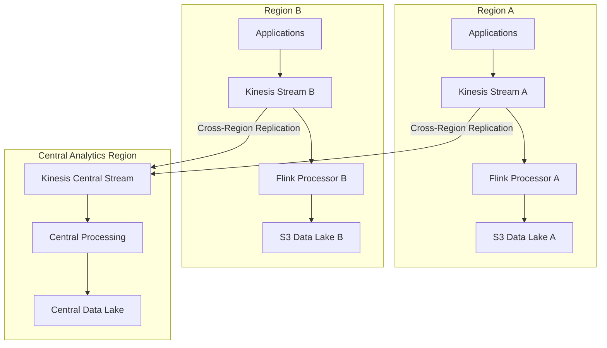
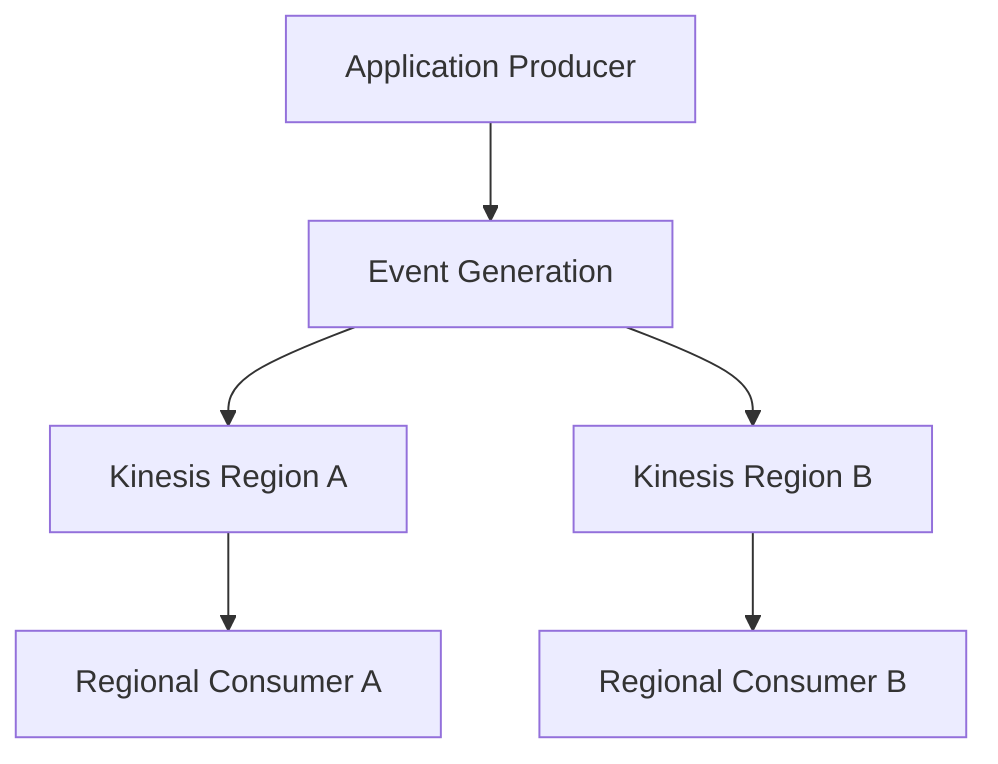
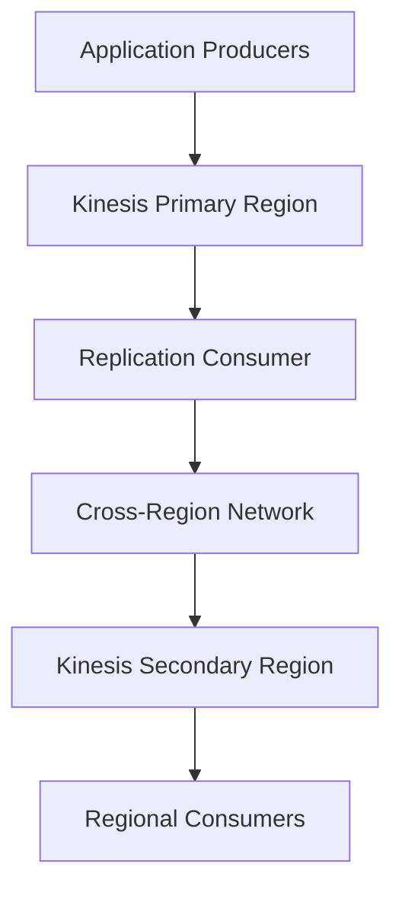
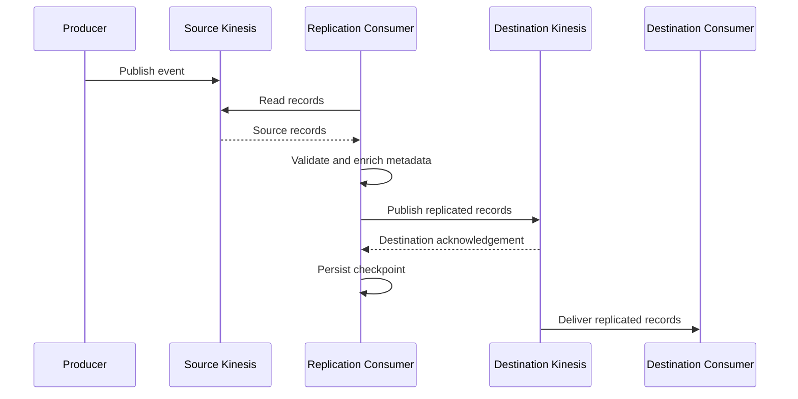
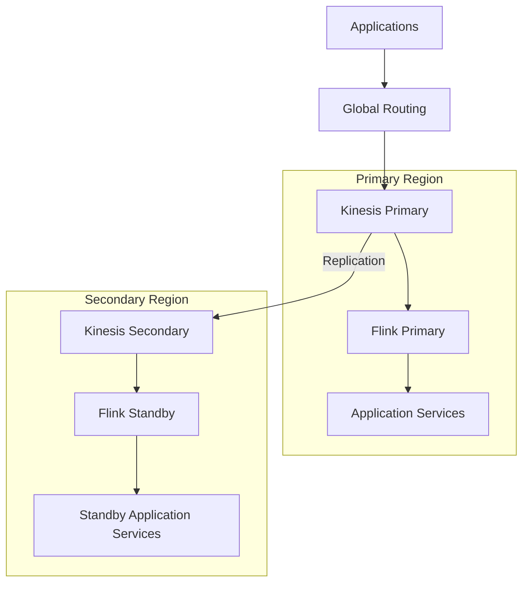
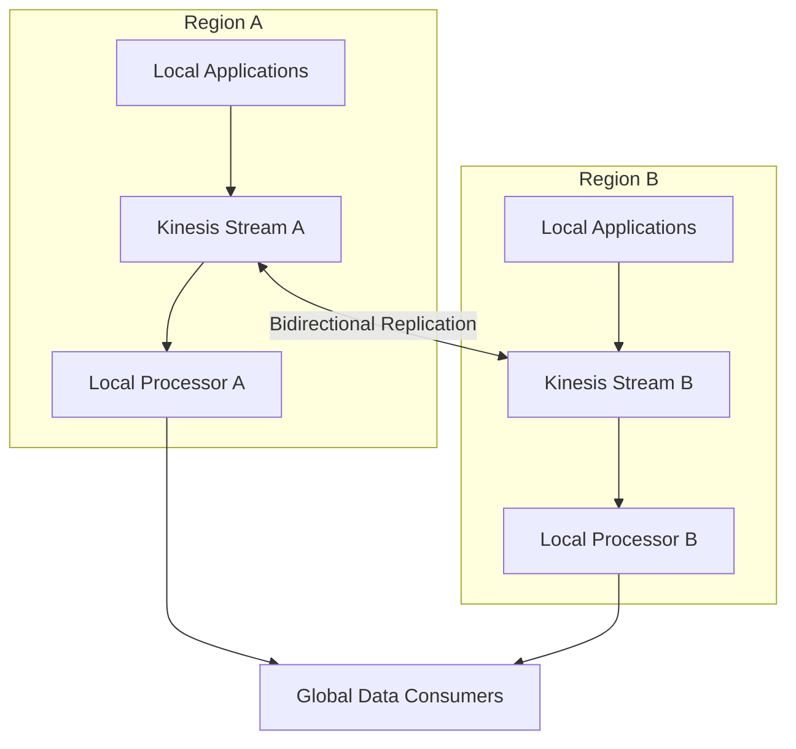
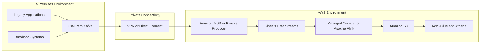

# 11- Multi-Region and Hybrid Cloud Streaming

## Overview

Multi-Region and hybrid cloud streaming architectures distribute event ingestion and processing across multiple AWS Regions, on-premises infrastructure, and external cloud environments.

These architectures are used when an organization requires:

- Regional data residency.
- Disaster recovery across AWS Regions.
- Low-latency event ingestion close to applications.
- Integration between on-premises systems and AWS.
- Gradual migration from legacy messaging platforms.
- Centralized analytics across geographically distributed workloads.
- Business continuity during regional or network failures.

Amazon Kinesis Data Streams provides regional streaming infrastructure. A Kinesis stream exists within a specific AWS Region, so multi-Region architectures require explicit mechanisms to transfer, replicate, or independently publish events across Regions.

Kinesis does not provide automatic cross-Region replication for Data Streams. Cross-Region replication must be implemented through producer fan-out, stream consumers, replication applications, or an integration architecture.

A production design must distinguish between:

- **High availability:** Keeping a workload operational during component failures.
- **Disaster recovery:** Restoring service after a major failure.
- **Data replication:** Copying events or records between environments.
- **Active-active processing:** Processing events in multiple Regions simultaneously.
- **Active-passive processing:** Maintaining a standby Region that takes over during failure.
- **Hybrid streaming:** Connecting cloud streaming infrastructure with on-premises or other cloud environments.

These are related but different architectural concerns. Replicating events does not automatically provide application failover, global ordering, conflict resolution, or exactly-once business processing.

## Multi-Region Streaming Architecture

A multi-Region streaming architecture distributes producers, streams, processors, and consumers across geographically separated AWS Regions.

For example, an enterprise application may operate in:

- `ap-south-1` — Mumbai.
- `eu-west-1` — Ireland.
- `us-east-1` — Northern Virginia.

Each Region can maintain local ingestion and processing infrastructure.

### Regional isolation

A regional architecture keeps event ingestion close to applications.



Regional processing reduces dependency on cross-Region network connectivity for local operations.

The central Region can aggregate replicated events for enterprise analytics, reporting, or centralized machine learning.

### Regional isolation advantages

- Local applications can continue publishing events when the central Region is unavailable.
- Regional data processing can satisfy locality requirements.
- Network latency is reduced for local ingestion.
- Regional workloads can scale independently.
- Failure in one Region does not necessarily stop other Regions.

### Limitations

- Cross-Region replication introduces network latency.
- Replication creates additional processing and data transfer costs.
- Events may arrive out of order across Regions.
- Duplicate records are possible.
- Global aggregation requires explicit consistency rules.
- Regional infrastructure must be deployed and operated independently.

## Cross-Region Replication Strategies

There are multiple ways to replicate Kinesis events across Regions.

The correct approach depends on throughput, ordering requirements, latency, failure tolerance, and operational complexity.

### Producer fan-out

In producer fan-out, the application publishes the same logical event to streams in multiple Regions.



Example:

A payment service publishes a transaction event to both the primary and secondary regional streams.

Advantages:

- No separate replication consumer is required.
- Each Region receives events directly.
- Regional streams can operate independently.
- Replication latency is not dependent on a downstream consumer.

Limitations:

- Producers must manage multiple regional endpoints.
- Partial publication failures are possible.
- The application must handle different stream responses.
- Duplicate publication can occur during retries.
- Cross-Region network latency affects publishing.

Producer fan-out is appropriate when the application already has a reliable multi-destination publishing mechanism.

It should not be implemented as two uncoordinated writes without considering partial failure.

For example:

1. The producer publishes successfully to Region A.
2. The publish to Region B fails.
3. The application retries both writes.
4. Region A receives a duplicate event.

Stable event identifiers and idempotent consumers are required.

### Consumer-based replication

A consumer-based replication architecture uses a dedicated application to read from one Region and publish records into another Region.



The replication consumer is responsible for:

- Reading source records.
- Preserving original event metadata.
- Publishing records to the destination stream.
- Handling retries and throttling.
- Tracking replication progress.
- Reporting failures.
- Preventing uncontrolled duplicate propagation.

Advantages:

- Producers remain unaware of destination Regions.
- Replication can be scaled independently.
- Replication behavior can be monitored centrally.
- Destination streams can have different consumer workloads.

Limitations:

- Adds a processing hop.
- Replication lag depends on consumer capacity.
- The replication application becomes operationally important.
- Checkpointing and destination publishing must be coordinated.
- Destination writes can be duplicated after failures.

A dedicated replication service can be implemented using a Kinesis consumer application, Kinesis Client Library, or a custom processor.

### Replication metadata

Replicated records should preserve their original identity and provenance.

Example:

```json
{
  "event_id": "evt-92831",
  "event_type": "payment.completed",
  "schema_version": 2,
  "source_region": "ap-south-1",
  "source_stream": "payments-primary",
  "source_sequence_number": "496512...",
  "event_time": "2026-11-20T10:15:30Z",
  "replication": {
    "replication_id": "rep-72831",
    "replicated_at": "2026-11-20T10:15:31Z",
    "hop_count": 1
  },
  "payload": {
    "transaction_id": "txn-92831",
    "amount": 12500.50,
    "currency": "INR"
  }
}
```

Important fields:

| Field | Purpose |
|---|---|
| `event_id` | Stable identity of the original business event |
| `source_region` | Identifies the originating Region |
| `source_stream` | Identifies the original stream |
| `source_sequence_number` | Supports source-side diagnostics |
| `event_time` | Preserves original event time |
| `replication_id` | Identifies a replication attempt or workflow |
| `replicated_at` | Records destination publication time |
| `hop_count` | Helps detect uncontrolled replication loops |

Do not replace the original event timestamp with the replication timestamp.

The original event time is necessary for event-time processing, while replication time is useful for measuring replication delay.

### AWS service selection

| Requirement | Possible approach |
|---|---|
| Replicate Kinesis events across Regions | Dedicated Kinesis consumer and destination producer |
| Publish directly to multiple regional streams | Producer fan-out |
| Archive regional data in another Region | S3 replication or cross-Region delivery architecture |
| Replicate application database changes | AWS DMS or database-native replication |
| Distribute application commands | SNS and SQS regional integration |
| Centralize analytical datasets | Regional S3 data lakes and controlled data sharing |

Do not assume that S3 replication, database replication, and Kinesis stream replication provide identical semantics. They operate on different resource types and have different consistency and recovery behavior.

## Building a Cross-Region Replication Consumer

A replication consumer reads records from a source stream and writes them to a destination stream.

A production implementation should use durable checkpointing and idempotent downstream processing.

### Replication flow



The replication checkpoint must advance only after the corresponding destination writes have been acknowledged.

Even then, a failure between destination acknowledgement and checkpoint persistence can cause the same records to be published again.

This is why replication must be designed for at-least-once behavior.

### Simplified Boto3 replication example

The following example demonstrates the core read-and-publish flow for one source shard. It intentionally omits durable checkpoint coordination and production lifecycle management.

```python
import json
import os
import time
from datetime import datetime, timezone

import boto3
from botocore.config import Config

config = Config(
    retries={
        "max_attempts": 8,
        "mode": "adaptive",
    },
    connect_timeout=5,
    read_timeout=30,
)

source_client = boto3.client(
    "kinesis",
    region_name=os.environ["SOURCE_REGION"],
    config=config,
)

destination_client = boto3.client(
    "kinesis",
    region_name=os.environ["DESTINATION_REGION"],
    config=config,
)

SOURCE_STREAM = os.environ["SOURCE_STREAM"]
DESTINATION_STREAM = os.environ["DESTINATION_STREAM"]


def get_iterator(shard_id: str) -> str:
    response = source_client.get_shard_iterator(
        StreamName=SOURCE_STREAM,
        ShardId=shard_id,
        ShardIteratorType="TRIM_HORIZON",
    )
    return response["ShardIterator"]


def replicate_record(record: dict) -> None:
    event = json.loads(record["Data"])

    event.setdefault(
        "source_region",
        os.environ["SOURCE_REGION"],
    )
    event.setdefault(
        "source_sequence_number",
        record["SequenceNumber"],
    )

    event["replication"] = {
        "replicated_at": datetime.now(
            timezone.utc
        ).isoformat(),
        "destination_region": os.environ[
            "DESTINATION_REGION"
        ],
    }

    destination_client.put_record(
        StreamName=DESTINATION_STREAM,
        Data=json.dumps(event).encode("utf-8"),
        PartitionKey=record["PartitionKey"],
    )


def replicate_shard(shard_id: str) -> None:
    iterator = get_iterator(shard_id)

    while iterator:
        response = source_client.get_records(
            ShardIterator=iterator,
            Limit=500,
        )

        for record in response["Records"]:
            replicate_record(record)

        iterator = response.get("NextShardIterator")

        if not response["Records"]:
            time.sleep(1)
```

This is not a complete production replication worker.

A production implementation must additionally handle:

- Durable checkpoint storage.
- Shard discovery and shard lifecycle.
- Parent-child shard relationships.
- Partial destination write failures.
- Source iterator expiration.
- Throttling and retry budgets.
- Destination partition-key strategy.
- Graceful shutdown.
- Replication lag metrics.
- Poison-record handling.
- Duplicate publication after recovery.

For production workloads, Kinesis Client Library can provide shard coordination and checkpoint management. The destination publishing and idempotency requirements still need to be designed explicitly.

### Partial batch failures

When using `PutRecords`, the API can accept some records and reject others.

A replication worker must inspect individual result entries and retry only failed records.

```python
def publish_batch(records: list[dict]) -> None:
    response = destination_client.put_records(
        StreamName=DESTINATION_STREAM,
        Records=records,
    )

    failed_records = []

    for record, result in zip(
        records,
        response["Records"],
        strict=True,
    ):
        if "ErrorCode" in result:
            failed_records.append(record)

    if failed_records:
        raise RuntimeError(
            f"{len(failed_records)} records failed"
        )
```

This example surfaces partial failure rather than implementing a complete retry queue.

Production code should retain the failed records, apply bounded retries with backoff, and avoid discarding them when a retry budget is exhausted.

## Active-Passive Architecture

Active-passive architecture maintains one primary Region that processes production traffic while another Region remains ready for failover.

The secondary Region may continuously receive replicated data while its application-facing consumers remain inactive.



### How failover works

1. Applications publish events to the primary Region.
2. The replication application copies events to the secondary Region.
3. The secondary Region maintains its stream and required processing infrastructure.
4. Health checks detect primary Region failure.
5. Traffic routing changes to the secondary Region.
6. Producers publish new events to the secondary stream.
7. Secondary consumers resume or continue processing according to the failover design.

### Advantages

- Simpler write ownership.
- Reduced conflict-resolution requirements.
- Easier global ordering assumptions within the primary processing path.
- Lower operational complexity than active-active processing.

### Limitations

- Failover may involve downtime.
- Replication lag can cause data loss relative to the primary's latest accepted records.
- Secondary capacity must be sufficient for production traffic.
- Failback requires careful reconciliation.
- Standby infrastructure can still incur significant cost.

### RPO and RTO

Two critical disaster recovery measurements are:

| Metric | Meaning |
|---|---|
| RPO | Maximum acceptable data loss measured in time |
| RTO | Maximum acceptable recovery time |

For example:

```text
Target RPO: 60 seconds
Target RTO: 10 minutes
```

These are architectural targets, not guaranteed Kinesis service behavior.

Actual recovery performance depends on:

- Replication lag.
- Stream retention.
- Consumer recovery time.
- Application deployment readiness.
- DNS or traffic-routing behavior.
- Database recovery.
- Feature-store availability.
- KMS and IAM dependencies.

A low RPO requires continuous replication and monitoring. A low RTO requires pre-provisioned infrastructure, automated failover, and tested operational procedures.

## Active-Active Architecture

Active-active architecture allows multiple Regions to process production traffic simultaneously.

Applications publish events to their local regional streams. Events may then be replicated to other Regions for global processing or analytical aggregation.



### Advantages

- Both Regions serve production traffic.
- Local ingestion can continue during regional connectivity failures.
- Capacity is distributed geographically.
- Regional application latency is reduced.
- Regional failure may have less impact on overall service availability.

### Limitations

- Duplicate events can circulate between Regions.
- Global ordering is not guaranteed.
- Concurrent updates can conflict.
- Business entities may be modified in multiple Regions.
- Replication loops must be prevented.
- Operational complexity increases significantly.

### Conflict resolution

Suppose the same customer account is updated in two Regions during a network partition.

```text
Region A:
  account_id = 1001
  balance = 5000

Region B:
  account_id = 1001
  balance = 4500
```

If both updates are replicated without a defined ownership or conflict-resolution strategy, the final state may be incorrect.

Possible strategies include:

- Single-writer ownership per entity.
- Region-based entity partitioning.
- Version-based conflict detection.
- Optimistic concurrency control.
- Domain-specific reconciliation.
- Append-only event sourcing with deterministic state reconstruction.

For financial systems, do not resolve concurrent balance updates using simple last-write-wins semantics. Financial state requires domain-level invariants and authoritative transaction processing.

### Preventing replication loops

Bidirectional replication can cause an event to be copied back to its origin.

Use replication metadata such as:

- Original source Region.
- Replication destination.
- Event identifier.
- Replication hop count.
- Originating stream identifier.

A replication worker should reject records that have already passed through its own replication path.

For example, a Region A replication worker should not re-publish records whose original source is Region A or whose replication metadata identifies Region A as an already visited destination.

A robust implementation should use a controlled set of visited Regions or a well-defined replication topology rather than relying only on a numeric hop count.

## Global Ordering and Data Consistency

Kinesis guarantees ordering within a shard. It does not provide global ordering across multiple shards or Regions.

Cross-Region replication introduces additional network and processing delays.

Consider two events generated by the same customer:

```text
Event A:
  event_time = 10:00:00
  source_region = ap-south-1

Event B:
  event_time = 10:00:01
  source_region = eu-west-1
```

Due to network delays, Event B may arrive first in the destination Region.

### Ordering strategies

| Strategy | Description | Trade-off |
|---|---|---|
| Single-writer per entity | One Region owns writes for an entity | Simplifies ordering but limits locality |
| Entity-based routing | Route related events to the same Region | Requires routing coordination |
| Sequence numbers | Assign an authoritative sequence per entity | Requires reliable sequence generation |
| Event-time processing | Process according to timestamps and watermarks | Late events require correction logic |
| Version-based updates | Reject stale entity versions | Requires version-aware consumers |

### Event-time processing

Flink can use event-time windows and watermarks to handle out-of-order events.

However, a watermark is not a guarantee that no earlier event will ever arrive.

Define:

- Maximum tolerated lateness.
- Late-event handling.
- State retention.
- Window correction behavior.
- Reconciliation requirements.

For critical business data, retain original events so that corrected results can be reconstructed.

### Idempotency across Regions

A replicated event may be published more than once because of retries or checkpoint recovery.

Use a stable `event_id` as the logical event identity.

A destination database can enforce uniqueness:

```sql
CREATE TABLE processed_events (
    event_id TEXT PRIMARY KEY,
    source_region TEXT NOT NULL,
    event_type TEXT NOT NULL,
    processed_at TIMESTAMPTZ NOT NULL DEFAULT NOW()
);
```

Consumers should perform deduplication and business updates within an appropriate transaction boundary.

A database uniqueness constraint is stronger than checking for an existing event in application code before inserting it because concurrent workers can otherwise process the same event simultaneously.

## Hybrid Cloud Streaming Architecture

Hybrid cloud streaming connects AWS streaming services with on-premises infrastructure or other cloud platforms.

This is common in enterprises that cannot migrate every system to AWS immediately.

Typical environments include:

- Legacy data centers.
- On-premises PostgreSQL and Oracle databases.
- Kafka clusters.
- Enterprise message brokers.
- Kubernetes clusters.
- Private corporate networks.
- Other public cloud platforms.

### Reference architecture



### Hybrid integration patterns

| Pattern | Description | Suitable use case |
|---|---|---|
| Application-level publishing | On-premises application publishes directly to Kinesis | Small or moderate event workloads |
| Kafka bridge | Kafka consumers publish events to Kinesis | Existing Kafka environments |
| Database CDC | Capture database changes and publish them to AWS | Legacy database migration |
| File-based transfer | Export files to S3 | Batch integration |
| API-based integration | Send events through an authenticated service | Controlled enterprise integrations |

### Direct application publishing

An on-premises application can use the AWS SDK to publish directly to Kinesis.

The application requires:

- Network connectivity to the regional Kinesis endpoint.
- IAM authentication.
- TLS.
- Retry and timeout handling.
- Network egress configuration.

A private connectivity design can use AWS Direct Connect or Site-to-Site VPN where appropriate.

Private connectivity does not automatically make every AWS service endpoint private. Use VPC endpoints, routing, DNS, and endpoint policies according to the required network path.

### Kafka-to-Kinesis integration

Organizations that already use Kafka may operate a bridge between Kafka topics and Kinesis streams.

A bridge consumer:

1. Reads Kafka records.
2. Maps Kafka metadata and payloads to the Kinesis event contract.
3. Publishes records to Kinesis.
4. Commits Kafka offsets according to the destination acknowledgement strategy.

The critical failure window is between successful Kinesis publication and Kafka offset commit.

If the bridge fails after publishing but before committing the Kafka offset, the record may be published again.

Use stable event identifiers and idempotent destination consumers.

For higher-throughput or long-running integrations, use a supported connector or managed integration where its operational and delivery semantics meet the requirements.

### Database change data capture

AWS Database Migration Service can capture database changes and replicate them to supported targets.

A CDC pipeline can support:

- Database migration.
- Near-real-time data lake ingestion.
- Synchronization of operational data.
- Historical and incremental data integration.

CDC events should preserve:

- Source database identity.
- Schema information.
- Operation type.
- Primary key.
- Commit or source-log position where available.
- Transaction metadata where supported.

Do not treat a CDC event as equivalent to a business-domain event without validating its semantics.

A row update indicates a database mutation. It does not necessarily explain the business action that caused it.

## Hybrid Network Connectivity

Network architecture is a critical dependency in hybrid streaming.

### AWS Direct Connect

AWS Direct Connect provides dedicated network connectivity between an organization's network and AWS.

Suitable use cases:

- High-volume data transfer.
- Predictable network performance requirements.
- Enterprise private connectivity.
- Hybrid application integration.

Direct Connect does not inherently encrypt traffic. Use appropriate encryption, such as IPsec VPN or application-level TLS, when confidentiality requirements demand it.

### AWS Site-to-Site VPN

Site-to-Site VPN establishes encrypted connectivity between an on-premises network and an AWS VPC.

Advantages:

- Encrypted network tunnel.
- Faster initial setup than dedicated connectivity.
- Useful as primary or backup connectivity.
- Supports hybrid routing.

Limitations:

- Internet-path performance may vary.
- Throughput depends on VPN configuration and service limits.
- Network outages can interrupt streaming publication.

### Connectivity comparison

| Dimension | Direct Connect | Site-to-Site VPN |
|---|---|---|
| Connectivity | Dedicated network connection | Encrypted VPN tunnels |
| Encryption | Not inherently encrypted | IPsec encrypted |
| Performance | More predictable | Depends on internet path and tunnel configuration |
| Setup | Requires provider or network connectivity | Generally quicker |
| Use case | Enterprise-scale connectivity | Secure hybrid access and backup |
| Resilience | Requires redundant connections for high availability | Requires redundant tunnels and endpoints |

For critical hybrid environments, use redundant connectivity paths and test failover behavior.

### VPC endpoints

For services that support them, VPC endpoints can provide private connectivity from a VPC to AWS services.

A Kinesis interface VPC endpoint can reduce reliance on public service endpoints for traffic originating within the VPC.

For on-premises systems, private connectivity, DNS resolution, routing, and endpoint accessibility must be designed together.

Do not assume that creating a VPC endpoint automatically makes Kinesis accessible from every on-premises network.

## Hybrid Streaming with Python

Python services can publish events from on-premises systems to Kinesis using Boto3.

A production producer should use IAM roles or an approved workload identity mechanism rather than static credentials embedded in application configuration.

Example:

```python
import json
import os
from datetime import datetime, timezone

import boto3
from botocore.config import Config

client = boto3.client(
    "kinesis",
    region_name=os.environ["AWS_REGION"],
    config=Config(
        connect_timeout=5,
        read_timeout=15,
        retries={
            "max_attempts": 6,
            "mode": "standard",
        },
    ),
)

STREAM_NAME = os.environ["KINESIS_STREAM_NAME"]


def publish_event(
    event_id: str,
    account_id: str,
    payload: dict,
) -> dict:
    event = {
        "event_id": event_id,
        "event_type": "account.updated",
        "schema_version": 1,
        "source": "legacy-account-service",
        "source_region": "on-premises",
        "event_time": datetime.now(
            timezone.utc
        ).isoformat(),
        "payload": payload,
    }

    response = client.put_record(
        StreamName=STREAM_NAME,
        Data=json.dumps(event).encode("utf-8"),
        PartitionKey=account_id,
    )

    return {
        "shard_id": response["ShardId"],
        "sequence_number": response["SequenceNumber"],
    }
```

This example assumes the caller supplies a stable `event_id`.

For reliable integration with a database transaction, use the transactional outbox pattern:

1. Update the business record.
2. Insert the event into an outbox table in the same database transaction.
3. Commit the transaction.
4. A separate publisher reads pending outbox records.
5. Publish to Kinesis.
6. Mark the outbox record as published after acknowledgement.
7. Retry pending records after failures.

This avoids losing an event when the database commits but the network connection to Kinesis fails.

## Hybrid Deployment with Containers and Kubernetes

A Kubernetes-based on-premises platform may run event producers or replication workers as containerized services.

Typical deployment responsibilities include:

- Workload identity and AWS authentication.
- Network routing to AWS.
- Producer retry policies.
- Resource limits.
- Horizontal scaling.
- Graceful shutdown.
- Secret management.
- Observability.

A simplified Kubernetes deployment:

```yaml
apiVersion: apps/v1
kind: Deployment
metadata:
  name: kinesis-event-publisher
  namespace: integration
spec:
  replicas: 3
  selector:
    matchLabels:
      app: kinesis-event-publisher
  template:
    metadata:
      labels:
        app: kinesis-event-publisher
    spec:
      containers:
        - name: publisher
          image: example.com/platform/kinesis-publisher:1.0.0
          env:
            - name: AWS_REGION
              value: ap-south-1
            - name: KINESIS_STREAM_NAME
              value: enterprise-events
          resources:
            requests:
              cpu: "250m"
              memory: "256Mi"
            limits:
              cpu: "1"
              memory: "512Mi"
```

This deployment is illustrative and does not configure AWS authentication.

In production, use an appropriate workload identity mechanism. For Kubernetes on AWS, EKS Pod Identity or IAM Roles for Service Accounts can provide workload-specific permissions. For on-premises Kubernetes, use an approved identity federation or credential-broker approach.

Avoid embedding long-lived AWS access keys in container images, ConfigMaps, or source repositories.

## Security Across Regions and Hybrid Environments

Multi-Region and hybrid architectures increase the number of trust boundaries.

Security must cover application identity, network connectivity, event payloads, storage, and cross-account access.

### IAM and cross-account access

Use separate IAM roles for:

- Regional producers.
- Replication consumers.
- Destination stream publishers.
- Regional processors.
- Central analytics services.
- Hybrid workloads.

Grant only the required stream and resource permissions.

Cross-account architectures should use controlled role assumption and resource policies where appropriate.

### Encryption

Apply encryption at each layer:

| Layer | Recommended control |
|---|---|
| Application-to-AWS traffic | TLS |
| Hybrid network | IPsec VPN where required |
| Kinesis streams | KMS-backed server-side encryption |
| S3 data lakes | KMS-backed server-side encryption |
| Databases | Encryption at rest |
| Secrets | Secrets Manager or approved secret-management system |
| Model and data artifacts | Restricted encrypted storage |

For cross-Region KMS usage, design key policies and regional key availability carefully.

A KMS key is a regional resource. A destination Region may require its own key and appropriate decryption or encryption permissions.

### Data residency

Some enterprise datasets cannot be copied freely across Regions or countries.

Before enabling replication, define:

- Data classification.
- Permitted destination Regions.
- Legal and contractual restrictions.
- Personally identifiable information handling.
- Retention requirements.
- Cross-border transfer requirements.
- Deletion propagation requirements.

A centralized analytics architecture should not bypass regional data residency controls.

### Network security

Use:

- Private subnets where appropriate.
- Restricted security groups.
- Network ACLs where required.
- Private endpoints.
- TLS.
- Network firewall controls.
- Explicit outbound destination policies.
- DNS and routing controls.

Do not assume that private connectivity automatically provides application-level authentication or authorization.

## Monitoring and Operational Observability

Multi-Region systems require both local and global monitoring.

A pipeline can appear healthy in the destination Region while replication from the source has stopped.

### Replication metrics

| Metric | Purpose |
|---|---|
| Source records processed | Measures replication input |
| Destination records accepted | Measures replication output |
| Replication lag | Measures delay between source and destination |
| Replication failures | Identifies failed publication |
| Retry count | Detects transient service or network issues |
| Duplicate event count | Detects repeated delivery |
| Per-shard lag | Identifies uneven processing |
| Unreplicated record count | Measures backlog where tracked |
| Checkpoint age | Indicates stale replication progress |

A useful replication lag metric is:

```text
Replication Lag =
Destination Publication Time - Source Event Time
```

This includes event-generation delay and source ingestion delay.

For a more precise replication measurement, record source ingestion time and destination publication time separately:

```text
Replication Transport Delay =
Destination Publication Time - Source Ingestion Time
```

### Regional health monitoring

Monitor each Region independently:

- Kinesis stream availability and throttling.
- Flink application status.
- Consumer iterator age.
- Application error rates.
- Database availability.
- S3 delivery failures.
- Replication backlog.
- Network connectivity.
- KMS permissions and access failures.

### Global operational view

A global dashboard should provide:

- Region status.
- Replication direction and health.
- Per-Region stream throughput.
- Replication lag.
- Failover readiness.
- Active processing ownership.
- Data reconciliation status.

Use CloudWatch metrics and alarms for AWS service health, with application-level metrics for replication progress and business consistency.

### Alerting

Alerts should distinguish between:

- Regional service failure.
- Replication delay.
- Destination throttling.
- Network connectivity failure.
- Checkpoint failure.
- Duplicate processing increase.
- Data reconciliation mismatch.

A temporary replication delay may not require application failover. A complete regional outage may require a controlled failover procedure.

## Scalability and Performance

Multi-Region replication adds network, serialization, and destination-write overhead.

Capacity planning must include the replication workload rather than only the original producer workload.

### Throughput planning

Consider an architecture with:

```text
Source event rate:       8,000 records/sec
Average record size:     2 KB
Destination Regions:     2
Replication strategy:    Consumer-based
```

Approximate source payload throughput:

```text
8,000 × 2 KB
= 16,000 KB/sec
≈ 16 MB/sec
```

If every record is replicated to two destination Regions, the replication system must sustain approximately 16,000 destination record publications per second in aggregate, before considering retries and metadata overhead.

This is a simplified estimate. Actual throughput depends on batching, shard distribution, record sizes, stream capacity, and service quotas.

### Scaling recommendations

**Replication consumers**

- Scale processing parallelism based on shard count and workload.
- Monitor per-shard lag.
- Use batching where appropriate.
- Avoid unbounded retry queues.
- Preserve ordering requirements.

**Destination streams**

- Size capacity for replicated traffic plus local producers.
- Monitor hot partition keys.
- Select an appropriate capacity mode.
- Account for cross-Region bursts after network recovery.

**Network**

- Measure sustained and peak bandwidth.
- Monitor connection failures and latency.
- Use redundant connectivity.
- Avoid routing all traffic through a single network path.

**Processing**

- Separate regional processing from global aggregation.
- Use local features and state where possible.
- Avoid synchronous cross-Region dependencies in latency-sensitive request paths.

### Replication backlog recovery

If a network outage lasts 30 minutes, the replication consumer may need to process a large backlog after connectivity returns.

The recovery rate must exceed the incoming event rate.

For example:

```text
Incoming event rate:       5,000 records/sec
Replication capacity:      8,000 records/sec
Net backlog reduction:     3,000 records/sec
```

A system that processes exactly the incoming rate can maintain current traffic but cannot drain an existing backlog.

Plan temporary recovery capacity and monitor the time required to return to normal replication lag.

## Disaster Recovery and Failover

Disaster recovery must include more than changing the producer endpoint.

A complete failover procedure considers:

- Producer routing.
- Stream availability.
- Replication progress.
- Consumer checkpoints.
- Database recovery.
- Feature-store state.
- Application configuration.
- IAM and KMS dependencies.
- DNS and load balancing.
- Duplicate processing prevention.

### Failover state management

A regional failover process should have an explicit ownership state.

For example:

```text
PRIMARY_REGION = ap-south-1
SECONDARY_REGION = eu-west-1
ACTIVE_WRITE_REGION = ap-south-1
FAILOVER_STATUS = NORMAL
```

During failover:

```text
ACTIVE_WRITE_REGION = eu-west-1
FAILOVER_STATUS = SECONDARY_ACTIVE
```

The authoritative active Region should be managed through a controlled mechanism such as a deployment configuration, routing control, or coordination service.

Do not rely on every application independently deciding which Region is active.

### Split-brain prevention

Split-brain occurs when two Regions both believe they are the authoritative writer.

This can cause conflicting updates and duplicate business actions.

Prevent it through:

- Single-writer ownership.
- Controlled traffic routing.
- Fencing or lease mechanisms where appropriate.
- Explicit failover approval for critical systems.
- Idempotent processing.
- Recovery reconciliation.

For financial or inventory systems, application-level consistency rules are mandatory even when infrastructure failover is automated.

### Failback procedure

Returning to the original primary Region requires controlled reconciliation.

A safe process includes:

1. Verify the recovered Region is healthy.
2. Confirm replication and stream state.
3. Reconcile events processed during failover.
4. Verify database and feature-store consistency.
5. Establish the intended write owner.
6. Switch producer routing.
7. Monitor replication and consumer lag.
8. Retire temporary failover capacity only after validation.

Do not switch traffic back merely because the original Region is reachable.

## Cost Considerations

Multi-Region and hybrid streaming introduce additional costs beyond a single-Region deployment.

Primary cost drivers include:

- Kinesis stream capacity in each Region.
- Replication consumer compute.
- Cross-Region data transfer.
- Flink processing capacity.
- S3 storage and replication.
- KMS requests.
- VPN or Direct Connect connectivity.
- CloudWatch logs and metrics.
- Standby application and database infrastructure.

### Cost optimization

- Replicate only events required by the destination.
- Avoid unnecessary bidirectional replication.
- Use compact event schemas.
- Batch destination writes where appropriate.
- Right-size regional stream capacity.
- Use lifecycle policies for archived data.
- Scale standby processing based on recovery objectives.
- Monitor cross-Region data transfer.
- Avoid excessive duplicate storage.
- Separate global analytical replication from operational replication.

Do not reduce replication scope without evaluating RPO, audit, recovery, and data residency requirements.

## Testing Strategy

Multi-Region and hybrid architectures require failure-oriented testing.

A successful integration test does not prove that the architecture can recover from a regional outage.

### Functional tests

Validate:

- Source-to-destination event replication.
- Event metadata preservation.
- Schema compatibility.
- Partition key behavior.
- Duplicate detection.
- Destination consumer processing.
- Cross-account access.
- Regional application routing.

### Failure tests

Simulate:

- Destination stream throttling.
- Source stream consumer failure.
- Network interruption.
- Direct Connect failure.
- VPN tunnel failure.
- KMS permission errors.
- Partial destination batch failure.
- Consumer checkpoint recovery.
- Regional service outage.
- Replication loop.
- Split-brain conditions.

### Recovery tests

Measure:

- Actual RPO.
- Actual RTO.
- Replication backlog.
- Backlog recovery time.
- Event loss or duplication.
- Business-state reconciliation.
- Failback behavior.

### Chaos testing

Controlled fault injection can validate whether the architecture behaves as expected under failure.

Do not perform uncontrolled regional failure experiments in production. Use isolated environments and approved operational procedures.

## Common Mistakes and Production Pitfalls

| Mistake | Impact | Recommended approach |
|---|---|---|
| Assuming Kinesis automatically replicates streams across Regions | Events remain regional unless explicitly transferred | Implement a replication architecture |
| Treating replication as exactly once | Retries and checkpoint recovery can duplicate events | Use stable IDs and idempotent consumers |
| Assuming global ordering | Events may arrive in different orders | Define ordering boundaries and event-time policies |
| Enabling bidirectional replication without loop prevention | Events circulate indefinitely | Track origin and replication path |
| Using last-write-wins for financial records | Concurrent updates can corrupt business state | Use domain-specific consistency controls |
| Failing over without checking replication lag | Recent source events may be missing | Measure RPO and reconcile |
| Running two active writers unintentionally | Split-brain and conflicting updates | Use explicit write ownership |
| Ignoring cross-Region KMS configuration | Destination processing can fail to decrypt or encrypt records | Configure regional keys and permissions |
| Treating Direct Connect as encrypted | Sensitive traffic may not meet encryption requirements | Use TLS or IPsec where required |
| Assuming a VPC endpoint provides on-premises access automatically | Network routing and DNS may still be incorrect | Design private connectivity end to end |
| Scaling only the source stream | Replication backlog grows | Capacity-plan source, consumer, destination, and network |
| Ignoring hybrid identity management | Static credentials become difficult to secure and rotate | Use workload identity or controlled federation |
| Switching back to the primary immediately after recovery | Data divergence may remain unresolved | Reconcile before failback |
| Monitoring only destination stream health | Source replication may have stopped silently | Monitor end-to-end replication progress |

## Production Deployment Checklist

### Architecture

- [ ] Active-passive or active-active behavior is explicitly defined.
- [ ] Regional ownership boundaries are documented.
- [ ] Cross-Region replication strategy is selected.
- [ ] Replication loops are prevented.
- [ ] Event identity and provenance are preserved.
- [ ] Ordering and consistency requirements are documented.

### Replication

- [ ] Replication workers have durable checkpoints.
- [ ] Partial destination failures are handled.
- [ ] Retry policies are bounded.
- [ ] Duplicate event handling is implemented.
- [ ] Replication lag is monitored.
- [ ] Backlog recovery capacity is tested.

### Hybrid connectivity

- [ ] Network paths are documented.
- [ ] Direct Connect or VPN redundancy is configured where required.
- [ ] DNS and routing are tested.
- [ ] Private endpoint requirements are addressed.
- [ ] TLS and network encryption requirements are satisfied.
- [ ] Workload identity is configured securely.

### Disaster recovery

- [ ] RPO and RTO targets are defined.
- [ ] Secondary infrastructure is deployable and tested.
- [ ] Failover ownership is controlled.
- [ ] Split-brain prevention is implemented.
- [ ] Database and feature-store recovery are included.
- [ ] Failback and reconciliation procedures are documented.

### Operations and security

- [ ] Regional and global dashboards exist.
- [ ] Replication failures trigger actionable alerts.
- [ ] IAM permissions follow least privilege.
- [ ] KMS keys and policies are configured per Region.
- [ ] Data residency requirements are enforced.
- [ ] Cross-Region transfer costs are monitored.
- [ ] Failure and recovery exercises are performed regularly.

## Key Takeaways

- Kinesis Data Streams is regional; cross-Region replication requires an explicit producer fan-out or consumer-based replication architecture.
- Active-passive designs simplify write ownership, while active-active designs require deliberate conflict resolution, ordering, and split-brain prevention.
- Hybrid streaming depends on reliable network connectivity, workload identity, secure service access, and controlled event delivery.
- Replication must tolerate duplicates, partial failures, out-of-order events, and backlog recovery through durable checkpoints and idempotent consumers.
- RPO, RTO, replication lag, regional ownership, and failback procedures must be measured and tested rather than assumed.