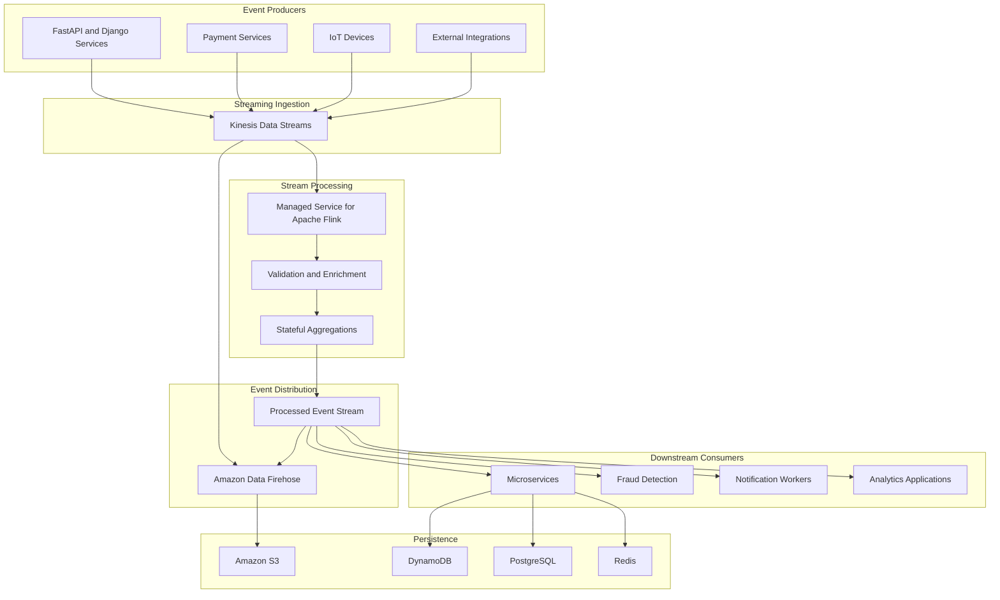
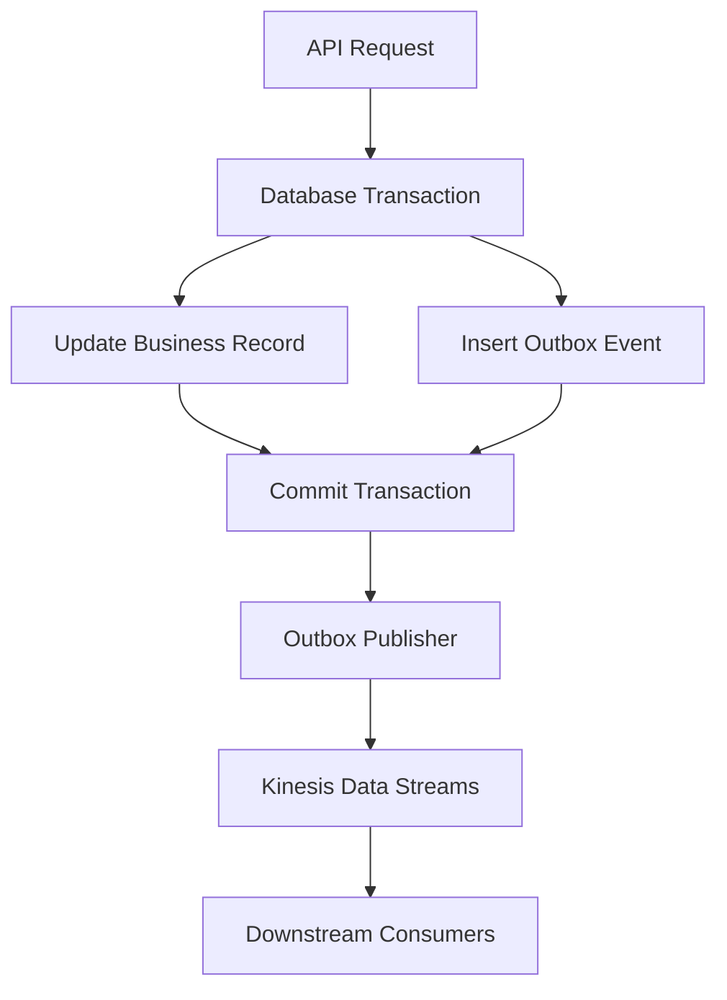
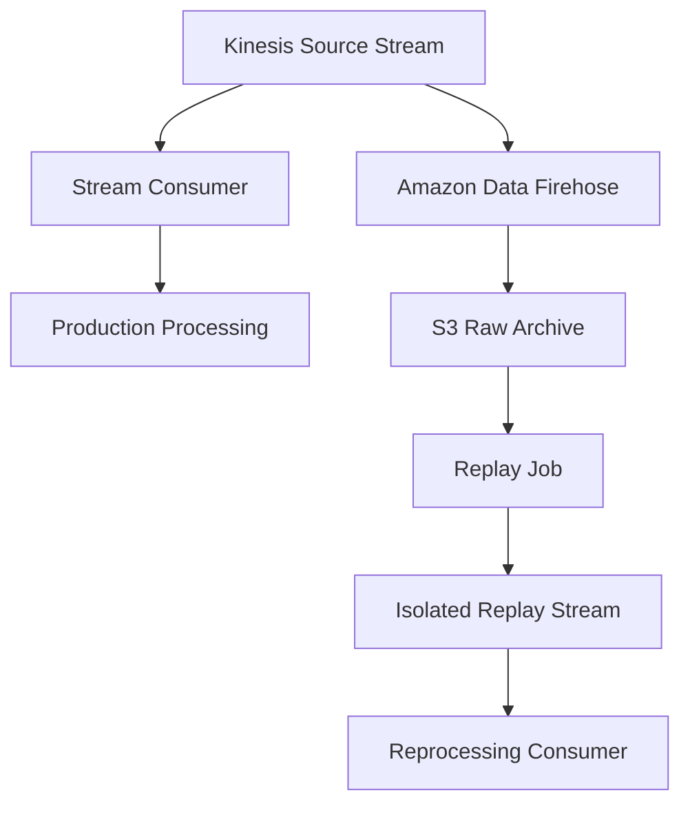
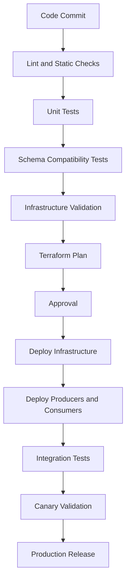

# 12- Production Streaming Architecture

## Overview

A production streaming architecture is designed to ingest, process, distribute, and retain continuous event data while meeting business requirements for availability, latency, throughput, consistency, security, and operational reliability.

Amazon Kinesis Data Streams provides the ingestion layer for event-driven systems. Managed Service for Apache Flink supports continuous stateful processing, while Amazon Data Firehose delivers streaming records to supported destinations such as Amazon S3.

A production architecture must address more than simply connecting producers and consumers. It must define:

- Event contracts and schema evolution.
- Partitioning and ordering boundaries.
- Delivery guarantees and idempotency.
- Consumer coordination and checkpointing.
- Backpressure and throughput management.
- Failure isolation and recovery.
- Data retention and replay.
- Security and access control.
- Monitoring and operational ownership.
- Deployment, scaling, and cost management.

The objective is to build a streaming platform that continues processing correctly under normal load, traffic spikes, partial failures, and infrastructure disruptions.

## Production Reference Architecture

A typical enterprise streaming architecture separates ingestion, processing, distribution, persistence, and consumption.



The architecture separates responsibilities:

| Layer | Responsibility |
|---|---|
| Producers | Generate and publish business events |
| Kinesis Data Streams | Buffer and distribute records |
| Flink | Validate, enrich, aggregate, and transform events |
| Processed streams | Distribute normalized events |
| Consumers | Execute independent business workflows |
| Data Firehose | Deliver streaming data to supported destinations |
| S3 | Retain historical and analytical datasets |
| Databases and caches | Serve operational application requirements |

Not every application requires every component. Introduce processing and storage layers when they solve a specific architectural requirement.

## Define Streaming Service-Level Objectives

Production streaming systems should have measurable service-level objectives rather than relying on general availability expectations.

An SLO defines the target behavior of the system from the perspective of its consumers.

### Important SLO dimensions

| Dimension | Example measurement |
|---|---|
| Ingestion availability | Percentage of successful producer publishing operations |
| Processing latency | Time between event acceptance and processing completion |
| End-to-end latency | Time between event creation and downstream availability |
| Replication lag | Delay between source and destination publication |
| Consumer lag | Delay between stream ingestion and consumer processing |
| Data completeness | Percentage of expected events successfully accounted for |
| Recovery time | Time required to restore processing after failure |
| Error rate | Percentage of records that fail processing |

Example objectives:

```text
Ingestion availability:       99.95%
Processing latency p99:       2 seconds
Consumer lag target:          30 seconds
Recovery time objective:      15 minutes
Data loss tolerance:          Defined per event category
```

These values are illustrative. Actual targets must be based on business requirements, workload characteristics, and service capabilities.

### Latency measurement

Track timestamps at different stages:

```json
{
  "event_id": "evt-92831",
  "event_time": "2026-11-20T10:15:30.000Z",
  "published_at": "2026-11-20T10:15:30.050Z",
  "processed_at": "2026-11-20T10:15:30.400Z",
  "persisted_at": "2026-11-20T10:15:30.650Z"
}
```

These timestamps help distinguish:

- Producer-side delay.
- Ingestion delay.
- Stream processing delay.
- Downstream persistence delay.

Use UTC timestamps and synchronized clocks. For precise duration measurement inside a process, use a monotonic clock rather than subtracting wall-clock timestamps.

## Event Contract Design

A production streaming platform needs a stable event contract.

The event contract defines the structure and meaning of records exchanged between producers and consumers.

### Standard event envelope

```json
{
  "event_id": "evt-92831",
  "event_type": "payment.completed",
  "schema_version": 2,
  "source": "payment-service",
  "tenant_id": "tenant-1001",
  "entity_id": "account-882",
  "event_time": "2026-11-20T10:15:30Z",
  "correlation_id": "corr-72831",
  "payload": {
    "transaction_id": "txn-92831",
    "amount": 12500.50,
    "currency": "INR"
  }
}
```

Recommended fields:

| Field | Responsibility |
|---|---|
| `event_id` | Stable event identity |
| `event_type` | Business event classification |
| `schema_version` | Contract version |
| `source` | Originating service |
| `tenant_id` | Tenant identity where applicable |
| `entity_id` | Business entity identifier |
| `event_time` | Time the business event occurred |
| `correlation_id` | Connects related operations |
| `payload` | Event-specific data |

### Schema evolution

Event schemas change as business requirements evolve.

Common changes include:

- Adding optional fields.
- Introducing new event types.
- Changing data representations.
- Deprecating fields.
- Splitting one event into multiple event types.

Use backward-compatible changes whenever possible.

For example, adding an optional field is generally safer than renaming an existing field that active consumers still require.

A schema registry or equivalent contract-management mechanism can help validate compatibility before deployment.

Schema compatibility should be enforced through CI/CD rather than discovered after incompatible records reach production.

### Event versioning strategy

| Change | Recommended approach |
|---|---|
| Add optional field | Preserve compatibility with existing consumers |
| Add new event type | Introduce a new event contract |
| Rename field | Support old and new fields during migration |
| Change field type | Introduce a compatible representation or new version |
| Remove field | Deprecate first and verify consumer migration |
| Change event semantics | Use an explicit new version or event type |

Do not assume that a structurally compatible schema is semantically compatible. Changing the meaning of an existing field can break consumers without changing its data type.

## Producer Architecture

Producers should publish events reliably without coupling business transactions to the availability of every downstream consumer.

Typical producers include:

- Django and FastAPI services.
- Payment services.
- Order management systems.
- Inventory applications.
- IoT gateways.
- External integration workers.

### Transactional outbox pattern

A common production problem occurs when a service updates a database and publishes an event as separate operations.

Consider:

1. PostgreSQL commits an order.
2. The application attempts to publish `order.created`.
3. Kinesis is temporarily unavailable.
4. The order exists, but the event is missing.

The transactional outbox pattern addresses this consistency gap.



The business update and outbox insert happen in the same database transaction.

A separate publisher reads pending outbox records and sends them to Kinesis.

Example PostgreSQL table:

```sql
CREATE TABLE event_outbox (
    event_id UUID PRIMARY KEY,
    aggregate_id TEXT NOT NULL,
    event_type TEXT NOT NULL,
    payload JSONB NOT NULL,
    created_at TIMESTAMPTZ NOT NULL DEFAULT NOW(),
    published_at TIMESTAMPTZ,
    attempts INTEGER NOT NULL DEFAULT 0
);

CREATE INDEX idx_event_outbox_pending
ON event_outbox (created_at)
WHERE published_at IS NULL;
```

Production publishers should:

- Claim records safely when multiple workers operate concurrently.
- Publish with stable event identifiers.
- Mark records as published only after acknowledgement.
- Retry transient failures.
- Monitor outbox backlog.
- Prevent one failed event from blocking unrelated events indefinitely.

A crash after Kinesis accepts a record but before PostgreSQL records the publication can cause the event to be sent again. Consumers must therefore be idempotent.

### Producer publishing example

```python
import json
import os

import boto3
from botocore.config import Config

client = boto3.client(
    "kinesis",
    region_name=os.environ["AWS_REGION"],
    config=Config(
        connect_timeout=5,
        read_timeout=15,
        retries={
            "max_attempts": 6,
            "mode": "standard",
        },
    ),
)

STREAM_NAME = os.environ["KINESIS_STREAM_NAME"]


def publish_event(event: dict) -> dict:
    required_fields = {
        "event_id",
        "event_type",
        "schema_version",
        "entity_id",
    }

    missing = required_fields.difference(event)

    if missing:
        raise ValueError(
            f"Missing event fields: {sorted(missing)}"
        )

    response = client.put_record(
        StreamName=STREAM_NAME,
        Data=json.dumps(event).encode("utf-8"),
        PartitionKey=str(event["entity_id"]),
    )

    return {
        "shard_id": response["ShardId"],
        "sequence_number": response["SequenceNumber"],
    }
```

This example assumes the event identifier and timestamp are created before publishing.

For production workloads, also consider:

- Payload size validation.
- Structured logging.
- Application-level metrics.
- Explicit retry classification.
- Request deadlines.
- Batch publishing where appropriate.
- Partial batch failure handling.

### Batching and partial failures

`PutRecords` supports publishing multiple records in one request, up to 500 records per request.

A successful HTTP response does not mean every record was accepted.

The application must inspect each result and retry failed records individually.

```python
def publish_batch(records: list[dict]) -> list[dict]:
    response = client.put_records(
        StreamName=STREAM_NAME,
        Records=[
            {
                "Data": json.dumps(event).encode("utf-8"),
                "PartitionKey": str(event["entity_id"]),
            }
            for event in records
        ],
    )

    failed = []

    for event, result in zip(
        records,
        response["Records"],
        strict=True,
    ):
        if "ErrorCode" in result:
            failed.append({
                "event_id": event["event_id"],
                "error_code": result["ErrorCode"],
                "error_message": result.get("ErrorMessage"),
            })

    return failed
```

Batch retries can change the relative ordering of records. If strict per-entity ordering is required, design the retry and publishing strategy around that requirement.

## Partitioning and Ordering Strategy

Partition keys determine how Kinesis distributes records across shards.

A production partitioning strategy must balance ordering requirements with traffic distribution.

### Partition key choices

| Partition key | Ordering boundary | Risk |
|---|---|---|
| Customer ID | Customer | High-volume customers can create hot shards |
| Account ID | Account | Large accounts can dominate throughput |
| Device ID | Device | Device activity may be uneven |
| Transaction ID | Transaction | Does not preserve customer-level ordering |
| Random identifier | Individual record distribution | No useful entity ordering guarantee |

For example, a payment platform may use `account_id` when account-level event ordering matters.

```python
partition_key = event["account_id"]
```

If one account produces a disproportionately large number of records, it may create a hot partition.

Do not change the partition key randomly to solve hot-shard problems when doing so breaks required ordering semantics.

### Ordering guarantees

Kinesis provides ordering within a shard.

It does not provide:

- Global ordering across all shards.
- Global ordering across multiple Regions.
- Business transaction ordering across unrelated partition keys.

For workflows requiring per-entity ordering:

- Use a stable entity-based partition key.
- Preserve source sequence metadata.
- Avoid uncontrolled parallel processing of the same entity.
- Define late-event behavior.
- Use entity versions when consumers need to reject stale updates.

## Consumer Architecture

Consumers process records independently from producers.

A single stream can support multiple consumers with different responsibilities.

Example:

| Consumer | Responsibility |
|---|---|
| Fraud processor | Evaluate transaction risk |
| Notification worker | Send business notifications |
| Analytics processor | Generate operational metrics |
| Data archive consumer | Persist raw records |
| Search indexer | Update searchable documents |

Consumer isolation prevents a slow notification system from directly blocking the fraud processor.

### Shared throughput and Enhanced Fan-Out

Kinesis supports two main consumer read patterns.

| Feature | Shared throughput | Enhanced Fan-Out |
|---|---|---|
| Read model | Consumers share shard read throughput | Dedicated read throughput per registered consumer |
| API | `GetRecords` | `SubscribeToShard` |
| Transport | Polling | HTTP/2 streaming |
| Isolation | Shared | Per registered consumer |
| Use case | Moderate fan-out | High-throughput independent consumers |

Enhanced Fan-Out is useful when multiple consumers need independent read throughput.

It does not remove the need for checkpointing, idempotency, or consumer recovery.

### Consumer checkpointing

A checkpoint records the last successfully processed position.

For Kinesis consumers, checkpointing should reflect durable processing progress rather than merely successful record retrieval.

Consider:

1. A consumer reads a record.
2. It writes to PostgreSQL.
3. PostgreSQL commits.
4. The consumer crashes before checkpointing.
5. The record is processed again.

The database operation must be idempotent.

Checkpointing and business processing are separate concerns unless the source and destination participate in a compatible transactional protocol.

### Kinesis Client Library

Kinesis Client Library (KCL) provides consumer coordination and shard processing support.

It helps manage:

- Shard discovery.
- Shard leases.
- Worker coordination.
- Checkpointing.
- Shard lifecycle.
- Resharding transitions.

KCL reduces custom coordination code but does not automatically make external side effects exactly once.

Application-level idempotency remains necessary.

## Idempotent Consumer Design

At-least-once processing means a record can be delivered more than once.

Consumers should make repeated processing safe.

### Database uniqueness

A PostgreSQL table can enforce event identity:

```sql
CREATE TABLE processed_events (
    event_id UUID PRIMARY KEY,
    event_type TEXT NOT NULL,
    processed_at TIMESTAMPTZ NOT NULL DEFAULT NOW()
);
```

For a business update, the deduplication check and business operation should occur within the same transaction.

```python
from sqlalchemy import text
from sqlalchemy.ext.asyncio import AsyncSession


async def process_payment_event(
    session: AsyncSession,
    event: dict,
) -> bool:
    async with session.begin():
        result = await session.execute(
            text("""
                INSERT INTO processed_events (
                    event_id,
                    event_type
                )
                VALUES (
                    :event_id,
                    :event_type
                )
                ON CONFLICT (event_id) DO NOTHING
                RETURNING event_id
            """),
            {
                "event_id": event["event_id"],
                "event_type": event["event_type"],
            },
        )

        inserted = result.scalar_one_or_none()

        if inserted is None:
            return False

        await session.execute(
            text("""
                UPDATE payments
                SET status = :status
                WHERE transaction_id = :transaction_id
            """),
            {
                "status": "completed",
                "transaction_id": event["payload"][
                    "transaction_id"
                ],
            },
        )

    return True
```

The example uses SQLAlchemy's asynchronous session API.

The transaction ensures that the deduplication marker and business update commit together.

A production implementation should also validate that the target business record exists and enforce its allowed state transitions.

### External side effects

Email, HTTP calls, and third-party API operations cannot generally be included in a PostgreSQL transaction.

For these operations:

- Persist an idempotent command or outbox record.
- Use a stable external idempotency key when supported.
- Retry safely.
- Track delivery state.
- Reconcile ambiguous outcomes.

Do not mark an event permanently processed before the required business effect is durably recorded.

## Stream Processing with Apache Flink

Managed Service for Apache Flink is suitable for continuous transformations and stateful event processing.

Typical workloads include:

- Rolling aggregates.
- Fraud detection.
- Real-time metrics.
- Sessionization.
- Event enrichment.
- Anomaly detection.
- Streaming ETL.

### Processing responsibilities

A production Flink application may perform:

1. Event parsing.
2. Schema validation.
3. Data normalization.
4. Stateful feature computation.
5. Event-time window aggregation.
6. Filtering and routing.
7. Output publication.

### Event-time and watermarks

Event time represents when the business event occurred.

Processing time represents when the processor handled the record.

Watermarks estimate progress in event time and help Flink decide when windows can be evaluated.

Production applications should define:

- Timestamp extraction.
- Watermark generation.
- Allowed lateness.
- Late-event routing.
- Window cleanup.
- State retention.

A watermark is not proof that no earlier event will arrive.

### Checkpointing and recovery

Flink checkpointing captures application state and source positions.

When an application fails, it can recover from a completed checkpoint.

Operational considerations include:

- Checkpoint interval.
- Checkpoint timeout.
- Checkpoint storage.
- State size.
- Checkpoint duration.
- Failed checkpoint rate.
- Backpressure.
- Recovery duration.

Exactly-once state consistency depends on the source and sink integration.

Arbitrary HTTP requests, notifications, and non-transactional database writes may still execute more than once after recovery.

## Backpressure and Throughput Management

Backpressure occurs when downstream processing cannot keep up with incoming records.

For example:

```text
Incoming throughput:       12,000 records/sec
Processing throughput:      8,000 records/sec
Backlog growth:              4,000 records/sec
```

If the condition continues, consumer lag increases and processing may eventually exceed the stream retention window.

### Common causes

- Slow database writes.
- Insufficient processor parallelism.
- Expensive feature calculations.
- Synchronous external API calls.
- Model inference bottlenecks.
- Hot shards.
- Network congestion.
- Excessive retries.
- Large record payloads.

### Mitigation strategies

| Problem | Mitigation |
|---|---|
| Slow database writes | Batch writes and optimize indexes |
| Hot shards | Reassess partition key distribution |
| Expensive transformations | Optimize operators and increase suitable parallelism |
| Slow inference | Batch inference or decouple model requests |
| External API delays | Use bounded asynchronous processing |
| Retry amplification | Apply exponential backoff and jitter |
| Large payloads | Store large objects separately and stream references |
| Insufficient stream capacity | Adjust capacity mode or shard capacity |

Do not increase stream capacity automatically when the actual bottleneck is downstream processing.

### Capacity planning

For provisioned Kinesis shards, common capacity limits are:

- Up to 1 MB/s or 1,000 records/s for writes per shard.
- Up to 2 MB/s shared read throughput per shard for shared-throughput consumers.
- Enhanced Fan-Out provides dedicated read throughput per shard per registered consumer, commonly up to 2 MB/s.

Actual quotas and behavior depend on the stream mode, Region, and service limits.

On-demand mode reduces manual shard management but does not eliminate hot partition keys or account quotas.

## Failure Isolation and Recovery

A production streaming system should prevent a single invalid record or unavailable dependency from stopping unrelated workloads.

### Failure categories

| Failure | Example | Handling |
|---|---|---|
| Validation failure | Missing required event field | Quarantine record |
| Transient AWS error | Throttling | Bounded retry with backoff |
| Consumer crash | Process termination | Recover from checkpoint |
| Database outage | PostgreSQL unavailable | Retry and preserve processing position |
| External API outage | Notification provider unavailable | Persist command for later delivery |
| Poison record | Deterministically fails processing | Isolate and alert |
| Stream retention exceeded | Consumer falls too far behind | Recover from archived data |

### Dead-letter and quarantine design

Kinesis does not provide a native SQS-style dead-letter queue for every consumer failure scenario.

Applications must implement an explicit failure destination.

Possible destinations include:

- A dedicated failure Kinesis stream.
- An SQS queue.
- An S3 quarantine prefix.
- A durable database failure table.

A failure record should include:

```json
{
  "event_id": "evt-92831",
  "source_stream": "payments-stream",
  "source_shard_id": "shardId-000000000001",
  "failure_stage": "payment-enrichment",
  "failure_type": "VALIDATION_ERROR",
  "failure_message": "Missing customer identifier",
  "failed_at": "2026-11-20T10:15:31Z",
  "retry_count": 0
}
```

Protect failure storage because the original payload may contain sensitive information.

### Poison record handling

A poison record repeatedly fails because of deterministic data or processing errors.

A production consumer should:

- Classify permanent and transient failures.
- Avoid infinite retries for permanent failures.
- Persist failure details.
- Continue processing unrelated records where ordering requirements permit.
- Alert on repeated failures.
- Support controlled replay after correction.

For strict per-entity ordering, skipping a failed record may violate business semantics. The failure policy must be defined for each event category.

## Data Retention and Replay

Kinesis Data Streams provides a configurable retention period.

The default retention period is 24 hours, and retention can be configured up to 365 days.

Retention is useful for:

- Consumer recovery.
- Temporary downstream outages.
- Reprocessing recent records.
- Operational investigation.

For longer-term retention, archive source events to Amazon S3.

### Replay architecture



A replay workflow should preserve:

- Original event identifiers.
- Original event timestamps.
- Source metadata.
- Schema version.
- Processing version.
- Replay execution identifier.

### Replay safety

Historical replay can accidentally repeat business actions.

For example, replaying payment events into a live notification consumer may send duplicate notifications.

Use:

- Isolated replay streams.
- Replay-specific consumer groups or application identities.
- Idempotency controls.
- Suppression of external side effects where appropriate.
- Explicit replay windows.
- Reconciliation after replay.

Amazon Data Firehose is a managed delivery service, not a retained replayable stream. Use S3 or another durable archive for long-term recovery.

## Security Architecture

Streaming infrastructure should use least-privilege access and protect event payloads throughout their lifecycle.

### IAM design

Use separate IAM roles for producers, processors, consumers, and delivery services.

| Role | Example permissions |
|---|---|
| Producer | `kinesis:PutRecord`, `kinesis:PutRecords` |
| Consumer | Required stream read permissions |
| Flink application | Source read and destination write permissions |
| Firehose delivery role | Write to approved S3 locations |
| Replay worker | Read approved archive and publish to replay stream |

Avoid granting broad service-wide permissions to application workloads.

### Encryption

Use:

- TLS for service communication.
- KMS-backed server-side encryption for Kinesis where required.
- S3 encryption.
- Encrypted databases and caches.
- Controlled secret storage.
- Restricted access to archived events.

KMS key policies and IAM permissions must both allow the intended operations.

### Sensitive data

Do not publish unnecessary personal or financial information.

Prefer:

- Tokenized identifiers.
- Data minimization.
- Explicit data classification.
- Controlled retention.
- Restricted access to raw event payloads.
- Masking in operational logs.

Never log full sensitive event payloads merely to simplify debugging.

## High Availability and Disaster Recovery

Production streaming systems should have recovery plans for both individual service failures and regional outages.

### High availability

High availability measures include:

- Multi-AZ service architecture where supported.
- Multiple application workers.
- Durable consumer checkpoints.
- Redundant network connectivity.
- Database backups and replication.
- S3 archival.
- Health checks and alarms.
- Automated deployment and recovery procedures.

### Multi-Region recovery

Kinesis Data Streams is regional. Cross-Region replication requires an explicit architecture.

Common approaches include:

- Producer fan-out.
- Consumer-based replication.
- Regional event ingestion with centralized aggregation.
- Active-passive regional processing.
- Active-active processing with explicit conflict resolution.

### Recovery objectives

Define:

| Objective | Meaning |
|---|---|
| RPO | Maximum acceptable data loss measured in time |
| RTO | Maximum acceptable recovery duration |
| Replication lag | Delay between source and destination |
| Backlog recovery time | Time needed to process accumulated records |

A secondary Region is not a complete disaster recovery solution unless producers, processors, consumers, storage, identity, networking, and operational procedures are also recoverable.

### Failover considerations

A failover process should:

1. Confirm the failure condition.
2. Identify the authoritative active Region.
3. Verify secondary stream and processor readiness.
4. Check replication lag and missing records.
5. Route producers to the secondary Region.
6. Resume downstream processing.
7. Reconcile business state.
8. Monitor the new active Region.

Prevent split-brain by controlling write ownership explicitly.

## Monitoring and Observability

Production streaming systems need observability at the infrastructure, application, and business levels.

### Kinesis monitoring

| Metric | Purpose |
|---|---|
| IncomingRecords | Measures record ingestion |
| IncomingBytes | Measures incoming payload volume |
| WriteProvisionedThroughputExceeded | Identifies write throttling |
| ReadProvisionedThroughputExceeded | Identifies shared read throttling |
| GetRecords.IteratorAgeMilliseconds | Indicates consumer processing lag |
| PutRecord.Success | Tracks successful publishing |
| SubscribeToShardEvent.Records | Helps monitor EFO consumption |

Metric availability and dimensions depend on the API and monitoring configuration.

### Flink monitoring

Monitor:

- Records received and emitted.
- Processing latency.
- Backpressure.
- Checkpoint duration.
- Failed checkpoints.
- Restart count.
- State size.
- Watermark progress.
- Sink failures.

### Application metrics

Publish custom metrics for:

- Event validation failures.
- Duplicate event count.
- Database persistence failures.
- External API failures.
- Retry count.
- Quarantined records.
- End-to-end event latency.
- Business processing completion.

### Structured logging

A production log should include enough context to trace a record without exposing sensitive data.

```json
{
  "level": "INFO",
  "service": "payment-stream-consumer",
  "event_id": "evt-92831",
  "event_type": "payment.completed",
  "shard_id": "shardId-000000000001",
  "processing_duration_ms": 42,
  "status": "processed"
}
```

Use correlation identifiers across producers, processors, and downstream services.

### Alerting

Alerts should be actionable and based on service objectives.

Examples:

- Consumer lag exceeds the defined threshold.
- Write throttling increases.
- Flink checkpoints repeatedly fail.
- Quarantine volume exceeds expected levels.
- End-to-end latency breaches the SLO.
- Data delivery to S3 stops.
- Replication lag exceeds the recovery objective.

Avoid alerting on every individual record failure when aggregated error-rate alerts provide better operational value.

## Deployment and Infrastructure as Code

Production streaming infrastructure should be managed through version-controlled infrastructure definitions.

Terraform can manage:

- Kinesis streams.
- KMS keys.
- IAM roles and policies.
- S3 archive buckets.
- Firehose delivery streams.
- CloudWatch alarms.
- Flink application infrastructure.
- Network and private endpoint resources.

### Example Kinesis stream

```hcl
resource "aws_kinesis_stream" "payments" {
  name             = "payments-events"
  retention_period = 48

  stream_mode_details {
    stream_mode = "ON_DEMAND"
  }

  encryption_type = "KMS"
  kms_key_id      = aws_kms_key.streaming.arn

  tags = {
    Environment = var.environment
    Application = "payments"
  }
}

resource "aws_kms_key" "streaming" {
  description             = "KMS key for payment streaming"
  enable_key_rotation     = true
  deletion_window_in_days = 30

  tags = {
    Environment = var.environment
    Application = "payments"
  }
}
```

Production infrastructure should additionally define:

- IAM resource policies.
- KMS key policies.
- CloudWatch alarms.
- Environment-specific configuration.
- Terraform provider version constraints.
- Remote state and locking.
- Controlled deletion protection and retention policies.
- Stream consumer registration where required.

### CI/CD pipeline



A safe release process should consider compatibility between producer and consumer versions.

Deploying a new producer schema before all required consumers can process it may cause production failures.

Use backward-compatible changes and staged rollout procedures.

## Performance and Cost Optimization

Production streaming systems must balance throughput, latency, reliability, and cost.

### Performance considerations

**Producer performance**

- Batch records where appropriate.
- Reuse SDK clients.
- Use bounded concurrency.
- Monitor throttling.
- Avoid oversized payloads.

**Consumer performance**

- Tune batch size and processing parallelism.
- Avoid unnecessary synchronous network calls.
- Use efficient database writes.
- Monitor shard-level lag.
- Separate slow downstream workflows.

**Flink performance**

- Tune operator parallelism.
- Monitor state size.
- Avoid skewed keys.
- Optimize serialization.
- Track checkpoint duration.
- Identify backpressure sources.

### Cost drivers

| Component | Cost driver |
|---|---|
| Kinesis | Capacity mode, stream usage, retention, optional enhanced features |
| Flink | Application processing resources |
| Data Firehose | Data ingestion and delivery usage |
| S3 | Storage, requests, lifecycle, replication |
| KMS | Key usage and API requests |
| CloudWatch | Metrics, logs, dashboards, alarms |
| Network | Cross-Region and external data transfer |

### Cost optimization

- Select the appropriate Kinesis capacity mode.
- Right-size provisioned capacity.
- Avoid hot shards and unnecessary retries.
- Use S3 lifecycle policies.
- Control log volume.
- Batch processing where latency permits.
- Avoid retaining duplicate datasets without a requirement.
- Monitor idle processing resources.

Do not reduce retention or standby capacity without evaluating recovery requirements.

## Production Testing Strategy

A production streaming system should be tested under realistic traffic and failure conditions.

### Unit tests

Test:

- Event validation.
- Serialization.
- Partition key generation.
- Feature calculations.
- Idempotency behavior.
- Failure classification.
- Retry logic.

### Integration tests

Validate:

- Producer-to-Kinesis publishing.
- Consumer processing.
- Flink transformations.
- Database persistence.
- S3 delivery.
- IAM permissions.
- KMS access.
- Replay workflows.

### Load tests

Measure:

- Sustained ingestion throughput.
- Peak throughput.
- End-to-end latency.
- Consumer lag.
- Database write capacity.
- Retry volume.
- Recovery after temporary overload.

### Failure testing

Simulate:

- Kinesis throttling.
- Consumer crashes.
- Database unavailability.
- Network interruption.
- Partial batch failure.
- Poison records.
- Checkpoint recovery.
- Destination service throttling.
- Regional failover.

### Reconciliation testing

Verify that source records can be accounted for across processing stages.

For example:

```text
Source events received:          1,000,000
Successfully processed:            998,500
Quarantined:                           1,200
Pending retry:                            300
Expected accounted records:        1,000,000
```

The reconciliation model must account for filtering, aggregation, intentional drops, and duplicate handling. Raw record counts should not be compared blindly with transformed output counts.

## Common Production Anti-Patterns

| Anti-pattern | Why it fails | Better approach |
|---|---|---|
| Treating Kinesis as a task queue | Stream replay and ordering semantics differ from queue semantics | Select the messaging primitive based on workload requirements |
| Publishing directly after every database commit without an outbox | Database and stream publication can diverge | Use transactional outbox |
| Assuming exactly-once end-to-end delivery | Checkpoint recovery and external side effects can repeat | Use idempotency and reconciliation |
| Using one partition key for every event | Creates a hot shard | Design partition keys around entity ordering |
| Running unlimited retries | Causes retry storms and resource exhaustion | Use bounded retries and quarantine |
| Performing expensive API calls inside a stream-processing operator | Introduces latency and backpressure | Decouple external operations |
| Treating logs as an event archive | Logs may be incomplete or expire | Use durable stream archival |
| Replaying historical records into live consumers without controls | Can repeat business actions | Use isolated replay workflows |
| Monitoring only stream ingestion | Consumer failures remain undetected | Monitor end-to-end processing lag |
| Deploying incompatible event schemas | Consumers fail after producer rollout | Enforce schema compatibility in CI/CD |
| Using Redis as the only durable record | Cache loss can remove required business history | Persist authoritative records in durable storage |
| Assuming Flink checkpoints make every external write exactly once | Arbitrary external side effects are not automatically transactional | Use transactional sinks or idempotent destinations |

## Production Readiness Checklist

### Architecture and contracts

- [ ] Streaming requirements and SLOs are documented.
- [ ] Event contracts are versioned.
- [ ] Partition keys satisfy ordering and distribution requirements.
- [ ] Producers use stable event identifiers.
- [ ] Consumer responsibilities are isolated.
- [ ] Streaming and batch workloads have defined boundaries.

### Reliability

- [ ] Database publishing uses an outbox where required.
- [ ] Consumers are idempotent.
- [ ] Checkpointing and recovery are configured.
- [ ] Retry policies are bounded.
- [ ] Poison records have a quarantine path.
- [ ] Replay procedures are documented.
- [ ] Business side effects are protected against duplication.

### Scalability and performance

- [ ] Stream capacity is based on measured workload.
- [ ] Hot partition keys are monitored.
- [ ] Consumer lag is monitored per shard.
- [ ] Flink backpressure is monitored.
- [ ] Downstream dependencies have timeouts and capacity limits.
- [ ] Load and recovery tests have been performed.

### Security and operations

- [ ] IAM follows least privilege.
- [ ] Encryption is configured where required.
- [ ] Sensitive data is minimized.
- [ ] Secrets are managed securely.
- [ ] Logs contain correlation identifiers.
- [ ] Alerts are tied to actionable thresholds.
- [ ] Infrastructure is managed through CI/CD.
- [ ] RPO, RTO, and failover procedures are tested.
- [ ] Costs are monitored across the complete pipeline.

## Key Takeaways

- A production streaming architecture requires explicit event contracts, partitioning, delivery semantics, consumer coordination, and failure-handling strategies.
- Transactional outbox publishing, durable checkpoints, and idempotent consumers protect business consistency across distributed processing stages.
- Backpressure, hot shards, downstream bottlenecks, and retry amplification must be monitored and addressed independently.
- Retention, S3 archival, replay isolation, and tested recovery procedures are essential for operational resilience.
- Production readiness depends on measurable SLOs, least-privilege security, infrastructure automation, end-to-end observability, and continuous failure testing.